# Chapter: VPN (Virtual Private Network)

Part: [05 — Networking and Operating Systems](PART_OVERVIEW.md) · Status: Drafted

## 1. Introduction

A Virtual Private Network (VPN) is an architecture that creates a logical,
encrypted point-to-point (or point-to-multipoint) link across a network you
do not control or trust — typically the public internet — so that the
traffic flowing across it behaves, from a routing and confidentiality
perspective, as if the two endpoints were directly connected on a private
network. The word "virtual" is doing precise work in that name: there is no
dedicated physical wire between a remote employee's laptop and a corporate
data center, or between an on-premises data center and a cloud Virtual
Private Cloud (VPC). What exists instead is a **tunnel** — an encapsulation
mechanism, taught in full in [OSI Model](CH02_OSI_Model.md#4-core-concepts),
that wraps one network protocol's packets inside another so they can
traverse an untrusted path while looking, to the applications and systems on
either end, like ordinary private-network traffic.

For a Solution Architect, VPN architecture matters for reasons that go well
beyond "encrypt the traffic":

1. **It is a foundational hybrid-cloud building block.** Almost every
   organization that runs workloads across an on-premises data center and one
   or more cloud providers needs a site-to-site VPN, or its higher-throughput
   sibling (dedicated interconnect), to let those environments route to each
   other as a single logical network (Section 4.2).
2. **It is the traditional model for remote access, and that model is now
   under architectural pressure.** For two decades, "VPN" and "remote access"
   were near-synonyms: install client software, authenticate, and the laptop
   is granted broad reachability into the corporate network. Section 4.9
   teaches why this model — implicit trust in anything "inside" once
   connected — is now considered an outdated security architecture, and how
   Zero Trust Network Access (ZTNA) is displacing it.
3. **Protocol choice is a genuine architecture decision with real trade-offs**,
   not a checkbox. IPsec (Internet Protocol Security), WireGuard, and the
   legacy Point-to-Point Tunneling Protocol (PPTP) and Layer 2 Tunneling
   Protocol (L2TP) sit at very different points on the complexity-versus-
   attack-surface spectrum, and picking wrong has operational and security
   consequences that surface months later (Section 4.5-4.7).
4. **The split-tunnel versus full-tunnel decision is a recurring, high-stakes
   trade-off** between user experience/cost and the completeness of security
   policy enforcement, and architects are asked to make this call for every
   new remote-access rollout (Section 4.8).

> **Scope boundary.** This chapter is the owning chapter for VPN
> architecture: the tunneling application specific to VPNs, site-to-site VPN
> architecture, remote-access VPN architecture, the IPsec/WireGuard/legacy
> PPTP-L2TP protocol family trade-offs, VPN-specific tunnel-establishment
> mechanics, split-tunnel versus full-tunnel routing architecture, and the
> architectural shift from perimeter-based VPN access to ZTNA. It recaps —
> and does **not** re-teach — the general encapsulation/de-encapsulation
> concept, which is owned by [OSI Model](CH02_OSI_Model.md#4-core-concepts);
> the TLS (Transport Layer Security) and general public-key/symmetric-key
> handshake mechanics, owned by [TLS](CH06_TLS.md#4-core-concepts); and
> Network Address Translation (NAT) mechanics, owned by this part's NAT
> chapter (CH12_NAT, not yet drafted at the time of writing — recapped here
> only at the level a VPN architect needs, e.g. why NAT traversal matters for
> a roaming VPN client, with full NAT mechanics deferred to that chapter).
> Per the Concept Ownership Rule in [STYLE_GUIDE.md](../STYLE_GUIDE.md),
> where this chapter needs those concepts it links back rather than
> re-deriving them.

## 2. Historical Evolution

VPN architecture evolved in three distinct waves, each driven by a different
problem: first cost (replacing leased lines), then remote-access scale (the
rise of the mobile/home workforce), and most recently a rethink of the trust
model itself.

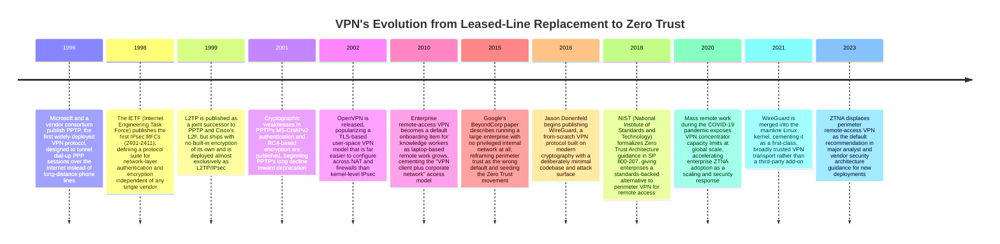

**Why leased lines came first, and why VPNs replaced them.** Before
commodity internet connectivity was reliable enough to trust, organizations
that needed guaranteed private connectivity between two sites — a branch
office and a headquarters, for example — paid a telecom carrier for a
dedicated leased line: a physical circuit reserved exclusively for that
organization's traffic. Leased lines are simple to reason about
architecturally (no shared medium, no encryption needed because no one else
can physically access the wire) but they are expensive in direct proportion
to distance and bandwidth, and provisioning a new one takes weeks. As
internet connectivity became ubiquitous and cheap, the obvious cost-saving
move was to replace the dedicated wire with an encrypted tunnel over the
shared, already-paid-for internet — trading a physical guarantee of
isolation for a cryptographic one. PPTP in 1996 was the first mainstream
attempt at this trade, aimed narrowly at letting remote dial-up users reach
a corporate network without long-distance phone charges.

**Why the protocol lineage kept restarting.** PPTP's early and severe
cryptographic weaknesses (Section 4.6) forced the industry toward IPsec, a
far more rigorous but also far more complex standard built by committee
consensus across many vendors. IPsec's complexity — multiple RFCs, two
security protocols (AH and ESP), two negotiation phases, dozens of
negotiable parameters — made it powerful but genuinely difficult to
configure correctly, a gap OpenVPN exploited by building a simpler,
TLS-based alternative that a much broader range of administrators could
operate correctly. WireGuard's 2016 arrival repeated this same pattern one
level deeper: instead of trying to simplify IPsec's *configuration*, it
replaced IPsec's entire cryptographic and protocol design with a small,
opinionated, formally-analyzable codebase, on the theory that a smaller
attack surface is itself a security property, not just an ergonomics win.

**Why the trust model itself eventually became the target for change.**
Every protocol generation up to this point solved the same problem — get an
encrypted packet from A to B — better. Google's 2015 BeyondCorp paper
attacked a different assumption entirely: that reaching the network at all
should imply meaningful trust. A remote-access VPN's traditional design
grants a connecting device broad network-layer reachability once
authenticated, which means a single compromised laptop or stolen credential
can pivot to a wide swath of internal systems. ZTNA (Section 4.9) is the
architectural response: authenticate and authorize *per application*, not
per network, treating "connected to the VPN" as no more inherently
trustworthy than "connected to the internet."

## 3. Why It Exists

The problem a VPN solves is stated most precisely as: **two networks, or a
device and a network, need to communicate as if they were on the same
private, trusted network segment, but the only physical path between them is
a network neither party controls and cannot trust.** The public internet
is, by design, a best-effort, unencrypted-by-default, multi-tenant transport
fabric. Any router along the path between two endpoints can, in principle,
read or tamper with unencrypted traffic; any observer on a shared Wi-Fi
network can capture packets passing through it. Without a VPN, an
organization has exactly two unattractive options for connecting a remote
site or user to internal systems: expose those internal systems directly to
the public internet (accepting the full blast radius of internet-facing
attack surface), or pay for genuinely private physical connectivity
end-to-end (leased lines, dedicated circuits — expensive, slow to
provision, and geographically constrained).

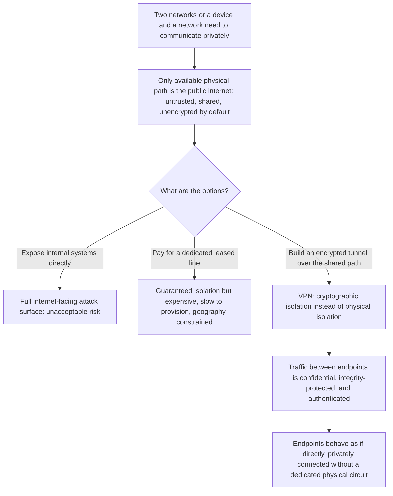

This reframes what a VPN actually is, architecturally: it is a **substitution
of cryptographic guarantees for physical ones**. A leased line's security
property — "no one else can access this wire" — is replaced by a VPN's
security property — "anyone can see the encrypted bytes on this wire, but
only the two authenticated endpoints can produce or read the plaintext
inside them." That substitution is what makes VPNs economically
transformative (any two points with ordinary internet access can now be
"directly" connected) and is also exactly why the correctness of the
cryptography and key management matters enormously — a bug in a leased
line's engineering does not usually expose your traffic to attackers,
whereas a bug in your VPN protocol's cryptography defeats the entire premise
of the connection. A Solution Architect who treats "which VPN protocol" as
an interchangeable checkbox item is missing the fact that swapping the
implementation of that cryptographic substitution is exactly what
distinguishes a secure hybrid-cloud connection from a false sense of
security. This chapter teaches VPN architecture with that substitution as
the throughline.

## 4. Core Concepts

### 4.1 Tunneling: The Mechanism Underneath Every VPN

**Definition.** Tunneling is the general technique — owned in full by
[OSI Model Section 4](CH02_OSI_Model.md#4-core-concepts) — of encapsulating
one network protocol's packets inside another protocol's packets, so the
inner packets can traverse a network that would not otherwise route or
understand them directly. A VPN is, mechanically, a specific and especially
important application of that general encapsulation concept: it wraps
private, often non-internet-routable traffic (an internal corporate
subnet's packets, for example) inside an encrypted outer packet that the
public internet *can* route, using the outer packet purely as a
confidentiality- and integrity-protected carrier.

**Mechanism, specific to VPN tunneling.** When a device on network A sends a
packet destined for network B across a VPN tunnel, the VPN software or
appliance on network A's side does the following, in order: (1) takes the
original ("inner") IP packet exactly as the application produced it,
addressed with network B's internal, private addressing scheme; (2)
encrypts and authenticates that inner packet as a payload; (3) wraps the
encrypted payload inside a new ("outer") IP packet addressed from A's public
VPN endpoint to B's public VPN endpoint — an address pair that the public
internet *can* route; and (4) transmits the outer packet normally. The
receiving VPN endpoint on network B's side reverses the process: it
strips the outer IP header, decrypts and authenticates the payload, recovers
the original inner packet, and forwards it onto network B's internal
routing exactly as if it had arrived over a local, private link.

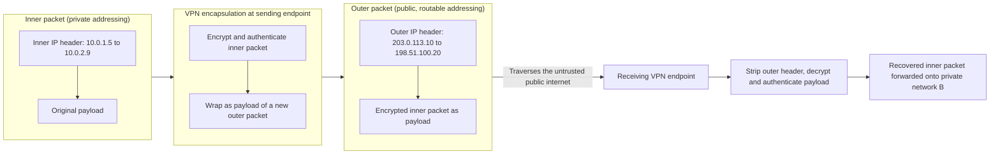

**Decision implications.** Because the inner packet's private addressing is
completely opaque to the public internet — only the outer packet's public
addresses are ever visible to routers along the path — a VPN tunnel lets an
organization use whatever private IP addressing scheme it wants internally
(including overlapping RFC 1918 ranges across sites, a problem in its own
right that site-to-site VPN designs must resolve explicitly) without
exposing any of that internal topology to the internet. The trade-off is
overhead: every packet now carries two IP headers plus encryption padding
and authentication tags instead of one, which reduces the effective Maximum
Transmission Unit (MTU) available to application payloads and can trigger IP
fragmentation if not accounted for — a common, subtle VPN failure mode
covered in Section 15.

**Common failure mode.** Teams frequently forget that tunneling reduces
available MTU and do not adjust the Maximum Segment Size (MSS) or path MTU
discovery settings accordingly, leading to silently dropped or fragmented
large packets that manifest as mysteriously slow or broken connections for
some traffic (typically large HTTP responses or file transfers) while small
request/response traffic works fine — because small packets never approach
the reduced MTU ceiling.

**Concrete scenario.** A company's Kubernetes pods use the private
`10.244.0.0/16` Container Network Interface (CNI) range internally. A
site-to-site VPN tunnel to a partner's data center, whose own internal
network happens to use `10.244.5.0/24` for an unrelated purpose, creates an
address-overlap conflict the moment both ranges try to route through the
same tunnel — a scenario that has nothing to do with encryption and
everything to do with tunneling's requirement that both ends agree on
unambiguous inner-packet routing, which is why address-plan review is a
mandatory step before standing up any site-to-site VPN (Section 6).

### 4.2 Site-to-Site VPN Architecture

**Definition.** A site-to-site VPN connects two entire networks — most
commonly an on-premises data center and a cloud provider's VPC, or two
separate office locations — so that hosts on either side can reach hosts on
the other side by ordinary private IP address, with the VPN tunnel acting as
a transparent, always-on link between the two network edges. Unlike
remote-access VPN (Section 4.3), no individual end-user client software is
involved: the tunnel is established and maintained between two network
devices (routers, firewalls, or cloud-managed VPN gateways), and every host
behind each gateway benefits from the tunnel without any per-host
configuration.

**Mechanism.** Each side deploys (or is assigned, in a managed cloud
service) a VPN gateway device that owns a public IP address reachable from
the internet. The two gateways negotiate a shared tunnel using a VPN
protocol — almost always IPsec in production site-to-site deployments,
because of its maturity and near-universal vendor interoperability (Section
4.5) — and each gateway is configured with routing information describing
which private CIDR (Classless Inter-Domain Routing) ranges live "behind" the
other side. Once the tunnel is up, each gateway inspects outbound traffic:
packets destined for the peer's advertised private ranges are encapsulated
and sent through the tunnel; all other traffic follows normal routing.

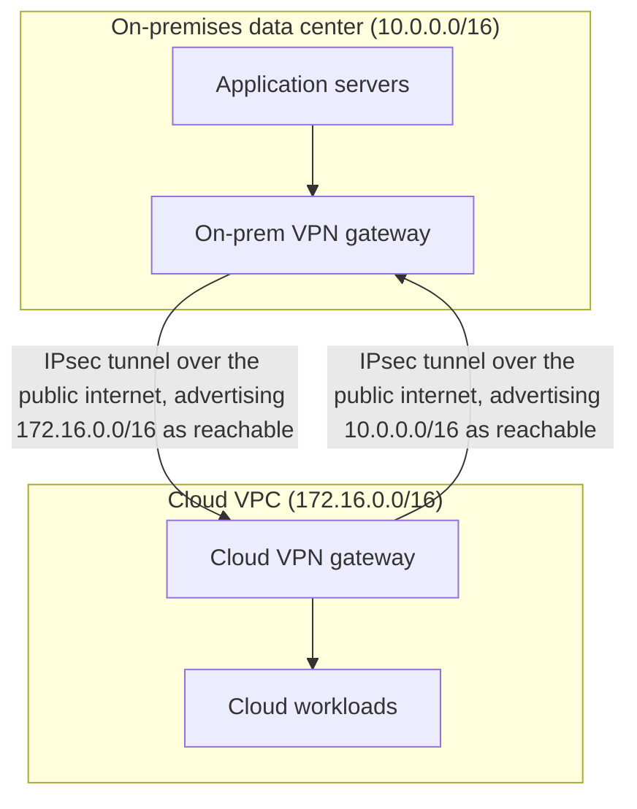

**Decision implications.** For hybrid-cloud architectures, site-to-site VPN
is usually the first, cheapest connectivity option evaluated, and often the
only one needed for moderate, latency-tolerant traffic volumes: it requires
no special carrier circuit, can be provisioned in minutes through a cloud
console or Terraform (Section 10), and costs a fraction of a dedicated
interconnect (AWS Direct Connect, Azure ExpressRoute, GCP Cloud
Interconnect). The trade-offs an architect must weigh against those
dedicated-circuit alternatives are: site-to-site VPN throughput is capped
(commonly 1.25 Gbps per tunnel on major cloud providers, since the gateway
is doing real-time encryption in software or accelerated hardware, not
passively forwarding), latency and jitter are subject to normal internet
conditions rather than a carrier's Service Level Agreement (SLA), and
availability depends on the public internet path being up, which is why
production site-to-site designs almost always provision two tunnels to two
different gateway instances for redundancy (Section 12).

**Common failure mode.** A single-tunnel site-to-site VPN is a classic
single point of failure that looks fine in testing (one tunnel, one route,
traffic flows) and fails silently in production the first time the cloud
provider performs gateway maintenance or the underlying tunnel's Internet
Key Exchange (IKE) session needs to renegotiate and briefly drops — traffic
simply stops routing between sites with no application-level error message
pointing at the cause, because from the application's perspective the
destination host just became unreachable.

**Concrete scenario.** An architect designing hybrid connectivity between an
on-premises Oracle database and a cloud-hosted reporting service needs to
decide: site-to-site VPN (fast to stand up, capped throughput, internet-
dependent latency) or a dedicated interconnect (weeks of carrier lead time,
consistent low-latency SLA, higher fixed cost). For an initial pilot or a
moderate nightly batch-extract workload, site-to-site VPN is almost always
the right first choice; the decision to upgrade to a dedicated interconnect
is usually driven by sustained throughput needs exceeding the VPN gateway's
cap, or by a Recovery Time Objective (RTO)/latency SLA that internet-path
variability cannot reliably meet.

### 4.3 Remote-Access VPN Architecture

**Definition.** A remote-access VPN connects an individual client device —
a laptop, phone, or workstation — to a corporate network, using
purpose-built VPN client software running on that device, rather than
connecting two whole networks together. This is the traditional "VPN"
experience most knowledge workers have used: install a client, enter
credentials, click connect, and gain access to internal resources as if
physically in the office.

**Mechanism.** The client device runs VPN client software that establishes
an authenticated tunnel to a VPN concentrator (a gateway appliance or cloud
service purpose-built to terminate many simultaneous client tunnels). Unlike
a site-to-site tunnel, which is set up once between two static gateways and
then simply routes traffic, a remote-access tunnel is set up per user
session: the client authenticates (username/password, certificate,
multi-factor authentication, or a combination), the concentrator assigns the
client a virtual internal IP address from a dedicated VPN address pool, and
the client's operating system routes traffic destined for internal ranges
through a virtual network interface the VPN software creates, sending it
through the tunnel to the concentrator, which forwards it onto the real
internal network.

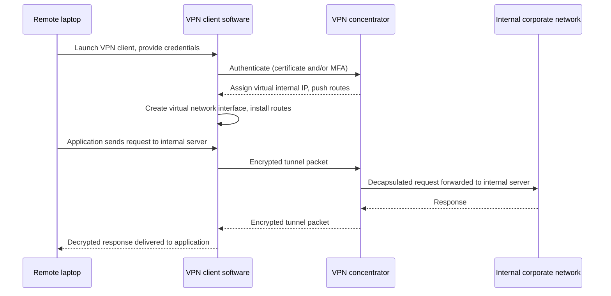

**Decision implications.** Remote-access VPN's central architecture decision
is what the concentrator grants access *to* once a session is authenticated:
the traditional design grants broad Layer 3 network reachability (any
internal host the routing table permits), which is simple to configure but
means a single compromised credential or malware-infected laptop can reach
far more of the internal network than the actual task requires — the exact
problem ZTNA (Section 4.9) is designed to fix by granting access per
application instead of per network. Concentrator capacity is also a real,
concrete constraint: each simultaneous session consumes gateway CPU for
encryption and connection-state memory, so remote-access VPN sizing must
account for peak simultaneous connect counts, not average — a lesson many
organizations learned the hard way during 2020's sudden shift to mass
remote work (Section 2).

**Common failure mode.** Over-provisioning remote-access VPN with a flat,
"connect once, reach everything" network policy, then treating multi-factor
authentication at login as the only control point — this leaves an
attacker who steals valid credentials (via phishing, for instance) with the
same broad network reachability a legitimate employee has for the entire
session duration, with no further verification as the session continues to
move across different internal systems.

**Concrete scenario.** A contractor's laptop, connected via remote-access
VPN with default full network routing, is compromised by malware. Because
the VPN grants Layer 3 reachability to the entire `10.0.0.0/8` internal
range rather than only the specific finance reporting application the
contractor was hired to use, the malware can scan and attempt lateral
movement against every reachable internal host — a blast radius directly
caused by the architecture's access model, not by any failure of the
encryption itself.

### 4.4 IPsec: Architecture, Modes, and the AH/ESP Split

**Definition.** IPsec (Internet Protocol Security) is a suite of protocols,
standardized by the IETF, that provides authentication and encryption at the
network layer (Layer 3), making it transparent to every application and
transport-layer protocol running above it — any IP traffic can be protected
without the application needing any VPN awareness at all. IPsec is not a
single protocol but an architecture composed of several cooperating pieces:
a key-exchange protocol (IKE), two alternative security protocols
(Authentication Header and Encapsulating Security Payload), and two modes of
operation (transport and tunnel).

**Mechanism.** IPsec tunnel establishment happens in two IKE phases. IKE
Phase 1 establishes a secure, authenticated channel between the two
gateways themselves (analogous in purpose to a TLS handshake, and this
chapter recaps rather than re-derives the underlying asymmetric/symmetric
cryptography and Diffie-Hellman key exchange mechanics, which are taught in
full in [TLS Section 4](CH06_TLS.md#4-core-concepts)) — the two endpoints
authenticate each other (via pre-shared key or certificates) and agree on a
shared secret used to protect Phase 2 negotiation. IKE Phase 2 then
negotiates the actual parameters for protecting user data: which encryption
and integrity algorithms to use, and whether to use AH (Authentication
Header, integrity/authentication only, no encryption — rarely used alone in
modern deployments) or ESP (Encapsulating Security Payload, both encryption
and authentication — the near-universal choice today). Separately, IPsec
operates in one of two modes: **transport mode** encrypts only the payload
of the original IP packet, leaving the original IP header intact and
visible (used for host-to-host protection on an already-private network);
**tunnel mode** encrypts the entire original IP packet, including its
header, and wraps it inside a brand-new outer IP header — this is the mode
every site-to-site and remote-access VPN uses, because it is what makes the
private inner addressing completely invisible to the transit network,
exactly as taught in Section 4.1.

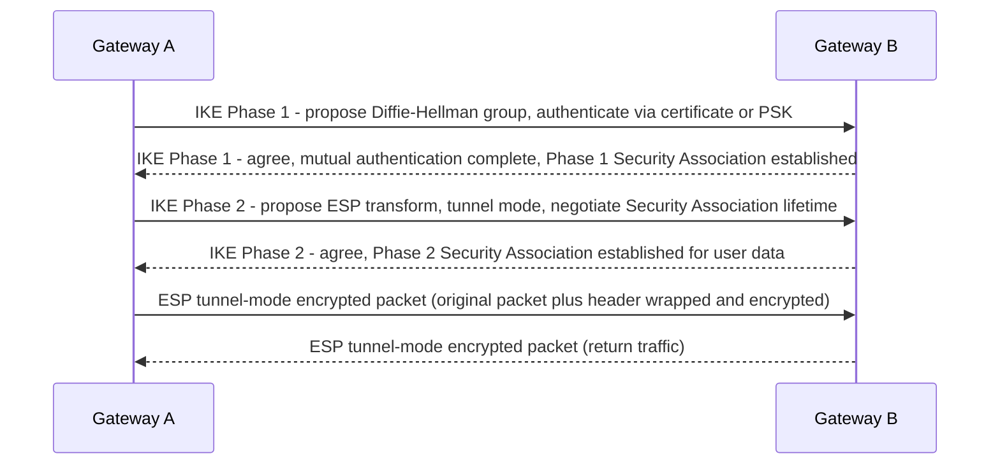

**Decision implications.** IPsec's architecture is deliberately
general-purpose and vendor-agnostic — almost every network appliance,
firewall, and cloud provider on the market implements IPsec and can
interoperate with any other IPsec implementation, which is exactly why it
remains the default choice for site-to-site VPN between organizations that
do not control both ends' software (a partner data center connecting to your
cloud VPC, for example). The cost of that generality is configuration
surface: IKE Phase 1 and Phase 2 each have multiple negotiable parameters
(encryption algorithm, integrity algorithm, Diffie-Hellman group, Security
Association lifetime), and both sides must agree on every one of them
exactly, or the tunnel simply fails to establish with an error message that
is often unhelpfully generic.

**Common failure mode.** Phase 1/Phase 2 parameter mismatches between two
vendors' IPsec implementations (for example, one side proposing a
Diffie-Hellman Group 14 and the other only accepting Group 2) are the single
most common site-to-site VPN outage cause in practice, and they are
notoriously time-consuming to diagnose because the failure surfaces as "the
tunnel won't come up" with log messages that vary significantly between
vendors.

**Concrete scenario.** Connecting an on-premises Cisco firewall to an AWS
Site-to-Site VPN gateway requires the architect to explicitly match AWS's
supported Phase 1/Phase 2 parameter set (documented per-region, and updated
over time as weaker algorithms are deprecated) against what the Cisco device
is configured to propose — a mismatch here is an operational, not a
security, problem, but it blocks the tunnel entirely until corrected.

### 4.5 WireGuard: Minimal-Attack-Surface Architecture

**Definition.** WireGuard is a VPN protocol and implementation built from
2016 onward on the explicit design philosophy that a smaller, simpler,
formally-analyzable codebase is itself a security property — in sharp
contrast to IPsec's decades of accumulated, negotiable options. WireGuard's
entire kernel implementation is on the order of a few thousand lines of
code, versus tens of thousands for typical IPsec stacks, which meaningfully
reduces the amount of code that could contain an exploitable bug and makes
the whole implementation small enough for security researchers to audit
thoroughly.

**Mechanism.** WireGuard makes two architectural choices that eliminate most
of IPsec's configuration surface entirely. First, it uses a single,
fixed, modern cryptographic suite (Curve25519 for key exchange, ChaCha20 for
symmetric encryption, Poly1305 for authentication, BLAKE2s for hashing) with
**no negotiation** — there is nothing to mismatch between two WireGuard
peers because there is only one supported algorithm set, period. This is a
deliberate rejection of IPsec's negotiable-everything model: WireGuard's
authors judged that algorithm agility (the ability to swap in different
ciphers later) had, in practice, mostly created configuration bugs and
downgrade-attack surface rather than genuine future-proofing value. Second,
WireGuard identifies peers by their Curve25519 public keys rather than by IP
address or certificate — this is called **Cryptokey Routing**: each
WireGuard interface maintains a simple table mapping public keys to allowed
inner IP ranges, and any packet whose source matches an allowed range for a
given peer's key is automatically routed and encrypted to that peer, with no
separate routing-protocol negotiation needed.

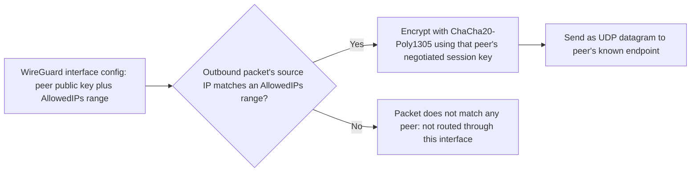

**Decision implications.** WireGuard's fixed cryptography and minimal
configuration make it dramatically easier to deploy correctly than IPsec —
a working WireGuard tunnel is often a dozen lines of configuration per side
(Section 10), versus pages of negotiated parameters for IPsec — and its
small codebase and kernel-level implementation give it a meaningful
performance edge in throughput and latency for the same encryption strength.
The trade-off an architect must weigh is ecosystem maturity and feature
breadth: WireGuard, by design, does not offer IPsec's decades of enterprise
features (dynamic routing protocol integration, extensive vendor hardware
acceleration, granular per-traffic-class policy), so large enterprises with
existing IPsec-centric network operations, or requirements for
FIPS-validated cryptographic modules that have not yet certified WireGuard's
primitives, may still choose IPsec for compliance or interoperability
reasons even where WireGuard would be the simpler technical fit.

**Common failure mode.** Treating WireGuard as a drop-in IPsec replacement
without accounting for its "no built-in session persistence beyond a
handshake" and connectionless UDP design: WireGuard silently stops sending
traffic to a peer whose endpoint IP has changed (a mobile client that
roamed networks, for example) until either side sends a new packet
triggering re-resolution, which can look like an intermittent, hard-to-
reproduce connectivity issue if the architect assumes WireGuard behaves
like a stateful, always-reconnecting IPsec tunnel.

**Concrete scenario.** A startup migrating its site-to-site connectivity
from a legacy IPsec appliance to WireGuard on commodity Linux hosts gains
significant configuration simplicity and CPU headroom, but must separately
verify that its compliance auditor's cryptographic-module certification
requirements (if any, e.g. FIPS 140-2/3 for a regulated financial workload)
accept WireGuard's specific primitive set before committing to the
migration for in-scope systems.

### 4.6 Legacy Protocols: Why PPTP and L2TP Are Deprecated

**Definition.** PPTP (Point-to-Point Tunneling Protocol) and L2TP (Layer 2
Tunneling Protocol) are earlier-generation VPN protocols that remain
present in operating system VPN client lists for backward compatibility, but
are considered deprecated and unsuitable for any new deployment due to
well-documented cryptographic and architectural weaknesses.

**Mechanism and why each failed.** PPTP's authentication relies on
MS-CHAPv2, which was demonstrated in 2012 to be crackable in a practically
trivial amount of time regardless of password strength, because of a design
flaw in how it derives its encryption keys from the password hash — once
broken, an attacker who captures a PPTP handshake can recover the session
key and decrypt all traffic, independent of how the actual data was
encrypted. This is not a configuration mistake an administrator can fix; it
is a structural flaw in the protocol's authentication design. L2TP, unlike
PPTP, was designed with no encryption of its own at all — it only provides
tunneling (Section 4.1), not confidentiality — so every real-world L2TP
deployment layers IPsec underneath it for encryption (L2TP/IPsec). This
combination works, but it means L2TP itself contributes no security value
and only adds a second layer of encapsulation overhead and configuration
complexity on top of IPsec, which already does the actual security work
alone in tunnel mode.

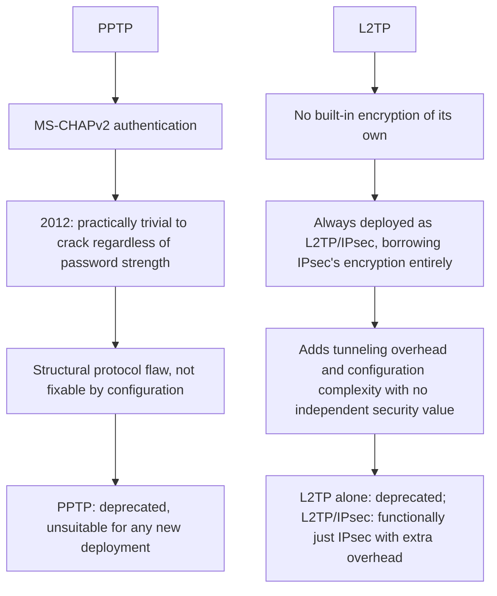

**Decision implications.** A Solution Architect should treat the presence of
PPTP or L2TP in an existing environment as a finding requiring remediation,
not a neutral legacy choice — PPTP in particular should be treated with the
same urgency as any other cryptographically broken protocol still in
production (comparable to finding SSLv3 still enabled, a parallel case
taught in [SSL Section 4](CH07_SSL.md#4-core-concepts)). Migration targets
are IPsec or WireGuard (Sections 4.4-4.5), both of which provide genuine,
current cryptographic guarantees.

**Common failure mode.** Some legacy client devices or embedded systems
still ship with only PPTP support, tempting teams to leave a PPTP endpoint
open "just for that one device" — this reintroduces a broken-authentication
attack surface for the entire VPN concentrator, not just that one device's
traffic, because the vulnerability lives in the protocol's authentication
exchange, which any attacker on the network path can target regardless of
which specific client initiated it.

**Concrete scenario.** An audit of a mid-sized company's VPN concentrator
finds PPTP still enabled "for a few older point-of-sale terminals." Because
PPTP's authentication weakness allows credential and session-key recovery
from a captured handshake, this single legacy allowance is a materially
higher-risk finding than the company's otherwise-solid IPsec configuration
for its main remote-access population — the remediation is retiring the
point-of-sale terminals' VPN method entirely, not "monitoring" the PPTP
listener.

### 4.7 VPN Tunnel Establishment: Applying Crypto Primitives to Handshakes

**Definition.** Tunnel establishment is the specific sequence by which two
VPN endpoints use cryptographic primitives — key exchange, mutual
authentication, and derived session keys — to agree on a shared secret and
confirm each other's identity *before* any user data is encrypted and sent.
This chapter recaps, rather than re-teaches, the underlying asymmetric
cryptography, symmetric cryptography, and Diffie-Hellman key exchange
mechanics that make this possible — those are taught in full in
[TLS Section 4](CH06_TLS.md#4-core-concepts) — and focuses specifically on
how IPsec and WireGuard apply those primitives to the distinct problem of
establishing a long-lived, potentially unattended, gateway-to-gateway or
client-to-gateway tunnel, rather than a short-lived, browser-initiated HTTPS
session.

**Mechanism.** The core difference from a typical TLS-protected HTTPS
session is that VPN tunnel establishment usually needs to happen with no
human present to click through a certificate warning or type a password at
the moment of connection (a site-to-site tunnel must re-establish itself
automatically after a network blip at 3 a.m.), so VPN protocols favor
authentication mechanisms suited to unattended operation: **pre-shared
keys** (a shared secret configured identically on both gateways ahead of
time — simple but requires secure out-of-band distribution and rotation),
**certificates** (each side holds a certificate signed by a mutually
trusted Certificate Authority, allowing authentication without a shared
secret and supporting easier per-device revocation), or, for WireGuard,
**static public keys** functioning similarly to certificates but without a
Certificate Authority hierarchy — each peer simply knows the other's public
key in advance, configured directly rather than issued and chained.
Regardless of which authentication mechanism is used, the output of a
successful handshake is always the same: both sides now hold a shared
symmetric session key, generated fresh for this session via Diffie-Hellman
key exchange, which is what actually encrypts the tunnel's data traffic —
the long-term key material (pre-shared key, certificate's private key, or
WireGuard static key) is used only to authenticate the handshake, never to
encrypt bulk traffic directly, preserving forward secrecy exactly as TLS
does (recapped, not re-derived, from [TLS Section 4](CH06_TLS.md#4-core-concepts)).

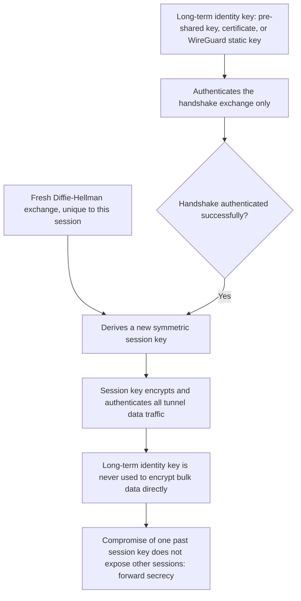

**Decision implications.** Pre-shared keys are operationally the simplest
to configure (a single shared secret, no Certificate Authority
infrastructure needed) but scale poorly and rotate painfully: every gateway
pair needs its own secret, and rotating one requires simultaneous,
coordinated reconfiguration on both sides with a window where the tunnel is
down. Certificate-based authentication scales far better across many sites
(a central Certificate Authority issues and can revoke individual
certificates without touching every other pair's configuration) at the cost
of needing genuine Public Key Infrastructure (PKI) operational maturity.
WireGuard's static-key model splits the difference: like a certificate, each
peer has a durable identity independent of a shared secret, but like a
pre-shared key, there is no Certificate Authority to operate — the trade-off
is that key distribution and revocation become entirely the deploying
organization's manual responsibility (there is no central authority to
revoke a leaked WireGuard key; it must be manually removed from every
peer's configuration).

**Common failure mode.** Long-lived pre-shared keys that are never rotated
after initial setup are extremely common in practice, because rotating them
requires coordinated downtime on both ends and there is rarely operational
pressure to do it — this leaves an organization with a years-old shared
secret whose exposure risk only grows over time (departed employees who once
had access to the configuration, backups containing the plaintext key,
etc.), a variant of the same key-hygiene problem seen elsewhere in the
handbook's cryptography-adjacent chapters.

**Concrete scenario.** A financial services company's compliance audit
flags a partner site-to-site VPN configured with a pre-shared key that has
not changed since the tunnel was first stood up seven years earlier — the
remediation is migrating to certificate-based IPsec authentication (which
supports scheduled, low-friction rotation without a synchronized outage
window) rather than simply rotating the pre-shared key once and repeating
the same long-lived-secret pattern.

### 4.8 Split-Tunnel vs. Full-Tunnel Architecture

**Definition.** This is the architectural decision of which traffic, once a
remote-access VPN session is established, actually gets routed through the
tunnel. **Full-tunnel** routes *all* of the client's network traffic —
including ordinary internet browsing having nothing to do with corporate
resources — through the VPN concentrator. **Split-tunnel** routes only
traffic destined for specific corporate IP ranges through the tunnel,
letting all other traffic (streaming video, a personal cloud storage sync,
general web browsing) go directly out the client's own internet connection,
bypassing the VPN entirely.

**Mechanism.** The distinction is implemented purely through the routes the
VPN client installs on the local operating system once connected. In a
full-tunnel configuration, the VPN pushes a default route (`0.0.0.0/0`)
pointing at the tunnel interface, meaning literally every packet the
operating system would otherwise send to its normal internet gateway is
instead sent through the VPN first. In a split-tunnel configuration, the VPN
pushes only specific routes for the corporate CIDR ranges it needs to serve
(`10.0.0.0/8`, for example), leaving the client's default route untouched —
so only packets whose destination falls inside those explicit ranges enter
the tunnel, and everything else follows the client's normal internet path.

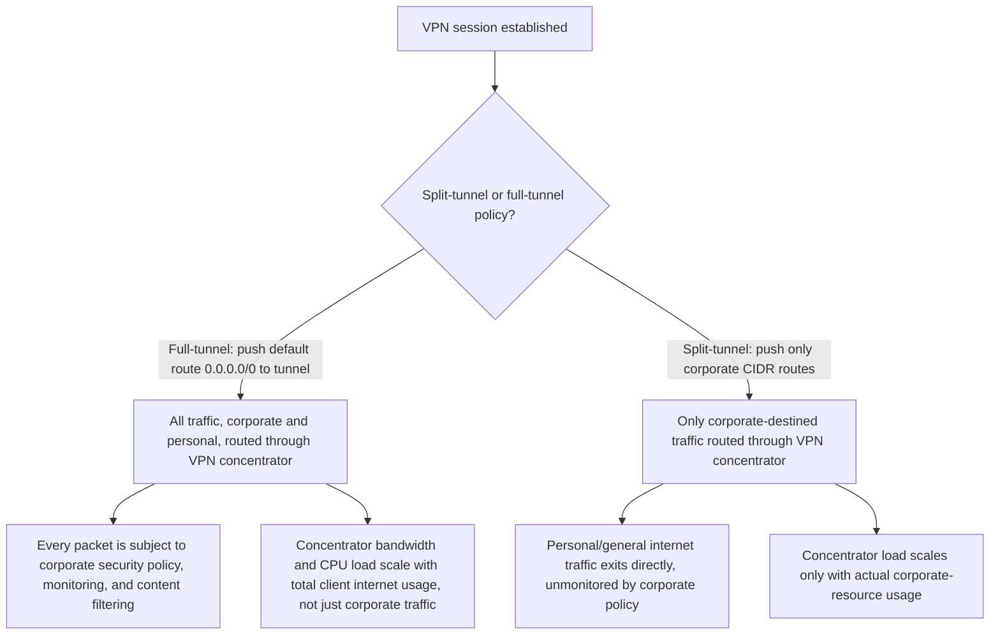

**Decision implications.** Full-tunnel gives security teams complete
visibility and policy enforcement over every byte a remote device sends or
receives while connected — every request passes through the corporate
network's firewall, Data Loss Prevention (DLP) tooling, and web content
filtering, exactly as if the device were physically in the office. The cost
is significant: concentrator bandwidth and compute must scale with every
connected user's *entire* internet usage, not just their corporate-resource
traffic, which is dramatically more expensive at scale, and it materially
degrades user experience for anything latency-sensitive that doesn't
actually need to go through corporate infrastructure (a video call to a
client's competitor's product, for instance, gains nothing from routing
through headquarters and loses real latency doing so). Split-tunnel is far
cheaper to operate and provides a better user experience for
non-corporate traffic, but by definition means the security team has zero
visibility into, and zero policy enforcement over, the traffic that bypasses
the tunnel — a device compromised via a malicious download over its direct
internet path is invisible to corporate monitoring for that specific
traffic, even while it is simultaneously connected to the VPN.

**Common failure mode.** Choosing split-tunnel purely for cost and
performance reasons without an explicit, written risk acceptance from
security stakeholders — this frequently surfaces later as a compliance gap
when an auditor asks "how do you monitor all traffic from devices with
access to regulated data" and the honest answer is "we don't, for anything
outside these specific corporate ranges."

**Concrete scenario.** A healthcare company handling Protected Health
Information (PHI) under HIPAA (Health Insurance Portability and
Accountability Act) compliance requirements chooses full-tunnel for its
clinical staff's remote-access VPN specifically because its compliance
program requires monitoring and DLP coverage over any device with access to
PHI systems, accepting the higher concentrator cost as a compliance
requirement rather than a preference — while the same company's marketing
department, with no PHI access, uses split-tunnel for cost efficiency and
better video-call quality, a defensible differentiation precisely because
the risk profile of the two populations genuinely differs.

### 4.9 The Shift from Perimeter VPN to Zero Trust Network Access

**Definition.** ZTNA (Zero Trust Network Access) is an architecture for
remote access that replaces the traditional VPN model of "authenticate once,
then trust broad network reachability" with "authenticate and authorize
every individual application access attempt, continuously, regardless of
network location." Where a remote-access VPN's security boundary is the
network perimeter (once past the concentrator, you are "inside" and treated
as trusted), ZTNA's security boundary is drawn around each individual
application or resource, with no concept of a trusted internal network at
all.

**Mechanism.** A perimeter VPN model works like this: a user authenticates
once at connection time, the concentrator assigns broad Layer 3 network
reachability, and every subsequent request the user's device makes to any
internal host is trusted by virtue of arriving from an IP address inside the
VPN's assigned range — the network layer itself is the (implicit) access
control. ZTNA inverts this entirely: there is no broad network-level tunnel
at all. Instead, a lightweight ZTNA client or browser-based proxy brokers
access to *individual applications*, and for every access attempt, a policy
engine evaluates identity, device posture (is the device's OS patched, is
disk encryption enabled, is it enrolled in Mobile Device Management), and
contextual signals (location, time, behavior anomaly) before granting
access — and that evaluation happens continuously, not just at initial
login, so a session can be revoked mid-stream if device posture changes or
anomalous behavior is detected.

```mermaid
flowchart TB
    subgraph Perimeter["Perimeter VPN model"]
        A1[Authenticate once at connect time] --> A2[Concentrator grants broad Layer 3 network reachability]
        A2 --> A3[Every subsequent request trusted purely because it arrives from the VPN's IP range]
        A3 --> A4[Single compromised session equals broad lateral-movement blast radius]
    end
    subgraph ZeroTrust["ZTNA model"]
        B1[No broad network tunnel exists at all] --> B2[Each application access request evaluated independently]
        B2 --> B3[Policy engine checks identity, device posture, and context per request]
        B3 --> B4[Access is scoped to one specific application, continuously re-evaluated]
        B4 --> B5[Compromised session is contained to whatever that single evaluation already granted]
    end
```

**Decision implications.** ZTNA's "never trust the network, always verify
per request" model directly closes the exact gap identified in Section 4.3:
a remote-access VPN grants broad reachability that a compromised credential
or device can abuse for lateral movement, while ZTNA's per-application,
continuously-evaluated access model means a compromised credential is
scoped to whatever narrow set of applications the policy engine explicitly
granted, and can be revoked instantly on a posture or behavior change
without tearing down an entire VPN session. The trade-off is architectural
complexity and dependency: ZTNA requires a functioning identity provider,
device posture data feed, and policy engine to be continuously available
and correctly configured — a misconfigured policy is a more granular, but
also more distributed, failure surface than a single VPN concentrator's
routing table, and organizations migrating from VPN to ZTNA must build (or
buy) this policy infrastructure, not merely swap client software.

**Common failure mode.** Rolling out a ZTNA product but configuring its
policies to simply mirror the old VPN's broad network access ("if
authenticated, allow reaching the entire `10.0.0.0/8` range") completely
discards the actual security benefit of the architecture — this is a
common transitional anti-pattern where an organization pays for ZTNA
tooling but retains perimeter-model risk, because the policy granularity
that makes ZTNA valuable was never actually applied.

**Concrete scenario.** An engineering organization migrating from a legacy
remote-access VPN to ZTNA defines per-application access policies:
engineers get ZTNA-brokered access only to the specific internal Git
hosting and CI/CD (Continuous Integration/Continuous Delivery) systems their
role requires, contractors get access scoped to a single project's staging
environment and nothing else, and every policy additionally requires an
up-to-date device posture check — meaning a contractor's compromised laptop
is contained to that one staging environment, a fundamentally smaller blast
radius than the equivalent VPN-based compromise would have produced under
the old model.

## 5. Internal Working

Having taught each concept individually in Section 4, this section traces
the complete, ordered lifecycle of a single packet traveling across an
established site-to-site IPsec tunnel in tunnel mode, showing how the pieces
compose end-to-end.

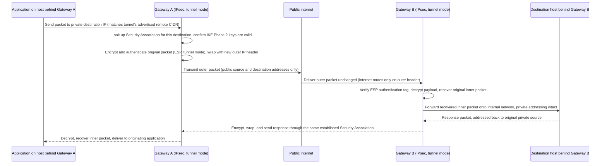

Two details in this lifecycle are easy to overlook but matter operationally.
First, the Security Association referenced at the start is not renegotiated
per packet — it was established once during the IKE handshake (Section 4.7)
and is reused for the Security Association's configured lifetime (commonly
one to eight hours), with IKE automatically renegotiating a fresh Security
Association shortly before expiry so the tunnel never actually drops under
normal operation; a misconfigured lifetime mismatch between the two
gateways is a subtler variant of the parameter-mismatch failure mode covered
in Section 4.4, surfacing only at renegotiation time rather than at initial
tunnel establishment. Second, every packet in both directions pays the
encapsulation overhead described in Section 4.1 (extra outer header, ESP
authentication tag, and padding) — for a `1500`-byte-MTU path, this
typically leaves only around 1400-1440 usable bytes for the inner packet,
which is why production site-to-site VPN deployments explicitly tune the
inner network's MTU/MSS rather than accepting default host settings.

## 6. Design Principles

- **Plan private addressing before standing up any site-to-site tunnel.**
  Confirm the two sides' internal CIDR ranges do not overlap (Section 4.1);
  overlap is a design-time problem that is far cheaper to catch on a
  whiteboard than after gateways are configured and routes are live.
- **Default to least-reachability, not least-friction.** A remote-access
  design that grants "the whole internal network" because it is the
  simplest initial configuration is choosing convenience over the
  blast-radius reduction taught in Sections 4.3 and 4.9 — scope access to
  what the role actually needs, even when it takes more up-front policy work.
- **Always provision redundant tunnels for production site-to-site links.**
  A single tunnel between two gateways is a single point of failure
  (Section 4.2); production designs use at least two tunnels to independent
  gateway instances, with routing (often Border Gateway Protocol, BGP, over
  the tunnels) to fail over automatically.
- **Choose the protocol for the actual constraint, not habit.** IPsec for
  guaranteed cross-vendor interoperability and existing enterprise tooling
  (Section 4.4); WireGuard where both ends are under your control and
  configuration simplicity/performance matter more than legacy feature
  parity (Section 4.5); never PPTP, and L2TP only ever paired with IPsec
  (Section 4.6).
- **Treat the split-tunnel decision as a documented risk acceptance, not a
  default.** Whichever way it is decided, write down who accepted the
  trade-off and why (Section 4.8) so a later compliance review has a paper
  trail rather than a surprise.
- **Plan the ZTNA migration path even if not implementing it immediately.**
  New remote-access designs should be evaluated against the ZTNA model
  (Section 4.9) as the default recommendation, with perimeter VPN treated as
  the exception requiring justification, not the reverse.

## 7. Architecture Patterns

Two recurring topology patterns appear across almost every multi-site VPN
deployment, and the choice between them is a genuine architecture decision
with different failure and scaling characteristics.

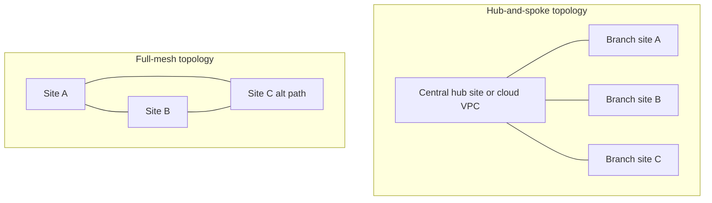

**Hub-and-spoke.** Every branch site maintains a single tunnel back to a
central hub (often the primary data center or a cloud "transit" VPC), and
branch-to-branch traffic is routed through the hub rather than directly
between branches. This pattern minimizes the number of tunnels to configure
and maintain (N tunnels for N branches, instead of the combinatorial growth
of a full mesh) and centralizes security policy enforcement at the hub,
where all inter-site traffic can be inspected. The cost is that branch-to-
branch traffic takes an extra hop through the hub even when the branches
could otherwise reach each other more directly, adding latency, and the hub
itself becomes a capacity and availability bottleneck that must be sized
for the sum of all branches' inter-site traffic, not just hub-bound traffic.

**Full-mesh.** Every site maintains a direct tunnel to every other site,
eliminating the extra hub hop and avoiding a single central bottleneck. The
cost is configuration and operational complexity that grows quadratically
with site count (a 10-site full mesh requires 45 tunnels), making this
pattern practical mainly for a small, relatively static number of sites, or
where an SD-WAN (Software-Defined Wide Area Network) overlay automates the
tunnel mesh's provisioning and management so operators do not hand-configure
each pairwise link individually.

## 8. Production Architecture

A production remote-access or site-to-site VPN deployment is more than "one
gateway, one tunnel" — it is a small system in its own right, with its own
availability, capacity, and operational concerns layered around the core
tunnel mechanics taught in Section 4.

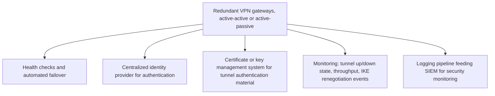

For site-to-site deployments, cloud providers offer managed VPN gateway
services (AWS Site-to-Site VPN, Azure VPN Gateway, GCP Cloud VPN) that
handle gateway redundancy and patching automatically, which is why most new
site-to-site connections into a cloud VPC use the managed service rather
than a self-run software gateway — the architect's job shifts from
operating the gateway itself to correctly configuring routing, redundancy
(multiple tunnels/gateways), and the on-premises side's peer configuration
to match. For remote-access deployments, the concentrator's identity
integration (Section 4.3's authentication step) is almost always delegated
to a centralized identity provider supporting Single Sign-On (SSO) and
multi-factor authentication, rather than a locally managed user database,
both for consistency with the rest of the organization's access policy and
so that revoking an employee's central identity immediately revokes VPN
access too.

## 9. Implementation

Implementing a VPN, whether site-to-site or remote-access, follows a
consistent sequence regardless of protocol choice: (1) decide the topology
(Section 7) and addressing plan (Section 6); (2) choose the protocol
(Sections 4.4-4.6) based on interoperability, control-over-both-ends, and
compliance constraints; (3) provision and configure the gateway(s), whether
self-managed software or a cloud-managed service; (4) establish and verify
the authentication material (pre-shared keys, certificates, or WireGuard
key pairs, per Section 4.7); (5) configure routing so each side correctly
advertises and accepts the other's private ranges; and (6) validate with
both connectivity testing (can a host on each side reach the other) and
failure testing (does failover actually work when a tunnel is forcibly
dropped). Section 10 shows concrete configuration for the two dominant
production protocols plus infrastructure-as-code provisioning.

## 10. Complete Code Examples

**Example 1: WireGuard site-to-site configuration.** Minimal but complete
configuration for both ends of a WireGuard site-to-site tunnel between an
on-premises gateway and a cloud host, demonstrating Cryptokey Routing
(Section 4.5) directly in the `AllowedIPs` fields.

```ini
# /etc/wireguard/wg0.conf — On-premises gateway (private range 10.0.0.0/16)
[Interface]
PrivateKey = <on-prem-private-key>
Address = 10.100.0.1/30
ListenPort = 51820

[Peer]
# Cloud gateway
PublicKey = <cloud-public-key>
Endpoint = 203.0.113.20:51820
# Routes the cloud side's private range through this tunnel
AllowedIPs = 172.16.0.0/16, 10.100.0.2/32
PersistentKeepalive = 25
```

```ini
# /etc/wireguard/wg0.conf — Cloud gateway (private range 172.16.0.0/16)
[Interface]
PrivateKey = <cloud-private-key>
Address = 10.100.0.2/30
ListenPort = 51820

[Peer]
# On-premises gateway
PublicKey = <on-prem-public-key>
Endpoint = 198.51.100.10:51820
# Routes the on-prem side's private range through this tunnel
AllowedIPs = 10.0.0.0/16, 10.100.0.1/32
PersistentKeepalive = 25
```

`PersistentKeepalive` sends a keepalive packet every 25 seconds so that any
NAT device between the two gateways keeps its translation entry alive —
without it, a NAT (recapped in this chapter's scope note, owned by
CH12_NAT) sitting in front of either gateway could silently drop the mapping
during idle periods, breaking the tunnel until new traffic happens to
originate from the correct side.

**Example 2: strongSwan IPsec site-to-site configuration.** A production
IPsec tunnel using strongSwan, an open-source IKE daemon, showing the
explicit Phase 1 (`ike=`) and Phase 2 (`esp=`) parameter negotiation
described in Section 4.4.

```
# /etc/ipsec.conf — On-premises strongSwan gateway
conn site-to-site-cloud
    left=198.51.100.10
    leftsubnet=10.0.0.0/16
    leftauth=pubkey
    leftcert=onprem-gateway-cert.pem
    right=203.0.113.20
    rightsubnet=172.16.0.0/16
    rightauth=pubkey
    rightid="CN=cloud-gateway.example.com"
    # IKE Phase 1: AES-256, SHA-256, Diffie-Hellman group 14
    ike=aes256-sha256-modp2048!
    # IKE Phase 2 (ESP): AES-256-GCM, no separate integrity alg needed (AEAD)
    esp=aes256gcm16-modp2048!
    keyexchange=ikev2
    ikelifetime=8h
    lifetime=1h
    auto=start
    dpdaction=restart
    dpddelay=30s
```

```
# /etc/ipsec.secrets
: RSA onprem-gateway-key.pem
```

The trailing `!` on the `ike=` and `esp=` lines is strongSwan's syntax for
"strictly enforce only this proposal" — without it, strongSwan will also
advertise weaker legacy algorithms for backward compatibility, which is
rarely desirable for a new, controlled-on-both-ends deployment. `dpdaction`
configures Dead Peer Detection, which is how strongSwan detects a silently
dropped peer (for example, after the far gateway reboots) and automatically
restarts the tunnel instead of leaving a stale Security Association in
place.

**Example 3: Terraform AWS Site-to-Site VPN Gateway.** Infrastructure-as-code
provisioning a redundant (two-tunnel) AWS Site-to-Site VPN connection,
directly implementing the redundancy principle from Section 6 and the
managed-gateway pattern from Section 8.

```hcl
resource "aws_customer_gateway" "on_prem" {
  bgp_asn    = 65000
  ip_address = "198.51.100.10"
  type       = "ipsec.1"
  tags = { Name = "on-prem-datacenter-gateway" }
}

resource "aws_vpn_gateway" "cloud_side" {
  vpc_id          = aws_vpc.main.id
  amazon_side_asn = 64512
  tags            = { Name = "cloud-vpc-vpn-gateway" }
}

# AWS automatically provisions two independent tunnels for redundancy
resource "aws_vpn_connection" "site_to_site" {
  customer_gateway_id = aws_customer_gateway.on_prem.id
  vpn_gateway_id       = aws_vpn_gateway.cloud_side.id
  type                 = "ipsec.1"
  static_routes_only   = false # use BGP for automatic route/failover, per Section 7
}

resource "aws_vpn_gateway_route_propagation" "propagate" {
  vpn_gateway_id = aws_vpn_gateway.cloud_side.id
  route_table_id = aws_route_table.private.id
}

output "tunnel1_address" {
  value = aws_vpn_connection.site_to_site.tunnel1_address
}
output "tunnel2_address" {
  value = aws_vpn_connection.site_to_site.tunnel2_address
}
```

Setting `static_routes_only = false` enables BGP route propagation over the
tunnels, meaning AWS and the on-premises router exchange reachability
information dynamically — if one of the two automatically-provisioned
tunnels fails, BGP withdraws its routes and traffic shifts to the surviving
tunnel without manual intervention, directly implementing the redundant-
tunnel design principle from Section 6.

**Example 4: OpenVPN split-tunnel client configuration.** A client-side
config demonstrating the split-tunnel routing decision from Section 4.8 —
only the corporate ranges are pushed as routes, and the client's default
route is explicitly left untouched.

```
# client.ovpn (relevant excerpt)
client
remote vpn.example.com 1194 udp
dev tun
persist-tun
persist-key

# Do NOT accept a pushed default route from the server (redirect-gateway
# would force full-tunnel); explicitly opt out to guarantee split-tunnel
# behavior even if the server-side config changes.
route-nopull

# Only these corporate ranges are routed through the tunnel;
# everything else uses the client's normal internet path.
route 10.0.0.0 255.0.0.0
route 172.16.0.0 255.240.0.0
```

`route-nopull` is the safety net here: even if a server administrator later
misconfigures the OpenVPN server to push a full-tunnel default route, this
client explicitly refuses any pushed routes and only honors the routes
listed locally, keeping the split-tunnel policy enforceable from the client
side rather than depending entirely on server-side configuration discipline.

## 11. Performance

VPN performance is governed primarily by three factors: encryption
throughput (CPU-bound unless hardware AES-NI or equivalent acceleration is
available), the encapsulation overhead described in Section 4.1 reducing
effective payload per packet, and latency added by the tunnel path itself
relative to a direct (unencrypted) route. WireGuard's smaller, kernel-level
implementation typically achieves meaningfully higher throughput and lower
CPU overhead per encrypted megabyte than IPsec software implementations at
equivalent security strength, which matters directly for the throughput cap
discussed in Section 4.2 — an organization bumping against a cloud
provider's per-tunnel throughput ceiling may gain material headroom simply
by switching the tunnel's underlying protocol where both ends are under
their control. MTU tuning (Section 5) is the other major, frequently
overlooked performance lever: leaving default MTU settings unchanged after
adding VPN encapsulation causes silent fragmentation, which shows up as
inexplicably poor throughput for large transfers specifically, while small
requests appear unaffected.

## 12. Scalability

Site-to-site VPN scalability is bounded by two independent ceilings: the
per-tunnel throughput cap (Section 4.2, typically ~1.25 Gbps on major cloud
providers' managed gateways) and the gateway's total concurrent-tunnel
capacity. Organizations exceeding a single tunnel's throughput ceiling scale
horizontally by provisioning multiple tunnels and load-balancing traffic
across them (via Equal-Cost Multi-Path routing over BGP, for example),
rather than expecting one tunnel to scale vertically past its architectural
cap. Remote-access VPN scalability is bounded by concentrator capacity —
each simultaneous session consumes CPU (for encryption) and memory (for
connection state) — so scaling a concentrator fleet requires either larger
instances, more concentrator instances behind a load-balancing layer, or (as
covered in Section 4.9) migrating some or all remote-access traffic to a
ZTNA model, which distributes the access-broker function differently and
often scales more gracefully because it does not maintain a persistent,
stateful, full-network tunnel per user.

## 13. Security

VPN security rests on getting three things right simultaneously: protocol
choice (never PPTP, Section 4.6), tunnel-establishment key management
(rotating pre-shared keys or maintaining a healthy certificate lifecycle,
Section 4.7), and the access-scope decision (split-tunnel policy and the
perimeter-versus-ZTNA access model, Sections 4.8-4.9). A VPN that uses
strong, current cryptography but grants broad, unscoped network reachability
to every authenticated session is only solving the confidentiality half of
the security problem — it does nothing to limit the damage a single
compromised credential or device can do once inside, which is precisely the
gap Section 4.9 addresses architecturally. Defense-in-depth for VPN
deployments should combine strong protocol/key hygiene with the narrowest
practical access scope, device posture checks where available, and
continuous monitoring (Section 14) rather than treating successful
authentication at connect time as sufficient ongoing assurance.

## 14. Observability

Effective VPN observability tracks tunnel state (up/down, and every IKE
renegotiation event, since flapping renegotiations often precede a full
outage), throughput and packet-loss per tunnel (to catch the throughput-cap
saturation described in Section 4.2 before it causes application-level
timeouts), and authentication events for remote-access concentrators
(successful and failed logins, feeding the same Security Information and
Event Management (SIEM) pipeline as other authentication systems, so a
credential-stuffing attempt against the VPN concentrator is visible
alongside attempts against every other login surface). For site-to-site
tunnels, alerting on Dead Peer Detection failures and Security Association
renegotiation failures (Section 5) catches degrading tunnels before they
fully drop, giving operators a chance to intervene proactively rather than
reactively after connectivity is already lost.

## 15. Failure Scenarios

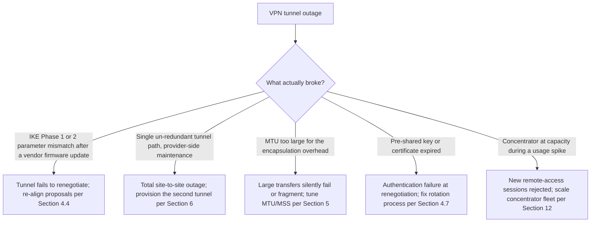

Each of these failure modes has a distinct signature an operator can learn
to recognize quickly: parameter mismatches typically fail immediately and
consistently (the tunnel never comes up at all, or fails at the very next
renegotiation after a change on either side); MTU problems are selective
(small packets succeed, large ones silently fail or fragment); and capacity
exhaustion is load-correlated (failures cluster at known peak-usage times,
such as a Monday-morning login surge). Recognizing which signature is
present narrows the diagnosis dramatically before any packet capture or log
diving is needed.

## 16. Testing

VPN configurations should be validated with both connectivity tests (can a
host behind each gateway reach a host behind the other, in both directions,
for every advertised CIDR range) and explicit failure-injection tests
(forcibly drop one of two redundant tunnels and confirm traffic actually
fails over, rather than assuming the routing configuration works because it
looks correct on paper). For remote-access deployments, testing should
include verifying the split-tunnel or full-tunnel routing behavior
end-to-end from an actual client (confirming which destinations really go
through the tunnel, not just trusting the pushed configuration), and
verifying that revoking a user's identity-provider access actually and
promptly terminates their VPN session, closing the loop described in
Section 8's centralized-identity design.

## 17. Common Mistakes

- Treating VPN protocol choice as an interchangeable checkbox rather than an
  architecture decision with real complexity/security/interoperability
  trade-offs (Sections 4.4-4.6).
- Standing up a single, un-redundant site-to-site tunnel and discovering the
  single point of failure only during the provider's next maintenance
  window (Section 4.2, Section 6).
- Never rotating long-lived pre-shared keys because rotation requires
  coordinated downtime (Section 4.7).
- Defaulting remote-access VPN to broad, flat network reachability instead
  of evaluating a ZTNA per-application model (Section 4.9).
- Ignoring MTU/MSS tuning after adding VPN encapsulation, producing
  intermittent large-transfer failures that are hard to correlate back to
  the VPN (Section 5, Section 11).
- Choosing split-tunnel purely for cost without an explicit, documented risk
  acceptance from security stakeholders (Section 4.8).

## 18. Best Practices

- Always provision redundant tunnels (multiple gateways, multiple paths)
  for any production site-to-site connection (Section 6).
- Prefer certificate-based or public-key-based tunnel authentication over
  long-lived pre-shared keys wherever the operational maturity to run
  Public Key Infrastructure exists (Section 4.7).
- Default new remote-access designs to a ZTNA evaluation first, falling
  back to perimeter VPN only where ZTNA tooling genuinely cannot yet meet a
  specific requirement (Section 4.9).
- Document the split-tunnel or full-tunnel decision explicitly, including
  who accepted the associated risk (Section 4.8).
- Tune MTU/MSS deliberately for every new tunnel rather than accepting host
  defaults (Section 5).
- Retire PPTP, and any bare (non-IPsec-paired) L2TP, immediately wherever
  found in an existing environment (Section 4.6).

## 19. Anti-Patterns

- **The eternal pre-shared key**: a site-to-site tunnel's shared secret that
  has never been rotated since initial setup, years earlier (Section 4.7).
- **"Split-tunnel because it's faster" with no risk sign-off**: making a
  security-relevant routing decision purely on user-experience grounds with
  no documented compliance/security review (Section 4.8).
- **ZTNA-in-name-only**: deploying ZTNA tooling but configuring policies to
  mirror the old VPN's broad network access, discarding the actual security
  benefit (Section 4.9).
- **"Just for that one legacy device" PPTP allowance**: keeping a
  cryptographically broken protocol enabled for a narrow use case, exposing
  the whole concentrator to its authentication weakness (Section 4.6).
- **Single-tunnel production site-to-site links**: no redundancy, discovered
  only during the first provider maintenance event (Section 4.2, Section 6).

## 20. Trade-off Analysis

| Decision | Option A | Option B | Key trade-off |
|---|---|---|---|
| Site-to-site connectivity | Site-to-site VPN | Dedicated interconnect (Direct Connect/ExpressRoute) | Fast/cheap to provision, capped throughput vs. slower to provision, higher fixed cost, carrier SLA |
| Protocol (both ends controlled) | WireGuard | IPsec | Simpler config, smaller attack surface vs. broader vendor interoperability, mature enterprise tooling |
| Remote-access model | Perimeter VPN | ZTNA | Simpler infrastructure, broad implicit trust vs. narrower blast radius, more moving parts to operate |
| Remote-access routing | Split-tunnel | Full-tunnel | Lower cost, better UX, no visibility into bypassed traffic vs. full policy enforcement, higher concentrator cost |
| Site-to-site topology | Hub-and-spoke | Full-mesh | Simpler to manage, extra hub hop latency vs. no extra hop, quadratic configuration growth |

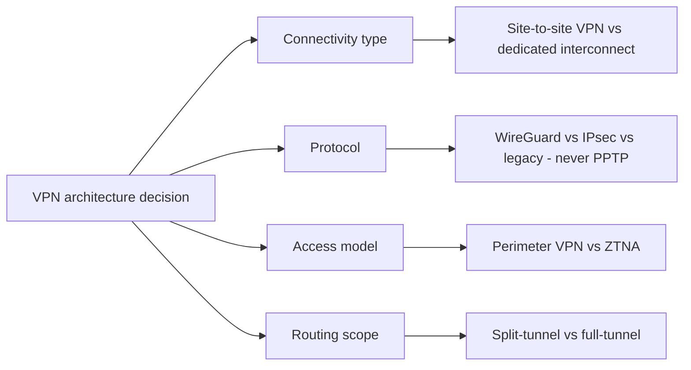

## 21. Comparison Table

| Protocol | Encryption agility | Attack surface | Vendor interoperability | Typical use today |
|---|---|---|---|---|
| IPsec | Negotiable (many algorithms) | Larger, decades of accumulated options | Excellent, near-universal | Site-to-site, cross-vendor connectivity |
| WireGuard | Fixed, modern suite only | Minimal, small audited codebase | Growing, native in Linux kernel | Both-ends-controlled site-to-site and remote-access |
| L2TP/IPsec | Inherits IPsec's | Adds tunneling overhead, no independent security value | Good, widely supported | Legacy remote-access, migration candidate |
| PPTP | Broken (MS-CHAPv2) | Severe, structurally compromised | Universal but irrelevant | None — deprecated, remediate on sight |

## 22. Real-World Case Study

A mid-sized retailer operating both an on-premises point-of-sale data center
and a growing set of cloud-hosted analytics workloads needed hybrid
connectivity between the two. The architecture team initially stood up a
single IPsec site-to-site tunnel using a pre-shared key, following a vendor
quick-start guide. Six months later, a scheduled maintenance window on the
cloud provider's side briefly took the gateway offline, and because only one
tunnel existed (violating the redundancy principle in Section 6), the
retailer's overnight inventory-sync batch job failed silently, discovered
only the next morning when store inventory counts were stale. The
remediation applied every relevant lesson from this chapter: the team
migrated to a two-tunnel, BGP-routed configuration matching the Terraform
pattern in Section 10 (closing the single-point-of-failure gap), replaced
the pre-shared key with certificate-based authentication tied to a proper
rotation schedule (Section 4.7), and separately began a phased migration of
its retail-store remote-access population from a flat, full-network VPN to
a ZTNA model scoped to the specific point-of-sale and inventory applications
each role actually needed (Section 4.9) — turning a single outage
post-mortem into a broader architectural correction rather than a one-off
fix.

## 23. Interview Questions

1. Explain, mechanically, what changes at the packet level when traffic
   enters a VPN tunnel in tunnel mode versus transport mode.
2. Why is WireGuard's fixed, non-negotiable cryptographic suite considered a
   security advantage rather than a limitation?
3. Walk through IPsec's IKE Phase 1 and Phase 2 and explain what each phase
   is actually protecting.
4. Why is PPTP considered fundamentally broken rather than merely outdated,
   and why doesn't stronger configuration fix it?
5. Describe the architectural difference between a perimeter remote-access
   VPN and ZTNA, and explain what specific security gap ZTNA closes.
6. What is the practical trade-off between split-tunnel and full-tunnel
   remote-access VPN configurations, and how would you decide between them
   for a given workforce segment?
7. Why does adding VPN encapsulation typically require MTU/MSS tuning, and
   what does it look like when a team forgets to do this?
8. When would you choose a dedicated interconnect over a site-to-site VPN
   for hybrid-cloud connectivity, and why?

## 24. Hands-on Exercises

1. Stand up a WireGuard tunnel between two virtual machines using the
   configuration pattern in Section 10; verify Cryptokey Routing by
   confirming traffic to an out-of-range address is not sent through the
   tunnel.
2. Configure a strongSwan IPsec tunnel between two hosts, then deliberately
   introduce an IKE Phase 2 parameter mismatch and observe how the failure
   surfaces in the logs.
3. Using the Terraform example in Section 10, provision an AWS Site-to-Site
   VPN connection and confirm both tunnels are established and BGP routes
   are propagating.
4. Configure an OpenVPN client in split-tunnel mode (Section 10's example)
   and verify with a routing-table inspection which destinations actually
   traverse the tunnel.
5. Capture packets on both sides of an established IPsec tunnel and confirm
   that only the outer IP header is visible in transit, with the inner
   packet's private addressing fully opaque.

## 25. Design Exercises

1. Design site-to-site connectivity between an on-premises data center and
   two separate cloud regions, choosing and justifying a hub-and-spoke or
   full-mesh topology (Section 7).
2. Design a remote-access architecture for a 5,000-employee organization
   migrating from a legacy full-tunnel VPN to ZTNA, including a phased
   rollout plan and a fallback strategy for applications ZTNA cannot yet
   broker.
3. Given a compliance requirement to monitor all traffic from any device
   with access to regulated data, design the split-tunnel/full-tunnel policy
   for two different workforce segments (regulated-data users versus
   general staff) and justify the difference (Section 4.8).
4. Design a key-management and rotation process for a fleet of 50 IPsec
   site-to-site tunnels using certificate-based authentication, including
   how a compromised certificate would be revoked.

## 26. Architecture Review Questions

- Does every production site-to-site tunnel have at least one redundant
  path, and has failover actually been tested, not just configured?
- Is any pre-shared key older than the organization's key-rotation policy
  allows, and is there a plan to migrate to certificate-based
  authentication?
- Does the remote-access architecture grant reachability scoped to actual
  role requirements, or does it default to broad network access?
- Has the split-tunnel/full-tunnel decision been explicitly documented with
  a named risk owner, for every distinct workforce segment?
- Is PPTP, or bare (non-IPsec) L2TP, present anywhere in the environment,
  and if so, is there an active remediation plan?
- Has MTU/MSS been explicitly tuned for every tunnel, or is the design
  relying on host defaults?
- Is there a credible, resourced plan to evaluate ZTNA for at least the
  highest-risk remote-access population?

## 27. Summary

A VPN is a cryptographic substitute for physical network isolation: it
takes the general tunneling/encapsulation mechanism (owned by
[OSI Model](CH02_OSI_Model.md)) and applies it specifically to carry private
traffic securely across an untrusted network, using TLS/IPsec-family
cryptographic primitives (owned by [TLS](CH06_TLS.md)) to authenticate
tunnel endpoints and derive session keys. Site-to-site VPN connects whole
networks and is a foundational hybrid-cloud building block; remote-access
VPN connects individual clients and has historically granted broad,
implicitly trusted network reachability once authenticated — a model now
being displaced by ZTNA's per-application, continuously-verified access
architecture. Protocol choice is a real trade-off, not a formality: IPsec
trades configuration complexity for universal vendor interoperability,
WireGuard trades ecosystem maturity for a minimal, modern, easily-audited
design, and legacy PPTP/L2TP-alone should never appear in a new deployment.
Split-tunnel versus full-tunnel is a security-visibility-versus-cost-and-
experience trade-off that deserves an explicit, documented decision rather
than a silent default. Above all, a Solution Architect should treat VPN
architecture as a set of deliberate, justified choices — topology,
protocol, authentication material lifecycle, access scope, and increasingly
whether a tunnel-based model is the right fit at all versus a Zero Trust
alternative — rather than a single interchangeable "turn on the VPN"
checkbox.
