# Chapter 14: Firewalls

## 1. Introduction

Every other chapter in this part of the handbook has, at some point, waved a
hand toward "the firewall" as the thing that keeps unwanted traffic out.
[NAT (Network Address Translation)](CH12_NAT.md) explicitly warned architects
not to mistake its incidental traffic-blocking behavior for a real security
control, and promised that the full teaching of deliberate, policy-driven
traffic filtering belonged here. This chapter closes that loop.

A firewall is a network security control that inspects traffic crossing a
defined boundary and makes an explicit, auditable allow-or-deny decision based
on a configured policy — as opposed to NAT's incidental blocking, which is
merely a side effect of address-translation bookkeeping (see Section 3 for
the full contrast). That one-sentence definition hides four decades of
architectural evolution: firewalls started as simple packet filters that
looked at nothing but a header, evolved into stateful inspection engines that
track entire conversations, grew proxy and application-layer awareness, and
have now converged into Next-Generation Firewalls (NGFW) that combine
stateful inspection with Deep Packet Inspection (DPI), application-identity
awareness, and integrated intrusion prevention.

For a Solution Architect, the firewall is not a box you buy and forget. It is
an architectural decision surface with real trade-offs: what posture do you
default to (allow-list vs. deny-list)? How do you structure rules so a
25,000-line policy doesn't become an unauditable liability? How do you use
segmentation to make a single compromised host a contained incident instead
of a company-wide breach? And, as workloads move to the cloud and
zero-trust models displace the perimeter, what does "firewall" even mean when
there is no longer a single network edge to defend?

This chapter teaches firewall architecture end to end: the generational
evolution of the technology, the rule-architecture decisions that determine
whether a policy is defensible or a liability, network segmentation using
firewalls (including Demilitarized Zone (DMZ) architecture), host-based vs.
network-based deployment, cloud-native firewall primitives (Security Groups
and Network Access Control Lists (NACLs) in a cloud Virtual Private Cloud
(VPC)), Web Application Firewalls (WAF) as an application-layer-specific
category, and the architectural shift toward micro-segmentation and Zero
Trust that is redistributing firewall enforcement from the perimeter to
everywhere.

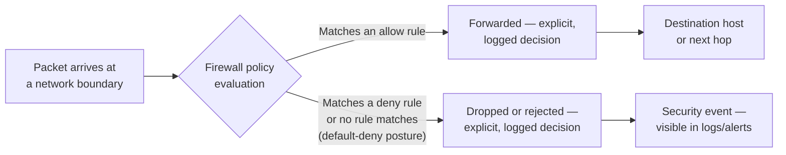

## 2. Historical Evolution

Firewall architecture has gone through four clearly identifiable generations,
each responding to a gap the previous generation could not close. Understanding
this evolution matters architecturally because most production environments
today still contain artifacts of every generation — a legacy packet-filtering
Access Control List (ACL) on a router, a stateful inspection firewall at the
data-center edge, and an NGFW or cloud-native security group protecting the
newest workloads — and an architect needs to reason about all of them
simultaneously, not just the newest one.

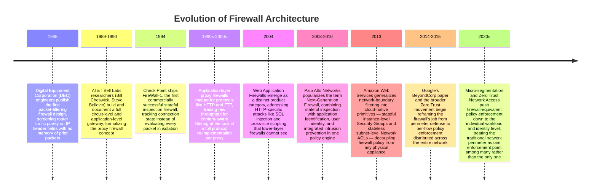

The 1988 packet-filtering generation solved a narrow but real problem:
routers were already forwarding packets and already had access to IP and
port headers, so adding an allow/deny rule table was a small, cheap
extension. Its weakness — no memory of connection state, so a return packet
for an established outbound connection looked exactly like an unsolicited
inbound packet — forced administrators into permissive rules (like allowing
all traffic with a source port above 1023) that were themselves exploitable.

Stateful inspection, commercialized by Check Point in 1994, closed that gap
by maintaining a connection table: once a firewall saw the outbound SYN of a
Transmission Control Protocol (TCP) handshake, it would automatically permit
the matching return traffic without a corresponding explicit rule. This is
the generation most people mean when they say "firewall" informally, and it
remains the correct choice for a large fraction of network-layer filtering
today.

Proxy and application-layer firewalls took a fundamentally different
approach: instead of just watching headers pass through, the firewall
terminates the connection itself and re-establishes a new connection to the
real destination, fully parsing the protocol in between. This lets it enforce
content-level policy (block a specific HTTP method, strip an unsafe header,
reassemble and inspect a full FTP session) that a stateful inspection
firewall — which only ever looks at header fields and connection state, never
reconstructed application content — cannot see. The cost is a full protocol
implementation per supported service and a latency/throughput penalty from
terminating and re-establishing every connection.

NGFWs, popularized by Palo Alto Networks starting around 2008-2010, converge
stateful inspection's efficient conversation tracking with DPI's ability to
identify the actual application generating traffic (not just the port
number it happens to use) and, often, integrated user-identity awareness and
intrusion prevention. Cloud-native firewalling generalized the same
underlying decisions — stateful vs. stateless, what layer to filter at — into
software-defined primitives that live in the cloud provider's control plane
rather than a physical or virtual appliance you manage yourself. And the
current shift toward Zero Trust and micro-segmentation (Section 20) is not a
fifth *technology* generation so much as an architectural repositioning:
firewall-equivalent enforcement is moving from "one big gate at the
perimeter" to "many small gates everywhere," a theme this chapter returns to
throughout.

## 3. Why It Exists

A firewall exists to answer one architectural question with certainty: *for
this traffic, crossing this boundary, is it deliberately allowed or
deliberately denied — and can I prove which, and why, after the fact?*
Without a firewall, any two systems that can route to each other can
communicate with each other, full stop; connectivity and permission become
the same thing, which is almost never the intended security posture for a
system of any real complexity.

This is precisely the gap [NAT](CH12_NAT.md#48-nat-is-not-a-security-boundary-a-critical-architecture-misconception)
flagged and deferred to this chapter. To recap that chapter's finding
precisely, because it is foundational to everything that follows: NAT's
apparent "blocking" of unsolicited inbound traffic is a side effect of
translation-table bookkeeping — a NAT gateway drops an inbound packet only
because it has no translation entry to map it to an internal host, not
because it evaluated the packet against a security policy and decided to
deny it. Three consequences fall out of that distinction, and they are the
precise reasons a real firewall is a separate, necessary control even when
NAT is already present:

1. **NAT has no allow/deny policy to bypass.** Any mechanism that gets a
   translation entry created — a Destination NAT (DNAT) port-forward rule, a
   Universal Plug and Play (UPnP) request from a compromised device, or an
   application using a Session Traversal Utilities for NAT (STUN) hole-punch
   — passes through NAT freely, because there was never a deliberate policy
   decision guarding that path in the first place. A firewall's allow/deny
   rule is evaluated on every packet, every time, by design.
2. **NAT provides zero east-west protection.** Two hosts on the same private
   subnet, both behind the same NAT gateway, can talk to each other with no
   NAT involvement at all — NAT only ever operates at the private/public
   boundary. A firewall (particularly one used for network segmentation,
   Section 6) is what actually constrains lateral movement between internal
   hosts.
3. **NAT offers no visibility or inspection.** A firewall logs and can alert
   on every denied (and, if configured, every allowed) connection; NAT's
   translation table was never built to be a security audit trail.

The architectural implication for a Solution Architect: never present "the
service sits in a private subnet behind NAT" as a security control in a
design review. It is a connectivity and addressing decision. The security
control is the firewall (or its cloud-native equivalent, Section 8) sitting
alongside it, and it needs to be reviewed, tested, and audited independently
of whatever NAT topology happens to be in place.

Beyond closing that specific gap, firewalls exist because of a more general
principle that recurs throughout security architecture: **the cost of an
unauthorized connection succeeding is usually far higher than the cost of an
authorized connection being blocked and needing a rule added.** This
asymmetry is why virtually every mature security architecture defaults to
denying by default and allowing by explicit exception (Section 6), rather
than the reverse — a decision this chapter teaches in depth, because getting
it backward is one of the most common and most consequential architecture
mistakes a reviewer will encounter.

## 4. Core Concepts

### 4.1 Packet-Filtering (Stateless) Firewalls

**Definition.** A packet-filtering firewall evaluates every packet in total
isolation, using only the information present in that single packet's
headers: source Internet Protocol (IP) address, destination IP address,
source port, destination port, and protocol (TCP, User Datagram Protocol
(UDP), Internet Control Message Protocol (ICMP), and so on). It has no memory
of any packet that came before it and no awareness of which packets belong to
the same logical connection.

**Mechanism.** The firewall maintains an ordered list of rules, each
specifying a match pattern (some combination of the five header fields
above) and an action (permit or deny). For every packet, the firewall walks
the rule list from top to bottom and applies the action of the first rule
that matches (the first-match-wins model taught fully in Section 4.6). Because
there is no connection tracking, a stateless firewall protecting a service
that both sends and receives traffic must have *two* rules for every logical
conversation: one permitting the outbound request and a *separate* one
explicitly permitting the corresponding inbound reply, because the firewall
has no way to recognize a reply packet as being "part of" an already-approved
connection.

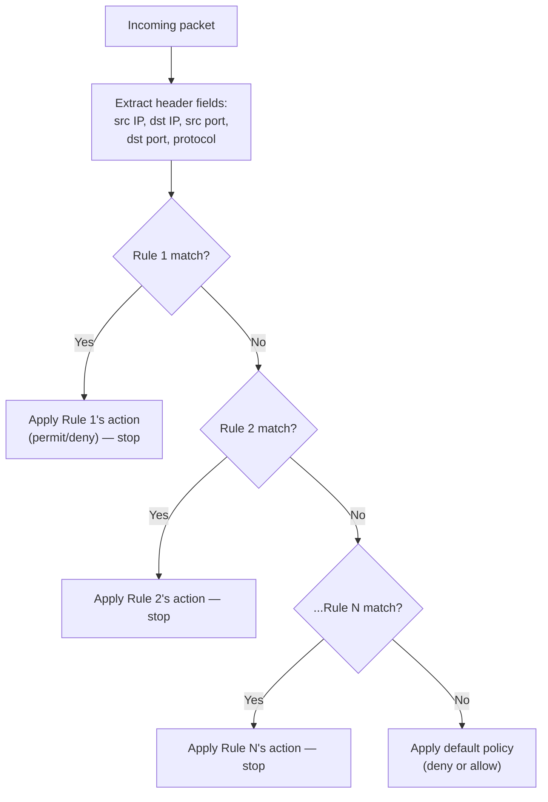

**Decision implications.** Stateless filtering is cheap: no per-connection
memory is required, so it scales to extremely high packet rates and is a
natural fit for a router's forwarding hardware (Access Control Lists on
routers and cloud Network ACLs, Section 8, are both stateless packet
filters). The trade-off is rule-authoring burden and fragility: every allowed
conversation needs matching rules in both directions, and because the
firewall cannot tell a legitimately-returning packet from a freshly
originated one that happens to share the same header shape, administrators
are pushed toward broader, riskier rules (for example, permitting all inbound
traffic to ports above 1023 to cover arbitrary ephemeral return ports) that
weaken the policy's actual security value.

**Common failure mode.** A team disables an inbound rule they believe is
"only for replies," not realizing a stateless firewall cannot distinguish a
genuine reply from a new, unsolicited connection using the same port range —
and inadvertently opens a much broader hole than intended. This exact
class of mistake is the primary reason stateful inspection (Section 4.2)
displaced pure packet filtering as the default choice for most network-layer
firewalls.

**Concrete scenario.** A legacy router ACL permits outbound Domain Name
System (DNS) queries on UDP port 53 from an internal subnet, and — because
the router has no state table — a matching rule must also permit *inbound*
UDP traffic *from* port 53 back to the subnet's high ephemeral ports. An
attacker who can spoof a UDP packet with a source port of 53 can walk through
that inbound rule as if it were a legitimate DNS reply, because the stateless
firewall has no way to verify a query was ever actually sent.

### 4.2 Stateful Inspection Firewalls

**Definition.** A stateful inspection firewall maintains a connection table
recording every conversation it has approved — source/destination
IP/port pairs, protocol, and, for TCP, sequence-number and handshake state —
and uses that table, not just per-packet header rules, to decide whether to
forward each subsequent packet.

**Mechanism.** When a stateful firewall sees the first packet of a new
conversation (a TCP SYN, or the first UDP datagram of a flow it has been
configured to track), it evaluates that packet against the rule set exactly
like a packet filter would. If permitted, it creates an entry in its
connection table. Every subsequent packet that matches an existing table
entry — including the return traffic — is forwarded automatically without
being re-evaluated against the full rule set, because the firewall already
knows this packet belongs to an approved, ongoing conversation. Table entries
expire after a period of inactivity (or immediately upon a graceful TCP
close), closing the corresponding hole in the policy without any
administrator action.

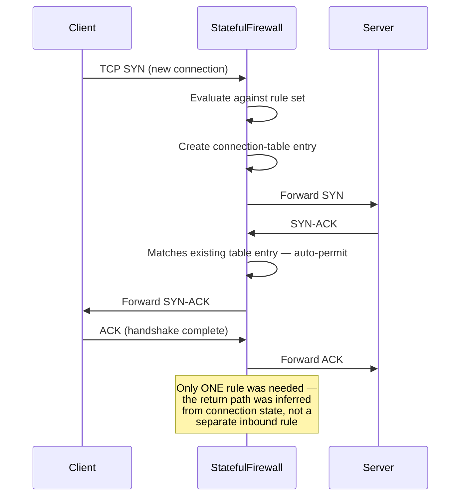

**Decision implications.** This is the single biggest architectural advantage
over pure packet filtering: an administrator writes one rule expressing
*intent* ("this internal subnet may initiate outbound HTTPS connections"),
and the firewall itself derives and enforces the correct, narrowly-scoped
return path — closing the broad-inbound-rule risk described in Section 4.1.
The cost is memory and processing overhead proportional to the number of
concurrent connections, and a new failure class: connection-table exhaustion,
where an attacker (or a misbehaving client) opens enough half-open or
long-lived connections to fill the table and cause legitimate new
connections to be dropped — a firewall-specific variant of a
resource-exhaustion Denial of Service (DoS) attack.

**Common failure mode.** Setting connection-table idle timeouts too
aggressively for a legitimate but bursty application (for example, a
database connection pool that goes quiet for a few minutes between bursts)
causes the firewall to silently drop the table entry, and the *next* packet
on that "existing" connection arrives with no matching state — the firewall
treats it as an unsolicited new packet and drops it, producing an
intermittent, hard-to-diagnose connectivity failure that looks like an
application bug rather than a firewall timeout.

**Concrete scenario.** An architect reviewing a data-center edge firewall
policy finds thousands of individual inbound rules that look nearly
identical to a handful of outbound rules, differing only in swapped
source/destination fields — a strong signal the firewall is still configured
in stateless packet-filter mode (or that a stateful firewall is being
operated as if it weren't), and an opportunity to collapse the policy
significantly by trusting the connection table to handle return traffic.

### 4.3 Application-Layer (Proxy) Firewalls

**Definition.** An application-layer (or proxy) firewall does not simply
inspect packets in transit; it fully terminates the client's connection,
parses the application protocol being carried (HTTP, File Transfer Protocol
(FTP), Simple Mail Transfer Protocol (SMTP), and so on), and then opens a
*separate* connection to the real destination on the client's behalf,
forwarding only the content it has validated.

**Mechanism.** Because the proxy is a genuine endpoint of both connections —
not a device passively watching packets fly past — it can reconstruct the
entire application-layer conversation the way the destination server would
see it: full HTTP request lines and headers, a completely reassembled FTP
control session, or a fully decoded email message. This lets it enforce
policy no header-only firewall can express: block a specific HTTP method,
strip a dangerous header, refuse a file upload above a size limit, or block
a request whose reassembled body matches a known attack signature.

```mermaid
sequenceDiagram
    participant Client
    participant Proxy as ApplicationProxy
    participant Server as OriginServer

    Client->>Proxy: Full HTTP request (connection terminates here)
    Proxy->>Proxy: Parse full request line, headers, body
    Proxy->>Proxy: Evaluate against content-aware policy
    Proxy->>Server: New, separate connection —<br/>only validated content forwarded
    Server->>Proxy: Full HTTP response
    Proxy->>Proxy: Parse and validate response content
    Proxy->>Client: Forward validated response
    Note over Client,Server: Client and Server never<br/>directly connect; the proxy is<br/>a genuine endpoint of both legs
```

**Decision implications.** The architectural payoff is depth of inspection:
a proxy firewall can enforce policy that genuinely understands the protocol's
semantics, not just its header shape. The cost is that the proxy must
implement (or license) a correct, current parser for every protocol it
proxies — a new protocol version, an unusual but valid message format, or a
protocol the proxy doesn't support at all becomes either a compatibility
break or a blind spot — plus the latency and throughput cost of terminating
and re-establishing every connection rather than merely forwarding packets.
This is precisely the trade-off that makes proxy firewalls a poor fit for
raw, high-throughput, protocol-agnostic traffic, and a strong fit for a
narrower set of well-understood, high-value protocols — which is exactly the
niche the WAF (Section 4.11) occupies today for HTTP specifically.

**Common failure mode.** Deploying an application-layer proxy for a protocol
whose specification is still evolving (or that has many non-standard vendor
extensions in practice) and discovering that the proxy silently strips or
mis-parses valid-but-unusual messages, breaking legitimate traffic in a way
that looks like an application bug rather than a firewall compatibility gap.

**Concrete scenario.** A financial services firm proxies all outbound FTP
file transfers through an application-layer firewall that fully reassembles
each file transfer and scans it for malware signatures before releasing it to
the internal host — a control a stateful inspection firewall, which never
reconstructs the file's actual bytes, could not implement, because from its
perspective a file transfer is just a stream of already-approved TCP
segments.

### 4.4 Next-Generation Firewalls (NGFW)

**Definition.** A Next-Generation Firewall (NGFW) combines the efficient
connection tracking of stateful inspection with Deep Packet Inspection (DPI)
— the ability to look past the port number and identify the actual
application protocol and, often, the specific application or service
generating the traffic — plus, typically, integrated user-identity
awareness, Intrusion Prevention System (IPS) signatures, and Transport Layer
Security (TLS) decryption/re-encryption to inspect otherwise-opaque encrypted
traffic.

**Mechanism.** Traditional stateful firewalls make policy decisions almost
entirely on port number, which breaks down as soon as an application uses a
non-standard port, tunnels through an allowed port (for example, running
arbitrary traffic over port 443 because "HTTPS is always allowed"), or
multiplexes many distinct services over one port. An NGFW instead fingerprints
traffic using a combination of signatures, protocol decoding, and behavioral
heuristics to answer "what application is this, regardless of the port it's
using?" — and can then write policy in terms of the application itself
("permit Salesforce, deny generic peer-to-peer file-sharing traffic") rather
than a fragile port number. Many NGFWs pair this with a TLS-interception
capability: the firewall performs a man-in-the-middle TLS termination
(with appropriate internal certificate trust) so it can inspect the decrypted
content of otherwise-opaque encrypted sessions before re-encrypting and
forwarding them — itself a significant architecture and privacy trade-off
that must be deliberately evaluated, not enabled by default.

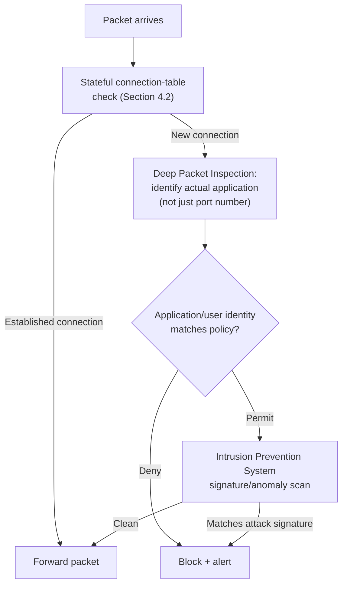

**Decision implications.** NGFWs collapse what used to be several separate
appliances — stateful firewall, IPS, application-control gateway, sometimes a
basic proxy — into a single policy engine and a single rule set, which
reduces the number of independent systems an architect has to reason about
and keep consistent. The cost is complexity and performance: DPI and TLS
interception are computationally expensive relative to header-only
inspection, throughput claims from vendors should always be checked against
the specific feature set actually enabled (DPI-on numbers are routinely much
lower than headline "firewall throughput" figures), and TLS interception in
particular introduces its own security and compliance surface (the firewall
now holds a certificate authority trusted by every internal client, and a
compromise of that firewall compromises the confidentiality of every
intercepted session).

**Common failure mode.** Enabling TLS interception broadly without
carving out exceptions for traffic that must never be decrypted for
compliance or trust reasons (health data, financial transactions to
third-party payment processors, traffic to services that use certificate
pinning and will simply break rather than accept the interception
certificate) — producing either a compliance violation or a wave of
mysterious client-side TLS errors.

**Concrete scenario.** A retailer replaces a stateful-only edge firewall with
an NGFW specifically to stop employees tunneling unauthorized peer-to-peer
file-sharing traffic over port 443 (which the old, port-based rule set
treated as "just HTTPS" and permitted); the NGFW's application-identification
engine correctly fingerprints the tunneled protocol regardless of the port
it rides on and blocks it under an explicit application-based deny rule.

### 4.5 Default-Deny vs. Default-Allow: The Foundational Posture Decision

**Definition.** Every firewall policy has an implicit or explicit *default
action* — what happens to a packet that matches none of the configured
rules. A **default-deny** (allow-list) posture drops anything not explicitly
permitted; a **default-allow** (deny-list) posture forwards anything not
explicitly denied.

**Mechanism.** This is not a stylistic preference; it is a structural choice
about where the burden of correctness sits. Under default-deny, every new,
legitimate need requires an explicit rule addition — friction lands on
enabling new functionality, but an administrator's *mistake of omission*
(forgetting to write a rule) fails safely, closed. Under default-allow, every
new *threat* requires an explicit rule addition to block it — friction lands
on chasing newly discovered risks, and a mistake of omission (forgetting to
add a block rule for a newly discovered bad actor or technique) fails unsafely,
open.

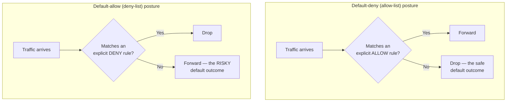

**Decision implications.** Default-deny is the correct default posture for
essentially every modern network security boundary, and the architectural
reasoning is the same asymmetry introduced in Section 3: the cost of an
unauthorized connection succeeding (data exfiltration, lateral movement,
remote code execution) is almost always far higher than the cost of a
legitimate connection being temporarily blocked until someone notices and
adds a rule. Default-allow persists mostly for historical reasons (many
legacy firewalls and early cloud security groups defaulted to permissive
configurations to avoid breaking connectivity during initial rollout) and in
situations where the traffic population is so unpredictable that a
comprehensive allow-list is considered operationally infeasible — a
justification that should be treated with real skepticism in a design
review, because it is far more often an excuse for not doing the discovery
work than a genuine architectural constraint.

**Common failure mode.** A team adopts a nominally default-deny firewall but
undermines it with an overly broad catch-all allow rule near the top of the
list (for example, "allow all traffic from the corporate Classless
Inter-Domain Routing (CIDR) block") that, combined with first-match-wins
evaluation (Section 4.6), effectively reintroduces default-allow behavior for
a large swath of traffic while the policy still *looks* like a tight
allow-list on paper.

**Concrete scenario.** A cloud migration project initially configures every
Security Group with a "0.0.0.0/0 inbound on all ports" rule to unblock
development quickly, intending to "tighten it later" before launch — and the
launch date arrives with the broad rule still in place, because narrowing a
rule that currently works is much lower priority, and much scarier to touch,
than shipping a new feature. This is one of the most common real-world
default-deny erosion patterns an architect will encounter, and the right
countermeasure is to make the *narrow* rule the one that ships in the first
environment, not a later cleanup task.

### 4.6 Rule Ordering and First-Match-Wins Evaluation

**Definition.** Most firewall rule engines — stateless packet filters,
stateful inspection firewalls, cloud NACLs — evaluate rules in a defined
order and apply the action of the **first** rule that matches a given
packet, ignoring every rule after it, even if a later rule would also have
matched and specified a different action.

**Mechanism.** This single evaluation model explains a large fraction of
real-world firewall misconfigurations. Because only the first match counts,
rule *position*, not just rule *content*, determines behavior: a narrow deny
rule placed after a broad allow rule that already matched the same traffic
will never fire, silently. Some firewall products (notably certain cloud
Security Groups, Section 4.10) deliberately deviate from strict first-match
ordering by instead evaluating *all* matching rules and applying a
most-permissive-wins or explicit-deny-wins aggregation — an important
distinction an architect must confirm for the specific product in front of
them rather than assuming universally.

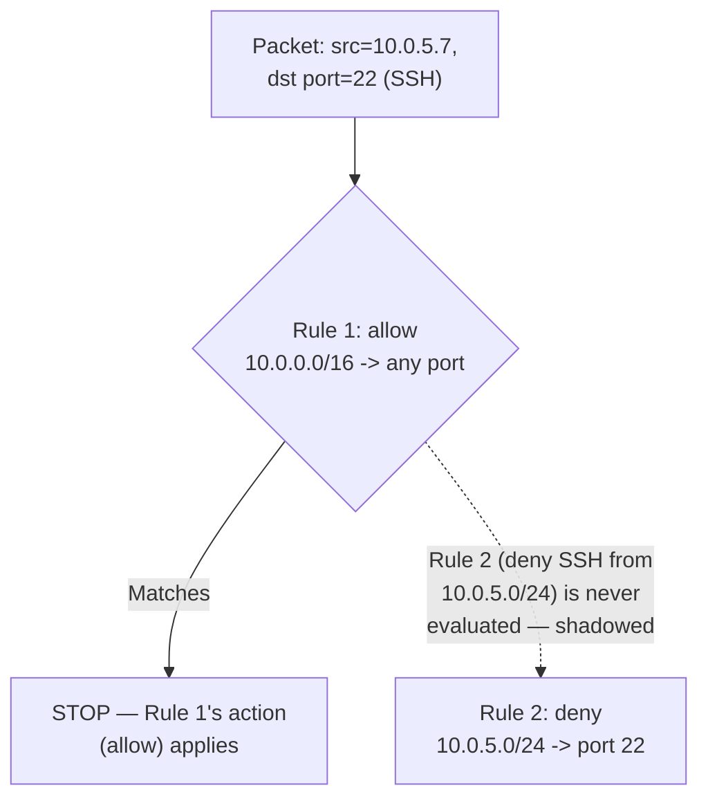

**Decision implications.** Rule ordering discipline is a first-class design
concern, not an implementation detail: the most specific, most
security-critical rules (explicit deny rules for known-bad sources, narrow
allow rules for specific, sensitive services) generally need to sit *above*
broader rules that might otherwise shadow them, and the default-deny
catch-all (Section 4.5) sits at the very bottom as the final fallback. A
useful operational heuristic: whenever a new rule is added, an administrator
should be able to state, in one sentence, which existing rule (if any) it
needs to sit above or below and why — an inability to answer that question
cleanly is itself a signal the policy has grown past the point of
confident manual reasoning (Section 4.7).

**Common failure mode.** Appending new rules to the bottom of a large policy
by default (the path of least resistance in many rule-management tools),
which is safe only if nothing above them coincidentally already matches the
same traffic — an assumption that becomes less and less safe as the rule set
grows, exactly the rule-sprawl dynamic covered next.

**Concrete scenario.** A security team adds a new rule denying traffic from a
newly identified malicious IP range, appends it to the bottom of a
50-rule policy as usual, and later discovers during an incident
investigation that the traffic was never actually blocked — a broad "allow
all inbound from partner network X" rule near the top of the list, whose CIDR
range happened to overlap the malicious IP block, matched first and shadowed
the new deny rule entirely.

### 4.7 Rule Sprawl as an Operational and Security Risk

**Definition.** Rule sprawl is the gradual, largely unplanned growth of a
firewall policy into a large number of overlapping, redundant, contradictory,
or simply no-longer-needed rules, to the point where no single person can
confidently reason about the policy's actual net effect.

**Mechanism.** Rule sprawl accumulates through entirely ordinary operational
pressure, not negligence: a new project needs a rule added under deadline
pressure, an old project's decommissioning never triggers a corresponding
rule removal, a temporary "just for this migration" rule is never revisited,
and rule ordering discipline (Section 4.6) erodes as more people touch the
policy over time without full context on everything already present. Each
individual addition looks reasonable in isolation; the aggregate effect is a
policy where determining "is this specific flow actually allowed, and by
which rule" requires careful, rule-by-rule tracing rather than a quick
glance.

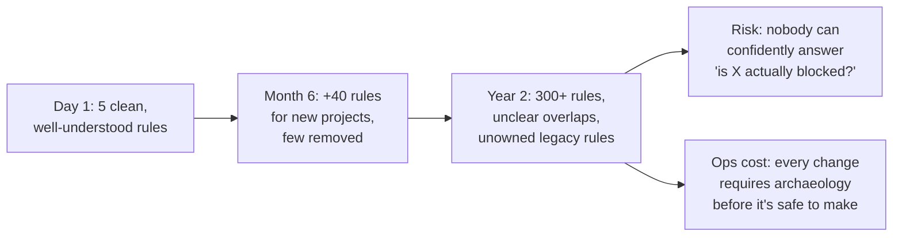

**Decision implications.** Rule sprawl is both a security risk (an
unreviewable policy hides both accidental over-permission and shadowed,
ineffective deny rules — see Section 4.6) and an operational one (every
subsequent change becomes slower and riskier as the reviewer has to
re-derive context that was never documented). The architectural
countermeasure is treating firewall policy as a first-class, version-controlled
artifact with the same lifecycle discipline as application code: every rule
should carry an owner, a business justification, and — ideally — an
expiration or review date, and rule sets should be periodically audited for
unused rules (a rule that has matched zero packets in a defined window is a
strong candidate for removal) and for coverage gaps left by decommissioned
systems.

**Common failure mode.** Treating "add a rule" as a purely additive,
low-risk operation while treating "remove a rule" as high-risk and therefore
something nobody wants to be responsible for — a asymmetry that guarantees
monotonic growth, because the removal side of the lifecycle simply never
happens in practice without a deliberate, scheduled process forcing it.

**Concrete scenario.** An enterprise firewall audit finds that of roughly
1,200 rules in a data-center edge policy, over 400 reference IP ranges or
services that were decommissioned years earlier, and a further 150 are fully
shadowed by broader rules positioned above them (Section 4.6) and have never
actually taken effect — meaning the policy's real, effective rule count is
closer to 650, but nobody could have known that without doing the audit,
and every change made in the meantime carried unnecessary risk and review
overhead as a result.

### 4.8 Network Segmentation Architecture and the Demilitarized Zone (DMZ)

**Definition.** Network segmentation is the architectural practice of
dividing a network into distinct zones (or tiers), each with a different
trust level, and using firewalls to control — and often fully mediate — all
traffic crossing between zones. A Demilitarized Zone (DMZ) is the
best-known segmentation pattern: a zone positioned between an untrusted
network (the public internet) and a fully trusted internal network, hosting
only the specific systems that must be reachable from outside (a public web
server, a mail relay, a reverse proxy) while denying those systems any direct
path into the trusted internal network.

**Mechanism.** A classic DMZ uses either one firewall with three (or more)
network interfaces — one facing the internet, one facing the DMZ, one facing
the internal network, each governed by its own rule set — or two firewalls in
series (sometimes from different vendors, to reduce the risk of a single
vulnerability compromising both layers), with the DMZ sitting in the network
between them. Traffic from the internet is permitted only to the specific
DMZ hosts and ports actually needed; traffic from the DMZ to the internal
network is restricted to the narrow, specific flows those DMZ services
genuinely require (for example, a web server in the DMZ may need a single
database connection to a specific internal host and port, and nothing else);
and, critically, traffic is never permitted to originate directly from the
internet straight through to the internal network, bypassing the DMZ
entirely.

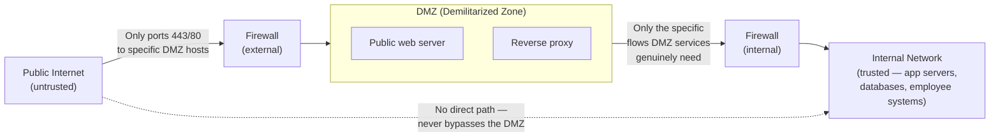

**Decision implications.** The core payoff of segmentation is limiting
blast radius: if the public-facing web server in the DMZ is compromised, the
attacker's next step is constrained by the internal-facing firewall's rules
— they can only reach the narrow set of internal systems and ports the DMZ
was ever permitted to reach, not the entire internal network. Without
segmentation, a single compromised internet-facing host sits on the same flat
network as every sensitive internal system, and the only thing standing
between the attacker and everything else is host-level security on every
single machine — a much weaker, much less auditable line of defense than a
firewall boundary enforcing it centrally. Beyond the classic three-zone
(internet/DMZ/internal) model, larger organizations extend the same principle
into more granular network tiers — for example, a presentation tier, an
application tier, and a data tier, each separated by its own firewall
boundary with progressively tighter rules — so that even a fully compromised
application server cannot reach the data tier on any port or protocol beyond
the one specific database connection it legitimately needs.

**Common failure mode.** Placing a DMZ host on the same broadcast domain or
routed subnet as internal systems "temporarily," or granting the DMZ-to-internal
firewall rule broader access than the DMZ service actually needs "in case we
need it later" — both of which quietly convert a supposedly segmented
architecture back into a flat one, defeating the entire purpose of the
DMZ while leaving the network diagram looking segmented on paper.

**Concrete scenario.** An e-commerce company's public web tier (in the DMZ)
is compromised through an unpatched content-management-system vulnerability;
because the internal-facing firewall permits the DMZ only a single, specific
outbound connection to one internal payment-processing gateway on one port,
the attacker's lateral movement is fully contained to that one narrow path —
they cannot reach the customer database, the internal file shares, or
employee workstations, all of which sit behind the same firewall boundary
but are simply never permitted from the DMZ zone at all.

### 4.9 Host-Based vs. Network-Based Firewalls: The Defense-in-Depth Argument

**Definition.** A **network-based firewall** sits at a network boundary
(perimeter, DMZ edge, segment boundary) and filters traffic for every host
behind it as a single, shared enforcement point. A **host-based firewall**
runs on the individual endpoint itself (a server or workstation's own
operating-system-level firewall) and filters only the traffic destined for,
or originating from, that one machine.

**Mechanism.** A network-based firewall's rules are typically expressed in
terms of network addressing (which subnet may reach which subnet, on which
ports) and enforced once, centrally, for every packet crossing that boundary
regardless of which specific host on either side is involved. A host-based
firewall's rules are typically expressed in terms of that single host's own
role (this specific database server accepts connections only from this
specific application server's IP, on this specific port, and nothing else)
and enforced locally by the host's own operating system, independent of
whatever the network firewall upstream has already decided.

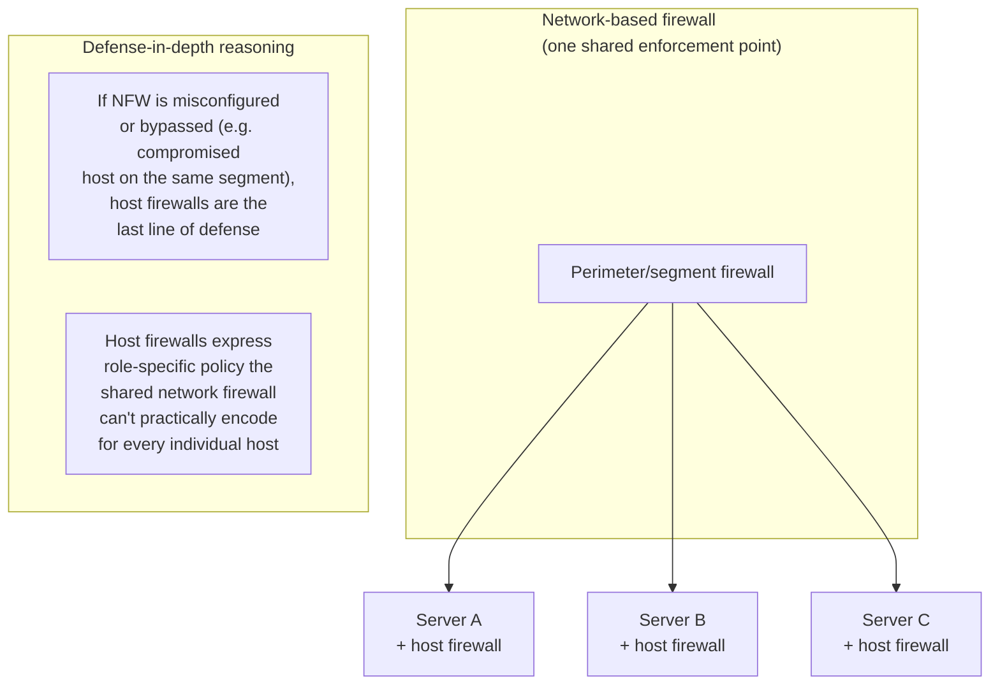

**Decision implications.** Relying on network-based filtering alone means
every host inside the same network zone implicitly trusts every other host
in that zone — which is exactly the flat-network risk Section 4.8's
segmentation argument addresses at the network-boundary level, but a network
firewall alone still can't stop lateral movement *within* a zone once
segmentation stops (and every zone has to stop somewhere; it's rarely
practical to put a network firewall between literally every pair of hosts).
Host-based firewalls close that residual gap by enforcing the same
default-deny discipline (Section 4.5) at the individual machine level, so
that even two hosts on the same subnet, behind the same network firewall,
cannot reach each other on ports neither of them legitimately needs to expose
to the other. This is the concrete meaning of "defense in depth" for
firewalling specifically: the two layers protect against different, only
partially overlapping failure modes (a network-firewall misconfiguration, a
newly compromised host trying to move laterally, an entirely new host added
to the network without anyone updating the network firewall's rules yet),
and a mature architecture deploys both rather than treating either as
sufficient on its own.

**Common failure mode.** Treating host-based firewalls as redundant
"belt-and-suspenders" busywork once a network firewall is already in place,
and consequently leaving every host firewall in a permissive default-allow
state — which erases exactly the lateral-movement protection host firewalls
exist to provide, while giving the *impression* of defense in depth on an
architecture diagram that lists both layers.

**Concrete scenario.** A ransomware strain compromises one workstation inside
a corporate Local Area Network (LAN) segment through a phishing email;
because every workstation on that segment also runs a host-based firewall
configured to deny inbound Server Message Block (SMB) connections from any
peer except the file-server IP, the ransomware's built-in SMB-based
lateral-spread mechanism cannot reach any other workstation on the same
segment, even though the network firewall at the segment boundary never
saw or evaluated any of this traffic at all — it was purely internal,
intra-segment traffic that only the host-based layer was positioned to stop.

### 4.10 Cloud-Native Firewall Architecture: Security Groups vs. Network ACLs

**Definition.** In a cloud Virtual Private Cloud (VPC), the two foundational
firewall-equivalent primitives are **Security Groups**, which are stateful
and attach to individual instances (or, more precisely, to individual network
interfaces), and **Network Access Control Lists (NACLs)**, which are
stateless and attach to an entire subnet.

**Mechanism.** A Security Group behaves like the stateful inspection
firewall taught in Section 4.2: an allowed inbound connection automatically
permits its corresponding return traffic, with no separate outbound rule
required, and — in AWS specifically — a Security Group evaluates *all*
matching rules and applies the most-permissive result across them rather
than strict first-match-wins, which is an important deviation from Section
4.6's general model that must be verified for the specific cloud provider in
use. A NACL, by contrast, behaves like the stateless packet filter from
Section 4.1: it evaluates rules in strict numbered order, applies the first
match, and requires explicit rules in *both* directions for any conversation,
because it has no connection-state memory at all. Security Groups are
instance-level (every network interface can have its own, and can attach
multiple Security Groups simultaneously) while NACLs are subnet-level (every
resource in a subnet shares the same NACL, whether it wants to or not).

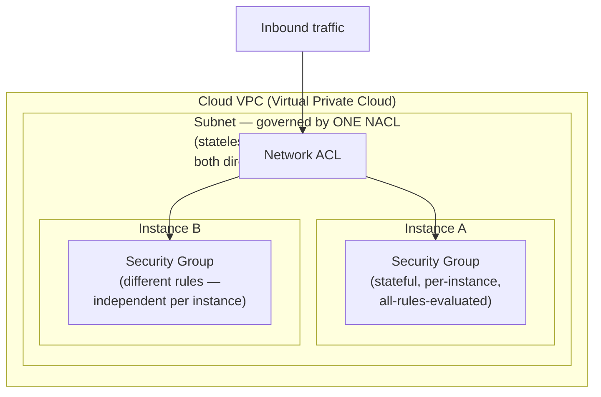

**Decision implications.** The architectural reason both primitives exist
side by side, rather than one superseding the other, is the same
network-based-vs-host-based defense-in-depth argument from Section 4.9,
recast for the cloud: the NACL is the network-based layer (one shared,
subnet-wide boundary, useful for coarse, broadly-applicable rules like
blocking a known-malicious CIDR range from an entire subnet regardless of
which instance an attacker targets) and the Security Group is the
host-based-equivalent layer (fine-grained, per-instance policy expressing
exactly which specific ports a specific instance's specific role requires).
A well-architected VPC uses NACLs for broad, subnet-wide guardrails
(often close to a coarse default-deny baseline) and Security Groups for the
detailed, role-specific policy that actually does most of the fine-grained
enforcement work day to day — mirroring exactly the reasoning in Section
4.9, just implemented as cloud-native constructs instead of physical or
per-host firewalls.

**Common failure mode.** Forgetting that a NACL is stateless and requires an
explicit *return-traffic* rule, then observing that outbound connections from
an instance appear to work at the TCP-handshake level but the response never
arrives — because the NACL's ephemeral-port outbound rule wasn't
provisioned to match the actual ephemeral port range the client operating
system uses, silently dropping return packets at the subnet boundary while
the Security Group (which correctly auto-permits the return traffic
statefully) never even sees a problem, making the fault look like it must be
inside the instance rather than at the NACL.

**Concrete scenario.** Section 9 works through a complete Terraform
configuration provisioning both a Security Group and a NACL for a
three-tier VPC, showing exactly how the stateful/stateless distinction
changes what each resource's configuration has to explicitly declare.

### 4.11 Web Application Firewalls (WAF) as an Application-Layer-Specific Category

**Definition.** A Web Application Firewall (WAF) is a specialized
application-layer firewall (Section 4.3) purpose-built for HTTP and
HyperText Markup Language (HTML)-based web traffic specifically, evaluating
requests against rules targeting web-application-specific attack classes —
Structured Query Language (SQL) injection, Cross-Site Scripting (XSS), path
traversal, and the broader categories catalogued by the Open Web Application
Security Project (OWASP) Top 10 — rather than the general-purpose protocol
awareness a traditional application-layer proxy provides.

**Mechanism.** A WAF sits in the HTTP request/response path (as a reverse
proxy, a Content Delivery Network (CDN) edge feature, or a dedicated
appliance/cloud service) and evaluates each fully-parsed HTTP request against
a rule set that inspects the request line, headers, query string, and body
for patterns associated with known attack techniques — for example, a
request whose body contains SQL syntax fragments in a field expected to
hold a plain product ID, or a query-string parameter containing a
`<script>` tag where the application expects a numeric value. Because this
is the same fully-terminated, fully-reassembled-content model as the
application-layer proxy firewall in Section 4.3, a WAF inherits the same
core trade-off: deep, content-aware inspection at the cost of needing an
accurate, current understanding of exactly what "normal" traffic for the
protected application looks like, so it can distinguish an attack pattern
from an unusual-but-legitimate request.

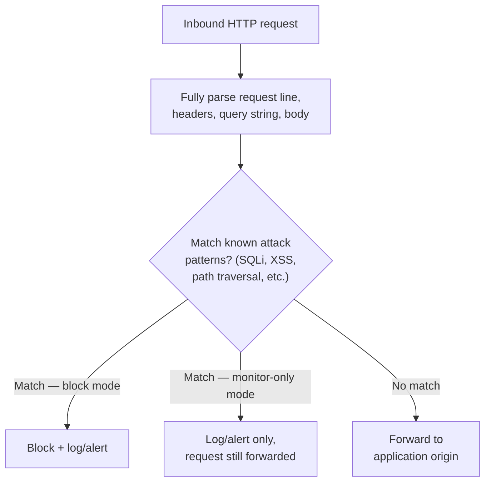

**Decision implications.** A WAF is a necessary complement to, not a
replacement for, the network-layer and application-layer-proxy firewalls
taught earlier in this section: a stateful inspection firewall or NGFW
happily permits a well-formed HTTPS request straight through to port 443
because, from a network-layer perspective, it is completely legitimate
traffic — the malicious content lives entirely inside the HTTP payload,
which is exactly the layer a WAF, and only a WAF, is positioned to inspect.
The [CDN](CH09_CDN.md#48-cdn-based-ddos-mitigation-and-waf-integration)
chapter's coverage of CDN-based WAF bundling recapped this exact point from
the delivery-architecture side: modern CDNs increasingly bundle WAF rule
evaluation directly into the edge request path (alongside Distributed
Denial of Service (DDoS) mitigation), because the CDN edge is already
terminating and inspecting every HTTP request for caching purposes, making it
a natural place to add WAF policy with minimal additional architectural
surface. This chapter's contribution is the WAF concept itself — what it is,
how it works, and its place in layered firewall architecture — while the CDN
chapter's Section 4.8 remains the owner of the delivery-architecture
implications of bundling it at the edge specifically.

**Common failure mode.** Enabling a WAF's full rule set in blocking mode
immediately, without first running it in monitor-only/log-only mode against
real production traffic to measure the false-positive rate — an overly
aggressive, untuned WAF is itself capable of becoming an availability
incident, blocking legitimate customer traffic that happens to trip a rule
pattern (a customer's last name containing `OR`, a product description
field containing an angle bracket) never intended to be flagged as an
attack.

**Concrete scenario.** Section 10 works through a concrete WAF rule blocking
a SQL-injection pattern in a query-string parameter, including exactly the
monitor-then-enforce rollout discipline this failure mode calls for.

## 5. Internal Working

This section traces how a single packet's fate is decided end to end across
a realistic multi-layer firewall deployment, tying together the concepts
taught in Section 4 into one coherent flow, and showing exactly where each
layer's decision happens relative to the others.

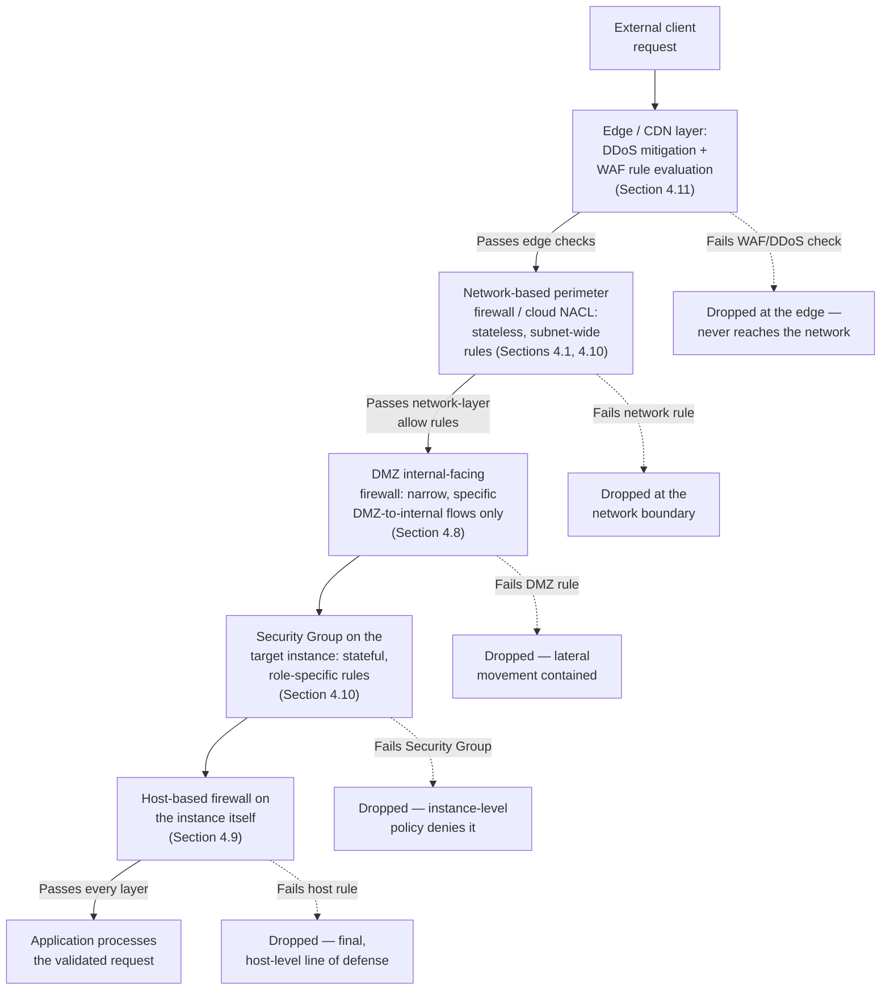

Each layer in this chain evaluates a fundamentally different question, using
information only that layer has: the edge layer asks "does this HTTP request
content match a known web-attack pattern?"; the network-layer firewall asks
"is this source/destination/port combination permitted at all, regardless of
content?"; the DMZ boundary asks "is this specific DMZ-originated flow one of
the narrow set the internal network actually needs to expose?"; the Security
Group asks "does this specific instance's role permit this specific
connection?"; and the host-based firewall asks the same question one more
time, independently, using the operating system's own enforcement rather
than trusting that every upstream layer was configured correctly. No single
layer is redundant with any other, because no single layer has access to all
the information the others use — which is precisely the architectural
justification for defense in depth introduced in Section 4.9 and echoed at
the cloud-native layer in Section 4.10.

## 6. Design Principles

- **Default-deny, always, as the starting posture** (Section 4.5) — every
  exception should be a deliberate, reviewed, justified rule addition, never
  the other way around.
- **Least privilege at every layer** — a rule (or Security Group, or NACL
  entry) should permit the narrowest source, destination, port, and protocol
  combination that satisfies the actual business need, not the broadest
  combination that happens to be convenient to write once.
- **Segment before you secure a flat network** (Section 4.8) — no amount of
  careful rule-writing on a single boundary firewall substitutes for actually
  dividing the network into zones with meaningfully different trust levels
  and different blast-radius exposure.
- **Defense in depth across layers, not redundant copies of the same layer**
  (Section 4.9) — combine network-based and host-based enforcement, and
  network-layer and application-layer inspection, because each closes a gap
  the others structurally cannot see.
- **Treat firewall policy as a version-controlled, owned artifact** (Section
  4.7) — every rule should be traceable to a business justification and a
  responsible owner, and rule sets should be periodically audited for
  unused, shadowed, or orphaned entries.
- **Monitor before you enforce** for any new content-aware control (Section
  4.11) — run new WAF or IPS rule sets in log-only mode against real traffic
  before switching to blocking mode, to catch false positives before they
  become an availability incident.

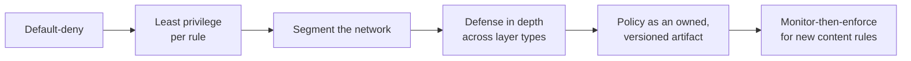

## 7. Architecture Patterns

- **Three-tier segmented architecture**: internet → DMZ (public-facing
  services only) → application tier → data tier, each boundary enforced by
  its own firewall rule set with progressively tighter permitted flows
  (Section 4.8).
- **Layered inspection pipeline**: edge WAF/DDoS mitigation → network-layer
  stateful/stateless filtering → per-instance Security Groups → host-based
  firewalls, exactly as traced in Section 5's internal-working flow.
- **Hub-and-spoke firewall topology** (common in cloud landing-zone designs):
  a central "hub" VPC/Virtual Network hosts shared, centrally-managed NGFW or
  next-generation firewall appliances, and every "spoke" VPC routes all
  north-south (into/out of the cloud) and often east-west (between spokes)
  traffic through the hub for consistent policy enforcement, rather than each
  spoke managing its own independent firewall configuration.
- **Micro-segmentation** (Section 20): instead of a small number of coarse
  network-level zones, policy is enforced per-workload or per-identity,
  often using an agent or a service-mesh sidecar rather than a traditional
  network appliance, collapsing the distinction between "network firewall"
  and "host firewall" into a single, identity-aware enforcement point that
  travels with the workload.

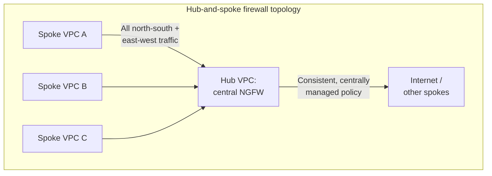

## 8. Production Architecture

A production firewall architecture is rarely a single device; it is a layered
system spanning several distinct control points, each owned by a different
part of the policy described in Section 4 and traced end to end in Section 5:

- **Edge layer** (CDN/DDoS/WAF, Section 4.11) — typically outside the
  organization's own network entirely, operated by a CDN or cloud
  provider's managed service.
- **Perimeter/network layer** (NGFW or cloud NACL, Sections 4.4, 4.10) —
  the traditional network boundary, now often a cloud-native construct rather
  than a physical appliance.
- **Segmentation layer** (DMZ and internal tier boundaries, Section 4.8) —
  multiple internal firewall boundaries between zones of differing trust.
- **Instance/workload layer** (Security Groups, Section 4.10) — fine-grained,
  per-instance rules attached directly to compute resources.
- **Host layer** (host-based firewalls, Section 4.9) — the final,
  independent enforcement point on the endpoint itself.

Change management for this stack should route every rule change through the
same review discipline as application code — a pull request, a named
approver, and, ideally, an automated policy-linting check that flags newly
introduced overly broad rules (a `0.0.0.0/0` source on a sensitive port, a
rule with no expiration or owner tag) before merge, directly addressing the
rule-sprawl risk from Section 4.7 at the process level rather than relying on
periodic manual audits alone.

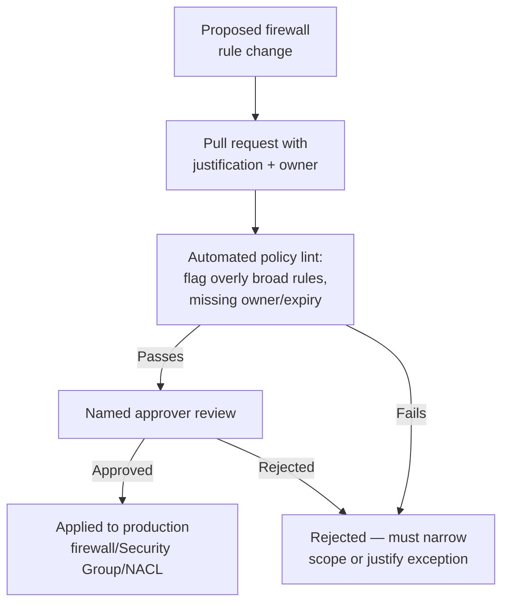

## 9. Implementation

This section works through the first two of this chapter's production-quality
configuration examples: a Linux `nftables` rule set implementing a
default-deny, stateful host-based firewall (Sections 4.2, 4.5, 4.9), and a
complete Terraform configuration provisioning both an AWS Security Group and
a Network ACL for a three-tier VPC subnet (Section 4.10).

### 9.1 nftables: Default-Deny Stateful Host Firewall

`nftables` is the modern successor to `iptables` on Linux, and this example
is written directly for it (an equivalent `iptables` rule set is noted
inline for teams still on the legacy tool).

```nftables
#!/usr/sbin/nft -f
# Default-deny, stateful host-based firewall (Sections 4.2, 4.5, 4.9)
# Equivalent legacy syntax: iptables -P INPUT DROP; iptables -A INPUT
# -m conntrack --ctstate ESTABLISHED,RELATED -j ACCEPT ; etc.

flush ruleset

table inet filter {
    chain input {
        # Default-deny posture (Section 4.5): the base chain policy is
        # drop, so anything not explicitly matched below is denied.
        type filter hook input priority 0; policy drop;

        # Stateful inspection (Section 4.2): auto-permit return traffic
        # for connections this host itself initiated, with a single rule
        # instead of a separate inbound rule per outbound flow.
        ct state established,related accept

        # Always permit loopback traffic.
        iifname "lo" accept

        # Drop clearly invalid/malformed packets outright (defense
        # against certain packet-crafting evasion techniques).
        ct state invalid drop

        # Least-privilege inbound rules (Section 6): only the specific
        # ports this host's role actually requires, from the specific
        # source it should ever receive them from.
        tcp dport 22 ip saddr 10.0.10.0/24 accept   # SSH from the bastion subnet only
        tcp dport 5432 ip saddr 10.0.20.0/24 accept # PostgreSQL from the app-tier subnet only
        icmp type echo-request ip saddr 10.0.0.0/16 accept # internal ping only

        # Everything else falls through to the default-deny policy above
        # and is dropped, logged by the counter for audit visibility.
        counter drop
    }

    chain forward {
        # This host does not route traffic for other hosts.
        type filter hook forward priority 0; policy drop;
    }

    chain output {
        # Outbound is permitted by default here (a common, deliberate
        # posture for a server whose main risk surface is inbound), but a
        # stricter architecture would apply the same default-deny +
        # explicit-allow discipline outbound too, to limit what a
        # compromised host could exfiltrate to or call out to.
        type filter hook output priority 0; policy accept;
    }
}
```

The key architectural points this configuration demonstrates, tied back to
Section 4: the base `input` chain policy is `drop` (default-deny, Section
4.5); the `ct state established,related accept` line is what makes this a
*stateful* firewall rather than a stateless packet filter (Section 4.2),
collapsing what would otherwise require a separate inbound rule per outbound
conversation into one line; and every remaining `accept` rule specifies both
a narrow source and a narrow destination port, following the least-privilege
design principle from Section 6 rather than a broad catch-all.

### 9.2 Terraform: AWS Security Group and Network ACL for a Three-Tier VPC Subnet

This example provisions both cloud-native primitives from Section 4.10 for
an application-tier subnet, deliberately showing how their stateful/stateless
difference changes what each resource has to declare explicitly.

```hcl
# --- Security Group (stateful, instance-level) — Section 4.10 ---
resource "aws_security_group" "app_tier" {
  name        = "app-tier-sg"
  description = "Least-privilege rules for the application tier (Section 6)"
  vpc_id      = aws_vpc.main.id

  # Inbound: only from the DMZ/web tier's Security Group, on the app port.
  # No matching outbound rule is required for the RESPONSE — Security
  # Groups are stateful (Section 4.10), so the reply is auto-permitted.
  ingress {
    description     = "App traffic from the web tier only"
    from_port       = 8443
    to_port         = 8443
    protocol        = "tcp"
    security_groups = [aws_security_group.web_tier.id]
  }

  # Outbound: only to the data tier's Security Group, on the DB port —
  # least privilege applied outbound as well, not just inbound.
  egress {
    description     = "DB traffic to the data tier only"
    from_port       = 5432
    to_port         = 5432
    protocol        = "tcp"
    security_groups = [aws_security_group.data_tier.id]
  }

  tags = {
    Owner      = "platform-team"
    ReviewDate = "2026-11-01" # rule-sprawl countermeasure (Section 4.7)
  }
}

# --- Network ACL (stateless, subnet-level) — Section 4.10 ---
resource "aws_network_acl" "app_tier" {
  vpc_id     = aws_vpc.main.id
  subnet_ids = [aws_subnet.app_tier.id]

  # Inbound: because NACLs are STATELESS, the app port must be permitted
  # inbound explicitly...
  ingress {
    rule_no    = 100
    protocol   = "tcp"
    action     = "allow"
    cidr_block = aws_subnet.web_tier.cidr_block
    from_port  = 8443
    to_port    = 8443
  }

  # ...AND the corresponding ephemeral-port RETURN traffic must also be
  # permitted explicitly in the opposite direction — a NACL has no
  # connection-state memory (Section 4.1/4.10), unlike the Security Group
  # above, which needed no equivalent rule at all.
  egress {
    rule_no    = 100
    protocol   = "tcp"
    action     = "allow"
    cidr_block = aws_subnet.web_tier.cidr_block
    from_port  = 1024
    to_port    = 65535
  }

  # Explicit numbered deny rule for a known-malicious range, evaluated in
  # strict first-match order (Section 4.6) — placed at a LOW rule number
  # so it is evaluated before any broader allow rule could shadow it.
  ingress {
    rule_no    = 50
    protocol   = "-1"
    action     = "deny"
    cidr_block = "198.51.100.0/24" # documentation-range placeholder for a real threat-intel feed
    from_port  = 0
    to_port    = 0
  }

  tags = {
    Owner = "platform-team"
  }
}
```

This pairing is the concrete implementation of Section 4.10's core teaching:
the Security Group needed no explicit return-traffic rule at all because it
is stateful, while the NACL needed an explicit, separate egress rule for the
ephemeral port range because it is stateless — the exact same
stateful-vs-stateless distinction taught in Sections 4.1 and 4.2, just
expressed as two different cloud-native resource types operating at two
different layers (instance vs. subnet) simultaneously, per the defense-in-depth
reasoning from Section 4.9.

## 10. Complete Code Examples

This section provides the chapter's third and fourth production-quality
examples: a WAF rule blocking a SQL-injection pattern (Section 4.11), and a
small Python reference tool that detects shadowed rules in a first-match-wins
policy (Section 4.6) — a practical instantiation of the rule-sprawl
countermeasure described in Sections 4.7 and 8.

### 10.1 AWS WAF Rule: Blocking a SQL-Injection Pattern (Monitor-Then-Enforce)

Following the rollout discipline flagged in Section 4.11's common failure
mode, this rule is shown first in `COUNT` (monitor-only) mode, with the
change to `BLOCK` mode noted as the deliberate second step after a
false-positive review window.

```hcl
resource "aws_wafv2_web_acl" "app_waf" {
  name  = "app-tier-waf"
  scope = "REGIONAL"

  default_action {
    allow {}
  }

  rule {
    name     = "block-sql-injection-query-string"
    priority = 1

    statement {
      sqli_match_statement {
        field_to_match {
          query_string {}
        }
        text_transformation {
          priority = 1
          type     = "URL_DECODE"
        }
        text_transformation {
          priority = 2
          type     = "HTML_ENTITY_DECODE"
        }
      }
    }

    # Step 1 (deploy first): monitor-only, per Section 4.11's rollout
    # discipline — logs and metrics, but the request is still forwarded.
    action {
      count {}
    }

    # Step 2 (after a review window with zero acceptable false positives):
    # switch the action block above to:
    #   action { block {} }
    # promoting the rule from monitor-only to enforcing.

    visibility_config {
      sampled_requests_enabled   = true
      cloudwatch_metrics_enabled = true
      metric_name                = "sqli-query-string"
    }
  }

  visibility_config {
    sampled_requests_enabled   = true
    cloudwatch_metrics_enabled = true
    metric_name                = "app-tier-waf"
  }
}
```

### 10.2 Python: Detecting Shadowed Rules in a First-Match-Wins Policy

This tool operationalizes the rule-sprawl audit from Section 4.7 by
programmatically detecting the exact failure mode described in Section 4.6:
a rule that can never fire because a broader rule earlier in the list already
matches every packet it would have matched.

```python
"""Detect shadowed (unreachable) rules in a first-match-wins firewall
policy — see Sections 4.6 and 4.7. A rule is "shadowed" if every packet it
could match is already matched by an earlier rule in the list."""

import ipaddress
from dataclasses import dataclass


@dataclass
class Rule:
    name: str
    cidr: str
    port: int
    action: str  # "allow" or "deny"

    def network(self) -> ipaddress.IPv4Network:
        return ipaddress.ip_network(self.cidr, strict=False)


def rule_covers(earlier: Rule, later: Rule) -> bool:
    """True if `earlier` matches every packet `later` could ever match —
    i.e. `later` is unreachable given first-match-wins evaluation."""
    if earlier.port != later.port:
        return False
    later_net = later.network()
    earlier_net = earlier.network()
    # `earlier` covers `later` only if `later`'s whole range is a subset
    # of `earlier`'s range (a broader or equal CIDR matches everything a
    # narrower one would have matched).
    return later_net.subnet_of(earlier_net)


def find_shadowed_rules(rules: list[Rule]) -> list[tuple[Rule, Rule]]:
    """Returns (shadowing_rule, shadowed_rule) pairs, in evaluation order,
    mirroring exactly how a first-match-wins engine (Section 4.6) walks
    the rule list packet by packet."""
    shadowed: list[tuple[Rule, Rule]] = []
    for i, later in enumerate(rules):
        for earlier in rules[:i]:
            if rule_covers(earlier, later):
                shadowed.append((earlier, later))
                break  # later is shadowed by the FIRST covering rule, matching real evaluation order
    return shadowed


if __name__ == "__main__":
    policy = [
        Rule("allow-corp-net", "10.0.0.0/16", 22, "allow"),
        Rule("deny-specific-host", "10.0.5.0/24", 22, "deny"),  # shadowed — see Section 4.6's scenario
        Rule("allow-db-subnet", "10.0.20.0/24", 5432, "allow"),
    ]
    for shadowing, shadowed_rule in find_shadowed_rules(policy):
        print(
            f"WARNING: rule '{shadowed_rule.name}' is shadowed by "
            f"'{shadowing.name}' and will never take effect "
            f"(first-match-wins, Section 4.6)."
        )
```

Running this against the sample policy reproduces exactly the failure mode
narrated in Section 4.6's concrete scenario: `deny-specific-host` can never
fire, because `allow-corp-net` (a broader CIDR on the same port, positioned
earlier) already matches every packet the deny rule was written to catch.

## 11. Performance

Firewall performance is governed primarily by which inspection depth a given
layer performs, not raw device throughput specifications alone. Stateless
packet filtering (Section 4.1) is cheapest per packet, because there is no
per-connection memory to maintain — this is why high-throughput cloud NACLs
and router ACLs remain stateless. Stateful inspection (Section 4.2) adds
per-connection table lookups and maintenance, which scales with concurrent
connection count rather than raw packet rate, making connection-table
capacity (not just packets-per-second) a first-class capacity-planning
metric. Application-layer proxies and WAFs (Sections 4.3, 4.11) are the most
expensive per request, because they fully terminate, parse, and often
reconstruct content, and NGFW DPI/TLS-interception features (Section 4.4)
add further, sometimes substantial, per-packet processing cost — vendor
"firewall throughput" numbers should always be checked against the specific
feature combination actually enabled in production, not the maximum
theoretical figure measured with those features disabled.

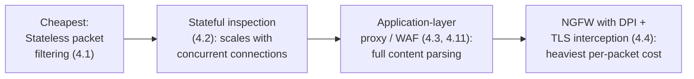

## 12. Scalability

Network-based firewalls scale primarily by adding capacity at the boundary
(larger appliances, additional parallel firewall instances behind a load
balancer, or, in the cloud, relying on the provider's managed, horizontally
scaled Security Group/NACL enforcement rather than a single bottleneck
device). Host-based firewalls (Section 4.9) scale essentially for free from
an architecture standpoint, because enforcement is distributed across every
endpoint already running the workload rather than centralized in one shared
device — the trade-off is that policy consistency across a large fleet
requires centralized configuration management (the same discipline discussed
in Section 8's change-management pipeline) rather than a single point of
control. Micro-segmentation (Section 20) takes this distribution further
still, scaling enforcement to the individual workload or identity level,
which avoids a shared network appliance ever becoming a throughput
bottleneck as the environment grows, at the cost of needing a control plane
capable of distributing and keeping consistent a much larger number of
independently-enforced policies.

## 13. Security

Firewalls are themselves a security-critical component and a target in their
own right, not merely a passive control: a compromised firewall (through an
unpatched management-plane vulnerability, weak administrative credentials, or
a supply-chain issue in its firmware) can silently disable or rewrite the
very policy meant to protect everything behind it, making firewall
management-plane hardening (strong authentication, network-restricted
management access, timely patching) a security priority equal to the rule
policy itself. TLS interception on an NGFW (Section 4.4) deserves particular
security scrutiny, because it concentrates an unusually high-value asset — a
certificate authority trusted by every internal client — in one device;
compromise of that device compromises the confidentiality of every
intercepted session, so interception scope, key protection, and audit
logging around it need to be treated with commensurate rigor. Firewall rule
sets themselves are also a security artifact worth protecting from
unauthorized modification — the change-management pipeline in Section 8 (pull
requests, named approvers, automated linting) exists as much to prevent a
malicious or careless rule change from silently opening a hole as it does to
manage rule sprawl.

## 14. Observability

Effective firewall observability means logging every denied connection (at
minimum) and, ideally, every allowed connection at a boundary carrying
sensitive traffic, with enough detail (timestamp, source, destination, port,
protocol, the specific rule that matched) to answer "was this specific flow
permitted, and by which rule" without manual re-derivation. Connection-table
metrics (Section 4.2) — current utilization, rejection rate due to table
exhaustion — are an early warning signal for both capacity problems and
certain denial-of-service attack patterns. WAF and NGFW layers (Sections
4.4, 4.11) should separately track monitor-only "would have blocked" counts
during any rollout, exactly as demonstrated in the Section 10.1 example, so a
false-positive rate can be measured with real evidence before a rule
transitions to enforcing.

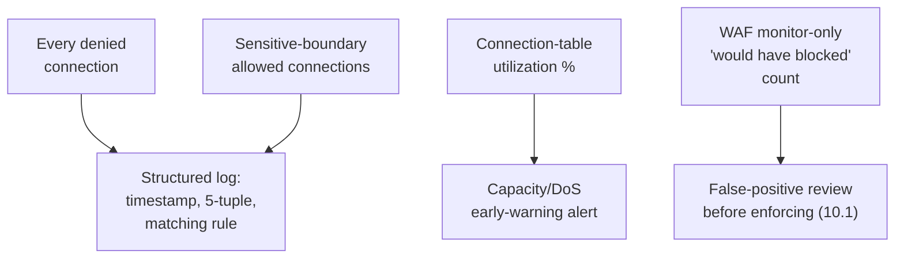

## 15. Failure Scenarios

- **Connection-table exhaustion** (Section 4.2): a stateful firewall's
  connection table fills — from a genuine volumetric attack or a
  misbehaving legitimate client opening excessive connections — and new,
  legitimate connections are dropped indiscriminately alongside malicious
  ones, because the firewall can no longer distinguish them once it has no
  table capacity left to track either.
- **Rule shadowing silently defeats a security control** (Section 4.6): a
  deny rule added to block a specific threat never actually takes effect
  because a broader, earlier rule already matches the same traffic — the
  failure is invisible until an incident investigation specifically checks
  whether the rule ever fired.
- **NAT-then-firewall confusion during an incident** (Section 3): a private
  subnet behind NAT is assumed "not internet-facing, therefore safe," and the
  actual firewall/Security-Group misconfiguration that made it reachable
  anyway goes unnoticed until exploited, because the review stopped at
  "there's no direct route from the internet" without separately verifying
  the firewall policy.
- **DMZ segmentation erosion** (Section 4.8): a temporary broad rule from
  the DMZ into the internal network, added under deadline pressure and never
  narrowed afterward, converts a compromised DMZ host from a contained
  incident into full internal network access.
- **TLS-interception outage** (Section 4.4): an NGFW's interception
  certificate expires or a client update begins enforcing certificate
  pinning against it, and every intercepted connection begins failing
  simultaneously — a single shared dependency (the interception CA) becoming
  a correlated single point of failure across otherwise-unrelated traffic.

## 16. Testing

Firewall policy should be tested the same way application logic is tested:
with an automated suite that asserts specific traffic is permitted and
specific traffic is denied, run against every proposed change before it
merges (Section 8's change-management pipeline). Practical techniques
include: replaying a captured set of known-legitimate flows against a staged
policy change and asserting none are newly blocked; replaying a set of
known-malicious or clearly-out-of-scope flows and asserting all are denied;
and running the shadowed-rule detector from Section 10.2 as an automated
check in the same pipeline, failing the build if a newly added rule turns
out to be immediately shadowed by an existing one. WAF and IPS rule changes
specifically should always pass through the monitor-only rollout stage from
Section 10.1 against real production traffic samples before the switch to
enforcing mode, treating the false-positive measurement itself as a required
test gate, not an optional nicety.

## 17. Common Mistakes

- Treating NAT as a security boundary and skipping a genuine firewall review
  because a system "isn't directly reachable" (Section 3).
- Defaulting to a permissive allow-all rule "temporarily" and never
  narrowing it before launch (Section 4.5).
- Appending new rules to the bottom of a large policy without checking
  whether an earlier, broader rule already shadows them (Section 4.6).
- Letting rule removal lag far behind rule addition, producing unbounded
  rule sprawl over the life of the system (Section 4.7).
- Placing a DMZ host on the same flat network as internal systems "for now"
  and never fully segmenting it (Section 4.8).
- Assuming a network-based firewall alone is sufficient and leaving
  host-based firewalls in a permissive default state (Section 4.9).
- Forgetting that cloud NACLs are stateless and omitting the corresponding
  ephemeral-port return-traffic rule (Section 4.10).
- Enabling a new WAF rule set directly in blocking mode without a
  monitor-only measurement period first (Section 4.11).

## 18. Best Practices

- Start every new boundary at default-deny and add exceptions deliberately,
  never the reverse (Section 4.5).
- Give every rule an explicit owner and, where feasible, an expiration or
  review date, and audit for unused/shadowed rules on a regular cadence
  (Section 4.7).
- Segment the network into meaningfully distinct trust zones and verify, not
  assume, that inter-zone flows are as narrow as the architecture diagram
  claims (Section 4.8).
- Deploy both network-based and host-based enforcement, and both
  network-layer and application-layer inspection, so that no single control
  is a single point of failure for the whole security posture (Section 4.9).
- Route every firewall policy change through the same review discipline as
  application code, including automated linting for overly broad new rules
  (Section 8).
- Roll out new content-aware rules (WAF, IPS) in monitor-only mode first and
  measure false positives against real traffic before enforcing (Sections
  4.11, 10.1).

## 19. Anti-Patterns

- **"NAT is my firewall"** — mistaking NAT's incidental, non-policy-driven
  traffic drop for a deliberate security control (Section 3).
- **The permanent temporary rule** — a broad allow rule added "just for
  now" that outlives the deadline pressure that created it by months or
  years (Sections 4.5, 4.7).
- **Bottom-of-the-list rule addition by default** — appending every new rule
  without checking for shadowing against existing broader rules (Section
  4.6).
- **Flat DMZ** — a DMZ host that, despite the diagram showing a boundary,
  actually shares a subnet or an overly broad internal-facing rule with the
  trusted network (Section 4.8).
- **Single-layer trust** — relying on one firewall layer (just the network
  perimeter, or just host firewalls) instead of defense in depth across
  layers (Section 4.9).
- **Block-mode-first WAF rollout** — enabling new content-aware rules
  directly in enforcing mode without a monitor-only measurement window
  (Section 4.11).

## 20. Trade-off Analysis

The recurring trade-off across this entire chapter is **inspection depth vs.
cost and complexity**: stateless packet filtering is cheap and scales
enormously but understands nothing about connection state or content;
stateful inspection adds connection awareness at the cost of per-connection
memory; application-layer proxies and WAFs add content awareness at the cost
of full protocol termination and reconstruction; and NGFW DPI/TLS
interception adds the deepest visibility at the highest per-packet
processing cost and the added risk concentration of a shared interception
certificate authority. A second, equally important trade-off is **posture
friction**: default-deny pushes friction onto enabling new legitimate
functionality (an explicit rule request), while default-allow pushes
friction onto discovering and blocking new threats — and, as argued in
Section 4.5, that second friction profile fails unsafely far more often than
it fails safely, which is why default-deny is the architecturally correct
default despite the extra day-to-day friction it introduces.

This chapter's related architectural shift — from perimeter-only enforcement
toward micro-segmentation and Zero Trust — is itself a trade-off between a
small number of coarse, cheap-to-operate enforcement points and a much
larger number of fine-grained, workload-level enforcement points that
shrink blast radius dramatically but require a correspondingly more capable
identity and policy-distribution control plane to operate. The
[VPN](CH13_VPN.md#49-the-shift-from-perimeter-vpn-to-zero-trust-network-access)
chapter already taught the full architecture of this shift for remote-access
specifically — its Zero Trust Network Access (ZTNA) section covers the
identity-centric, per-application access-brokering model in depth — and this
chapter recaps it only to the extent needed to place firewall
micro-segmentation in the same architectural narrative: just as ZTNA moves
remote-access trust decisions from a broad network-level tunnel to a
narrow, per-application, continuously-verified decision, micro-segmentation
moves firewall-equivalent policy from a small number of network-boundary
appliances to per-workload enforcement that travels with the workload itself,
regardless of which physical network segment it happens to run on at any
given moment. An architect evaluating this shift should treat it the same
way the VPN chapter recommends evaluating ZTNA: as the default target model
for new designs, falling back to traditional perimeter/segment firewalling
only where the organization's identity and policy-distribution tooling
genuinely cannot yet support the finer-grained model.

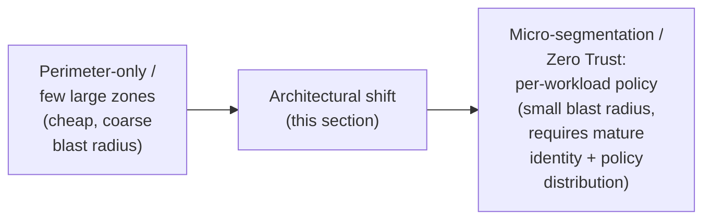

## 21. Comparison Table

| Firewall Type | State Awareness | Inspection Layer | Typical Placement | Primary Trade-off |
|---|---|---|---|---|
| Packet-filtering (Section 4.1) | Stateless | Network (IP/port headers) | Router ACLs, cloud NACLs | Cheapest/fastest; requires explicit bidirectional rules |
| Stateful inspection (Section 4.2) | Stateful | Network + transport | Perimeter/segment firewalls | Efficient single-rule intent; connection-table exhaustion risk |
| Application-layer proxy (Section 4.3) | Stateful (per proxied session) | Full application content | Specific high-value protocols | Deep content awareness; per-protocol parser maintenance cost |
| NGFW (Section 4.4) | Stateful + DPI | Network through application, identity-aware | Perimeter, hub-and-spoke hub | Converges several appliances; DPI/TLS-interception processing cost |
| Security Group (Section 4.10) | Stateful | Network/transport, instance-level | Cloud VPC, per instance | Fine-grained per-role rules; all-rules-evaluated (not strict first-match) in AWS |
| Network ACL (Section 4.10) | Stateless | Network/transport, subnet-level | Cloud VPC, per subnet | Coarse, broadly-applicable guardrails; needs explicit bidirectional rules |
| WAF (Section 4.11) | Stateful (per request) | HTTP application content | Reverse proxy, CDN edge, dedicated service | Deep web-attack-pattern awareness; needs monitor-then-enforce tuning |

## 22. Real-World Case Study

A mid-size online retailer operates a traditional three-tier architecture: a
public web tier in a DMZ, an application tier, and a data tier, each
separated by firewall boundaries exactly as taught in Section 4.8. The
retailer's content-management system suffers a known vulnerability, and an
attacker gains code execution on a single DMZ web server.

The incident response afterward showed the layered architecture from Section
5 working as designed at every subsequent step. The internal-facing DMZ
firewall permitted the compromised host only one narrow outbound flow — a
single TCP port to one internal payment-gateway endpoint the web tier
legitimately needed — so the attacker's attempts to scan and connect to the
customer database and internal file shares were dropped at that boundary and
logged, giving the security team an early, specific alert rather than a
late, diffuse one. The Security Group attached to the payment-gateway
instance itself (Section 4.10) additionally restricted inbound traffic to
only the DMZ web tier's Security Group on the specific application port, so
even the one permitted flow could not be abused to reach any other service
running on that same instance's other ports. And because the retailer had,
months earlier, moved a previously untuned WAF rule set through the
monitor-then-enforce discipline from Section 10.1, the same
content-management-system exploit attempt had actually already been logged
(though not yet blocking) by the WAF weeks before it eventually succeeded,
giving the retailer's security team advance warning they had, in this case,
not yet acted on quickly enough — a finding that directly informed shortening
the monitor-only review window for future WAF rule rollouts.

The retailer's post-incident review explicitly credited the DMZ segmentation
and layered Security-Group policy (Sections 4.8, 4.10, 4.9) with converting
what could have been a full customer-database breach into a contained,
single-host incident — while also identifying the WAF alert-response gap as
the one process failure to fix, illustrating that even a well-designed
layered architecture's value depends on the operational discipline (Sections
14, 8) built around it.

```mermaid
flowchart TB
    Exploit["CMS vulnerability\nexploited on DMZ web host"] --> Attempt1["Attacker attempts\nlateral movement to DB tier"]
    Attempt1 -->|"Blocked + logged"| DMZFW["DMZ internal-facing\nfirewall (4.8)"]
    Exploit --> Attempt2["Attacker uses the ONE\npermitted flow to the\npayment gateway instance"]
    Attempt2 -->|"Restricted to one port,\nno lateral spread on\nother instance ports"| SGPay["Payment-gateway\nSecurity Group (4.10)"]
    Exploit -.->|"Weeks earlier: exploit\nattempt already logged\nin WAF monitor-only mode"| WAFLog["WAF log — alert not\nacted on quickly enough"]
```

## 23. Interview Questions

1. Explain the difference between stateless packet filtering and stateful
   inspection, and describe a concrete misconfiguration risk unique to each.
2. Why is default-deny considered the architecturally correct posture for
   almost every firewall boundary, even though it introduces more day-to-day
   friction than default-allow?
3. What does "first-match-wins" mean for firewall rule evaluation, and how
   can it cause a correctly-written deny rule to have no actual effect?
4. Describe why NAT is not a substitute for a firewall, referencing the
   specific mechanism that makes NAT's traffic-blocking behavior incidental
   rather than policy-driven.
5. Explain the architectural purpose of a DMZ and why placing a DMZ host on
   the same flat network as internal systems defeats that purpose.
6. Compare Security Groups and Network ACLs in a cloud VPC: which is
   stateful, which is stateless, and what practical rule-authoring
   difference does that create?
7. What is the defense-in-depth argument for deploying both network-based
   and host-based firewalls rather than relying on either alone?
8. Why should a new WAF rule set be deployed in monitor-only mode before
   switching to blocking mode, and what specific risk does skipping that
   step introduce?
9. What operational and security risks does firewall rule sprawl create over
   time, and what concrete practices limit it?
10. How does the architectural shift toward micro-segmentation and Zero
    Trust change where firewall-equivalent enforcement happens, compared to
    a traditional perimeter-only model?

## 24. Hands-on Exercises

1. Using the `nftables` configuration in Section 9.1 as a starting point,
   add a rule permitting inbound Hypertext Transfer Protocol Secure (HTTPS)
   traffic from anywhere, and then verify (by tracing the rule evaluation
   order) that it does not accidentally shadow or get shadowed by any
   existing rule.
2. Extend the Terraform configuration in Section 9.2 to add a third tier
   (data tier) Security Group and NACL, applying the same least-privilege
   and stateful/stateless reasoning demonstrated for the app tier.
3. Run the Python shadowed-rule detector from Section 10.2 against a rule
   set you construct yourself with at least one deliberately shadowed rule,
   and confirm it is correctly flagged.
4. Using the WAF rule from Section 10.1 as a template, write a second rule
   targeting a Cross-Site Scripting (XSS) pattern in a request body field,
   deployed first in monitor-only mode.

## 25. Design Exercises

1. Design a segmented network architecture (Section 4.8) for a system with
   a public web tier, an internal application tier, and a regulated data
   tier subject to strict compliance controls, specifying exactly which
   flows are permitted across each boundary and why.
2. Design the firewall-policy change-management pipeline (Section 8) for an
   organization currently allowing direct, unreviewed edits to a shared
   firewall configuration, including how you would migrate the existing
   rule set into the new process without an outage.
3. Propose a phased plan for migrating a traditional perimeter-firewall
   architecture toward micro-segmentation (Section 20), including what
   identity and policy-distribution capabilities must exist before the
   migration can begin.

## 26. Architecture Review Questions

- Does every firewall boundary in this design default to deny, with every
  permitted flow an explicit, justified exception (Section 4.5)?
- Can every rule in the policy be traced to an owner and a business
  justification, and is there a process for removing rules that are no
  longer needed (Section 4.7)?
- Is the network genuinely segmented (Section 4.8), or does a diagram show
  segmentation that the actual firewall rules don't enforce?
- Does the design rely on a single enforcement layer anywhere it could
  instead use defense in depth across network-based and host-based, or
  network-layer and application-layer, controls (Section 4.9)?
- For any new content-aware rule (WAF, IPS), was it validated in
  monitor-only mode against real traffic before being switched to enforcing
  (Section 4.11)?
- Has the design's remote-access or internal segmentation model been
  evaluated against a Zero Trust/micro-segmentation approach, per the
  cross-reference to the [VPN](CH13_VPN.md#49-the-shift-from-perimeter-vpn-to-zero-trust-network-access)
  chapter's ZTNA teaching, rather than defaulting to a perimeter-only model
  without that comparison (Section 20)?

## 27. Summary

A firewall exists to turn "can these two systems reach each other" into a
deliberate, explicit, auditable decision — closing precisely the gap
[NAT](CH12_NAT.md) flagged and deferred here: NAT's incidental,
non-policy-driven traffic drop is not a substitute for that decision, and
must never be treated as one in a design review. Firewall technology evolved
through four generations — stateless packet filtering, stateful inspection,
application-layer proxies, and Next-Generation Firewalls converging DPI,
application identity, and integrated intrusion prevention — and most
production environments still contain artifacts of several generations
simultaneously, which is why an architect needs fluency in all of them, not
just the newest.

The foundational rule-architecture decisions this chapter taught — default-deny
as the correct starting posture, disciplined rule ordering under
first-match-wins evaluation, and active countermeasures against rule sprawl —
determine whether a policy remains defensible over its lifetime or decays
into an unauditable liability. Network segmentation, and the DMZ pattern
specifically, limits blast radius by ensuring a single compromised host's
next move is constrained by an internal firewall boundary rather than a flat,
fully-reachable network; host-based and network-based firewalls together
provide defense in depth that neither alone can offer; and cloud-native
Security Groups and Network ACLs implement the same stateful/stateless
distinction from the earliest packet-filtering and stateful-inspection
generations as software-defined VPC primitives. Web Application Firewalls
extend application-layer inspection specifically to HTTP-borne attacks that
no lower-layer control can see — recapping, not re-teaching, the
[CDN](CH09_CDN.md#48-cdn-based-ddos-mitigation-and-waf-integration) chapter's
coverage of WAF bundling at the edge. And the ongoing shift toward
micro-segmentation and Zero Trust — recapping, not re-deriving, the
[VPN](CH13_VPN.md#49-the-shift-from-perimeter-vpn-to-zero-trust-network-access)
chapter's ZTNA teaching — is redistributing firewall-equivalent enforcement
from a small number of perimeter appliances to a much larger number of
fine-grained, workload-level enforcement points, a trajectory every new
segmentation and access-control design should be evaluated against going
forward.
