# Certificates

## 1. Introduction

Every time a browser shows a padlock, an internal service calls another
service over mutual TLS (mTLS), or a Kubernetes ingress controller terminates
HTTPS (Hypertext Transfer Protocol Secure), a **digital certificate** is doing
the actual work of answering one question: *am I really talking to who I
think I'm talking to?* Transport Layer Security (TLS) — covered in full in
[CH06_TLS.md](CH06_TLS.md) — supplies the *mechanism* for encrypting a
connection and cryptographically proving possession of a private key. But
proving you hold a private key proves nothing about *identity* unless a
trusted third party has already vouched, in a way anyone can verify, that
this specific public key belongs to this specific server, organization, or
workload. That vouching document is the X.509 certificate, and the system
that issues, distributes, renews, and revokes it at scale is **Public Key
Infrastructure (PKI)**.

This chapter owns the full certificate and PKI lifecycle: the anatomy of an
X.509 certificate field-by-field, the Certificate Authority (CA) trust
hierarchy and why it is structured the way it is, the meaning (and the
marketing myth) behind Domain Validation (DV), Organization Validation (OV),
and Extended Validation (EV) certificates, the mechanics of issuance,
renewal, and revocation (Certificate Revocation List (CRL) and Online
Certificate Status Protocol (OCSP)), the Automatic Certificate Management
Environment (ACME) protocol that turned certificate management from an
annual manual chore into an automated 90-day-or-shorter pipeline, private CA
architecture for internal service-to-service PKI (including SPIFFE (Secure
Production Identity Framework For Everyone) / SPIRE (the SPIFFE Runtime
Environment) workload identity), certificate pinning and its operational
risks, and Certificate Transparency (CT) as a public accountability
mechanism. Per the Concept Ownership Rule, this chapter does **not**
re-teach the TLS handshake, cipher negotiation, or the mTLS handshake
mechanics themselves — those live in [CH06_TLS.md](CH06_TLS.md); here, a
certificate is treated as the artifact, and PKI as the factory and supply
chain that produces, ships, and eventually recalls it.


## 2. Historical Evolution

Certificates did not appear alongside the web; they were retrofitted onto it
once commerce needed a trust mechanism that scaled beyond "call the other
company and read them your key's fingerprint over the phone."

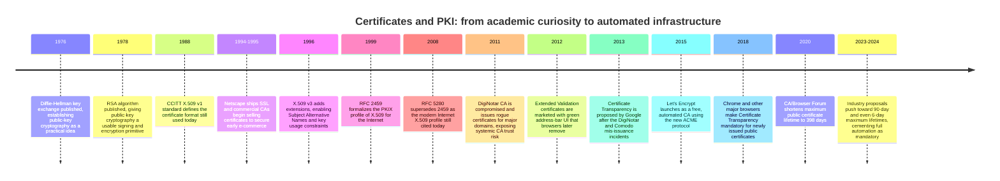

Two structural shifts matter more than any single date. First, **X.509 v3's
extension mechanism (1996)** turned the certificate from a rigid, single-name
document into an extensible container — this is what later made Subject
Alternative Names, key usage constraints, and eventually CT log commitments
possible without breaking the base format. Second, **Let's Encrypt and ACME
(2015)** did not just make certificates cheaper — they made short-lived,
frequently-rotated certificates *operationally viable* for the first time,
which in turn is what let the industry keep shortening maximum lifetimes
without causing an operational crisis. Section 8 (Production Architecture)
and Section 22 (Real-World Case Study) return to this shift in depth, since
it is the single biggest architectural change in this chapter's scope.

## 3. Why It Exists

A public key is, by itself, just a number. Anyone can generate a key pair,
including an attacker, and publish the public half claiming to be
`bank.example.com`. TLS's cryptography proves that whoever is on the other
end of the connection holds the *matching private key* — but that only
matters if there is an independent, verifiable reason to believe the
public key genuinely belongs to `bank.example.com` and not to an impostor
who generated their own key pair five minutes ago. Certificates exist to
close exactly this gap: a trusted third party (the CA) checks — to a
degree defined by the validation level, Section 4.4 — that the requester
actually controls the domain (or represents the organization) named in the
certificate, and then cryptographically signs a statement binding that
public key to that identity. Anyone holding the CA's own public key (via
the CA's certificate, which is either pre-trusted or itself signed by
something pre-trusted) can verify that signature without ever having to
call the CA or the domain owner directly.

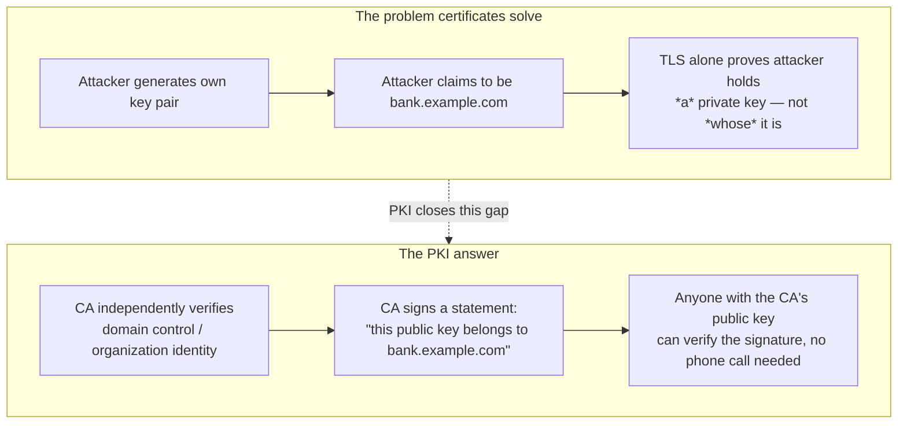

Without this, secure communication would not scale past pairs of parties who
had already exchanged keys through some other trusted channel — which is
exactly how pre-web cryptographic systems worked, and exactly why they never
scaled to an open internet with billions of first-time connections between
strangers every day. PKI is, architecturally, a trust-distribution problem
solved by delegation: instead of every client verifying every server
directly, clients verify a small, curated set of roots, and CAs do the
per-server verification work on the clients' behalf, at scale.

## 4. Core Concepts

### 4.1 Certificate anatomy — the fields that make up an X.509 certificate

**Definition.** An X.509 certificate is a structured, digitally signed data
object (encoded in ASN.1/Distinguished Encoding Rules, almost always shown
in PEM (Privacy-Enhanced Mail) Base64 text form) containing an identity
claim, a public key, validity constraints, and a signature from the issuing
CA over all of it. Understanding a certificate means understanding what each
field actually asserts — and, just as importantly, what it does *not*
assert.

**Mechanism (field-by-field).**

- **Version** — almost always `3`, meaning the certificate can carry
  extensions (Section 4.2). Version 1 and 2 certificates have no extension
  mechanism and are essentially extinct in production.
- **Serial Number** — a CA-assigned integer, unique per-CA, that uniquely
  identifies this certificate. This is the identifier used in CRLs
  (Section 4.6) to name a specific revoked certificate.
- **Signature Algorithm** — the algorithm the *issuing CA* used to sign this
  certificate (e.g. `sha256WithRSAEncryption` or an ECDSA (Elliptic Curve
  Digital Signature Algorithm) variant). This is not the algorithm the
  certificate's own key uses for TLS — it describes how the CA vouched for
  it.
- **Issuer** — the Distinguished Name (DN) of the CA that signed this
  certificate, e.g. `CN=R3, O=Let's Encrypt, C=US`. This is the field a
  client follows *backward* to find the next link in the chain (Section
  4.3).
- **Validity (Not Before / Not After)** — the window during which the
  certificate is considered valid. A client checks the *current* time
  against this window on every connection; there is no grace period, and
  clock skew on either side is a real, frequently-hit failure mode
  (Section 15).
- **Subject** — the DN of the entity the certificate is issued *to*. For
  modern web certificates the Subject Common Name (CN) is often empty or
  ignored by clients entirely in favor of the SAN extension (Section 4.2)
  — this is a common point of confusion since the CN field still exists
  and still shows a hostname-looking value in many certificates for
  backward compatibility, even though no modern browser trusts it alone.
- **Subject Public Key Info** — the actual public key this certificate is
  vouching for, plus the algorithm it uses (RSA, ECDSA, or increasingly
  Ed25519 in non-web contexts). This is the key whose matching private key
  the server must prove possession of during the TLS handshake (see
  [CH06_TLS.md Section 5](CH06_TLS.md#5-internal-working) for the handshake
  trace).
- **Extensions** — the extensible v3 block covered fully in Section 4.2.
- **Certificate Signature** — the CA's actual signature, computed over a
  hash of every preceding field. Any modification to any field —
  including one bit of the public key or one character of the Subject —
  invalidates this signature, which is exactly the tamper-evidence
  property PKI depends on.

**Decision implications.** As a Solution Architect, the fields that matter
operationally are Validity (drives renewal automation, Section 4.7),
Subject/SAN (drives which hostnames a single certificate can legitimately
cover — getting this wrong means either over-provisioning wildcard
certificates that widen blast radius, or under-provisioning and causing
hostname-mismatch outages), and the key algorithm (RSA-2048 is still the
safe default for broad compatibility; ECDSA P-256 is smaller and faster to
negotiate and is now widely supported, and is the default for most modern
automated issuance).

**Common failure mode.** Treating the Subject CN as authoritative for
hostname matching. Since 2000 (RFC 2818) and enforced strictly by all major
browsers since roughly 2017, the CN field is **ignored for hostname
validation** — only the SAN extension's `DNS:` entries are checked. A
certificate with a correct-looking CN but no matching SAN entry will fail
validation in any modern client, which surprises engineers who inspect a
certificate with `openssl x509 -text` and see what looks like the right
hostname in the Subject line without checking the SAN block underneath.

```mermaid
flowchart TB
    subgraph Cert["X.509 Certificate — what it actually asserts"]
        V["Version: 3"]
        SN["Serial Number: CA-unique ID"]
        SA["Signature Algorithm"]
        ISS["Issuer: signing CA's identity"]
        VAL["Validity: Not Before / Not After"]
        SUB["Subject: entity identity (CN often ignored today)"]
        PK["Subject Public Key Info: the actual key being vouched for"]
        EXT["Extensions: SAN, Key Usage, EKU, ... (Section 4.2)"]
        SIG["CA Signature: over a hash of every field above"]
    end
    V --> SN --> SA --> ISS --> VAL --> SUB --> PK --> EXT --> SIG
    SIG -.->|any prior field changes,<br/>this signature no longer verifies| SIG
```

### 4.2 Extensions: Subject Alternative Names, Key Usage, and Extended Key Usage

**Definition.** X.509 v3 extensions are typed, optionally-critical
data fields attached to a certificate beyond the base v1 structure. Three
extensions matter enormously in practice: Subject Alternative Name (SAN),
Key Usage, and Extended Key Usage (EKU).

**Mechanism.**

- **Subject Alternative Name (SAN)** — a list of additional identities the
  certificate is valid for: `DNS:` entries for hostnames (including
  wildcards like `DNS:*.example.com`, which covers exactly one label depth
  and never the bare apex domain), `IP:` entries for IP-address-based
  TLS, and less commonly `email:` or `URI:` entries for non-web use cases.
  Modern hostname validation checks *only* this list — a certificate can
  legitimately cover `example.com`, `www.example.com`, and
  `api.example.com` in one certificate by listing all three as SAN
  entries, which is exactly how multi-domain (SAN/Unified Communications)
  certificates work.
- **Key Usage** — a bitmask constraining *what cryptographic operations*
  the key may legitimately be used for: `digitalSignature`,
  `keyEncipherment`, `keyCertSign` (only meaningful on CA certificates —
  this bit is what lets a certificate itself sign *other* certificates),
  `cRLSign`, and others. A leaf certificate should never carry
  `keyCertSign` — if it does, and a client fails to check this extension,
  a compromised leaf key could be abused to mint fraudulent sub-certificates.
- **Extended Key Usage (EKU)** — further constrains the *purpose*:
  `serverAuth`, `clientAuth` (both relevant to mTLS — see
  [CH06_TLS.md Section 4.10](CH06_TLS.md#410-mutual-tls-mtls-for-service-to-service-authentication)
  for the handshake mechanics that consume this), `codeSigning`,
  `emailProtection`, and others. A certificate issued purely for code
  signing should be rejected by a TLS client even if every other field
  looks correct, because EKU says it was never meant to authenticate a
  server or client connection.

**Decision implications.** Architecturally, SAN design determines
blast radius: a single wildcard certificate covering `*.internal.example.com`
is operationally convenient (one certificate, one renewal cycle) but means
compromising that one private key compromises every subdomain's TLS
identity simultaneously — the opposite of the "individually revocable
identity" property that mTLS-based zero-trust architectures want (Section
4.8). Key Usage and EKU matter most when architects design a private CA:
issuing leaf certificates without `keyCertSign` and with the narrowest EKU
that satisfies the use case is a cheap, high-value guardrail against a
compromised leaf key being escalated into a rogue sub-CA.

**Common failure mode.** Provisioning a client certificate without
`clientAuth` in its EKU (or a server certificate without `serverAuth`) —
strict TLS stacks (notably Go's `crypto/tls` and many service meshes) will
reject the handshake outright, producing an error that looks like a trust
or chain problem but is actually a purpose-mismatch problem, wasting
significant debugging time if the engineer only checks the chain and
Subject and never inspects EKU.

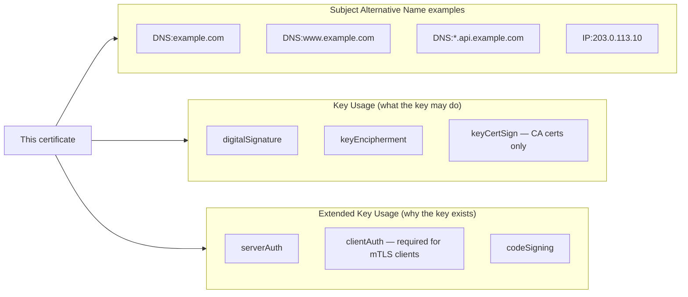

### 4.3 The CA trust hierarchy and chain of trust

**Definition.** A chain of trust is the ordered sequence of certificates —
leaf (end-entity), zero or more intermediates, and a root — where each
certificate is signed by the private key corresponding to the *next*
certificate up the chain, terminating at a **root CA** certificate the
verifying client already trusts unconditionally (typically pre-installed
in the operating system's or browser's trust store).

**Mechanism.** When a server presents its leaf certificate during a TLS
handshake ([CH06_TLS.md Section 4.4](CH06_TLS.md#44-certificate-chains-and-the-ca-trust-model-recap)
covers this from the handshake's point of view), it also sends the
intermediate certificate(s) needed to walk from the leaf up to a root the
client already trusts. The client verifies each signature in turn: does the
leaf's signature verify under the intermediate's public key? Does the
intermediate's own signature verify under the next certificate's public
key? This repeats until it reaches a certificate already present, byte-for-
byte, in the client's trust store — at which point the client trusts the
entire chain transitively, because it trusts the root unconditionally and
every link in between was cryptographically vouched for by the link above
it.

**Why intermediate CAs exist — the architectural reason, not just the
convention.** It would be simpler, in principle, for every leaf certificate
to be signed directly by a root CA. The industry deliberately does not do
this, for one overriding reason: **root key protection.** A root CA's
private key is the single most valuable cryptographic secret in the entire
public PKI ecosystem — if it leaks, every certificate ever issued under it
(and every certificate that could ever be forged under it) is suspect, and
the only remedy is removing that root from every operating system and
browser trust store on Earth, which is a slow, painful, high-blast-radius
operation. Root keys are therefore generated and stored in air-gapped
hardware security modules (HSMs), used only rarely (often in an audited
physical ceremony), and almost never touch a network-connected system.
**Intermediate CAs exist specifically to be the thing that signs
certificates day-to-day**, so the root key can stay offline almost all the
time. If an intermediate's key is ever compromised, the operational fix is
proportionate: revoke that one intermediate (Section 4.6), reissue the
leaf certificates it had signed under a new intermediate, and the root
itself never has to be touched or distrusted. This is defense in depth
applied to key custody, and it is the single most important architectural
reason the CA hierarchy has the shape it does.

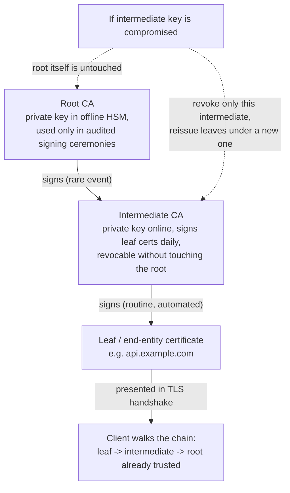

**Decision implications.** When designing a private CA for internal PKI
(Section 4.8), architects should replicate this same structure rather than
signing every workload certificate directly from a single private root:
keep the private root offline and rarely used, and let an online
intermediate (or, in high-scale internal PKI, several intermediates per
region or environment) do the actual short-lived leaf issuance. This
bounds the blast radius of the far more exposed online-issuance component.

**Common failure mode.** Sending only the leaf certificate and omitting the
intermediate chain during a TLS handshake. Many modern browsers tolerate
this by caching intermediates they have seen from other sites (AIA
chasing, using the Authority Information Access extension to fetch a
missing intermediate), which masks the problem in casual browser testing —
but non-browser HTTP clients, mobile app TLS stacks, and most server-to-
server clients do *not* do this caching, and the connection fails outright.
This is one of the most common real-world TLS/PKI outages and is covered
further in Section 15.

### 4.4 Validation levels: Domain Validation, Organization Validation, and Extended Validation

**Definition.** Public CAs issue certificates at three validation levels
that differ in *how much* the CA verifies before issuing, not in the
cryptographic strength of the resulting certificate:

- **Domain Validation (DV)** — the CA verifies only that the requester
  controls the domain named in the certificate (via one of several
  ACME challenge types, Section 4.7). No organizational identity is
  checked at all.
- **Organization Validation (OV)** — the CA additionally verifies that a
  named legal organization exists (business registry lookup) and that the
  requester is authorized to act on its behalf, which typically takes
  hours to a few days of manual review.
- **Extended Validation (EV)** — the CA performs a more rigorous,
  standardized identity-verification process defined by the CA/Browser
  Forum, including verified legal, physical, and operational existence of
  the organization, historically taking days.

**The architectural and trust meaning versus the marketing perception.**
This is the single most misunderstood concept in this space, and it is
worth being precise about it as an architect, not just as a consumer of
marketing copy. **All three levels produce a certificate that is
cryptographically identical in strength** — same key sizes, same signature
algorithms, same encryption the resulting TLS session gets. The *only*
difference is what the CA claims to have verified about the requester's
identity before issuing. EV certificates were marketed for years with a
green address-bar and company-name display specifically to imply "this
connection is more secure" — but every major browser (Chrome from 2019,
Firefox shortly after) **removed that distinguishing UI entirely**, because
independent research (and repeated real-world incidents) showed that EV's
extra identity vetting did not measurably reduce phishing, since attackers
simply registered legitimately-named shell companies and obtained
legitimate EV certificates for them. The practical, architecture-relevant
takeaway: **DV is entirely sufficient for encryption-in-transit and for
proving domain control**; OV/EV add organizational-identity assurance that
matters for specific compliance or brand-verification requirements (some
enterprise/government procurement policies still mandate OV or EV
specifically), but they add zero cryptographic strength and, since the
UI changes, essentially zero end-user-visible signal anymore.

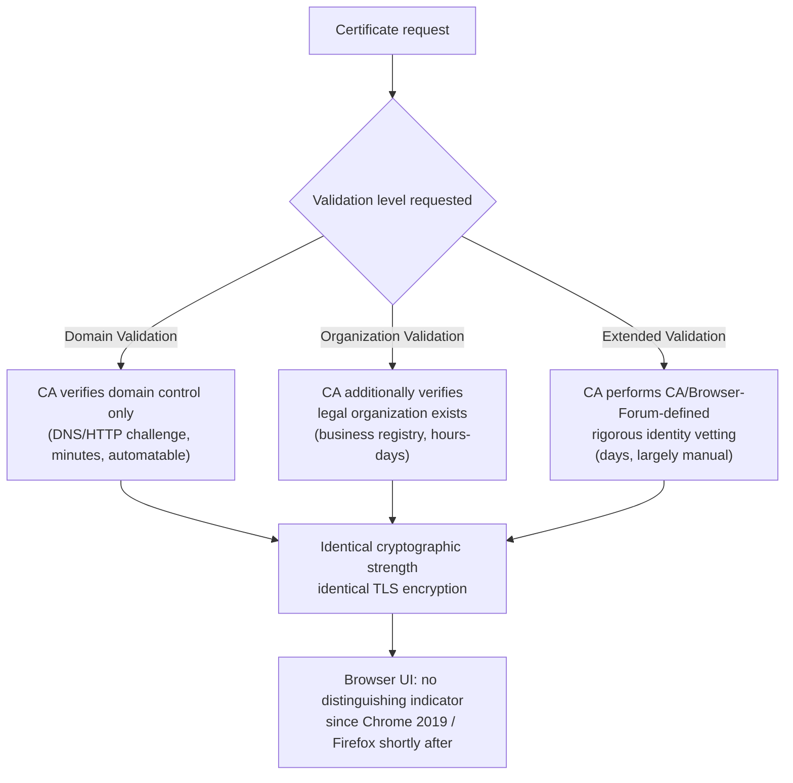

**Decision implications.** For the overwhelming majority of public-facing
and internal services, DV certificates issued via ACME automation (Section
4.7) are the correct default — they cost nothing, renew automatically, and
provide exactly the cryptographic assurance a TLS connection needs. Reach
for OV/EV only when a specific compliance framework, procurement
requirement, or contractual obligation names it explicitly; do not choose
it believing it makes the connection more secure or more trusted by end
users, because as of current major browsers, it visibly does neither.

### 4.5 Certificate lifecycle: issuance and renewal

**Definition.** The certificate lifecycle is the recurring process by which
a certificate is requested, issued, deployed, monitored as it approaches
expiry, and renewed (or replaced) before that expiry — ideally without any
manual intervention at all in a modern architecture.

**Mechanism.** The canonical lifecycle has five stages: (1) **key
generation** — a new (or reused, though reuse is discouraged) key pair is
generated on the entity that will hold the certificate; (2) **Certificate
Signing Request (CSR) creation** — the public key plus the identity claim
(Subject, SAN entries) is packaged and signed with the *requester's own*
private key, proving the requester holds that private key, without
revealing it; (3) **submission and validation** — the CA validates the
claim at the appropriate level (Section 4.4); (4) **issuance** — the CA
signs the certificate and returns it; (5) **deployment and monitoring** —
the certificate is installed at the TLS termination point, and its expiry
is tracked so renewal (repeating from step 1 or 2) happens with margin to
spare, never at the last possible moment.

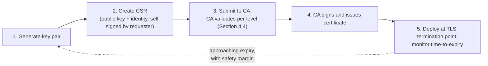

**Decision implications.** The critical architectural decision here is
*how much lead time* renewal has before expiry, and whether renewal is
automated or manual. Manual renewal on an annual cycle is exactly the
pattern that has caused a long history of expired-certificate production
outages at well-resourced companies — because a once-a-year task, done by
a human, reliably falls through organizational cracks (the engineer who
set it up leaves, the calendar reminder is missed, an unrelated freeze
window blocks the change). Automated renewal with a short certificate
lifetime (Section 4.7) converts "a certificate might expire" from a
once-a-year fire drill into background infrastructure noise, which is a
strictly better failure profile: if automation breaks, a 90-day
certificate gives weeks of warning before impact, while a break in a once-
a-year manual process might not be noticed until the outage itself.

**Common failure mode.** Renewing a certificate but forgetting to reload or
restart the service that holds it in memory — many TLS-terminating
processes (nginx workers, JVM (Java Virtual Machine) processes holding a
`KeyStore`) read the certificate file once at startup and do not
automatically pick up a replaced file on disk, so the renewal succeeds but
the running process keeps serving the old, soon-to-expire certificate
until an explicit reload or restart is triggered as part of the renewal
pipeline.

### 4.6 Revocation: CRL, OCSP, and OCSP stapling

**Definition.** Revocation is the mechanism by which a CA declares a
previously-valid certificate untrustworthy before its natural expiry —
typically because the private key was compromised, the certificate was
mis-issued, or the entity it identifies no longer controls the domain or
organization. Two mechanisms exist to let clients check revocation status:
the Certificate Revocation List (CRL) and the Online Certificate Status
Protocol (OCSP).

**Mechanism — CRL.** A CRL is a CA-signed list of serial numbers of every
certificate that CA has revoked, published at a URL and refreshed
periodically. A client wanting to check a certificate downloads the
(potentially large) CRL and scans it for the certificate's serial number.
This does not scale gracefully — CRLs for large CAs can be megabytes, they
grow monotonically until reissued, and a client that fails to fetch the
CRL has to decide whether to fail open (skip the check, less secure) or
fail closed (block the connection, less available).

**Mechanism — OCSP.** OCSP replaces "download a list and search it" with a
single targeted query: the client sends the certificate's serial number to
an OCSP responder URL (found in the certificate's Authority Information
Access extension) and receives a small, signed `good`, `revoked`, or
`unknown` response for that one certificate. This is far lighter-weight
than a CRL, but it introduces a new problem of its own: it requires a live
network round trip to the CA's infrastructure on every single TLS
connection (or at least a caching interval's worth of connections),
which adds latency, and — architecturally significant — **it leaks
browsing metadata to the CA**, since the CA's OCSP responder learns which
sites a given client IP is visiting and when.

**Mechanism — OCSP stapling.** OCSP stapling moves the OCSP query from the
*client* to the *server*. The server itself periodically queries the OCSP
responder for its own certificate's status, caches the signed response,
and "staples" that pre-fetched, signed OCSP response directly onto the TLS
handshake it sends to clients. The client verifies the stapled response's
signature (from the CA, over the "good" status) without ever contacting
the CA's OCSP infrastructure itself. This solves both problems at once:
latency (no extra round trip per client connection — the server did the
round trip once, on its own schedule, and reuses the cached response) and
privacy (the CA sees the *server's* periodic query pattern, not each
individual client's browsing behavior).

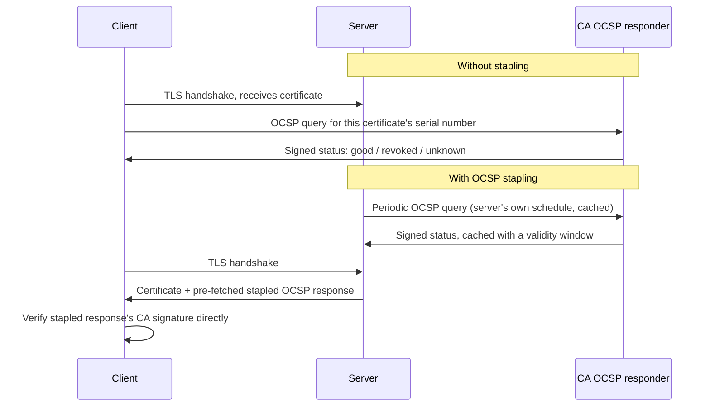

**Decision implications.** Architects deploying public-facing TLS
termination should always enable OCSP stapling where the termination point
supports it (nearly universal in modern nginx, HAProxy, and cloud load
balancer offerings) — it is close to a pure win: lower client-perceived
latency, better privacy, and lower load on the CA's own OCSP
infrastructure. CRL remains relevant mainly for offline or air-gapped
verification scenarios (code signing, some internal PKI use cases) where a
periodically-synced list is more practical than a live network query.

**Common failure mode.** "Soft-fail" revocation checking — the default
behavior in most browsers historically, where if the OCSP responder is
unreachable, the client proceeds as if the certificate were valid rather
than blocking the connection. This is a deliberate availability-over-
security trade-off (a CA outage should not take down the entire web), but
it means revocation checking alone is not a reliable enforcement
mechanism against a truly determined attacker who can also block the
victim's OCSP traffic — a subtlety worth knowing when someone claims
"we revoked the cert, so we're safe" as the sole mitigation for a key
compromise.

### 4.7 The automation revolution: ACME and Let's Encrypt

**Definition.** The Automatic Certificate Management Environment (ACME)
protocol (RFC 8555) is a standardized, machine-to-machine protocol for
requesting, validating, and renewing domain-validated certificates without
any human in the loop. Let's Encrypt, launched in 2015 by the Internet
Security Research Group, was the first CA built specifically around ACME,
offering DV certificates free of charge, explicitly to make automation the
path of least resistance for the entire web.

**Mechanism.** An ACME client (`certbot`, `acme.sh`, a Kubernetes
`cert-manager` controller, or a library embedded directly in infrastructure
code) proves domain control to the CA using one of several standardized
**challenge types**: `HTTP-01` (place a specific token at a well-known
path the CA fetches over HTTP), `DNS-01` (create a specific TXT record the
CA queries, the only option that works for wildcard certificates), or
`TLS-ALPN-01` (respond to a special TLS connection with a self-signed
certificate containing the token, useful when port 80/HTTP is unavailable).
Once the challenge succeeds, the CA issues the certificate automatically,
typically within seconds, and the client stores it and schedules the next
renewal well before the 90-day expiry Let's Encrypt uses (shorter-lived
than the CA/Browser Forum's 398-day public-certificate maximum, and
several industry proposals as of this writing push toward even shorter
default lifetimes).

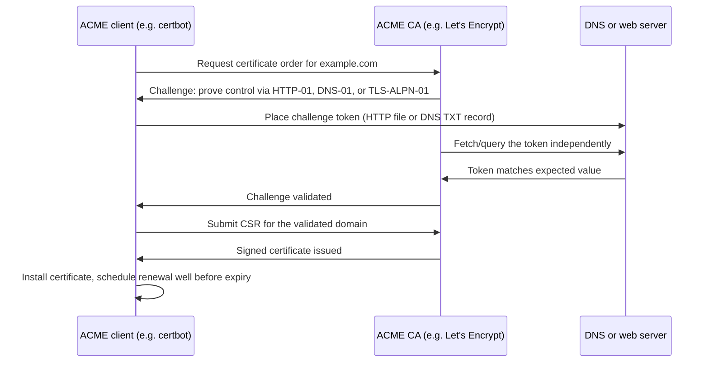

**Why this is a genuine architecture shift, not just a cheaper product.**
Before ACME, certificate issuance was a manual, human-mediated,
often-annual process: generate a CSR, paste it into a CA's web portal,
prove domain control via an emailed link or a manual DNS change, wait
for issuance (often hours to days for anything above DV), download the
certificate, and manually install it — repeated once a year, per
certificate, by whoever remembered to do it. This shaped the entire
industry's default posture toward long-lived certificates (because
issuance was expensive in human time, engineers requested the longest
lifetime the CA allowed) and toward risk-averse, infrequent rotation
(because rotating meant repeating the manual process). ACME inverted
both defaults: because issuance is now an API call with no human
step, **short lifetimes stopped being an operational burden and became
a security feature** — a certificate that expires in 90 days (or less)
bounds the maximum damage window of an undetected key compromise or a
missed revocation to that same short window, and frequent automated
rotation is now the industry's recommended default rather than an
exotic practice reserved for the most security-conscious teams. This is
the case study referenced from Section 22 in more operational depth.

### 4.8 Private CA and internal PKI for service-to-service mTLS

**Definition.** A private (or internal) CA is a Certificate Authority an
organization operates for itself, trusted only by its own systems (added
explicitly to internal trust stores, never trusted by the public
internet), used to issue certificates for internal services, workloads,
and devices at a rotation cadence and scale that a public CA is not
designed for.

**Recap — mTLS itself is owned by [CH06_TLS.md](CH06_TLS.md).** The
handshake mechanics of mutual TLS — both sides presenting and validating a
certificate, the `CertificateRequest`/`CertificateVerify` message flow —
are taught in full in
[CH06_TLS.md Section 4.10](CH06_TLS.md#410-mutual-tls-mtls-for-service-to-service-authentication).
This chapter's concern is narrower and complementary: **the certificate
issuance and rotation infrastructure that makes mTLS practical at the
scale of hundreds or thousands of short-lived service instances**, which
public CAs and manual issuance simply cannot support.

**Mechanism.** At small scale, a private CA can be as simple as an offline
root key and a script that signs short-lived leaf certificates for each
service on deployment. At the scale modern container/orchestration
platforms operate — services scaling up and down continuously, with
individual instances living for minutes to hours — manual or even simple
scripted issuance breaks down, and the industry has converged on
**workload identity frameworks**, of which **SPIFFE (Secure Production
Identity Framework For Everyone)** and its reference implementation
**SPIRE (the SPIFFE Runtime Environment)** are the dominant open standard.
SPIFFE defines a URI-based identity format, the **SPIFFE ID**
(`spiffe://trust-domain/path`, e.g.
`spiffe://prod.example.com/ns/payments/sa/checkout-service`), and a
workload API that lets any process on a node request a short-lived X.509
certificate (an **SVID**, SPIFFE Verifiable Identity Document) asserting
its own SPIFFE ID, without the workload ever handling the CA's private key
or a long-lived credential at all — the SPIRE agent on each node attests
the workload's identity (via Kubernetes service account, process
attributes, or cloud instance metadata) and only then issues it a
certificate scoped to minutes-to-hours of validity, automatically rotated
before expiry.

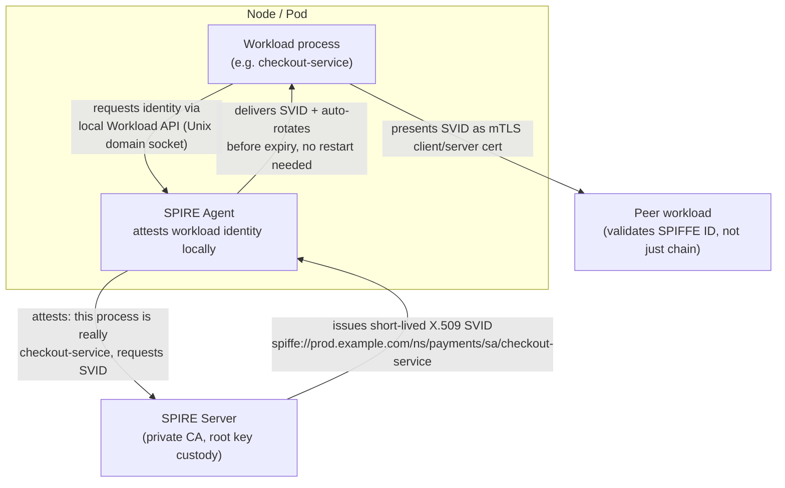

**Decision implications.** The architectural payoff of a SPIFFE/SPIRE-style
system over a hand-rolled private CA is threefold: identity is tied to
verified *workload* attributes rather than a static file or environment
variable that can be copied; certificates are short-lived and rotated
automatically, bounding compromise blast radius the same way ACME does for
public certificates (Section 4.7); and a peer verifying a certificate
checks not just "is this chain valid" but "does this SPIFFE ID match the
identity I expect to be talking to," which closes exactly the gap flagged
as a common mTLS failure mode in
[CH06_TLS.md Section 4.10](CH06_TLS.md#410-mutual-tls-mtls-for-service-to-service-authentication)
(a valid mTLS certificate from *any* workload being treated as sufficient
authorization). Section 10 (Complete Code Examples) includes a
representative SPIRE server/agent registration configuration.

**Common failure mode.** Standing up a private CA's root key on the same
network-connected system that performs day-to-day issuance — reproducing
exactly the root-key-exposure risk that the public CA hierarchy's
root/intermediate split (Section 4.3) exists to avoid. A private CA
architecture should apply the same intermediate-signs-daily,
root-stays-offline discipline, not treat "it's just internal" as a reason
to skip it.

### 4.9 Certificate pinning and its operational risks

**Definition.** Certificate pinning is the practice of hard-coding (pinning)
a client's trust to one specific certificate or public key — or one
specific CA — rather than trusting any certificate that validates against
the client's full trust store. HTTP Public Key Pinning (HPKP) was the
standardized browser mechanism for this; it is now deprecated and removed
from browsers, but pinning remains common in native mobile apps and some
service-to-service clients implemented manually in application code.

**Mechanism.** Instead of asking "does this certificate chain to any
trusted root," a pinned client asks "does this certificate (or its public
key, or an intermediate/root in its chain) match one of a small,
explicitly configured allow-list, embedded in the client at build time."
This defeats an entire class of attack that chain validation alone does
not: a compromised or coerced CA (or a state-level actor with CA access)
issuing a *validly signed* but fraudulent certificate for a domain it does
not actually control — chain validation alone would accept such a
certificate, since it really is signed by a trusted root, but pinning
would reject it because the specific pinned key/certificate does not
match.

**Why it's a risky architecture choice — the real operational failure
modes.** Pinning trades one risk (rogue-CA mis-issuance) for a different,
often larger operational risk: **the pin itself becomes a single point of
renewal failure.** If the pinned certificate or key needs to change —
because of a routine renewal, an unplanned emergency reissuance after a
key compromise, or a CA/intermediate change — every client that has the
old pin baked in will now reject the legitimate new certificate as if it
were an attack, since from the pinned client's point of view a changed key
is indistinguishable from a compromised one. For a native mobile app, this
means every user is broken until they update the app through an app-store
review-and-rollout cycle that can take days — turning a routine
certificate rotation into a forced-upgrade outage. Multiple well-known
production incidents (several major apps in the mid-2010s) followed
exactly this pattern: an expiring pinned certificate, a rotation the
server side handled correctly, and millions of older app installs unable
to connect until they updated.

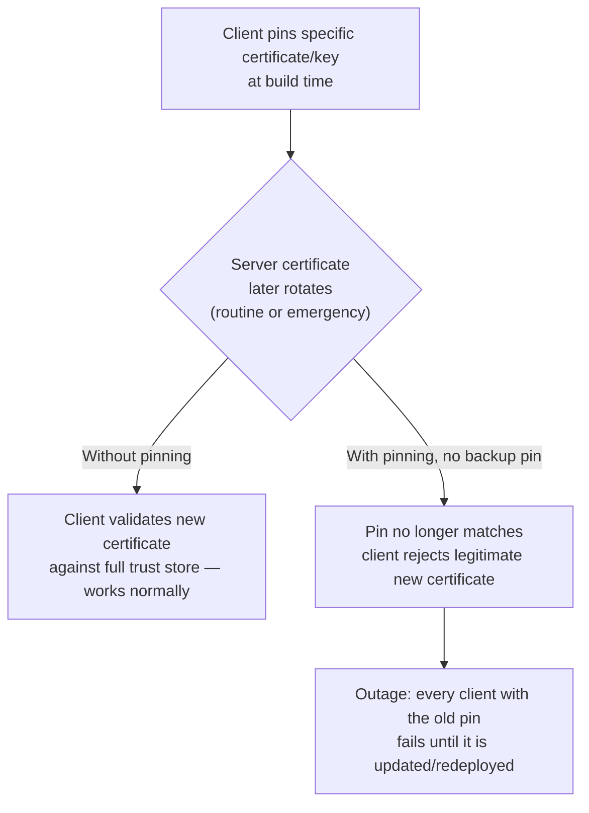

**Decision implications.** Where pinning is genuinely warranted (high-value
mobile apps defending against targeted CA-compromise threats, or
service-to-service clients defending an especially sensitive internal
boundary), it must always be paired with an operational discipline that
avoids the failure mode above: pin to a **CA or intermediate**, not a
single leaf certificate (so routine leaf renewal under the same
intermediate doesn't break anything), and always ship **at least one
backup pin** for a certificate or key not yet in production, so a planned
rotation can happen without an app-store-cycle-length outage window. For
most architectures, the SPIFFE-style identity check described in Section
4.8 (verify the *identity* the certificate asserts, not the literal bytes
of the certificate) achieves the same anti-impersonation goal with far
less operational fragility, and is the preferred modern alternative.

### 4.10 Certificate Transparency: public accountability against mis-issuance

**Definition.** Certificate Transparency (CT) is a framework of public,
append-only, cryptographically verifiable logs that record every publicly
trusted certificate issued by participating CAs, so that domain owners,
security researchers, and browsers can detect mis-issued or fraudulent
certificates for any domain, regardless of which CA issued them.

**Mechanism.** When a CA issues a publicly trusted certificate, it (or the
requester) submits it to one or more independent CT logs. Each log returns
a **Signed Certificate Timestamp (SCT)** — a promise, signed by the log,
that the certificate will be incorporated into the log's public,
Merkle-tree-structured record within a bounded time. Modern browsers
require a valid SCT (embedded in the certificate itself, delivered via a
TLS extension, or via OCSP stapling) as a condition of trusting the
certificate at all — a certificate without a valid SCT from a recognized
log is simply rejected by Chrome and other major browsers since roughly
2018. Because the logs are append-only and independently auditable
(anyone can run a "monitor" that watches every log for certificates
issued for domains they care about), a CA that mis-issues — whether
through compromise, error, or coercion — cannot do so quietly; the
mis-issued certificate becomes part of the public record the moment it
enters a log, and domain owners running monitors are alerted.

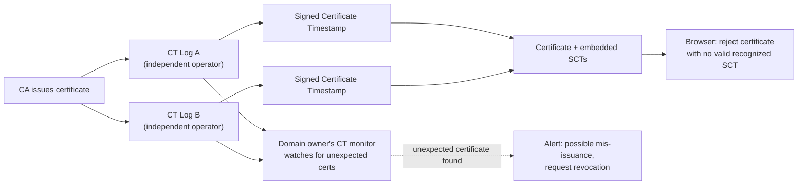

**Decision implications.** As a Solution Architect, the actionable
takeaway is operational, not just theoretical: run (or subscribe to) a CT
monitor for every domain your organization owns. This turns CT from a
passive browser-enforcement mechanism into an active early-warning system
— catching a mis-issued certificate for your domain (whether from CA
error, account compromise at your registrar/CA account, or an internal
mistake by another team requesting a certificate you didn't expect) within
minutes of it entering a public log, rather than discovering it only after
it is exploited.

**Common failure mode.** Treating CT purely as "a browser requirement I
don't need to think about" rather than as a monitoring capability.
Organizations that never set up a CT monitor lose one of the cheapest,
highest-signal detective controls available against domain-impersonation
attacks — SCTs are already public for every certificate ever issued for
your domains; the only missing piece is watching them.

## 5. Internal Working

Tracing a full issuance-to-revocation lifecycle end-to-end grounds the
concepts above in what actually happens on the wire and on disk. Consider a
service requesting a fresh certificate via ACME (Section 4.7), backed by a
private CA's intermediate (Section 4.3), and later staple-checked via OCSP
(Section 4.6):

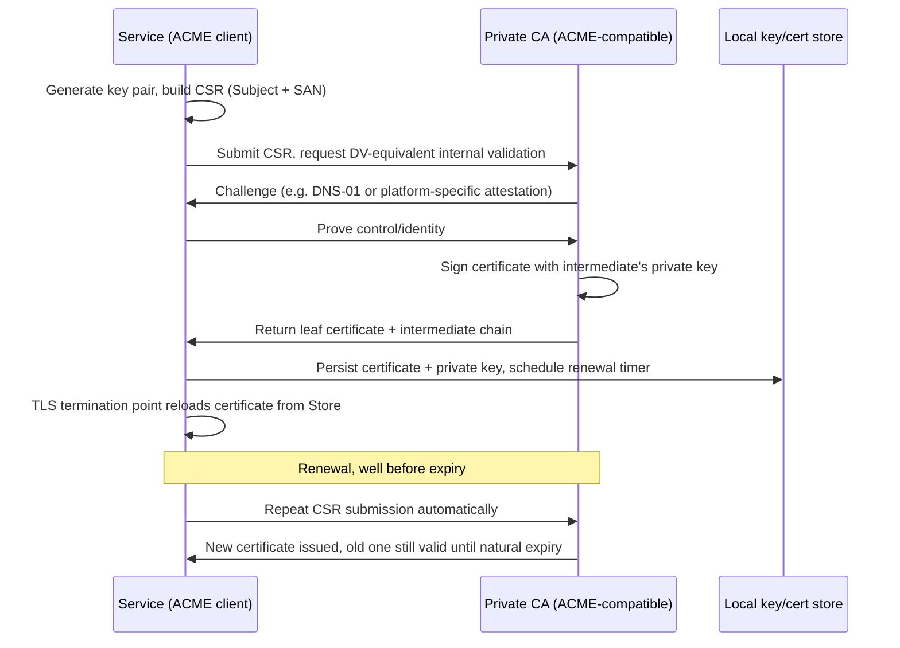

The `openssl x509 -text -noout` output below (annotated) is what an
architect debugging a chain or field-mismatch issue actually reads —
recognizing which line maps to which concept above turns an opaque wall of
text into a diagnostic tool:

```
Certificate:
    Data:
        Version: 3 (0x2)                              # v3 -> extensions present, Section 4.1
        Serial Number: 04:a1:...                      # unique per-CA, used in CRL/OCSP lookups
        Signature Algorithm: sha256WithRSAEncryption   # how the ISSUER signed this cert
        Issuer: CN=Internal Intermediate CA, O=Example Corp   # Section 4.3
        Validity
            Not Before: Jan  5 00:00:00 2026 GMT       # Section 4.5 lifecycle window
            Not After : Apr  5 00:00:00 2026 GMT       # 90-day pattern, Section 4.7
        Subject: CN=checkout-service                   # legacy field, often ignored, Section 4.1
        Subject Public Key Info:
            Public Key Algorithm: id-ecPublicKey        # Section 4.1 key material
        X509v3 extensions:
            X509v3 Subject Alternative Name:
                DNS:checkout-service.prod.svc, URI:spiffe://prod.example.com/ns/payments/sa/checkout-service
            X509v3 Key Usage: critical
                Digital Signature, Key Encipherment      # Section 4.2 — no keyCertSign, correctly a leaf
            X509v3 Extended Key Usage:
                TLS Web Server Authentication, TLS Web Client Authentication   # supports mTLS both ways
            Authority Information Access:
                OCSP - URI:http://ocsp.internal.example.com   # Section 4.6 revocation-check endpoint
```

## 6. Design Principles

- **Root key custody is the highest-value control in the whole system.**
  Every design decision in this chapter — the intermediate layer (Section
  4.3), the private-CA structure (Section 4.8) — exists to keep the root
  key rarely used and never network-exposed. Treat any architecture that
  puts a root key on a routinely-accessed system as a critical finding.
- **Short-lived and automated beats long-lived and manual.** ACME (Section
  4.7) demonstrated this at internet scale; the same reasoning applies
  internally — bound the blast radius of a compromised or leaked
  certificate by making its natural lifetime short and its renewal
  unattended.
- **Fail closed on validation, fail open only where availability truly
  outweighs the marginal security loss.** Chain validation must fail
  closed (Section 4.3); soft-fail revocation checking (Section 4.6) is a
  deliberate, narrow exception justified by CA-outage blast radius, not a
  general principle to copy elsewhere.
- **Verify identity, not just validity.** A cryptographically valid chain
  proves the certificate was legitimately issued; it does not by itself
  prove the presenter is the specific peer you intended to talk to
  (Section 4.8's SPIFFE ID check, and the mTLS common failure mode in
  [CH06_TLS.md](CH06_TLS.md#410-mutual-tls-mtls-for-service-to-service-authentication)).
- **Prefer identity checks over pinning where possible.** Pinning (Section
  4.9) solves a real threat but introduces a real, historically-proven
  outage risk; reach for it deliberately and with backup pins, not as a
  default hardening step.

## 7. Architecture Patterns

- **Public CA + ACME automation for internet-facing services.** The
  default pattern for anything with a public hostname: DV certificates
  (Section 4.4), issued and renewed automatically (Section 4.7), OCSP
  stapling enabled (Section 4.6).
- **Private CA + workload identity for internal service-to-service
  traffic.** SPIFFE/SPIRE or an equivalent (Section 4.8), feeding
  short-lived leaf certificates into the mTLS pattern taught in
  [CH06_TLS.md Section 7](CH06_TLS.md#7-architecture-patterns) (sidecar-
  mediated mTLS via a service mesh is the most common delivery mechanism).
- **Hybrid edge/internal split.** A public CA-issued certificate terminates
  TLS at the edge (public trust required, browsers must trust it); a
  private CA issues separate certificates for the internal hop from edge
  to backend, so the internal PKI's shorter lifetimes and workload-identity
  model can be used without needing public browsers to trust an internal
  root.

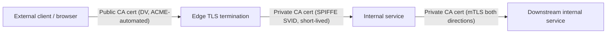

## 8. Production Architecture

A production-grade certificate management architecture treats certificates
as fully automated, observable infrastructure rather than artifacts anyone
manually tracks in a spreadsheet:

- **Issuance layer** — an ACME-compatible CA (public, e.g. Let's Encrypt or
  a commercial ACME CA, or private, e.g. an internal SPIRE server or a
  cloud provider's private CA service) issuing certificates on request
  with no manual approval step for routine renewals.
- **Delivery and storage layer** — certificates and private keys are
  stored in a secrets manager or KMS (Key Management Service)-backed store,
  never committed to source control, and delivered to the exact process
  that needs them (a sidecar, an ingress controller, an application
  process) via a mechanism that also triggers a reload — a certificate
  update that the running process never picks up (Section 4.5's common
  failure mode) is operationally equivalent to a failed renewal.
- **Expiry monitoring and alerting** — independent of the renewal
  automation itself, a separate monitor periodically checks actual
  deployed certificate expiry dates (not just "did the renewal job run
  without error") and alerts well before expiry, because the renewal
  automation itself is exactly the kind of component that can silently
  fail.
- **CT monitoring** (Section 4.10) — watching public CT logs for
  unexpected certificates issued for owned domains.
- **Revocation readiness** — a documented, tested (Section 16) procedure
  for emergency revocation and reissuance if a key is suspected
  compromised, since this is exactly the moment operational unfamiliarity
  causes the most damage.

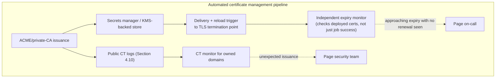

## 9. Implementation

Implementing this pipeline concretely means wiring three pieces together:
an issuance client (ACME or SPIRE agent), a storage/delivery mechanism, and
a reload trigger. Section 10 provides complete, runnable examples for the
core pieces referenced throughout Section 4: manual CSR/certificate
generation with OpenSSL (useful for understanding the fields directly and
for private-CA bootstrapping), an automated ACME renewal script, an nginx
configuration with OCSP stapling enabled, and a SPIRE server/agent
registration configuration for internal workload identity.

## 10. Complete Code Examples

**1. OpenSSL: generating a key pair, a CSR, and a self-signed CA plus a
CA-signed leaf certificate** — this is the manual, first-principles version
of the Section 4.5 lifecycle, useful both for learning the fields directly
and for bootstrapping a private CA's root (Section 4.3):

```bash
#!/usr/bin/env bash
set -euo pipefail

# --- 1. Create a private root CA (offline in production, Section 4.3) ---
openssl genrsa -out root-ca.key 4096
openssl req -x509 -new -nodes -key root-ca.key -sha256 -days 3650 \
    -subj "/C=US/O=Example Corp/CN=Example Corp Root CA" \
    -out root-ca.crt

# --- 2. Create an intermediate CA, signed by the root (Section 4.3) ---
openssl genrsa -out intermediate-ca.key 4096
openssl req -new -key intermediate-ca.key \
    -subj "/C=US/O=Example Corp/CN=Example Corp Intermediate CA" \
    -out intermediate-ca.csr

cat > intermediate-ext.cnf <<'EOF'
basicConstraints=critical,CA:TRUE,pathlen:0
keyUsage=critical,keyCertSign,cRLSign
EOF

openssl x509 -req -in intermediate-ca.csr -CA root-ca.crt -CAkey root-ca.key \
    -CAcreateserial -days 1825 -sha256 \
    -extfile intermediate-ext.cnf \
    -out intermediate-ca.crt

# --- 3. Create a leaf certificate for a service, signed by the intermediate ---
openssl ecparam -name prime256v1 -genkey -noout -out checkout-service.key
openssl req -new -key checkout-service.key \
    -subj "/C=US/O=Example Corp/CN=checkout-service" \
    -out checkout-service.csr

cat > leaf-ext.cnf <<'EOF'
basicConstraints=critical,CA:FALSE
keyUsage=critical,digitalSignature,keyEncipherment
extendedKeyUsage=serverAuth,clientAuth
subjectAltName=DNS:checkout-service.prod.svc,DNS:checkout-service.internal.example.com
EOF

openssl x509 -req -in checkout-service.csr \
    -CA intermediate-ca.crt -CAkey intermediate-ca.key -CAcreateserial \
    -days 90 -sha256 -extfile leaf-ext.cnf \
    -out checkout-service.crt

# --- 4. Inspect the resulting leaf certificate's fields (Section 4.1/4.2) ---
openssl x509 -in checkout-service.crt -noout -text | \
    grep -A2 "Subject Alternative Name\|Key Usage\|Extended Key Usage"

# --- 5. Assemble the full chain the TLS termination point should serve ---
cat checkout-service.crt intermediate-ca.crt > checkout-service-fullchain.pem
```

**2. ACME automation script (certbot) with a safe renewal + reload hook** —
the automated replacement for the manual flow above, implementing the
Section 4.7 renewal cadence and the Section 4.5 "renewal without a
reload is a failed renewal" lesson:

```bash
#!/usr/bin/env bash
# renew-certs.sh — intended to run twice daily via cron/systemd timer.
# certbot itself no-ops if the certificate is not yet within its renewal
# window, so frequent invocation is safe and recommended (Section 4.7).
set -euo pipefail

certbot renew \
    --non-interactive \
    --agree-tos \
    --preferred-challenges dns-01 \
    --dns-route53 \
    --deploy-hook /usr/local/bin/reload-tls-termination.sh

# reload-tls-termination.sh is invoked by certbot ONLY when a certificate
# was actually renewed in this run, avoiding unnecessary reloads:
#
#   #!/usr/bin/env bash
#   set -euo pipefail
#   nginx -t && systemctl reload nginx
#   # Independently verify the deployed cert's actual expiry, not just
#   # "the command exited 0" (Section 8's expiry-monitoring principle):
#   EXPIRY=$(echo | openssl s_client -connect localhost:443 -servername example.com 2>/dev/null \
#       | openssl x509 -noout -enddate)
#   echo "Post-reload deployed certificate: ${EXPIRY}"
```

**3. nginx TLS termination with OCSP stapling enabled** (Section 4.6),
building on the [CH06_TLS.md Section 9](CH06_TLS.md#9-implementation)
base TLS configuration:

```nginx
server {
    listen 443 ssl;
    server_name example.com;

    ssl_certificate     /etc/nginx/certs/example.com/fullchain.pem;
    ssl_certificate_key /etc/nginx/certs/example.com/privkey.pem;

    # OCSP stapling: server pre-fetches and caches the CA's signed status
    # (Section 4.6), so clients never make their own OCSP round trip.
    ssl_stapling on;
    ssl_stapling_verify on;
    ssl_trusted_certificate /etc/nginx/certs/example.com/chain.pem;
    resolver 1.1.1.1 8.8.8.8 valid=300s;
    resolver_timeout 5s;

    # certbot's --deploy-hook reloads this config after every renewal
    # (Section 4.5) — nginx re-reads the certificate files on reload only.
}
```

**4. SPIRE server and agent configuration for internal workload identity**
(Section 4.8) — a minimal but representative registration establishing the
SPIFFE ID structure used in this section's diagram:

```hcl
# spire-server.conf — private CA configuration (Section 4.3's structure
# replicated internally: this "server" plays the intermediate-CA role,
# with its own root key kept in an upstream authority / HSM in production).
server {
    bind_address = "0.0.0.0"
    bind_port    = "8081"
    trust_domain = "prod.example.com"
    data_dir     = "/opt/spire/data/server"
    log_level    = "INFO"

    ca_ttl         = "24h"   # intermediate signing cert lifetime
    default_x509_svid_ttl = "1h"  # leaf SVID lifetime — short by design (Section 4.7)
}

plugins {
    DataStore "sql" {
        plugin_data {
            database_type = "postgres"
            connection_string = "dbname=spire user=spire sslmode=verify-full"
        }
    }
    NodeAttestor "k8s_sat" {
        plugin_data {
            clusters = {
                "prod-cluster" = {
                    service_account_allow_list = ["spire:spire-agent"]
                }
            }
        }
    }
    KeyManager "aws_kms" {
        plugin_data {
            region     = "us-east-1"
            key_prefix = "prod-spire"
        }
    }
}
```

```bash
# Register a workload's identity: binds a Kubernetes service-account
# selector to a SPIFFE ID (Section 4.8), the identity a SPIRE agent will
# attest and issue short-lived SVIDs against.
spire-server entry create \
    -parentID spiffe://prod.example.com/spire/agent/k8s_sat/prod-cluster \
    -spiffeID  spiffe://prod.example.com/ns/payments/sa/checkout-service \
    -selector  k8s:ns:payments \
    -selector  k8s:sa:checkout-service \
    -ttl 3600
```

## 11. Performance

Certificate-related performance concerns concentrate around three points:
handshake CPU cost (owned by [CH06_TLS.md Section 11](CH06_TLS.md#11-performance)
— key exchange and cipher operations, not certificate-specific), OCSP
round-trip latency (eliminated by stapling, Section 4.6), and **chain
length/size** — every additional intermediate in the chain adds bytes to
every handshake's `Certificate` message and one more signature the client
must verify; keeping chains as short as practically possible (avoiding
unnecessary cross-signed or redundant intermediates) is a real, if modest,
performance lever, particularly on constrained mobile or IoT (Internet of
Things) clients. ECDSA leaf certificates (Section 4.1) are also
meaningfully smaller and cheaper to verify than RSA at equivalent security
strength, which matters at very high connection-per-second scale.

## 12. Scalability

The scalability constraint this chapter's concepts introduce is almost
entirely about **issuance throughput and renewal fleet size**, not runtime
TLS performance. A fleet with thousands of short-lived (Section 4.7/4.8)
certificates renewing continuously puts sustained load on the issuing CA's
API and the internal secrets/KMS store — architects should verify the
chosen CA (public ACME provider or private CA/SPIRE deployment) can
sustain the fleet's steady-state renewal rate, not just its peak, and
should stagger renewal schedules (jittered rather than all-at-once) to
avoid thundering-herd load on the CA at predictable intervals like
midnight UTC.

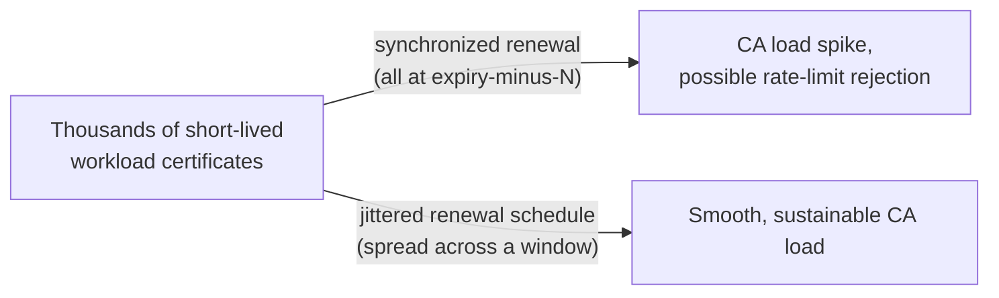

## 13. Security

Certificate/PKI security is, in large part, the synthesis of everything
already taught in Section 4: fail-closed chain validation (4.3), correct
Key Usage/EKU constraints on issued certificates (4.2), short lifetimes to
bound compromise windows (4.7/4.8), CT monitoring as a detective control
(4.10), and root-key custody as the highest-value asset in the system
(4.3/6). Two additional points deserve emphasis here: **never let a
private key leave the system that generated it** — generate keys
in-place (or, for the highest-assurance workloads, in an HSM/KMS that
never exports the key material at all) rather than generating a key pair
centrally and distributing the private half over a network, since every
hop the private key travels is another place it can be intercepted or
logged; and **audit certificate issuance the same way you audit any other
privileged action** — an internal private CA that issues certificates
without logging who/what requested each one loses the ability to
investigate a suspicious certificate after the fact.

## 14. Observability

Observable signals specific to this chapter's scope: **days-to-expiry**
per deployed certificate (the single most important PKI metric — alert at
multiple thresholds, e.g. 30/14/3 days, not just once), **renewal success/
failure rate** from the automation pipeline itself, **OCSP responder
latency and error rate** (a degrading OCSP responder silently increases
handshake latency or, without stapling, connection failure rate), **CT log
entries for owned domains** (Section 4.10, ideally wired into the same
alerting pipeline as the rest), and **CRL/OCSP staple age** at the TLS
termination point, since a stale staple approaching its own validity
window's end is itself a near-term availability risk distinct from the
leaf certificate's own expiry.

## 15. Failure Scenarios

- **Incomplete intermediate chain served.** Covered in depth in Section
  4.3 — the single most common real-world certificate outage, invisible
  in browsers that cached the missing intermediate from elsewhere,
  fatal for strict non-browser clients.
- **Clock skew.** A server or client with a significantly wrong system
  clock will reject a certificate as "not yet valid" or "expired" even
  though the certificate itself is fine — Network Time Protocol (NTP)
  drift is a surprisingly frequent root cause of intermittent, hard-to-
  reproduce TLS failures traced back to certificates when the actual
  fault is the clock.
- **Renewal automation succeeds, reload never happens.** Section 4.5's
  common failure mode — the certificate file on disk is current, but the
  running process serves a cached, aging copy from memory until an
  explicit reload, eventually expiring in production despite the
  automation "having worked."
- **Pinned client rejects a legitimate rotated certificate.** Section
  4.9's central risk, at its worst when discovered only after a
  significant fraction of a mobile app's install base is already broken.
- **CA outage during a soft-fail OCSP window.** Section 4.6 — an
  unreachable OCSP responder is tolerated by design, but if the
  underlying reason is a broader CA compromise event, "the check failed
  open" is precisely the scenario an attacker wants.
- **Root or intermediate key compromise.** Section 4.3/6 — the scenario
  the entire hierarchy is designed to make survivable (revoke the
  compromised link, reissue underneath a new one) rather than
  catastrophic (rebuild every trust relationship from scratch); an
  architecture without this separation turns any leaf-adjacent
  compromise into the worst-case outcome.

## 16. Testing

Certificate/PKI infrastructure should be tested the same way any other
production-critical automation is: (1) **renewal dry-runs** —
`certbot renew --dry-run` or the equivalent, exercised regularly in CI/CD,
not only when someone remembers; (2) **expiry-alert testing** — verify
the monitoring pipeline (Section 14) actually fires by deliberately
issuing a certificate with a short test lifetime in a non-production
trust domain; (3) **chain-completeness testing** — validate the full
served chain with a client that does *not* cache intermediates (a
fresh container, `openssl s_client` with no prior state, or a tool like
`testssl.sh`), not just a browser that may mask a missing intermediate;
(4) **revocation/emergency-reissuance game days** — periodically
rehearse the "a key is compromised, revoke and reissue now" procedure
(Section 8) end-to-end so the first real execution isn't also the first
rehearsal; (5) **SPIFFE ID / identity-check testing** — for mTLS
architectures (Section 4.8), explicitly test that a workload holding a
validly-chained but wrong-identity certificate is rejected, not just that
an *invalid* chain is rejected.

## 17. Common Mistakes

- Assuming DV, OV, and EV differ in cryptographic strength rather than
  only in identity-vetting depth (Section 4.4).
- Trusting the Subject CN field for hostname matching instead of the SAN
  extension (Section 4.1/4.2).
- Deploying a wildcard certificate for convenience without weighing the
  blast-radius trade-off against per-service certificates (Section 4.2).
- Renewing a certificate without triggering a reload of the process
  holding it in memory (Section 4.5).
- Running a private CA's root key on a routinely-accessed, network-
  connected system (Section 4.3/4.8).
- Treating certificate pinning as a default hardening step rather than a
  deliberate, backup-pin-equipped choice (Section 4.9).
- Never setting up a Certificate Transparency monitor for owned domains,
  leaving a free detective control unused (Section 4.10).

## 18. Best Practices

- Default to DV certificates issued via ACME automation for anything
  public-facing (Section 4.4/4.7); reserve OV/EV for an explicit
  compliance or contractual requirement.
- Keep certificate lifetimes short and renewal fully automated, jittered
  across the fleet (Section 4.7/12).
- Enable OCSP stapling everywhere the TLS termination point supports it
  (Section 4.6).
- Structure any private CA with an offline (or HSM-protected) root and an
  online intermediate doing routine issuance, exactly mirroring the
  public CA hierarchy's reasoning (Section 4.3/4.8).
- Use narrow Key Usage/Extended Key Usage on every issued leaf certificate
  — no `keyCertSign` on leaves, `serverAuth`/`clientAuth` scoped to actual
  need (Section 4.2).
- Monitor days-to-expiry independently of renewal-job success, and
  monitor CT logs for owned domains (Section 8/14).
- Prefer SPIFFE-style identity verification over certificate pinning for
  service-to-service authentication (Section 4.8/4.9).

## 19. Anti-Patterns

- **The "annual fire drill."** A manual, once-a-year certificate renewal
  process, maintained by institutional memory rather than automation —
  the exact pattern ACME (Section 4.7) exists to eliminate.
- **The single shared wildcard certificate for everything.** Maximizes
  convenience, maximizes blast radius, and makes per-service revocation
  impossible without touching every service sharing the certificate
  (Section 4.2).
- **Pinning without a backup pin.** Guarantees a forced-upgrade outage on
  the next legitimate rotation (Section 4.9).
- **A private CA with its root key reachable from the same network as
  routine issuance traffic.** Section 4.3/4.8's central lesson, violated.
- **Treating a valid mTLS handshake as sufficient authorization.**
  Confusing "this certificate chain is valid" with "this is the specific
  peer I meant to authorize" (Section 4.8, and
  [CH06_TLS.md Section 4.10](CH06_TLS.md#410-mutual-tls-mtls-for-service-to-service-authentication)).

## 20. Trade-off Analysis

| Decision | Favors | Costs |
|---|---|---|
| DV via ACME automation | Speed, cost, operational simplicity, short lifetimes | No organizational-identity assurance (rarely needed anyway, Section 4.4) |
| OV/EV certificates | Satisfies specific compliance/contractual mandates | Slower issuance, cost, no meaningful browser-UI or cryptographic benefit today |
| Wildcard certificate | One certificate to manage, simpler operations | Single point of compromise for every covered subdomain |
| Certificate pinning | Defends against rogue-CA mis-issuance | Real, historically-proven forced-upgrade outage risk if mismanaged (Section 4.9) |
| OCSP with stapling | No client-side latency or privacy cost | Server must run its own periodic OCSP fetch loop |
| Private CA / SPIFFE internal PKI | Fine-grained, short-lived, workload-scoped identity | Meaningful build-out and operational investment vs. simpler static internal certs |

## 21. Comparison Table

| Mechanism | Purpose | Key trade-off |
|---|---|---|
| CRL | Bulk, offline-friendly revocation list | Can be large; stale between publications |
| OCSP | Targeted, real-time revocation check | Adds a client-CA round trip; leaks browsing metadata to the CA |
| OCSP stapling | Server-fetched, client-verified revocation status | Best of both — requires termination-point support |
| DV | Domain-control-only issuance | Fast, automatable, no organizational assurance |
| OV | Domain + organization existence | Slower, manual steps, moderate assurance |
| EV | Domain + rigorous organization vetting | Slowest, no longer distinguished in browser UI |
| Public CA | Internet-trusted certificates | Cannot be used for internal-only trust domains at internal scale/speed |
| Private CA (e.g. SPIRE) | Internal-only, workload-scoped identity | Requires operating your own trust root and issuance infrastructure |

## 22. Real-World Case Study: Let's Encrypt and the automation-first shift

Before 2015, obtaining a certificate for even a small public website
typically meant a manual CSR submission to a commercial CA, a domain-
validation email link, a payment, and a downloaded file installed by
hand — repeated annually. This friction meant a meaningful fraction of the
web either ran plaintext HTTP or ran TLS with a certificate nobody was
actively watching for expiry. Let's Encrypt's founding premise (Section
2/4.7) was that **if issuance is free and fully automatable, the entire
industry's default posture toward encryption and renewal changes** — not
just for the sites that adopt Let's Encrypt itself, but industry-wide,
because every other public CA had to build ACME support to remain
competitive once automation became the expected baseline.

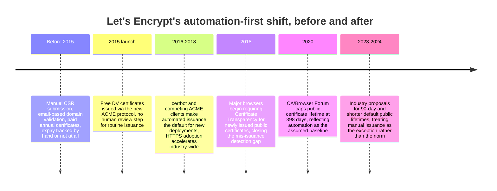

The measurable architectural consequence: HTTPS adoption on the web went
from a minority of page loads to the overwhelming majority within a few
years of Let's Encrypt's launch, and the entire conversation around
certificate lifetime shifted from "how long can we make this so we touch
it as rarely as possible" to "how short can we make this now that touching
it costs nothing" — precisely the inversion described in Section 4.7. Any
Solution Architect designing a new certificate management pipeline today,
public or private, should treat "issuance and renewal are a fully
automated API call, never a ticket" as the non-negotiable starting
requirement this case study established as the industry norm.

## 23. Interview Questions

1. Walk through what happens, field by field, when a client validates a
   server's X.509 certificate during a TLS handshake. (Section 4.1/4.3)
2. Why do CA hierarchies use intermediate certificates instead of signing
   every leaf certificate directly from the root? (Section 4.3)
3. What is the actual difference in trust and cryptographic strength
   between a DV, OV, and EV certificate? (Section 4.4)
4. Explain OCSP stapling and why it is preferred over a client performing
   its own OCSP lookup. (Section 4.6)
5. How did ACME and Let's Encrypt change the architecture of certificate
   management, beyond simply making certificates free? (Section 4.7/22)
6. Design a private CA architecture for issuing short-lived certificates
   to thousands of ephemeral service instances. What would you use, and
   why? (Section 4.8)
7. What are the real operational risks of certificate pinning, and how
   would you mitigate them if a team insisted on using it? (Section 4.9)
8. What is Certificate Transparency, and what specific attack does it
   defend against that chain validation alone does not? (Section 4.10)
9. A service's TLS handshake fails intermittently with chain-validation
   errors in some clients but not others. What would you check first?
   (Section 4.3/15)
10. Why should a leaf certificate never have the `keyCertSign` key usage
    bit set? (Section 4.2/6)

## 24. Hands-on Exercises

1. Using OpenSSL (Section 10, example 1), build a two-tier private CA
   (root + intermediate) and issue a leaf certificate with a SAN covering
   two hostnames; verify the chain with `openssl verify -CAfile`.
2. Stand up a local ACME server (e.g. Pebble or Smallstep's `step-ca`) and
   issue a certificate to a local service using `certbot` or `acme.sh`
   against it, observing the challenge exchange on the wire.
3. Enable OCSP stapling on a local nginx instance (Section 10, example 3)
   and confirm the staple is present using
   `openssl s_client -status -connect localhost:443`.
4. Deploy a minimal SPIRE server and agent locally (Section 10, example 4),
   register a workload identity, and fetch an SVID via the Workload API to
   observe its short lifetime and SAN structure directly.
5. Deliberately let a test certificate expire in a non-production
   environment and verify your monitoring pipeline (Section 14) actually
   fires the expected alert.

## 25. Design Exercises

1. Design the certificate management architecture for a public SaaS
   (Software as a Service) product with 50,000 customer-provided custom
   domains, each needing its own TLS certificate, provisioned and renewed
   with zero manual steps. Address CA choice, challenge type, and
   renewal-rate scaling (Section 4.7/12).
2. Design an internal PKI for a Kubernetes-based microservices platform
   with 2,000 pods rotating every few hours, requiring mTLS between every
   service pair. Justify your choice of workload-identity mechanism
   (Section 4.8) and root-key custody model (Section 4.3).
3. A security review has flagged that your mobile app pins a single leaf
   certificate with no backup pin. Redesign the pinning strategy (or
   justify removing it) to eliminate the forced-upgrade outage risk
   (Section 4.9).
4. Design a Certificate Transparency monitoring and alerting pipeline for
   an organization owning 200 domains across multiple business units
   (Section 4.10/8).

## 26. Architecture Review Questions

- Is certificate renewal fully automated end-to-end, including the reload/
  restart step, with no human action required for routine renewals?
- Where does the private CA's (if any) root key live, and who/what can
  access it? Does it mirror the offline-root/online-intermediate pattern?
- Are leaf certificates issued with the narrowest Key Usage/Extended Key
  Usage that satisfies their actual purpose?
- Is OCSP stapling enabled at every TLS termination point that supports
  it?
- Is expiry monitored independently of renewal-job success/failure
  signals, with alerting at multiple lead-time thresholds?
- Does any client in the architecture pin certificates or keys, and if
  so, is there a backup pin and a tested rotation runbook?
- Is there a Certificate Transparency monitor watching every domain the
  organization owns?
- For service-to-service mTLS, does certificate validation check the
  presented identity (e.g. SPIFFE ID) and not just chain validity?

## 27. Summary

A certificate is a signed claim binding a public key to an identity, and
PKI is the supply chain — issuance, distribution, renewal, and revocation
— that makes that claim trustworthy at scale. The chain-of-trust model
(root, intermediate, leaf) exists specifically to keep the highest-value
secret, the root private key, offline and rarely touched, while routine
issuance happens through an online intermediate that can be revoked and
replaced without disturbing the root at all. Validation levels (DV, OV,
EV) differ only in how much identity vetting the CA performed before
issuing, not in cryptographic strength — a distinction the industry's own
UI choices have since made explicit. Revocation exists because issuance
mistakes and key compromises happen; OCSP stapling makes checking for it
both fast and private. The single biggest architectural shift this
chapter covers is automation: ACME and Let's Encrypt turned certificate
management from an annual, human-mediated chore into background
infrastructure, and in doing so made short-lived certificates — and the
security benefit of a bounded compromise window — the industry default
rather than an exotic practice. Internally, the same automation-first,
short-lived, workload-scoped philosophy shows up as SPIFFE/SPIRE-style
identity issuance behind mTLS (whose handshake mechanics remain owned by
[CH06_TLS.md](CH06_TLS.md)). Certificate pinning and Certificate
Transparency sit at opposite ends of a spectrum — one a risky, manually-
managed defense against rogue issuance, the other a public, automated
accountability mechanism against the same threat — and a mature
architecture leans toward the latter, plus identity-aware validation,
rather than the operationally fragile former.

## Further Reading

- [CH06_TLS.md](CH06_TLS.md) — TLS handshake mechanics, cipher
  negotiation, TLS termination patterns, and the mTLS handshake this
  chapter's certificates are presented within.
- [CH07_SSL.md](CH07_SSL.md) — historical SSL/TLS versioning and
  deprecated-protocol audit methodology.
- [CH08_DNS.md](CH08_DNS.md) — DNS-01 ACME challenge mechanics and CAA
  (Certification Authority Authorization) DNS records constraining which
  CAs may issue for a domain.
- [CH01_HTTP.md](CH01_HTTP.md) — HTTPS as an HTTP scheme and the baseline
  request/response model certificates ultimately secure.
