# Chapter: Sockets

Part: [05 — Networking and Operating Systems](PART_OVERVIEW.md) · Status: Drafted

## 1. Introduction

Every network call an application makes — an HTTP (HyperText Transfer
Protocol) request, a database connection, a gRPC (Google Remote Procedure
Call) stream, a Kafka producer publishing a message — eventually bottoms out
in exactly one OS (Operating System)-level primitive: the **socket**. A
socket is the kernel's abstraction for "an endpoint of network
communication," and on every POSIX (Portable Operating System Interface)
system — Linux, macOS, BSD (Berkeley Software Distribution) — that
abstraction is deliberately shaped to look like a file. You `open()` it
(via `socket()`), you `read()` and `write()` it (via `recv()`/`send()`, or
even literally `read()`/`write()`), and you `close()` it, and the kernel
hides the entire mess of TCP (Transmission Control Protocol) segments, IP
(Internet Protocol) packets, retransmission timers, and Ethernet frames
behind that uniform file-descriptor interface. [TCP/IP](CH03_TCPIP.md)
already taught how IP addressing and port numbers combine into the 4-tuple
that identifies a connection, and how TCP's three-way handshake, state
machine, and reliability mechanisms work; this chapter does not re-teach
any of that. This chapter owns the layer directly above it: the **Berkeley
sockets API** itself — the actual function calls (`socket`, `bind`,
`listen`, `accept`, `connect`, `send`, `recv`, `close`) an application uses
to drive that state machine, the file-descriptor-based model that makes
sockets first-class OS objects, and the architectural decisions every
network-server author must make on top of that API: blocking versus
non-blocking I/O, how a single thread can multiplex thousands of
connections through `select`/`poll`/`epoll`/`kqueue`, whether to build a
server around one thread per connection or one event loop for all
connections, which socket options actually matter in production
(`SO_REUSEADDR`, `SO_REUSEPORT`, and a recap of `TCP_NODELAY`), when a Unix
domain socket beats a TCP socket for local inter-process communication, and
the file-descriptor ceiling every high-concurrency service eventually
collides with.

Solution Architects rarely write raw socket code today — frameworks like
Netty, libuv (which powers Node.js), Boost.Asio, and every managed
language's standard networking library wrap this API. But every one of
those frameworks is a decision about *how* to use sockets, and understanding
those decisions requires understanding the primitive underneath them. When
an architect chooses between a thread-pool web server (Apache's traditional
MPM (Multi-Processing Module)) and an event-loop server (nginx, Node.js), is
sizing a Kubernetes pod's `ulimit -n` (open file descriptor limit), is
debugging why a load-balanced service can't rebind to a port after a
restart, or is deciding whether two sidecar containers in the same pod
should talk over a TCP loopback socket or a Unix domain socket, they are
making a sockets-architecture decision. This chapter teaches the primitive
those decisions rest on, from the system call level up to the architectural
patterns built on top of it.

**Quick orientation — where this chapter sits:**

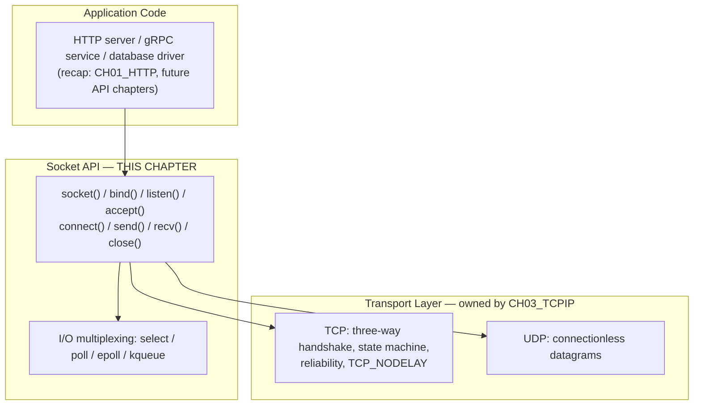

## 2. Historical Evolution

The Berkeley sockets API is one of the oldest still-load-bearing interfaces
in computing — nearly every modern networking stack, in every language, is
ultimately a wrapper around the same calls introduced over four decades ago.

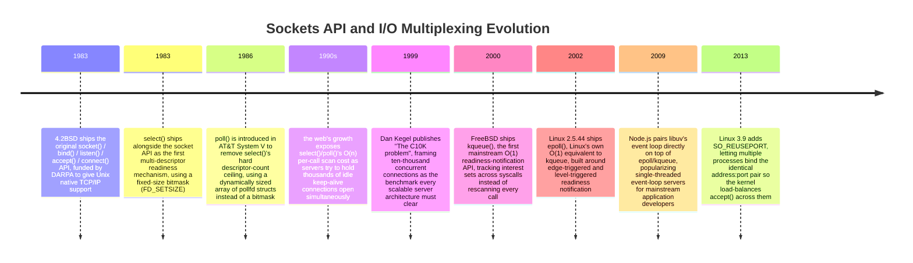

The through-line across four decades is a single pressure: as the number of
concurrent connections a server needed to hold open grew from tens to
thousands to millions, the *cost of asking the kernel "which of my sockets
is ready?"* had to shrink from linear-per-call to constant-per-event. That
pressure is the entire reason `select`, `poll`, `epoll`, and `kqueue` exist
as four different answers to the same question, and it is the mechanism
Section 4.5 teaches in depth.

## 3. Why It Exists

Before the socket abstraction, every operating system that supported
networking exposed it through a bespoke, non-uniform API tied to that
system's specific network stack. Application code that wanted to talk over
the network had to learn a different interface from the one it used to read
files, and that interface typically differed across every vendor's Unix
variant. The Berkeley engineers who added TCP/IP support to 4.2BSD in 1983
made a deliberate design choice that still pays dividends today: make a
network connection look, as much as possible, like an open file. A socket
is created and destroyed the same way a file is (`open`-like `socket()` +
`close()`), and once connected, it can be read and written with the same
system calls (`read()`/`write()`) used for any other file descriptor. This
unification means the OS's existing readiness-notification, buffering, and
descriptor-table machinery — already built for files — could be reused for
network I/O with only the parts that are genuinely network-specific (an
address family, a socket type, the connection-establishment handshake)
added as new concepts layered on top.

This "sockets are files" design is not just an implementation convenience;
it is the reason a single I/O-multiplexing mechanism (`select`, `poll`,
`epoll`) can watch a mix of sockets, pipes, and regular files through one
uniform interface, and the reason every high-level networking library in
every language — from Python's `socket` module to Java's NIO
(New I/O) `Selector` to Go's runtime-managed goroutines — is describable in
terms of the same handful of underlying system calls. Understanding those
calls is what lets an architect reason correctly about what a framework is
actually doing underneath its abstractions, rather than treating "the
framework handles networking" as an opaque black box.

## 4. Core Concepts

### 4.1 The socket as a file descriptor — the OS-level abstraction

A **file descriptor (FD)** is a small non-negative integer a process uses to
refer to an open resource the kernel is tracking on its behalf — a file, a
pipe, a device, or a socket. When an application calls `socket()`, the
kernel does three things: it allocates an in-kernel data structure holding
the socket's state (its address family, type, connection state, and two
kernel-space buffers for outbound and inbound bytes), it inserts that
structure into the calling process's per-process file-descriptor table, and
it returns the integer index of that table entry to the caller. From that
point forward, every operation the application performs on the socket
— reading, writing, closing, querying options — is expressed as "do X to FD
7," and the kernel resolves FD 7 back to the actual socket structure. This
is precisely the same mechanism used for open files, which is why a socket
FD and a file FD are interchangeable inputs to generic system calls like
`read()`, `write()`, `close()`, and the multiplexing calls in Section 4.5.

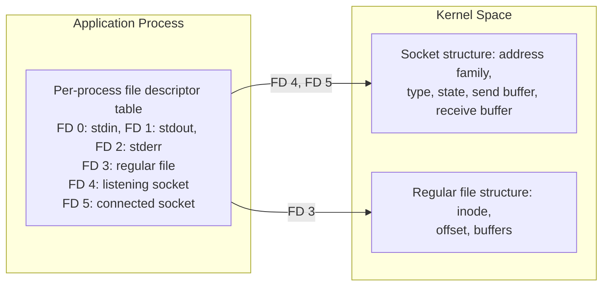

A socket is created with three parameters that together fully describe what
kind of communication endpoint it will be: the **address family** (`AF_INET`
for IPv4, `AF_INET6` for IPv6, `AF_UNIX`/`AF_LOCAL` for local IPC discussed
in Section 4.8), the **socket type** (`SOCK_STREAM` for a reliable,
ordered, connection-oriented byte stream — TCP — or `SOCK_DGRAM` for
connectionless datagrams — UDP (User Datagram Protocol), both already
taught in [TCP/IP Section 4.10](CH03_TCPIP.md#410-udp-as-tcps-connectionless-counterpart)),
and the **protocol** (almost always left as 0, letting the kernel pick the
default protocol for the given family/type combination). Everything this
chapter teaches from here — the lifecycle, the multiplexing mechanisms, the
threading models — is built on top of this one structural fact: a socket is
a kernel object reachable through an integer in a table the process already
uses for every other kind of I/O.

### 4.2 The socket lifecycle: server and client call sequences

The Berkeley sockets API exposes the connection lifecycle as a small,
fixed sequence of system calls, and the sequence differs meaningfully
between the side that waits for connections (the server) and the side that
initiates them (the client). Learning this sequence precisely — including
which calls block, which calls consume kernel-side queues, and where a
common mistake breaks the sequence — is the foundation for every server
architecture pattern taught later in this chapter.

**Server-side sequence:**

1. **`socket()`** — allocate the socket structure and FD as described in
   Section 4.1.
2. **`bind()`** — associate the socket with a specific local address and
   port (e.g., `0.0.0.0:8080`), telling the kernel "packets destined for
   this address:port pair belong to this socket." Binding to `0.0.0.0`
   listens on all local network interfaces; binding to a specific IP
   restricts the socket to traffic arriving on that interface only.
3. **`listen()`** — transition the socket from a plain socket into a
   **passive/listening socket**, and tell the kernel how large to make the
   **backlog** — the queue of connections that have completed (or are
   completing) the TCP three-way handshake but that the application has not
   yet accepted. Section 5 covers this queue's internal two-stage structure
   (SYN queue and accept queue) in depth, because backlog sizing is a real
   production tuning knob.
4. **`accept()`** — block (in the default blocking mode; see Section 4.3)
   until a completed connection is available in the backlog, then dequeue
   it and return a **brand-new socket FD** distinct from the listening
   socket. This is the detail every socket-programming newcomer gets wrong
   at least once: the listening socket never carries application data —
   it exists only to produce new connected sockets — and a server that
   calls `accept()` in a loop is doing so specifically because each call
   consumes exactly one waiting connection and hands back a dedicated FD
   for that one client.
5. **`send()`/`recv()`** (or `read()`/`write()`) — exchange bytes with the
   client over the newly accepted socket.
6. **`close()`** — release the socket, triggering TCP's connection
   termination sequence (already covered in
   [TCP/IP Section 4.6](CH03_TCPIP.md#46-the-tcp-connection-lifecycle-and-state-machine)).

**Client-side sequence:**

1. **`socket()`** — same allocation step.
2. **`connect()`** — actively initiate the TCP three-way handshake toward
   the server's address:port. Unlike the server, the client does not need
   an explicit `bind()` call first — the kernel silently binds the socket
   to an ephemeral local port
   ([recap: TCP/IP Section 4.4](CH03_TCPIP.md#44-ports-and-sockets--the-os-level-addressing-layer-above-ip))
   the moment `connect()` is called, unless the application explicitly
   wants to control its own source port.
3. **`send()`/`recv()`** — same data-exchange calls as the server, now
   over the single socket the client created (a client has no separate
   "listening" socket — it only ever has connected sockets).
4. **`close()`** — release the socket.

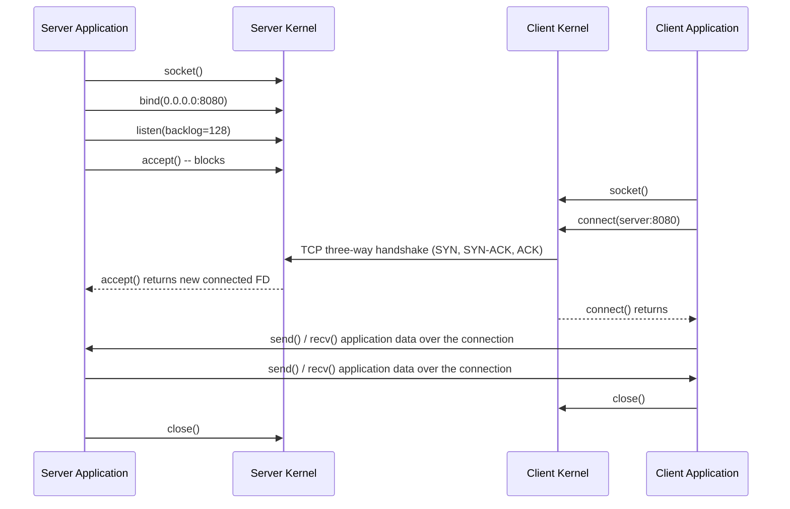

A subtle but architecturally important consequence of this sequence: the
listening socket and every connected socket it produces are **independent
kernel objects with independent FDs**, all of which can coexist and be
multiplexed together (Section 4.5) or handled by different threads
(Section 4.6). A server that only ever has one listening socket can still
be juggling ten thousand connected sockets simultaneously — the listening
socket's only job is minting new ones.

### 4.3 Blocking versus non-blocking I/O at the socket level

By default, every socket operation is **blocking**: if data isn't yet
available, `recv()` suspends the calling thread until data arrives (or the
connection closes); if the kernel's send buffer is full, `send()` suspends
until space frees up; `accept()` suspends until a connection is ready;
`connect()` suspends until the handshake completes (or times out). This is
the simplest programming model — one thread's control flow reads top to
bottom exactly like sequential file I/O — but it has one unavoidable
consequence: **a thread blocked on one socket cannot simultaneously service
any other socket.** A server built entirely from blocking calls can serve
exactly one connection per thread of execution at any given moment.

Setting the `O_NONBLOCK` flag on a socket FD (via `fcntl()`) changes this
contract entirely: every call that would otherwise block instead returns
immediately with a specific error (`EWOULDBLOCK`/`EAGAIN`) if the operation
cannot complete right now. Non-blocking mode does not make the operation
happen instantly — reading from an empty socket still means there's no data
— it simply refuses to suspend the calling thread waiting for it. This
shifts the burden onto the application: it must now ask "is this socket
ready?" *before* attempting to read or write, rather than letting the
kernel do the waiting for it. That "which of my many sockets is ready right
now" question is exactly what the I/O-multiplexing mechanisms in Section
4.5 exist to answer efficiently, and non-blocking sockets are a
prerequisite for using them correctly — mixing blocking calls into an
event-driven loop reintroduces the single-connection-at-a-time bottleneck
non-blocking mode exists to remove.

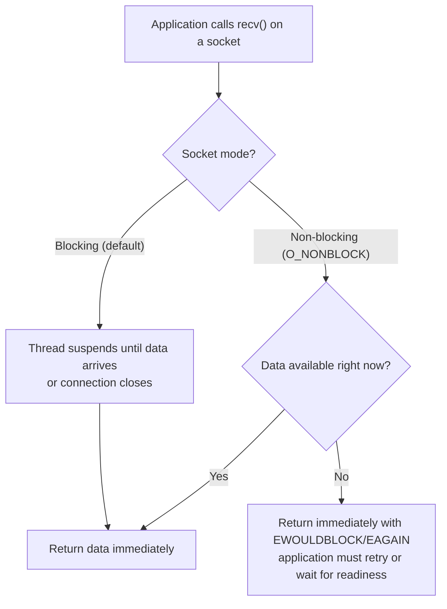

**Decision implication:** blocking sockets are the correct default for
simple, low-concurrency clients (a service calling one downstream
dependency at a time) and for thread-per-connection servers (Section 4.6)
where each thread is dedicated to exactly one connection and blocking is
harmless. Non-blocking sockets are mandatory for any server architecture
that wants a small, fixed number of threads to service a large, variable
number of connections — which is every event-loop and async-I/O server in
production use today.

### 4.4 The I/O multiplexing evolution: select, poll, epoll, and kqueue

Non-blocking sockets solve the "don't suspend my thread" problem, but they
create a new one: if a server holds a thousand non-blocking sockets open
and none of them happen to have data ready, how does the server avoid
busy-looping — calling `recv()` on all thousand of them repeatedly, wasting
CPU (Central Processing Unit) on calls that mostly return `EAGAIN`?
**I/O multiplexing** system calls exist to answer exactly this: "block this
one thread until *at least one* of these N sockets is ready for I/O, and
tell me which ones." This is the mechanism referenced by the browser and
Node.js event-loop chapters — this chapter owns the OS-level mechanism
itself; the event-loop chapters recap it and build their runtime-specific
scheduling on top.

- **`select()`** (1983) takes a bitmask of file descriptors the caller
  cares about and blocks until any of them are ready, then returns the same
  bitmask with only the ready ones set. Two structural limits made it
  unsuitable for high-concurrency servers: the bitmask has a compile-time
  maximum size (`FD_SETSIZE`, historically 1024), and every single call
  requires the kernel to **linearly rescan every watched descriptor**
  — O(n) work per call regardless of how many are actually ready — plus the
  entire bitmask must be copied between user space and kernel space on
  every call.
- **`poll()`** (1986) replaced the fixed-size bitmask with a dynamically
  sized array of `pollfd` structs, removing the hard descriptor-count
  ceiling, but it **kept the same fundamental O(n) rescan-every-call cost**
  — poll fixed select's size limit, not its scaling problem.
- **`epoll()`** (Linux, 2002) and **`kqueue()`** (BSD, 2000) solved the
  scaling problem structurally rather than incrementally: instead of
  re-describing the entire interest set to the kernel on every call, the
  application registers its interest set *once* (`epoll_ctl()` to add/
  remove/modify a watched FD), and the kernel maintains that interest set
  persistently, pushing ready FDs onto an internal ready list as I/O events
  actually occur (typically driven by the same interrupt/callback machinery
  that already notifies the kernel when a network packet arrives). The
  application then calls `epoll_wait()` and receives **only the FDs that
  are actually ready** — O(1) with respect to the total number of watched
  descriptors, and proportional only to the number of *ready* ones.

This is precisely the mechanism that solved what Dan Kegel named the
**C10K problem**: a server built on `select`/`poll` trying to hold ten
thousand mostly-idle keep-alive connections open was spending most of its
CPU time rescanning nine thousand nine hundred idle sockets on every single
loop iteration just to find the handful that had new data — the
multiplexing overhead grew faster than the useful work. `epoll`/`kqueue`
made the overhead track *active* connections instead of *total* connections,
which is the structural property every modern high-concurrency server
(nginx, Node.js/libuv, Envoy, HAProxy) depends on to hold hundreds of
thousands of connections on a handful of OS threads.

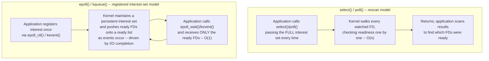

`epoll` additionally distinguishes **level-triggered** notification (the
default: `epoll_wait()` keeps reporting a socket as ready as long as
unread data remains, forgiving an application that doesn't drain a socket
completely) from **edge-triggered** notification (`EPOLLET`: the
application is notified only once when a socket transitions from
not-ready to ready, and must drain it completely in a loop until it gets
`EAGAIN`, or it will never be notified again even though data remains).
Edge-triggered mode is more efficient (fewer wake-ups) but strictly harder
to use correctly — a common production bug is an edge-triggered server that
reads only part of the available data on a burst and then stalls that
connection forever, waiting for a "ready" notification that will never
come because, from the kernel's point of view, nothing new has arrived
since the edge it already reported.

### 4.5 Server architecture models: thread-per-connection, event loop, and async I/O

The multiplexing mechanisms in Section 4.4 are a building block, not a
complete server architecture. Three distinct architectural models exist for
turning "the kernel tells me which sockets are ready" into a working
network server, and choosing among them is one of the highest-leverage
architecture decisions a Solution Architect makes when designing or
evaluating a network-facing service.

**Thread-per-connection**: dedicate one OS thread to each accepted
connection, and let every socket operation on that thread be a simple
blocking call. This is the conceptually simplest model — the code reads
top-to-bottom like sequential logic with no callbacks or explicit state
machines — and it was the dominant model for early web servers (Apache's
traditional prefork/worker MPM). Its weakness is that OS threads are not
free: each carries a fixed-size stack (commonly 1-8 MB by default, though
tunable), and the OS scheduler's context-switching cost grows with thread
count. A server holding 50,000 idle keep-alive connections open under this
model needs 50,000 threads, which exhausts memory and scheduler efficiency
long before it exhausts CPU — this is the concrete, mechanical reason
thread-per-connection servers hit a wall well below the C10K threshold
that `epoll`-based servers clear comfortably.

**Event loop (single-threaded, reactor pattern)**: run one thread that
repeatedly calls `epoll_wait()`/`kqueue()`, and for each ready socket,
invoke a small, non-blocking handler function that processes exactly the
data currently available and returns immediately — never blocking, never
holding the loop hostage. All connection state lives in application-managed
data structures (not thread stacks), so the memory cost per idle connection
is just that state, not an entire OS thread stack. This is the model nginx,
Redis, and Node.js's underlying libuv are built on. Its cost is
programming complexity: a single slow or CPU-bound handler blocks the
*entire* server, since there is only one thread servicing every connection
— which is exactly why event-loop runtimes (recap: Node.js's event-loop
phases, owned by the Node.js chapter) push CPU-heavy work onto separate
worker threads or processes rather than doing it inline in a handler.

**Async I/O (multi-threaded event loop / async-await runtimes)**: run
several event-loop threads (often one per CPU core) each handling a subset
of connections, combined with a language-level async/await scheduling model
that lets application code *look* sequential while the runtime
transparently suspends and resumes it around non-blocking I/O calls. This
is the model used by Go's goroutine scheduler (recap:
[Go's concurrency model](../03_Software_Engineering_Foundations/CH04_Go.md)),
Rust's async runtimes like Tokio (recap:
[Rust's async/await executor model](../03_Software_Engineering_Foundations/CH05_Rust.md)),
and Python's `asyncio`
(recap: [Python's concurrency-mechanism selection model](../03_Software_Engineering_Foundations/CH02_Python_Architecture.md)).
It captures the memory efficiency of the event-loop model while spreading
work across multiple cores, at the cost of a more sophisticated runtime and
subtler concurrency bugs (shared state accessed from multiple event-loop
threads needs the same synchronization discipline as any multi-threaded
program).

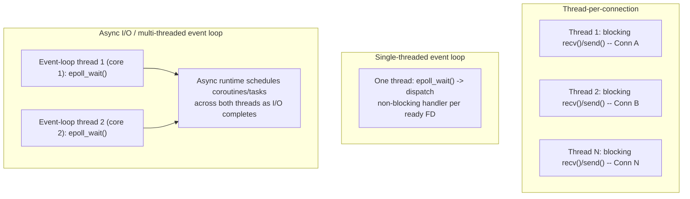

The architectural trade-off is a straight line from "simplicity per
connection" to "efficiency at scale": thread-per-connection is easiest to
reason about but scales worst; a single event loop scales connection count
extremely well but caps out on CPU-bound work per core; multi-threaded
async I/O gets both, at the price of runtime and concurrency-control
complexity. Section 7 (Architecture Patterns) and Section 20 (Trade-off
Analysis) return to this decision with concrete production scenarios.

### 4.6 Socket options that matter architecturally: SO_REUSEADDR and SO_REUSEPORT

Socket options, set via `setsockopt()`, adjust kernel-level behavior for an
individual socket. Two matter enough to production server architecture that
every architect should recognize them by name and know exactly what problem
each solves; a third, `TCP_NODELAY`, is already fully taught in
[TCP/IP Section 4.11](CH03_TCPIP.md#411-nagles-algorithm-and-tcp_nodelay)
and is recapped here only for completeness: it disables Nagle's algorithm so
small writes are sent immediately rather than batched, which matters for
latency-sensitive request/response traffic over the sockets this chapter's
lifecycle produces.

**`SO_REUSEADDR`** lets a socket `bind()` to an address:port pair that the
kernel would otherwise refuse because a previous socket using that same pair
is still lingering in `TIME_WAIT`
(recap: [TCP/IP Section 4.6](CH03_TCPIP.md#46-the-tcp-connection-lifecycle-and-state-machine)).
Without it, restarting a server process immediately after it stops commonly
fails with "address already in use," because the *previous* process's
closed connections are still occupying that 4-tuple in `TIME_WAIT` for up to
a couple of minutes. `SO_REUSEADDR` tells the kernel "I know a previous
socket used this address recently; let me bind anyway" — it is close to a
mandatory option on any listening socket that needs to support fast
restarts, and its absence is one of the most common "works in dev, breaks
on deploy" surprises new socket programmers hit.

**`SO_REUSEPORT`** (Linux 3.9+, also on modern BSDs and macOS) solves a
different problem: it lets **multiple independent sockets** — typically one
per worker process — bind to the **exact same** address:port pair
simultaneously, with the kernel load-balancing incoming connections across
them. Before `SO_REUSEPORT`, a multi-process server had exactly two options
for sharing a listening socket across worker processes: have one parent
process own the single listening socket and either `fork()` after creating
it (so children inherit the same FD and all call `accept()` on it,
serialized through the kernel's own backlog) or pass FDs between processes
over a Unix domain socket. `SO_REUSEPORT` removes that indirection
entirely — each worker process independently creates, binds, and listens on
its own socket for the identical port, and the kernel itself distributes
incoming connections across the group (typically via a hash of the
client's 4-tuple), improving cache locality and removing the single shared
listening-socket contention point that the older `fork()`-and-share model
had. This is precisely the mechanism nginx and other high-throughput
servers use to run one worker process per CPU core, each with its own
`accept()` loop, without any of them needing to know about the others.

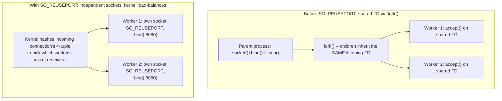

**Decision implication:** `SO_REUSEADDR` is close to unconditional best
practice for any server socket. `SO_REUSEPORT` is the right choice
specifically when scaling a single machine's throughput across multiple
worker *processes* (as opposed to threads within one process, which don't
need it — they already share the same listening FD naturally) and when the
kernel's connection distribution is an acceptable load-balancing strategy
compared to a userspace load balancer in front of the workers.

### 4.7 Unix domain sockets versus TCP sockets for local IPC

Every socket example so far has assumed `AF_INET`/`AF_INET6` sockets
communicating over the network stack — even when both processes are on the
same machine, traffic to `127.0.0.1` still traverses the full TCP/IP stack:
segmentation, checksums, the loopback network interface, and the kernel's
routing logic, even though no physical network is involved. **Unix domain
sockets** (`AF_UNIX`) are an alternative socket family designed specifically
for **inter-process communication (IPC)** between processes on the *same*
machine: they use the exact same Berkeley API — `socket()`, `bind()`,
`listen()`, `accept()`, `connect()`, `send()`, `recv()` — but instead of an
IP address and port, a Unix domain socket is addressed by a path in the
filesystem (e.g., `/var/run/myapp.sock`), and the kernel routes data
directly between the two processes' buffers without ever constructing an
IP packet, TCP segment, or Ethernet frame.

This makes Unix domain sockets measurably faster and lower-overhead than a
loopback TCP connection for the same two processes talking on the same
host: there's no protocol-header construction/parsing, no checksum
computation, no port-number demultiplexing through the full networking
stack — the kernel just copies bytes between two buffers it already knows
belong to the same two endpoints. Unix domain sockets also carry two
capabilities TCP sockets fundamentally cannot: **filesystem-permission-based
access control** (a socket file's Unix permissions and ownership gate who
can even attempt to connect, using the exact same access-control model as
any other file) and **passing open file descriptors between processes**
(`SCM_RIGHTS` ancillary data), which is exactly the mechanism older
multi-process server architectures used to hand a shared listening socket
to worker processes before `SO_REUSEPORT` existed (Section 4.6).

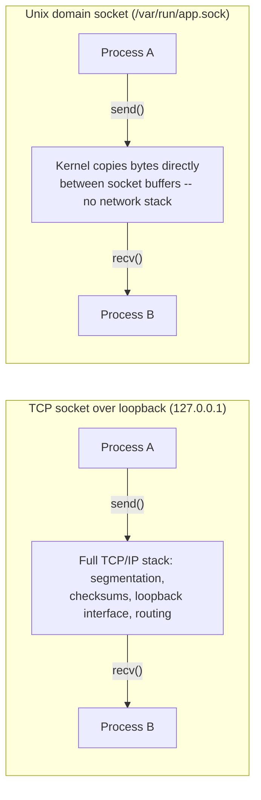

**Decision implication:** prefer Unix domain sockets over loopback TCP for
any purely local IPC — a sidecar container talking to its main application
container over a shared volume-mounted socket path, a database driver
talking to a local connection-pooler process (PgBouncer commonly supports
both), or a web server talking to a local application server (nginx to a
PHP-FPM or Gunicorn Unix socket) — whenever both endpoints are guaranteed to
stay on the same host and the same filesystem namespace. Reach for TCP
sockets instead the moment either endpoint might move to a different host
(any Kubernetes pod-to-pod call, any call that could cross a network
boundary during a future refactor) or when the client is external to the
machine entirely — a Unix domain socket has no meaning across a network.

### 4.8 The file-descriptor and connection-limit operational ceiling

Every socket a process holds open consumes exactly one file descriptor, and
every OS enforces limits on how many FDs a single process (and often the
system as a whole) may hold open simultaneously. On Linux, the per-process
soft/hard limits are queryable and settable via `ulimit -n` (shell) or
`getrlimit()`/`setrlimit()` (`RLIMIT_NOFILE`, programmatically), and a
common out-of-the-box default (1024) is far too low for any server intended
to hold thousands of concurrent connections — a server that hits this
ceiling gets `EMFILE` ("too many open files") back from `accept()` or
`socket()` and, without explicit handling, this frequently manifests as new
connections silently failing while existing ones continue working
perfectly fine, making the root cause non-obvious from symptoms alone.
There is also a **system-wide** ceiling (`fs.file-max` on Linux) that caps
total FDs across every process combined, which matters when many
short-lived worker processes or containers share a single kernel (for
example, many pods scheduled onto one Kubernetes node).

This ceiling is not just a tuning knob to raise and forget — it is a real
architectural planning input. A load balancer terminating one million
concurrent long-lived WebSocket connections needs either enough raised FD
limits on a small number of large instances, or enough instances that each
one's FD count stays comfortably under a safely-tuned ceiling; a
connection-pooling database driver needs to size its pool against the
downstream database's own max-connections limit, which is frequently a much
tighter ceiling than the client's own FD limit; and a service performing
one outbound TCP connection per request without any pooling or keep-alive
reuse can exhaust its own *ephemeral port range* long before it exhausts its
FD limit (recap:
[TCP/IP's ephemeral-port-exhaustion failure mode, Section 4.4/15](CH03_TCPIP.md#44-ports-and-sockets--the-os-level-addressing-layer-above-ip)) —
these are two distinct ceilings (FD count vs. ephemeral source ports) that
an architect must reason about separately even though both ultimately
express as "ran out of sockets."

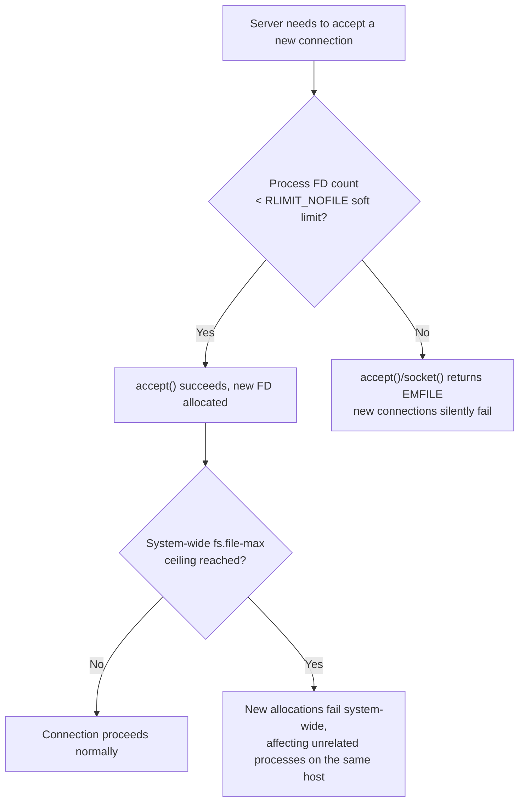

## 5. Internal Working

Two kernel-internal structures make the socket lifecycle taught in Section
4.2 work correctly under concurrent load, and understanding them explains
several production tuning decisions later in this chapter.

**The two-stage connection backlog.** When a client's `SYN` (synchronize)
segment arrives at a listening socket, the connection is not immediately
handed to the application. The kernel maintains two internal queues: the
**SYN queue** (also called the incomplete-connection queue), holding
connections that have received a `SYN` but not yet completed the three-way
handshake, and the **accept queue** (the completed-connection queue),
holding fully-handshaken connections waiting for the application to call
`accept()`. The `backlog` argument passed to `listen()` sizes the accept
queue (its exact semantics differ slightly between BSD-derived and Linux
kernels, but the architectural shape is the same on both): if the
application isn't calling `accept()` fast enough to keep pace with incoming
connections, the accept queue fills up, and the kernel starts silently
dropping (or, depending on configuration, resetting) new handshake-completing
connections — a slow or stalled `accept()` loop is therefore a direct,
mechanical cause of client-visible connection failures under load, not just
a performance nuisance.

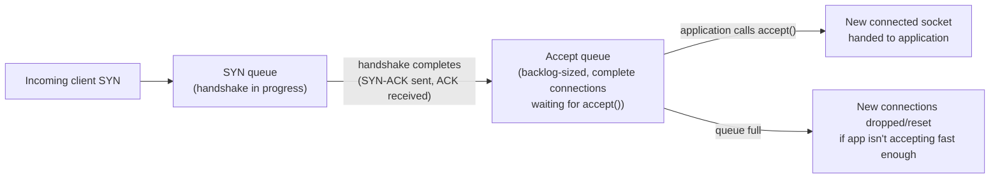

**How epoll's readiness list stays O(1).** The registered-interest-set
model from Section 4.4 works because the kernel doesn't discover readiness
by *polling* sockets when `epoll_wait()` is called — it discovers readiness
*eagerly*, the moment it happens, through the same code paths that already
run whenever a packet arrives or buffer space frees up (the network stack's
receive-interrupt handling and the socket buffer's own bookkeeping). Every
socket added to an epoll instance via `epoll_ctl()` is inserted into a
red-black tree keyed by FD (giving `epoll_ctl()`'s add/remove/modify
operations O(log n) cost), and separately, whenever that socket transitions
into a ready state, the kernel appends it to a simple linked **ready list**.
`epoll_wait()` then does nothing more than drain that ready list and return
— it never has to consult the red-black tree or examine sockets that
haven't signaled readiness, which is exactly why its cost tracks the number
of *ready* FDs rather than the number of *watched* FDs.

## 6. Design Principles

- **Match the concurrency model to the workload's I/O-to-compute ratio.**
  I/O-bound workloads (many idle connections waiting on network I/O) favor
  event-loop or async-I/O models; CPU-bound-per-request workloads favor
  thread-per-connection or a thread pool, since an event loop gains nothing
  from non-blocking I/O if every handler burns CPU anyway.
- **Never block the event loop.** In a single-threaded event-loop
  architecture, any blocking call — a synchronous file read, a CPU-heavy
  computation, a blocking DNS lookup — stalls every other connection on
  that loop; offload such work to a thread pool or separate process.
- **Size the accept backlog for burst tolerance, not steady-state load.**
  The backlog exists to absorb momentary bursts of connection attempts
  faster than the application drains them; a backlog sized only for average
  load will silently drop connections during any traffic spike.
- **Prefer kernel-level connection distribution (`SO_REUSEPORT`) over
  userspace connection hand-off** when scaling a single host across
  multiple worker processes, unless the userspace load balancer needs to
  apply logic (weighting, health-awareness) the kernel's simple hash cannot.
- **Treat file-descriptor limits as a first-class capacity-planning input**,
  sized alongside CPU, memory, and network bandwidth — not an
  afterthought discovered only when `EMFILE` errors start appearing in
  production.
- **Use Unix domain sockets for guaranteed-local IPC**, and reserve TCP
  sockets for anything that might ever cross a host boundary — don't
  default to TCP loopback out of habit when the two endpoints are
  structurally guaranteed to always share a machine.

## 7. Architecture Patterns

The **Reactor pattern** is the formal name for the single-threaded
event-loop architecture from Section 4.5: one thread runs an indefinite
loop calling `epoll_wait()`/`kqueue()`, and for each ready event, dispatches
to a registered, non-blocking handler associated with that socket. nginx's
worker-process model is a direct implementation of this pattern, run
multiple times in parallel (one reactor per worker process, each pinned to
a CPU core, commonly combined with `SO_REUSEPORT` from Section 4.6 so every
worker's reactor can `accept()` independently rather than funneling through
one shared listening socket).

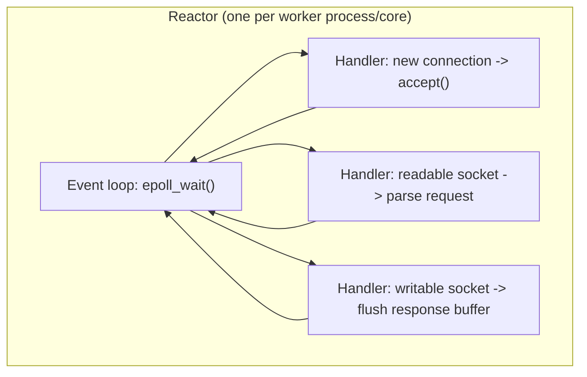

The **Half-Sync/Half-Async pattern** hybridizes the reactor with a thread
pool: an event-loop thread handles all socket I/O (accepting connections,
reading requests, writing responses) in the fully async half, but hands any
CPU-bound or blocking work (image processing, a synchronous legacy library
call, a slow disk operation) off to a bounded worker-thread pool in the
synchronous half, communicating results back through an internal queue.
This is the shape underneath Node.js's `libuv` thread pool (used for
filesystem operations and some crypto operations that have no true
async-native kernel equivalent) and underneath many Java NIO-based servers
that pair a small number of I/O-selector threads with a larger worker-thread
pool for request handling.

For local IPC between sidecar processes (Section 4.7), the common
production pattern is a **sidecar-over-Unix-socket** architecture: a service
mesh's sidecar proxy (e.g., Envoy in an Istio deployment) intercepts
outbound traffic from the application container and communicates with it
over a Unix domain socket or a loopback TCP connection scoped entirely
within the pod's network namespace, keeping the performance and
access-control benefits of Section 4.7 while presenting a normal TCP
interface to the rest of the network.

## 8. Production Architecture

A production HTTP load balancer or reverse proxy (recap:
[Load Balancer](CH10_Load_Balancer.md),
[Reverse Proxy](CH11_Reverse_Proxy.md)) is, underneath its routing and
health-checking logic, a socket-multiplexing server exactly as described in
Sections 4-5: one or more reactor-pattern worker processes, each with its
own `epoll` instance, each holding open two sockets per proxied connection
(one to the client, one to the chosen backend) and shuttling bytes between
them as both sides signal readiness. Sizing such a proxy in production means
reasoning simultaneously about: the accept backlog (Section 5) relative to
peak connection-attempt bursts, the per-worker file-descriptor limit
(Section 4.8) relative to the maximum concurrent connections that worker
must hold (remembering each proxied connection consumes *two* FDs, one per
side), whether `SO_REUSEPORT` (Section 4.6) is enabled so the kernel
distributes new connections across workers evenly, and whether
`TCP_NODELAY` (recapped in Section 4.6) is set on the backend-facing socket
for latency-sensitive traffic.

## 9. Implementation

Implementing a socket server means choosing, in order: (1) the socket type
— `SOCK_STREAM` for anything needing reliable, ordered delivery, or
`SOCK_DGRAM` when occasional loss/reordering is acceptable and the
per-message overhead of connection state isn't wanted; (2) the concurrency
model from Section 4.5, driven by the workload's I/O-to-compute ratio; (3)
the relevant socket options from Section 4.6, set immediately after
`socket()` and before `bind()`/`listen()`; and (4) the multiplexing
mechanism from Section 4.4, generally through a higher-level abstraction
(Java NIO `Selector`, Python's `selectors` module, libuv, Boost.Asio) rather
than calling `epoll_ctl()` directly, since these abstractions correctly
handle the significant platform differences between `epoll` (Linux),
`kqueue` (BSD/macOS), and IOCP (I/O Completion Ports, Windows) behind one
portable interface.

## 10. Complete Code Examples

**Example A — a raw blocking TCP socket server (Python).** This demonstrates
the full server-side lifecycle from Section 4.2 with the socket options
from Section 4.6, handling one connection at a time — the simplest possible
correct server, and the baseline every more sophisticated model in this
chapter improves on.

```python
# blocking_server.py -- minimal blocking TCP echo server
import socket

HOST, PORT = "0.0.0.0", 8080

with socket.socket(socket.AF_INET, socket.SOCK_STREAM) as server_sock:
    # SO_REUSEADDR: allow immediate rebind after a restart even while a
    # previous socket on this port lingers in TIME_WAIT (Section 4.6).
    server_sock.setsockopt(socket.SOL_SOCKET, socket.SO_REUSEADDR, 1)
    server_sock.bind((HOST, PORT))
    server_sock.listen(128)  # backlog: accept-queue size (Section 5)
    print(f"listening on {HOST}:{PORT}")

    while True:
        # accept() blocks until a completed connection is in the backlog.
        conn, addr = server_sock.accept()
        with conn:
            print(f"accepted connection from {addr}")
            conn.setsockopt(socket.IPPROTO_TCP, socket.TCP_NODELAY, 1)
            while True:
                data = conn.recv(4096)  # blocking recv()
                if not data:
                    break  # peer closed its side of the connection
                conn.sendall(data)  # echo back what was received
```

This server can only ever service one client at a time — while `recv()` is
blocked waiting on the current connection, no other client's `accept()` can
even be attempted, let alone serviced, since it's the same single thread
doing both. This limitation is the entire motivation for the multiplexed
server in Example B.

**Example B — an epoll-based single-threaded event-loop server (Python,
using the portable `selectors` module, which selects `epoll` automatically
on Linux).** This implements the Reactor pattern from Section 7: one thread,
non-blocking sockets, and a registered-interest-set multiplexer instead of
one thread per connection.

```python
# epoll_event_loop_server.py -- single-threaded non-blocking echo server
import selectors
import socket

sel = selectors.DefaultSelector()  # epoll on Linux, kqueue on BSD/macOS

def accept(sock):
    conn, addr = sock.accept()
    conn.setblocking(False)  # Section 4.3: non-blocking mode is mandatory
    conn.setsockopt(socket.IPPROTO_TCP, socket.TCP_NODELAY, 1)
    # register the new connection's read-readiness with the event loop
    sel.register(conn, selectors.EVENT_READ, read)
    print(f"accepted {addr}")

def read(conn):
    try:
        data = conn.recv(4096)
    except BlockingIOError:
        return  # spurious wakeup; nothing to do this cycle
    if data:
        conn.sendall(data)  # echo -- fine here since writes rarely block
    else:
        sel.unregister(conn)
        conn.close()

server_sock = socket.socket(socket.AF_INET, socket.SOCK_STREAM)
server_sock.setsockopt(socket.SOL_SOCKET, socket.SO_REUSEADDR, 1)
server_sock.bind(("0.0.0.0", 8080))
server_sock.listen(128)
server_sock.setblocking(False)
sel.register(server_sock, selectors.EVENT_READ, accept)

print("event-loop server listening on 0.0.0.0:8080")
while True:
    # blocks here until at least one registered socket is ready --
    # this single call replaces per-connection blocking recv()/accept().
    events = sel.select(timeout=None)
    for key, _mask in events:
        callback = key.data
        callback(key.fileobj)
```

Note the structural shift versus Example A: there is still exactly one
thread, but it now services an arbitrary number of simultaneous connections
by never blocking on any single one — every callback does the minimum work
available and returns control to `sel.select()` immediately, which is the
Reactor pattern's core discipline from Section 7.

**Example C — a multi-process `SO_REUSEPORT` server (Python).** This
demonstrates Section 4.6's kernel-level load-balancing model: multiple
independent worker processes, each with its own socket bound to the
identical address:port pair, with no shared listening FD and no coordination
between workers required.

```python
# reuseport_multiprocess_server.py -- N worker processes sharing one port
import multiprocessing
import socket

HOST, PORT, WORKERS = "0.0.0.0", 8080, 4

def worker(worker_id: int) -> None:
    sock = socket.socket(socket.AF_INET, socket.SOCK_STREAM)
    sock.setsockopt(socket.SOL_SOCKET, socket.SO_REUSEADDR, 1)
    # SO_REUSEPORT: every worker binds the SAME address:port; the kernel
    # hashes each new connection's 4-tuple to pick a worker (Section 4.6).
    sock.setsockopt(socket.SOL_SOCKET, socket.SO_REUSEPORT, 1)
    sock.bind((HOST, PORT))
    sock.listen(128)
    print(f"worker {worker_id} listening on {HOST}:{PORT}")

    while True:
        conn, addr = sock.accept()
        with conn:
            print(f"worker {worker_id} accepted {addr}")
            data = conn.recv(4096)
            if data:
                conn.sendall(data)

if __name__ == "__main__":
    processes = [
        multiprocessing.Process(target=worker, args=(i,))
        for i in range(WORKERS)
    ]
    for p in processes:
        p.start()
    for p in processes:
        p.join()
```

Compared to the older `fork()`-after-`listen()` pattern (where all workers
inherit and contend on one shared FD), each worker process here calls
`socket()`/`bind()`/`listen()` completely independently — the kernel is
solely responsible for distributing incoming connections across the four
identical listening sockets, which is exactly the "with SO_REUSEPORT"
branch of the Section 4.6 diagram.

## 11. Performance

The dominant performance lever at the socket layer is the multiplexing
mechanism choice from Section 4.4: `epoll`/`kqueue`'s O(1)-per-ready-event
cost versus `select`/`poll`'s O(n)-per-call cost becomes the bottleneck the
moment idle-connection count grows into the thousands, regardless of how
efficient the rest of the application logic is. Beyond multiplexing choice,
three further levers matter: **buffer sizing** (the kernel's per-socket send/
receive buffer sizes, tunable via `SO_SNDBUF`/`SO_RCVBUF`, trade memory for
throughput on high-bandwidth-delay-product links — this interacts directly
with TCP's sliding-window mechanics already taught in
[TCP/IP Section 4.8](CH03_TCPIP.md#48-sliding-window-flow-control));
**syscall batching** (issuing fewer, larger `send()`/`recv()` calls rather
than many small ones, since every syscall carries a fixed user/kernel
context-switch cost independent of the data size); and **zero-copy
techniques** (`sendfile()`, `splice()`) that let the kernel transfer data
directly between a file and a socket without ever copying it through
user-space buffers, which matters enormously for static-file-serving and
proxy workloads that would otherwise pay a copy cost on every byte.

## 12. Scalability

Scaling a socket-based server vertically means clearing the C10K-class
ceiling with `epoll`/`kqueue` (Section 4.4) and running one reactor per CPU
core with `SO_REUSEPORT` (Section 4.6) so all cores participate in accepting
new connections without contention. Scaling horizontally means running
multiple hosts behind a load balancer (recap:
[Load Balancer](CH10_Load_Balancer.md)), at which point the file-descriptor
ceiling (Section 4.8) becomes a per-host capacity-planning input feeding
directly into how many hosts are needed for a target total connection
count — a single host safely tuned for 200,000 concurrent connections
needs five such hosts to serve one million, independent of CPU or memory
headroom, if FD limits (not CPU) are the binding constraint.

## 13. Security

A listening socket is, by definition, an exposed attack surface — binding
to `0.0.0.0` on a port with no further access control accepts connection
attempts from anywhere network-reachable. Architects should default
listening sockets to the narrowest interface that satisfies the requirement
(a specific internal IP rather than all interfaces, where possible), rely on
firewall rules (recap: future Firewalls chapter) as a second layer rather
than trusting application-level access control alone, and use Unix domain
sockets' filesystem-permission model (Section 4.7) for local IPC that has no
legitimate reason to be reachable over the network at all. A malicious or
misbehaving client that opens connections faster than the backlog drains
(Section 5) without ever completing meaningful requests is executing a
resource-exhaustion (denial-of-service-class) attack against the accept
queue and the file-descriptor ceiling simultaneously — mitigations include
connection-rate limiting upstream (recap: Load Balancer/Reverse Proxy
chapters) and SYN-flood-specific kernel defenses (SYN cookies), which
operate below this chapter's API surface inside TCP's own handshake
handling (recap:
[TCP/IP Section 4.5](CH03_TCPIP.md#45-the-tcp-three-way-handshake-and-connection-establishment)).

## 14. Observability

The socket-level metrics an architect should expect a production service to
expose, distinct from application-level request metrics: current open FD
count per process relative to its `RLIMIT_NOFILE` ceiling (Section 4.8),
accept-queue depth and overflow-drop counts (exposed on Linux via
`netstat -s` counters and `/proc/net/sockstat`), per-state TCP socket
counts (recap: [TCP/IP Section 14](CH03_TCPIP.md)), and — for event-loop
architectures specifically — event-loop-iteration latency (how long each
`epoll_wait()`-to-next-`epoll_wait()` cycle takes), since a rising iteration
latency is the direct symptom of a handler blocking the reactor thread
(Section 6's "never block the event loop" principle) even when every
individual connection still eventually gets serviced.

## 15. Failure Scenarios

**File-descriptor exhaustion.** A service leaking sockets (failing to
`close()` connections on an error path, or a connection pool that grows
without an upper bound) eventually hits its `RLIMIT_NOFILE` ceiling
(Section 4.8) and starts failing new `accept()`/`socket()` calls with
`EMFILE`, while existing connections continue operating normally — making
this failure mode easy to miss until new-connection failures are explicitly
monitored.

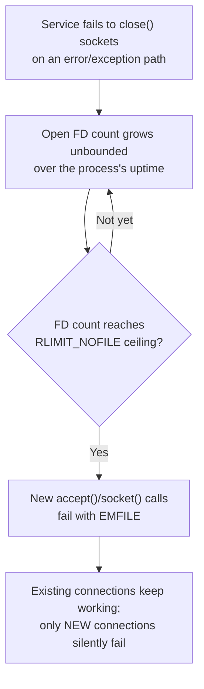

**Accept-queue overflow under a connection burst.** A sudden spike in
connection attempts (a flash-crowd event, or a thundering-herd retry storm
from clients reacting to a brief earlier outage) can fill the accept queue
(Section 5) faster than the application drains it via `accept()`, causing
the kernel to drop or reset the overflow — visible to clients as connection
timeouts or resets even though the server process itself never crashed or
even logged an error, because the failure happened entirely inside the
kernel before the application ever saw the connection.

**Edge-triggered epoll starvation.** As described in Section 4.4, an
edge-triggered epoll handler that reads only part of the available data on
a large burst, rather than looping until `EAGAIN`, will never be notified
again for that socket's remaining buffered data — the connection appears to
silently stall from the client's perspective, and this bug frequently
survives testing because it only manifests when a single read burst exceeds
whatever buffer size the handler happens to use.

## 16. Testing

Socket-level testing should verify both correctness and the operational
properties this chapter emphasizes: functional tests using real loopback
sockets (not mocks) to exercise the actual `accept()`/`connect()` handshake
and confirm application-level protocol framing works over real TCP segment
boundaries (which can split or coalesce application-level messages in ways
a mocked transport never reproduces); socket-option assertions (opening a
real connection against the service under test and confirming
`TCP_NODELAY`, `SO_REUSEADDR`, or `SO_REUSEPORT` are actually set as
expected, since a misconfigured option is a silent correctness/performance
bug, not a crash); load tests specifically targeting the accept-queue and
FD-ceiling failure modes from Section 15 (opening far more concurrent
connections than the backlog or FD limit, and confirming the failure mode
is a clean rejection rather than a crash or a stall); and chaos-style tests
that kill a connection mid-stream (simulating a client or network failure)
to confirm the server correctly detects the closed socket and releases its
FD rather than leaking it.

## 17. Common Mistakes

- Forgetting `SO_REUSEADDR`, causing restarts to fail with "address already
  in use" while a previous socket drains through `TIME_WAIT`.
- Mixing blocking socket calls into an otherwise non-blocking event-loop
  handler, silently reintroducing the single-connection-at-a-time
  bottleneck the event loop exists to avoid.
- Using edge-triggered `epoll` without looping a `recv()`/`send()` call
  until `EAGAIN`, causing the starvation bug described in Section 15.
- Never explicitly sizing `RLIMIT_NOFILE` for a high-concurrency service,
  inheriting a low default (often 1024) that fails silently in exactly the
  way Section 15 describes.
- Treating the listening socket and connected sockets as the same object —
  applying socket options (like `TCP_NODELAY`) to the listening socket
  instead of to each accepted connection, where they actually need to take
  effect.
- Using a TCP loopback socket for guaranteed-same-host IPC out of habit,
  paying the full network-stack overhead Section 4.7 shows is avoidable
  with a Unix domain socket.

## 18. Best Practices

- Default to `SO_REUSEADDR` on every server-side listening socket.
- Choose the concurrency model (Section 4.5) deliberately based on the
  workload's I/O-to-compute ratio, not by defaulting to whichever framework
  the team already knows.
- Size the accept backlog and `RLIMIT_NOFILE` explicitly as capacity-planning
  inputs, and monitor both (Section 14) rather than discovering their limits
  in production incidents.
- Prefer `SO_REUSEPORT` over a shared-FD `fork()` model when scaling a
  single host across worker processes.
- Use Unix domain sockets for same-host IPC; reserve TCP sockets for
  anything that could ever cross a host boundary.
- When using edge-triggered `epoll`, always loop reads/writes until
  `EAGAIN`/`EWOULDBLOCK` to avoid the starvation failure mode.

## 19. Anti-Patterns

- **The thread-per-connection web server at internet scale**: dedicating an
  OS thread to every connection for a service expected to hold tens of
  thousands of concurrent (mostly idle, keep-alive) connections, hitting the
  thread-count wall from Section 4.5 long before any CPU or bandwidth limit.
- **The busy-polling non-blocking server**: setting sockets non-blocking but
  then repeatedly calling `recv()` on all of them in a tight loop instead of
  using `select`/`poll`/`epoll`, burning CPU on calls that mostly return
  `EAGAIN` — non-blocking mode without a multiplexer defeats its own purpose.
  the way Section 4.4's evolution exists to prevent.
- **Ignoring `RLIMIT_NOFILE` until production**: treating the FD ceiling as
  an implementation detail rather than an explicit capacity-planning input
  sized alongside CPU and memory (Section 4.8).
- **Blocking the reactor thread**: performing synchronous file I/O, a
  blocking DNS lookup, or heavy computation directly inside an event-loop
  handler, stalling every other connection on that thread (Section 6).

## 20. Trade-off Analysis

| Decision | Favor thread-per-connection when | Favor single-threaded event loop when | Favor multi-threaded async I/O when |
|---|---|---|---|
| Connection count | Low-to-moderate, short-lived connections | Very high concurrent connection count, mostly I/O-bound | Very high concurrency AND needs multi-core CPU throughput |
| Programming complexity | Simplicity is prioritized; sequential logic per connection | Team accepts callback/async-style code for scale | Team can manage async-runtime concurrency subtleties |
| Per-connection workload | Can include blocking calls without much cost | Must remain non-blocking; CPU-bound work offloaded elsewhere | Can mix I/O-bound and CPU-bound work across cores |
| Failure isolation | One thread crashing affects only its connection | One handler crash can affect the whole loop | Isolated per event-loop thread, not fully process-wide |

## 21. Comparison Table

| Mechanism | Introduced | Interest-set model | Per-call cost | Cross-platform |
|---|---|---|---|---|
| `select()` | 1983 (4.2BSD) | Re-describe full set every call | O(n) rescan, fixed max FD count | Nearly universal (POSIX) |
| `poll()` | 1986 (SVR3) | Re-describe full set every call | O(n) rescan, no fixed max count | Nearly universal (POSIX) |
| `epoll()` | 2002 (Linux 2.5.44) | Registered once, persistent | O(1) relative to ready FDs | Linux-only |
| `kqueue()` | 2000 (FreeBSD) | Registered once, persistent | O(1) relative to ready FDs | BSD/macOS-only |
| IOCP | Windows NT | Completion-based (not readiness) | O(1), different model entirely | Windows-only |

## 22. Real-World Case Study

A mid-sized SaaS (Software as a Service) company's real-time notifications
service was originally built as a thread-per-connection server to hold open
long-lived WebSocket connections (recap: future WebSockets chapter) for
active browser sessions. At roughly 15,000 concurrent connections, the host
began exhausting memory purely from thread-stack overhead (each thread's
default 8 MB stack, even mostly unused, multiplied by 15,000 threads far
exceeded available RAM (Random Access Memory) long before CPU became a
bottleneck), and the OS scheduler's context-switching cost among that many
threads was independently degrading tail latency for every connection, not
just the newest ones. The team re-architected the service around a
single-threaded-per-core event-loop model (Node.js, whose underlying
`libuv` uses `epoll` per Section 4.4) with `SO_REUSEPORT` (Section 4.6)
distributing new connections across one reactor process per CPU core. The
same hardware then comfortably held over 200,000 concurrent connections,
because per-connection memory cost dropped from "one OS thread stack" to
"one small application-level connection-state object," and CPU load
distributed evenly across cores without any shared-state contention on the
listening socket itself.

## 23. Interview Questions

1. Walk through the exact sequence of system calls a TCP server and a TCP
   client each make, and explain what the listening socket versus the
   accepted socket each represent.
2. Why does `select()` not scale to tens of thousands of connections, and
   what specifically does `epoll` change to fix that?
3. What is the difference between level-triggered and edge-triggered epoll,
   and what bug can edge-triggered mode introduce if handled incorrectly?
4. When would you choose `SO_REUSEPORT` over a single shared listening
   socket with multiple worker threads?
5. Why might a Unix domain socket be preferable to a TCP socket on
   `127.0.0.1` for two processes on the same host?
6. A service's new connections start failing with `EMFILE` while existing
   connections keep working — what's the likely root cause and how would
   you confirm it?
7. Explain the difference between the SYN queue and the accept queue, and
   why a slow `accept()` loop can cause client-visible connection failures.

## 24. Hands-on Exercises

1. Implement the blocking echo server from Example A, then open three
   simultaneous `telnet`/`nc` (netcat) connections to it and observe that
   only one is served at a time.
2. Extend the epoll-based server from Example B to track and log the
   number of currently open connections, and verify it can hold hundreds of
   simultaneous idle connections without the CPU usage the blocking version
   would require to poll them individually.
3. Run the `SO_REUSEPORT` example from Example C with four workers, then
   use a load-testing tool to send a burst of connections and confirm (via
   per-process logging) that the kernel distributes them across all four
   workers rather than concentrating them on one.
4. Deliberately lower a test process's `ulimit -n` to a small number (e.g.,
   `ulimit -n 50`), then write a client that opens connections in a loop
   until it observes the `EMFILE`-driven failure, confirming the mechanism
   from Section 15 firsthand.

## 25. Design Exercises

1. Design the socket-layer architecture for a service that must hold one
   million concurrent long-lived connections (a chat/notification backend)
   across a fleet of hosts — specify the concurrency model, socket options,
   FD-limit sizing per host, and how many hosts are needed given a
   per-host FD ceiling you choose and justify.
2. A legacy service uses one blocking thread per connection and is
   scheduled for a rewrite. Propose a migration plan to an event-loop or
   async-I/O model, including how you would validate the new version
   handles the same connection-count and latency targets before cutover.
3. Design the local-IPC architecture for a sidecar-proxy pattern (an
   application container and a network-proxy sidecar in the same pod):
   justify your choice between a Unix domain socket and a loopback TCP
   socket for the data path between them.

## 26. Architecture Review Questions

- What concurrency model does this service use for its network sockets,
  and is that choice justified by its actual I/O-to-compute ratio?
- What is the configured accept backlog, and has it been sized against
  realistic connection-burst scenarios rather than steady-state averages?
- What is this service's `RLIMIT_NOFILE`, and is it monitored alongside CPU
  and memory as a capacity-planning input?
- Are `SO_REUSEADDR` and (where applicable) `SO_REUSEPORT` set explicitly
  and deliberately, rather than left to defaults?
- Does any code path use edge-triggered `epoll` without looping to
  `EAGAIN`, risking the starvation failure mode from Section 15?
- Is any purely local, same-host IPC unnecessarily routed over TCP loopback
  instead of a Unix domain socket?

## 27. Summary

A socket is the OS's file-descriptor-shaped abstraction over a network
connection, and the small, fixed sequence of calls that create, connect,
and tear one down — `socket`, `bind`, `listen`, `accept`, `connect`,
`send`/`recv`, `close` — is the foundation every higher-level networking
library and framework is ultimately built on. Blocking sockets are simple
but bind one thread to one connection; non-blocking sockets remove that
binding but require an efficient way to ask "which of my sockets is ready,"
which is exactly the problem `select`, `poll`, `epoll`, and `kqueue` each
answer with increasing efficiency, culminating in the O(1)
registered-interest-set model that solved the C10K problem. On top of that
mechanism, thread-per-connection, single-threaded event-loop, and
multi-threaded async-I/O are three distinct, deliberate architectural
choices trading programming simplicity against connection-count and
CPU-core scalability. `SO_REUSEADDR` and `SO_REUSEPORT` solve two different
multi-process production problems (fast restart, and kernel-level
connection distribution across worker processes, respectively); Unix domain
sockets trade TCP's network-reachability for lower overhead and
filesystem-permission-based access control when both endpoints share a
host; and the file-descriptor ceiling is a real, explicit capacity-planning
input, not an implementation detail — together, these are the sockets-layer
decisions a Solution Architect must be able to reason about explicitly
every time they evaluate, design, or debug a network-facing service.

## Further Reading

- [TCP/IP](CH03_TCPIP.md) — owns TCP/UDP transport mechanics, the
  three-way handshake, the TCP state machine, `TIME_WAIT`, and
  `TCP_NODELAY`, all recapped rather than re-taught in this chapter.
- [OSI Model](CH02_OSI_Model.md) — the layering model this chapter's
  transport/network split sits within.
- [Load Balancer](CH10_Load_Balancer.md) and
  [Reverse Proxy](CH11_Reverse_Proxy.md) — production systems built directly
  on the reactor-pattern socket architecture this chapter teaches.
- Node.js chapter (event-loop phases) and Go/Rust chapters (async
  runtimes) — [Node.js](../03_Software_Engineering_Foundations/CH03_Nodejs.md),
  [Go](../03_Software_Engineering_Foundations/CH04_Go.md),
  [Rust](../03_Software_Engineering_Foundations/CH05_Rust.md) — own the
  runtime-specific scheduling built on top of this chapter's OS-level
  multiplexing mechanism.
- WebSockets chapter (Part 05, not yet drafted) — builds a persistent,
  bidirectional application protocol on top of the TCP sockets this chapter
  teaches how to open, multiplex, and manage.
