# Chapter: WebSockets

Part: [05 — Networking and Operating Systems](PART_OVERVIEW.md) · Status: Drafted

## 1. Introduction

A WebSocket is a communication protocol that upgrades a single Transmission
Control Protocol (TCP) connection, initially opened as an ordinary Hypertext
Transfer Protocol (HTTP) request, into a persistent, full-duplex channel over
which either side — client or server — can send messages at any time, without
waiting to be asked. For a Solution Architect, WebSockets are the answer to a
recurring architectural question: *how do I let a server push data to a
browser (or any client) the instant something happens, instead of the client
having to keep asking?* Chat applications, live dashboards, collaborative
editors, multiplayer games, trading tickers, and real-time notification
systems all share this same underlying need, and WebSockets are the protocol
that the web platform standardized to meet it.

This chapter's scope is the WebSocket protocol itself: the handshake that
turns an HTTP connection into a WebSocket, the wire-level framing format that
carries messages after the upgrade, and — most importantly for an architect —
the operational consequences of introducing a long-lived, stateful,
bidirectional connection into an infrastructure that was designed around
short-lived, stateless HTTP requests. That last part is the real content of
this chapter: knowing the frame format is trivia; knowing why a WebSocket
server cannot be load-balanced, scaled, or deployed the same way a stateless
Representational State Transfer (REST) API can be is the architecture.

This chapter deliberately does not re-teach two adjacent topics that already
have dedicated ownership elsewhere in this handbook. The Berkeley sockets
Application Programming Interface (API), the operating-system-level
`socket()`/`bind()`/`listen()`/`accept()` primitives, and I/O multiplexing
mechanisms such as `epoll` are owned by the sibling chapter
[Sockets](CH16_Sockets.md) — a WebSocket, despite the name, is a completely
different layer of abstraction (an application-layer message-framing protocol
running over an operating-system-level TCP socket), and this chapter recaps
that relationship only briefly in Section 4.1. Likewise, the general anatomy
of an HTTP request/response and the full HTTP status code taxonomy are owned
by [HTTP](CH01_HTTP.md); this chapter owns and teaches in full only the parts
of HTTP that are specific to how a connection is *upgraded* out of HTTP
entirely (the `Upgrade` header mechanism and the `101 Switching Protocols`
status code), because no other chapter currently teaches that mechanism in
depth.

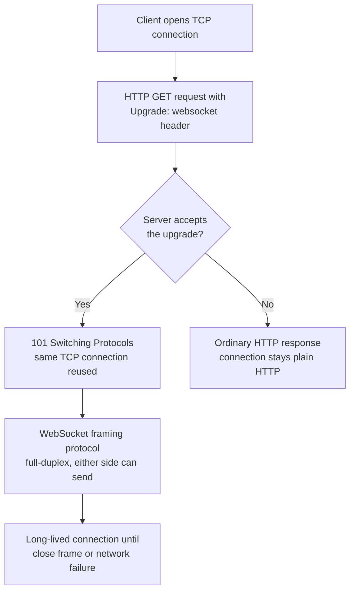

## 2. Historical Evolution

The desire for the server to push data to the browser predates WebSockets by
more than a decade, and understanding the failed and semi-successful attempts
that came before is essential to understanding why WebSockets look the way
they do.

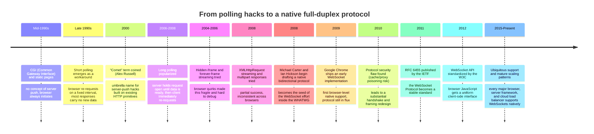

The critical detail in that timeline is that *every* pre-2011 technique —
short polling, long polling, Comet's hidden-iframe and forever-frame tricks,
and streaming XMLHttpRequest — was built entirely out of the request-response
primitives HTTP already had. None of them introduced a new wire protocol;
they all found increasingly clever ways to abuse the existing one. WebSockets
are different: RFC 6455 defines an actual new framing format that replaces
HTTP framing after the handshake completes. That is the historical
significance of 2011 — the industry stopped simulating push and started
shipping a protocol designed for it from the ground up.

## 3. Why It Exists

To understand why WebSockets had to exist, an architect needs to understand
precisely *what* is structurally impossible with plain HTTP, not just that
"HTTP is slow for real-time." HTTP's request-response model has a hard
architectural constraint: a client sends a request, the server sends exactly
one response, and the exchange is over. Nothing in the protocol lets a server
initiate a new message toward an idle client on an existing request; the
client must always be the one who opens a request. This is not a performance
limitation that faster hardware or better code could fix — it is baked into
the semantics of HTTP itself.

### 3.1 Short polling: querying on a timer

The client asks "anything new?" every N seconds, whether or not anything
changed.

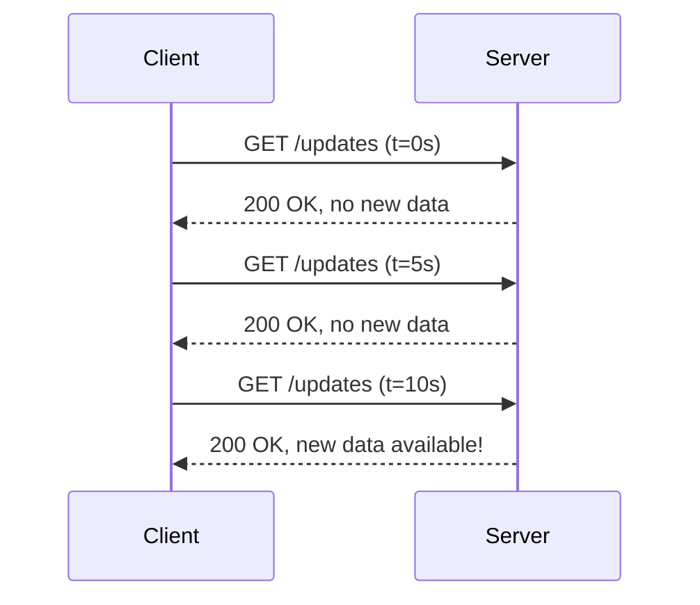

The failure mode is obvious once drawn out: the overwhelming majority of
requests are wasted round trips that find nothing, yet the system still pays
full HTTP overhead (Transmission Control Protocol (TCP) handshake reuse
permitting, but still full HTTP headers, and often a new Transport Layer
Security (TLS) handshake if connections are not kept alive) for each one.
Worse, there is an inherent latency floor equal to half the polling interval
on average — data that became available at t=10.1s is not seen until the
next poll at t=15s in a 5-second-interval scheme. Tightening the interval to
reduce that latency directly multiplies wasted-request volume, so short
polling forces architects into a lose-lose trade between staleness and load.

### 3.2 Long polling: holding the request open

Long polling improves on short polling by having the server *hold* the
request open without responding until it actually has something to say, then
the client immediately issues a new request the moment a response arrives.

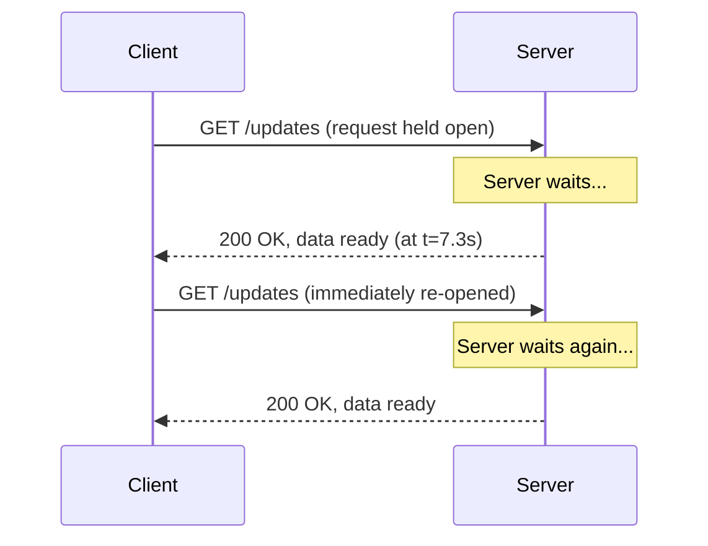

This removes the staleness-versus-load trade-off of short polling — the
server responds the instant it has data, and there is no idle polling
traffic. But long polling introduces a different, more insidious
architectural cost: it requires the server to hold one open HTTP request per
connected client indefinitely, tying up a server-side thread, worker, or
connection-handling resource for the entire wait period. On a
thread-per-request server architecture (a common design for HTTP servers),
ten thousand long-polling clients means ten thousand blocked threads doing
nothing but waiting — this is exactly the C10K problem (handling ten
thousand concurrent connections) that motivated event-driven, non-blocking
I/O server architectures in the first place. Long polling also still pays a
fresh HTTP request's overhead (headers, and potentially a new TCP/TLS
handshake) on every single response cycle, and it remains fundamentally
half-duplex: the client cannot send a message to the server *while* its long
poll is open without opening a second, separate connection for outbound
traffic.

### 3.3 Comet: the umbrella of hacks, and its ceiling

"Comet" is the umbrella term (coined in 2006) for the whole family of
browser tricks — long polling, hidden `<iframe>` streaming, multipart
XMLHttpRequest responses — that developers used to approximate push before a
real protocol existed. All of them shared the same ceiling: they were built
on top of HTTP's one-request-one-response contract, so at best they could
make that contract *feel* bidirectional through clever request-timing games,
but they could never make it *actually* full-duplex. Every Comet technique
still needed a client-initiated request as the carrier for every server
message, still suffered from browser-specific quirks and connection limits
(browsers historically capped simultaneous connections per hostname, so a
long-polling connection competed with the page's other HTTP requests for that
budget), and still incurred HTTP overhead on every cycle.

### 3.4 The actual gap WebSockets close

The core motivation, stated precisely: **HTTP has no mechanism for the server
to send an unsolicited message to a client over an existing connection, and
no mechanism for both sides to send simultaneously on one connection.**
WebSockets close that gap by changing the underlying protocol running over
the TCP connection — once the WebSocket handshake completes (Section 4.2),
the connection is no longer HTTP request/response at all; it becomes a
message-oriented full-duplex channel where either side transmits whenever it
wants, with no requirement to have been asked first and no per-message HTTP
overhead. This is a categorically different capability from anything Comet
or polling could deliver, not merely a faster or more efficient version of
the same thing.

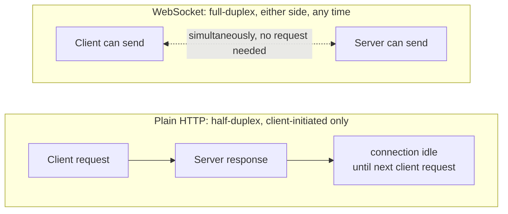

## 4. Core Concepts

### 4.1 Relationship to the underlying operating-system socket

**Definition.** A WebSocket is an application-layer message-framing protocol
that runs on top of one ordinary operating-system TCP socket. The name is a
frequent source of confusion for engineers new to the topic: "WebSocket" does
*not* mean a new kind of operating-system socket, a new transport protocol,
or a replacement for the Berkeley sockets API. It means a specific way of
structuring the bytes sent and received over a perfectly normal TCP
connection, once that connection has been upgraded away from HTTP framing.

**Mechanism.** Underneath, a server implementing WebSockets still calls the
same `socket()`, `bind()`, `listen()`, and `accept()` system calls — and still
needs the same I/O multiplexing strategy (`epoll` on Linux, `kqueue` on BSD/
macOS, IOCP on Windows) to handle many concurrent connections efficiently —
that any other TCP server needs. All of that machinery is owned and taught in
full by [Sockets](CH16_Sockets.md); this chapter recaps only that a WebSocket
server is, from the operating system's point of view, an ordinary TCP server
holding many open sockets simultaneously, each one now carrying WebSocket
frames (Section 4.5) instead of HTTP request/response bytes after the
handshake completes.

**Decision implication.** This distinction matters architecturally because it
means every operational lesson about scaling TCP-socket-holding servers —
file descriptor limits, `epoll`-based event loops outperforming
thread-per-connection models at high connection counts, the cost of context
switches under a naive threading model — applies directly to WebSocket
servers. A WebSocket server at scale is, underneath, exactly the
high-connection-count socket-server problem that [Sockets](CH16_Sockets.md)
teaches; WebSockets add a message framing format and a set of higher-level
architectural concerns (Sections 4.7-4.11) on top of that foundation, not a
different foundation.

**Common failure mode.** Engineers sometimes assume a WebSocket connection is
"lighter weight" than a TCP connection in some fundamental way, and are
surprised when the same file-descriptor and memory-per-connection limits that
apply to any long-lived-socket server also apply to their WebSocket server —
because it *is* a long-lived-socket server.

### 4.2 The WebSocket handshake: an HTTP Upgrade

**Definition.** A WebSocket connection begins life as an ordinary HTTP
request. The client sends a `GET` request that includes an `Upgrade:
websocket` header and a `Connection: Upgrade` header, signaling that it wants
to renegotiate the protocol running over this TCP connection rather than
receive a normal HTTP response. If the server is willing and able to speak
WebSocket, it replies with the HTTP status code `101 Switching Protocols`
instead of the usual `200 OK` — after that response, both sides stop
speaking HTTP on this connection entirely and start exchanging WebSocket
frames (Section 4.5).

The `Upgrade` header and the `101 Switching Protocols` status are general
HTTP mechanisms defined by the core HTTP specification and owned by
[HTTP](CH01_HTTP.md) at the level of "what an HTTP status code is and how
status code classes are grouped" (see
[HTTP Section 4](CH01_HTTP.md#4-core-concepts)); this chapter owns and
teaches, in full, the WebSocket-specific semantics of *how that upgrade
mechanism is used* — the specific headers RFC 6455 requires, the
cryptographic handshake-validation step, and why it is designed this way.

**Mechanism — the request.** A conforming WebSocket handshake request looks
like this:

```
GET /chat HTTP/1.1
Host: example.com
Upgrade: websocket
Connection: Upgrade
Sec-WebSocket-Key: dGhlIHNhbXBsZSBub25jZQ==
Sec-WebSocket-Version: 13
Origin: https://example.com
```

- `Upgrade: websocket` and `Connection: Upgrade` together request the
  protocol switch.
- `Sec-WebSocket-Key` is a randomly generated, base64-encoded 16-byte value
  the client creates fresh for every handshake. Its purpose is *not*
  encryption or authentication — it exists specifically to prove to the
  client that the server it is talking to actually understood and
  intentionally handled this as a WebSocket handshake, rather than being, for
  example, a misconfigured HTTP cache or transparent proxy that blindly
  echoed the request back (a real, exploitable risk with older,
  pre-standardization draft versions of the protocol that this key exchange
  was specifically introduced to close).
- `Sec-WebSocket-Version: 13` identifies the RFC 6455 protocol version.
- `Origin` carries the requesting page's origin, which the server is expected
  to validate (Section 4.11) — this is not enforced by the protocol itself.

**Mechanism — the response.** A server that accepts the upgrade must reply:

```
HTTP/1.1 101 Switching Protocols
Upgrade: websocket
Connection: Upgrade
Sec-WebSocket-Accept: s3pPLMBiTxaQ9kYGzzhZRbK+xOo=
```

`Sec-WebSocket-Accept` is computed by the server by concatenating the
client's `Sec-WebSocket-Key` with a fixed magic globally unique identifier
(GUID) string defined in RFC 6455
(`258EAFA5-E914-47DA-95CA-C5AB0DC85B11`), taking the SHA-1 (Secure Hash
Algorithm 1) hash of the result, and base64-encoding that hash. The client
performs the identical computation on its side and compares the result to
what the server sent back; a mismatch means the client must abort the
connection. Because the magic GUID is public and fixed, this is not a secret
or a proof of identity — its sole purpose is to prove that the far end
deliberately implements the WebSocket protocol and processed this specific
handshake, defeating naive proxies or caches that might otherwise
misinterpret or replay a WebSocket upgrade request as if it were a normal
cacheable HTTP request.

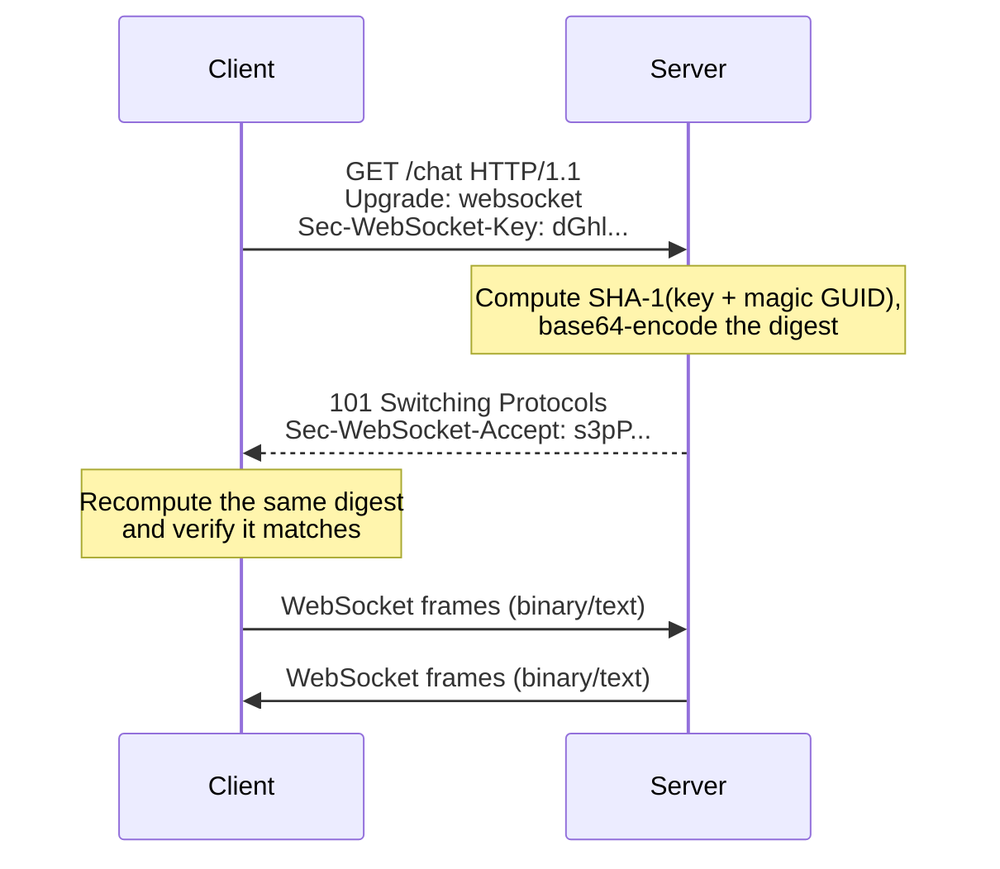

**Decision implication.** Because the handshake is a real HTTP request, it
passes through the exact same infrastructure as any other HTTP request —
reverse proxies, load balancers, and firewalls that already understand HTTP
generally handle the initial handshake without modification, provided they
are explicitly configured to also forward the `Upgrade` and `Connection`
headers and *keep the connection open* afterward rather than treating it as
a completed, closeable request (a configuration detail that trips up teams
migrating an existing HTTP reverse-proxy setup to also carry WebSocket
traffic — see Section 8).

**Common failure mode.** A reverse proxy configured with a fixed request
timeout (a sensible default for ordinary HTTP requests, where a response is
expected within seconds) will forcibly close a WebSocket connection that has
simply been idle, correctly, for longer than that timeout — because from the
proxy's point of view, the "request" that began the handshake never
"completed." This is one of the most common production incidents introduced
when a team enables WebSockets behind existing HTTP infrastructure without
adjusting proxy timeout configuration (Section 8, Section 15).

### 4.3 `wss://` and Transport Layer Security

**Definition.** Just as HTTP has a secure counterpart, HTTPS, WebSockets have
`wss://` (WebSocket Secure), which layers the identical TLS encryption used
by HTTPS underneath the WebSocket handshake and framing. `ws://` is the
unencrypted scheme; `wss://` runs the entire handshake and all subsequent
frames inside a TLS session, exactly as HTTPS wraps HTTP.

**Mechanism.** The TLS handshake itself — key exchange, cipher suite
negotiation, certificate verification — is identical to the HTTPS case and is
owned in full by [TLS](CH06_TLS.md); this chapter's only addition is that the
WebSocket `Upgrade` request/`101` response and all subsequent frames are
simply the "application data" carried inside that already-established TLS
session, in the same way an HTTPS request's request line and headers are.

**Decision implication.** Browsers enforce a mixed-content restriction
analogous to HTTPS: a page loaded over `https://` cannot open a `ws://`
(unencrypted) WebSocket connection — it must use `wss://`. This is not
optional in production. Beyond the browser policy, `wss://` matters
architecturally because WebSocket payloads frequently carry the same
sensitive data an equivalent HTTPS API would (session tokens, chat content,
financial data), so plaintext `ws://` in production is a straightforward data
exposure and downgrade-attack risk, not a hypothetical one.

### 4.4 Subprotocols and extensions

**Definition.** RFC 6455 allows the client to advertise a list of
application-level "subprotocols" it can speak — via the
`Sec-WebSocket-Protocol` request header — and the server picks (and echoes
back) exactly one, telling the client which message format/convention to
expect on top of raw WebSocket framing (for example, a client might offer
`graphql-transport-ws` and `soap`, and the server confirms it will speak
`graphql-transport-ws`). Separately, `Sec-WebSocket-Extensions` negotiates
protocol-level extensions such as `permessage-deflate` (per-message
compression).

**Mechanism.** Both negotiations happen entirely within the handshake request
and response headers, before any WebSocket frame is exchanged — the protocol
itself (opcodes, masking, fragmentation) never changes; only how the
*payload bytes* inside frames should be interpreted (subprotocol) or
transformed (extension, e.g. decompressed) changes.

**Decision implication.** `permessage-deflate` compression trades CPU time on
both ends for reduced bandwidth per message, which is usually a good trade
for text-heavy protocols (JSON (JavaScript Object Notation) chat messages)
but a poor one for already-compressed or high-entropy binary payloads (video
frames, encrypted blobs) where compression cannot shrink the data further and
only adds CPU overhead — an architect choosing to enable compression should
base the decision on payload entropy, not enable it unconditionally.

### 4.5 The WebSocket framing protocol

**Definition.** After the handshake, every unit of data exchanged is a
**frame**: a small binary header followed by a payload. Unlike HTTP/1.1's
text-based, delimiter-scanning framing, WebSocket framing is fixed-format
binary, conceptually similar in spirit to HTTP/2's binary framing layer (see
[HTTP/2 Section 4.1](CH04_HTTP2.md#41-the-binary-framing-layer) for that
chapter's ownership of binary-framing-as-a-general-technique) but with a
distinct, simpler frame structure defined specifically for WebSockets.

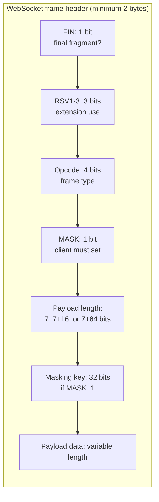

**Mechanism — opcodes.** The 4-bit opcode field identifies the frame's
purpose:

| Opcode | Meaning |
|---|---|
| `0x0` | Continuation frame (part of a fragmented message, Section 4.6) |
| `0x1` | Text frame (payload is UTF-8 (Unicode Transformation Format-8) text) |
| `0x2` | Binary frame (payload is arbitrary binary data) |
| `0x8` | Close frame (initiates or acknowledges connection closure) |
| `0x9` | Ping frame (liveness check, Section 4.10) |
| `0xA` | Pong frame (reply to a ping, Section 4.10) |

**Mechanism — payload length encoding.** The 7-bit length field is a compact
encoding: values 0-125 are the literal payload length; the value 126 signals
"the *next* 16 bits hold the real length" (payloads up to 65,535 bytes); the
value 127 signals "the next 64 bits hold the real length" (payloads up to
theoretically 2^63 bytes, though practical implementations cap this far
lower). This variable-width encoding avoids wasting 8 bytes on every small
frame while still supporting arbitrarily large messages.

**Decision implication.** Because framing is a fixed binary format rather
than a text protocol, a WebSocket frame parser is simpler and faster to
implement correctly than an HTTP/1.1 text parser, and — combined with masking
(Section 4.6) — is considerably more resistant to the kind of
request-smuggling-style ambiguity attacks that plague text-based protocols
with multiple valid ways to represent the same boundary.

### 4.6 Masking: why client-to-server frames must be obfuscated

**Definition.** Every frame sent from client to server must have its payload
XOR (exclusive-or)-masked with a 32-bit masking key that is randomly chosen
per frame and transmitted alongside it in the clear; frames sent from server
to client must *not* be masked. This asymmetry is deliberate and is one of
the most commonly misunderstood details of the protocol — masking is not
encryption (the key is sent in plaintext right next to the data, so anyone
who can see the frame can trivially unmask it) and provides zero
confidentiality.

**Mechanism.** The actual purpose of masking is a security mitigation against
a specific class of attack: **cache and proxy poisoning** and **cross-site
attacks that exploit ambiguity in shared network intermediaries**. Before
masking was mandated (an early draft of the protocol did not require it, and
this was one of the exact vulnerabilities that delayed and reshaped the
final RFC 6455 handshake and framing design mentioned in Section 2's
timeline), an attacker running JavaScript on a victim's browser could open a
WebSocket connection and craft payload bytes that, if a misbehaving
intermediary (a transparent HTTP proxy or cache sitting between the browser
and a server) misinterpreted the WebSocket byte stream as if it were plain
HTTP, could smuggle a forged HTTP request through that intermediary. Because
the attacker's JavaScript fully controls the payload bytes going out from the
browser (client to server), masking those bytes with a key that is only
known once the frame is already assembled means an attacker cannot predict
what the *masked* bytes on the wire will look like well enough to reliably
construct a byte sequence that some intermediary would misparse as an
injected HTTP request — masking scrambles the attacker's chosen bytes into
unpredictable ones from the intermediary's point of view. Server-to-client
frames are not attacker-controlled in the same way (a compliant server is not
running attacker-supplied script), so masking in that direction is
unnecessary and is explicitly forbidden by the RFC.

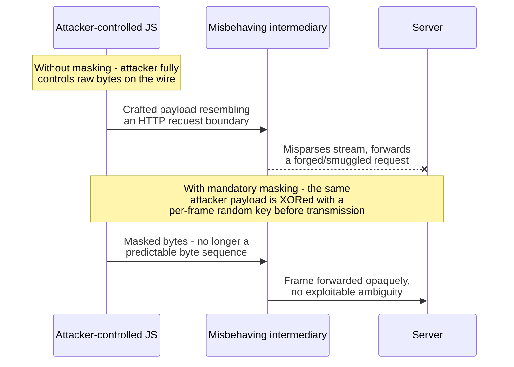

**Decision implication.** Because masking is a mandatory *protocol*
requirement, not an application choice, every conforming WebSocket client
library implements it transparently — an architect does not need to
configure or reason about masking directly, but should understand it when
explaining to a security reviewer why WebSockets are not equivalent to
plaintext data exposure risk in the way an unencrypted `ws://` connection
still is (masking defends against a specific intermediary-confusion class of
attack; it is not a substitute for `wss://` encryption, Section 4.3).

**Common failure mode.** Engineers occasionally assume masking means
WebSocket traffic is "somewhat encrypted" even over plain `ws://`, and are
surprised that the masking key is transmitted unencrypted directly next to
the masked payload — trivially reversible by anyone observing the raw bytes.
Masking provides zero confidentiality; only `wss://` (TLS) provides
confidentiality.

### 4.7 Fragmentation: splitting one logical message across frames

**Definition.** A single logical WebSocket message (one text string, one
binary blob) does not have to arrive in one frame — it can be split across
multiple frames, called **fragmentation**. The first frame of a fragmented
message carries the real opcode (`0x1` text or `0x2` binary) with its `FIN`
bit set to 0 (meaning "more fragments follow"); every subsequent fragment
uses the continuation opcode `0x0`; the final fragment sets `FIN` to 1.

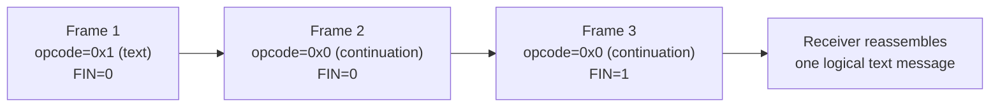

**Mechanism.** Fragmentation exists to let a sender begin transmitting a
message before the entire payload is known or ready — for example, streaming
a large file or a long-running computation's output incrementally — without
having to buffer the entire message in memory first, and to let a receiver
begin processing early fragments before the whole message has arrived.
Critically, control frames (close, ping, pong; Section 4.5 and 4.10) are
never themselves fragmented and can be injected *between* the fragments of a
larger data message, so a peer can still respond to a ping while in the
middle of receiving a large fragmented message.

**Decision implication.** Fragmentation is a transport-level detail that most
application code never has to think about directly — WebSocket client
libraries (browser `WebSocket` API, Node.js `ws` library) reassemble
fragments transparently and deliver one complete logical message to
application code. An architect's practical takeaway is narrower: know that
fragmentation exists so that a custom low-level implementation (rare, but
occasionally necessary for very high-throughput binary protocols) correctly
handles interleaved control frames, and know that a "message size limit"
configured on a WebSocket server applies to the *reassembled* logical
message, not to any individual physical frame.

**Common failure mode.** Confusing fragmentation with the separate concept of
message *batching* at the application layer — fragmentation is purely a
wire-level mechanism for splitting one logical message; it says nothing about
how many distinct application-level messages (e.g. distinct chat messages) a
system chooses to send per second, which is an application design decision,
not a protocol-level one.

### 4.8 Full-duplex bidirectional communication as the core value proposition

**Definition.** Full-duplex means both parties can transmit and receive
simultaneously and independently over the single open connection — the
server does not have to wait for a client message to send one, and the
client does not have to wait for a server response to send another message.
This is the single architectural capability that everything else in this
chapter exists to deliver, and it is the correct lens through which to
compare WebSockets against every alternative real-time technique.

**Mechanism.** Once the handshake (Section 4.2) completes, the TCP connection
carries WebSocket frames (Section 4.5) in both directions with no inherent
ordering constraint between them — a server can push three unsolicited
frames in a row while the client is also independently sending frames, all
on the same connection, with no additional handshake, no additional
connection, and no per-message HTTP overhead.

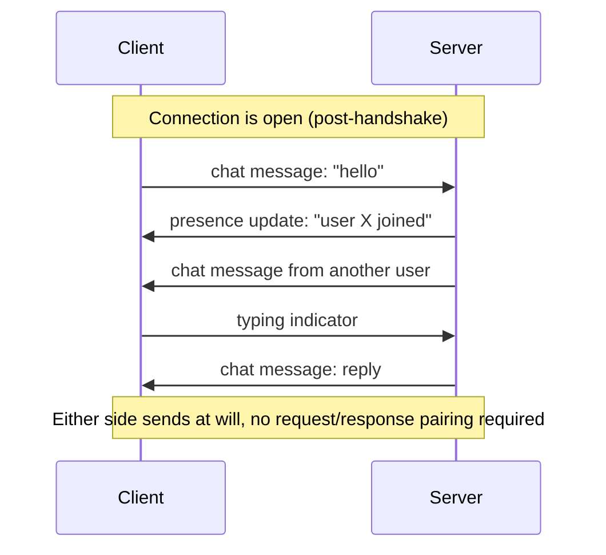

**Decision implication — the real decision framework.** This is the section
an architect should use directly when choosing among real-time techniques,
because "just use WebSockets, they're real-time" is not a sufficient
architectural justification on its own:

| Technique | Direction | Server can push unsolicited? | Per-message overhead | When it is the right choice |
|---|---|---|---|---|
| Short/long polling | Client-initiated only | No (simulated via fast re-request) | Full HTTP headers every cycle | Update frequency is low, staleness of seconds-to-minutes is acceptable, and you want zero new infrastructure |
| Server-Sent Events (SSE) | Server-to-client only, one-way | Yes, natively | Low (one long-lived HTTP response, event-stream framed) | You only need server-to-client push (live feeds, notifications, progress updates) and the client never needs to send data back over the same channel |
| WebSockets | Full-duplex, both directions | Yes, natively | Very low (small binary frame header, no HTTP per message) | Genuine bidirectional, low-latency, high-frequency interaction is required (chat, collaborative editing, gaming, trading) |

Server-Sent Events deserve a direct comparison because they are the option
architects most often confuse with WebSockets: SSE is a standard built
directly on top of ordinary HTTP (a response with `Content-Type:
text/event-stream` that simply never closes, streaming newline-delimited
events), so it is simpler to implement, works over plain HTTP/1.1 or HTTP/2
without any upgrade mechanism, automatically reconnects in browsers via the
native `EventSource` API, and passes through ordinary HTTP infrastructure
without special handling. Its limitation is architectural, not incidental:
SSE is one-way by design. If a client needs to send data back, it must use a
separate ordinary HTTP request alongside the SSE stream — which is entirely
adequate for a live sports-score feed or a progress-bar update, but wrong for
a chat application or collaborative document editor where both parties send
frequent, low-latency messages. Choosing WebSockets when SSE would suffice
means accepting all of the stateful-connection scaling complexity taught in
Sections 4.9-4.11 for a bidirectional capability the application does not
actually use — a common over-engineering mistake this chapter flags directly
in Section 19 (Anti-Patterns).

**Common failure mode.** Defaulting to WebSockets for every feature that
merely feels "real-time" (a notification badge, a live counter) when the
actual data flow is one-directional and SSE (or even a well-tuned polling
interval) would deliver the same user experience with dramatically less
operational complexity (Sections 4.9-4.11) is one of the most frequent
architecture-review findings in production systems that adopted WebSockets
prematurely.

### 4.9 The stateful-connection problem: why horizontal scaling changes fundamentally

**Definition.** An HTTP server handling REST traffic is, in the ideal
architecture, **stateless**: any request can be handled by any server
instance, because nothing about "this client's session" lives in a
particular server process's memory — session data, if any, is externalized
to a shared store (a database, a distributed cache). A WebSocket server
breaks that assumption at the most fundamental level: **the moment a
client's WebSocket handshake completes, that client has an open, long-lived
TCP connection to one specific server process, and that connection itself
— not just some associated session data — physically exists only on that one
machine.**

**Mechanism.** This is not a design choice an architect can configure away —
it is inherent to what a persistent connection *is*. A load balancer can
distribute the initial handshake request to any healthy backend, exactly like
any other HTTP request, but once that backend accepts the upgrade and the
`101 Switching Protocols` response is sent, every subsequent frame for that
client's session must travel over that exact same TCP connection to that
exact same server process. There is no way to "move" an established TCP
connection to a different backend process without dropping and re-establishing
it. This is precisely why **sticky sessions (session affinity) become
mandatory, not optional**, once WebSockets are introduced — a distinction
this chapter recaps rather than re-teaches, because sticky sessions/session
affinity mechanics (cookie-based versus IP-hash affinity, and why they
conflict with clean stateless load balancing) are owned in full by
[Load Balancer Section 4.5](CH10_Load_Balancer.md#45-session-affinity-sticky-sessions-cookie-based-vs-ip-hash-and-the-tension-with-stateless-scaling).
That section's framing of affinity as "a workaround for backends that hold
client-specific state" applies to WebSockets in the most literal sense
possible: the "state" being pinned is not application session data at all —
it is the physical TCP connection itself, which categorically cannot be
relocated.

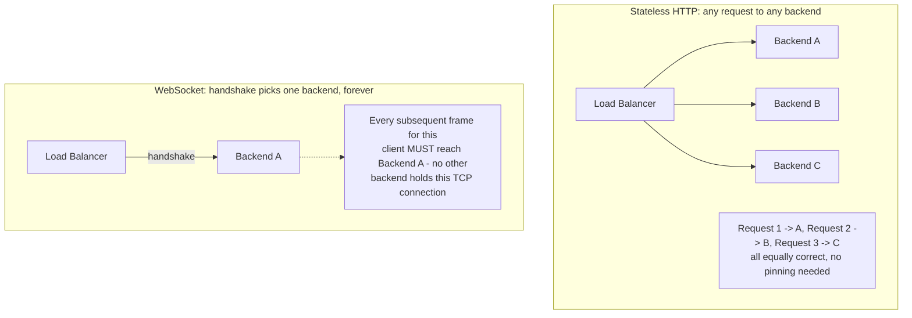

**Decision implication.** Because the connection cannot move, a load
balancer fronting WebSocket traffic must be configured for connection-level
persistence for the *entire lifetime* of that connection (not just a
request), which can be minutes, hours, or days rather than the milliseconds
a typical HTTP request/response affinity window would need. This has
concrete downstream effects an architect must plan for explicitly:

- **Deployments and rolling restarts become disruptive by default.** Taking a
  backend out of rotation to deploy a new version does not merely stop new
  requests from reaching it (as with stateless HTTP) — it forcibly
  disconnects every currently-connected WebSocket client on that backend,
  unless the deployment process explicitly implements connection draining
  (waiting for clients to gracefully reconnect elsewhere, or proactively
  sending a close frame with a reason code the client can interpret to
  reconnect immediately, Section 4.10).
- **Load distribution skews under normal operation.** Because connections
  are long-lived, a backend that happens to accumulate more long-lived
  connections than its peers (for example, because it came online during a
  traffic spike) stays "loaded" with those connections for as long as they
  remain open — unlike stateless HTTP, where load naturally rebalances
  request-by-request, a WebSocket server's load only rebalances as old
  connections eventually close and new handshakes distribute elsewhere.
- **Autoscaling reacts on the wrong timescale.** Adding a new backend
  instance during a traffic spike helps only with *new* handshakes; it does
  nothing to redistribute the thousands of connections already pinned to the
  overloaded existing instances, so scale-out capacity for WebSocket
  workloads should be provisioned ahead of anticipated load, not purely
  reactively.

**Common failure mode.** A team migrates an existing REST API's load-balancer
configuration verbatim to also front a new WebSocket endpoint, without adding
persistence/affinity — clients experience their WebSocket connection
appearing to "randomly" drop mid-session, because the load balancer, having
no reason to keep a request pinned, is round-robin distributing what it
still thinks are independent stateless requests, when in reality each
distributed attempt is trying (and failing) to resume a connection whose
state lives only on the original backend.

### 4.10 Scaling architecture: the pub/sub backplane pattern

**Definition.** Session affinity (Section 4.9) solves *one* problem — making
sure a given client's frames keep reaching the backend holding its
connection — but it does not solve a second, equally important problem: what
happens when server-initiated data (a chat message, a live update) needs to
reach a client whose connection is held by a *different* server process than
the one that received the triggering event? Because no single WebSocket
server instance holds all connections in a horizontally scaled deployment,
broadcasting a message to "everyone in this chat room" or "every subscriber
to this data feed" requires a mechanism for server instances to relay
messages to each other. The standard architectural solution is a **publish/
subscribe (pub/sub) backplane**: a shared messaging layer (commonly Redis
pub/sub, though any message broker with pub/sub semantics — Apache Kafka,
NATS, cloud-native equivalents — can fill this role) that every WebSocket
server instance both publishes to and subscribes from.

**Mechanism.** When Client A (connected to Server 1) sends a chat message
intended for Client B (connected to Server 2), Server 1 cannot deliver that
message directly — it has no open connection to Client B. Instead, Server 1
publishes the message to a shared channel on the pub/sub backplane (e.g. a
Redis channel named for the chat room). Every WebSocket server instance,
including Server 2, is already subscribed to that channel. Server 2 receives
the published message from the backplane and, because it *does* hold Client
B's open connection, forwards it over that connection as a WebSocket frame.

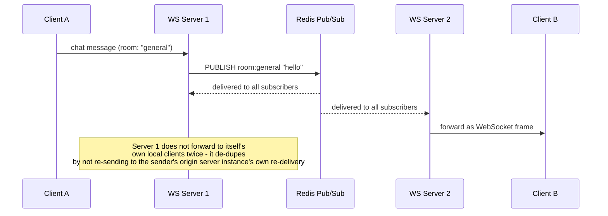

**Decision implication.** This pattern is what allows the stateful-connection
constraint from Section 4.9 to coexist with horizontal scale-out: instead of
trying to make connections movable (impossible) or forcing all clients onto
one giant server (does not scale), the architecture accepts that connections
are pinned and instead makes *messages* mobile via the backplane. The
trade-offs an architect must weigh explicitly:

- The backplane itself becomes a new critical-path dependency and potential
  single point of failure — if Redis (or the chosen broker) becomes
  unavailable, cross-server message delivery stops even though individual
  WebSocket connections remain open and healthy, a partial-failure mode that
  is easy to miss in monitoring that only checks "is the WebSocket server
  up."
- Pub/sub delivery is typically fire-and-forget (Redis pub/sub in particular
  provides no delivery guarantee or persistence — a message published while a
  subscriber is briefly disconnected is simply lost) so applications
  requiring guaranteed delivery need either a broker with persistence and
  acknowledgment (Kafka-style) or an application-level acknowledgment/replay
  scheme layered on top.
- Every server instance subscribing to every channel (a simple starting
  design) means every message is delivered to every server regardless of
  whether it has any relevant connected clients — at very high scale, this
  motivates partitioning channels or using consistent hashing so a server
  only subscribes to channels relevant to the connections it actually holds.

**Common failure mode.** Building a WebSocket feature that works correctly in
local development and single-instance staging, then discovering in
production (once traffic justifies more than one server instance) that
messages silently fail to reach roughly half of connected clients, because
the messages were only ever being delivered to clients on the *same* server
instance that received the triggering event — the pub/sub backplane was
never added, and the bug is invisible until horizontal scaling is actually in
effect.

### 4.11 Reconnection and heartbeat architecture

**Definition.** A WebSocket connection can fail silently: a client's laptop
can go to sleep, a mobile device can move out of coverage, an intermediate
network device can drop an idle connection's state without either endpoint
being notified via a proper close frame. Because TCP itself will not always
promptly report this kind of failure (a connection can remain in an
established-but-dead state for a long time from one side's perspective, if no
data is being exchanged), WebSocket architectures need two complementary
mechanisms: an **application-level heartbeat** (ping/pong) to actively detect
a dead connection, and a **reconnection strategy** on the client to recover
from the inevitable disconnects that do occur.

**Mechanism — ping/pong.** RFC 6455 defines two dedicated control opcodes
(Section 4.5) for exactly this purpose: `0x9` (ping) and `0xA` (pong). Either
side may send a ping frame at any time; a compliant peer must respond with a
pong frame carrying the identical payload, as soon as practical, without
waiting for any application-level processing to finish. A server (or client)
that sends a ping and receives no matching pong within a configured timeout
treats the connection as dead and closes it, freeing the resources (Section
4.9) it was consuming.

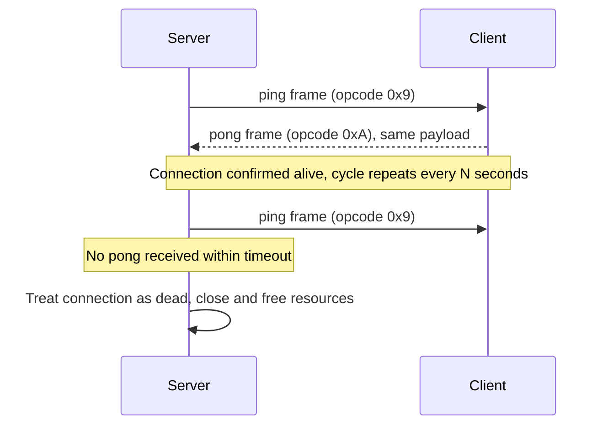

**Mechanism — client reconnection with backoff.** When a client detects that
its connection has closed unexpectedly (as opposed to a clean, intentional
close), it should not simply retry immediately in a tight loop — during an
outage affecting many clients simultaneously (a server restart, a network
partition resolving), every client reconnecting at the same instant creates
a "thundering herd" that can overwhelm the very server that just recovered.
The standard mitigation is **exponential backoff with jitter**: each failed
reconnection attempt waits progressively longer before the next attempt (for
example, doubling the delay each time up to a capped maximum), and a small
random jitter is added to each computed delay so that many clients retrying
around the same moment do not all retry at the exact same instant.

**Decision implication.** The heartbeat interval and reconnection backoff
parameters are a direct latency-versus-overhead trade-off an architect must
tune deliberately: a short ping interval detects dead connections faster
(freeing server resources sooner and letting clients begin reconnecting
sooner) but adds proportionally more background traffic across a large
connected population; too long an interval lets dead connections linger,
silently consuming server-side connection slots and memory that Section 4.9
already identified as a scarce, non-transferable resource.

**Common failure mode.** Implementing reconnection without any backoff at
all — a client that immediately retries on every failure, in a loop, is the
single most common cause of a WebSocket server being knocked back down
immediately after a successful recovery, because the very moment the server
comes back healthy, it is hit simultaneously by every previously-disconnected
client's retry.

## 5. Internal Working

Putting Sections 4.2 through 4.11 together, the full lifecycle of a
production WebSocket connection looks like this end to end:

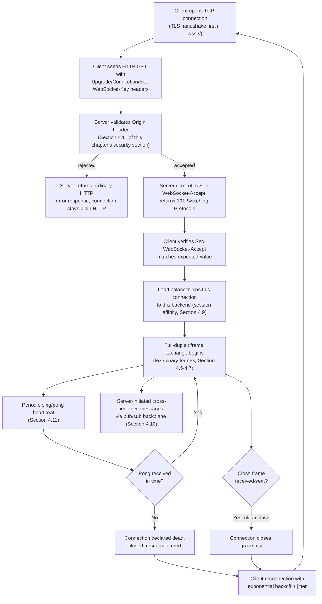

At the operating-system layer underneath all of this, each open WebSocket
connection is one held file descriptor and one entry in the server's I/O
multiplexing mechanism (`epoll`, `kqueue`, or IOCP) — the mechanics of how a
single-threaded or small-thread-pool event loop can efficiently watch tens of
thousands of these file descriptors for readiness are owned in full by
[Sockets](CH16_Sockets.md); this chapter's internal-working diagram above is
specifically the application-protocol-level lifecycle riding on top of that
foundation.

## 6. Design Principles

- **Prefer the least powerful sufficient protocol.** Section 4.8's decision
  framework exists precisely so this principle can be applied concretely:
  reach for WebSockets only when genuine bidirectional, low-latency,
  high-frequency communication is required; prefer Server-Sent Events for
  one-way push, and prefer polling for infrequent, latency-tolerant updates.
  Every step up this ladder adds real operational complexity (Sections 4.9
  and 4.10 in particular), so the "more powerful" option is not automatically
  the better architecture.
- **Treat the connection itself as a scarce, pinned resource.** Because a
  WebSocket connection cannot be relocated once established (Section 4.9),
  design capacity planning, deployment strategy, and autoscaling policy
  around the assumption that connections accumulate on whichever backend
  first accepted them, not around the stateless assumption that any backend
  can absorb any share of load at any moment.
- **Externalize cross-instance messaging from day one, not as a later
  retrofit.** The pub/sub backplane pattern (Section 4.10) should be part of
  the initial architecture for any WebSocket feature expected to run on more
  than one server instance, even if the system launches on a single
  instance — retrofitting it after clients already depend on cross-user
  messaging "just working" is a much larger and riskier change than
  designing it in from the start.
- **Design for disconnection as the normal case, not the exception.**
  Heartbeats (Section 4.11) and client-side reconnection with backoff are not
  optional hardening added late; a WebSocket client that has no reconnection
  logic at all is not production-ready, because network interruptions of
  long-lived connections are a statistical certainty at any meaningful scale
  or duration.
- **Validate `Origin` on every handshake, unconditionally.** As detailed in
  Section 13, the browser same-origin policy that protects `fetch` and
  XMLHttpRequest calls does not automatically protect WebSocket handshakes —
  server-side origin validation is a mandatory control, not a defense-in-depth
  nicety.

## 7. Architecture Patterns

- **Direct WebSocket server behind a session-affinity-aware load balancer.**
  The simplest topology: clients connect to a load balancer, which performs
  the initial HTTP-level handshake routing like any HTTP request but then
  pins the resulting connection to one backend for its entire lifetime
  (Section 4.9). Appropriate for small-to-medium deployments where a handful
  of WebSocket server instances, each running a pub/sub backplane client
  (Section 4.10), is sufficient.
- **Dedicated WebSocket gateway/edge tier, decoupled from application
  servers.** At larger scale, many architectures separate "the process that
  holds the client's TCP connection" from "the process that runs business
  logic" — a thin WebSocket gateway layer terminates connections, handles
  handshakes, heartbeats, and frame parsing, and forwards decoded application
  messages to stateless backend services over an internal protocol (HTTP,
  gRPC, or a message queue), with the gateway also subscribing to the pub/sub
  backplane on the application services' behalf. This isolates the
  stateful-connection scaling concerns (Section 4.9) from application logic,
  letting the two scale independently — a common pattern in managed
  real-time platforms (Section 22).
- **Managed WebSocket infrastructure (cloud/third-party).** Rather than
  operating the stateful-connection and pub/sub-backplane complexity
  in-house, many organizations adopt a managed real-time messaging service
  (for example, a cloud provider's managed WebSocket API gateway, or a
  third-party real-time platform) that absorbs Sections 4.9-4.10's scaling
  concerns entirely, at the cost of vendor coupling and, typically, per-
  connection or per-message pricing that needs to be modeled against
  self-hosted infrastructure cost.

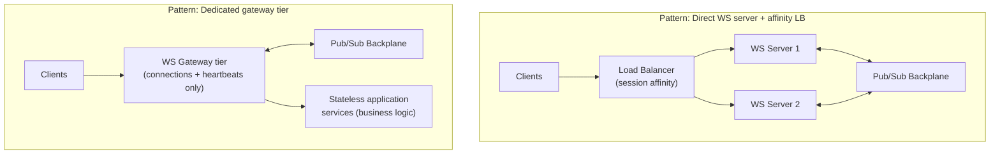

## 8. Production Architecture

A production WebSocket deployment behind a reverse proxy or load balancer
needs several settings adjusted beyond what a stateless HTTP service would
require, because — as established in Section 4.9 — the infrastructure must
treat this as a long-lived connection, not a completed request:

- **Idle timeout must exceed the heartbeat interval with margin.** If a
  reverse proxy in front of the WebSocket server has its own idle-connection
  timeout (many do, by default, to reclaim resources from abandoned HTTP
  connections), that timeout must be set comfortably longer than the
  application's ping/pong interval (Section 4.11) — otherwise the proxy will
  close connections that the application itself still considers healthy.
- **`Upgrade`/`Connection` headers must be explicitly forwarded.** A reverse
  proxy that strips or does not understand these headers will either reject
  the handshake or silently convert it into an ordinary (broken) HTTP
  request/response, since the proxy never actually performs the protocol
  switch on the connection it holds to the backend.
- **Connection draining on deployment.** Rolling out a new server version
  should stop routing *new* handshakes to an outgoing instance immediately,
  but existing connections on that instance should be given a grace period
  (with a proactive close frame carrying a reason clients can use to
  reconnect immediately elsewhere) rather than being killed abruptly the
  moment the instance is torn down.
- **Health checks must not count active WebSocket connections against
  capacity naively.** Because connections are long-lived and do not "finish"
  the way HTTP requests do, a health/readiness check based on active
  connection count needs its threshold calibrated against expected steady-
  state connection volume, not against typical short-lived-HTTP-request
  concurrency assumptions.

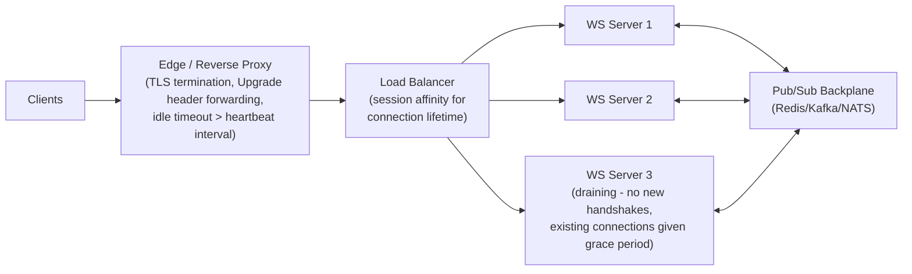

## 9. Implementation

Implementing a production-grade WebSocket server means addressing, at
minimum: the handshake (usually handled transparently by a library), origin
validation (Section 13), a heartbeat loop (Section 4.11), a pub/sub
backplane subscription for cross-instance delivery (Section 4.10), and
graceful shutdown/draining behavior (Section 8). Section 10 below provides
complete, runnable code for the two most operationally significant pieces: a
server with a working pub/sub backplane, and a client with correct
reconnection-with-backoff behavior. Both examples use Node.js and the `ws`
library, the de facto standard low-level WebSocket implementation in that
ecosystem, chosen here because it exposes the protocol-level details
(frames, ping/pong, close codes) directly rather than hiding them behind a
higher-level abstraction, which suits this chapter's first-principles
teaching goal.

## 10. Complete Code Examples

### 10.1 Annotated WebSocket handshake trace

This is a real, byte-accurate handshake exchange (values shortened/formatted
for readability), annotated against Section 4.2's mechanism explanation:

```
--- Client request ---
GET /chat HTTP/1.1
Host: chat.example.com
Upgrade: websocket                      <- requests the protocol switch
Connection: Upgrade                     <- required alongside Upgrade
Sec-WebSocket-Key: dGhlIHNhbXBsZSBub25jZQ==   <- fresh random nonce, this handshake only
Sec-WebSocket-Version: 13               <- RFC 6455
Origin: https://chat.example.com        <- server must validate this (Section 13)

--- Server computes Sec-WebSocket-Accept ---
concat  = "dGhlIHNhbXBsZSBub25jZQ==" + "258EAFA5-E914-47DA-95CA-C5AB0DC85B11"
sha1    = SHA1(concat)                  <- 20-byte binary digest
accept  = base64(sha1)                  <- "s3pPLMBiTxaQ9kYGzzhZRbK+xOo="

--- Server response ---
HTTP/1.1 101 Switching Protocols
Upgrade: websocket
Connection: Upgrade
Sec-WebSocket-Accept: s3pPLMBiTxaQ9kYGzzhZRbK+xOo=   <- client re-derives and compares

--- Client verification (pseudocode) ---
expected = base64(SHA1(sent_key + "258EAFA5-E914-47DA-95CA-C5AB0DC85B11"))
if expected != received_accept_header:
    abort_connection("handshake verification failed")
else:
    connection_is_now_websocket_framing()   <- HTTP framing is done; frames begin
```

### 10.2 Node.js `ws` server with a Redis pub/sub backplane

```javascript
// server.js — WebSocket server with origin validation, heartbeat,
// and a Redis pub/sub backplane for cross-instance broadcast (Section 4.10).
const { WebSocketServer } = require('ws');
const { createClient } = require('redis');
const http = require('http');

const ALLOWED_ORIGINS = new Set(['https://chat.example.com']);
const HEARTBEAT_INTERVAL_MS = 30_000;
const ROOM_CHANNEL_PREFIX = 'room:';

const server = http.createServer();

// verifyClient runs during the HTTP Upgrade request, before the 101 response
// is sent — this is where mandatory Origin validation belongs (Section 13).
const wss = new WebSocketServer({
  server,
  verifyClient: ({ origin }, callback) => {
    if (!ALLOWED_ORIGINS.has(origin)) {
      callback(false, 403, 'Forbidden origin');
      return;
    }
    callback(true);
  },
});

// Two Redis connections are required: one dedicated to SUBSCRIBE mode
// (a subscribed client cannot issue other commands), one for PUBLISH.
const subscriber = createClient({ url: process.env.REDIS_URL });
const publisher = createClient({ url: process.env.REDIS_URL });

// Track which local sockets belong to which room, so an inbound backplane
// message is only forwarded to the sockets that actually need it.
const roomToSockets = new Map(); // room -> Set<WebSocket>

async function start() {
  await subscriber.connect();
  await publisher.connect();

  wss.on('connection', (socket, request) => {
    socket.isAlive = true;
    socket.room = new URL(request.url, 'http://placeholder').searchParams.get('room') || 'general';

    if (!roomToSockets.has(socket.room)) {
      roomToSockets.set(socket.room, new Set());
      // Subscribe to this room's channel once per room, not once per socket.
      subscriber.subscribe(ROOM_CHANNEL_PREFIX + socket.room, (message) => {
        const sockets = roomToSockets.get(socket.room) || new Set();
        for (const s of sockets) {
          if (s.readyState === s.OPEN) s.send(message);
        }
      });
    }
    roomToSockets.get(socket.room).add(socket);

    // Pong handler: mark alive whenever the client answers a ping.
    socket.on('pong', () => { socket.isAlive = true; });

    socket.on('message', async (data) => {
      // Publish to the backplane so every server instance's subscribers
      // (including sockets on THIS instance, for simplicity here) receive it.
      await publisher.publish(ROOM_CHANNEL_PREFIX + socket.room, data.toString());
    });

    socket.on('close', () => {
      roomToSockets.get(socket.room)?.delete(socket);
    });
  });

  // Heartbeat sweep (Section 4.11): ping every open socket; terminate any
  // socket that did not answer the previous ping.
  setInterval(() => {
    wss.clients.forEach((socket) => {
      if (socket.isAlive === false) {
        socket.terminate(); // no pong since last ping - treat as dead
        return;
      }
      socket.isAlive = false;
      socket.ping();
    });
  }, HEARTBEAT_INTERVAL_MS);

  server.listen(8080, () => console.log('WebSocket server listening on 8080'));
}

start().catch((err) => {
  console.error('Failed to start server', err);
  process.exit(1);
});
```

### 10.3 Client reconnection with exponential backoff and jitter

```javascript
// client.js — browser/Node.js WebSocket client with heartbeat-aware
// reconnection using exponential backoff with jitter (Section 4.11).
class ReconnectingSocket {
  constructor(url, { maxDelayMs = 30_000, baseDelayMs = 500 } = {}) {
    this.url = url;
    this.maxDelayMs = maxDelayMs;
    this.baseDelayMs = baseDelayMs;
    this.attempt = 0;
    this.deliberatelyClosed = false;
    this.connect();
  }

  connect() {
    this.socket = new WebSocket(this.url);

    this.socket.addEventListener('open', () => {
      this.attempt = 0; // reset backoff once a connection succeeds
      console.log('connected');
    });

    this.socket.addEventListener('message', (event) => {
      this.onMessage?.(event.data);
    });

    this.socket.addEventListener('close', (event) => {
      if (this.deliberatelyClosed) return;
      // 1000 = normal closure; anything else (or an abnormal drop) reconnects.
      this.scheduleReconnect();
    });

    this.socket.addEventListener('error', () => {
      // 'close' still fires after 'error' for a failed connection attempt;
      // reconnect scheduling happens in the close handler, not here.
    });
  }

  scheduleReconnect() {
    this.attempt += 1;
    const exponential = Math.min(this.maxDelayMs, this.baseDelayMs * 2 ** this.attempt);
    // Full jitter: pick uniformly between 0 and the exponential delay, so
    // many clients reconnecting after the same outage don't retry in lockstep.
    const delay = Math.random() * exponential;
    setTimeout(() => this.connect(), delay);
  }

  send(data) {
    if (this.socket.readyState === WebSocket.OPEN) this.socket.send(data);
  }

  close() {
    this.deliberatelyClosed = true;
    this.socket.close(1000, 'client closing deliberately');
  }
}

// Usage:
const chat = new ReconnectingSocket('wss://chat.example.com/chat?room=general');
chat.onMessage = (data) => console.log('received:', data);
```

## 11. Performance

A WebSocket connection's steady-state performance profile is dominated by
per-frame overhead and connection-count-driven resource consumption rather
than per-request latency the way HTTP is. Each frame after the handshake
carries only its small binary header (as little as 2 bytes for a short
unmasked server frame, or 6 bytes for a masked client frame under 126 bytes
of payload) — dramatically less overhead than a fresh HTTP request's full
header set, which is precisely why high-frequency small messages (a
multiplayer game's per-tick position updates, a trading feed's tick-by-tick
price updates) benefit so much from WebSockets over any HTTP-based
alternative. The dominant cost at scale is not per-message throughput but the
memory and file-descriptor footprint of holding many thousands of concurrent
open connections simultaneously — a concern owned in depth by
[Sockets](CH16_Sockets.md) for the underlying operating-system mechanics, and
by Section 12 below for the WebSocket-specific scaling architecture built on
top of it. `permessage-deflate` compression (Section 4.4) trades CPU for
bandwidth and should be benchmarked against real payload characteristics
before being enabled by default.

## 12. Scalability

Scalability for a WebSocket system is really two separate problems layered
on top of each other, both already taught in full in Section 4: horizontal
connection distribution (Section 4.9 — session affinity, because connections
cannot move once established) and cross-instance message delivery (Section
4.10 — the pub/sub backplane, because no single instance holds every
connection). A useful heuristic for capacity planning: estimate maximum
concurrent connections per instance based on available memory and file
descriptors (each open connection typically costs low kilobytes of buffer
memory plus one file descriptor, but this must be measured for the actual
library/runtime in use, not assumed), provision enough instances for peak
expected concurrent connections with headroom for one instance's capacity to
be lost during a rolling deployment or an unplanned failure, and ensure the
pub/sub backplane itself is scaled and made highly available independently —
since Section 4.10 already established it as a new critical-path dependency
in its own right, it must not become the actual bottleneck or single point
of failure once the WebSocket server tier itself is properly scaled out.

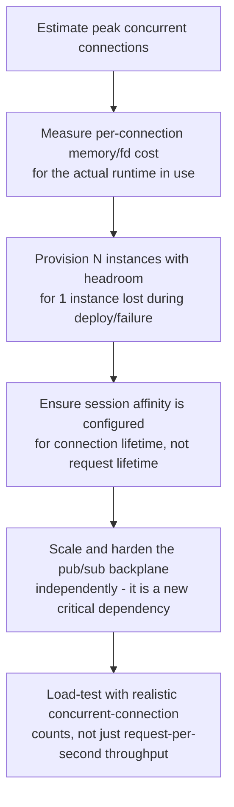

## 13. Security

WebSockets introduce one security gap that does not exist for `fetch` or
XMLHttpRequest (XHR), and every other traffic security concern layers on top
of the general web and transport security this handbook already teaches
elsewhere.

- **The same-origin-policy gap.** The browser's Same-Origin Policy
  automatically blocks a script running on `evil.example.com` from reading
  the response of a `fetch()` or XHR call made to `bank.example.com` unless
  the target explicitly opts in via Cross-Origin Resource Sharing (CORS)
  headers. **The WebSocket handshake is not subject to this restriction in
  the same way** — a browser will happily let a page on `evil.example.com`
  open a WebSocket connection to `wss://bank.example.com/socket`, and the
  browser sends the initiating page's `Origin` header along with the
  handshake, but it is entirely up to the *server* to inspect that header
  and decide whether to accept or reject the connection. If the server does
  not check `Origin` at all, any website on the internet can open a
  WebSocket connection to it, and — if the user is authenticated to the
  target site via a cookie that the browser automatically attaches to the
  handshake request, exactly as it would to any other same-site request —
  the attacker's page can interact with that authenticated WebSocket session
  as if it were the legitimate site, a cross-site WebSocket hijacking
  attack.

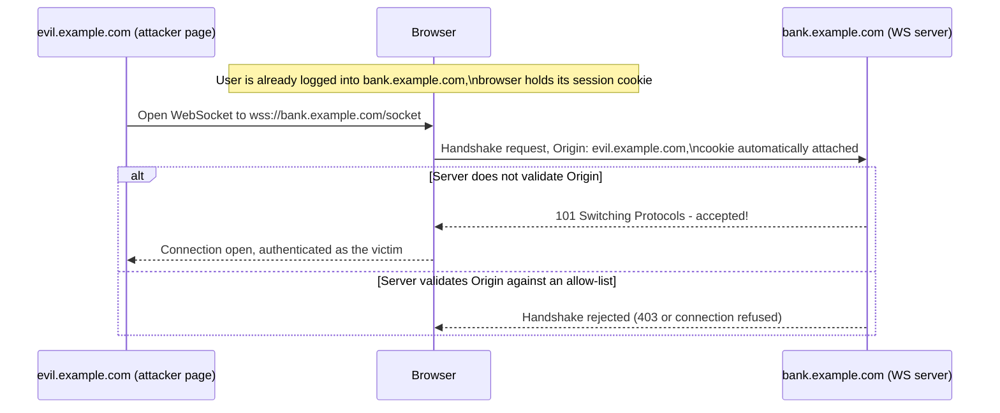

- **Mandatory mitigation: explicit server-side origin validation.** As shown
  in Section 10.2's example (`verifyClient`), the server must check the
  `Origin` header on every handshake against an explicit allow-list of
  trusted origins and reject anything not on that list — this is not a
  defense-in-depth nicety, it is the single control that closes the gap
  described above, because the protocol itself provides no automatic
  protection the way CORS does for `fetch`/XHR.
- **`wss://` (TLS) is mandatory for any connection carrying sensitive data**,
  for the reasons detailed in Section 4.3 — plaintext `ws://` in production
  exposes every frame, in both directions, to any network observer.
- **Authentication should not rely on the handshake alone.** Because the
  handshake is an ordinary HTTP request, existing authentication mechanisms
  (a session cookie, a bearer token passed as a query parameter or
  subprotocol value, since custom headers are not universally controllable
  from browser WebSocket clients) can be validated at handshake time — but
  the connection's authenticated identity should also be checked against
  authorization rules for every subsequent message the connection sends, not
  assumed to remain valid indefinitely for a connection that might stay open
  for hours.
- **Masking is not a substitute for the controls above** (Section 4.6) —
  masking mitigates intermediary-confusion/cache-poisoning risks
  specifically; it provides no confidentiality, authentication, or origin
  protection whatsoever.

## 14. Observability

Effective WebSocket observability tracks metrics that a stateless HTTP
service does not need at all, because the operational unit of interest is
the long-lived connection, not the discrete request:

- **Concurrent open connections per instance** — the primary capacity signal
  (Section 12), since it drives memory/file-descriptor consumption directly
  rather than being derived from a request rate.
- **Connection duration distribution** — unusually short average durations
  can indicate a misconfigured proxy timeout (Section 8) forcibly closing
  healthy connections, rather than a client-side issue.
- **Heartbeat failure rate** (pings sent versus pongs received within
  timeout, Section 4.11) — a rising failure rate can indicate network
  degradation upstream of the server, independent of application logic.
- **Pub/sub backplane publish/subscribe latency and error rate** (Section
  4.10) — since the backplane is a new critical-path dependency, its health
  must be monitored as its own service, not assumed healthy because the
  WebSocket server tier reports healthy.
- **Close code distribution** — RFC 6455 close codes (1000 normal, 1001 going
  away, 1006 abnormal closure with no close frame at all, 1008 policy
  violation, etc.) tell an operator *why* connections are ending in
  aggregate, distinguishing planned client navigation from network failure
  from server-side rejection.

## 15. Failure Scenarios

- **Reverse proxy idle timeout shorter than the heartbeat interval** (Section
  8) — connections are killed by the intermediary even though both
  application endpoints consider them healthy; observed as periodic mass
  disconnects at a suspiciously regular interval matching the proxy's
  configured timeout.
- **Pub/sub backplane outage** (Section 4.10) — individual WebSocket
  connections remain open and appear healthy in connection-count metrics,
  but cross-user/cross-instance messages silently stop being delivered; this
  failure mode is easy to miss because no connection actually drops.
- **Missing connection draining during deployment** (Section 8) — every
  currently-connected client on an instance being torn down is disconnected
  simultaneously without warning, producing a visible spike in reconnection
  attempts (and, absent backoff, a thundering-herd risk against the
  remaining instances, Section 4.11) synchronized with every deployment.
- **No reconnection backoff on the client** (Section 4.11) — after any
  server-side incident affecting many clients at once, the recovering
  server tier is immediately re-overwhelmed by synchronized, un-jittered
  reconnection attempts, extending the outage rather than allowing recovery.
- **Missing origin validation** (Section 13) — a cross-site WebSocket
  hijacking vulnerability that typically surfaces not as an outage but as a
  security incident, discovered during a penetration test or, worse, active
  exploitation.

## 16. Testing

- **Handshake conformance tests** — verify the server correctly rejects
  requests missing required headers (`Sec-WebSocket-Key`,
  `Sec-WebSocket-Version`), correctly computes `Sec-WebSocket-Accept`
  (Section 4.2), and rejects disallowed `Origin` values (Section 13).
- **Heartbeat/dead-connection tests** — simulate a client that stops
  responding to pings and verify the server detects and cleans up the
  connection within the expected timeout window (Section 4.11), without
  leaking the associated resources.
- **Multi-instance broadcast tests** — run at least two server instances
  against a real (or realistic test-double) pub/sub backplane and verify a
  message sent by a client on instance A is received by a client on instance
  B (Section 4.10) — a single-instance test suite cannot catch the most
  common production failure mode described in Section 4.10's common failure
  mode.
- **Reconnection/backoff tests** — force repeated connection failures and
  assert the client's retry delays actually grow (not constant), and that
  jitter prevents perfectly synchronized retries across multiple simulated
  client instances (Section 4.11).
- **Load tests targeting concurrent connections, not just request rate** —
  a load-testing tool must be capable of holding many thousands of
  simultaneous open WebSocket connections (not just issuing many sequential
  requests) to validate the capacity assumptions from Section 12.

## 17. Common Mistakes

- Assuming a WebSocket connection is somehow lighter-weight than a TCP
  socket, rather than recognizing it *is* one plus a thin framing layer
  (Section 4.1), and under-provisioning file descriptors/memory accordingly.
- Reusing an existing stateless-HTTP load-balancer configuration verbatim for
  a new WebSocket endpoint without adding session affinity (Section 4.9),
  causing connections to appear to randomly drop under load.
- Building and testing only against a single server instance, missing that
  cross-instance broadcast requires a pub/sub backplane (Section 4.10) until
  the bug surfaces in production at real scale.
- Implementing client reconnection with no backoff, causing a thundering
  herd against a server tier that just recovered from an incident (Section
  4.11, Section 15).
- Never validating the `Origin` header on the server, leaving a cross-site
  WebSocket hijacking gap open (Section 13).
- Confusing masking (Section 4.6) with encryption, and skipping `wss://` in
  production under the mistaken belief that masking already protects
  confidentiality.
- Defaulting to WebSockets for one-directional "real-time-feeling" features
  that Server-Sent Events would serve with far less operational complexity
  (Section 4.8, Section 19).

## 18. Best Practices

- Apply Section 4.8's decision framework explicitly during design review:
  justify WebSockets specifically on the basis of a genuine bidirectional,
  low-latency requirement, not general "real-time" branding.
- Build the pub/sub backplane (Section 4.10) into the architecture from the
  first multi-instance deployment, not as a retrofit.
- Configure session affinity, reverse-proxy idle timeouts, and connection
  draining (Sections 4.9, 8) before the first production rollout, not after
  the first incident caused by their absence.
- Implement heartbeats on both ends and client reconnection with exponential
  backoff and jitter (Section 4.11) as a non-negotiable baseline, not an
  enhancement.
- Validate `Origin` on every handshake against an explicit allow-list
  (Section 13), and re-check authorization for sensitive actions sent over
  an already-open connection rather than trusting the handshake-time check
  indefinitely.
- Monitor connection count, connection duration, heartbeat failure rate, and
  backplane health as first-class metrics (Section 14), not as an
  afterthought bolted onto existing HTTP request-rate dashboards.

## 19. Anti-Patterns

- **Using WebSockets for a purely one-directional data feed** when
  Server-Sent Events would deliver the same user-facing behavior with none
  of Sections 4.9-4.10's stateful-scaling complexity — the single most
  common WebSocket over-engineering mistake (Section 4.8).
- **Treating sticky sessions/session affinity as an optional performance
  tweak** rather than the mandatory consequence of a connection that
  physically cannot move (Section 4.9) — this is a categorically different
  situation from the tactical, avoidable session-affinity trade-off taught
  for ordinary stateless-HTTP backends in
  [Load Balancer Section 4.5](CH10_Load_Balancer.md#45-session-affinity-sticky-sessions-cookie-based-vs-ip-hash-and-the-tension-with-stateless-scaling).
- **Skipping the pub/sub backplane "until it's actually needed"** on the
  assumption that a single-instance deployment will never need to scale out
  — by the time cross-instance messaging is needed in production, clients
  already depend on behavior that silently breaks the moment a second
  instance is added (Section 4.10).
- **Reconnecting without backoff or jitter**, guaranteeing a thundering-herd
  re-outage immediately after any incident that disconnects many clients at
  once (Section 4.11).
- **Treating masking as encryption** and shipping `ws://` instead of
  `wss://` in production (Sections 4.3, 4.6, 13).

## 20. Trade-off Analysis

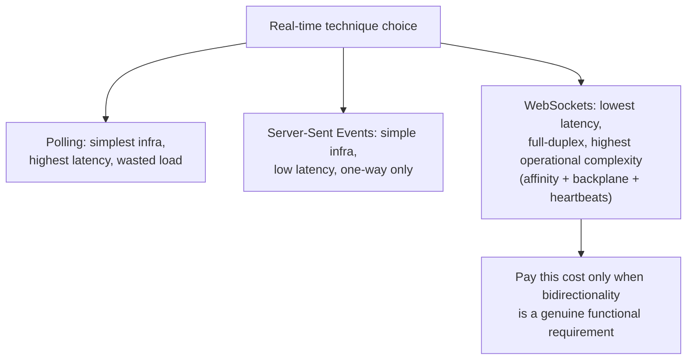

The recurring trade-off through this whole chapter is complexity for
capability: every step from polling toward WebSockets buys lower latency and
richer interaction at the cost of new infrastructure that has to be designed,
operated, and monitored (session affinity, a pub/sub backplane, heartbeat
tuning, origin validation). An architect's job is to spend that complexity
budget only where the product requirement genuinely needs it (Section 4.8),
not to default to the most capable protocol available.

## 21. Comparison Table

| Dimension | Short/Long Polling | Server-Sent Events | WebSockets |
|---|---|---|---|
| Direction | Client-initiated only | Server-to-client only | Full-duplex |
| Transport | Plain HTTP requests | Plain HTTP, long-lived response | Upgraded connection, own framing |
| Per-message overhead | High (full HTTP headers) | Low (event-stream framing) | Very low (small binary frame header) |
| Browser reconnection | Manual (application code) | Automatic (`EventSource`) | Manual (application code, Section 4.11) |
| Load-balancer impact | None beyond ordinary HTTP | Long-lived response, moderate affinity need | Mandatory session affinity (Section 4.9) |
| Cross-instance fan-out | N/A (stateless) | Needs a backplane if multi-instance | Needs a pub/sub backplane (Section 4.10) |
| Typical use case | Infrequent, latency-tolerant updates | Live feeds, notifications, progress | Chat, collaborative editing, gaming, trading |

## 22. Real-World Case Study

A mid-size collaborative document-editing product initially shipped its
"who else is viewing this document" presence feature and its live
co-editing cursors both over a single WebSocket connection per client,
running on a single application server, because the feature launched before
traffic justified horizontal scaling. As adoption grew and the team added a
second application server purely for redundancy, users on the second
instance stopped seeing presence updates or cursor movements from users
connected to the first instance — exactly the common failure mode described
in Section 4.10, because no pub/sub backplane existed yet; each server
instance only knew about its own locally connected clients. The incident was
diagnosed by observing that the bug was intermittent and correlated
precisely with which instance a given user's load-balancer handshake had
landed on, not with any application logic. The fix followed the architecture
in Section 4.10 directly: a Redis pub/sub layer was introduced so that a
cursor-movement or presence event received by either instance was published
to a shared channel and re-broadcast by whichever instance held the relevant
recipient connections. The team additionally discovered, during the same
remediation, that their load balancer had never been configured for session
affinity at all — WebSocket connections had been surviving purely because
low traffic volume made round-robin redistribution rare in practice, a
latent Section 4.9 defect that would have caused far more visible connection
drops once traffic increased further. Both fixes were deployed together, and
the team added the multi-instance broadcast test described in Section 16 to
its test suite specifically so a single-instance-only test environment could
never again mask this class of bug.

## 23. Interview Questions

1. Explain, from first principles, why HTTP's request-response model cannot
   support server-initiated push, and how WebSockets close that gap
   structurally rather than by working around it.
2. Walk through the WebSocket handshake in detail: what does
   `Sec-WebSocket-Key`/`Sec-WebSocket-Accept` actually protect against, and
   why is it not a security/authentication mechanism?
3. Why must client-to-server WebSocket frames be masked while server-to-
   client frames must not be? What specific attack does masking mitigate,
   and what does it not protect against?
4. A team wants to add a live-updating dashboard that only needs
   server-to-client push. Would you recommend WebSockets or Server-Sent
   Events, and why, in terms of the operational complexity each choice
   commits the team to?
5. Why does introducing WebSockets make session affinity mandatory rather
   than optional, in a way that is architecturally different from the
   sticky-session trade-off for a stateless HTTP backend?
6. Describe the pub/sub backplane pattern for WebSocket scaling: what
   specific problem does it solve that session affinity does not, and what
   new failure modes does it introduce?
7. Why is heartbeat-based dead-connection detection necessary given that the
   connection sits on top of TCP, which has its own notion of a broken
   connection?
8. What is the same-origin-policy gap specific to WebSockets, and what is
   the mandatory server-side control that closes it?
9. Why is exponential backoff with jitter necessary for WebSocket
   reconnection logic, and what production failure does its absence cause?
10. What operational metrics would you monitor for a WebSocket service that
    you would not need for an equivalent stateless REST API, and why?

## 24. Hands-on Exercises

1. Implement a minimal WebSocket handshake server (without using a
   WebSocket library) that correctly parses the `Upgrade` request, computes
   `Sec-WebSocket-Accept` per Section 4.2's algorithm, and returns
   `101 Switching Protocols` — verify it against a real browser client.
2. Extend Section 10.2's server to run two instances locally against a real
   Redis instance, and verify a message sent by a client connected to
   instance A is received by a client connected to instance B.
3. Implement a client (Section 10.3) with reconnection and backoff, then
   forcibly kill the server repeatedly and confirm the client's retry delays
   grow rather than remain constant.
4. Add `Origin` validation to a test server, and demonstrate — using a
   simple attacker page served from a different origin — that the
   handshake is rejected when the origin is not on the allow-list.
5. Instrument Section 10.2's server with the metrics listed in Section 14
   (concurrent connections, heartbeat failure rate) and observe them under a
   simulated load test that opens and holds several thousand connections.

## 25. Design Exercises

1. Design the WebSocket architecture for a live multiplayer game server
   expected to run on dozens of instances globally, addressing session
   affinity, cross-instance state synchronization, and how you would
   minimize added latency from the pub/sub backplane for a
   latency-sensitive workload.
2. Design a graceful deployment/connection-draining strategy for a
   WebSocket-backed chat service that must roll out new server versions
   several times per day without visibly disrupting active conversations.
3. Design the reconnection and offline-message-replay strategy for a mobile
   chat client that frequently loses and regains network connectivity,
   ensuring no messages are silently lost during a reconnection window.
4. A stakeholder proposes replacing an existing polling-based notification
   feature with WebSockets purely for "modernization." Design the decision
   memo you would write back, applying Section 4.8's framework to determine
   whether this is justified.

## 26. Architecture Review Questions

1. Is session affinity explicitly configured for this WebSocket endpoint,
   with a persistence duration that covers the full expected connection
   lifetime, not just a typical request window?
2. Is there a pub/sub backplane (or equivalent) in place for any
   deployment topology with more than one WebSocket server instance, and has
   its own availability been assessed as a critical-path dependency?
3. Is `Origin` validated on every handshake against an explicit allow-list,
   and is this covered by an automated test?
4. Are heartbeats implemented on both client and server, with a reverse
   proxy idle timeout configured to exceed the heartbeat interval?
5. Does the client implement reconnection with exponential backoff and
   jitter, and has this been tested under a simulated mass-disconnect
   scenario?
6. Is this feature's data flow genuinely bidirectional, or would
   Server-Sent Events (or polling) meet the requirement with materially less
   operational complexity?
7. Is `wss://` (TLS) mandatory in every environment this service runs in,
   with no plaintext `ws://` fallback in production?
8. Does the deployment process drain existing connections gracefully rather
   than dropping them abruptly on every rollout?

## 27. Summary

WebSockets exist to close a structural gap in HTTP: the request-response
model has no way to express a server-initiated push or a genuinely
simultaneous bidirectional exchange, and the pre-2011 workarounds — short
polling, long polling, and the broader family of Comet techniques — were all
increasingly clever hacks built on top of that same limitation rather than
solutions to it. The WebSocket handshake solves the "how do we get a new
protocol running on this connection" problem by reusing HTTP's own `Upgrade`
mechanism and `101 Switching Protocols` status, with a key-exchange step
whose real purpose is defeating naive intermediaries, not providing security.
The framing protocol that follows is a compact binary format supporting
text/binary/control opcodes, mandatory client-to-server masking as an
anti-cache-poisoning mitigation (not encryption), and fragmentation for
streaming large messages incrementally. The genuinely architectural content
of this chapter, though, is what happens once that connection is open at
scale: a WebSocket connection is a long-lived, non-relocatable pinning of one
client to one specific server process, which makes session affinity
mandatory rather than a tactical trade-off, and which requires a pub/sub
backplane so that messages — not connections — can travel between server
instances. Heartbeats and backoff-based reconnection exist because
disconnection at this scale is the normal case, not an edge case, and
explicit server-side origin validation exists because the browser's
same-origin protections that guard `fetch`/XHR do not automatically extend
to the WebSocket handshake. Used where a genuine bidirectional, low-latency
requirement exists, WebSockets are the correct and only protocol that
delivers it natively; used reflexively for one-directional "real-time-
feeling" features, they import all of this operational complexity for no
corresponding benefit — the decision framework in Section 4.8 is the tool
that keeps that trade-off honest.

## Further Reading

- [Sockets](CH16_Sockets.md) — the operating-system-level Berkeley sockets
  API, `epoll`/`kqueue`/IOCP multiplexing, and file-descriptor scaling that
  underlie every WebSocket server, owned in full by that chapter.
- [HTTP](CH01_HTTP.md) — HTTP methods, status code taxonomy, and general
  request/response semantics that the WebSocket handshake builds on top of.
- [HTTP/2](CH04_HTTP2.md) — a different application of binary framing over
  HTTP, useful as a contrasting example of framing-layer design.
- [TLS](CH06_TLS.md) — the full TLS handshake that `wss://` layers underneath
  the WebSocket handshake and framing.
- [Load Balancer](CH10_Load_Balancer.md) — session affinity/sticky sessions
  mechanics (cookie-based vs. IP-hash), owned in full by that chapter and
  applied here as a mandatory (not tactical) requirement for WebSockets.
