# Chapter: QUIC

Part: [05 — Networking and Operating Systems](PART_OVERVIEW.md) · Status: Draft

## 1. Introduction

QUIC is a general-purpose, encrypted, multiplexed transport protocol built on
top of User Datagram Protocol (UDP), standardized by the Internet Engineering
Task Force (IETF) as RFC 9000 in 2021. It was originally developed at Google
starting in 2012 as "Quick UDP Internet Connections" — a name now retained as
a proper noun rather than an active backronym, since the IETF-standardized
version diverged substantially from Google's original ("gQUIC") design. QUIC
is not an HTTP-specific protocol: it is a transport layer, occupying the same
conceptual slot in the network stack as Transmission Control Protocol (TCP),
and it can carry any application protocol that has a mapping onto it — HTTP/3
is the best-known such mapping, but DNS-over-QUIC (Domain Name System over
QUIC, RFC 9250) and several other protocols also run directly on QUIC.

This chapter is this handbook's single owner of QUIC's full transport-layer
mechanics. [HTTP/3](CH05_HTTP3.md) already introduced QUIC at the depth an
HTTP-focused reader needs — streams exist, loss is isolated per-stream, a
Connection ID (CID) survives network changes, and the handshake folds
Transport Layer Security (TLS) into itself — and explicitly deferred the
*how* to this chapter. This chapter teaches that *how*: the packet and frame
wire format, the mechanics of connection IDs and migration byte-for-byte, how
QUIC embeds a TLS 1.3 handshake inside its own packets using per-encryption-level
packet protection, how loss detection and congestion control work across
multiple independent packet number spaces, why QUIC lives in userspace
application libraries instead of the operating system (OS) kernel and what
that costs in Central Processing Unit (CPU) terms, and the production
realities of multipath QUIC and 0-RTT (zero Round-Trip Time) replay risk.

This chapter assumes the reader already understands TCP's three-way
handshake, sliding-window flow control, and congestion control fundamentals —
all owned by [TCP/IP](CH03_TCPIP.md) — and the TLS 1.3 handshake itself,
owned by [TLS](CH06_TLS.md). Those are recapped only where needed to explain
what QUIC does differently, never re-derived from scratch. For a Solution
Architect, QUIC matters because it is not merely "HTTP/3's transport" — it is
a transport an architect can choose to run any latency-sensitive,
loss-tolerant, or mobility-sensitive workload over (real-time telemetry,
gaming, video conferencing signaling, DNS resolution, VPN-style tunnels), and
because its userspace-library deployment model has real operational
consequences for CPU capacity planning that a kernel-resident TCP stack never
had.

## 2. Historical Evolution

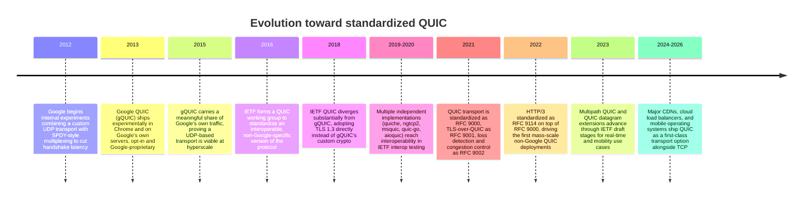

The pivotal shift is 2016-2018: Google's gQUIC proved the *idea* — a
UDP-based, integrated-handshake, per-stream-loss-isolated transport measurably
reduced tail latency on lossy mobile networks at Google's scale — but gQUIC
was a single-vendor protocol with a custom, non-standard cryptographic
handshake that no other party could safely implement or audit independently.
The IETF working group's job was to take that proven idea and rebuild it as
an open, standards-track protocol using an already-vetted cryptographic
foundation (TLS 1.3, which was being finalized in the same period) instead of
inventing a new one. That decision — reuse TLS 1.3 rather than gQUIC's
bespoke crypto — is why IETF QUIC and gQUIC are wire-incompatible despite
sharing a name and a design philosophy, and why this chapter teaches the IETF
version (RFC 9000 and its companion RFCs) exclusively.

## 3. Why It Exists

Every transport protocol answers a specific question: what unit of reliable,
ordered communication should the operating system's kernel (or, as with QUIC,
a userspace library) expose to applications, and at what cost? TCP's answer,
fixed in 1981 and still nearly universal, is: a single ordered, reliable byte
stream per connection, implemented in the OS kernel, with no cryptographic
protection of its own (TLS is layered on top, entirely separately). That
answer served the internet for three decades, but three specific costs of
that answer became impossible to work around from *above* TCP, no matter how
clever the application-layer protocol built on it:

1. **Transport-level head-of-line (HOL) blocking.** TCP's single byte stream
   means a single lost segment blocks delivery of every byte sent after it,
   even bytes that logically belong to an unrelated application-layer stream
   multiplexed on the same connection. [HTTP/2](CH04_HTTP2.md) multiplexed
   many logical streams over one TCP connection at the application layer, but
   could not fix this, because the blocking happens one layer down, inside
   TCP itself, where HTTP/2's stream IDs are invisible.
2. **A minimum two-round-trip handshake.** TCP's three-way handshake
   establishes the connection; TLS's own handshake (historically one to two
   more round trips) must then run on top before any encrypted application
   data can move. These are two separate protocols with two separate
   handshakes, layered rather than integrated, because TCP was designed
   decades before TLS existed and neither protocol's design anticipated the
   other.
3. **Four-tuple connection identity.** TCP identifies a connection by
   `{source IP, source port, destination IP, destination port}`. Any change
   to that tuple — most commonly the client's IP address changing when a
   mobile device switches from Wi-Fi to cellular — makes the OS kernel treat
   it as a wholly new connection, even though the application and the remote
   peer both still consider it the same logical session.

None of these three costs can be fixed by an application-layer protocol
running on top of TCP, because each one is enforced by TCP itself, in kernel
space, on billions of already-deployed devices that cannot be rewritten in
place. The only way to fix them is to design a new transport that does not
make TCP's specific promises the same way — and to make that new transport
*deployable* without requiring every router, firewall, and middlebox on the
public internet to be upgraded first. That second requirement — deployability
without a flag day — is precisely why QUIC is built on UDP rather than as a
brand-new IP-layer protocol number, and is the very first concept this
chapter teaches in depth, in Section 4.1.

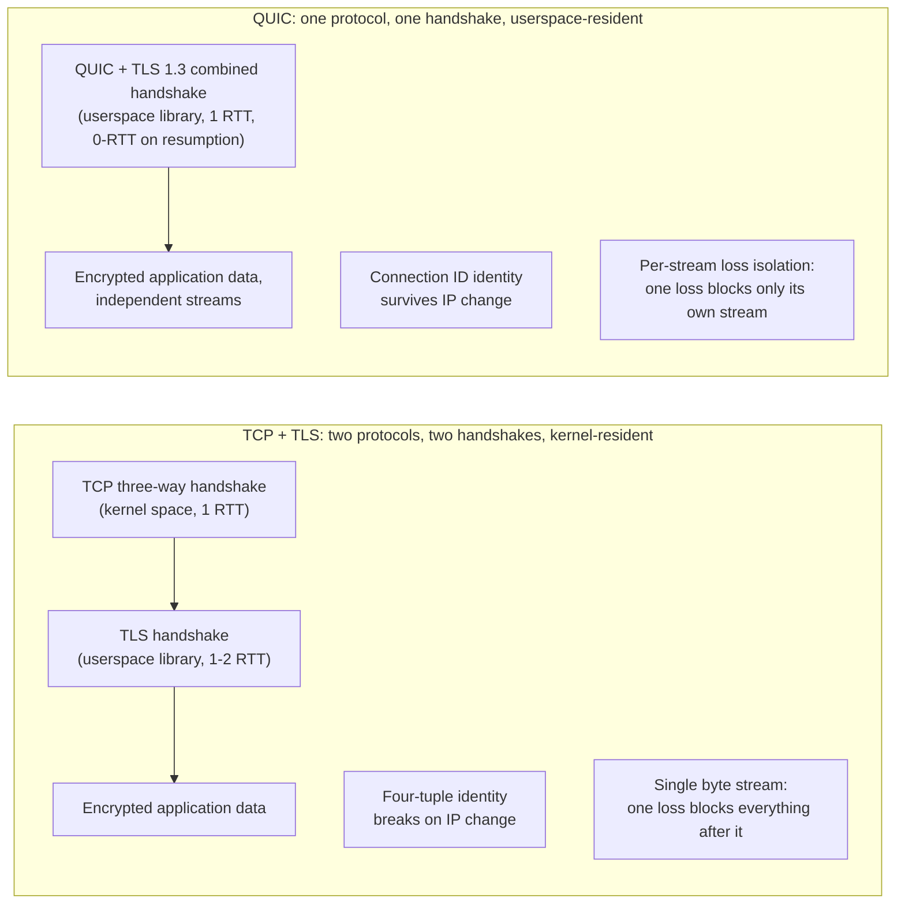

## 4. Core Concepts

### 4.1 UDP as QUIC's substrate: a deliberate deployability choice

*User Datagram Protocol (UDP) itself — its header format, its lack of
ordering/reliability/congestion-control guarantees, and the criteria for
choosing it over TCP for a given application — is owned by
[TCP/IP](CH03_TCPIP.md#410-udp-as-tcps-connectionless-counterpart) Section
4.10. This chapter does not re-teach UDP basics; it recaps only the two facts
QUIC's designers relied on: UDP is connectionless (each datagram is
independent, with no handshake of its own) and it is deliberately minimal (no
ordering, no retransmission, no congestion control built in) — meaning
everything an application layered on UDP needs, it must build itself.*

**Definition.** QUIC is a protocol implemented entirely *on top of* UDP: every
QUIC packet is carried as the payload of one UDP datagram. QUIC is not an
alternative to UDP the way TCP is; it is a substantial protocol built as an
application-layer payload from the network's point of view, even though from
an *architectural* point of view it fully replaces TCP's job.

**Mechanism.** Because UDP adds no ordering, reliability, or congestion
control of its own, QUIC has to implement all three itself, entirely in the
sending and receiving endpoints' own code — nothing in the path between them
(routers, NAT devices, firewalls) needs to understand QUIC's internal
structure at all. A UDP datagram is, from any middlebox's point of view, just
an opaque payload behind a UDP header; QUIC's own packet header, packet
number, frames, and encryption are all invisible to anything that is not one
of the two communicating endpoints.

**Decision implications — why not build a new transport protocol directly on
IP?** This is the deployability question, and the answer is almost entirely
about what already exists in the installed base of internet infrastructure,
not about protocol elegance:

- **New IP protocol numbers require kernel and middlebox support that does
  not exist and cannot be added remotely.** TCP is protocol number 6 and UDP
  is protocol number 17 in the IP header's protocol field (see
  [TCP/IP](CH03_TCPIP.md) Section 4). A brand-new transport protocol would
  need its own protocol number, and every router, firewall, Network Address
  Translation (NAT) device, and OS kernel on the path between two endpoints
  would need code recognizing and forwarding that number correctly. In
  practice, measurement studies Google ran before committing to QUIC's design
  found that a meaningful fraction of networks (corporate firewalls, older
  home routers, some mobile carrier networks) silently drop any IP protocol
  they do not recognize — a brand-new protocol number would simply fail to
  traverse large parts of the real internet, with no way to fix already-
  deployed hardware.
- **UDP is nearly universally forwarded already**, because DNS, real-time
  media (Voice over IP (VoIP), video conferencing), and online gaming have
  relied on it for decades. Middleboxes that would silently drop an unknown
  protocol number generally already have rules permitting UDP traffic (though
  not unconditionally — Section 15 covers the real-world exceptions).
- **This makes UDP a compatibility shim, not a technical requirement.** QUIC
  does not need anything UDP specifically provides (it re-implements
  ordering, reliability, and congestion control itself); it needs only *a
  protocol number that is already allowed through the existing installed
  base*. UDP satisfies that need, and nothing else widely deployed does.

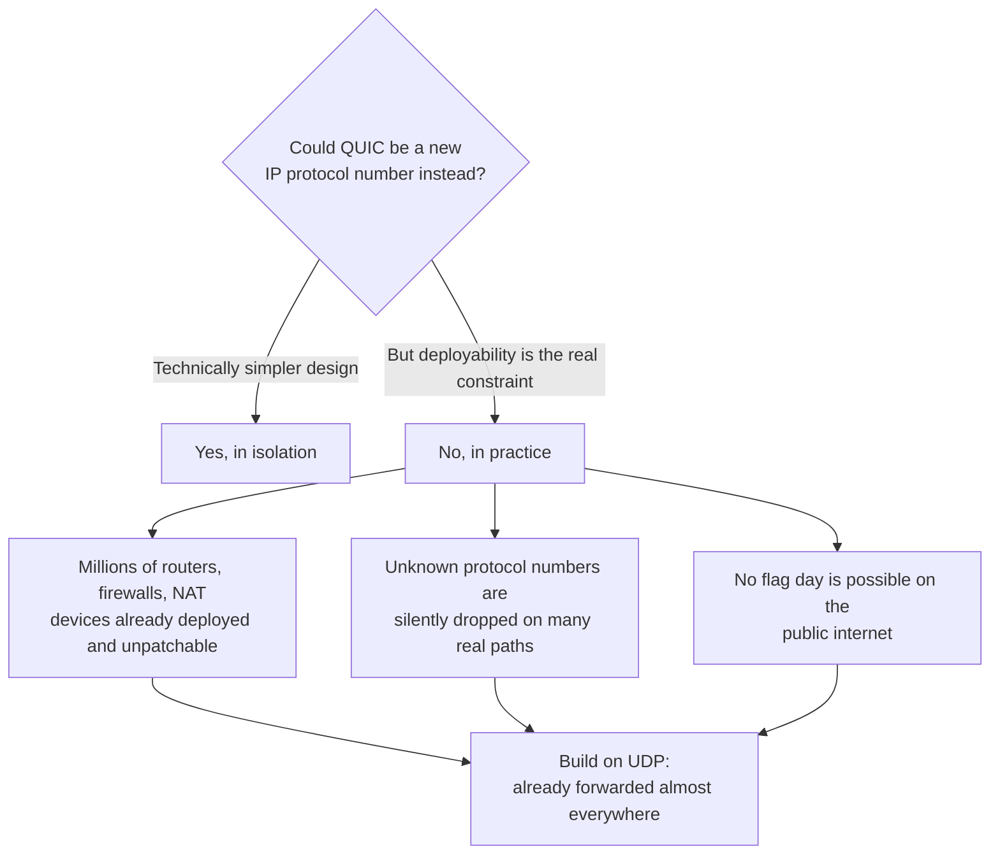

**Common failure mode.** Assuming QUIC "is" UDP, or that choosing UDP for a
new protocol automatically grants QUIC-like properties. UDP is silent on
ordering, reliability, and congestion — an application that sends raw UDP
datagrams with no additional protocol logic gets none of QUIC's guarantees.
QUIC's value comes entirely from the substantial engineering built on top of
UDP, not from UDP itself; a team building "just UDP" for performance without
replicating QUIC's loss detection and congestion control is not getting a
faster QUIC, it is getting an unreliable, congestion-unaware protocol that
can actively harm shared network paths.

**Concrete scenario.** A logistics company builds a custom telemetry ingestion
protocol on raw UDP for its delivery-tracking fleet, reasoning "QUIC uses UDP,
so UDP must be fast." Under load, their ingestion servers begin dropping a
rising fraction of packets during network congestion, and because their
protocol implements no congestion control, it keeps sending at full rate,
worsening the congestion for every other flow sharing that network path
(including the company's own other services) — precisely the failure mode
[TCP/IP](CH03_TCPIP.md) Section 4.10 warns about for undisciplined UDP usage.
Adopting QUIC itself (or a UDP-based library replicating its loss detection
and congestion control) rather than raw UDP would have avoided this.

### 4.2 Encrypt-everything and no-middlebox-ossification as design principles

**Definition.** QUIC encrypts nearly its entire packet — not just the
application payload, but most of QUIC's own protocol-level metadata (packet
numbers, frame types, most header fields) — leaving only the minimum
information a middlebox needs to route the packet (source/destination
addresses and ports from the UDP header, plus a small, mostly-opaque
Connection ID) visible in plaintext.

**Mechanism.** TCP's header — sequence numbers, acknowledgment numbers,
window size, flags — travels in plaintext on the wire, because TCP predates
widespread transport encryption. Over decades, this plaintext visibility let
middleboxes (firewalls, traffic-shaping appliances, some corporate proxies)
inspect and, in some cases, actively rewrite TCP header fields in transit —
a phenomenon called **protocol ossification**: because middleboxes came to
depend on specific plaintext fields having specific meanings, *any* future
change to those fields' meaning risked breaking deployed middleboxes, which
in turn made evolving TCP itself extremely slow and risky at internet scale.
QUIC's designers deliberately encrypted almost everything specifically to
deny middleboxes the ability to develop that same dependency: if a
middlebox cannot see or interpret a field, it cannot be built to depend on
that field's current meaning, and the protocol's designers remain free to
change QUIC's internal wire format in future versions without breaking
already-deployed middleboxes.

**Decision implications.** This is why QUIC was designed to evolve faster
than TCP ever could — version negotiation (Section 4.6) and encrypted
transport parameters mean new QUIC versions can change internal behavior
without waiting for global middlebox replacement. For a Solution Architect,
this also explains a subtler operational fact: because QUIC's metadata is
opaque, traditional network-observability tooling built around inspecting
TCP headers (deep packet inspection appliances, some NetFlow/sFlow-based
traffic classifiers) cannot classify QUIC traffic the way they classify TCP
traffic — Section 14 covers the observability mitigation (QUIC's own `qlog`
format and endpoint-side telemetry, since the network path itself can no
longer help).

**Common failure mode.** Assuming existing network-monitoring or
traffic-shaping infrastructure will "just work" against QUIC traffic the way
it did against TCP. Enterprises that rely on deep packet inspection for
policy enforcement (blocking specific applications, enforcing quality-of-
service tiers by protocol fingerprinting) frequently discover that QUIC
traffic is opaque to those tools, and either block UDP/443 outright (breaking
QUIC entirely, forcing fallback to TCP-based HTTP/2, covered in Section 15)
or must adopt QUIC-aware tooling that reasons about connection metadata QUIC
does expose (packet sizes, timing, the visible parts of the header) instead.

### 4.3 How QUIC embeds TLS 1.3: the integrated handshake

*The TLS 1.3 handshake itself — its message sequence, ephemeral
Diffie-Hellman key exchange, Perfect Forward Secrecy (PFS), and 0-RTT
resumption at the TLS layer — is owned in full by [TLS](CH06_TLS.md) Sections
4.2-4.3. This chapter does not re-derive the TLS 1.3 handshake; it owns the
distinct question of exactly how QUIC carries that handshake inside its own
packets instead of running it as a separate protocol on top of an
already-established transport connection.*

**Definition.** QUIC does not run TLS 1.3 "on top of" itself the way TCP runs
TLS on top of an already-established connection. Instead, QUIC uses TLS 1.3
as an internal component: TLS 1.3's handshake *messages* (`ClientHello`,
`ServerHello`, certificate, `Finished`, and so on) are carried as data inside
QUIC's own `CRYPTO` frames, and TLS 1.3's *key schedule* (the algorithm that
derives encryption keys from the handshake's shared secrets) is used directly
by QUIC to derive the keys QUIC uses to encrypt everything else — including
QUIC's own transport-layer control information, which TLS itself has no
native concept of.

**Mechanism — four encryption levels.** Because the TLS handshake and the
QUIC transport handshake now happen in the same exchange rather than
sequentially, QUIC needs a way to encrypt packets *before* the full TLS
handshake completes, using progressively stronger keys as the handshake
proceeds. QUIC defines four **encryption levels**, each with its own
independently derived key and — critically — its own separate **packet
number space** (Section 4.7):

| Encryption level | Keys derived from | Carries |
|---|---|---|
| Initial | A publicly-known, version-specific salt (not secret — provides obfuscation, not confidentiality) | The first `CRYPTO` frame (client's `ClientHello`), ACKs for Initial packets |
| 0-RTT (early data) | A Pre-Shared Key (PSK) from a previous session's resumption ticket | Early application data sent before the handshake completes (Section 4.11) |
| Handshake | Keys derived once the TLS key exchange completes | Remaining `CRYPTO` frames (`ServerHello` onward), ACKs for Handshake packets |
| 1-RTT (Application) | Final keys derived after the handshake fully completes | All application data and most transport-layer frames for the rest of the connection |

Each level's packets are protected with that level's own keys, and a receiver
that has not yet derived a given level's keys simply cannot decrypt packets
sent at that level — which is precisely how QUIC ensures a middlebox (or an
attacker) that lacks Handshake or 1-RTT keys can read only what Initial-level
obfuscation permits, nothing more.

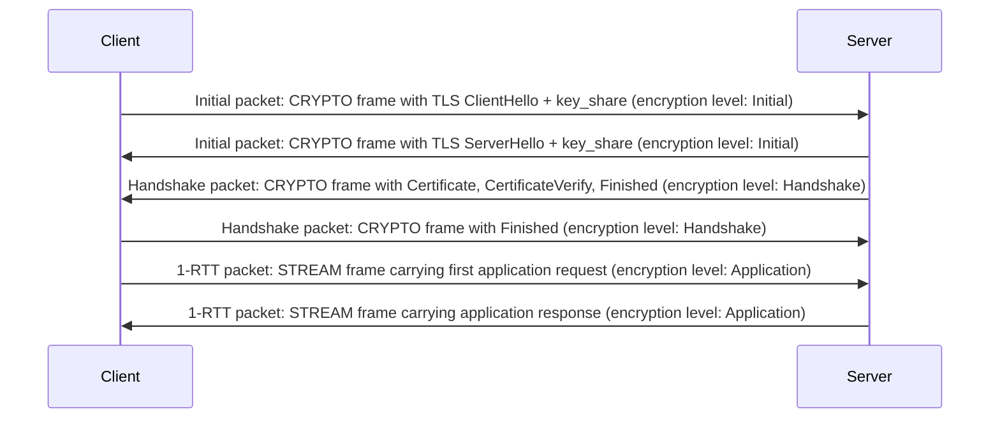

**Decision implications.** This integration is exactly why QUIC needs no
separate transport handshake before the cryptographic one: the very first
packet a client sends carries both QUIC transport parameters (its own
`CRYPTO` frame payload, negotiated as a TLS extension) and the TLS
`ClientHello` in a single UDP datagram, and application data can begin
flowing as soon as the 1-RTT keys are available — one combined round trip
instead of TCP's handshake-then-TLS-handshake sequence. For an architect,
this means QUIC endpoints must always be paired with a TLS 1.3-capable
library; there is no meaningful "QUIC without TLS" deployment mode — the
transport and the security layer are architecturally inseparable by design,
unlike TCP where running without TLS (plain HTTP, plain database wire
protocols) remains a distinct, if inadvisable, option.

**Common failure mode.** Treating QUIC's TLS integration as "TLS is
optional, like it is for TCP." QUIC's specification mandates TLS 1.3 (RFC
9001) as an integral part of the transport, not a security add-on; there is
no unencrypted QUIC mode defined in the standard. Teams evaluating whether to
"skip TLS for internal QUIC traffic to save CPU" are evaluating a
configuration the protocol does not actually support — the real trade-off
available is whether to use a lighter-weight certificate/authentication
model (e.g., mutual TLS (mTLS) with a private Certificate Authority (CA) for
internal service mesh traffic, per [Certificates](CH15_Certificates.md)),
not whether to remove TLS entirely.

### 4.4 Streams and multiplexing without transport-layer head-of-line blocking

*[HTTP/2](CH04_HTTP2.md) Section 4.2 owns application-layer stream
multiplexing over a single TCP connection — the `Stream Identifier` field,
odd/even ID partitioning, and the frame-interleaving mechanism at the HTTP
layer. This chapter's job is different and complementary: to teach exactly
how QUIC implements multiplexing **inside the transport itself**, which is
the actual mechanism HTTP/2 could never reach, because HTTP/2's stream IDs
live one layer above the point where TCP enforces its single ordered byte
stream.*

**Definition.** A QUIC stream is an ordered, reliable byte sequence, exactly
like a TCP connection's byte stream — except a single QUIC *connection* can
carry many independent streams simultaneously, and a lost packet carrying one
stream's data does not block delivery of any other stream's data to the
application. This is the property Section 3 called out as unreachable from
above TCP: QUIC reaches it by moving the multiplexing boundary itself down
into the transport layer, where loss detection and retransmission decisions
are made per-stream rather than per-connection.

**Mechanism.** Every QUIC packet can carry one or more **frames** — the unit
of information inside a QUIC packet, analogous to but distinct from an
HTTP/2 frame (which lives one layer up, inside stream data). A `STREAM`
frame carries a chunk of one specific stream's bytes, tagged with a Stream ID
and an offset (the byte position within that stream this chunk starts at).
Multiple `STREAM` frames belonging to different streams can be packed into
the same QUIC packet, or spread across different packets — the sender
decides packing strategy, and it has no bearing on stream independence.

The critical mechanism enabling per-stream isolation is this: **QUIC's
retransmission and reassembly logic operates on frames and their stream/
offset tags, not on raw packet sequence**. If packet 105 is lost, and packet
105 contained only a `STREAM` frame for Stream 7, the receiver's reassembly
buffer for every *other* stream is entirely unaffected — those streams'
`STREAM` frames arrived in other, undamaged packets, and the receiver can
hand their bytes to the application the instant they arrive in-order *for
that stream specifically*. Only Stream 7's reassembly buffer has a gap,
waiting on the lost data's retransmission; Streams 1, 3, and 5 (say) proceed
independently, with no coupling to Stream 7's fate.

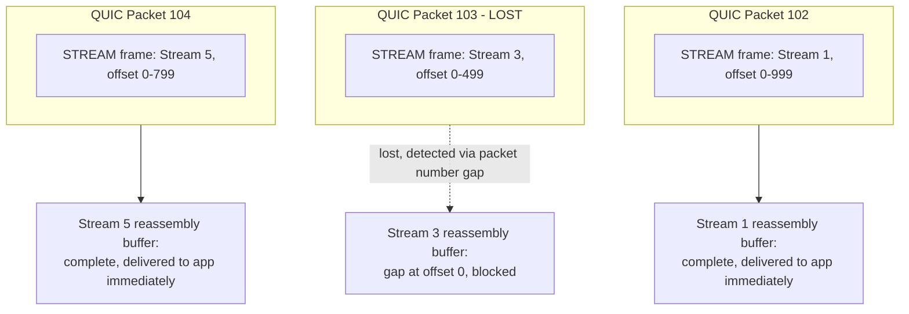

This contrasts directly with the diagram in Section 3, where TCP's *single*
byte stream means the receiving kernel cannot deliver *any* bytes sent after
a loss, even bytes belonging to a stream ID an HTTP/2 layer above it would
consider entirely unrelated — because TCP has no concept of "stream ID" at
all; it only knows one connection-wide sequence number space. QUIC gives each
stream its own delivery-order guarantee specifically so the receiver's
reassembly logic can make that same "unrelated, deliver immediately"
decision that TCP structurally cannot.

**Stream types and flow control.** QUIC defines four stream types by
combining two axes: client- or server-initiated, and bidirectional or
unidirectional (used for one-way data such as HTTP/3's QPACK encoder/decoder
streams). Each stream, and the connection as a whole, has independent flow
control limits (a receiver-advertised maximum number of bytes it is willing
to buffer per-stream and in total) — conceptually similar to TCP's sliding
window (owned by [TCP/IP](CH03_TCPIP.md) Section 4.8), but tracked per-stream
in QUIC rather than once per connection, and communicated via explicit
`MAX_STREAM_DATA` and `MAX_DATA` frames rather than a window field in every
packet header.

**Decision implications.** For a Solution Architect, per-stream isolation
means the decision of *how many logical requests to multiplex per connection*
has a fundamentally different risk profile under QUIC than under HTTP/2 over
TCP: aggressive multiplexing (many parallel API calls over one connection)
loses much of its downside on lossy paths, because one slow/lost stream no
longer taxes every other stream sharing the connection. This is precisely
why mobile-heavy, high-loss workloads see the largest real-world gains from
adopting QUIC-based transports.

**Common failure mode.** Assuming stream independence extends to the
connection's *congestion control* state — it does not. All streams on a QUIC
connection still share one congestion window (Section 4.8); a lost packet
still signals congestion to the connection as a whole, even though it only
blocks its own stream's data delivery. A team that multiplexes an
unreasonably large number of streams over a single QUIC connection can still
see the connection-wide congestion window throttle overall throughput, even
though no individual stream is "head-of-line blocked" in the TCP sense.

**Concrete scenario.** A video conferencing client sends audio, video, and a
low-bandwidth chat-and-reaction channel as three separate QUIC streams on one
connection. Under packet loss affecting only the video stream's data (video's
higher bitrate makes it statistically more likely to lose a packet), the
audio stream and chat stream continue delivering without interruption — a
listener never experiences audio dropouts caused by an unrelated video
packet loss, which is precisely the guarantee neither HTTP/2 over TCP nor a
raw single TCP connection carrying all three data types could offer.

### 4.5 The QUIC short-header packet: wire-format walkthrough

**Definition.** Once a connection reaches the 1-RTT (Application)
encryption level, the overwhelming majority of packets use QUIC's **short
header** format — a deliberately minimal, mostly-encrypted structure
optimized for the steady-state data-transfer phase of a connection (the
**long header**, used only during the handshake and for Initial/Handshake/
0-RTT packets, carries additional negotiation fields this chapter does not
need to enumerate in full for architectural understanding).

**Mechanism — the annotated byte layout.**

```
 0                   1                   2                   3
 0 1 2 3 4 5 6 7 8 9 0 1 2 3 4 5 6 7 8 9 0 1 2 3 4 5 6 7 8 9 0 1
+-+-+-+-+-+-+-+-+-+-+-+-+-+-+-+-+-+-+-+-+-+-+-+-+-+-+-+-+-+-+-+-+
|0|1|S|R|R|K|P P|      <- first byte: header form (0=short), fixed bit,
+-+-+-+-+-+-+-+-+          spin bit (S), reserved (R,R), key phase (K),
|                          packet number length (P P)
|         Destination Connection ID (variable length, 0-160 bits)
|
+-+-+-+-+-+-+-+-+-+-+-+-+-+-+-+-+-+-+-+-+-+-+-+-+-+-+-+-+-+-+-+-+
|   Packet Number (8/16/24/32 bits, length set by P P above)   |
+-+-+-+-+-+-+-+-+-+-+-+-+-+-+-+-+-+-+-+-+-+-+-+-+-+-+-+-+-+-+-+-+
|                                                               |
|              Protected Payload (encrypted frames)            |
|                                                               |
+-+-+-+-+-+-+-+-+-+-+-+-+-+-+-+-+-+-+-+-+-+-+-+-+-+-+-+-+-+-+-+-+
```

The fields that matter architecturally:

- **The Destination Connection ID (DCID)** is the only field, besides the
  UDP header's source/destination ports, that a network device between the
  two endpoints can read in plaintext and use to route the packet — this is
  the field Section 4.6's connection-ID-based load balancing depends on
  entirely.
- **The Packet Number** is itself encrypted (via a technique called *header
  protection*, layered on top of the payload's own encryption) — unlike
  TCP's plaintext sequence number, an on-path observer cannot read QUIC
  packet numbers at all, only the endpoints can, after decrypting header
  protection with keys derived in Section 4.3.
- **The Protected Payload** carries one or more frames (`STREAM`, `ACK`,
  `CRYPTO`, `MAX_DATA`, `PING`, `CONNECTION_CLOSE`, and about a dozen others
  defined by RFC 9000), fully encrypted using the encryption level's keys.

**Decision implications.** Because almost everything except the DCID and the
UDP header is encrypted or otherwise opaque to the network path, any
infrastructure component that needs to make a routing or load-balancing
decision about QUIC traffic (Section 7) must be built to read *only* the
DCID — it cannot, unlike some TCP/HTTP load balancers, inspect sequence
numbers, flags, or payload content to make smarter routing decisions. This is
a deliberate trade-off: privacy and ossification-resistance (Section 4.2) are
purchased at the cost of network-path visibility that some existing
middlebox designs had come to rely on.

### 4.6 Connection IDs and connection migration: the full mechanism

*[HTTP/3](CH05_HTTP3.md) Section 4.4 already established, at a high level,
that a QUIC connection survives an IP address change because it is
identified by a Connection ID rather than the traditional four-tuple, and
that a path-validation exchange guards against hijacking. This chapter owns
the full mechanism: how connection IDs are issued, rotated, and used for
production load-balancer routing, and the exact wire-level steps of a
migration.*

**Definition.** A Connection ID (CID) is an opaque, endpoint-chosen byte
string (0 to 20 bytes) that identifies a QUIC connection independently of
the IP address and port pair currently being used to reach either endpoint.
Each endpoint issues CIDs for the *other* endpoint to use when addressing it
— the "Destination Connection ID" in a packet you send is a CID your peer
gave you, and vice versa.

**Mechanism — issuance and multiple active CIDs.** During the handshake,
both endpoints exchange initial connection IDs, and each side can issue
additional ones over the connection's lifetime via `NEW_CONNECTION_ID`
frames — typically several are active at once, each with a sequence number
and an optional **stateless reset token** (a secret value that lets an
endpoint recognize its own abandoned connection state later, used to send a
clean connection-close signal if it receives packets for a CID it no longer
has state for, without needing to keep that state around indefinitely).
Having multiple valid CIDs in reserve is what lets an endpoint switch which
CID it uses *before* a network change happens, denying an on-path observer
the ability to correlate "old CID on Wi-Fi" with "new CID on cellular" by
simply watching for the same CID value crossing paths — this is a deliberate
privacy mitigation, since a Connection ID that a client kept using unchanged
across a migration would otherwise let a network observer track a device
moving between networks.

**Mechanism — the migration sequence.** When a client's local network path
changes (detected as a new local IP address becoming active), it does not
need to inform the server in advance. It simply sends its next packet from
the new path, using the same (or a freshly-selected, previously-issued)
Connection ID the server already recognizes:

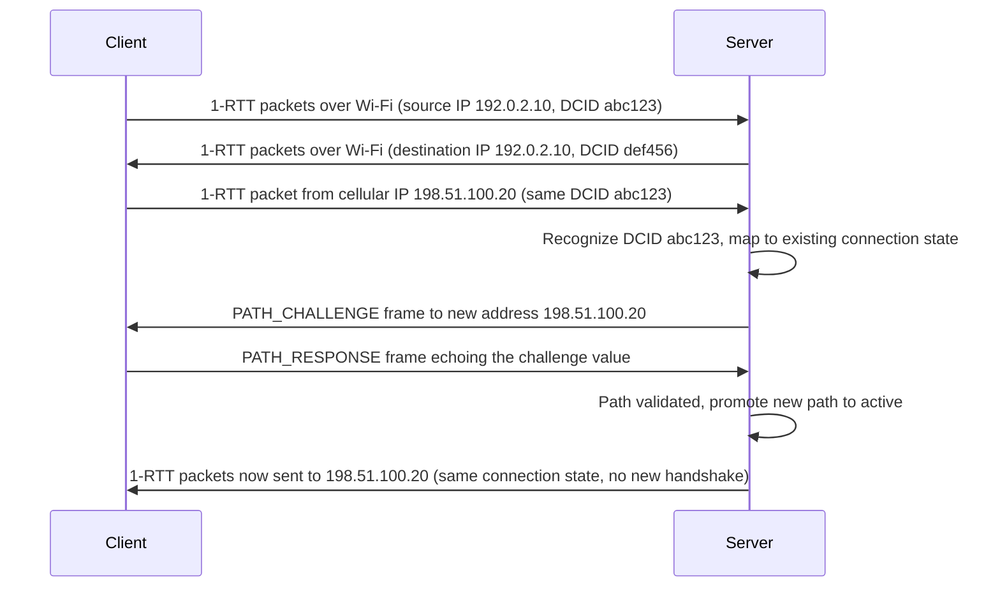

The `PATH_CHALLENGE`/`PATH_RESPONSE` frame pair is the path-validation step:
the server sends a random value only reachable by replying to the *new*
address, and only promotes the new path to primary once it receives that
exact value echoed back — proving the client genuinely controls the new
address, not merely that *some* packet claiming the old CID arrived from a
new IP (which could be an off-path attacker attempting to redirect traffic,
the exact concern flagged in [HTTP/3](CH05_HTTP3.md) Section 4.4).

**Decision implications.** Everything about production load balancing for
QUIC (Section 7's connection-ID-aware routing) exists because of this
mechanism: a Layer 4 load balancer that only hashes on the traditional
four-tuple (as most pre-QUIC load balancers do for UDP or TCP) will, by
design, route the client's post-migration packets — arriving from a new
source IP — to a *different* backend server than the one holding that
connection's state, breaking the migration the protocol was designed to
survive. A QUIC-aware load balancer must instead extract and hash on the
plaintext DCID field (Section 4.5) to route consistently regardless of which
network path the packet arrived on.

**Common failure mode.** Deploying a QUIC-terminating fleet behind a
load balancer that was configured (or is only capable of) hashing on the
UDP four-tuple. Connection migration then appears to work at the protocol
level (the client and its immediate network path are fine) but silently
fails end-to-end, because the load balancer routes the migrated path's
packets to a backend instance that has no state for that connection,
forcing a full reconnect anyway — the exact user-visible failure the
protocol exists to prevent, reintroduced by an infrastructure layer that
was not updated for QUIC's addressing model.

### 4.7 Packet number spaces and loss detection

*General loss-detection concepts — retransmission timers, duplicate
acknowledgment signals, and the overall goal of distinguishing genuine loss
from reordering — are introduced for TCP in [TCP/IP](CH03_TCPIP.md) Section
4.7. This chapter teaches QUIC's specific refinement: **per-encryption-level
packet number spaces**, a structural improvement TCP's single sequence-number
space cannot offer.*

**Definition.** A packet number space is an independent, monotonically
increasing counter used to number packets sent at one encryption level
(Section 4.3). QUIC maintains **three** separate packet number spaces per
connection — Initial, Handshake, and Application (0-RTT and 1-RTT share the
Application space) — each with its own packet numbers starting from zero and
its own independent acknowledgment and loss-detection state.

**Mechanism.** Because each space is independent, an acknowledgment for an
Initial-space packet says nothing about the state of any Handshake- or
Application-space packet, and vice versa. This matters concretely: a lost
Initial packet (say, the client's first `ClientHello`-carrying packet, lost
before the server ever saw it) is detected and retransmitted using purely
Initial-space logic, without any interference from or dependency on
Application-space packets that might already be flowing if 0-RTT data was
sent in the same flight. TCP has no equivalent separation — it has exactly
one sequence-number space for the connection's entire lifetime, so anything
that could cause TCP loss-detection ambiguity (reordering, retransmission
timing) has to be resolved against that single, shared space.

QUIC's loss detection (formalized in RFC 9002, which this handbook treats as
this chapter's authority alongside RFC 9000) uses two complementary signals,
tracked per packet-number space:

- **Packet-threshold detection**: if a packet number sufficiently *larger*
  than an unacknowledged packet has already been acknowledged (by default,
  three packets larger), the unacknowledged packet is presumed lost and
  retransmitted immediately — this is analogous in spirit to TCP's
  fast-retransmit on duplicate ACKs, but operates on QUIC's own explicit
  `ACK` frames, which (unlike TCP's cumulative-only ACKs) can acknowledge
  arbitrary, non-contiguous ranges of received packet numbers directly.
- **Time-threshold detection**: if enough time has passed since a packet was
  sent (based on the connection's measured round-trip time, with a
  multiplier and minimum granularity defined by RFC 9002) without an
  acknowledgment, it is presumed lost even without a later, larger packet
  having been acknowledged yet — this catches the case where an entire
  flight of packets, including everything after the lost one, is also
  delayed or lost, leaving no later acknowledgment to trigger
  packet-threshold detection.

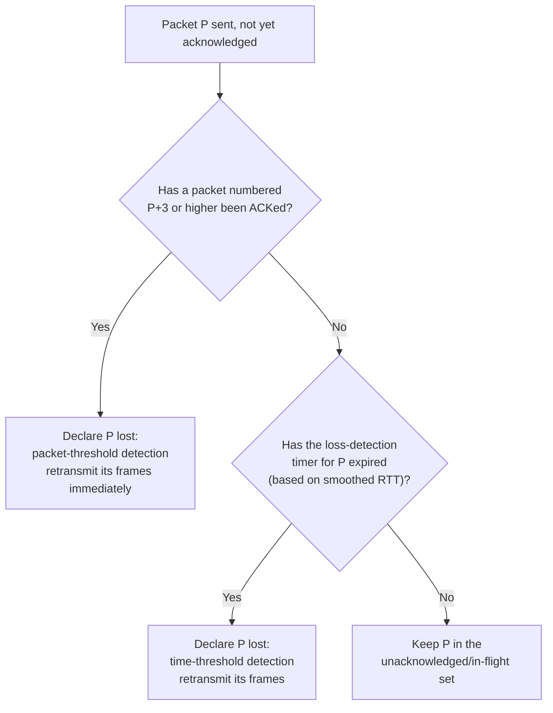

**Decision implications.** Because QUIC's `ACK` frames can express arbitrary
received ranges (not just "everything up to sequence N," as TCP's cumulative
ACK does), QUIC gets a materially more precise picture of exactly which
packets survived and which did not, in a single round trip — reducing
unnecessary retransmissions of data that actually arrived, and speeding up
detection of data that did not. For an architect evaluating whether to run
latency-sensitive traffic over QUIC, this precision is part of why QUIC
recovers faster from loss bursts on lossy paths than TCP typically does.

**Common failure mode.** Assuming "per-space loss detection" means loss in
one space (say, Handshake) has zero bearing on the other spaces' congestion
state — it does not. Loss detection is per-space, but as Section 4.8
explains, the *congestion controller* is a single, connection-wide state
machine that reacts to loss signals from any space; keeping these two
concepts (independent loss detection, shared congestion response) distinct
is essential to reasoning correctly about QUIC's behavior under partial
packet loss during the handshake.

### 4.8 Congestion control in QUIC: reusing TCP's playbook, adapted to packet-number spaces

*The conceptual foundations of congestion control — slow start, congestion
avoidance, the bandwidth-delay product (BDP), and why congestion control must
never be disabled on a shared network path — are owned in full by
[TCP/IP](CH03_TCPIP.md) Section 4.9. This chapter does not re-derive those
foundations; it teaches specifically how QUIC's congestion control differs
in its bookkeeping (operating over packet-number spaces and explicit
byte-accurate ACK ranges) while remaining behaviorally compatible with the
TCP congestion-control family it must coexist fairly with on the internet.*

**Definition.** QUIC's default congestion controller, defined in RFC 9002,
is deliberately modeled on **NewReno** — one of the TCP congestion control
algorithms recapped in [TCP/IP](CH03_TCPIP.md) Section 4.9 — with the same
overall phases (slow start, congestion avoidance, loss recovery) and the same
underlying goal: estimate how much unacknowledged data the network path can
absorb without inducing congestion, and adjust the sending rate accordingly.
Production QUIC implementations commonly substitute a more modern algorithm
(CUBIC or BBR (Bottleneck Bandwidth and Round-trip propagation time), both
also usable with TCP) in place of the RFC's reference NewReno behavior — the
algorithm is pluggable, just as it is for TCP.

**Mechanism — why this had to be a deliberate compatibility decision.** QUIC
could, in principle, have invented an entirely novel congestion-response
model. Its designers explicitly chose not to, for a reason grounded in
network fairness: the shared internet's routers and links depend on the
statistical assumption that *most* flows sharing a bottleneck respond to
congestion signals (packet loss, increasing latency) in roughly the way TCP's
algorithm family does — backing off proportionally when loss is detected,
probing gradually for more capacity otherwise. A transport that ignored this
convention and simply sent as fast as possible regardless of loss would
starve TCP-based flows sharing the same bottleneck of their fair share of
bandwidth. QUIC's congestion controller is therefore engineered to be
**TCP-friendly**: it targets roughly the same steady-state throughput a
well-behaved TCP flow would achieve under the same loss/latency conditions,
even though the byte-accounting mechanics underneath differ.

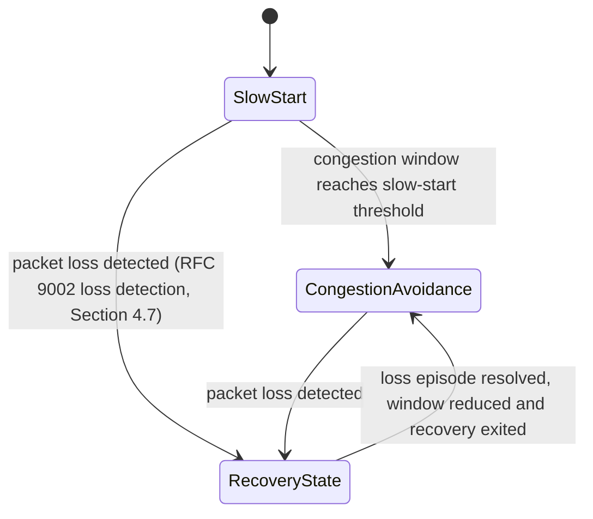

**Mechanism — byte-accurate, per-space accounting.** Where the mechanics
genuinely differ from typical TCP implementations is bookkeeping precision.
Because QUIC's `ACK` frames can express exact, non-contiguous received
ranges (Section 4.7) and every frame's byte length is explicit in the wire
format, a QUIC congestion controller tracks bytes-in-flight with more
granularity than most TCP stacks bother to, and — since Initial and
Handshake packet number spaces (Section 4.7) are largely finished before the
Application space carries the bulk of a connection's data — congestion
window growth during the handshake and during steady-state data transfer can
be reasoned about somewhat more cleanly than in TCP, where handshake and data
share one sequence space and one congestion-window history from the start.

**Decision implications.** For a Solution Architect, the practical takeaway
is that QUIC does not offer some magic "better than TCP" throughput ceiling
by default — a QUIC connection using NewReno-equivalent congestion control on
a clean, low-loss path will not meaningfully outperform a TCP connection
using the same algorithm on the same path (see the "no universal performance
multiplier" caveat already flagged in [HTTP/3](CH05_HTTP3.md) Section 4.3).
The realistic wins are (a) faster recovery from loss due to more precise ACK
information and per-stream isolation (Section 4.4), and (b) the freedom to
choose or tune a congestion controller (e.g., BBR) per-application in a
userspace library, without needing OS kernel changes or administrator
privileges — a direct consequence of QUIC's userspace implementation model,
covered next in Section 4.9.

### 4.9 QUIC's userspace implementation architecture: where the CPU cost goes

**Definition.** Unlike TCP, which is implemented once, centrally, inside
every mainstream operating system's kernel, QUIC is implemented as a
**userspace library** linked directly into each application (or into a
proxy/load-balancer process sitting in front of applications) — there is no
equivalent of a single, shared, kernel-resident QUIC stack that every
process on a machine automatically benefits from.

**Mechanism — why this was a deliberate, not incidental, choice.** Three
forces pushed QUIC's designers toward userspace rather than kernel space:

1. **Deployment velocity.** Kernel code ships on OS release cycles measured
   in months to years, and requires administrator privilege and a reboot (or
   at minimum a module reload) to update in production. A userspace library
   ships with the application itself, on that application's own release
   cadence — which is exactly the deployment speed QUIC's designers needed,
   given how quickly the protocol itself was still evolving through IETF
   standardization (Section 2).
2. **Encryption is easier to implement correctly and audit in userspace.**
   QUIC's near-total packet encryption (Section 4.2) needs an up-to-date TLS
   1.3 implementation tightly integrated with packet processing; TLS
   libraries have historically lived in userspace, and keeping QUIC's
   cryptographic code there avoids duplicating or reinventing kernel-space
   cryptography, which is a much higher-risk, lower-auditability environment
   to maintain correctly.
3. **UDP already provides the minimal kernel primitive QUIC needs** — a
   socket that can send and receive arbitrary datagrams — so there was no
   requirement to add anything to the kernel at all; QUIC could be built
   entirely as a consumer of an interface (`sendto`/`recvfrom`-style UDP
   sockets) that already existed everywhere.

**Mechanism — the real operational consequence: no free kernel offload.**
TCP's kernel residency is not incidental to its performance profile — decades
of optimization work (segmentation offload, where the Network Interface
Card (NIC) hardware itself splits large buffers into properly-sized segments
instead of the CPU doing it in software; interrupt coalescing; kernel-bypass
integrations for the highest-performance cases) assume the transport
protocol's per-packet processing happens in, or very close to, the kernel and
often partially in hardware. QUIC's userspace residency means **all of that
per-packet processing — encryption/decryption, header protection, frame
parsing, congestion control bookkeeping, loss detection — runs as ordinary
application-process CPU time**, competing for the same CPU cores as the
application's own business logic, rather than being absorbed by the kernel
or offloaded to NIC hardware the way a large fraction of TCP's per-packet
cost historically has been.

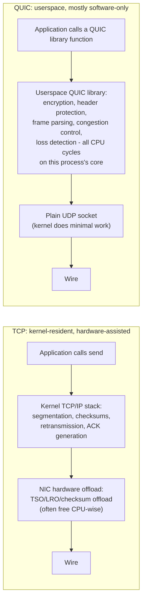

**Decision implications.** This is why production QUIC deployments at scale
report meaningfully higher CPU utilization per gigabit of throughput compared
to an equivalent mature TCP+TLS stack on the same hardware — this is not a
QUIC implementation bug to be optimized away eventually; it is a structural
consequence of where the work happens. Solution Architects sizing a
QUIC-terminating fleet (an edge proxy layer, a Content Delivery Network (CDN)
node, or an API gateway) must budget materially more CPU headroom per unit of
throughput than an equivalent TCP+TLS deployment would need, and should
expect this gap to persist even as individual QUIC library implementations
mature — techniques that narrow it (Generic Segmentation Offload (GSO) and
Generic Receive Offload (GRO) for batching UDP datagrams, `io_uring`-based
Linux I/O to reduce syscall overhead, and even emerging kernel-offload
proposals for parts of QUIC's packet processing) are covered as tuning
levers in Section 11, but none of them eliminate the fundamental shift of
work from kernel/hardware to userspace/software.

**Common failure mode.** Capacity-planning a QUIC migration using the same
CPU-per-gigabit assumptions validated for the existing TCP+TLS fleet, then
being surprised by CPU exhaustion at a materially lower throughput ceiling
after cutover. The correct planning approach is to load-test the actual
QUIC library and hardware combination being deployed and derive a fresh
CPU-per-gigabit figure, rather than reusing TCP-era capacity models.

**Concrete scenario.** A CDN operator migrates edge Points of Presence (PoPs)
from HTTP/2-over-TCP to HTTP/3-over-QUIC to capture connection-migration and
loss-isolation benefits for mobile users. Their existing capacity model,
built around TCP+TLS's CPU cost per gigabit, under-provisions the new fleet;
the migration succeeds functionally (users see the expected latency and
resilience improvements) but the operator must add roughly 20-40% more CPU
capacity per PoP (an illustrative, implementation- and hardware-dependent
figure, not a universal constant) to sustain the same peak throughput,
purchased specifically to cover QUIC's userspace processing cost that the
prior TCP deployment received largely for free from the kernel and NIC.

### 4.10 Multipath QUIC

**Definition.** Multipath QUIC (an IETF draft extension building on RFC 9000,
not yet part of the base standard as of this writing) extends the single
active-path-at-a-time migration model of Section 4.6 into **simultaneous use
of multiple network paths for one logical connection** — for example, a
mobile device sending some of a connection's packets over Wi-Fi and others
over cellular *at the same time*, rather than migrating fully from one to the
other.

**Mechanism.** Multipath QUIC builds directly on two mechanisms this chapter
already established: multiple active Connection IDs (Section 4.6, originally
designed to support privacy-preserving migration) and independent per-stream/
per-packet-number-space bookkeeping (Sections 4.4 and 4.7). Multipath extends
these by allowing more than one path to be *simultaneously validated*
(instead of validating a new path only when abandoning the old one) and by
requiring the sender to maintain **separate congestion-control state per
active path** — because two paths (say, Wi-Fi and cellular) can have wildly
different bandwidth and latency characteristics, and pooling one shared
congestion window across both would misestimate either path's true capacity.
Packets for a given stream can then be scheduled across whichever active path
the sender's scheduling policy favors (lowest latency, highest available
bandwidth, or redundant transmission of the same data over both paths for
maximum resilience).

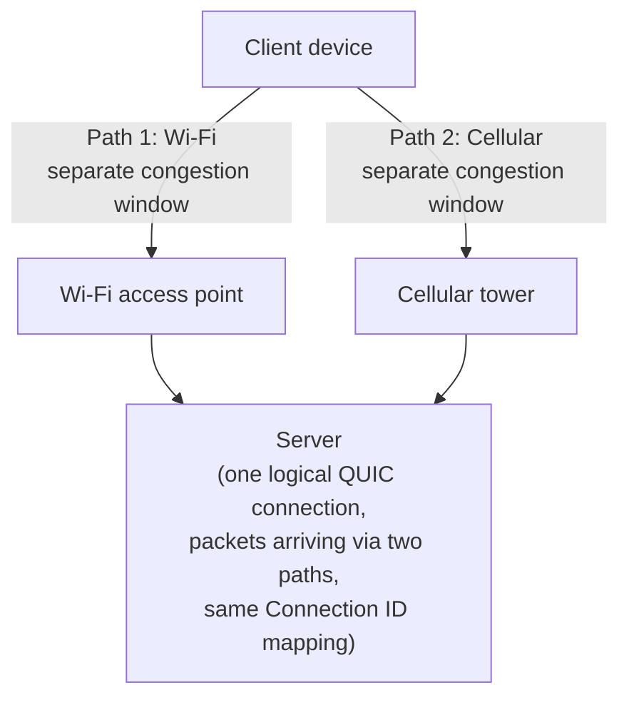

**Decision implications.** Multipath QUIC's realistic near-term production
use is narrower than the general internet: it matters most for scenarios
where the *cost of a brief interruption* is high enough to justify running
two network interfaces simultaneously — real-time video conferencing on
devices with both Wi-Fi and cellular radios active, industrial IoT (Internet
of Things) devices with redundant radio links, or specialized enterprise
Wide Area Network (WAN) aggregation appliances bonding multiple uplinks. For
most consumer web traffic, single-path connection migration (Section 4.6)
already captures the bulk of the practical benefit at far lower complexity
and battery cost (keeping a second radio active purely for redundancy has a
real power-consumption price on mobile devices), which is why an architect
evaluating multipath QUIC should treat it as a specialized tool for specific
latency/reliability-critical workloads, not a general-purpose upgrade to
apply broadly.

**Common failure mode.** Assuming multipath QUIC is simply "connection
migration but faster" or a drop-in throughput multiplier. It is a distinct
mechanism with its own complexity (per-path congestion state, scheduling
policy tuning, and — as of this writing — an IETF draft rather than a
finalized, universally-implemented standard, meaning interoperability across
different vendors' implementations cannot yet be assumed the way it can for
core RFC 9000 behavior).

### 4.11 0-RTT and replay-attack considerations, specifically in QUIC

*TLS 1.3's 0-RTT mechanism — the resumption-ticket/Pre-Shared Key model, and
the fundamental replay vulnerability inherent to any 0-RTT design (an
attacker capturing and re-sending the first flight verbatim, with the server
unable to distinguish a replay from a genuine retry) — is owned in full by
[TLS](CH06_TLS.md) Section 4.3, which already establishes that 0-RTT data
should be restricted to operations safe to receive more than once. This
chapter recaps that TLS-layer risk only as background, and owns the
QUIC-specific question: what does 0-RTT actually carry in a QUIC connection,
and what QUIC-specific production controls exist beyond the general
idempotency-restriction rule.*

**Definition, QUIC-specific.** In QUIC, 0-RTT does not merely resume a TLS
session — it lets the client send **early application data as QUIC `STREAM`
frames**, at the 0-RTT encryption level (Section 4.3), in the very first
flight of packets, using keys derived from a previous connection's
resumption secret. For an HTTP/3 deployment, this concretely means an entire
HTTP request (method, headers, and body) can arrive at the server before the
handshake's Handshake-level messages have even been exchanged.

**Mechanism — the anti-amplification limit as a QUIC-specific control.**
Independently of the replay concern, QUIC servers apply a distinct,
mandatory protection against a different attack: **amplification abuse**.
Because a client's address is not yet validated at the start of a connection
(Section 4.6's path-validation mechanism has not yet run), an attacker could
spoof a victim's source address in an Initial packet and trigger the server
to send a much larger response (certificate chains in the Handshake flight
are frequently several times the size of the Initial packet that requested
them) to that victim, using the server as a traffic amplifier against a
target that never actually initiated anything. RFC 9000 mandates that a
server **must not send more than three times the amount of data it has
received from an unvalidated client address** until that address is
validated — capping the maximum amplification factor any QUIC server can be
abused into providing, regardless of how large a legitimate handshake
response would otherwise be.

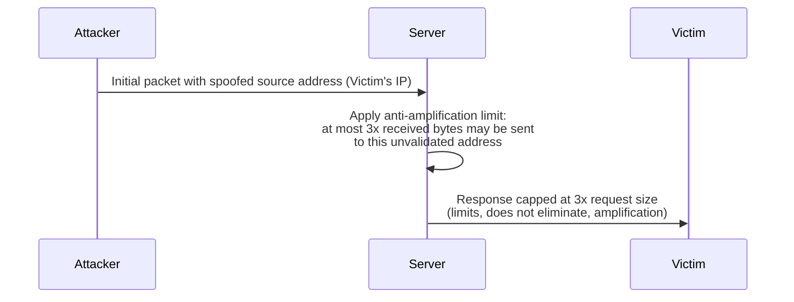

**Mechanism — 0-RTT replay's QUIC-specific consequence.** Because early data
arrives as ordinary `STREAM` frames indistinguishable in structure from any
other stream data, an application-layer server cannot tell, purely from the
QUIC transport, whether a given piece of 0-RTT stream data is a fresh request
or a captured-and-replayed one — that determination has to happen above the
transport, using the same idempotency-based reasoning
[TLS](CH06_TLS.md) Section 4.3 already teaches (restrict 0-RTT acceptance to
safe methods, or require an explicit idempotency key). What is specifically
QUIC's own responsibility is exposing, to the application or the terminating
proxy, **whether a given connection's data actually arrived via 0-RTT or
only after the full handshake completed** — QUIC libraries surface this as
an explicit signal precisely so an HTTP/3 server (or any other
QUIC-based application) can apply a replay-safety policy correctly, rather
than the application having to infer 0-RTT status indirectly.

**Decision implications.** For a production deployment, this means the
QUIC-terminating layer (an edge proxy, load balancer, or the application
server itself) must expose 0-RTT status as a first-class piece of request
context, and every handler for a route reachable over 0-RTT needs an
explicit, audited answer to "is this operation safe to execute twice?" —
exactly the audit discipline [TLS](CH06_TLS.md) Section 20 already
recommends, applied here specifically to whichever QUIC library and
reverse-proxy layer is terminating connections.

**Common failure mode.** Enabling 0-RTT support in a QUIC library's default
configuration without auditing which application routes become reachable
through it. A payment API that accepts 0-RTT connections without restricting
which requests may use early data risks a captured 0-RTT packet containing a
`POST /charge-card` request being replayed by an attacker, causing a
duplicate charge the server has no protocol-level way to detect as a replay
— the QUIC transport faithfully delivers the replayed stream data exactly as
it would any other data, because detecting the replay is explicitly outside
QUIC's own responsibility.

**Concrete scenario.** An e-commerce platform migrates its checkout API to
HTTP/3. The platform's QUIC-terminating proxy exposes a per-request
`used_0rtt` boolean into request context. The checkout service's route
handlers are audited against this flag: read-only routes (product lookup,
cart contents) accept 0-RTT freely; the final `POST /orders` submission route
explicitly rejects 0-RTT-flagged requests, forcing a full 1-RTT round trip
for that specific operation — trading a small latency cost on checkout
submission for eliminating the replay risk on the one operation where a
duplicate execution has real financial consequence.

## 5. Internal Working

A QUIC connection's internal lifecycle, end to end, looks like this:

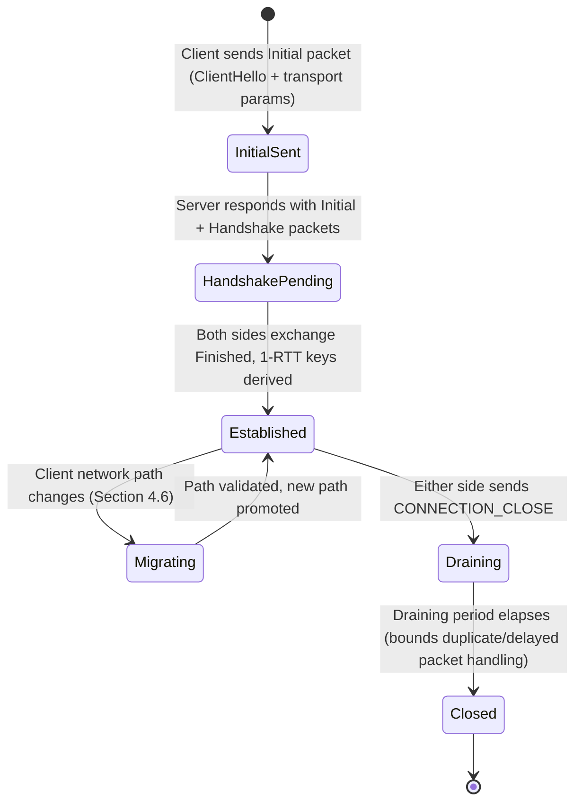

Per-packet processing on the receive path, inside a QUIC library, follows a
fixed pipeline: (1) demultiplex the incoming UDP datagram to the correct
connection using the Destination Connection ID (Section 4.5); (2) remove
header protection to recover the packet number (Section 4.5); (3) decrypt
the payload using that packet's encryption level's keys (Section 4.3); (4)
parse the decrypted payload into its constituent frames; (5) route each
frame to the relevant subsystem — `STREAM` frames to stream reassembly
(Section 4.4), `ACK` frames to loss detection and congestion control
(Sections 4.7-4.8), `CRYPTO` frames to the embedded TLS state machine
(Section 4.3), `NEW_CONNECTION_ID`/`PATH_CHALLENGE` frames to connection-ID
and migration management (Section 4.6); (6) generate any required response
frames (acknowledgments, path responses) for the next outgoing packet.
Because every one of these steps is software running in the calling
process, this pipeline is exactly the CPU cost Section 4.9 quantifies —
there is no kernel or hardware stage doing any of steps 2-6 on QUIC's
behalf the way there often is for the equivalent TCP receive path.

## 6. Design Principles

- **Encrypt by default, minimize plaintext surface** (Section 4.2) — every
  field not strictly required for on-path routing is encrypted, denying
  middleboxes a plaintext dependency to ossify around.
- **Integrate rather than layer** (Section 4.3) — folding TLS's handshake
  into the transport handshake removes a whole round trip that layering two
  independently-designed protocols would otherwise cost.
- **Move multiplexing to the layer that can act on loss** (Section 4.4) —
  stream independence only eliminates head-of-line blocking if the layer
  doing loss detection and retransmission is the same layer that understands
  stream boundaries; QUIC merges those responsibilities deliberately.
- **Identity independent of network address** (Section 4.6) — decoupling
  connection identity from the four-tuple is what makes mobility a first-
  class, protocol-level property instead of an application-layer workaround.
- **Reuse proven congestion behavior, innovate only where genuinely new
  ground exists** (Section 4.8) — QUIC does not reinvent congestion control's
  fairness contract with the rest of the internet, only its bookkeeping
  precision.
- **Deployability constrains protocol design as much as elegance does**
  (Section 4.1) — building on UDP rather than a new IP protocol number is a
  direct acknowledgment that a transport protocol nobody can deploy is a
  transport protocol that does not matter, regardless of its technical
  merits.

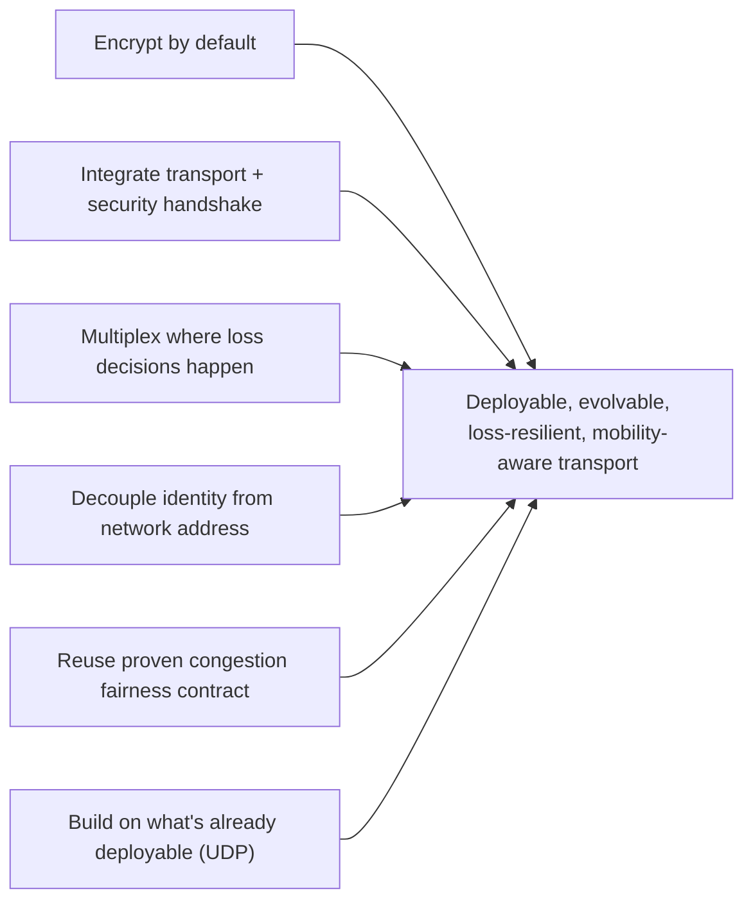

## 7. Architecture Patterns

**Connection-ID-aware load balancing.** As established in Section 4.6, a
production QUIC fleet behind a load balancer must route based on the
Destination Connection ID visible in the QUIC short header, not the UDP
four-tuple, or connection migration silently breaks. The common pattern:
the load balancer (or a lightweight routing layer in front of a QUIC-
terminating proxy fleet) parses just enough of the packet to extract the
DCID, and either (a) encodes routing information directly into the CID
bytes it issues to clients (a "self-encoding" CID scheme, where the CID's
bytes themselves identify which backend instance owns the connection, so no
external lookup table is needed), or (b) maintains a CID-to-backend mapping
table updated whenever a new connection is established or a CID is rotated.

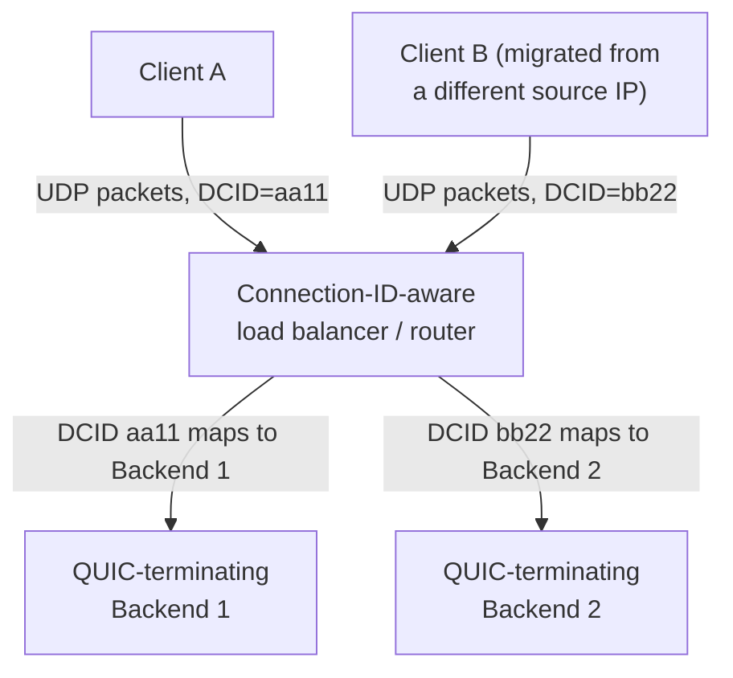

**Edge termination with origin fan-out.** Mirroring the CDN/reverse-proxy
patterns owned by [CDN](CH09_CDN.md) and [Reverse Proxy](CH11_Reverse_Proxy.md),
a common production topology terminates QUIC at the network edge (closest to
the client, minimizing the effect of any residual loss on the client-to-edge
leg, which is typically the lossiest segment) and re-encapsulates traffic as
ordinary TCP+TLS (or a separate QUIC connection) for the edge-to-origin leg,
where loss is rare and QUIC's benefits are smallest relative to its CPU cost
(Section 4.9).

**Multipath-aware scheduling for latency-critical services.** For the
narrower set of workloads justifying multipath QUIC (Section 4.10), the
pattern is to run a dedicated path-scheduling policy (lowest-latency-first,
redundant-send, or bandwidth-aggregating) inside the client library, keeping
the policy itself outside the transport protocol's own scope — QUIC provides
the mechanism (multiple validated paths, per-path congestion state), while
the choice of *how* to use them is an application/library-level decision.

## 8. Production Architecture

A representative production QUIC deployment for a public-facing service:

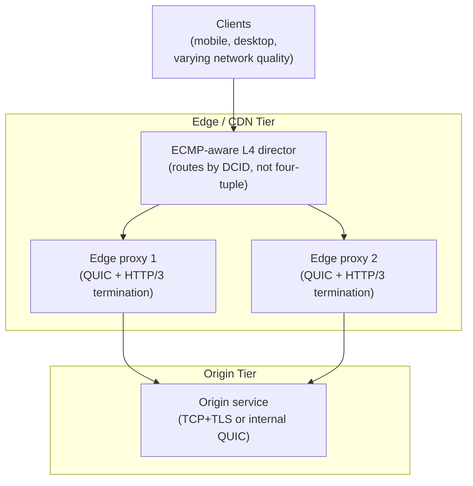

Key production considerations layered onto this topology: (1) Equal-Cost
Multi-Path (ECMP) routing at the network layer, commonly used to spread UDP
traffic across multiple edge proxy instances, must itself be CID-aware or
paired with a CID-aware layer directly in front of the proxy fleet, or ECMP's
own hashing (frequently four-tuple-based by default at the router level) will
reintroduce exactly the migration-breaking problem Section 4.6 describes;
(2) `SO_REUSEPORT`-style kernel socket sharing lets multiple worker processes
on one edge host share a single UDP port efficiently, which is the common
mechanism for scaling a QUIC-terminating proxy across CPU cores on one
machine; (3) capacity planning must use the CPU-per-gigabit figures
established through load-testing (Section 4.9), not figures inherited from
an existing TCP+TLS fleet.

## 9. Implementation

Production-grade QUIC implementations an architect is likely to evaluate:

- **quiche** (Cloudflare, Rust with C bindings) — used in Cloudflare's own
  edge and widely embedded in other proxies.
- **msquic** (Microsoft, C) — used in Windows, and embeddable in .NET and
  native applications.
- **ngtcp2** (C) — a standalone QUIC implementation frequently paired with
  nginx via a QUIC module.
- **quic-go** (Go) — the most common choice for Go-based services and
  proxies.
- **aioquic** (Python) — used for scripting, testing, and Python-based
  services where raw throughput is secondary to integration convenience.

Implementation-level decisions an architect should expect a platform team to
make explicitly rather than accept a default for: which congestion control
algorithm to run (NewReno, CUBIC, or BBR — Section 4.8), whether and how to
enable 0-RTT (Section 4.11), how connection IDs are issued and whether they
encode backend routing information (Section 7), and whether Generic
Segmentation/Receive Offload (GSO/GRO) and multi-core UDP socket sharing
(`SO_REUSEPORT`) are configured to offset the CPU cost identified in
Section 4.9.

## 10. Complete Code Examples

**Example 1 — an annotated QUIC connection establishment trace**, showing
the packet flow a `qlog`-capable implementation would emit (format
simplified for readability; real `qlog` output is JSON per the qlog/
qvis specification):

```text
t=0.000ms  TX  Initial   pkt_num=0  size=1252  DCID=8f3a9c1e2b7d4f60
             CRYPTO[offset=0,len=245]  -> TLS ClientHello + key_share
             (padded to 1252 bytes: anti-amplification requires the
              client's first flight be large enough that the 3x server
              response limit in Section 4.11 still permits a full
              handshake response)

t=14.203ms RX  Initial   pkt_num=0  size=1236  DCID=8f3a9c1e2b7d4f60
             CRYPTO[offset=0,len=122]  -> TLS ServerHello + key_share
             ACK[largest=0,ranges=[0-0]]

t=14.210ms RX  Handshake pkt_num=0  size=1180
             CRYPTO[offset=0,len=987] -> Certificate, CertificateVerify

t=14.215ms RX  Handshake pkt_num=1  size=64
             CRYPTO[offset=987,len=36] -> Finished

t=28.401ms TX  Handshake pkt_num=0  size=52
             CRYPTO[offset=245,len=36] -> Finished
             ACK[largest=1,ranges=[0-1]]

t=28.405ms TX  1-RTT     pkt_num=0  size=118
             STREAM[id=0,offset=0,len=64,fin=false] -> HTTP/3 request headers

t=42.607ms RX  1-RTT     pkt_num=0  size=1400
             STREAM[id=0,offset=0,len=1350,fin=false] -> HTTP/3 response headers + body chunk
             ACK[largest=0,ranges=[0-0]]

# Connection established end-to-end in 1 round trip (client's first
# packet at t=0 to first 1-RTT application data at t=28.405ms is a
# single RTT of ~28ms), consistent with Section 4.3's 1-RTT design.
```

**Example 2 — a quiche-style (Rust) client establishing a connection and
sending a request**, illustrating the library-level Application
Programming Interface (API) shape common across QUIC libraries — note that
the application code never manipulates packet numbers, encryption levels, or
frame types directly; the library owns all of Sections 4.3-4.8's mechanics
internally:

```rust
use quiche::{Config, ConnectionId};
use std::net::UdpSocket;

fn establish_and_request(server_addr: &str) -> std::io::Result<()> {
    let mut config = Config::new(quiche::PROTOCOL_VERSION)?;
    config.set_application_protos(&[b"h3"])?;
    // Congestion control algorithm is explicitly selectable (Section 4.8);
    // BBR is a common production choice over the RFC reference NewReno.
    config.set_cc_algorithm(quiche::CongestionControlAlgorithm::BBR);
    // Enabling early data opts this client into 0-RTT on resumption
    // (Section 4.11) - callers must separately gate which requests are
    // allowed to use it.
    config.enable_early_data();

    let socket = UdpSocket::bind("0.0.0.0:0")?;
    socket.connect(server_addr)?;

    let scid = ConnectionId::from_ref(&rand::random::<[u8; 16]>());
    let local_addr = socket.local_addr()?;
    let peer_addr = socket.peer_addr()?;
    let mut conn = quiche::connect(None, &scid, local_addr, peer_addr, &mut config)?;

    let mut out = [0u8; 1350];
    loop {
        let (write_len, send_info) = match conn.send(&mut out) {
            Ok(v) => v,
            Err(quiche::Error::Done) => break,
            Err(e) => return Err(e.into()),
        };
        socket.send_to(&out[..write_len], send_info.to)?;
    }

    // Handshake completion and stream open/write/read would follow the
    // same send()/recv() event loop pattern until conn.is_established(),
    // at which point conn.stream_send(stream_id, data, fin) carries
    // application data as QUIC STREAM frames (Section 4.4) — none of
    // which the application code above needed to construct manually.
    Ok(())
}
```

**Example 3 — a connection-ID-aware routing snippet** for the load-balancing
pattern in Section 7, illustrating how a router extracts the Destination
Connection ID from a raw QUIC short-header packet (Section 4.5) to make a
consistent routing decision across migrations:

```python
import struct

# Simplified extraction of the Destination Connection ID from a QUIC
# short-header packet (Section 4.5's wire format), assuming a fixed,
# operator-chosen DCID length agreed upon when CIDs were issued.
DCID_LENGTH = 8  # bytes; must match the length this fleet issues CIDs with

def route_packet(udp_payload: bytes, cid_to_backend: dict[bytes, str]) -> str | None:
    if len(udp_payload) < 1 + DCID_LENGTH:
        return None  # too short to be a valid QUIC packet

    first_byte = udp_payload[0]
    is_long_header = bool(first_byte & 0x80)
    if is_long_header:
        # Long-header packets (Initial/Handshake/0-RTT) carry a variable-
        # length CID with an explicit length field; handshake-time
        # packets are comparatively rare and can be routed via a slower
        # path (e.g. consistent hashing on the four-tuple) until the
        # first NEW_CONNECTION_ID-derived short-header CID is observed.
        return None

    dcid = udp_payload[1:1 + DCID_LENGTH]
    return cid_to_backend.get(dcid)

def register_connection(dcid: bytes, backend: str, cid_to_backend: dict[bytes, str]) -> None:
    # Called whenever an edge proxy issues a new Connection ID (Section
    # 4.6's NEW_CONNECTION_ID frame) so the router's table stays current
    # across CID rotation, not just at initial connection setup.
    cid_to_backend[dcid] = backend
```

## 11. Performance

Section 4.9 established the structural CPU-cost shift from kernel/hardware
to userspace/software; the concrete levers available to narrow that gap
without abandoning QUIC's benefits:

- **Generic Segmentation Offload (GSO) and Generic Receive Offload (GRO)**:
  even though QUIC's own protocol processing is userspace, the kernel can
  still batch multiple outgoing UDP datagrams into a single system call
  (GSO) and coalesce multiple incoming datagrams into fewer read operations
  (GRO), substantially cutting the number of syscalls per gigabit — a
  meaningful win that does not require moving any QUIC-specific logic into
  the kernel.
- **`io_uring`-based I/O** (Linux) reduces per-operation syscall overhead
  further by allowing batched, asynchronous submission and completion of
  socket operations, which several modern QUIC implementations are adopting
  specifically to offset userspace residency's syscall-density cost.
- **Multi-core scaling via `SO_REUSEPORT`**: since there is no single kernel
  thread handling all QUIC processing the way there conceptually is for a
  kernel-resident TCP stack, a QUIC-terminating process must explicitly
  shard incoming connections across multiple worker threads/processes, each
  with its own UDP socket sharing the same port via `SO_REUSEPORT`, to use
  all available CPU cores.
- **Hardware/kernel-offload proposals** for parts of QUIC's per-packet
  crypto and header protection exist as active research and vendor-specific
  work, but are not yet a universally available, standardized capability an
  architect can assume is present across cloud providers or NIC vendors —
  treat any specific offload claim as a hardware/vendor-specific evaluation,
  not a general QUIC property.

## 12. Scalability

Horizontal scaling of a QUIC-terminating fleet inherits the connection-ID-
aware routing requirement from Section 7 as its central scalability
constraint: **any layer that distributes load across multiple backend
instances — an ECMP router, a Layer 4 load balancer, or a `SO_REUSEPORT`
socket group on a single host — must route by DCID, not by the traditional
four-tuple**, or migrating connections (Section 4.6) will be silently routed
to instances holding no state for them. This is a materially different
scaling constraint than TCP's, where four-tuple-based ECMP hashing has
always been "good enough" precisely because TCP connections cannot migrate
in the first place — there was never a mismatch to cause. Beyond routing,
horizontal scaling of the userspace processing itself (Section 4.9) is
otherwise conventional: add more terminating instances, each independently
capped by the CPU-per-gigabit figure established under load test, with no
kernel-level shared bottleneck analogous to a single kernel TCP stack's
resource limits.

## 13. Security

- **0-RTT replay** (Section 4.11) — mitigate via idempotency-restricted
  route policy, exactly as [TLS](CH06_TLS.md) Section 4.3 recommends at the
  TLS layer, applied here to whichever QUIC/HTTP-3-terminating layer
  exposes 0-RTT status per request.
- **Amplification-attack abuse** (Section 4.11) — mitigated at the protocol
  level by the mandatory 3x anti-amplification limit on unvalidated client
  addresses; an architect's responsibility is confirming the terminating
  library actually enforces this (all mainstream implementations do by
  default) rather than a custom or heavily-modified stack silently omitting
  it.
- **Connection-ID-based tracking risk** (Section 4.6) — because a
  Connection ID persists across a migration, an endpoint that reused the
  same CID indefinitely would let an on-path observer correlate a device's
  presence across different networks over time; the mitigation (frequent
  CID rotation via `NEW_CONNECTION_ID`, especially around migration events)
  is a deliberate privacy control, not merely a routing convenience.
- **UDP-based reflection/amplification Distributed Denial of Service (DDoS)
  risk at the network level** — while QUIC's own anti-amplification limit
  caps abuse of the QUIC protocol itself, UDP as a substrate remains a
  historically favored vector for generic reflection attacks against
  unrelated UDP-based services (DNS, NTP (Network Time Protocol)) sharing
  the same network path; this is a network-level concern addressed by
  general UDP traffic-scrubbing infrastructure, not something QUIC-specific
  configuration alone resolves.
- **Version negotiation downgrade risk** — QUIC's version negotiation
  mechanism (used when client and server do not share a common QUIC
  version) must itself be protected against a downgrade attack; RFC 9000's
  design authenticates the negotiated transport parameters as part of the
  TLS-integrated handshake (Section 4.3) specifically so an on-path attacker
  cannot force a downgrade to a weaker or vulnerable QUIC version without
  detection.

## 14. Observability

Because QUIC encrypts nearly everything visible to the network path
(Section 4.2), traditional network-level observability (packet captures
interpreted the way a TCP capture would be) largely stops working —
QUIC-specific observability must instead come from the endpoints
themselves. The standard mechanism is **`qlog`**, a structured, JSON-based
event-logging format standardized alongside QUIC specifically so any
compliant implementation can emit a common, tool-interoperable trace of
every packet sent/received, every frame processed, every congestion-control
state transition, and every loss-detection event — the annotated trace in
Section 10's Example 1 is a human-readable simplification of what a real
`qlog` file captures precisely. Complementary application-level metrics an
architect should require from any QUIC-terminating fleet: connection
establishment time (1-RTT vs. 0-RTT split), migration event counts and
outcomes (validated vs. abandoned), per-connection loss rate, and CPU time
attributable to QUIC processing specifically (to keep the Section 4.9
capacity model current as traffic patterns shift).

## 15. Failure Scenarios

- **UDP blocked or deprioritized by a middlebox.** Some corporate firewalls,
  older mobile carrier networks, and certain public Wi-Fi captive portals
  block or heavily rate-limit UDP/443 while permitting TCP/443 freely. A
  well-designed QUIC-capable client (and this is why HTTP/3 deployments
  always retain a TCP+TLS+HTTP/2 fallback) must detect a failed or
  excessively slow QUIC handshake attempt and fall back to TCP within a
  bounded time budget, rather than leaving the user waiting indefinitely on
  a path that will never succeed.
- **Path MTU (Maximum Transmission Unit) issues causing silent packet
  black-holing.** Because QUIC packets can legitimately be as large as
  1350-1500 bytes and some network paths silently drop oversized UDP
  datagrams rather than returning the ICMP (Internet Control Message
  Protocol) "fragmentation needed" signal IP path MTU discovery depends on,
  a QUIC connection can stall in a way that looks like ordinary packet loss
  but is actually an MTU mismatch; production QUIC implementations run
  their own DPLPMTUD (Datagram Packetization Layer Path MTU Discovery)
  probing specifically because they cannot rely on ICMP signals arriving
  reliably.
- **NAT rebinding misidentified as migration, or vice versa.** A NAT
  device's mapping for a UDP flow can silently change the external port it
  presents (NAT rebinding) even without the client's own address changing —
  from the server's point of view this looks identical to a genuine client-
  side migration (Section 4.6), and QUIC's path-validation mechanism handles
  both cases identically and correctly by design, but an operator debugging
  "unexpected migration events" should know NAT rebinding, not just device
  mobility, is a common real-world trigger.
- **CID-unaware infrastructure silently breaking migration** (Section 4.6,
  Section 7) — the single most common production QUIC failure mode reported
  by early adopters, arising whenever any component between client and
  terminating proxy hashes on the four-tuple instead of the DCID.

## 16. Testing

- **IETF QUIC interoperability testing.** Because QUIC has multiple
  independent implementations (Section 9), the IETF QUIC working group
  maintains an ongoing interoperability test matrix exercising handshake,
  migration, 0-RTT, and version-negotiation behavior across every pair of
  participating implementations — an architect selecting a library should
  weigh its interop-matrix track record, not just its standalone benchmark
  numbers.
- **Chaos/network-condition testing.** Because QUIC's entire value
  proposition is about behavior under loss, reordering, and mobility
  (Sections 4.4, 4.6, 4.7), testing must inject those conditions
  deliberately — tools that shape traffic to introduce configurable packet
  loss percentages, reordering, and simulated network-path switches are
  essential, not optional, for validating a QUIC deployment; testing only
  on a clean lab network validates none of QUIC's differentiating
  properties.
- **Frame-parser fuzzing.** Because a QUIC endpoint must correctly parse
  attacker-influenced input at the frame level (Section 4.4-4.5) before any
  application-level authentication has necessarily completed, fuzz testing
  of the frame-parsing and header-protection-removal code paths is a
  standard, high-value practice for any team maintaining or heavily
  customizing a QUIC library rather than consuming it as-is.
- **0-RTT replay-safety test suite.** Specifically verify, per route, that
  a captured and replayed 0-RTT request either is correctly rejected by
  application-level idempotency controls or is provably safe to execute
  twice (Section 4.11) — this is an application-level test obligation
  QUIC's transport-level test suites cannot cover on the application's
  behalf.

## 17. Common Mistakes

- Treating "QUIC uses UDP" as license to build a new UDP-based protocol
  without replicating QUIC's loss detection and congestion control
  (Section 4.1's failure mode).
- Assuming existing TCP-era load balancers or ECMP configurations will
  correctly route QUIC traffic without modification (Section 4.6, 4.12).
- Capacity-planning a QUIC fleet using TCP+TLS CPU-per-gigabit figures
  instead of measuring QUIC's own, structurally higher figure (Section 4.9).
- Enabling 0-RTT globally without an explicit, per-route replay-safety audit
  (Section 4.11).
- Assuming QUIC is unconditionally faster than TCP+TLS on every network
  path, rather than understanding its benefits are concentrated on lossy,
  high-latency, or mobility-heavy paths.
- Assuming multipath QUIC is a drop-in upgrade rather than a distinct,
  still-maturing extension warranting its own evaluation (Section 4.10).
- Assuming existing deep-packet-inspection or traffic-shaping tooling will
  classify QUIC traffic the way it classified TCP (Section 4.2).

## 18. Best Practices

- Always retain a TCP+TLS+HTTP/2 fallback path for clients or networks
  where QUIC's UDP-based handshake fails or times out (Section 15).
- Route QUIC traffic through any load-balancing or ECMP layer using the
  Destination Connection ID, never the four-tuple alone (Sections 4.6, 7).
- Load-test with the specific QUIC library and hardware combination being
  deployed to establish an accurate CPU-per-gigabit figure before committing
  to a capacity plan (Section 4.9, 11).
- Audit every route reachable via 0-RTT for idempotency safety before
  enabling early data acceptance in production (Section 4.11).
- Emit and retain `qlog` traces (or an equivalent structured event log) for
  production connections, since the network path itself can no longer
  provide the observability TCP-era tooling relied on (Section 14).
- Choose a congestion control algorithm deliberately (BBR vs. CUBIC vs.
  NewReno) based on measured behavior on representative network paths,
  rather than accepting a library's default unexamined (Section 4.8).

## 19. Anti-Patterns

- **"UDP is faster, so just use raw UDP"** — discards every reliability,
  ordering, and congestion-control guarantee QUIC spent years engineering,
  in exchange for a nominal transport-selection line change (Section 4.1).
- **Four-tuple load balancing left unchanged during a QUIC migration** —
  silently breaks the exact resilience property (connection migration) the
  migration was undertaken to gain (Section 4.6, 7).
- **Blanket 0-RTT enablement** across every route without per-route
  idempotency review (Section 4.11).
- **Treating multipath QUIC as a default configuration** rather than a
  narrowly-scoped tool for specific latency/reliability-critical workloads
  (Section 4.10).
- **Assuming kernel-level TCP tuning knowledge transfers unchanged to QUIC**
  — congestion control concepts transfer (Section 4.8), but kernel-specific
  levers (like classic TCP sysctl tuning) do not apply to a userspace
  transport the same way.

## 20. Trade-off Analysis

| Decision axis | Favors TCP + TLS + HTTP/2 | Favors QUIC + HTTP/3 |
|---|---|---|
| Network path quality | Clean, low-loss, low-latency (data-center-to-data-center) | Lossy, high-latency, or mobility-heavy (mobile, satellite, congested Wi-Fi) |
| CPU budget per unit throughput | Constrained, kernel/hardware offload highly valuable | Ample headroom available to absorb userspace processing cost |
| Client mobility requirements | Minimal (stationary servers/services) | High (mobile apps, field devices, roaming users) |
| Middlebox/firewall environment | Restrictive UDP policies known or suspected | Permissive UDP policies confirmed, with a TCP fallback still retained regardless |
| Deployment/library maturity tolerance | Requires maximum implementation maturity (e.g. regulated, latency-uncritical back-office systems) | Acceptable to adopt a still-maturing (if standards-track) ecosystem for meaningful latency/resilience gains |
| 0-RTT/replay risk tolerance | N/A (TCP+TLS 0-RTT carries the same TLS-layer trade-off, see [TLS](CH06_TLS.md)) | Requires an explicit per-route idempotency audit before enabling |

## 21. Comparison Table

| Property | TCP + TLS | QUIC |
|---|---|---|
| Implementation location | OS kernel (TCP) + userspace library (TLS) | Userspace library, end to end |
| Handshake round trips (full) | 2 (1 TCP + 1 TLS 1.3) | 1 (transport + TLS 1.3 integrated) |
| Handshake round trips (resumption) | 1-2 (TCP always 1; TLS 0-RTT optional) | 0 (0-RTT early data, replay-risk caveats apply) |
| Connection identity | Four-tuple (source/destination IP and port) | Explicit, negotiated Connection ID |
| Survives client IP change | No — requires a new connection | Yes — connection migration (Section 4.6) |
| Head-of-line blocking scope | Whole connection (single byte stream) | Single stream only (per-stream reassembly, Section 4.4) |
| Loss detection granularity | One connection-wide sequence space | Independent packet number space per encryption level (Section 4.7) |
| Congestion control | Kernel-resident, pluggable (CUBIC, BBR, Reno family) | Userspace, pluggable (same algorithm family, Section 4.8) |
| Wire-format visibility to middleboxes | Header largely plaintext | Nearly all metadata encrypted (Section 4.2) |
| CPU cost profile | Historically offloaded to kernel/hardware | Runs as application-process CPU time (Section 4.9) |
| Multipath support | Not natively (MPTCP exists as a separate extension) | Emerging IETF draft extension (Section 4.10) |

## 22. Real-World Case Study

A large-scale video-streaming platform observed, in its own production
telemetry prior to any QUIC adoption, that rebuffering events correlated
strongly with mobile network transitions and with markets characterized by
higher average packet loss — precisely the conditions Section 4.4 and 4.6
identify as QUIC's strongest use case. After migrating its mobile client
and edge-serving fleet to HTTP/3 over QUIC, the platform's own published
engineering analysis attributed measurable reductions in rebuffering and
connection-re-establishment events specifically to two mechanisms this
chapter teaches in depth: per-stream loss isolation (Section 4.4) preventing
one lost segment-request from stalling unrelated in-flight segment requests
multiplexed on the same connection, and connection migration (Section 4.6)
eliminating the reconnect-and-rebuffer pattern previously triggered by
Wi-Fi-to-cellular handoffs mid-playback. The same migration required the
platform's infrastructure team to rebuild its edge load-balancing layer to
route by Connection ID (Section 4.6, 7) — an infrastructure change the
platform's own post-mortem retrospectives flagged as a harder and more
consequential engineering effort than adopting the HTTP/3 client library
itself, and to provision meaningfully more CPU capacity per edge node
(Section 4.9) than its prior HTTP/2-over-TCP fleet had required at
equivalent throughput — both effects this chapter predicts from first
principles rather than treating as surprising, implementation-specific
outcomes.

## 23. Interview Questions

1. Why is QUIC built on top of UDP instead of being defined as a new IP
   protocol number? What specific deployability problem does this avoid?
2. Explain, at the wire-format level, how a QUIC connection survives a
   client's IP address changing, and what protects this mechanism from
   being abused by an attacker.
3. HTTP/2 already multiplexes many streams over one TCP connection. Why
   does that not eliminate head-of-line blocking the way QUIC does?
4. What does it mean that QUIC "integrates" the TLS 1.3 handshake rather
   than layering it on top of the transport handshake, and what does that
   integration actually buy in round-trip terms?
5. Why does QUIC use separate packet number spaces for Initial, Handshake,
   and Application data, instead of one shared sequence number space like
   TCP?
6. What is the concrete operational consequence of QUIC living in userspace
   rather than the OS kernel, and why can it not simply be optimized away
   over time?
7. Describe the 0-RTT replay-attack risk specifically in the context of
   QUIC, and the production control that mitigates it.
8. Why must a load balancer in front of a QUIC fleet route on the
   Connection ID rather than the traditional four-tuple?
9. What is the anti-amplification limit, and what specific attack does it
   defend against?
10. When would multipath QUIC be the right tool, and when is single-path
    connection migration sufficient on its own?

## 24. Hands-on Exercises

1. Using a QUIC-capable library of your choice (quic-go, quiche, or
   aioquic), establish a connection to a public HTTP/3-enabled endpoint,
   capture a `qlog` trace, and identify the exact packets and frames
   corresponding to the handshake sequence in Section 4.3's diagram.
2. Using a network-emulation tool (e.g., `tc netem` on Linux), introduce 2%
   packet loss on a loopback interface, run a multi-stream QUIC data
   transfer, and measure whether unaffected streams continue delivering
   data while the affected stream retransmits — reproduce Section 4.4's
   isolation claim empirically.
3. Configure two network interfaces on a test client (or simulate the
   equivalent), initiate a long-lived QUIC connection, then switch the
   active interface mid-transfer; capture the resulting `PATH_CHALLENGE`/
   `PATH_RESPONSE` exchange from Section 4.6 in a packet capture of the UDP
   traffic (note that the QUIC payload itself remains encrypted; you are
   confirming timing and packet presence, not decrypting payload content
   without the session keys).
4. Implement the connection-ID extraction logic from Section 10's Example 3
   against a captured pcap of real QUIC traffic, and verify it correctly
   distinguishes long-header (handshake) packets from short-header
   (1-RTT) packets.

## 25. Design Exercises

1. Design the load-balancing and routing layer for a QUIC-terminating
   fleet of 200 edge proxy instances across 8 regions, explicitly
   addressing: how Connection IDs are issued and encoded, how ECMP routing
   at the network layer avoids reintroducing four-tuple-based hashing, and
   how a connection migrates cleanly between two edge proxies in different
   regions if a client's network path change also happens to route through
   a different region's anycast entry point.
2. Design a 0-RTT enablement policy for a multi-tenant Software-as-a-Service
   (SaaS) platform's public API, including: which route categories are
   0-RTT-eligible by default, what audit process a new route must pass
   before being marked 0-RTT-eligible, and how the platform detects and
   alerts on suspected 0-RTT replay activity in production.
3. Design a capacity model for migrating a TCP+TLS+HTTP/2 fleet serving 50
   Gbps of peak traffic to HTTP/3 over QUIC, including a load-testing plan
   to establish an accurate CPU-per-gigabit figure (Section 4.9, 11) before
   committing to a hardware procurement budget.

## 26. Architecture Review Questions

- Does every load-balancing, ECMP, or reverse-proxy layer in the path route
  QUIC traffic by Connection ID, not the four-tuple?
- Has the CPU-per-gigabit cost of the QUIC-terminating layer been measured
  under representative load, rather than assumed from prior TCP+TLS
  figures?
- Is 0-RTT enabled on any route, and if so, has every such route been
  explicitly audited for replay safety?
- Does the client (or client library) implement a bounded fallback to
  TCP+TLS+HTTP/2 when a QUIC handshake attempt fails or times out?
- Is `qlog` (or an equivalent structured event log) captured for production
  QUIC connections, given that network-path-level observability tooling no
  longer applies?
- If multipath QUIC is in use, is its scope explicitly limited to the
  workloads that justify its added complexity, rather than applied broadly
  by default?
- Has the anti-amplification limit and general DDoS-mitigation posture for
  UDP-based traffic been reviewed with the same rigor as the existing
  TCP-based posture?

## 27. Summary

QUIC is a complete, general-purpose transport protocol — not merely "HTTP/3's
plumbing" — that solves three problems TCP could never solve from within its
own thirty-year-old design: transport-level head-of-line blocking, a
minimum-two-handshake connection setup cost, and an identity model that
breaks the instant a client's IP address changes. It solves all three by
making a deliberate set of trade-offs: building on UDP instead of a new IP
protocol number, purely because UDP is already deployable everywhere TCP is
and a new protocol number would not be (Section 4.1); embedding TLS 1.3
directly into its own handshake so the two protocols' round trips collapse
into one (Section 4.3); moving stream multiplexing and loss detection into
the transport layer itself, where per-stream isolation actually becomes
possible (Section 4.4); replacing the four-tuple with an explicit Connection
ID so mobility becomes a protocol-level guarantee instead of an application
workaround (Section 4.6); and reusing TCP's proven congestion-control fairness
contract rather than inventing a new one, while gaining more precise,
per-packet-number-space loss-detection bookkeeping (Sections 4.7-4.8). None of
this comes free: QUIC's userspace-library implementation model shifts
per-packet processing cost from the kernel and network hardware onto the
application process's own CPU budget, a structural consequence every
capacity plan for a QUIC deployment must account for explicitly (Section
4.9), and its integrated 0-RTT handshake reopens the same replay-attack
question TLS 1.3 already raised, now applied to QUIC's own stream data
(Section 4.11). For a Solution Architect, the decision to adopt QUIC is
therefore not a blanket "faster transport" upgrade — it is a targeted choice
for workloads where loss resilience, connection mobility, and handshake
latency genuinely dominate the cost of the CPU and infrastructure changes
QUIC demands in return.

### Further reading

- [HTTP/3](CH05_HTTP3.md) — the application-layer mapping this chapter's
  transport mechanics were built to serve.
- [TCP/IP](CH03_TCPIP.md) — UDP fundamentals, congestion control concepts,
  and the sliding-window/loss-detection foundations this chapter builds on.
- [TLS](CH06_TLS.md) — the TLS 1.3 handshake and 0-RTT/replay trade-off QUIC
  embeds directly.
- [HTTP/2](CH04_HTTP2.md) — application-layer stream multiplexing over TCP,
  contrasted against QUIC's transport-layer multiplexing throughout Section
  4.4.
- [Load Balancer](CH10_Load_Balancer.md) and [Reverse Proxy](CH11_Reverse_Proxy.md)
  — general routing and termination patterns extended here for
  Connection-ID-aware QUIC routing (Section 7).
- [Certificates](CH15_Certificates.md) — certificate lifecycle and mTLS
  patterns applicable to QUIC's mandatory TLS 1.3 layer.
