# Chapter: OAuth

Part: [05 — Networking and Operating Systems](PART_OVERVIEW.md) · Status: Drafted

## 1. Introduction

OAuth 2.0 is the industry-standard **delegated authorization** framework: it
lets a Resource Owner (typically a human user) grant a third-party
application limited, revocable access to their resources on another service
**without ever handing that application their password**. Every "Sign in
with Google," "Connect your Slack workspace," "Allow this app to read your
calendar," and "Authorize this CI pipeline to deploy to our cloud account"
experience a Solution Architect designs or reviews rests on OAuth 2.0's
four-party model and its family of grant types (also called "flows").

This chapter is the **owning chapter** for OAuth 2.0's protocol roles, grant
types, token lifecycle architecture, and scope-based authorization model.
Two sibling chapters in this same part build directly on what is taught
here and must recap and link back rather than re-deriving it:

- [OIDC (OpenID Connect)](CH20_OIDC.md) — adds a **standardized identity/
  authentication layer** on top of OAuth 2.0's authorization mechanics. This
  chapter explicitly stops at the authorization boundary; Section 20 below
  sets up that hand-off in detail.
- [JWT (JSON Web Token)](CH21_JWT.md) — owns the JSON Web Token (JWT) *token
  format* (header/payload/signature, claims, signing algorithms). This
  chapter treats access tokens and refresh tokens as **opaque strings**
  wherever their internal format doesn't change the protocol reasoning — a
  deliberate choice, because OAuth 2.0 does not require tokens to be JWTs at
  all (many production Authorization Servers issue opaque, database-backed
  tokens instead).

The mental model to hold onto for the rest of this chapter is the **valet
key**: a valet key lets a parking attendant start and move your car, but it
physically cannot open the trunk or the glovebox. You didn't have to hand
over your *master* key (your password), and the valet's key can be
deactivated independently at any time. OAuth 2.0 is the protocol that lets
software systems hand out valet keys instead of master keys.

## 2. Historical Evolution

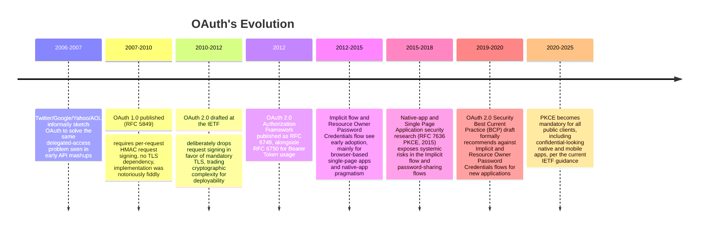

- **Pre-OAuth mashup era (mid-2000s)**: to let a third-party app "import your
  contacts" or "post to your feed," the common (and dangerous) pattern was
  **password anti-pattern sharing** — the app asked the user to type their
  Twitter/Google/Yahoo password directly into the third-party app's own
  login form, which then replayed those credentials against the real
  service's API. The third-party app now permanently held the user's actual
  password, could do anything the user could do, and the user had no way to
  revoke just that one app without changing their master password
  everywhere.
- **OAuth 1.0 (RFC 5849, 2010)**: solved the password-sharing problem but
  required each HTTP request to be individually signed with Hash-based
  Message Authentication Code (HMAC), using a shared secret and precise
  request-canonicalization rules (exact parameter ordering, URL encoding,
  timestamp/nonce handling). This made OAuth 1.0 client libraries hard to
  implement correctly and painful to debug — a mismatched signature failed
  silently or with an unhelpful error.
- **OAuth 2.0 (RFC 6749, 2012)**: a deliberate architectural trade — instead
  of signing every request, OAuth 2.0 mandates Transport Layer Security (TLS)
  for every token-bearing request and lets a valid **Bearer Token** (RFC
  6750) act as sole proof of authorization, the same way a physical bearer
  bond or a hotel key card grants access to whoever holds it. This shifted
  security responsibility from complex per-request cryptography to (a)
  keeping the channel encrypted and (b) protecting the token in storage and
  transit.
- **Implicit flow and Resource Owner Password Credentials flow's rise and
  fall**: OAuth 2.0 initially shipped with grant types tailored to
  JavaScript-only Single Page Applications (Implicit flow) and
  fully-trusted first-party apps (Resource Owner Password Credentials flow).
  Both are covered as deprecated flows in Section 4.6 below — that section
  is written explicitly as an architecture-evolution lesson: understanding
  *why* the industry walked these back is more instructive than the flows
  themselves.
- **Proof Key for Code Exchange (PKCE) and the current security
  baseline (2015-present)**: RFC 7636 introduced PKCE to protect the
  Authorization Code flow for clients that cannot hold a secret (mobile
  apps, SPAs, desktop apps). The 2019-2020 OAuth 2.0 Security BCP then
  consolidated years of real-world attack research into a single
  recommendation: **use Authorization Code + PKCE for every client type**,
  confidential or public, and retire Implicit and Resource Owner Password
  Credentials entirely for new work.

## 3. Why It Exists

Before OAuth, there was no standard way to express "let this application act
on my behalf, but only for these specific things, and only until I say
otherwise" without disclosing a long-lived, all-powerful secret (the
password). Three forces made this an unavoidable architectural problem, not
a nice-to-have:

1. **The API economy exploded.** Once services exposed HTTP APIs, every new
   integration ("connect your bank account to this budgeting app," "let this
   scheduling tool see your calendar") needed a way to grant partial access
   across organizational boundaries — often to companies that had never met
   each other's engineering teams and had no other trust relationship.
2. **Password sharing doesn't compose.** If ten different apps all hold your
   real password, revoking access from one means rotating the password
   everywhere, and a breach at the least-trusted app now compromises the
   most-trusted one. There was no way to scope, audit, or time-box access
   per integration.
3. **Machines needed to talk to machines too.** Beyond human-delegated
   access, backend services, CI/CD (Continuous Integration/Continuous
   Delivery) pipelines, and batch jobs needed a standard way to authenticate
   *as themselves* (no human resource owner in the loop at all) — this is
   what the Client Credentials grant (Section 4.5) formalizes.

OAuth 2.0 exists to make delegated, scoped, revocable, and auditable access
a first-class, standardized capability instead of an ad hoc, per-integration
hack — the same way HTTP standardized request/response semantics (see
[HTTP](CH01_HTTP.md)) instead of every application inventing its own wire
format.

## 4. Core Concepts

### 4.1 The Valet Key Model and the Four-Party Problem

**Definition.** OAuth 2.0 solves the problem of **delegated authorization**:
letting a Resource Owner grant a Client application a limited, time-boxed,
revocable set of permissions on a Resource Server, without ever disclosing
the Resource Owner's actual credentials to the Client.

**Mechanism.** Instead of a two-party relationship (user logs into an app
with a password), OAuth introduces an intermediary — the Authorization
Server — whose entire job is to authenticate the Resource Owner once, ask
them explicitly what they want to authorize, and then hand the Client a
narrow, revocable **access token** instead of the Resource Owner's
credentials. The Client never sees the password; the Authorization Server
never has to trust the Client with anything beyond what the token encodes.

**Decision implications.** This indirection is *the* reason OAuth-protected
systems can support fine-grained revocation ("remove this one app's access"
from an account security page), scope limitation ("read calendar only, not
write"), and auditability (the Authorization Server logs every grant) — none
of which are achievable with direct password sharing.

**Common failure mode.** Architects sometimes try to shortcut OAuth by
having a Client collect a user's real password and exchange it "under the
hood" — this is exactly the Resource Owner Password Credentials flow
(Section 4.6), and it re-introduces every problem OAuth was built to solve.
If you find yourself reaching for that pattern, that is a signal to stop and
use Authorization Code + PKCE instead.

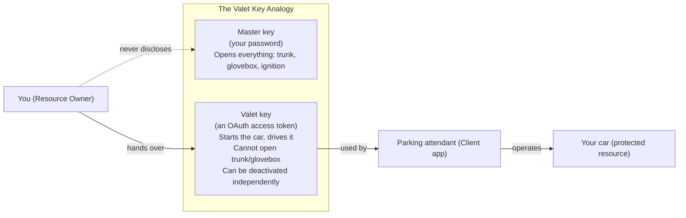

### 4.2 The Four Core Roles

**Definition.** Every OAuth 2.0 interaction involves exactly four logical
roles. Understanding these roles precisely — and never collapsing two of
them together in your architecture diagrams — is the single most important
mental model for reasoning about any OAuth deployment.

- **Resource Owner** — the entity (usually a human end user, but can be an
  organization) who owns the protected data and has the authority to grant
  access to it.
- **Client** — the application requesting access to the protected resource
  *on behalf of* the Resource Owner (or, in Client Credentials, on behalf of
  itself). "Client" here is an OAuth-specific term of art — it can be a
  server-side web app, a Single Page Application, a native mobile app, or a
  backend batch job. It is *not* the same as "web browser."
  - Clients are further classified as **confidential** (can securely hold a
    secret — a server-side app whose backend code never reaches the
    end-user's device) or **public** (cannot — a Single Page Application or
    native mobile app whose entire binary/bundle is inspectable by the
    end user). This classification directly drives which grant type is safe
    to use (Section 4.6).
- **Authorization Server** — issues access tokens to the Client after
  successfully authenticating the Resource Owner and obtaining their
  consent. This is the component that owns login screens, consent screens,
  token issuance, token introspection, and revocation.
- **Resource Server** — hosts the protected resources and accepts access
  tokens as proof of authorization to serve a request. This is typically
  "the API" the Client actually wants to call.

**Mechanism.** In many production deployments the Authorization Server and
Resource Server are operated by the same company (e.g. Google issues tokens
for Google Calendar's own API) — but they are architecturally distinct roles
even when co-located in the same codebase, because they answer different
questions: the Authorization Server asks "is this Client allowed to act on
this Resource Owner's behalf, for these scopes?" while the Resource Server
asks "does this presented token actually grant access to what I'm about to
serve?"

**Decision implications.** As a Solution Architect, drawing all four roles
explicitly (rather than compressing "Authorization Server + Resource Server"
into a single "backend" box) forces you to answer concrete integration
questions early: does the Resource Server call back to the Authorization
Server to validate every token (introspection, Section 4.9), or does it
validate locally using a signed token format? Is the Authorization Server a
build-vs-buy decision (Auth0, Okta, Azure AD/Entra ID, AWS Cognito, Keycloak)
or a bespoke internal service?

**Common failure mode.** Treating "the Client" as trustworthy by default
because it's "your own frontend" — a public Single Page Application's
JavaScript bundle is fully readable by the end user's browser, so any secret
embedded in it is not actually secret. This is precisely why public clients
cannot use flows that require a client secret (Section 4.6).

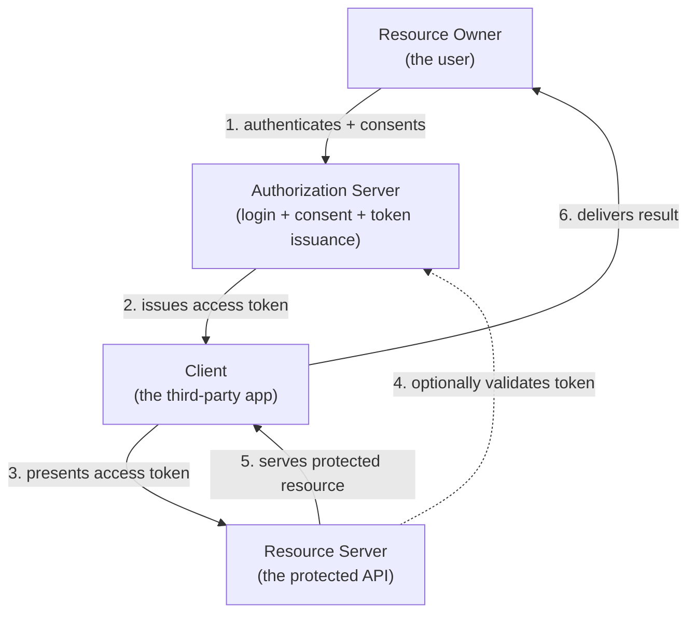

### 4.3 The Authorization Code Flow (the Primary Secure Flow)

**Definition.** The Authorization Code flow is OAuth 2.0's foundational,
most-secure grant type: instead of handing the Client an access token
directly, the Authorization Server first hands the Client a short-lived,
single-use **authorization code** via a browser redirect, and the Client
then exchanges that code for an access token through a direct, back-channel
(server-to-server) request.

**Mechanism — step by step.**

1. The Client redirects the Resource Owner's browser to the Authorization
   Server's `/authorize` endpoint, including its `client_id`,
   `redirect_uri`, requested `scope`, and a `state` parameter (an
   anti-Cross-Site Request Forgery (CSRF) nonce the Client generates and
   later verifies).
2. The Authorization Server authenticates the Resource Owner (login
   screen, or reuses an existing session) and presents a consent screen
   describing exactly what the Client is requesting.
3. On approval, the Authorization Server redirects the browser back to the
   Client's `redirect_uri` with a short-lived `code` and the same `state`
   value.
4. The Client verifies `state` matches what it generated (proving the
   response corresponds to a request it actually initiated), then makes a
   **direct, back-channel** POST request to the Authorization Server's
   `/token` endpoint, exchanging the `code` plus its own `client_id` and
   `client_secret` for an access token (and typically a refresh token).
5. The Authorization Server validates the code (single-use, not expired,
   issued to this exact `client_id` and `redirect_uri`) and returns the
   tokens directly to the Client over the back channel — never through the
   browser.

**Decision implications.** The critical architectural property here is that
the actual access token **never appears in the browser's URL bar, browser
history, or server access logs** — only the short-lived, single-use code
does, and that code is useless without also presenting the `client_secret`
in step 4. This is why Authorization Code is safe for confidential clients:
even if a code is somehow intercepted or logged, it cannot be redeemed for a
token without the secret that only the Client's backend holds.

**Common failure mode.** Skipping `state` validation. Without it, an
attacker can trick a victim's browser into completing an authorization flow
initiated by the attacker (an injected/forged `code`), leading to the victim
being logged into the attacker's account without realizing it — a
CSRF-class login mix-up attack.

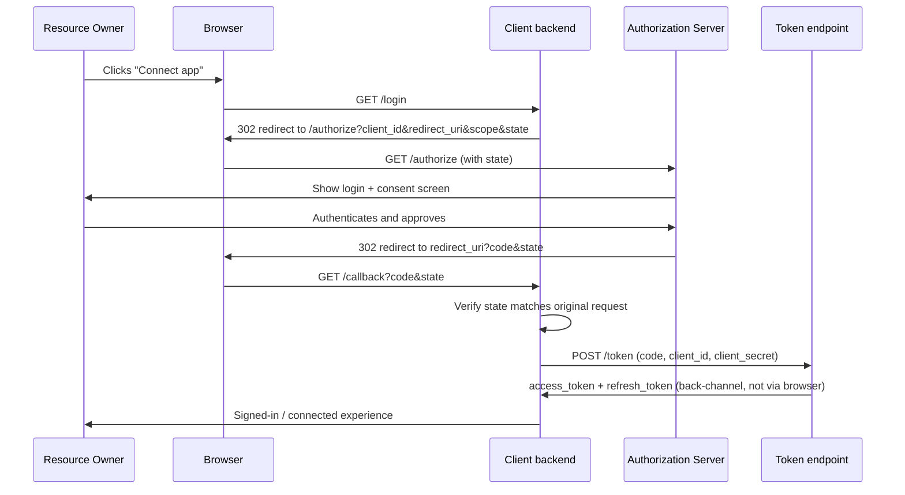

### 4.4 Authorization Code with PKCE (the Modern Mandatory Extension)

**Definition.** Proof Key for Code Exchange (PKCE, RFC 7636, pronounced
"pixy") extends the Authorization Code flow so that it is safe for **public
clients** — Single Page Applications, native mobile apps, and desktop
apps — which cannot hold a `client_secret` securely, because their code
runs entirely on the end user's device and is inspectable.

**Mechanism.** The Client generates a random, high-entropy secret at the
start of each flow, called the **code verifier**. It derives a **code
challenge** from it (typically `SHA-256(code_verifier)`, base64url-encoded)
and sends only the code challenge in the initial `/authorize` request. When
exchanging the authorization code at the `/token` endpoint, the Client sends
the original code verifier. The Authorization Server independently
recomputes the challenge from the presented verifier and rejects the
exchange if it doesn't match the one supplied at authorization time.

**Decision implications.** PKCE replaces the security property that a
`client_secret` used to provide (proof that the entity redeeming the code is
the same entity that started the flow) with a property derived *per-flow-
instance* instead of per-client — critically, this works even when there is
no durable secret to protect, because the verifier is generated fresh, held
only in memory/local storage for the flow's brief lifetime, and never
transmitted until the final back-channel exchange. Since 2019-2020 industry
best practice (Section 2), **PKCE is now recommended for confidential
clients too**, not just public ones — it costs almost nothing to add and
closes an authorization-code-interception attack class even when a client
secret also exists (defense in depth).

**Common failure mode.** Using the `plain` code-challenge method (sending
the raw verifier as the challenge, with no hashing) when the Authorization
Server supports it as a fallback — this defeats the protection PKCE is
designed to provide, because an attacker who intercepts the authorization
request can then replay the same value as the verifier. Always use the
`S256` (SHA-256) method; treat `plain` as a legacy compatibility shim only.

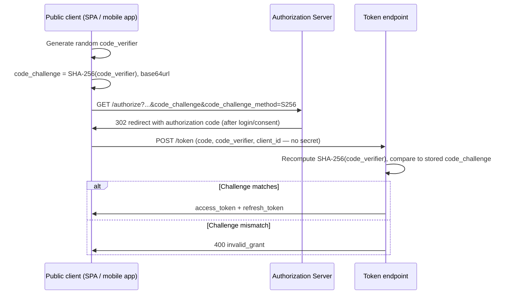

### 4.5 The Client Credentials Flow (Machine-to-Machine)

**Definition.** The Client Credentials grant is OAuth 2.0's flow for
**machine-to-machine (M2M)** authorization — there is no Resource Owner in
the loop at all. The Client authenticates as itself, using its own
`client_id` and `client_secret` (or a stronger credential such as a signed
JSON Web Token (JWT) assertion or a mutual TLS (mTLS) client certificate),
and receives an access token scoped to the Client's own permissions.

**Mechanism.** This is the simplest OAuth flow: a single direct, back-
channel POST request to the `/token` endpoint with `grant_type=
client_credentials` plus the Client's credentials and requested `scope`. No
redirect, no browser, no user interaction — appropriate exactly because
there is no human whose consent needs to be collected.

**Decision implications.** This is the correct flow for backend service-
to-service calls, CI/CD pipelines authenticating to a deployment API, and
scheduled batch jobs pulling data from a partner API — anywhere "the
application itself" is the security principal, not a delegated human. Scope
the Client's token tightly to only what that specific service integration
needs (Section 4.7's principle of narrow, auditable scopes applies here too)
and rotate the `client_secret` on a defined cadence, or prefer a signed-
assertion / mTLS-based client authentication method where the platform
supports it, since a leaked static `client_secret` is a standing risk with
no expiration of its own.

**Common failure mode.** Reusing a single, broadly-scoped Client Credentials
token across many unrelated internal services "because it's convenient" —
this collapses fine-grained blast-radius control back down to an
all-or-nothing shared secret, defeating the purpose of scoped tokens
entirely. Issue a distinct Client registration (and therefore a distinct,
independently revocable secret and scope set) per integration.

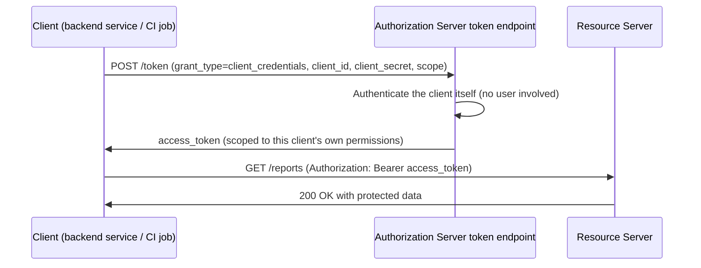

### 4.6 Why Implicit and Resource Owner Password Credentials Are Deprecated

**Definition.** Two of OAuth 2.0's original grant types are now formally
discouraged by the OAuth 2.0 Security Best Current Practice and omitted
entirely from the OAuth 2.1 consolidation draft. Understanding *why* is one
of the most valuable architecture-evolution lessons in this chapter — it
illustrates how a standard's own security guidance evolves as real-world
attack patterns accumulate.

**The Implicit flow's flaw.** Designed for early Single Page Applications
that could not make a back-channel POST request due to browser Cross-
Origin Resource Sharing (CORS) limitations of the era, the Implicit flow
skipped the authorization-code exchange step entirely: the Authorization
Server returned the **access token directly in the redirect URI's fragment**
(`#access_token=...`). This has multiple structural weaknesses:

- The token appears directly in the browser's address bar and is exposed to
  browser history, referrer leakage in some configurations, and any
  JavaScript running on the page (including malicious third-party scripts).
- There is no code-exchange step, so there is no opportunity to bind the
  token issuance to a client secret or a PKCE verifier — a token, once
  redirected, is immediately usable by whoever's browser received it.
- Refresh tokens are not issued in this flow at all (they cannot safely be
  put in a URI fragment either), forcing frequent, disruptive re-
  authentication or unsafely long-lived access tokens.

**The Resource Owner Password Credentials flow's flaw.** This flow lets the
Client collect the Resource Owner's actual username and password directly
and exchange them for a token — which is precisely the password-sharing
anti-pattern OAuth was invented to eliminate (Section 3). It was only ever
appropriate for a first-party, fully-trusted native app owned by the same
organization as the Authorization Server — and even there, it teaches end
users the dangerous habit of typing their credentials into arbitrary app
login forms, undermining phishing resistance everywhere else.

**The architecture lesson.** Both flows were reasonable engineering
trade-offs *given the browser and client capabilities of the mid-2010s*.
Modern browsers now support CORS-enabled back-channel requests reliably,
and PKCE (Section 4.4) solved the "public client cannot hold a secret"
problem that Implicit was originally invented to work around. Once the
underlying constraint that justified a design disappears, the design itself
should be retired — clinging to a legacy flow "because it's what we've
always used" is a common anti-pattern (see Section 19). **The current
guidance is unambiguous: use Authorization Code + PKCE for every client
type**, and reserve Client Credentials only for genuine machine-to-machine
cases.

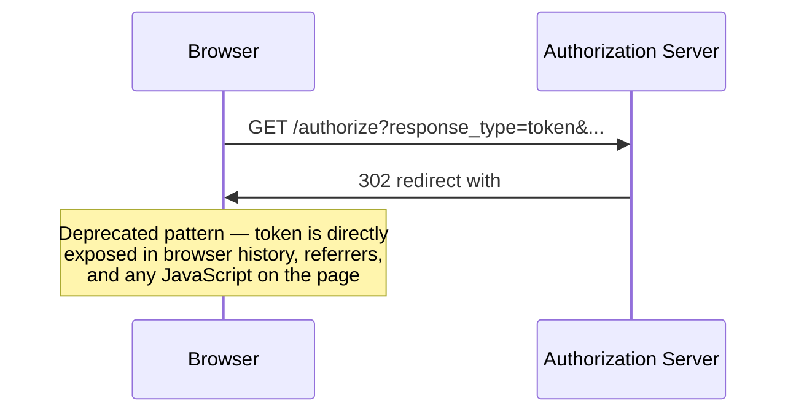

### 4.7 Access Tokens vs. Refresh Tokens: Lifetime and Rotation Architecture

**Definition.** OAuth 2.0's token model deliberately splits authorization
into two artifacts with very different lifetimes and blast radii: a
**short-lived access token** (minutes to roughly an hour) presented on every
API call, and a **longer-lived, rotatable refresh token** (hours to weeks or
months) used only to silently obtain a new access token without re-
prompting the Resource Owner.

**Mechanism.** When an access token expires, the Client presents its refresh
token to the Authorization Server's `/token` endpoint
(`grant_type=refresh_token`) and receives a fresh access token — and, under
**refresh token rotation**, a *new* refresh token that invalidates the
previous one. Rotation means a stolen refresh token is only useful once: if
an attacker replays a rotated-out refresh token, the Authorization Server
can detect the reuse of an already-superseded token and treat it as a signal
that the token family has been compromised, revoking the entire chain.

**Decision implications — why this split exists.** A short-lived access
token limits the *time window* an attacker can exploit a stolen token even
if it leaks into a log file, a browser extension, or a misconfigured proxy —
it will simply expire soon regardless of whether anyone notices the leak. A
long-lived refresh token would defeat that protection if it were sent on
every request (it would be exposed to the same leakage surface as the
access token, constantly); keeping it reserved for the low-frequency
token-refresh exchange, storing it more securely (e.g. httpOnly cookie or
secure device keystore, never in JavaScript-reachable storage for a Single
Page Application), and rotating it on every use together give architects a
tunable trade-off between user experience (not forcing re-login every few
minutes) and blast-radius containment.

**Common failure mode.** Storing a refresh token in `localStorage` in a
browser-based Single Page Application — `localStorage` is readable by any
JavaScript running on the page, including an injected Cross-Site Scripting
(XSS) payload, which turns a single XSS bug into full, long-lived account
takeover. Prefer a Backend-for-Frontend (BFF) pattern (Section 7) that keeps
refresh tokens server-side entirely, or at minimum an httpOnly, `Secure`,
`SameSite` cookie the Client's own JavaScript cannot read.

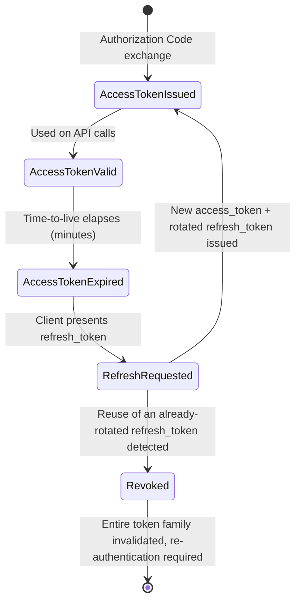

### 4.8 Scopes: the Authorization-Granularity Mechanism

**Definition.** A **scope** is a named permission string (e.g.
`calendar.read`, `repo:write`, `orders.read`) that the Client requests and
the Resource Owner explicitly consents to; the Authorization Server encodes
the granted set into the resulting access token, and the Resource Server is
responsible for enforcing that a request only proceeds if the token carries
the scope that specific endpoint or action requires.

**Mechanism.** Scopes are requested as a space-delimited string in the
initial `/authorize` request. The Authorization Server may grant a subset of
what was requested (e.g. if the Resource Owner unchecks an item on the
consent screen), and the actual granted scopes are returned alongside the
token so the Client can adjust its behavior (hide a feature the user didn't
grant, rather than calling an API it knows will be rejected).

**Decision implications.** Scopes are the practical, architect-facing
realization of the **principle of least privilege**: a well-designed scope
taxonomy lets a Client request exactly `calendar.read` for a "show my
upcoming meetings" feature instead of an all-encompassing `full_access`
scope, so that a compromised Client, or an over-permissioned consent a user
clicked through too quickly, only exposes that narrow slice of data. Scope
design is an API design problem in its own right — too coarse
(`admin`-style catch-all scopes) reintroduces the blast-radius problem
OAuth exists to solve; too fine-grained produces an unmanageable consent
screen with dozens of checkboxes that users click through without reading
(consent fatigue).

**Common failure mode.** Treating scopes as a purely cosmetic label on the
consent screen without the Resource Server actually checking them on every
protected endpoint — a scope that is requested and granted but never
enforced provides no real security benefit, only a false sense of one.

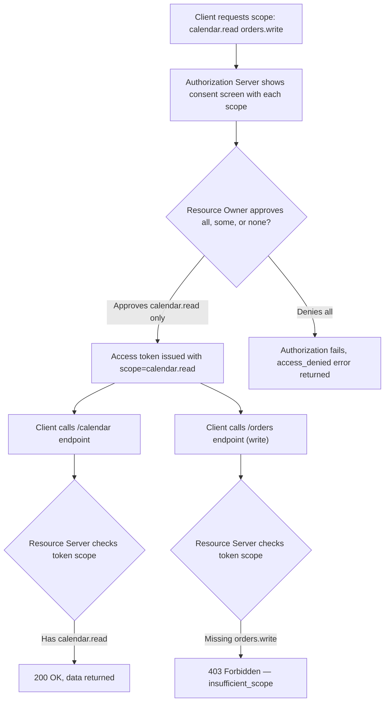

### 4.9 Token Introspection and Revocation

**Definition.** **Token introspection** (RFC 7662) is a standardized
endpoint (`/introspect`) that lets a Resource Server (or any authorized
party) ask the Authorization Server "is this token currently valid, and
what does it grant?" in real time. **Token revocation** (RFC 7009) is a
standardized endpoint (`/revoke`) that lets a Client or Resource Owner
proactively invalidate a token before its natural expiration — for example,
when a user clicks "disconnect this app" or a security team detects a
compromised integration.

**Mechanism.** Introspection matters architecturally because it determines
where token-validity checking work happens: an opaque, database-backed
token requires the Resource Server to call the Authorization Server's
`/introspect` endpoint on every request (a network round trip, but
instantly reflects revocation); a self-contained signed token (see the
sibling [JWT chapter](CH21_JWT.md) for the format itself) can often be
validated locally by verifying its signature and expiration, trading an
extra network hop for a short window where a revoked-but-not-yet-expired
token might still locally "look" valid until the Resource Server's cache of
revocation state catches up.

**Decision implications.** This is a genuine architectural trade-off, not a
free lunch: introspection-per-request gives the strongest, most immediate
revocation guarantee at the cost of coupling every Resource Server call to
the Authorization Server's availability and latency; local signature
validation removes that coupling and scales better under load, but requires
a deliberate strategy for near-real-time revocation (short access-token
lifetimes plus a revocation list/denylist check, or accepting that
revocation propagation has a bounded delay equal to the access token's
lifetime).

**Common failure mode.** Assuming that because a token *can* be revoked, it
*is* revoked instantly everywhere — with locally-validated signed tokens
and no denylist mechanism, a "revoked" token can remain technically usable
at any Resource Server that hasn't re-checked revocation status until it
naturally expires. Document this window explicitly in any security review.

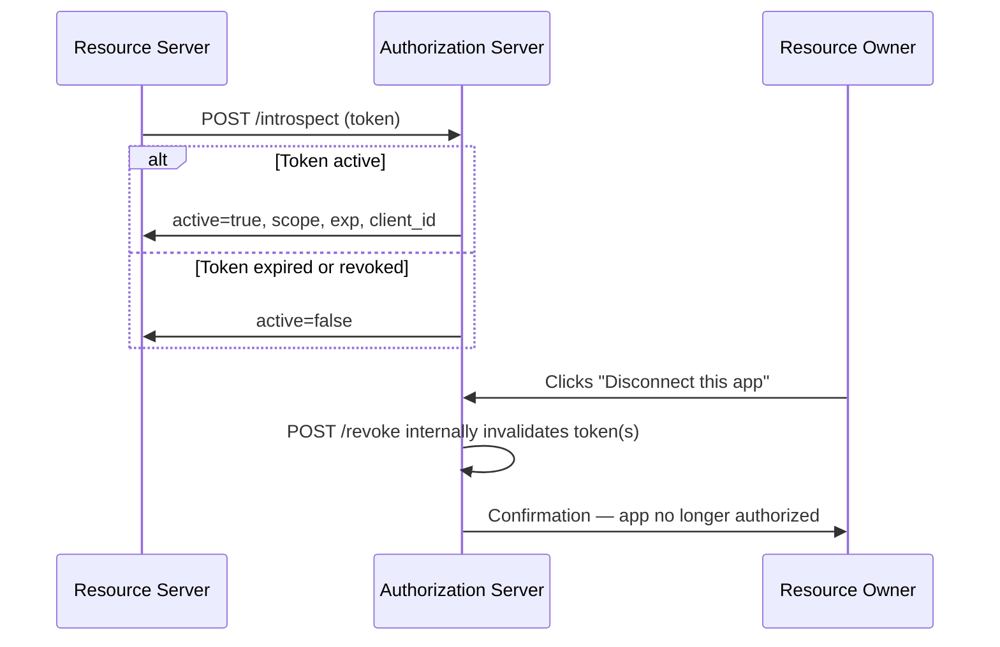

### 4.10 OAuth Is Authorization, Not Authentication

**Definition.** This is the single most important distinction in the
chapter, and the most common architectural mistake made with OAuth 2.0:
**OAuth 2.0 answers "what is this Client allowed to do?" — it does not, by
itself, answer "who is this end user?"**

**Mechanism.** OAuth's entire protocol surface (authorization codes, access
tokens, scopes) is designed around granting *access to resources*. Nothing
in base OAuth 2.0 mandates a standard, verifiable way for the Client to
learn the Resource Owner's stable identity (a user ID, an email, a name) as
a first-class, signed, machine-readable output of the flow. Some
implementations informally bolted on ad hoc "call a `/me` endpoint with the
access token and hope it returns user info in a consistent shape" — but
that is not part of the OAuth 2.0 specification, and every provider's `/me`
response shape historically differed.

**Decision implications — "OAuth for login" is a well-known anti-pattern.**
Using a successful OAuth authorization ("the user approved this Client's
access to their profile scope") as a proxy for "the user is now logged in"
has a specific, exploitable flaw: a malicious Client can potentially replay
or forge parts of the flow to make a Relying Party believe a user has
authenticated when they haven't, because OAuth access tokens were never
designed to be verified as proof-of-identity by a third party the way a
signed identity assertion is. This exact gap — an industry-wide pattern of
misusing OAuth for login, with inconsistent and sometimes insecure ad hoc
"who is this user" endpoints — is precisely why [OIDC (OpenID
Connect)](CH20_OIDC.md) exists: OIDC is a thin, standardized identity layer
built directly on top of OAuth 2.0's Authorization Code flow, adding a
signed **ID Token**, a standardized `/userinfo` endpoint, and a
purpose-built `openid` scope — turning "OAuth, used carefully and
consistently for login" into "OIDC, a protocol that is actually designed
for login." This chapter deliberately stops here: the OIDC chapter picks up
exactly at this boundary and is the correct place to learn ID Tokens, the
`openid` scope, and authentication-specific claims.

**Common failure mode.** Building a "Sign in with X" feature using raw
OAuth 2.0 (no ID Token, no OIDC), and treating "we got an access token back"
as sufficient proof of the user's identity — this is the exact anti-pattern
OIDC was standardized to close. If your requirement is "authenticate this
user," reach for OIDC, not bare OAuth.

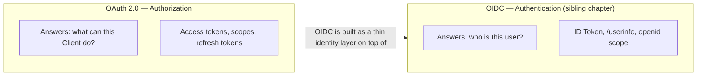

## 5. Internal Working

Internally, an Authorization Server's `/token` endpoint performs the same
core sequence regardless of which grant type triggered it, differing mainly
in *how* the caller is authenticated and *what* is exchanged for a token:

1. **Grant validation** — verify the presented grant artifact: an
   authorization code (checked for single-use, expiry, matching
   `client_id`/`redirect_uri`, and matching PKCE code verifier if present),
   a refresh token (checked for validity and rotation state), or direct
   client/user credentials.
2. **Client authentication** — verify the Client is who it claims to be,
   using a `client_secret`, a signed JWT client assertion, or mTLS,
   depending on the Client's registered authentication method.
3. **Scope resolution** — intersect the requested scopes with what was
   actually granted/consented and what the Client is registered to be
   allowed to request at all.
4. **Token issuance** — mint an access token (opaque, stored server-side in
   a token store, or self-contained/signed — see the [JWT chapter](CH21_JWT.md)
   for the signed-token internals) and, if applicable, a refresh token,
   recording the association between token, Client, Resource Owner, and
   granted scopes for later introspection/revocation lookups.
5. **Response** — return the token set as a JSON body over the back
   channel, never via a redirect for anything beyond the initial
   authorization code.

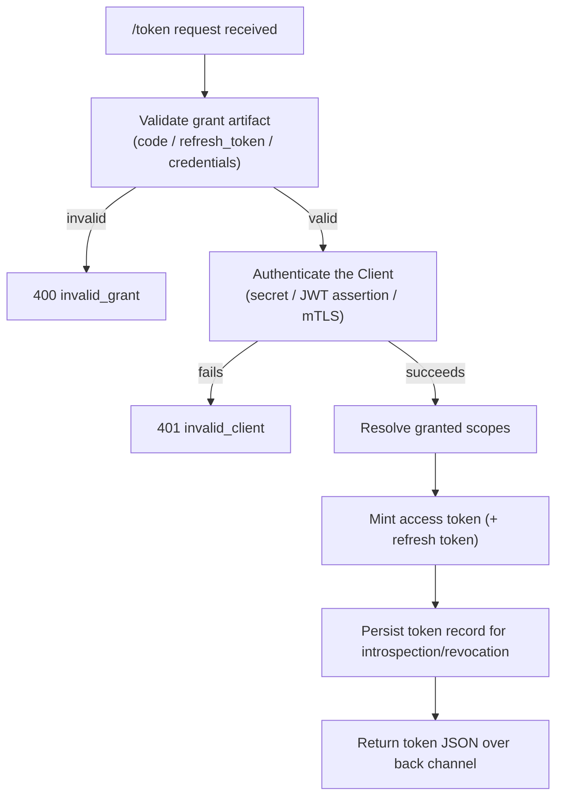

## 6. Design Principles

- **Least privilege by default.** Request and grant the narrowest scope set
  a feature actually needs; never request a broad scope "just in case a
  future feature needs it."
- **Confidential vs. public client honesty.** Classify every Client
  accurately at registration time — a Single Page Application or mobile app
  is a public client no matter how much its team wants to treat it as
  confidential; the classification must drive the grant type choice, not
  convenience.
- **Short-lived access, long-lived-but-rotated refresh.** Default to short
  access-token lifetimes (minutes) and rely on rotating refresh tokens for
  session longevity, rather than issuing long-lived access tokens to avoid
  implementing refresh logic.
- **Defense in depth on PKCE.** Apply PKCE even to confidential clients; it
  is cheap insurance against authorization-code interception regardless of
  whether a client secret also exists.
- **Design revocation in from day one.** Every integration must be
  independently revocable without affecting other integrations or requiring
  a password change — this is the entire point of the four-party model
  (Section 4.1).
- **Assume the Client is compromised eventually.** Architect scopes, token
  lifetimes, and revocation paths as if a Client's credentials *will*
  eventually leak — the question is how contained the damage is when that
  happens, not whether it happens.

## 7. Architecture Patterns

- **Backend-for-Frontend (BFF).** A server-side component sits between a
  browser-based Single Page Application and the Authorization Server,
  performing the Authorization Code + PKCE exchange itself and storing
  access/refresh tokens server-side (in a session store), issuing the
  browser only an httpOnly session cookie. This removes tokens from
  JavaScript-reachable storage entirely, closing the XSS-to-token-theft
  path described in Section 4.7, at the cost of an additional backend
  component to operate.
- **API Gateway token validation.** An API Gateway (see the forward
  reference in [Reverse Proxy](CH11_Reverse_Proxy.md) and the not-yet-
  drafted API Gateway chapter) terminates and validates access tokens at
  the edge — either via introspection calls or local signature
  verification — so that individual downstream microservices don't each
  need to reimplement token validation logic.
- **Token exchange for downstream service calls.** When Service A calls
  Service B on behalf of an authenticated user, rather than forwarding the
  original access token unchanged (which may carry broader scope than
  Service B needs, or may not even be intended for Service B's audience),
  a **token exchange** pattern (RFC 8693) mints a new, narrower-scoped
  token specific to the A-to-B call.
- **Central Authorization Server vs. per-domain Authorization Servers.**
  Large enterprises often run one central Authorization Server (an
  Identity Provider) that many internal and partner Resource Servers trust,
  versus smaller organizations sometimes running a single combined
  Authorization Server + Resource Server for a single product.

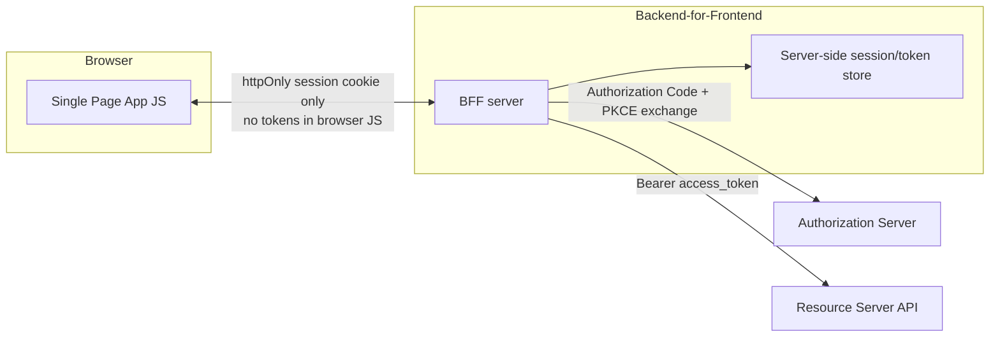

## 8. Production Architecture

A production OAuth deployment typically separates three concerns across
distinct network zones: a public-facing Authorization Server endpoint
(login/consent UI plus `/authorize` and `/token`), an internal-facing
introspection/revocation surface reachable only by trusted Resource
Servers, and the Resource Servers themselves sitting behind an API Gateway
that terminates TLS and performs the first layer of token validation.
Authorization Servers are almost always run as managed Identity Provider
platforms in production (Auth0, Okta, Azure AD/Entra ID, AWS Cognito,
Ping Identity/PingFederate — see the sibling [PingFederate
chapter](CH23_PingFederate.md) — or a self-hosted Keycloak instance) rather
than bespoke in-house implementations, because correctly implementing
token issuance, rotation, revocation, and the full breadth of security
mitigations described in this chapter is a substantial and easy-to-
get-subtly-wrong undertaking. The build-vs-buy calculus almost always favors
buy for the Authorization Server itself, reserving custom code for how
Resource Servers validate and enforce scopes.

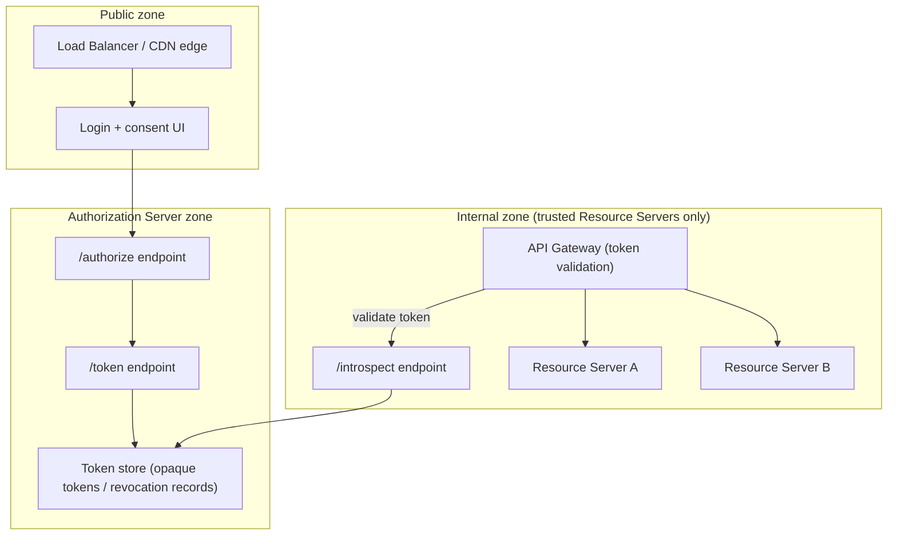

## 9. Implementation

Implementing OAuth correctly is less about writing cryptography from
scratch and more about correctly using a vetted library or platform SDK, and
getting the surrounding plumbing right: redirect URI allow-listing, `state`
verification, PKCE verifier generation and storage, token storage location,
and refresh-token rotation handling. The code examples in Section 10 show
these details concretely for the three flows this chapter emphasizes:
Authorization Code with PKCE, Client Credentials, and token refresh.

Key implementation checklist for a Client integration:

- Register an exact, non-wildcard `redirect_uri` with the Authorization
  Server; wildcard or overly permissive redirect URIs are a well-documented
  open-redirect and code-interception risk.
- Always generate a fresh, cryptographically random `state` value (and
  PKCE `code_verifier`) per authorization attempt — never reuse one across
  requests.
- Store tokens according to client type: server-side session store for
  confidential clients and BFFs; platform-provided secure storage (Keychain
  on iOS, Keystore on Android) for native apps; never `localStorage` for a
  browser-based public client's refresh token.
- Implement refresh-token rotation handling defensively: if a refresh
  attempt is rejected as "already used," treat that as a possible
  compromise signal and force full re-authentication rather than silently
  retrying.

## 10. Complete Code Examples

### 10.1 Authorization Code + PKCE — Node.js/Express client

```javascript
// server.js — confidential-ish Express client using Authorization Code + PKCE
const express = require("express");
const crypto = require("crypto");
const session = require("express-session");

const app = express();
app.use(session({ secret: process.env.SESSION_SECRET, resave: false, saveUninitialized: false }));

const AUTH_SERVER = "https://auth.example.com";
const CLIENT_ID = process.env.OAUTH_CLIENT_ID;
const CLIENT_SECRET = process.env.OAUTH_CLIENT_SECRET; // omit entirely for a public client
const REDIRECT_URI = "https://app.example.com/callback";

function base64url(buffer) {
  return buffer.toString("base64").replace(/\+/g, "-").replace(/\//g, "_").replace(/=+$/, "");
}

app.get("/login", (req, res) => {
  const state = base64url(crypto.randomBytes(32));
  const codeVerifier = base64url(crypto.randomBytes(32));
  const codeChallenge = base64url(crypto.createHash("sha256").update(codeVerifier).digest());

  // Persist per-flow secrets server-side, never in a client-readable cookie
  req.session.oauthState = state;
  req.session.codeVerifier = codeVerifier;

  const authUrl = new URL(`${AUTH_SERVER}/authorize`);
  authUrl.searchParams.set("response_type", "code");
  authUrl.searchParams.set("client_id", CLIENT_ID);
  authUrl.searchParams.set("redirect_uri", REDIRECT_URI);
  authUrl.searchParams.set("scope", "calendar.read orders.read");
  authUrl.searchParams.set("state", state);
  authUrl.searchParams.set("code_challenge", codeChallenge);
  authUrl.searchParams.set("code_challenge_method", "S256");

  res.redirect(authUrl.toString());
});

app.get("/callback", async (req, res) => {
  const { code, state } = req.query;

  // Reject immediately if state doesn't match — anti-CSRF login mix-up defense
  if (!state || state !== req.session.oauthState) {
    return res.status(400).send("Invalid state parameter");
  }

  const tokenResponse = await fetch(`${AUTH_SERVER}/token`, {
    method: "POST",
    headers: { "Content-Type": "application/x-www-form-urlencoded" },
    body: new URLSearchParams({
      grant_type: "authorization_code",
      code: String(code),
      redirect_uri: REDIRECT_URI,
      client_id: CLIENT_ID,
      client_secret: CLIENT_SECRET, // omit for a true public client relying on PKCE alone
      code_verifier: req.session.codeVerifier,
    }),
  });

  if (!tokenResponse.ok) {
    return res.status(400).send("Token exchange failed");
  }

  const tokens = await tokenResponse.json();
  // Store tokens server-side only — never forward them to browser JavaScript
  req.session.accessToken = tokens.access_token;
  req.session.refreshToken = tokens.refresh_token;
  req.session.accessTokenExpiresAt = Date.now() + tokens.expires_in * 1000;

  delete req.session.oauthState;
  delete req.session.codeVerifier;

  res.redirect("/dashboard");
});

app.listen(3000);
```

### 10.2 Client Credentials — Python/FastAPI machine-to-machine caller

```python
# m2m_client.py — a backend service authenticating to a partner API via
# Client Credentials, with in-memory token caching to avoid refetching per call.
import time
import httpx

AUTH_SERVER = "https://auth.example.com"
CLIENT_ID = "billing-service"
CLIENT_SECRET = "REDACTED"  # load from a secret manager, never hardcode in source
SCOPE = "reports.read"

_token_cache: dict = {"access_token": None, "expires_at": 0}


async def get_access_token() -> str:
    if _token_cache["access_token"] and time.time() < _token_cache["expires_at"] - 30:
        return _token_cache["access_token"]

    async with httpx.AsyncClient() as client:
        response = await client.post(
            f"{AUTH_SERVER}/token",
            data={
                "grant_type": "client_credentials",
                "client_id": CLIENT_ID,
                "client_secret": CLIENT_SECRET,
                "scope": SCOPE,
            },
        )
        response.raise_for_status()
        payload = response.json()

    _token_cache["access_token"] = payload["access_token"]
    _token_cache["expires_at"] = time.time() + payload["expires_in"]
    return _token_cache["access_token"]


async def fetch_reports() -> dict:
    token = await get_access_token()
    async with httpx.AsyncClient() as client:
        response = await client.get(
            "https://api.partner.example.com/reports",
            headers={"Authorization": f"Bearer {token}"},
        )
        response.raise_for_status()
        return response.json()
```

### 10.3 Token Refresh — Java 21 refresh-with-rotation handling

```java
// TokenRefreshService.java — refresh handling with rotation-reuse detection.
public final class TokenRefreshService {

    private final HttpClient http = HttpClient.newHttpClient();
    private final String tokenEndpoint;
    private final String clientId;
    private final String clientSecret;

    public TokenRefreshService(String tokenEndpoint, String clientId, String clientSecret) {
        this.tokenEndpoint = tokenEndpoint;
        this.clientId = clientId;
        this.clientSecret = clientSecret;
    }

    public TokenPair refresh(String currentRefreshToken) throws IOException, InterruptedException {
        var form = "grant_type=refresh_token"
                + "&refresh_token=" + URLEncoder.encode(currentRefreshToken, StandardCharsets.UTF_8)
                + "&client_id=" + URLEncoder.encode(clientId, StandardCharsets.UTF_8)
                + "&client_secret=" + URLEncoder.encode(clientSecret, StandardCharsets.UTF_8);

        var request = HttpRequest.newBuilder(URI.create(tokenEndpoint))
                .header("Content-Type", "application/x-www-form-urlencoded")
                .POST(HttpRequest.BodyPublishers.ofString(form))
                .build();

        var response = http.send(request, HttpResponse.BodyHandlers.ofString());

        if (response.statusCode() == 400) {
            // A previously-rotated-out refresh token being replayed is a strong
            // compromise signal — force full re-authentication, don't retry silently.
            throw new ReuseDetectedException(
                "Refresh token rejected — possible token theft, forcing re-login");
        }
        if (response.statusCode() != 200) {
            throw new IOException("Unexpected token refresh failure: " + response.statusCode());
        }

        // Parsing omitted for brevity — extract access_token, refresh_token, expires_in
        return TokenPair.fromJson(response.body());
    }

    public record TokenPair(String accessToken, String refreshToken, long expiresInSeconds) {
        static TokenPair fromJson(String body) {
            // JSON parsing library call goes here
            throw new UnsupportedOperationException("implement with your JSON library of choice");
        }
    }

    public static final class ReuseDetectedException extends RuntimeException {
        public ReuseDetectedException(String message) { super(message); }
    }
}
```

## 11. Performance

- **Token validation strategy dominates latency.** Introspection-per-
  request (Section 4.9) adds a network round trip to the Authorization
  Server on every protected call; locally-validated signed tokens avoid
  that round trip entirely but require the Authorization Server's signing
  keys to be cached and rotated correctly at each Resource Server (see the
  [JWT chapter](CH21_JWT.md) for key-rotation mechanics).
  Under high request volume, this single decision often has more impact on
  p99 latency than any other OAuth-related architecture choice.
  - Mitigation: cache introspection results for a short Time-To-Live (TTL)
    (seconds, not minutes) to blend the two approaches — most of the
    latency benefit of local validation with a bounded revocation-detection
    delay.
- **Authorization Server as a shared dependency.** A centrally-shared
  Authorization Server becomes a single point of contention under load;
  size its `/token` endpoint capacity for the aggregate refresh-token churn
  of every Client, not just steady-state login traffic, especially right
  after a short access-token lifetime change increases refresh frequency
  fleet-wide.
- **Connection reuse for back-channel calls.** The Client's `/token`
  exchange and any introspection calls are server-to-server HTTP requests —
  reuse persistent HTTP connection pools (HTTP/1.1 keep-alive or HTTP/2
  multiplexing, see [HTTP/2](CH04_HTTP2.md)) rather than opening a new TLS
  handshake per token operation.

## 12. Scalability

- **Horizontally scale the Authorization Server statelessly where possible**,
  backing token state (issued tokens, revocation records, rotation
  lineage) in a shared, replicated store (a distributed cache or database)
  rather than in-process memory, so any Authorization Server instance can
  serve any request.
- **Partition introspection load** by placing a short-TTL cache (Section 11)
  in front of the Authorization Server at each Resource Server or API
  Gateway instance, turning what would be N-times-per-request calls across
  a large Resource Server fleet into a much smaller number of actual
  Authorization Server hits.
- **Scope token stores by tenant** in multi-tenant Software-as-a-Service
  (SaaS) deployments so that one tenant's token issuance volume spike
  (e.g. a partner's bulk M2M job) cannot degrade token issuance latency for
  unrelated tenants sharing the same Authorization Server.

## 13. Security

- **Always enforce TLS everywhere** — OAuth 2.0's entire security model
  assumes an encrypted channel; a Bearer Token (Section 2) sent over plain
  HTTP is trivially stolen by anyone on the network path.
- **Validate `redirect_uri` with exact string matching**, not prefix or
  substring matching — a permissive redirect URI check is one of the most
  common real-world OAuth implementation vulnerabilities, letting an
  attacker redirect an authorization code or token to a domain they control.
- **Always verify `state`** (Section 4.3) and always use PKCE (Section 4.4)
  even for confidential clients.
- **Never log access tokens or refresh tokens** in application or access
  logs, error-tracking tools, or analytics events — treat them as secrets
  equivalent to passwords for logging purposes.
- **Bind tokens to their intended audience** where the platform supports it
  (the `aud` claim in a signed token, or an audience check in introspection)
  so a token minted for one Resource Server cannot be replayed against a
  different one.
- **Rotate refresh tokens on every use** (Section 4.7) and treat reuse of an
  already-rotated token as an active compromise signal, not a benign retry.

## 14. Observability

- **Instrument every stage of the flow**: authorization requests issued,
  consent approved/denied, codes exchanged, refresh attempts (success,
  failure, and specifically reuse-detected failures), and revocation
  events — each as a distinct, queryable metric and structured log event.
- **Alert on anomalous refresh-reuse-detected spikes** — a sudden increase
  in rotated-refresh-token-reuse detections across many users can indicate
  a systemic token-theft campaign (e.g. a compromised Client or a malicious
  browser extension harvesting tokens), not isolated incidents.
- **Track per-Client token issuance and scope-grant rates** to catch a
  Client silently requesting broader scopes than its registered baseline, or
  issuance volume far exceeding its expected user base (a sign of
  credential-stuffing against the authorization endpoint or a compromised
  `client_secret` being used by an attacker).
- **Correlate Authorization Server logs with downstream Resource Server
  logs** using a token identifier (not the token value itself) so a
  security investigation can trace "this specific grant" end to end without
  ever needing to log the sensitive token value.

## 15. Failure Scenarios

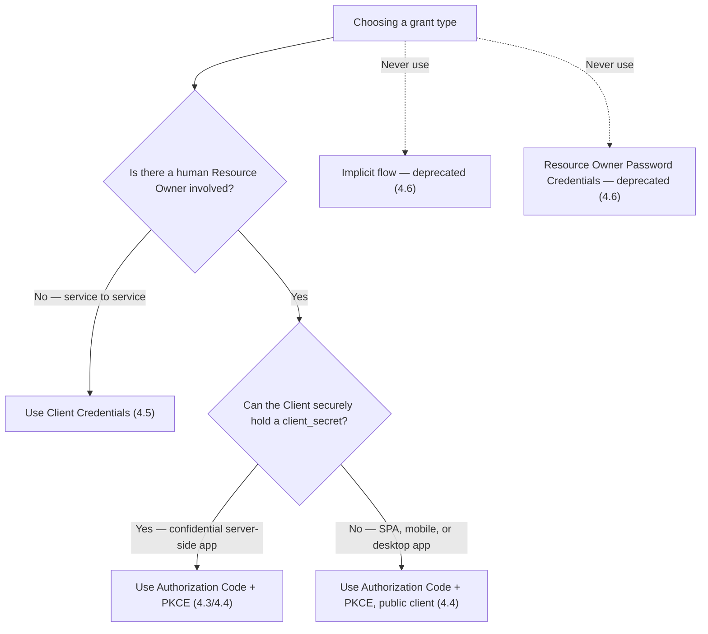

- **Authorization Server outage.** If the Authorization Server's `/token`
  endpoint is unavailable, Clients cannot exchange codes or refresh tokens —
  already-issued access tokens continue to work (if validated locally) or
  fail (if introspection-dependent) until they expire. Architect the
  Authorization Server's availability requirements accordingly (it is a
  systemic single point of failure for the whole platform).
- **Clock skew between Client and Authorization Server.** Token expiry
  checks depend on synchronized clocks; significant skew can cause
  premature "expired token" rejections or, worse, acceptance of a token
  past its intended lifetime. Use Network Time Protocol (NTP)-synchronized
  infrastructure clocks.
- **Redirect URI mismatch after a deployment change.** A Client
  redeploying to a new domain without updating its registered
  `redirect_uri` fails every login attempt at the `/authorize` step —
  treat redirect URI registration as part of the deployment change
  checklist, not a one-time setup task.
- **Refresh token exhaustion / silent lockout.** If rotation-reuse
  detection (Section 4.7) is too aggressive (e.g. triggered by benign
  network retries resending the same refresh request), legitimate users can
  be forced into unexpected re-authentication loops — make retry-safety in
  Client code (idempotent refresh handling, avoiding duplicate concurrent
  refresh calls) part of the design, not just the Authorization Server's
  detection logic.

## 16. Testing

- **Unit test PKCE verifier/challenge generation** independently of the
  network flow — verify the challenge is correctly derived via SHA-256 and
  base64url-encoded without padding.
- **Integration test the full Authorization Code + PKCE round trip** against
  a real or sandboxed Authorization Server (most Identity Providers offer a
  developer/sandbox tenant), asserting `state` mismatch is rejected and an
  expired/reused code is rejected.
- **Test refresh-token rotation reuse detection explicitly**: perform two
  concurrent refresh attempts with the same refresh token and assert the
  second is rejected and treated as a compromise signal, not silently
  retried.
- **Test scope enforcement at the Resource Server**, not just at the
  consent screen — request a token with a narrow scope and assert that
  calls to endpoints requiring a broader scope are rejected with
  `403 Forbidden` / `insufficient_scope`.
- **Load-test the token endpoint's refresh path specifically** — refresh
  traffic scales with active-session count and access-token lifetime, and
  is easy to under-provision for if only login-flow traffic was modeled.

## 17. Common Mistakes

- Treating the Implicit flow or Resource Owner Password Credentials flow
  as acceptable "because it's simpler" for a new application (Section 4.6).
- Skipping `state` validation "because the demo works without it."
- Storing refresh tokens in browser `localStorage` for a Single Page
  Application instead of using a BFF (Section 7).
- Using OAuth alone (no OIDC, no ID Token) to implement "Sign in with X" and
  calling that "authentication" (Section 4.10).
- Requesting overly broad scopes "in case we need them later," inflating
  the blast radius of a future token compromise.
- Hardcoding `client_secret` values in mobile app binaries or public
  repositories — a "confidential" client secret embedded in a distributed
  binary is not actually confidential.
- Assuming a revoked token is instantly unusable everywhere when using
  locally-validated signed tokens without a denylist mechanism (Section
  4.9).

## 18. Best Practices

- Default every new Client integration to Authorization Code + PKCE,
  regardless of whether the Client is confidential or public.
- Register exact-match redirect URIs; never use wildcards.
- Keep access tokens short-lived (minutes) and rely on rotating refresh
  tokens for session longevity.
- Use a Backend-for-Frontend for browser-based Single Page Applications
  handling anything beyond read-only, low-sensitivity scopes.
- Design a real scope taxonomy up front (least-privilege, one scope per
  meaningfully distinct permission) rather than ad hoc scope names added
  reactively per feature.
- Prefer buying a managed Authorization Server/Identity Provider platform
  over building one in-house, reserving engineering effort for correct
  Resource Server-side enforcement instead.
- Instrument refresh-reuse detection and alert on it as a security signal,
  not just a debugging curiosity.

## 19. Anti-Patterns

- **"OAuth for login" without OIDC** — using a successful authorization as
  a stand-in for authentication (Section 4.10); use OIDC instead.
- **The "just use Implicit, it's simpler" regression** — reintroducing a
  deprecated flow for a new Single Page Application because a tutorial or
  legacy internal template still references it (Section 4.6); check
  whether the reference material predates 2019-2020 security guidance.
- **All-or-nothing scope design** — a single `full_access` scope covering
  every permission, defeating the granularity OAuth exists to provide
  (Section 4.8).
- **Client-secret-in-the-binary** — embedding a `client_secret` in a
  distributed mobile app or public JavaScript bundle and calling the client
  "confidential" anyway.
- **Token forwarding without re-scoping** — passing a user's original,
  broadly-scoped access token unchanged to every downstream microservice
  instead of using token exchange (Section 7) to mint narrower, per-hop
  tokens.

## 20. Trade-off Analysis

| Decision | Option A | Option B | Trade-off |
|---|---|---|---|
| Token validation | Introspection per request | Local signature validation | Immediate revocation vs. lower latency/higher throughput |
| Refresh token storage (browser) | Backend-for-Frontend, server-side | Directly in the Single Page Application | Stronger XSS containment vs. simpler architecture |
| Client secret rotation | Static long-lived secret | Signed JWT assertion / mTLS | Operational simplicity vs. stronger, self-expiring proof of identity |
| Access token lifetime | Longer-lived (hours) | Short-lived (minutes) + refresh | Fewer refresh calls vs. smaller stolen-token exposure window |
| Authorization Server | Build in-house | Managed Identity Provider (Auth0/Okta/Entra ID/Cognito/Keycloak) | Full control vs. dramatically lower implementation-risk and maintenance cost |

## 21. Comparison Table

| Grant Type | Requires Resource Owner? | Client type | Status |
|---|---|---|---|
| Authorization Code + PKCE | Yes | Confidential or public | Recommended default for every client type |
| Client Credentials | No (machine-to-machine) | Confidential (service identity) | Recommended for M2M |
| Implicit | Yes | Public (legacy SPA) | Deprecated — do not use for new applications |
| Resource Owner Password Credentials | Yes (direct password) | First-party trusted only | Deprecated — do not use for new applications |
| Device Authorization Grant (RFC 8628, referenced only) | Yes | Input-constrained devices (Smart TVs, CLIs) | Acceptable niche use, not covered in depth in this chapter |

## 22. Real-World Case Study

A mid-size SaaS company integrated with a partner ecosystem of roughly forty
third-party applications that each needed access to a subset of customer
data (orders, shipping addresses, support tickets). The original
implementation issued each partner a single, broadly-scoped API key with no
expiration — functionally equivalent to a shared password. After a single
partner's key leaked via a misconfigured logging pipeline, the security team
discovered they had no way to know which customers' data had actually been
accessed through that key, because the key carried no per-customer
delegation record at all — every access looked identical regardless of
which end customer had (or hadn't) actually consented.

The remediation migrated all forty partner integrations to OAuth 2.0
Authorization Code with PKCE for customer-delegated access (a customer
explicitly authorizes "Partner X can read my orders") and Client Credentials
for the small number of genuinely partner-owned, non-customer-specific
batch jobs. This gave the security team three capabilities they didn't have
before: per-customer, per-partner revocation ("disconnect just this one
partner for just this one customer"), a real audit trail (which customer
consented to which scope, when, and every subsequent token refresh), and
scope-limited blast radius (a leaked token for one partner integration could
only expose the scopes that specific integration had been granted, not the
entire customer dataset). The migration also retired several long-lived,
never-expiring API keys that predated any formal review process — a
direct instance of the "assume the Client is compromised eventually"
design principle from Section 6 paying off in an actual incident response.

## 23. Interview Questions

1. Explain the four OAuth 2.0 roles and why collapsing the Authorization
   Server and Resource Server into a single mental "backend" box is a
   modeling mistake.
2. Walk through the Authorization Code flow step by step, including exactly
   where `state` and the authorization code each appear, and explain why
   the access token itself never appears in the browser.
3. What problem does PKCE solve, and why is it now recommended even for
   confidential clients?
4. Why are the Implicit flow and Resource Owner Password Credentials flow
   deprecated? What changed in the ecosystem that made the original
   justification for each obsolete?
5. Why does OAuth 2.0 split tokens into short-lived access tokens and
   longer-lived, rotatable refresh tokens instead of issuing one long-lived
   token?
6. What is the architectural trade-off between token introspection and
   local signature validation?
7. Explain precisely why "the user completed an OAuth flow successfully"
   is not the same as "the user is authenticated," and what OIDC adds to
   close that gap.
8. How would you design a scope taxonomy for a new multi-tenant SaaS API
   from scratch?

## 24. Hands-on Exercises

1. Register a test application with a free-tier Identity Provider sandbox
   (e.g. Auth0, Okta developer tenant, or a local Keycloak instance) and
   implement the Authorization Code + PKCE flow end to end, verifying that
   `state` mismatch and PKCE verifier mismatch are both correctly rejected.
2. Implement a Client Credentials integration against the same sandbox and
   confirm the issued token's scope matches only what was requested for
   that service identity.
3. Deliberately capture and replay a rotated-out refresh token against your
   test Authorization Server and confirm rotation-reuse detection triggers.
4. Build a minimal Backend-for-Frontend that keeps tokens server-side and
   issues the browser only an httpOnly session cookie; verify via browser
   developer tools that no token value is ever visible to page JavaScript.

## 25. Design Exercises

1. Design the token-validation architecture (introspection vs. local
   signature validation, or a hybrid with short-TTL caching) for a Resource
   Server fleet handling 50,000 requests per second, and justify your
   latency/revocation-freshness trade-off explicitly.
2. Design a scope taxonomy and consent-screen experience for a project-
   management SaaS product exposing an integrations marketplace with at
   least five distinct third-party integration categories.
3. Design the token-exchange (Section 7) architecture for a five-service
   internal call chain, where the originating user's access token must
   never be forwarded unchanged past the first hop.
4. Design a migration plan to retire a legacy Implicit-flow Single Page
   Application to Authorization Code + PKCE without a breaking change for
   existing logged-in users.

## 26. Architecture Review Questions

1. Does every Client in this system have an accurate confidential-vs-public
   classification driving its grant type choice?
2. Is PKCE enforced for every Authorization Code flow, including
   confidential clients?
3. Where are refresh tokens stored for each Client type, and is that
   storage location appropriate for that Client's trust boundary?
4. Is `redirect_uri` validated with exact-match semantics everywhere, with
   no wildcard or prefix matching?
5. What is this system's token-revocation propagation delay, and is it
   documented and acceptable for the sensitivity of the scopes involved?
6. Is any component in this system using OAuth alone (without OIDC) as a
   substitute for authentication?
7. Are access tokens and refresh tokens excluded from every logging,
   analytics, and error-tracking pipeline?

## 27. Summary

OAuth 2.0 exists to solve one precise architectural problem: letting a
Resource Owner delegate limited, revocable, auditable access to a Client
application without ever disclosing their actual credentials — the "valet
key," not the master key. Its four-party model (Resource Owner, Client,
Authorization Server, Resource Server) separates authentication-and-consent
from resource-serving, enabling scoped, time-boxed, independently revocable
access grants. The Authorization Code flow, extended with PKCE for every
client type, is the current, universally-recommended way to obtain that
access for human-delegated scenarios; Client Credentials serves the
equivalent machine-to-machine case. The industry's retirement of the
Implicit and Resource Owner Password Credentials flows is a case study in a
standard's guidance evolving as the ecosystem's constraints (browser
capabilities, attack research) evolved with it — a lesson worth carrying
into any other long-lived standard an architect works with. The access-
token/refresh-token split and rotation architecture trades a small amount
of implementation complexity for a materially smaller blast radius when a
token inevitably leaks somewhere in a distributed system. Scopes make
least-privilege access an enforceable, auditable mechanism rather than an
aspiration. And critically, OAuth 2.0 is an authorization framework, full
stop — treating a successful authorization as proof of identity is the most
common and most consequential mistake made with this protocol; that gap is
exactly what the sibling [OIDC chapter](CH20_OIDC.md) closes, and it is the
next chapter to read after this one.

## Further Reading

- [HTTP](CH01_HTTP.md) — transport-level vocabulary and the TLS handshake
  this chapter's Bearer Token model depends on.
- [TLS](CH06_TLS.md) — full handshake mechanics underpinning every OAuth
  back-channel and browser redirect exchange.
- [OIDC (OpenID Connect)](CH20_OIDC.md) — the identity/authentication layer
  built directly on top of the Authorization Code flow taught here.
- [JWT (JSON Web Token)](CH21_JWT.md) — the token format most commonly used
  to encode signed, self-contained access and ID Tokens.
- [PingFederate](CH23_PingFederate.md) — a production Identity Provider
  implementing the Authorization Server role described in Sections 8 and
  20 of this chapter.
- [Reverse Proxy](CH11_Reverse_Proxy.md) — API Gateway token-validation
  placement referenced in Section 7.
