# Chapter 20: OIDC (OpenID Connect)

## 1. Introduction

OIDC (OpenID Connect) is an identity layer built directly on top of OAuth
2.0. Where OAuth 2.0 answers "what is this application allowed to do on my
behalf?", OIDC answers a question OAuth 2.0 was never designed to answer:
"who is this user, and how do I know the answer is trustworthy?" This
distinction sounds academic until you have debugged a production incident
caused by treating an OAuth 2.0 access token as proof of identity — a
mistake so common in the 2012-2014 window that it is the entire reason OIDC
exists.

This chapter assumes you have read [OAuth](CH19_OAuth.md), which owns the
full mechanics of the Authorization Code flow, PKCE (Proof Key for Code
Exchange), the Client Credentials flow, the roles (Resource Owner, Client,
Authorization Server, Resource Server), and the access/refresh token
lifecycle. This chapter does not re-derive any of that. Instead, it treats
OAuth 2.0 as a load-bearing foundation and asks precisely: what does OIDC
add on top of it, why was that addition necessary, and what does a Solution
Architect need to know to design authentication (not authorization) systems
correctly?

The three things OIDC adds, in one sentence each, previewed here and taught
in full depth in Section 4:

- **The ID Token** — a signed JWT (JSON Web Token) that asserts "this
  specific user authenticated, at this time, using this method" — something
  no OAuth 2.0 token format guarantees.
- **Standardized discovery and claims** — a `/.well-known/openid-configuration`
  document and a fixed vocabulary of identity claims (`sub`, `iss`, `aud`,
  `exp`, `iat`, and more), so any compliant client can integrate with any
  compliant IdP (Identity Provider) without bespoke, vendor-specific glue
  code.
- **A standardized UserInfo endpoint** — one predictable place to fetch
  additional profile data about the authenticated user, decoupled from
  whatever the ID token itself carries.

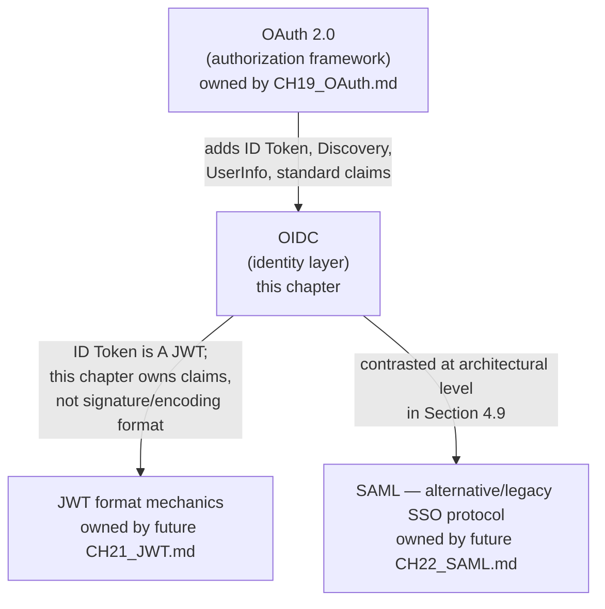

By the end of this chapter you will be able to explain, precisely and
without hand-waving, why "we use OAuth for login" is an architecturally
dangerous sentence, how an ID token differs from an access token in both
format and intended audience, how OIDC discovery lets a client dynamically
configure itself against any IdP without hardcoding endpoints, and why
"logging a user out" is a genuinely hard distributed-systems problem the
moment more than one relying party is involved.

## 2. Historical Evolution

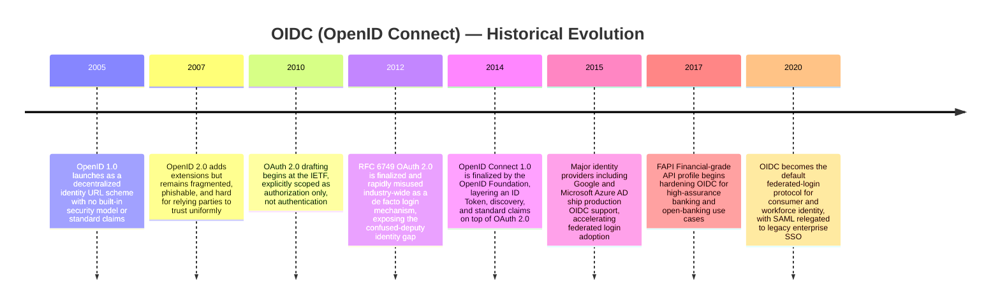

- **2005 — OpenID 1.0**: a decentralized identity scheme where a user
  proved ownership of a URL (for example `alice.example.com`) to log into
  third-party sites. It had no standardized cryptographic trust model, no
  discovery mechanism beyond scraping HTML, and was highly susceptible to
  phishing because the login redirect flow was inconsistent across
  providers.
- **2007 — OpenID 2.0**: added extensions (attribute exchange, provider
  discovery via XRDS documents) but remained fragmented — every provider
  implemented the extensions slightly differently, and adoption stayed
  largely confined to blogging platforms and niche communities. It never
  achieved the trust and interoperability enterprises needed.
- **2010-2012 — OAuth 2.0 is drafted and finalized (RFC 6749)**, explicitly
  and repeatedly in its own text scoped as an *authorization* framework: it
  lets a Client obtain a token to access a Resource Owner's data on a
  Resource Server, full stop. The specification says nothing about how the
  Resource Owner authenticated, what identity claims mean, or how a Client
  should interpret a token as proof of "who." Despite this, because OAuth
  2.0 already had a working redirect-based consent flow, thousands of
  applications simply built "Login with Google/Facebook" by having their
  backend treat "we received a valid access token" as "the user is
  logged in." This is the **OAuth-as-login anti-pattern**, and it created a
  genuine security gap: an access token proves the bearer can call an API on
  the user's behalf; it does not prove that the specific token issued to
  *your* application actually represents the user your application thinks
  it does, and a malicious client that captured a token issued for a
  different resource could sometimes be tricked into accepting it as login
  proof (a class of vulnerability now generally called the **confused
  deputy problem** in the OAuth-as-login context).
- **2014 — OpenID Connect 1.0 is finalized** by the OpenID Foundation as a
  formal specification suite (Core, Discovery, Dynamic Registration,
  Session Management) built as a strict superset of OAuth 2.0's Authorization
  Code and Implicit flows. It fixes the ambiguity by defining exactly one
  new artifact — the ID Token — whose entire purpose is to be an
  authentication assertion, cryptographically bound to a specific Client via
  the `aud` (audience) claim, so it cannot be silently reused across
  applications the way an access token sometimes could.
- **2015 onward — rapid production adoption**: Google, Microsoft (Azure AD,
  now Microsoft Entra ID), Okta, Auth0, Ping Identity, and effectively every
  major IdP shipped OIDC support, because the specification's discovery
  document and JWKS (JSON Web Key Set) mechanism (Section 4.4-4.5) meant a
  client library could be written once and pointed at *any* compliant
  provider — a level of interoperability OpenID 1.0/2.0 never achieved.
- **2017 — FAPI (Financial-grade API)** working group publishes hardened
  OIDC profiles for banking-grade security (mandatory PKCE, signed request
  objects, stricter redirect URI validation), demonstrating OIDC's
  extensibility for high-assurance use cases beyond simple social login.
- **2020s — OIDC is now the default answer** for both consumer identity
  ("Sign in with Google/Apple/Microsoft") and workforce identity (enterprise
  Single Sign-On via an IdP such as Okta or Entra ID), with SAML increasingly
  confined to legacy enterprise integrations that predate OIDC's dominance —
  contrasted at the architectural level in Section 4.9, full SAML mechanics
  owned by the future [SAML](CH22_SAML.md) chapter.

## 3. Why It Exists

OIDC exists to close a specific, well-documented gap: **OAuth 2.0 has no
concept of authentication, and treating it as one is unsafe.** To see why,
consider what an OAuth 2.0 access token actually is, per [OAuth
Section 4](CH19_OAuth.md#4-core-concepts): an opaque or structured
credential that authorizes bearer access to a Resource Server's API,
typically scoped ("read:calendar", "write:contacts") to specific
permissions. Nothing in the OAuth 2.0 specification requires an access
token to:

1. Identify *which* user it was issued for, in a standardized, parseable
   way.
2. Assert that the user actually authenticated (as opposed to a
   long-lived, silently-refreshed token being reused without the user
   present).
3. Be scoped to a specific Client such that Client A cannot be tricked into
   accepting a token that was actually issued to Client B.
4. Carry a standard, cross-provider vocabulary of who the user is (a
   verified email address, a display name, a stable subject identifier).

Every one of these gaps is exactly what OIDC's ID Token closes. This is not
a stylistic preference — it maps to a concrete threat model.

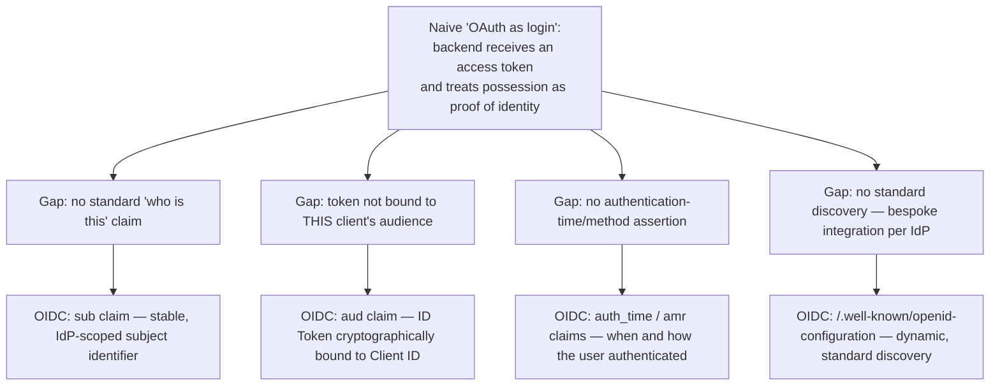

A useful heuristic for a Solution Architect: **if a system needs to answer
"who is logged in right now, and can I trust that claim enough to render
their name, personalize content, or make an authorization decision that
depends on identity," that system needs OIDC's ID Token — an OAuth 2.0
access token alone is the wrong tool, because its entire contract is about
API access, not identity assertion.** Conversely, if a system only needs
"can this caller invoke this API with these permissions," plain OAuth 2.0
(without OIDC) remains the correct, sufficient tool — machine-to-machine
Client Credentials flows, for example, have no user to authenticate and
correctly skip OIDC entirely.

OIDC also exists for a second, equally important architectural reason:
**federated identity interoperability**. Before OIDC's discovery mechanism,
integrating with a new IdP meant reading that provider's bespoke API docs
and writing custom glue code. OIDC's promise — and largely delivered reality
— is that a single, standards-compliant OIDC client library can authenticate
against Google, Microsoft, Okta, Auth0, or a self-hosted Keycloak instance
with configuration changes only, not code changes. This is why "Sign in
with Google," enterprise Single Sign-On (Section 4.8), and per-tenant
identity federation in B2B SaaS (Software as a Service) products are all
built on the same protocol.

## 4. Core Concepts

### 4.1 The Architectural Relationship: OIDC = OAuth 2.0 + a Standardized Identity Layer

The single most important mental model in this chapter: **OIDC does not
replace OAuth 2.0, and it is not a competing protocol — it is OAuth 2.0,
unmodified at the transport/flow level, with three additions bolted on
top.** Every OIDC exchange is, underneath, a normal OAuth 2.0 Authorization
Code flow (or, less commonly today, Implicit or Hybrid flow) — the
redirect to the Authorization Server, the user consent screen, the
authorization code, the token exchange at the Token Endpoint, all of it is
exactly what [OAuth Section 4](CH19_OAuth.md#4-core-concepts) already
teaches. OIDC's contribution is entirely additive:

| OAuth 2.0 alone | OAuth 2.0 + OIDC |
|---|---|
| `scope=read:contacts write:contacts` | `scope=openid profile email` — the literal string `openid` is the trigger that tells the Authorization Server "also act as an OpenID Provider and issue an ID Token" |
| Token response: `access_token`, `token_type`, `expires_in`, optional `refresh_token` | Token response adds: `id_token` — the new artifact |
| Access token format: unspecified by OAuth 2.0 (opaque string or JWT, client's choice) | ID Token format: mandated — always a signed JWT with a fixed claim set |
| No standard "who is the user" endpoint | Standardized UserInfo Endpoint (Section 4.3) |
| No standard way to discover an Authorization Server's endpoints/keys | Standardized Discovery document + JWKS (Sections 4.4-4.5) |

Architecturally, this means a Solution Architect evaluating "should we use
OAuth or OIDC" is usually asking the wrong question — the real question is
"does this integration need user authentication (use OIDC, which includes
OAuth 2.0's authorization machinery for free) or purely machine-to-machine
authorization (use plain OAuth 2.0, typically Client Credentials, and skip
OIDC because there is no user to authenticate)." The `openid` scope is the
literal on/off switch between the two modes when talking to the same
Authorization Server, which in the OIDC context is more precisely called
an **OpenID Provider (OP)** — the IdP role — while the application
consuming the identity assertion is called a **Relying Party (RP)**,
mapping directly onto OAuth 2.0's Client role.

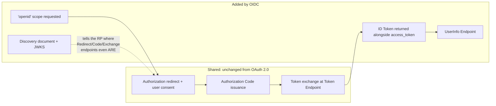

### 4.2 The ID Token: OIDC's Core Contribution

The ID Token is a JWT (JSON Web Token — a compact, URL-safe, digitally
signed JSON structure; full encoding/signing mechanics are owned by the
future [JWT](CH21_JWT.md) chapter and only recapped here) whose entire
purpose is to be a **verifiable authentication assertion**: a signed
statement from the OpenID Provider saying "this specific user, identified
by this subject identifier, authenticated at this time, for this specific
Relying Party." This chapter owns the ID Token's specific claim semantics
and architectural role — not the JWT container format itself (base64url
encoding, the three-part header/payload/signature structure, JWS versus
JWE) — that mechanical detail is recapped in one sentence and linked
forward.

The claims a Solution Architect must understand, because they are the
actual security-relevant contract of the token:

| Claim | Meaning | Why it matters architecturally |
|---|---|---|
| `iss` (issuer) | The OpenID Provider's canonical URL, e.g. `https://accounts.example.com` | The RP must verify this matches the exact issuer it expects — accepting an ID token from an unexpected issuer is a spoofing risk |
| `sub` (subject) | A stable, unique identifier for the user, scoped to this issuer | This — not email — is the correct primary key for "who is this user" in your database, because email addresses can be reassigned or changed |
| `aud` (audience) | The Client ID(s) this token was issued for | The RP MUST reject any ID token whose `aud` does not include its own Client ID — this is exactly the "bound to a specific client" fix described in Section 3 |
| `exp` (expiration) | Unix timestamp after which the token is no longer valid | Bounds the window during which a leaked/replayed ID token remains dangerous |
| `iat` (issued at) | Unix timestamp of token issuance | Used for clock-skew-tolerant freshness checks and detecting unreasonably old tokens |
| `auth_time` | Unix timestamp of the user's actual authentication event | Distinct from `iat` — lets an RP enforce "re-authenticate if login was more than N minutes ago" for step-up authentication |
| `nonce` | A value the RP generated and sent in the original request | The RP must verify this matches, which prevents replay of an ID token obtained via a different, unrelated authentication request |
| `amr` (authentication methods reference) | Which methods were used (e.g. `["pwd", "otp"]`) | Lets an RP make policy decisions like "require MFA (Multi-Factor Authentication) claim present before allowing a sensitive action" |

The most consequential architectural distinction in this entire chapter is
**ID token versus access token**, and conflating them is the single most
common OIDC implementation mistake:

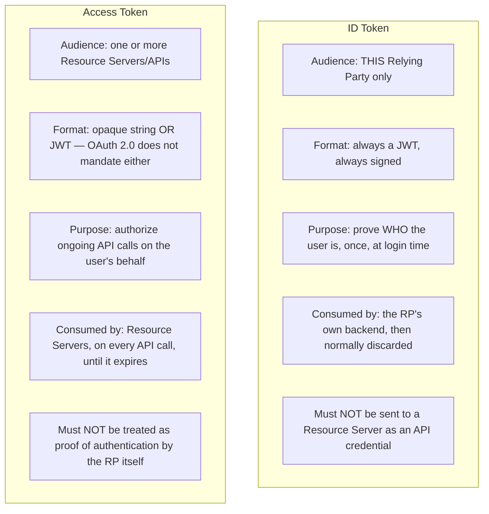

A production failure mode worth naming explicitly: a backend that
authenticates a user by validating the ID token, then continues sending
that same ID token as a bearer credential to downstream microservices
instead of using the access token, has reintroduced exactly the ambiguity
OIDC was designed to eliminate — because the ID token's `aud` claim asserts
it was issued only for the original RP, and any downstream service that
naively accepts it as an API credential is trusting an assertion that was
never meant for it.

### 4.3 The UserInfo Endpoint

The ID token is intentionally kept small — it is transmitted on every
login and, per Section 4.2, is meant to be validated once and then
discarded, so IdPs generally avoid stuffing large amounts of profile data
into it. When an RP needs additional identity data beyond the ID token's
core claims (a profile picture URL, a phone number, locale preferences),
OIDC standardizes a second mechanism: the **UserInfo Endpoint**, an
OAuth 2.0-protected resource that the RP calls using the **access token**
(not the ID token) obtained in the same exchange.

```mermaid
sequenceDiagram
    participant RP as Relying Party backend
    participant OP as OpenID Provider
    RP->>OP: GET /userinfo<br/>Authorization: Bearer {access_token}
    OP->>OP: Validate access token; check scopes (profile, email, etc.)
    OP-->>RP: 200 OK { sub, name, email, picture, ... }
    Note over RP,OP: sub returned here MUST match<br/>the sub in the already-validated ID token
```

Two architectural points a Solution Architect must get right:

1. **The UserInfo response's `sub` claim must be cross-checked against the
   ID token's `sub` claim.** If they differ, the RP is potentially being
   handed data about a different user than the one who just authenticated
   — treat a mismatch as a hard failure, not a warning.
2. **UserInfo data is not guaranteed fresh or complete on every call** — it
   reflects whatever scopes were granted (`profile`, `email`, and so on,
   Section 4.6) and the RP should not assume it can call UserInfo
   arbitrarily often without considering the access token's expiration and
   the IdP's rate limits. Many production systems fetch UserInfo once at
   login and cache the result rather than calling it on every request.

### 4.4 OIDC Discovery: the Well-Known Configuration Endpoint

Before OIDC, integrating a new IdP meant manually configuring the
Authorization Endpoint URL, Token Endpoint URL, public signing keys, and
supported scopes/claims by reading that provider's documentation — brittle,
error-prone, and impossible to keep in sync if the provider rotated
infrastructure. OIDC Discovery fixes this with a single, standardized,
unauthenticated HTTP GET:

```
GET https://{issuer}/.well-known/openid-configuration
```

Every OIDC-compliant OpenID Provider must serve a JSON document at this
exact well-known path, containing (among other fields) the
`authorization_endpoint`, `token_endpoint`, `userinfo_endpoint`,
`jwks_uri`, `issuer`, and the lists of supported `scopes_supported`,
`response_types_supported`, and `claims_supported`. This is the mechanism
that makes a generic OIDC client library possible: point it at an issuer
URL, it fetches this document, and it now knows everything it needs to
drive the entire flow — no provider-specific code required.

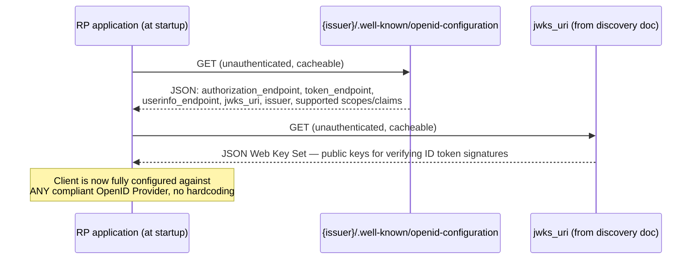

Discovery documents and JWKS responses are designed to be cached — most
production client libraries cache the discovery document for hours and the
JWKS for as long as its `Cache-Control` headers allow, refetching only when
a token's `kid` (key ID, Section 4.5) doesn't match any cached key,
which is the signal that the provider rotated its signing keys.

### 4.5 JWKS and Signature Validation

The `jwks_uri` from the discovery document points to a **JSON Web Key
Set (JWKS)**: a JSON document listing the OpenID Provider's current public
signing keys, each tagged with a `kid` (key ID) and the algorithm it's used
with (commonly `RS256`, RSA signature with SHA-256). This is how an RP
verifies an ID token's signature without ever having a shared secret with
the OpenID Provider — the OP signs with its private key, the RP verifies
with the corresponding public key fetched from JWKS.

The full ID token validation sequence a Solution Architect should expect
every compliant client library to perform, and should personally verify is
actually implemented (not skipped) in any custom integration:

1. Fetch (or use cached) discovery document and JWKS.
2. Parse the ID token's header to read its `kid`, find the matching public
   key in the JWKS.
3. Verify the signature cryptographically using that public key.
4. Verify `iss` matches the expected issuer exactly.
5. Verify `aud` contains this RP's Client ID.
6. Verify `exp` has not passed and `iat` is not implausibly in the future
   (clock-skew tolerance, typically a few minutes).
7. Verify `nonce` matches the value the RP generated for this specific
   authentication request.
8. Only after all six checks pass, trust the token's claims.

Skipping any single step re-opens a specific attack: skipping signature
verification allows a forged token; skipping `aud` allows a token issued
for a different client to be accepted (Section 3's confused-deputy gap,
directly); skipping `nonce` allows replay of a previously captured valid
token.

### 4.6 Standard Claims and Scopes

OIDC defines a fixed vocabulary of scopes, each of which unlocks a
standardized set of claims, so that "email" means the same thing across
every compliant provider:

| Scope | Claims it unlocks |
|---|---|
| `openid` (mandatory to trigger OIDC at all) | `sub`, `iss`, `aud`, `exp`, `iat` (the baseline ID token) |
| `profile` | `name`, `given_name`, `family_name`, `picture`, `locale`, `updated_at`, and more |
| `email` | `email`, `email_verified` |
| `address` | `address` (a structured object) |
| `phone` | `phone_number`, `phone_number_verified` |

The `_verified` suffix on `email_verified` and `phone_number_verified` is
architecturally significant and frequently misunderstood: it asserts
whether the OpenID Provider itself has confirmed ownership of that email
or phone number (for example, via a verification link the user clicked),
not merely that the user typed a syntactically valid value. A Solution
Architect designing an authorization rule such as "auto-provision an
account and grant elevated access to any user whose email domain matches
our corporate domain" must gate that rule on `email_verified: true` —
otherwise a user could self-report an unverified email at the corporate
domain and bypass the intended trust boundary.

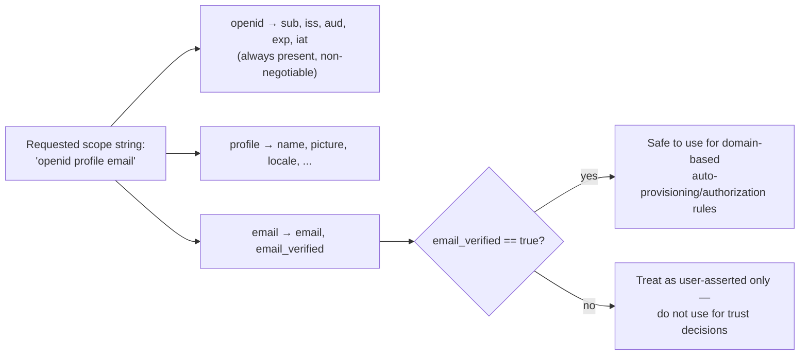

### 4.7 Authentication vs Authorization: Why They're Genuinely Separate Concerns

Even though the same IdP frequently handles both, and even though a single
OIDC login flow often issues both an ID token and an access token in one
round trip, **authentication ("who are you") and authorization ("what can
you do") are answering different questions, are validated differently, and
fail differently** — collapsing them into one mental model is the root
cause of the OAuth-as-login anti-pattern described in Section 3.

| | Authentication (OIDC's job) | Authorization (OAuth 2.0's job) |
|---|---|---|
| Question answered | Who is this user? | What is this caller permitted to do? |
| Artifact | ID Token | Access Token |
| Validated by | The RP itself, once, at login | The Resource Server, on every API call |
| Trust anchor | OpenID Provider's signature + `aud`/`nonce` binding | Scopes, token introspection, or JWT claims interpreted by the Resource Server's policy |
| Typical lifetime | Short — validated once, session established | Often short-lived with refresh, revalidated per call or per cache window |
| Failure mode if conflated | Confused-deputy identity spoofing (Section 3) | Privilege escalation if a Resource Server trusts identity claims it should be re-checking against its own authorization policy |

A concrete scenario that makes this concrete: a user authenticates via
OIDC and the RP correctly validates the ID token — the system now knows
*who* the user is. That fact alone says nothing about whether this user is
allowed to approve a $50,000 purchase order, delete another tenant's data,
or view another employee's salary. Those are authorization decisions that
must be made against the application's own permission model (roles,
attribute-based policies, resource ownership checks), consulting the
authenticated identity (`sub`) as an input, not a bypass. Systems that skip
this and grant access purely because "the OIDC login succeeded" have
conflated the two concerns and created an authorization gap.

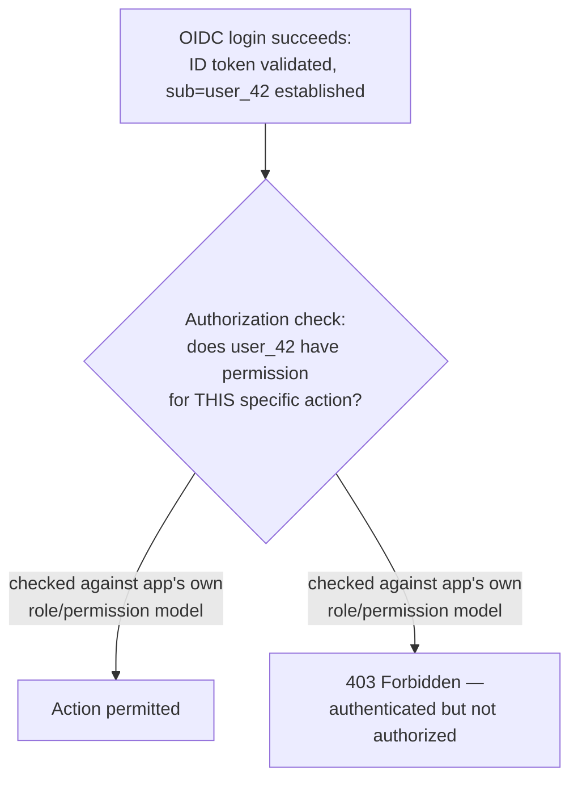

### 4.8 Single Sign-On (SSO) Architecture Built on OIDC

SSO (Single Sign-On) is the architectural pattern where a user
authenticates once against a central OpenID Provider and is then
recognized, without re-entering credentials, across multiple independent
applications (Relying Parties). OIDC is one of the two dominant protocols
used to implement SSO in production (the other, SAML, is contrasted in
Section 4.9); the mechanism relies on the OpenID Provider maintaining its
own session (typically a browser cookie scoped to the OP's domain) that
persists across the redirect-based login flow.

```mermaid
sequenceDiagram
    participant User as User's browser
    participant RP1 as Relying Party 1 (app-a.example.com)
    participant OP as OpenID Provider (sso.example.com)
    participant RP2 as Relying Party 2 (app-b.example.com)
    User->>RP1: Visit app-a.example.com
    RP1-->>User: Redirect to OP (302, with openid scope + nonce + state)
    User->>OP: Follow redirect
    OP->>OP: No existing OP session — show login form
    User->>OP: Submit credentials
    OP->>OP: Authenticate; establish OP session cookie (sso.example.com)
    OP-->>User: Redirect back to RP1 with authorization code
    User->>RP1: Deliver code
    RP1->>OP: Exchange code for ID token + access token (back-channel)
    RP1-->>User: RP1 session established
    User->>RP2: Later, visit app-b.example.com
    RP2-->>User: Redirect to OP
    User->>OP: Follow redirect — OP session cookie already present
    OP-->>User: NO login prompt — redirect straight back with a new code
    User->>RP2: Deliver code
    RP2->>OP: Exchange code for RP2's own ID token + access token
    RP2-->>User: RP2 session established — user never re-entered credentials
```

The architecturally important detail: each Relying Party ends up with its
**own** ID token, scoped to its own `aud` (its own Client ID) and its own
local session — SSO does not mean one shared token used everywhere; it
means one shared authentication event (the OP session) that produces
independent, per-RP tokens. This distinction matters directly for Section
4.10's logout problem: because each RP has its own session, "logging out"
of one RP does not automatically end the user's sessions at the others.

### 4.9 SAML vs OIDC: Contrasting Architectural Eras

SAML (Security Assertion Markup Language) is the other major SSO protocol,
predating OIDC by roughly a decade, and full SAML mechanics (XML-based
assertions, the Identity Provider/Service Provider terminology, SP-initiated
versus IdP-initiated flows, SAML's own logout binding) are owned entirely
by the future [SAML](CH22_SAML.md) chapter — recapped only at the
architectural-contrast level here.

| | SAML | OIDC |
|---|---|---|
| Era / origin | 2002-2005, designed for enterprise/browser SSO in an XML-heavy era | 2014, designed on top of OAuth 2.0 for a REST/JSON/mobile-first era |
| Assertion format | XML, digitally signed (often large, verbose) | JWT (compact, base64url JSON, signature) |
| Primary transport | Browser HTTP redirects/POST bindings carrying XML | OAuth 2.0 redirect flow carrying JSON |
| Mobile/native app fit | Poor — designed around full browser redirects and form posts | Strong — PKCE (owned by CH19_OAuth.md) makes public mobile/SPA clients viable |
| Typical modern usage | Legacy enterprise SSO integrations, some large enterprise IdPs still default to it for workforce identity | Consumer identity, modern enterprise workforce identity, API-first and mobile-first architectures |
| Developer ergonomics | Requires XML signature/canonicalization handling — notoriously easy to get subtly wrong | JSON + JWT tooling is broadly available and simpler to reason about |

The practical guidance for a Solution Architect choosing between the two
for a new integration: **default to OIDC unless a specific enterprise
customer's existing identity infrastructure mandates SAML** — most greenfield
systems in the 2020s have no reason to choose SAML over OIDC, but B2B SaaS
products frequently must support both because large enterprise customers'
existing IdP deployments were configured for SAML years before OIDC
existed.

### 4.10 Session Management and Logout Architecture

"Log the user out" sounds trivial and is, in a distributed multi-RP
architecture, one of the genuinely hard problems in this chapter. The
difficulty stems directly from Section 4.8's SSO mechanics: once a user has
authenticated once and obtained independent sessions at RP1, RP2, and RP3,
a logout initiated at RP1 must somehow also terminate the OP's own session
*and* notify RP2 and RP3 — and RP2/RP3 might not even have an open browser
tab where a redirect-based notification could land.

OIDC's Session Management and RP-Initiated Logout specifications define two
mechanisms, each with a real architectural trade-off:

**Front-channel logout**: the OP, upon processing a logout request, renders
a page containing hidden `<iframe>` elements pointing at each RP's
registered front-channel logout URI. Each RP's iframe loads and clears that
RP's local session cookie. This only works if the user's browser is
actually present and each RP's logout endpoint is reachable via iframe (a
growing problem as browsers restrict third-party cookies and cross-site
iframe behavior).

**Back-channel logout**: the OP makes a direct, server-to-server HTTP POST
to each RP's registered back-channel logout endpoint, carrying a signed
**Logout Token** (a JWT similar in shape to an ID token). This does not
depend on the user's browser being present or on iframes working at all,
making it the more reliable mechanism in modern browsers — at the cost of
requiring every RP to expose and secure a server-side logout endpoint.

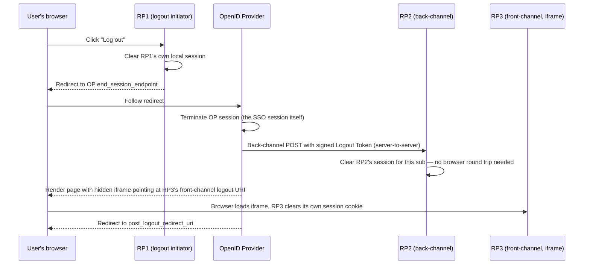

The failure mode a Solution Architect must plan for explicitly: **if RP2's
back-channel logout endpoint is down, slow, or misconfigured, the OP
typically cannot block on it indefinitely** — most production
implementations fire-and-forget or apply a short timeout, meaning RP2 may
end up with a stale session that outlives the user's intended logout. This
is why session lifetimes at every RP should be kept as short as usability
allows, with logout treated as a best-effort accelerant rather than the
sole mechanism enforcing session termination — a short-lived session that
naturally expires is a safety net for a logout notification that silently
failed to reach every RP.

## 5. Internal Working

Putting Sections 4.2-4.5 together, here is the complete internal
request/validation lifecycle a Solution Architect should be able to trace
end to end, from the RP's very first HTTP request to the point where the
authenticated identity is trusted:

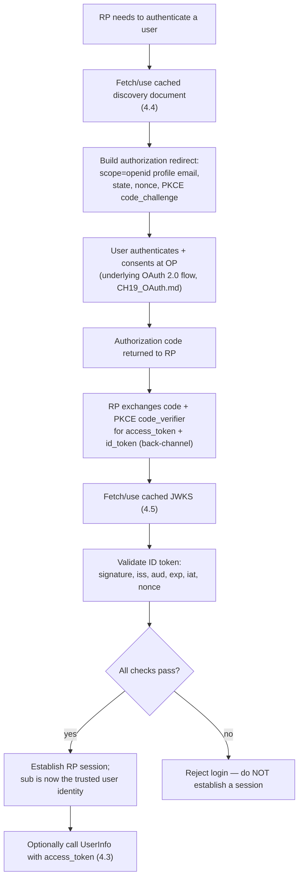

Two internals worth making explicit because they're easy to get wrong when
implementing this by hand rather than using a maintained library:

- **`state` versus `nonce`** — both are RP-generated random values echoed
  back through the flow, but they protect against different things:
  `state` (an OAuth 2.0 mechanism, owned by [OAuth Section
  4](CH19_OAuth.md#4-core-concepts)) protects the authorization-code
  redirect against CSRF (Cross-Site Request Forgery); `nonce` (OIDC-specific)
  is embedded *inside the signed ID token itself* and protects against
  replay of a previously issued, still-valid ID token being injected into a
  different, unrelated login attempt. Implementing only one of the two
  leaves the corresponding attack open.
- **Clock skew tolerance** — because `exp`/`iat`/`nonce` validation depends
  on comparing timestamps between the RP's clock and the OP's clock, and
  these are different machines, production validators apply a small
  tolerance window (commonly 60-300 seconds) rather than rejecting tokens
  on exact millisecond comparisons — too strict causes spurious login
  failures during normal clock drift; too loose widens the replay window.

## 6. Design Principles

- **Never invent a parallel identity vocabulary.** If the standard claims
  (`sub`, `email`, `name`, and so on) cover what your application needs,
  use them rather than defining custom claims for concepts OIDC already
  standardizes — custom claims should be reserved for genuinely
  application-specific data (a tenant ID, an internal role code) that has
  no standard equivalent.
- **Treat `sub`, not email, as the primary identity key.** Email addresses
  change, get reassigned, or get merged across accounts at some IdPs; `sub`
  is defined by the specification to be stable for a given issuer/client
  pairing (or globally stable, depending on the `subject_type` the OP
  supports — `public` versus `pairwise`).
  and should be the foreign key linking your local user record to the
  external identity.
- **Validate the full checklist (Section 4.5), never a subset.** A partial
  implementation that checks signature and expiry but skips `aud` or
  `nonce` is not "mostly secure" — it has a specific, exploitable gap.
- **Keep RP sessions short-lived and independently revocable.** Because
  logout propagation (Section 4.10) is best-effort across multiple RPs, the
  RP's own session lifetime — not the logout mechanism — is the reliable
  backstop against a session outliving its intended lifetime.
- **Never pass an ID token to a downstream service as an API credential.**
  Its `aud` claim is a promise to exactly one RP; downstream services
  should receive an access token (or a token this RP itself mints for its
  own internal service-to-service calls), never the ID token.

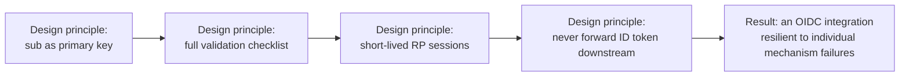

## 7. Architecture Patterns

- **Backend-for-Frontend (BFF) token handling**: the RP's server-side
  backend performs the entire OIDC exchange and validation, then issues its
  *own* opaque session cookie to the browser — the ID token and access
  token never reach client-side JavaScript at all. This is the
  recommended pattern for browser-based applications, because it removes
  an entire class of token-theft-via-XSS (Cross-Site Scripting) risk that
  exists whenever tokens are stored in browser-accessible storage.
- **Native/mobile app pattern**: the app itself acts as the RP, using
  PKCE (mandatory for public clients, per [OAuth
  Section 4](CH19_OAuth.md#4-core-concepts)) and an OS-level secure
  redirect (a custom URI scheme or, preferably, an OS-verified "app link"),
  storing the resulting tokens in the platform's secure credential storage
  (Keychain on iOS, Keystore on Android) rather than plain files.
- **Multi-tenant B2B pattern**: each customer's own IdP is registered as a
  distinct OIDC issuer; the RP resolves which issuer to redirect to based
  on the user's email domain or an explicit tenant selector *before*
  initiating the redirect, since OIDC's discovery mechanism is
  issuer-specific and cannot dynamically merge multiple tenants into one
  flow.
- **API gateway / sidecar token validation**: rather than every downstream
  microservice independently fetching JWKS and validating tokens, a shared
  gateway or sidecar proxy performs validation once and forwards a
  lightweight, internally-trusted identity assertion (for example, a
  signed internal JWT scoped to the internal network) — reducing both
  JWKS-fetch traffic and the number of places the validation checklist
  must be correctly implemented.

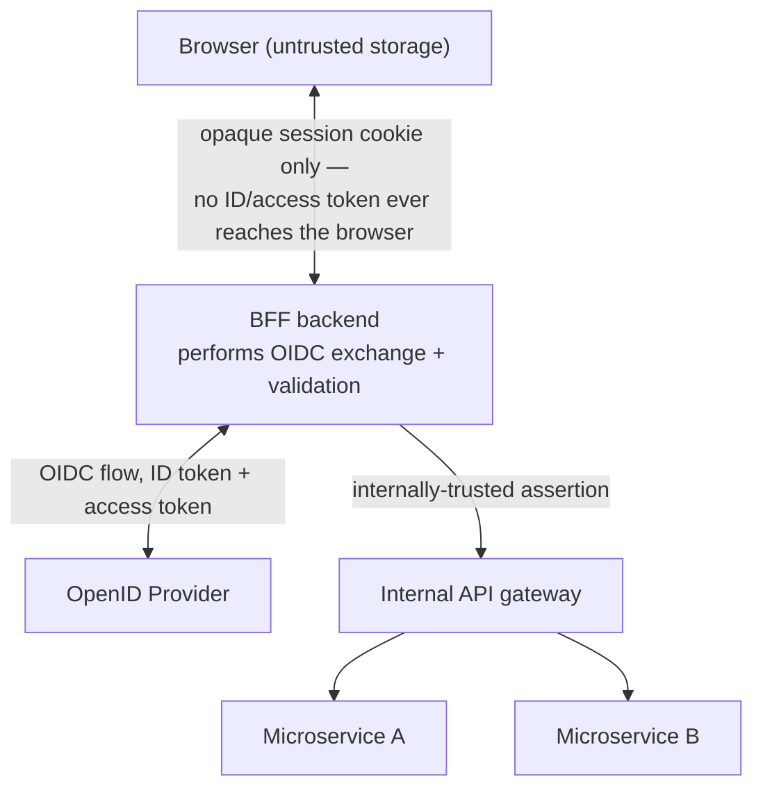

## 8. Production Architecture

A production OIDC deployment typically involves these concrete
components, each with its own operational ownership:

- **OpenID Provider**: either a managed IdP (Okta, Auth0, Microsoft Entra
  ID, AWS Cognito, Google Identity Platform) or a self-hosted one
  (Keycloak, Ory Hydra/Kratos). Managed IdPs remove the operational burden
  of key rotation, uptime, and compliance certification (SOC 2, ISO 27001)
  at the cost of per-user or per-MAU (Monthly Active User) pricing and less
  control over exact claim shaping.
- **RP client libraries**: mature, audited libraries (for example
  `openid-client`/`oidc-client-ts` in Node.js/TypeScript, `authlib` or
  `python-jose` plus a discovery-aware wrapper in Python, Spring Security's
  OAuth2/OIDC support in Java) should be used instead of hand-rolled token
  validation — Section 4.5's checklist is easy to get subtly wrong by hand,
  and these libraries are maintained specifically to track specification
  updates and CVEs (Common Vulnerabilities and Exposures).
- **Key rotation infrastructure**: production OpenID Providers rotate
  signing keys periodically (weeks to months); RP client libraries must
  refetch JWKS when they encounter a `kid` they don't recognize rather than
  hardcoding a single key — a rotation event that isn't handled gracefully
  causes a hard authentication outage for every RP simultaneously.
- **Session store**: RP-side sessions (Section 7's BFF pattern) are
  typically backed by a shared, horizontally-scalable session store (Redis
  is the most common choice) rather than in-process memory, so that
  logout/session-invalidation and horizontal scaling both work correctly
  across multiple RP server instances.

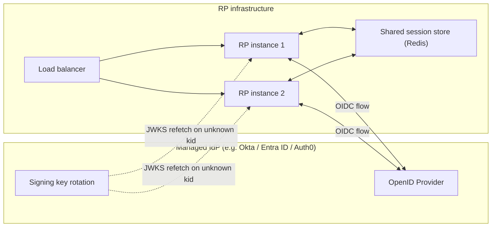

## 9. Implementation

Implementing an OIDC RP correctly, in priority order:

1. **Register the client** with the chosen OpenID Provider, obtaining a
   Client ID (and, for confidential clients, a Client Secret) and
   registering exact redirect URIs — OIDC/OAuth 2.0 both require exact,
   pre-registered redirect URI matching to prevent redirect-based token
   theft.
2. **Fetch and cache the discovery document** at application startup
   (Section 4.4), failing startup loudly if it cannot be fetched, rather
   than silently falling back to hardcoded endpoint guesses.
3. **Implement the Authorization Code + PKCE flow** exactly as specified in
   [OAuth Section 4](CH19_OAuth.md#4-core-concepts), adding the `openid`
   scope and a generated `nonce`.
4. **Implement the full ID token validation checklist** (Section 4.5) —
   this is the step most commonly shortcut in practice, and where using an
   audited library rather than hand-rolled JWT parsing materially reduces
   risk.
5. **Establish a server-side session** (Section 7's BFF pattern) rather
   than storing tokens client-side.
6. **Implement logout** (Section 4.10) with both a local session clear and
   a redirect to the OP's `end_session_endpoint`, and, if the OP supports
   it, register a back-channel logout endpoint.

## 10. Complete Code Examples

### 10.1 OIDC Authorization Code + PKCE flow with ID token validation (Node.js / TypeScript)

```typescript
// bff-auth.ts — Backend-for-Frontend OIDC integration (Express + openid-client)
import express from "express";
import { randomBytes, createHash } from "node:crypto";
import * as client from "openid-client";
import session from "express-session";

const app = express();
app.use(
  session({
    secret: process.env.SESSION_SECRET!, // rotate via secret manager, never hardcode
    cookie: { httpOnly: true, secure: true, sameSite: "lax" },
    resave: false,
    saveUninitialized: false,
  })
);

// Discovery (Section 4.4) — fetched once at startup, cached by the library.
const oidcConfig = await client.discovery(
  new URL(process.env.OIDC_ISSUER!), // e.g. https://accounts.example.com
  process.env.OIDC_CLIENT_ID!,
  process.env.OIDC_CLIENT_SECRET!
);

function base64url(input: Buffer): string {
  return input
    .toString("base64")
    .replace(/\+/g, "-")
    .replace(/\//g, "_")
    .replace(/=+$/, "");
}

app.get("/login", (req, res) => {
  const state = base64url(randomBytes(32));
  const nonce = base64url(randomBytes(32));
  const codeVerifier = base64url(randomBytes(32)); // PKCE — owned by CH19_OAuth.md
  const codeChallenge = base64url(createHash("sha256").update(codeVerifier).digest());

  req.session.oidc = { state, nonce, codeVerifier };

  const authUrl = client.buildAuthorizationUrl(oidcConfig, {
    redirect_uri: process.env.OIDC_REDIRECT_URI!,
    scope: "openid profile email",
    state,
    nonce,
    code_challenge: codeChallenge,
    code_challenge_method: "S256",
  });

  res.redirect(authUrl.href);
});

app.get("/callback", async (req, res) => {
  const saved = req.session.oidc;
  if (!saved) return res.status(400).send("Missing session state");

  try {
    // Exchanges the authorization code, then validates signature, iss, aud,
    // exp, iat, and nonce internally — the full checklist from Section 4.5.
    const tokens = await client.authorizationCodeGrant(
      oidcConfig,
      new URL(req.url, process.env.OIDC_REDIRECT_URI!),
      {
        pkceCodeVerifier: saved.codeVerifier,
        expectedState: saved.state,
        expectedNonce: saved.nonce,
      }
    );

    const claims = tokens.claims(); // validated ID token claims (sub, iss, aud, ...)
    if (!claims) throw new Error("ID token missing from token response");

    // Never forward the ID token downstream (Section 6) — establish our own
    // opaque session instead.
    req.session.user = { sub: claims.sub, name: claims.name, email: claims.email };
    delete req.session.oidc;

    // Access token is used only for the UserInfo call, not passed to the browser.
    if (tokens.access_token) {
      const userInfo = await client.fetchUserInfo(oidcConfig, tokens.access_token, claims.sub);
      if (userInfo.sub !== claims.sub) {
        throw new Error("UserInfo sub mismatch — possible token substitution");
      }
    }

    res.redirect("/");
  } catch (err) {
    req.session.destroy(() => {});
    res.status(401).send("Authentication failed");
  }
});
```

### 10.2 OIDC discovery document fetch + JWKS validation (Python)

```python
# oidc_validate.py — manual discovery + JWKS validation, for environments
# without a full OIDC client library (illustrates Section 4.4-4.5 internals).
import time
import httpx
from jose import jwt, jwk
from jose.exceptions import JWTError

ISSUER = "https://accounts.example.com"
CLIENT_ID = "my-rp-client-id"

_discovery_cache: dict | None = None
_jwks_cache: dict | None = None


def get_discovery_document() -> dict:
    global _discovery_cache
    if _discovery_cache is None:
        resp = httpx.get(f"{ISSUER}/.well-known/openid-configuration", timeout=5)
        resp.raise_for_status()
        _discovery_cache = resp.json()
    return _discovery_cache


def get_jwks() -> dict:
    global _jwks_cache
    if _jwks_cache is None:
        jwks_uri = get_discovery_document()["jwks_uri"]
        resp = httpx.get(jwks_uri, timeout=5)
        resp.raise_for_status()
        _jwks_cache = resp.json()
    return _jwks_cache


def validate_id_token(id_token: str, expected_nonce: str) -> dict:
    """Runs the full Section 4.5 checklist; raises on any failure."""
    header = jwt.get_unverified_header(id_token)
    kid = header.get("kid")

    jwks = get_jwks()
    matching_key = next((k for k in jwks["keys"] if k["kid"] == kid), None)
    if matching_key is None:
        # kid not found — force a refetch once, in case keys just rotated.
        global _jwks_cache
        _jwks_cache = None
        jwks = get_jwks()
        matching_key = next((k for k in jwks["keys"] if k["kid"] == kid), None)
        if matching_key is None:
            raise JWTError(f"No matching JWKS key for kid={kid}")

    public_key = jwk.construct(matching_key)

    # Signature, iss, aud, exp are verified in one call.
    claims = jwt.decode(
        id_token,
        public_key,
        algorithms=[matching_key["alg"]],
        audience=CLIENT_ID,
        issuer=ISSUER,
        options={"verify_at_hash": False},
    )

    # jose's exp/iat checks use a small internal clock-skew tolerance already;
    # nonce is OIDC-specific and must be checked explicitly.
    if claims.get("nonce") != expected_nonce:
        raise JWTError("nonce mismatch — possible replay of a stale ID token")

    if claims.get("iat", 0) > time.time() + 300:
        raise JWTError("iat implausibly in the future — reject")

    return claims
```

### 10.3 Single Sign-On session flow across two Relying Parties (Java / Spring Boot)

```java
// SsoSessionController.java — illustrates each RP maintaining its OWN
// session while sharing the OP's authentication event (Section 4.8).
@RestController
public class SsoSessionController {

    private final OAuth2AuthorizedClientService authorizedClientService;

    public SsoSessionController(OAuth2AuthorizedClientService authorizedClientService) {
        this.authorizedClientService = authorizedClientService;
    }

    // Spring Security's OIDC support performs discovery + full ID token
    // validation (Section 4.5) automatically when this endpoint is reached
    // after a successful login — this handler only establishes THIS RP's
    // own local session state from the already-validated principal.
    @GetMapping("/session/establish")
    public ResponseEntity<Map<String, Object>> establishSession(
            @AuthenticationPrincipal OidcUser oidcUser,
            HttpSession httpSession) {

        if (oidcUser == null) {
            return ResponseEntity.status(HttpStatus.UNAUTHORIZED).build();
        }

        // sub is the correct, stable primary key — not email (Section 6).
        String subject = oidcUser.getSubject();
        Instant authTime = oidcUser.getAuthenticatedAt();

        // Step-up check: if authentication happened more than 30 minutes
        // ago (auth_time claim, Section 4.2), require re-authentication
        // before allowing a sensitive downstream action.
        boolean recentEnoughForSensitiveActions =
                authTime != null && authTime.isAfter(Instant.now().minus(Duration.ofMinutes(30)));

        httpSession.setAttribute("rpUserSub", subject);
        httpSession.setAttribute("stepUpEligible", recentEnoughForSensitiveActions);

        return ResponseEntity.ok(Map.of(
                "sub", subject,
                "email", oidcUser.getEmail(),
                "emailVerified", oidcUser.getEmailVerified(), // Section 4.6 trust gate
                "stepUpEligible", recentEnoughForSensitiveActions));
    }

    // RP-local logout: clears THIS RP's session only. Full SSO logout across
    // sibling RPs additionally requires the OP-driven flow in Section 4.10
    // (front-channel iframes or back-channel Logout Token POSTs), which this
    // RP participates in by exposing its own back-channel logout endpoint.
    @PostMapping("/session/logout")
    public ResponseEntity<Void> localLogout(HttpSession httpSession) {
        httpSession.invalidate();
        return ResponseEntity.noContent().build();
    }
}
```

### 10.4 Back-channel logout endpoint (Node.js / Express)

```typescript
// back-channel-logout.ts — receives the OP's server-to-server Logout Token
// (Section 4.10) and terminates this RP's session for the matching sub,
// without depending on the user's browser being present.
import { jwtVerify, createRemoteJWKSet } from "jose";

const JWKS = createRemoteJWKSet(new URL(`${process.env.OIDC_ISSUER}/.well-known/jwks.json`));

app.post("/oidc/backchannel-logout", express.urlencoded({ extended: false }), async (req, res) => {
  const logoutToken = req.body.logout_token;
  if (!logoutToken) return res.status(400).send("Missing logout_token");

  try {
    const { payload } = await jwtVerify(logoutToken, JWKS, {
      issuer: process.env.OIDC_ISSUER,
      audience: process.env.OIDC_CLIENT_ID,
    });

    // A Logout Token carries 'events' with the specific OIDC back-channel
    // logout event type, and either sub or sid identifying the session(s)
    // to terminate — never trust a token missing this event marker.
    const events = payload["events"] as Record<string, unknown> | undefined;
    if (!events || !("http://schemas.openid.net/event/backchannel-logout" in events)) {
      return res.status(400).send("Not a valid back-channel logout token");
    }

    await destroyAllSessionsForSubject(payload.sub as string); // shared Redis store

    // Per spec, respond 200 with no body and Cache-Control: no-store.
    res.set("Cache-Control", "no-store").sendStatus(200);
  } catch {
    res.status(400).send("Invalid logout token");
  }
});
```

## 11. Performance

- **Cache discovery documents and JWKS aggressively.** Both change rarely
  (JWKS on key rotation only, typically weeks to months); refetching on
  every login round trip adds unnecessary latency and load on the OP with
  no security benefit — respect the `Cache-Control` headers the OP returns
  and refetch JWKS reactively (on an unrecognized `kid`), not on a fixed
  short polling interval.
- **Avoid unnecessary UserInfo calls.** If the ID token already carries the
  claims your application needs (common when `profile`/`email` scopes are
  requested and the OP includes them directly in the ID token), skip the
  separate UserInfo round trip entirely rather than always calling it out
  of habit.
- **Prefer local JWKS-based validation over token introspection for ID
  tokens.** Because ID tokens are self-contained signed JWTs, an RP can
  validate them entirely locally using cached JWKS, with zero additional
  network round trips to the OP at validation time — this materially
  outperforms any pattern that calls back to the OP synchronously to
  "check" every ID token.

## 12. Scalability

- **Session store horizontal scaling** (Section 8's Redis-backed session)
  is the primary scaling concern for the BFF pattern — size Redis for
  concurrent session count and eviction policy (typically TTL-based),
  since sessions naturally expire and don't require unbounded storage
  growth.
- **JWKS/discovery caching amortizes OP load across all RP instances** —
  because both are safely shared, cache them at the process or shared-cache
  level rather than per-request, so RP fleet size scaling does not linearly
  increase OP-facing discovery/JWKS traffic.
- **Back-channel logout endpoints must scale to receive fan-out from the
  OP**, especially in architectures with many RPs sharing one OP — treat
  the endpoint like any other externally-triggered webhook: idempotent,
  fast to acknowledge, and safe to receive duplicate deliveries.

## 13. Security

- **Exact redirect URI matching** (Section 9) prevents authorization code
  interception via a maliciously registered near-identical redirect URI —
  never allow wildcard or prefix-matched redirect URIs in production OP
  client registration.
- **The full ID token validation checklist (Section 4.5) is non-negotiable**
  — signature, `iss`, `aud`, `exp`/`iat`, and `nonce` must all be checked;
  a partially implemented validator is a specific, nameable vulnerability,
  not a rounding error.
- **Never store ID or access tokens in browser `localStorage` or
  non-`HttpOnly` cookies** — both are readable by any script that achieves
  XSS, which converts a scripting bug into full account takeover; prefer
  the BFF pattern's opaque, `HttpOnly`, `Secure`, `SameSite` session cookie
  (Section 7).
- **Treat `email_verified` as a hard gate**, not informational metadata,
  for any authorization rule keyed on email domain (Section 4.6).
- **PKCE is mandatory for public clients** (SPAs, mobile/native apps) —
  full rationale owned by [OAuth Section
  4](CH19_OAuth.md#4-core-concepts); this chapter's contribution is that
  the same `code_verifier`/`code_challenge` pair protects the ID token
  exchange exactly as it protects the access token exchange, since both
  come from the same code-exchange step.
- **Rotate signing keys on a defined schedule** and ensure every RP client
  library refetches JWKS reactively — an RP that hardcodes a single public
  key will experience a hard authentication outage the moment the OP
  rotates, and worse, an RP that disables signature verification "to work
  around" a rotation incident has silently disabled its core security
  control.

## 14. Observability

- **Log every ID token validation failure with the specific check that
  failed** (bad signature, `iss` mismatch, `aud` mismatch, expired,
  `nonce` mismatch) — these are distinct signals: a spike in `aud`
  mismatches suggests a misconfigured or malicious client attempting to
  reuse tokens; a spike in expired-token failures suggests clock skew or a
  client-side caching bug.
- **Track discovery/JWKS cache hit rate and refetch frequency** — an
  unexpectedly high refetch rate indicates either aggressive key rotation
  upstream or a caching bug in the client library/configuration.
- **Emit a distinct metric for back-channel logout delivery success/failure
  per RP** (Section 4.10) — since logout propagation is best-effort, this
  is the only visibility into how often a given RP's session outlives an
  intended logout, which should inform that RP's session TTL (Time To
  Live) policy.
- **Correlate authentication events by `sub`, not by session ID**, across
  logs from the OP and every RP, so a security investigation can trace a
  single user's authentication history across the entire federated system.

## 15. Failure Scenarios

- **JWKS endpoint unreachable during a key rotation window**: RPs that
  cannot refetch JWKS will fail to validate any new tokens signed with the
  new key, causing a full authentication outage across every RP
  simultaneously — mitigate by having the OP publish both old and new keys
  in JWKS for an overlap window before retiring the old key.
- **Clock drift between RP and OP**: without skew tolerance (Section 5),
  legitimate tokens are rejected as "not yet valid" or "expired" — monitor
  and alert on drift, and apply a bounded tolerance rather than either
  extreme (no tolerance, or unbounded tolerance that defeats `exp`
  entirely).
- **Back-channel logout endpoint down at one RP** (Section 4.10): that
  RP's session silently outlives the user's intended logout until natural
  session expiry — this is why session TTL, not logout, is the ultimate
  backstop.
- **UserInfo `sub` mismatch** (Section 4.3): almost always indicates either
  a serious implementation bug (access token from one login attempt reused
  against a different attempt's flow) or an active attack — must fail
  closed, never degrade to "use ID token's data instead" silently.
- **Confused-deputy reuse of an ID token as an API credential** (Section
  4.2): if a downstream service accepts an ID token and it happens to
  validate (same OP, same signature scheme) but was never intended for
  that service, it has reintroduced the exact vulnerability class OIDC was
  designed to prevent — this is caught by strict `aud` checking, provided
  every consuming service actually performs it rather than assuming
  upstream already did.

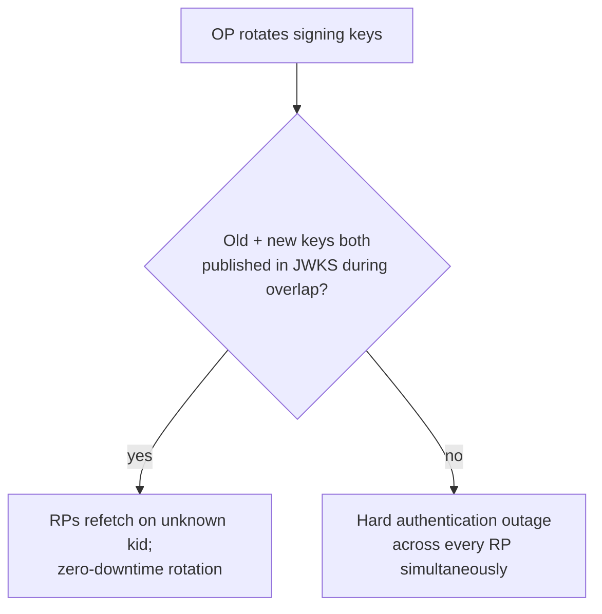

## 16. Testing

- **Unit test the full validation checklist independently** (Section 4.5):
  a valid token, a token with a wrong `aud`, a token with a wrong `iss`, an
  expired token, a token with a mismatched `nonce`, and a token with an
  invalid signature — each must be individually rejected with a distinct,
  loggable reason.
- **Test JWKS rotation handling** by simulating an unrecognized `kid` and
  asserting the client refetches rather than failing permanently on a
  stale cache.
- **Test the BFF pattern's token boundary**: assert that no ID token,
  access token, or refresh token ever appears in any response body,
  cookie, or header sent to the browser.
- **Test logout propagation** against a mock OP: assert a back-channel
  Logout Token correctly terminates the targeted session, and that a
  malformed or unsigned logout token is rejected rather than blindly
  trusted.
- **Test the `email_verified` gate** explicitly for any authorization rule
  that depends on domain matching, including the case where it is `false`.

## 17. Common Mistakes

- **Treating a valid access token as proof of login** (Section 3) — the
  root anti-pattern this entire chapter exists to prevent.
- **Skipping `aud` or `nonce` validation** because "the signature already
  checked out" — signature validity proves the token wasn't tampered with;
  it says nothing about whether it was issued for this client or this
  specific authentication attempt.
- **Using email instead of `sub` as the primary user identifier.**
- **Passing the ID token to downstream microservices** instead of an
  access token or an internally-minted assertion.
- **Storing tokens in `localStorage`** for perceived convenience, exposing
  them to any XSS vulnerability anywhere in the application.
- **Hardcoding endpoint URLs instead of using discovery**, which silently
  breaks the moment the OP changes infrastructure and also defeats the
  entire interoperability benefit of choosing OIDC in the first place.
- **Assuming logout is instantaneous and complete across every RP** without
  planning for the best-effort nature of Section 4.10's propagation
  mechanisms.

## 18. Best Practices

- Use an actively maintained OIDC client library rather than hand-rolling
  token validation in production code (Section 10.2's manual example is
  for teaching internals, not a production recommendation).
- Adopt the BFF pattern for browser-based applications by default.
- Request the minimum scopes actually needed (`openid` plus only the
  specific claim scopes the application uses) rather than requesting
  every available scope reflexively.
- Set RP session TTLs deliberately short enough that a failed logout
  propagation (Section 4.10) is an acceptable residual risk, not an
  unbounded one.
- Monitor JWKS/discovery cache freshness and alert before a rotation
  window causes an outage, not after.

## 19. Anti-Patterns

- **"OAuth as login"** (Section 3) — using a bare access token, with no ID
  token and no `aud`/`nonce` validation, as a substitute for authentication.
- **Shared token reuse across services** — passing one token (ID or
  access) to every downstream service regardless of its intended audience.
- **Client-side-only token storage with no BFF layer**, exposing tokens
  directly to browser JavaScript.
- **Treating logout as synchronous and guaranteed** across every RP,
  leading to false assumptions in security incident response ("we logged
  the user out everywhere" when back-channel delivery may have silently
  failed at one RP).
- **Custom claims duplicating standard ones** (for example, a
  `userEmailAddress` custom claim alongside the standard `email` claim),
  fragmenting the identity vocabulary this specification exists to
  standardize.

## 20. Trade-off Analysis

| Decision | Option A | Option B | When to choose A | When to choose B |
|---|---|---|---|---|
| Token handling location | BFF (server-side) | Client-side SPA (Single-Page Application) token handling | Any application where XSS risk must be minimized (Section 13) — the default recommendation | Only for architectures with no server-side component at all, accepting the increased token-exposure risk |
| Managed IdP vs self-hosted OP | Managed (Okta/Auth0/Entra ID/Cognito) | Self-hosted (Keycloak/Ory) | Teams without dedicated identity engineering capacity, need for compliance certifications out of the box | Strict data residency/control requirements, or cost at very large user volumes where self-hosting amortizes better |
| Logout mechanism | Front-channel (iframes) | Back-channel (server-to-server) | Legacy browser support requirements where iframes still reliably fire | Modern deployments — more reliable given third-party cookie/iframe restrictions in current browsers |
| SSO protocol for a given enterprise customer | OIDC | SAML (Section 4.9) | Greenfield integrations, mobile/native clients, API-first architectures | Legacy enterprise customer IdP already deployed for SAML and unwilling to migrate |

## 21. Comparison Table

| Concept | OAuth 2.0 alone | OIDC | SAML (owned by future CH22_SAML.md) |
|---|---|---|---|
| Primary purpose | Authorization | Authentication + Authorization (via underlying OAuth 2.0) | Authentication (primarily), some authorization via attributes |
| Core artifact | Access token (format unspecified) | ID Token (always a signed JWT) + access token | SAML Assertion (XML) |
| Discovery mechanism | None standardized | `/.well-known/openid-configuration` (Section 4.4) | Metadata XML documents, less dynamically discoverable |
| Best fit | Machine-to-machine, pure API authorization | User login, federated identity, SSO (consumer + workforce) | Legacy enterprise workforce SSO |
| Mobile/native fit | Good, with PKCE | Good, with PKCE (inherits from OAuth 2.0) | Poor |

## 22. Real-World Case Study

A B2B SaaS analytics platform serves both self-service customers (who sign
up directly and authenticate via the platform's own OIDC-based "Sign in
with Google" and "Sign in with Microsoft" options) and enterprise customers
(who require the platform to federate with *their* corporate identity
system for workforce SSO). The architecture team faced a concrete design
question directly answered by this chapter's concepts: enterprise customer
A's IdP is a modern Entra ID tenant exposing full OIDC discovery, while
enterprise customer B's IdP is a decade-old on-premises SAML deployment
customer B's IT team refuses to migrate off before a multi-year contract
renewal.

The resulting design: the platform's RP layer implements OIDC natively
(Section 9's implementation sequence) as the default and primary path for
every self-service and OIDC-capable enterprise customer, using per-tenant
issuer configuration (Section 7's multi-tenant pattern) so each enterprise
tenant's users are redirected to their own IdP's discovery document at
login time. For customer B specifically, the platform adds a translation
layer (a small SAML Service Provider component, deferred in full detail to
the future SAML chapter) that consumes customer B's SAML assertions and
mints the platform's own internal, OIDC-shaped session — meaning every
downstream service in the platform only ever has to understand one
identity format (its own internally-minted assertion) regardless of
which protocol authenticated the user at the edge. This is a direct
application of Section 4.7's authentication/authorization separation: the
edge-layer authentication protocol (OIDC or SAML) is treated as an
input to establishing identity, never as something downstream services
need to understand directly.

The team also discovered, during a security review, that an earlier
prototype had been forwarding the ID token itself to an internal
recommendations microservice as a bearer credential (the anti-pattern in
Section 4.2 and Section 19) — caught before production by exactly the
`aud`-mismatch check Section 4.5 mandates, since the recommendations
service's Client ID was never in the token's audience.

## 23. Interview Questions

1. Explain precisely what OIDC adds on top of OAuth 2.0, and why "OAuth for
   login" is an architecturally unsafe shorthand.
2. What is the difference between an ID token and an access token, and
   what should each be used for?
3. Walk through the full ID token validation checklist. What specific
   vulnerability does skipping the `aud` check reopen? The `nonce` check?
4. What problem does OIDC Discovery solve, and why couldn't earlier
   federated identity protocols achieve the same level of interoperability?
5. Why is `sub` the correct primary key for a user's identity, rather than
   `email`?
6. Explain the architectural difference between authentication and
   authorization, using a concrete example of a system that conflates
   them incorrectly.
7. Describe how Single Sign-On works across multiple Relying Parties
   sharing one OpenID Provider, and explain why each RP ends up with its
   own distinct ID token.
8. Compare front-channel and back-channel logout. Which is more reliable in
   modern browsers, and why?
9. Why is "logging a user out" a genuinely hard distributed-systems
   problem once more than one Relying Party is involved?
10. At a high level, contrast OIDC and SAML — what eras were they designed
    for, and what would make you choose one over the other for a new
    enterprise integration?

## 24. Hands-on Exercises

1. Register a test application with a free-tier OIDC provider (for example
   Google or Auth0) and implement the full Authorization Code + PKCE flow
   from scratch, including manual JWKS-based ID token validation (do not
   use a high-level client library for this exercise) — confirm you can
   correctly reject a token with a tampered `aud` claim.
2. Fetch a real provider's discovery document and JWKS, and write a script
   that reports which signing algorithm(s) it supports and how many keys
   are currently active (a proxy for how frequently that provider rotates
   keys).
3. Implement a minimal back-channel logout receiver (Section 10.4) and
   test it against a simulated Logout Token, including a deliberately
   malformed one that must be rejected.
4. Build a small two-RP SSO demo (two separate local applications sharing
   one OpenID Provider) and observe, using browser developer tools, that
   the second RP's login redirect completes without a credential prompt.

## 25. Design Exercises

1. Design the identity architecture for a B2B SaaS platform that must
   support both self-service OIDC login and enterprise customers whose
   IdPs may be OIDC- or SAML-based, ensuring every downstream service only
   needs to understand one internal identity format. Justify where the
   protocol-translation boundary should live.
2. Design a session-timeout and logout policy for a system with five
   Relying Parties sharing one OpenID Provider, explicitly accounting for
   the possibility that back-channel logout delivery fails at one RP.
   State your chosen session TTL and justify it against the residual risk.
3. A security review flags that your mobile app currently stores the
   access token and ID token in plaintext local storage. Redesign the
   token-handling architecture for the mobile client, addressing both
   storage and the PKCE-based token acquisition flow.

## 26. Architecture Review Questions

- Does every Relying Party in this system perform the full ID token
  validation checklist (Section 4.5), or is validation assumed to have
  happened upstream somewhere it actually hasn't?
- Is `sub`, not email, used as the durable foreign key linking external
  identity to internal user records?
- Are ID tokens ever forwarded to any downstream service as an API
  credential?
- Does the browser-facing client ever receive a raw ID token, access
  token, or refresh token, or is a BFF-issued opaque session used
  instead?
- Is `email_verified` checked before any authorization decision keyed on
  email domain?
- What is the actual (not assumed) behavior when a Relying Party's
  back-channel logout endpoint is unreachable — is there a bounded
  session TTL backstop?
- Is JWKS refetched reactively on an unrecognized `kid`, or is a signing
  key hardcoded anywhere in the system?

## 27. Summary

OIDC is not a competing protocol to OAuth 2.0 — it is OAuth 2.0 with a
standardized identity layer added on top, contributing exactly three
things: the ID Token (a signed, audience-bound authentication assertion),
a discovery mechanism that makes any compliant client interoperable with
any compliant provider, and a standardized UserInfo endpoint plus claim
vocabulary. The central architectural discipline this chapter teaches is
keeping authentication ("who are you," OIDC's job) and authorization
("what can you do," OAuth 2.0's job, applied on top of an established
identity) as genuinely separate concerns validated by different mechanisms
at different points in the request lifecycle — collapsing them is the root
cause of the OAuth-as-login anti-pattern that motivated OIDC's creation in
the first place. Single Sign-On is a natural consequence of OIDC's
redirect-based flow combined with the OpenID Provider's own session, and it
directly creates the hardest operational problem in this chapter: logout is
best-effort across multiple Relying Parties, front-channel and back-channel
mechanisms both have real failure modes, and a bounded session lifetime —
not a perfect logout guarantee — is the reliable backstop a Solution
Architect should design around. Full authorization-flow mechanics remain
owned by [OAuth](CH19_OAuth.md), full JWT format mechanics remain owned by
the future [JWT](CH21_JWT.md) chapter, and full SAML mechanics remain owned
by the future [SAML](CH22_SAML.md) chapter — this chapter's job was the
identity layer that sits on top of all three.
