# Chapter 21: JWT (JSON Web Token)

## 1. Introduction

A JWT (JSON Web Token) is a compact, URL-safe, digitally signed data
structure for transmitting claims — statements about a subject — between two
parties. It is not an authentication protocol, not an authorization
framework, and not an identity layer; it is a **format**. That distinction
matters more than it sounds, because JWT is the format both
[OAuth](CH19_OAuth.md)'s access tokens and [OIDC (OpenID Connect)](CH20_OIDC.md)'s
ID Tokens are commonly built on top of, and this chapter is the place both of
those chapters deliberately stopped short of teaching.

This chapter assumes you have read OAuth and OIDC. OAuth 2.0 defined the
**roles** — Resource Owner, Client, Authorization Server, Resource Server —
and the access-token/refresh-token lifecycle, but treated the access token
itself as an **opaque string** by design, because RFC 6749 never mandated a
token format. OIDC then layered an **ID Token** on top of OAuth 2.0 and
mandated that the ID Token specifically must always be a JWT, with a fixed
claim vocabulary (`sub`, `iss`, `aud`, `exp`, and more) — but OIDC's Section
4.2-4.3 explicitly deferred the JWT container format itself to this chapter.
Neither chapter re-derives what follows; both simply recap it and link here.
This chapter does the reverse: it recaps their claim/role ownership in one or
two sentences each and focuses entirely on the format, the cryptography, the
architectural trade-offs, and the vulnerability classes that are specific to
JWT itself.

By the end of this chapter you will be able to explain, precisely, what
"self-contained" actually means at the level of a database query that no
longer has to happen, why signing algorithm choice is an architectural
decision and not an implementation detail, why the single most damaging
historical JWT vulnerability class exists and how to close it permanently in
one line of configuration, and why the single biggest architectural
trade-off of adopting JWTs — stateless horizontal scalability — is purchased
at the direct cost of a revocation problem that has no clean solution, only
mitigations.

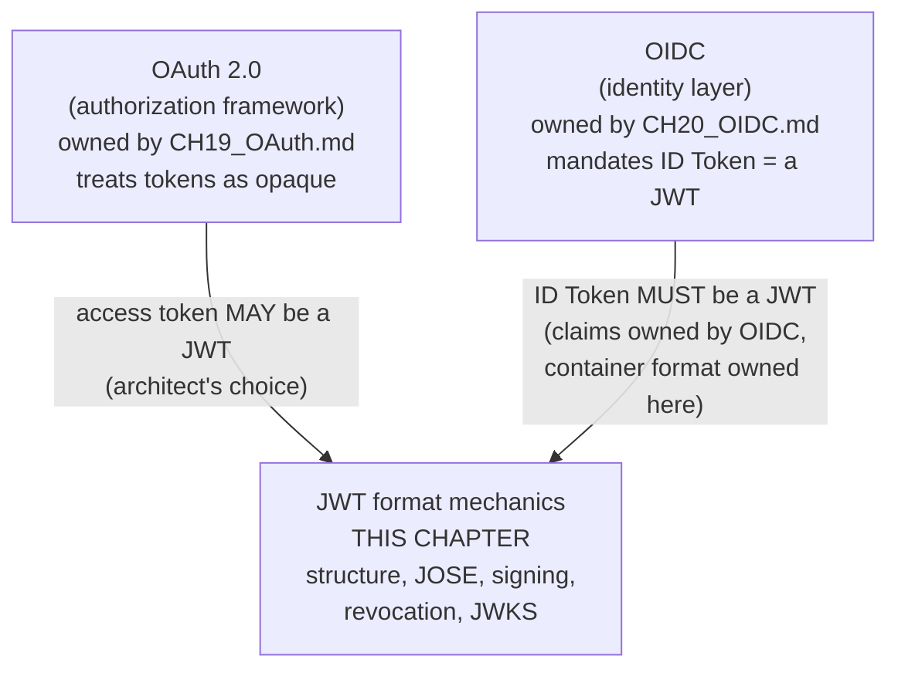

## 2. Historical Evolution

JWT did not appear in isolation — it is the practical, JSON-based successor
to a much heavier XML-based token ecosystem, and its own specification
history is a story of the IETF (Internet Engineering Task Force)
deliberately narrowing scope to ship something implementable.

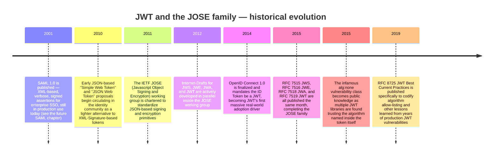

Three details in that timeline carry direct architectural weight today.
First, JWT was not invented to replace SAML's use case wholesale — it was
invented to be **lighter and JSON-native** for the API-and-mobile-first web,
where parsing an XML document with XML-DSig on every request was an
unacceptable tax; SAML remains the incumbent in many enterprise SSO (Single
Sign-On) contexts precisely because it predates and outlives that
JSON-versus-XML tooling shift. Second, JWT was standardized as **one member
of a family** (JOSE), not a standalone spec — Section 4.3 explains why that
family membership, not just the JWT RFC (Request for Comments) alone,
determines what a "JWT" can and cannot do. Third, the `alg:none`
vulnerability (Section 4.5) is not a footnote — it is the reason RFC 8725
exists at all, and it remains the most commonly cited JWT security failure
in production incident retrospectives a decade later.

## 3. Why It Exists

Before JWT, the two realistic options for representing "this request is
authenticated as user X" were: (1) an **opaque session identifier** stored in
a cookie, resolved against a server-side session store on every request, or
(2) a heavyweight, XML-Signature-based SAML assertion. Neither fit the
emerging architecture of the 2010s: stateless HTTP APIs, mobile clients that
don't reliably carry cookies, and — critically — **microservice
architectures** where a request might be verified by a dozen different
services that have no shared database and no shared session store.

JWT exists to answer one specific architectural question: *can a party that
did not issue this token, and has no database connection to the party that
did, cryptographically verify that the token is authentic and unmodified —
using nothing but the token itself and a public key or shared secret it
already has?* The answer JWT provides is yes, by making the token
**self-contained**: the claims are inside the token, and a signature over
those claims lets any holder of the right key verify authenticity without a
network round trip to the issuer.

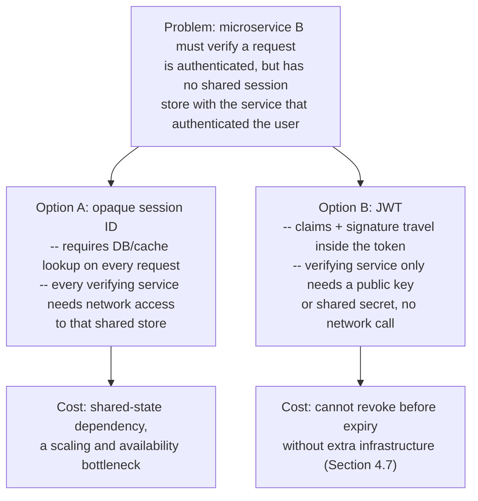

Neither option is free — Section 4.2 and Section 4.7 walk through exactly
what each side is trading away. What matters here is that JWT's entire
reason for existing is to make that trade *available* as an architectural
choice, not to declare it universally correct. A monolith with one database
has little reason to adopt JWTs at all; a fleet of independently-deployed
microservices verifying requests issued by a central Authorization Server
is the textbook case JWT was built for.

## 4. Core Concepts

### 4.1 JWT Structure: Header, Payload, Signature

**Definition.** A JWT is three Base64URL-encoded segments joined by periods:
`header.payload.signature`. Structurally it is always exactly this shape —
there is no variant with two segments or four; a JWE (JSON Web Encryption,
Section 4.3) uses five segments and is a different, related format, not a
variant of the three-segment JWT.

**Mechanism.** Each of the first two segments is a JSON object, Base64URL-encoded
(not standard Base64 — see below for why that distinction matters):

- **Header** (also called the JOSE header) — declares the token's metadata,
  minimally `alg` (the signing algorithm, e.g. `RS256`) and `typ` (always
  `JWT`). It commonly also carries `kid` (Key ID), used in Section 4.9 to
  select which public key verifies this specific token.
- **Payload** — the claims themselves: arbitrary JSON key-value pairs, a
  mix of registered claims with standardized meaning (Section 4.8) and any
  application-specific private claims the issuer wants to include.
- **Signature** — computed over the ASCII bytes of
  `base64url(header) + "." + base64url(payload)`, using the algorithm named
  in the header and a key. This is the segment that makes the first two
  segments trustworthy: any modification to header or payload after signing
  invalidates the signature.

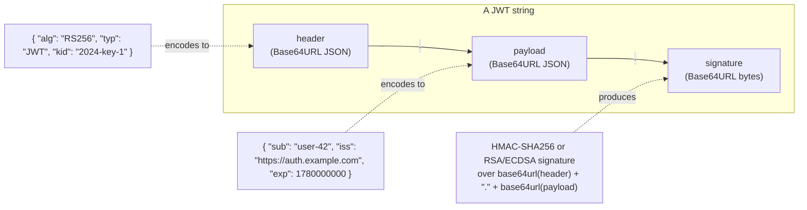

**A critical, frequently misunderstood detail: the payload is encoded, not
encrypted.** Base64URL is a reversible encoding, not cryptography — anyone
who intercepts a JWT can decode the header and payload instantly with no key
at all (try it: paste any JWT into a Base64URL decoder). The signature
proves the payload was *not tampered with* and *was issued by a party
holding the signing key*; it says nothing about *confidentiality*. This is
the single most common architectural misunderstanding new JWT adopters make:
**never put secrets (passwords, full card numbers, unrelated PII) in a JWT
payload**, because the payload is, for all practical purposes, plaintext to
anyone who can see the token in transit or in a log line.

**Why Base64URL and not standard Base64?** Standard Base64 uses `+`, `/`,
and `=` padding characters, all of which have reserved meaning in URLs
(`+` means space, `/` is a path separator, `=` is a query-parameter
delimiter) and in HTTP headers. Base64URL substitutes `-` for `+` and `_`
for `/`, and conventionally omits `=` padding entirely, so a JWT can be
placed directly into a URL query parameter, an `Authorization: Bearer`
header, or a cookie without any additional escaping. This single decision is
why JWTs are practically ubiquitous in HTTP-based architectures where
SAML's XML assertions, which require additional encoding gymnastics to
survive a URL, are not.

**Common failure mode.** Treating a decoded-but-unverified JWT payload as
trustworthy. Any JSON parser can read a JWT's claims without checking the
signature at all — several early mobile SDKs and even some server
middleware historically decoded the payload for convenience (e.g., to read
`sub` for logging) and only checked the signature later, or not at all, on
a different code path. If any code path in your system reads claims without
running signature verification first, an attacker can hand-craft a payload
with `alg` set to anything and have it accepted as-is. Section 4.5 covers
exactly how this failure mode becomes an exploitable vulnerability class.

### 4.2 Self-Contained Tokens vs. Opaque Reference Tokens

**Definition.** A **self-contained token** (a signed JWT) carries its own
claims and can be verified using only a locally-held key — no network call
to the issuer is required at verification time. An **opaque reference
token** (sometimes called a "reference token" in OAuth terminology) is a
random, meaningless string that must be exchanged for its meaning via a
lookup — either a direct database query or an OAuth 2.0 Token Introspection
(RFC 7662) call to the Authorization Server.

**Mechanism.** The architectural difference is *where the state lives*. With
an opaque token, the Authorization Server owns a table (`token -> claims,
expiry, revoked?`) and every relying party asks it, on every request, "is
this token still valid, and what does it mean?" With a JWT, the
Authorization Server signs the claims once at issuance time and hands the
verifying party everything it needs up front; the verifying party does the
cryptographic check locally and never talks to the Authorization Server
again for that request.

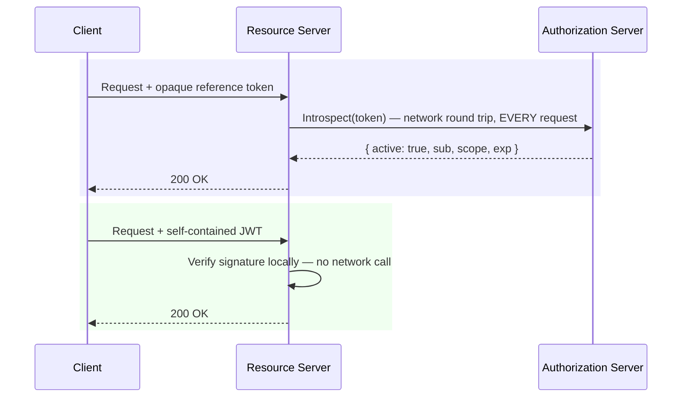

**Decision implications.** Choose self-contained JWTs when verifying parties
are numerous, geographically distributed, or cannot reliably reach a central
Authorization Server on every request — the classic microservices-behind-an-
API-gateway topology, or an offline-capable mobile client that must validate
a cached token locally. Choose opaque reference tokens when you need
**instant, centrally-controlled revocation** to be a first-class property
(Section 4.7 explains why JWTs specifically lack this), when tokens carry
sensitive claims that should never leave the Authorization Server's trust
boundary unencrypted, or when the verifying-party count is small enough that
the introspection network cost is genuinely negligible.

**Common failure mode.** Assuming "JWT" and "stateless" are unconditionally
better because they "scale." A self-contained JWT that verifying services
never actually validate cryptographically (only decode) provides zero
security benefit over an opaque token and is strictly worse, because it also
leaks its payload in plaintext to anyone reading it. The architectural payoff
of self-containment only exists if every verifying party actually performs
signature verification — skipping it to save CPU cycles defeats the entire
design.

**Concrete scenario.** A ride-sharing platform's Authorization Server issues
access tokens consumed by a `trips` service, a `payments` service, and a
`driver-matching` service, all independently deployed, in different regions,
scaled independently, none sharing a database with the Authorization Server.
A self-contained JWT signed with RS256 (Section 4.4) lets all three verify
requests with only a cached public key, adding zero network hops and zero
availability coupling to the Authorization Server per request — exactly the
case JWT was built for.

### 4.3 The JOSE Family: JWS, JWE, and Why Most Production JWTs Are JWS-Only

**Definition.** JOSE (JavaScript Object Signing and Encryption) is the
umbrella IETF working group and family of specifications that JWT belongs
to. The two operations JOSE standardizes are **signing** (JWS — JSON Web
Signature, RFC 7515) and **encryption** (JWE — JSON Web Encryption, RFC
7516). "JWT" (RFC 7519) is a claims-set *data model* that can be serialized
using either JWS or JWE as its container.

**Mechanism.** A **JWS-based JWT** — what nearly everyone means when they
say "JWT" informally, and the only kind this chapter's code examples
produce — has the familiar three-segment `header.payload.signature`
structure; the payload is Base64URL-encoded but not encrypted, and is
readable by anyone. A **JWE-based JWT** wraps the claims in an encrypted
envelope instead, producing a five-segment structure
(`header.encrypted_key.iv.ciphertext.tag`) where the payload is genuinely
confidential to anyone without the decryption key.

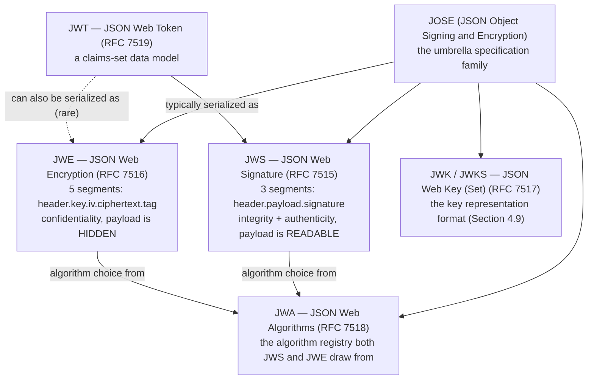

**Why most production JWTs are JWS-only.** Three practical reasons converge.
First, **the transport is usually already encrypted**: a JWT travels over
HTTPS/TLS (Transport Layer Security), so confidentiality-in-transit is
already handled at the transport layer, making a second layer of payload
encryption redundant for that specific threat. Second, **JWS is
computationally far cheaper** to sign and verify than JWE is to encrypt and
decrypt, and a high-throughput authentication path is exactly where that
cost matters. Third, **verifying parties need to read the claims to make
authorization decisions** — a Resource Server has to see `scope` or `sub`
to decide what to allow; if the payload were encrypted, every verifier would
also need a decryption key, which reintroduces exactly the shared-secret
distribution problem asymmetric JWS was chosen to avoid (Section 4.4).

**Decision implications.** Reach for JWE only when the token must cross a
trust boundary where the transport itself is not fully trusted end-to-end
(for example, a JWT embedded inside another document that is stored at
rest, or passed through an intermediary that should not be able to read the
claims), or when regulatory requirements mandate payload-level encryption
independent of transport security. For the overwhelming majority of
"authenticate an API call" use cases this chapter and CH19/CH20 describe,
plain signed JWS is the correct, simpler, cheaper choice — this is why every
code example in Section 10 produces a JWS-serialized JWT, and why "JWT" and
"signed JWT" are used interchangeably for the rest of this chapter.

### 4.4 Signing Algorithms: Symmetric HMAC vs. Asymmetric RS256/ES256

**Definition.** A JWT's signature is computed using one of two categories of
algorithm: **symmetric** (HMAC — Hash-based Message Authentication Code,
e.g. `HS256`), where the exact same secret key both signs and verifies, or
**asymmetric** (e.g. `RS256` using RSA, or `ES256` using ECDSA — Elliptic
Curve Digital Signature Algorithm), where a private key signs and a
mathematically related but distinct public key verifies.

**Mechanism.** `HS256` computes `HMAC-SHA256(secret, header + "." + payload)`.
Both the party that mints the token and every party that verifies it must
possess the identical shared secret. `RS256` and `ES256` instead generate a
key pair; the issuer signs with the private key, and distributes the public
key (via JWKS, Section 4.9) to anyone who needs to verify. Verification with
a public key mathematically proves the signature could only have been
produced by the holder of the corresponding private key, without that
verifier ever being able to derive the private key or mint new valid tokens
itself.

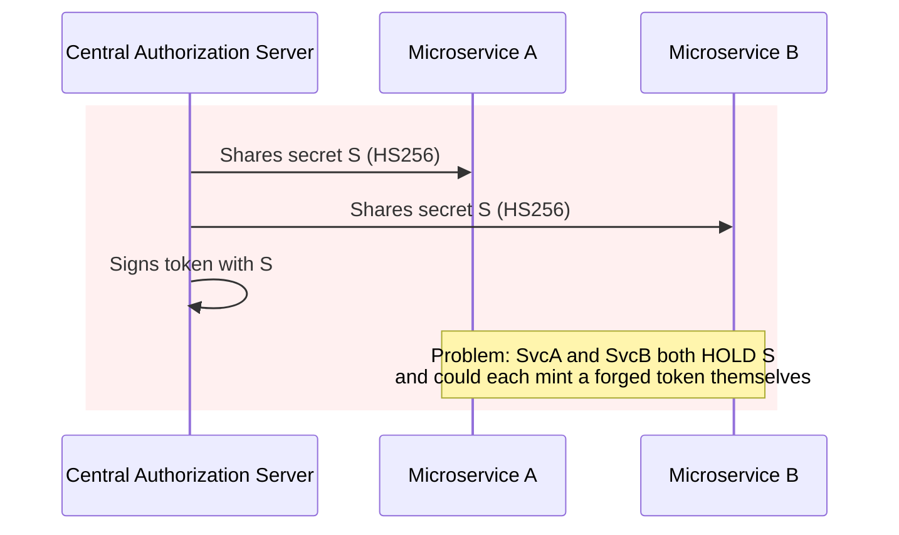

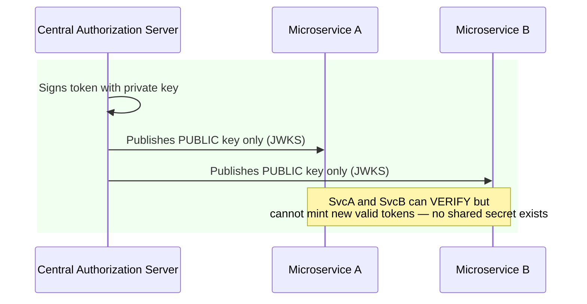

**Decision implications — this is the architecturally load-bearing choice
in this entire chapter.** Symmetric HMAC signing is appropriate only when
the same trusted party both issues and verifies the token, or when every
verifying party is equally trusted to also mint tokens (rare, and usually a
design smell). The moment a token must be **verified by a party that should
not be able to mint tokens itself** — which describes essentially every
microservices architecture where a central Authorization Server issues
tokens and downstream services only verify them — asymmetric signing is not
a preference, it is an architectural requirement. Distributing an HMAC
secret to every verifying microservice means any one of those services (or
anything that compromises one of them) can forge tokens claiming to be any
user with any scope, indistinguishable from a real Authorization Server-
issued token. Asymmetric signing collapses that blast radius: a compromised
verifying service leaks only a public key, which is not sensitive material
at all.

**Common failure mode.** Choosing `HS256` for its simplicity in a
microservices architecture "to get started" and only discovering the trust
problem after the fleet has grown to the point where rotating a leaked
shared secret means redeploying every service simultaneously. Asymmetric
key rotation, by contrast, is decoupled — Section 4.9 shows how JWKS's `kid`
mechanism lets the Authorization Server rotate its signing key without any
coordinated redeployment of verifiers at all.

**Concrete scenario.** A payments platform initially used `HS256` between
its monolith and a single internal reporting service, sharing one secret.
As the platform split into 12 microservices, that same secret was copied to
every new service's configuration. A security review found the secret in a
misconfigured logging pipeline's output; because it was shared everywhere,
the fix required rotating the secret across all 12 services in a coordinated
release window with a brief authentication outage. Migrating to RS256 with
JWKS-based public key distribution (Section 4.9) was the direct remediation,
and made all subsequent key rotations a zero-downtime, verifier-transparent
operation.

### 4.5 The alg:none and Algorithm-Confusion Vulnerability Classes

**Definition.** These are two related, historically devastating JWT-specific
vulnerability classes, both rooted in the same root cause: **trusting the
`alg` field inside the token itself to decide how to verify the token.**

**Mechanism — `alg: none`.** The JWS specification defines `none` as a
legal (if unusual) algorithm value, meaning "this token is unsigned." Early
JWT libraries, when asked to verify a token, read the `alg` from the
attacker-controlled header and dispatched to whatever verification logic
matched that string — including, for `none`, no verification at all. An
attacker could take any legitimate JWT, change the payload claims freely
(e.g. `"role": "admin"`), set `alg` to `none`, strip the signature segment
entirely, and have several real-world libraries accept it as valid.

**Mechanism — algorithm confusion (RS256-to-HS256 downgrade).** A subtler
and more damaging variant. Many verifying applications embed the
Authorization Server's RSA **public** key in configuration, expecting only
`RS256` tokens. An attacker constructs a *forged* token, sets `alg` to
`HS256` in the header, and — critically — uses the well-known, publicly
available **RSA public key itself as the HMAC secret**. Some libraries,
again trusting the header's `alg` to select the verification algorithm,
happily run `HMAC-SHA256(publicKeyBytes, header + "." + payload)` — and
because the attacker also knows the public key (it is, after all, public),
the attacker can compute the exact same HMAC and produce a signature the
library accepts as legitimate.

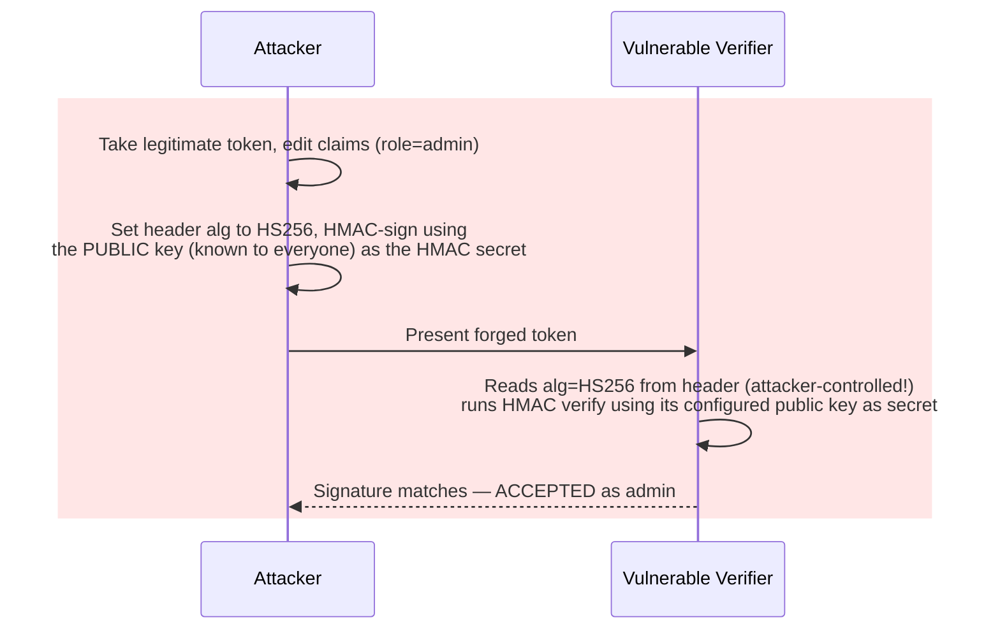

**Why this is architecturally significant, not just a bug.** Both
vulnerabilities share the exact same design flaw: **letting untrusted input
(the token) decide the trust decision (which algorithm/key verifies it)**.
This is a general anti-pattern well beyond JWT — the fix generalizes to any
system where a message names its own verification method — but JWT's `alg`
header field is the canonical, most-cited real-world instance of it in
identity and access management literature.

**The mandatory fix: library-level algorithm allow-listing.** Every
production JWT verification call must explicitly pass the *exact* algorithm
(or small fixed set of algorithms) the verifier expects, and the library
must reject any token whose header `alg` does not match — never derive the
verification algorithm from the token's own header. RFC 8725 (JWT Best
Current Practices) codifies this explicitly. Section 10's second code
example shows the vulnerable pattern next to the hardened one; the fix is
almost always a single, mandatory parameter most libraries already expose
but that many teams historically omitted.

**Common failure mode.** Upgrading a JWT library version and discovering the
new version made algorithm allow-listing the *default* — while your calling
code, written years earlier against an older, more permissive API, silently
continued to pass no explicit algorithm list and now fails every request in
production. Treat this as a reason to explicitly, always pass the allow-list
rather than relying on a library's current default, since defaults have
changed at least once industry-wide already and may again.

### 4.6 Stateless Authentication Architecture: The Real Trade-off

**Definition.** "Stateless authentication" describes an architecture where
no server-side session state (a session ID mapped to session data in a
shared store) is required to authenticate a request — the JWT itself carries
everything the verifying party needs, and verification is a pure, local
cryptographic computation.

**Mechanism.** Recall Section 4.2's sequence diagrams: with opaque tokens,
every Resource Server instance needs network access to the same shared
session/token store, and that store becomes a scaling and availability
dependency shared by every instance. With JWTs, each Resource Server
instance independently verifies using only a locally cached public key (or,
for HS256, a shared secret) — adding a new instance behind a load balancer
requires zero coordination with any central state store for the
authentication path specifically.

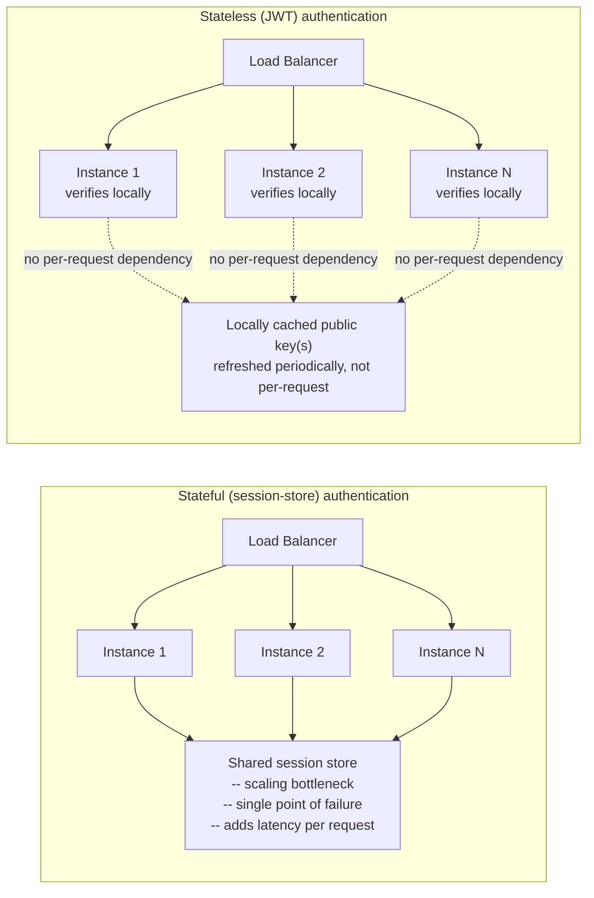

**The actual trade-off — say this precisely, not as marketing.** The payoff
of statelessness is **horizontal scalability without shared session
infrastructure on the authentication hot path**: new instances scale up and
down freely, there is no session-store capacity to provision or fail over,
and cross-region deployments don't need a globally-replicated session store
just to authenticate requests. The cost, paid in full and unavoidably, is
the **revocation problem**, covered in depth in Section 4.7: because the
token is self-contained and verification is purely local and
cryptographic, there is no natural place to ask "has this specific token
been revoked?" without reintroducing exactly the shared, centrally-checked
state that statelessness was designed to eliminate. Solution Architects who
present JWTs as a pure scalability win without naming this cost in the same
breath are not describing the trade-off accurately — it is a trade, not a
free upgrade.

**Decision implications.** Statelessness is worth its cost when scale and
availability of the authentication path dominate your architecture's
requirements and when token lifetimes can realistically be kept short
(Section 4.7). It is a poor fit for systems that need instant, guaranteed
revocation as a compliance or security requirement (for example, an
immediate, "kill this session right now" administrative action for a
suspected account compromise) unless paired with the additional
infrastructure Section 4.7 describes.

**Common failure mode.** Adopting JWTs specifically for horizontal
scalability, then adding a "check if this token is revoked" database lookup
on every single request to compensate for the revocation problem —
unknowingly reintroducing the exact per-request shared-state dependency
JWTs were adopted to remove, while keeping all of JWT's downsides (payload
readability, no instant compliance-grade guarantee for the interim, more
complex tooling) and none of its benefit.

### 4.7 The Revocation Problem and Its Real Mitigations

**Definition.** The revocation problem is this: once a JWT is signed and
handed to a client, there is no way for the issuer to make that *specific*
token invalid before its own `exp` (expiration) claim is reached, without
introducing additional infrastructure that the client-and-verifier
interaction alone cannot provide.

**Mechanism — why this is structural, not a missing feature.** Verification
is, by design, a pure function of `(token, public key or secret)` — it does
not consult any external state. That purity is exactly what makes stateless
verification possible (Section 4.6). Adding a revocation check reintroduces
a lookup, which is the very dependency JWTs exist to avoid — so any
revocation mechanism is, honestly, a partial reintroduction of shared state,
scoped as narrowly as the architecture can tolerate.

**Mitigation 1 — short expiry + refresh tokens (recap from
[OAuth](CH19_OAuth.md#47-access-tokens-vs-refresh-tokens-lifetime-and-rotation-architecture)).**
OAuth's access-token/refresh-token split, taught in full in CH19 Section 4.7,
is JWT's primary practical mitigation: keep the JWT's own `exp` short
(minutes), so a leaked or now-unwanted token naturally expires soon even
without an explicit revocation call, and rely on the separately-tracked,
rotatable refresh token (which is *not* itself typically a bearer-verified
JWT presented to Resource Servers, and *can* be checked/revoked
server-side on each use) for session longevity. This is why "how long should
a JWT live?" is one of the most consequential single decisions in a JWT-based
architecture: it directly bounds the maximum blast radius of un-revocable
misuse.

**Mitigation 2 — token blocklists / denylists.** For cases where a
short expiry alone is not a strong enough guarantee (e.g., a suspected
account takeover that must be shut down immediately), maintain a
small, fast-lookup store (commonly Redis or similar) of revoked token
identifiers (`jti`, Section 4.8) or affected `sub`+issued-before timestamps,
and have verifying services check it in addition to signature verification.

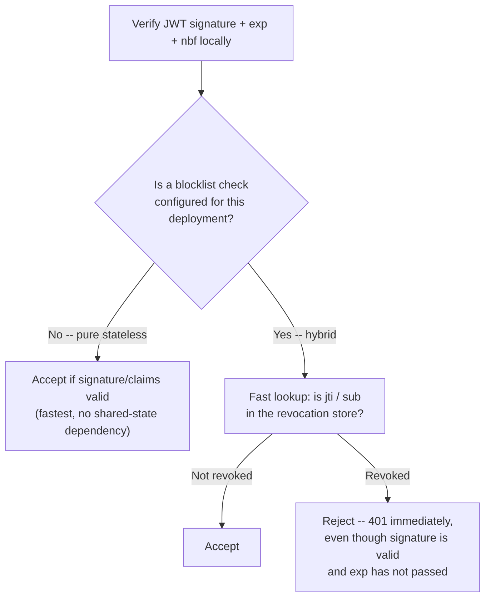

This is a deliberate, narrow reintroduction of shared state — a
denylist lookup is far cheaper and far smaller than a full session store
(most tokens are never revoked, so the store stays small), but it is not
free, and it reintroduces exactly the availability coupling Section 4.6
described. Most architectures reserve this hybrid approach for
security-critical revocation events only, not as the default per-request
path.

**Why many architectures simply accept short-lived JWTs as sufficient.**
For a large share of production systems, the combination of a short access-
token `exp` (5-15 minutes is common) and a revocable refresh token gives an
acceptable bound: worst case, a compromised access token is useful to an
attacker for at most that short window, and the refresh token — which *is*
checked server-side on every use — closes the loop for anything longer-lived.
This is why "just keep JWTs short-lived" is not a workaround but the
mainstream, accepted architectural answer to the revocation problem, reserved
for the minority of genuinely compliance- or incident-driven cases that
warrant Mitigation 2's added infrastructure.

### 4.8 The JWT Claims Registry

**Definition.** RFC 7519 defines a small set of **registered claim names** —
short, reserved keys with standardized meaning — that any JWT consumer can
rely on having a consistent interpretation, alongside any number of
application-specific **private claims** the issuer chooses to add.

| Claim | Name | Architectural purpose |
|---|---|---|
| `iss` | Issuer | Identifies who minted the token; a verifier should reject tokens from an unexpected issuer, closing the same spoofing gap CH20 Section 4.2 covers for the ID Token specifically |
| `sub` | Subject | A stable identifier for the token's principal (a user, a service account); the correct primary key for "who is this," not a mutable field like email |
| `aud` | Audience | The intended recipient(s) of the token; a Resource Server must reject a token whose `aud` doesn't name it, preventing a token minted for Service A from being replayed against Service B |
| `exp` | Expiration Time | Unix timestamp after which the token must be rejected outright — the primary lever for bounding the revocation problem (Section 4.7) |
| `nbf` | Not Before | Unix timestamp before which the token must not yet be accepted — used for tokens minted in advance of their validity window |
| `iat` | Issued At | Unix timestamp of minting; used for clock-skew-tolerant freshness checks and detecting suspiciously old tokens even before `exp` |
| `jti` | JWT ID | A unique identifier for this specific token instance; the anchor Mitigation 2 in Section 4.7 uses to reference one exact token in a denylist, and a defense against replay when combined with a seen-`jti` cache |

**Mechanism — validation is a checklist, not a single check.** A correct
verifier does not stop at signature verification; it must additionally
check `exp` (not expired), `nbf` (if present, not yet-future), `iss`
(matches the expected issuer), and `aud` (contains this verifier's own
identifier) before trusting any claim in the payload. Skipping any one of
these checks re-opens a specific, nameable attack: skipping `aud` allows
token replay across services; skipping `exp` allows indefinite reuse of an
old, leaked token; skipping `iss` allows a token minted by an unrelated,
untrusted issuer whose public key happens to be trusted for unrelated
reasons to be accepted.

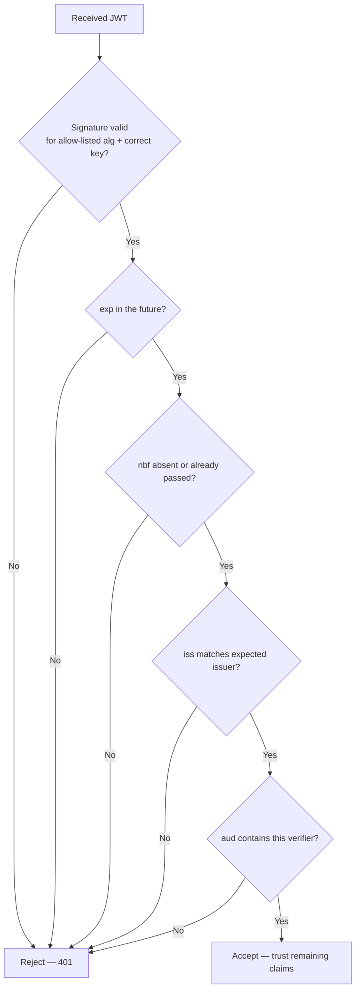

**Recap: OIDC's specific claim usage
([OIDC](CH20_OIDC.md#42-the-id-token-oidcs-core-contribution)).** OIDC's ID
Token is exactly this claims registry applied to an authentication-specific
use case: it mandates `sub`, `iss`, `aud`, `exp`, `iat`, adds
authentication-specific private claims (`auth_time`, `nonce`, `amr`), and
CH20 Section 4.2 teaches the reasoning behind each in the identity context
in full — this chapter does not re-teach that reasoning, only the underlying
claim mechanics any JWT (identity-related or not) shares.

**Common failure mode.** Implementing `aud` validation as "contains at
least one of our known client IDs" instead of "contains *this specific*
verifying service's own identifier" — in a microservices fleet, that
looser check allows a token minted for Service A to be replayed
successfully against Service B, exactly the cross-service confusion CH20
names as the single most damaging OIDC/JWT production mistake.

### 4.9 JWKS: Key Distribution for Asymmetric Verification at Scale

**Definition.** A JWKS (JSON Web Key Set) is a JSON document — typically
served at a well-known, unauthenticated, cacheable HTTPS endpoint — listing
an issuer's current public keys in a standardized format (RFC 7517, JWK),
so any verifying party can fetch the correct public key without
out-of-band coordination.

**Recap: JWKS in the OIDC discovery flow
([OIDC](CH20_OIDC.md#44-discovery-the-well-known-openid-configuration-document)
/
[OIDC](CH20_OIDC.md#45-jwks-and-signature-validation)).**
CH20 Section 4.4-4.5 already teaches how an OIDC Relying Party discovers
`jwks_uri` from the `/.well-known/openid-configuration` document and uses it
to validate an ID Token's signature; that flow is the OIDC-specific
application of the exact general mechanism taught here, and this section
does not repeat that discovery-document walkthrough — only the JWKS
mechanism itself, generalized to any JWT verifier, not only OIDC Relying
Parties.

**Mechanism — the `kid` header and key rotation.** Each key in a JWKS
response carries a `kid` (Key ID). A signed JWT's header includes the `kid`
of the specific key that signed it. A verifier fetches (or uses a cached
copy of) the JWKS, finds the entry whose `kid` matches the token's header,
and uses that entry's public key material to verify the signature. This
`kid`-based lookup is precisely what makes **zero-downtime key rotation**
possible: the Authorization Server can publish a *new* key in the JWKS
alongside the still-valid old one, start signing new tokens with the new
key (new `kid`), and only remove the old key from the JWKS once every
already-issued token signed with it has naturally expired — no verifying
service ever needs a coordinated deployment or restart to pick up the new
key, because it re-fetches the JWKS (subject to normal HTTP caching) and
finds the new `kid` there automatically.

```mermaid
sequenceDiagram
    participant AuthServer as Authorization Server
    participant JWKSEndpoint as JWKS endpoint (cacheable, public)
    participant Verifier as Verifying Microservice

    AuthServer->>AuthServer: Generate new key pair, kid=&quot;2025-key-2&quot;
    AuthServer->>JWKSEndpoint: Publish BOTH old (kid=2025-key-1) and new key
    AuthServer->>AuthServer: Start signing NEW tokens with 2025-key-2
    Verifier->>JWKSEndpoint: GET /.well-known/jwks.json (cached, refetched on kid miss)
    JWKSEndpoint-->>Verifier: [ {kid: 2025-key-1, ...}, {kid: 2025-key-2, ...} ]
    Verifier->>Verifier: Token header says kid=2025-key-2 — matched, verify succeeds
    Note over AuthServer,JWKSEndpoint: Old key stays published until every token<br/>signed with it has naturally expired, then removed
```

**Decision implications.** JWKS is what makes asymmetric signing
(Section 4.4) operationally practical at scale: without it, distributing a
new public key to every verifying service on every rotation would require
the exact coordinated redeployment problem that made shared HMAC secrets so
brittle. With JWKS, key rotation becomes a publish-and-wait operation with
no verifier-side deployment at all — provided every verifier's caching
strategy correctly refetches on a `kid` cache-miss rather than only on a
fixed schedule, which is the detail Section 10's fourth code example
implements explicitly.

**Common failure mode.** Caching a JWKS response forever (or for an
unreasonably long TTL) with no cache-miss refetch path at all. When the
Authorization Server rotates keys, every verifier that only refreshes on a
schedule (say, once a day) will reject every newly-signed token for up to
that entire window, producing a rolling authentication outage that looks
like a JWKS endpoint failure but is actually a caching-strategy defect.

## 5. Internal Working

Putting Sections 4.1-4.9 together, here is the complete, end-to-end
lifecycle of a JWT from issuance through verification in a typical
central-Authorization-Server / multiple-microservices topology.

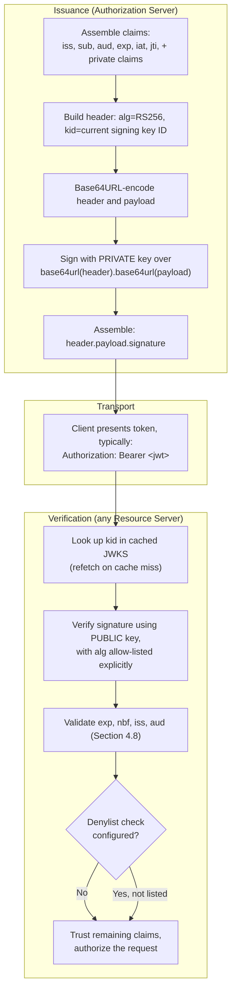

The single most important property visible in this diagram: **the
Authorization Server appears exactly once**, at issuance, and never again in
the verification path (except indirectly, via the cached JWKS). Every
Resource Server in the fleet verifies independently and locally. This is
the concrete mechanism behind Section 4.6's "stateless" claim, and the exact
place where Section 4.7's revocation problem becomes visible: nothing in
this diagram asks the Authorization Server "is this token still good?" at
verification time unless the optional denylist branch is explicitly wired
in.

## 6. Design Principles

- **Sign always, encrypt only when needed.** Default to JWS (Section 4.3);
  reach for JWE only when the transport itself cannot be trusted to protect
  confidentiality end-to-end.
- **Never trust the token to describe its own trust.** Allow-list algorithms
  and keys server-side; never derive verification method from the token's
  own `alg` or `kid` alone without cross-checking against a trusted registry
  (Section 4.5).
- **Keep JWTs short-lived and small.** Short `exp` bounds the revocation
  problem (Section 4.7); a small claim set keeps the token's ubiquitous
  plaintext exposure (Section 4.1) to the minimum necessary.
- **Prefer asymmetric signing the moment more than one trust boundary
  verifies the token.** Symmetric HMAC is only safe when issuer and every
  verifier are equally trusted (Section 4.4).
- **Validate every registered claim relevant to your trust model, every
  time.** `aud` and `iss` checks are not optional hardening — skipping
  either is a specific, exploitable gap (Section 4.8).
- **Rotate keys routinely, not only when compromised.** JWKS's `kid`
  mechanism (Section 4.9) makes routine rotation operationally free; treat
  an unused rotation capability as a missed defense-in-depth opportunity.

## 7. Architecture Patterns

**Pattern 1 — Central Authorization Server, JWKS-verified microservices.**
A single Authorization Server (often the same one issuing OAuth access
tokens or OIDC ID Tokens) signs with a private key; every downstream
microservice independently verifies via a cached JWKS. This is the
canonical pattern this entire chapter has built toward, and the one Section
10's fourth code example implements.

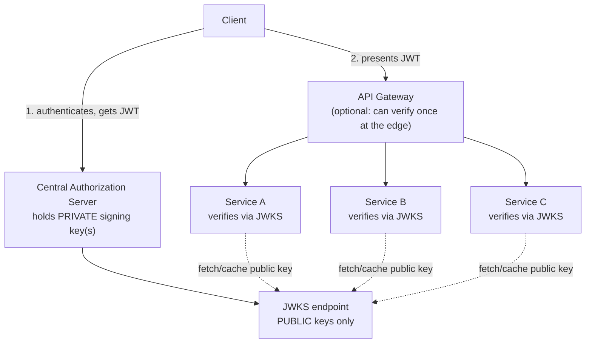

**Pattern 2 — Edge-verify-once, propagate a derived internal token.** An
API Gateway or Backend-for-Frontend (recapped from
[OAuth](CH19_OAuth.md#48-backend-for-frontend-bff-token-handling-pattern))
terminates and fully verifies the external-facing JWT once at the edge, then
mints a smaller, internal-only token (often a short-lived JWT scoped to
just the fields internal services actually need) for propagation
downstream — trading a small amount of edge-side verification cost for
smaller, faster internal tokens and a single place where external-token
validation logic lives.

**Pattern 3 — Hybrid opaque-plus-JWT.** A publicly-facing access token is
kept opaque (so it is instantly revocable via introspection, Section 4.2),
while an internal, short-lived JWT is minted after introspection succeeds
and propagated only within the trusted internal network — combining opaque
tokens' instant-revocation property at the edge with JWTs' cheap,
stateless verification for the high-fan-out internal call graph.

## 8. Production Architecture

A production JWT-issuing Authorization Server typically maintains: an
active signing key plus at least one recently-retired key still published in
JWKS (Section 4.9) to cover in-flight tokens during rotation; a
configuration-driven, per-environment algorithm allow-list (Section 4.5)
that is never derived from client input; short, environment-tuned `exp`
values for access-token-shaped JWTs (commonly 5-15 minutes) paired with
OAuth refresh tokens (CH19 Section 4.7) for session longevity; and,
where compliance requires it, a lightweight `jti`-keyed denylist (Section
4.7, Mitigation 2) backed by a low-latency cache such as Redis, with a TTL
matched to the JWT's own maximum `exp` so denylist entries expire alongside
the tokens they reference rather than growing unbounded.

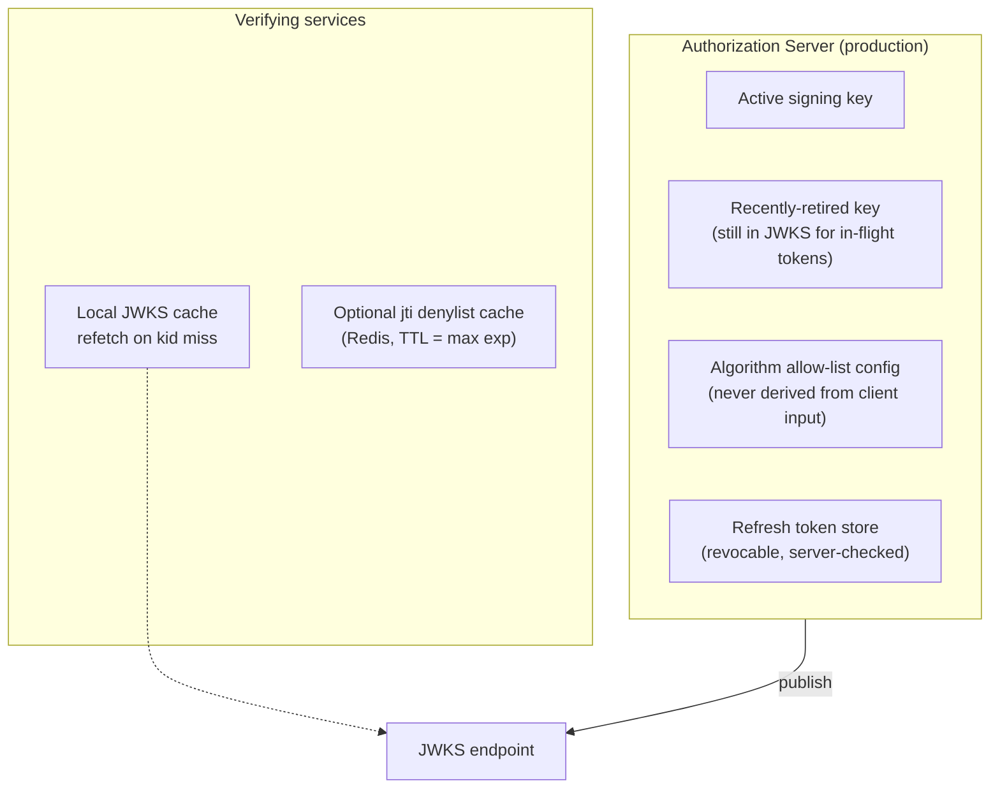

## 9. Implementation

Implementing JWT support correctly means choosing a well-maintained,
actively patched JOSE library for your platform rather than hand-rolling
Base64URL/HMAC/RSA logic in production code — Section 10's first example
implements the mechanics from scratch specifically as a *teaching* tool to
demystify the format, not as a production recommendation. In production:
use `jsonwebtoken` or `jose` in Node.js, `PyJWT` or `authlib` in Python,
and `jjwt` or Spring Security's OAuth2 Resource Server support in Java —
all of which implement algorithm allow-listing, JWKS client caching, and
constant-time signature comparison correctly, all three of which are easy
to get subtly wrong by hand.

## 10. Complete Code Examples

**Example 1 — Python: manual JWT encode/decode/verify from first
principles (teaching implementation, HS256).** This deliberately reimplements
the mechanics of Section 4.1 and 4.4's symmetric path without a JOSE
library, to make the Base64URL-and-HMAC mechanism concrete.

```python
import base64
import hashlib
import hmac
import json
import time


def _b64url_encode(data: bytes) -> str:
    return base64.urlsafe_b64encode(data).rstrip(b"=").decode("ascii")


def _b64url_decode(segment: str) -> bytes:
    padding = "=" * (-len(segment) % 4)
    return base64.urlsafe_b64decode(segment + padding)


def encode_jwt(payload: dict, secret: str) -> str:
    header = {"alg": "HS256", "typ": "JWT"}
    header_b64 = _b64url_encode(json.dumps(header, separators=(",", ":")).encode())
    payload_b64 = _b64url_encode(json.dumps(payload, separators=(",", ":")).encode())
    signing_input = f"{header_b64}.{payload_b64}".encode("ascii")
    signature = hmac.new(secret.encode(), signing_input, hashlib.sha256).digest()
    signature_b64 = _b64url_encode(signature)
    return f"{header_b64}.{payload_b64}.{signature_b64}"


def decode_and_verify_jwt(token: str, secret: str) -> dict:
    try:
        header_b64, payload_b64, signature_b64 = token.split(".")
    except ValueError:
        raise ValueError("Malformed JWT: expected exactly 3 segments")

    header = json.loads(_b64url_decode(header_b64))
    # Mandatory allow-list check (Section 4.5) — never trust header['alg'] alone.
    if header.get("alg") != "HS256":
        raise ValueError(f"Unsupported or disallowed algorithm: {header.get('alg')}")

    signing_input = f"{header_b64}.{payload_b64}".encode("ascii")
    expected_signature = hmac.new(secret.encode(), signing_input, hashlib.sha256).digest()
    actual_signature = _b64url_decode(signature_b64)
    # Constant-time comparison — never use == on raw signature bytes.
    if not hmac.compare_digest(expected_signature, actual_signature):
        raise ValueError("Signature verification failed")

    payload = json.loads(_b64url_decode(payload_b64))

    now = int(time.time())
    if "exp" in payload and now >= payload["exp"]:
        raise ValueError("Token has expired")
    if "nbf" in payload and now < payload["nbf"]:
        raise ValueError("Token not yet valid")

    return payload


if __name__ == "__main__":
    secret = "a-sufficiently-long-random-shared-secret"
    token = encode_jwt(
        {
            "iss": "https://auth.example.com",
            "sub": "user-42",
            "aud": "reporting-service",
            "iat": int(time.time()),
            "exp": int(time.time()) + 300,
            "jti": "9f1c2e3a-...",
        },
        secret,
    )
    print("Token:", token)
    print("Verified claims:", decode_and_verify_jwt(token, secret))
```

**Example 2 — Node.js/TypeScript: asymmetric RS256 signing and
verification (central Authorization Server + independent verifier).** Uses
the `jsonwebtoken` library with an explicit algorithm allow-list, modeling
Section 4.4's asymmetric microservices pattern.

```typescript
import jwt, { JwtPayload } from "jsonwebtoken";
import { generateKeyPairSync } from "crypto";

// --- Authorization Server: holds the PRIVATE key ---
const { privateKey, publicKey } = generateKeyPairSync("rsa", {
  modulusLength: 2048,
  privateKeyEncoding: { type: "pkcs1", format: "pem" },
  publicKeyEncoding: { type: "pkcs1", format: "pem" },
});

function issueToken(subject: string, audience: string): string {
  return jwt.sign(
    { sub: subject, aud: audience, iss: "https://auth.example.com" },
    privateKey,
    { algorithm: "RS256", expiresIn: "5m", keyid: "2025-key-1" }
  );
}

// --- Verifying microservice: holds only the PUBLIC key (e.g. via JWKS) ---
function verifyToken(token: string, expectedAudience: string): JwtPayload {
  // Mandatory: explicit algorithm allow-list, never derived from the token.
  const claims = jwt.verify(token, publicKey, {
    algorithms: ["RS256"],
    audience: expectedAudience,
    issuer: "https://auth.example.com",
  });
  return claims as JwtPayload;
}

const token = issueToken("user-42", "billing-service");
console.log("Issued:", token);
console.log("Verified claims:", verifyToken(token, "billing-service"));
```

**Example 3 — Algorithm-confusion vulnerable vs. hardened verification
(Python, PyJWT).** Directly demonstrates Section 4.5's vulnerability class
and its fix.

```python
import jwt  # PyJWT

# The RSA PUBLIC key is, by definition, not secret; anyone can read it.
rsa_public_key_pem = b"""-----BEGIN PUBLIC KEY-----
... (the Authorization Server's public key) ...
-----END PUBLIC KEY-----"""


def vulnerable_verify(token: str) -> dict:
    # VULNERABLE: no explicit algorithms list — some library versions/
    # configurations will trust the header's own `alg`, including HS256,
    # and use `rsa_public_key_pem` bytes as if they were an HMAC secret.
    return jwt.decode(token, rsa_public_key_pem, options={"verify_signature": True})


def hardened_verify(token: str) -> dict:
    # HARDENED: algorithm allow-list is explicit and mandatory (Section 4.5 / RFC 8725).
    # A token forged with alg=HS256 is rejected before any cryptographic
    # comparison happens, regardless of what key material an attacker used.
    return jwt.decode(
        token,
        rsa_public_key_pem,
        algorithms=["RS256"],  # the only algorithm this verifier will ever accept
        audience="billing-service",
        issuer="https://auth.example.com",
    )


# An attacker who knows the public key can HMAC-sign a forged token with it:
# forged = jwt.encode({"sub": "attacker", "role": "admin"}, rsa_public_key_pem, algorithm="HS256")
# vulnerable_verify(forged)  -> may succeed on unpatched/misconfigured setups
# hardened_verify(forged)    -> always raises InvalidAlgorithmError
```

**Example 4 — Java 21/Spring: JWKS-based verification with `kid`-aware key
selection.** Models Section 4.9's key-rotation-safe verification pattern
that a Resource Server would run against a Authorization Server's published
JWKS endpoint.

```java
import com.nimbusds.jose.JWSAlgorithm;
import com.nimbusds.jose.jwk.source.JWKSource;
import com.nimbusds.jose.jwk.source.RemoteJWKSet;
import com.nimbusds.jose.proc.JWSVerificationKeySelector;
import com.nimbusds.jose.proc.SecurityContext;
import com.nimbusds.jwt.SignedJWT;
import com.nimbusds.jwt.proc.DefaultJWTProcessor;
import com.nimbusds.jwt.JWTClaimsSet;

import java.net.URL;
import java.util.Date;

public final class JwksVerifier {

    private final DefaultJWTProcessor<SecurityContext> processor;

    public JwksVerifier(String jwksUrl) throws Exception {
        JWKSource<SecurityContext> keySource =
            new RemoteJWKSet<>(new URL(jwksUrl)); // caches, refetches on kid cache-miss

        // Mandatory allow-list: only RS256 is ever accepted from this source.
        JWSVerificationKeySelector<SecurityContext> keySelector =
            new JWSVerificationKeySelector<>(JWSAlgorithm.RS256, keySource);

        this.processor = new DefaultJWTProcessor<>();
        this.processor.setJWSKeySelector(keySelector);
    }

    public JWTClaimsSet verify(String token, String expectedIssuer, String expectedAudience)
            throws Exception {
        JWTClaimsSet claims = processor.process(SignedJWT.parse(token), null);

        if (!expectedIssuer.equals(claims.getIssuer())) {
            throw new SecurityException("Unexpected issuer: " + claims.getIssuer());
        }
        if (!claims.getAudience().contains(expectedAudience)) {
            throw new SecurityException("Token audience does not include this service");
        }
        Date now = new Date();
        if (claims.getExpirationTime() == null || claims.getExpirationTime().before(now)) {
            throw new SecurityException("Token expired");
        }

        return claims;
    }
}
```

## 11. Performance

Local JWT verification (Section 4.2) removes a network round trip per
request compared to introspection-based opaque tokens, which is the
dominant performance win — typically low single-digit milliseconds for
RS256/ES256 signature verification versus tens of milliseconds for a
network-bound introspection call, and that gap widens under load as the
introspection endpoint becomes a shared bottleneck. Asymmetric signature
*verification* (public key) is computationally cheaper than *signing*
(private key), which is favorable, since verification happens far more
often (every request, at every verifying service) than signing (once, at
issuance). ES256 (ECDSA) produces smaller signatures and keys than RS256
for equivalent security strength, which matters when tokens are embedded in
places with size constraints such as URL query parameters or certain header
size limits.

## 12. Scalability

JWT's stateless verification model is the direct enabler of horizontally
scaling Resource Servers without a shared session-store bottleneck (Section
4.6). JWKS caching (Section 4.9) must itself scale independently of request
volume — because it is fetched rarely (only on cache-miss or `kid`-miss)
relative to request volume, a JWKS endpoint typically handles orders of
magnitude less traffic than the Resource Servers it serves, and can be
fronted by a CDN (Content Delivery Network, see [CDN](CH09_CDN.md)) for
additional resilience at effectively no cost, since its content changes only
on key rotation.

## 13. Security

The security surface unique to JWT, beyond general web/API security, is:
algorithm allow-listing (Section 4.5, mandatory, non-negotiable); never
storing sensitive data in the payload given its plaintext readability
(Section 4.1); validating the full claim set (`exp`, `nbf`, `iss`, `aud`)
every time, not just the signature (Section 4.8); protecting private
signing keys with the same operational rigor as any other high-value
secret, including short-lived credentials for any service that holds one;
and bounding the revocation gap with short `exp` values (Section 4.7) as the
default posture, reserving denylists for genuinely compliance-driven
immediate-revocation requirements. `alg: none` acceptance and RS256-to-HS256
downgrade acceptance are the two specific, nameable vulnerability classes
every JWT-consuming code path must be verified not to exhibit.

## 14. Observability

Log JWT verification failures with the *reason* (`expired`, `bad-signature`,
`audience-mismatch`, `unsupported-algorithm`, `issuer-mismatch`) as a
structured field, never the raw token itself (Section 4.1's plaintext
payload risk extends to log aggregation systems). Track JWKS cache-hit
ratio and `kid`-cache-miss rate as a leading indicator of an in-progress key
rotation or a misconfigured cache TTL (Section 4.9's common failure mode).
Alert on a spike in `unsupported-algorithm` rejections specifically — it is
one of the few verification-failure categories that can indicate an active
algorithm-confusion attack attempt (Section 4.5) rather than benign client
error.

## 15. Failure Scenarios

**JWKS endpoint unreachable during a key rotation window.** Verifiers with
a still-warm cache continue operating on stale-but-still-valid keys;
verifiers with a cold cache or a `kid`-miss cannot verify any token signed
with a key they don't yet have, producing a partial authentication outage
scoped to exactly the newly-rotated key's tokens — mitigated by publishing
new keys well ahead of switching signing to them (Section 4.9's overlap
window). **Clock skew** between issuer and verifier can cause valid tokens
to be rejected as not-yet-valid (`nbf`) or already-expired (`exp`);
production verifiers typically apply a small (30-60 second) clock-skew
tolerance. **A compromised signing key** requires immediate rotation
(publish new key, stop signing with old) and, because already-issued tokens
signed with the compromised key remain cryptographically valid until their
own `exp`, may require an emergency denylist entry (Section 4.7, Mitigation
2) for the affected token population specifically.

## 16. Testing

Test suites for JWT-consuming code should explicitly include: a token
signed with a disallowed algorithm (must be rejected, proving the allow-list
is enforced — Example 3's exact scenario); an expired token; a token with a
future `nbf`; a token whose `aud` does not match; a token whose `iss` does
not match; a token with a `kid` not present in the current JWKS (proving the
cache-miss refetch path works, not just the happy path); and a
structurally malformed token (wrong segment count, invalid Base64URL) to
confirm parsing failures are handled as rejections, not exceptions that
crash the request path.

## 17. Common Mistakes

- Omitting an explicit algorithm allow-list, trusting the token's own `alg`
  header (Section 4.5) — the single most cited JWT production mistake.
- Storing sensitive data (passwords, full payment card numbers, unrelated
  PII) in the JWT payload, forgetting it is Base64URL-encoded, not encrypted
  (Section 4.1).
- Using symmetric HS256 across a microservices fleet where not every
  verifier should also be trusted to mint tokens (Section 4.4).
- Never validating `aud`, allowing a token minted for one service to be
  replayed against another (Section 4.8).
- Setting `exp` unreasonably long "to avoid dealing with refresh tokens,"
  maximizing the revocation problem's blast radius (Section 4.7).
- Caching JWKS with no cache-miss refetch path, causing a rolling outage on
  key rotation (Section 4.9).

## 18. Best Practices

- Always pass an explicit algorithm allow-list to every verification call.
- Default to asymmetric signing (RS256/ES256) unless issuer and verifier
  are provably the same trust boundary.
- Keep `exp` short (minutes) and rely on OAuth refresh tokens (CH19 Section
  4.7) for session longevity.
- Validate the full registered claim set (`exp`, `nbf`, `iss`, `aud`) on
  every verification, not only the signature.
- Cache JWKS responses per standard HTTP caching semantics, with an
  explicit refetch-on-`kid`-miss fallback path.
- Rotate signing keys routinely, publishing overlapping old/new keys in
  JWKS during the transition window (Section 4.9).

## 19. Anti-Patterns

- **"JWT as a session cookie with no expiry."** Removes every benefit of
  short-lived tokens and turns Section 4.7's revocation problem into an
  unbounded one.
- **Deriving verification algorithm or key from attacker-controlled token
  fields without cross-checking a trusted registry** (Section 4.5).
- **Treating "decoded successfully" as "verified."** Any JSON parser can
  decode a JWT's payload without checking the signature at all — decoding
  is not authentication.
- **Sharing one HMAC secret across every microservice in a fleet** "to keep
  things simple," reintroducing the exact forgery risk Section 4.4 exists
  to prevent.

## 20. Trade-off Analysis

| Dimension | Self-contained JWT | Opaque reference token |
|---|---|---|
| Verification cost per request | Local, no network call | Network round trip (introspection or DB lookup) |
| Revocation | Bounded by `exp`; instant revocation requires added infrastructure (Section 4.7) | Instant — revoke centrally, effective immediately |
| Payload confidentiality | Readable by anyone (unless JWE) | Opaque; meaning held only by the issuer |
| Scaling verifying fleet | Adds no shared-state dependency | Adds load to the shared introspection/lookup path |
| Operational complexity | Key management, rotation, algorithm allow-listing | Simpler token shape, but a highly-available shared store is mandatory |

## 21. Comparison Table

| Aspect | JWS-signed JWT | JWE-encrypted JWT | SAML Assertion (future chapter) | Opaque OAuth token |
|---|---|---|---|---|
| Confidentiality of claims | No (Base64URL only) | Yes (encrypted) | Depends on XML-Enc use | Yes (opaque) |
| Typical use | API auth, ID Tokens | Sensitive payload transport | Enterprise SSO | OAuth access tokens needing instant revocation |
| Verification model | Local, stateless | Local, requires decryption key | Local, XML-DSig | Central introspection/DB lookup |
| Format weight | Compact, JSON | Larger (5 segments) | Verbose, XML | Implementation-defined |

## 22. Real-World Case Study

A mid-size SaaS platform migrated from a shared-database session model to a
JWT-based architecture as it split its monolith into eleven independently
deployed services. The initial rollout used HS256 with one secret
distributed via environment variables to every service (Section 4.4's
common failure mode) — functional, but every secret rotation required a
coordinated deployment across all eleven services, and a misconfigured
staging environment once leaked the secret into a public error-tracking
dashboard, forcing an emergency, all-hands rotation. The remediation moved
signing to RS256 with a JWKS endpoint (Section 4.9): the Authorization
Server retained the only private key, every service switched to fetching
public keys via a small, well-tested JWKS client library with correct
`kid`-miss refetching, and subsequent key rotations — including a second,
planned rotation performed specifically to validate the new process —
completed with zero verifier-side deployments and zero authentication
downtime. Access-token `exp` was simultaneously reduced from 24 hours to 10
minutes, paired with OAuth refresh token rotation (CH19 Section 4.7), cutting
the theoretical exposure window for a leaked access token by over 99%.

## 23. Interview Questions

1. What does "self-contained" mean for a JWT, and what specific runtime
   cost does it eliminate compared to an opaque reference token?
2. Why is Base64URL used instead of standard Base64, and why does that
   choice not provide confidentiality?
3. Explain the algorithm-confusion (RS256-to-HS256 downgrade) attack in
   your own words, and name the single configuration change that prevents
   it.
4. When is symmetric HMAC signing architecturally acceptable, and when does
   it become a liability?
5. What is the actual trade-off of stateless JWT-based authentication —
   name both the benefit and the cost precisely, not just the benefit.
6. How does JWKS enable zero-downtime key rotation, and what specific
   client-side caching mistake breaks that guarantee?
7. Name the JWT claims required to prevent cross-service token replay in a
   microservices fleet, and explain the failure each one specifically
   prevents.

## 24. Hands-on Exercises

1. Using Example 1's from-scratch implementation, manually alter a decoded
   payload's `sub` claim, re-encode it without re-signing, and confirm
   `decode_and_verify_jwt` rejects it — then explain exactly which byte
   comparison caused the rejection.
2. Implement the vulnerable path from Example 3 against a real PyJWT
   version history and identify the exact release where the library
   changed its default algorithm-handling behavior.
3. Stand up a minimal JWKS endpoint serving two keys with different `kid`
   values, and modify Example 4's verifier to force a `kid` cache miss;
   confirm it refetches rather than failing.

## 25. Design Exercises

1. Design the token architecture for a payments platform with 20
   independently-deployed microservices, an external mobile client, and a
   compliance requirement for instant session termination on suspected
   fraud. Specify signing algorithm, `exp` values, and where (if anywhere)
   a denylist is introduced.
2. Design a key-rotation runbook for a JWKS-based Authorization Server that
   guarantees zero verifier-side downtime, including the minimum safe
   overlap window given your platform's maximum token `exp`.

## 26. Architecture Review Questions

1. Is the signing algorithm explicitly allow-listed at every verification
   call site, with no path that derives it from the token itself?
2. Is `aud` validated against this specific verifying service's own
   identifier, not a broader "any known client" set?
3. What is the JWT's `exp`, and does it match the platform's accepted
   revocation-exposure window?
4. Does every verifying service's JWKS client correctly refetch on a `kid`
   cache miss, not only on a fixed schedule?
5. Is any sensitive data present in the JWT payload that should not be
   readable by anyone who intercepts the token?
6. Is there a tested, working key-rotation procedure, or has rotation never
   actually been exercised outside of initial setup?

## 27. Summary

JWT is a compact, self-contained, signed claims format — one member of the
JOSE family alongside JWE, and the container format both OAuth's opaque-by-
default access tokens and OIDC's mandatory-JWT ID Tokens can be built on.
Its central architectural payoff is stateless, local verification with no
shared-state dependency at request time, which is exactly what makes it fit
for microservices verifying tokens issued by a central Authorization Server;
its central architectural cost is the revocation problem, which every
production deployment must consciously bound with short expiries, OAuth
refresh tokens, or, where compliance demands it, a narrowly-scoped denylist.
Asymmetric signing (RS256/ES256) combined with JWKS-based key distribution
is what makes that verification trustworthy across trust boundaries that
should not be able to mint tokens themselves, and algorithm allow-listing is
the single, mandatory defense against the format's most damaging historical
vulnerability class. None of this is exotic — every piece here is a small,
well-understood mechanism — but skipping any one of them (an unchecked
`alg`, a shared HMAC secret across a fleet, an unbounded `exp`, an
unvalidated `aud`) turns a well-designed format into a production incident.

## Further Reading

- [OAuth](CH19_OAuth.md) — owns the Authorization Code flow, PKCE (Proof
  Key for Code Exchange), Client Credentials flow, roles, and the access-
  token/refresh-token lifecycle this chapter's revocation mitigations rely
  on.
- [OIDC (OpenID Connect)](CH20_OIDC.md) — owns the ID Token's specific
  claim semantics and identity-layer role, and the OIDC discovery/JWKS flow
  this chapter's JWKS section generalizes from.
- [TLS (Transport Layer Security)](CH06_TLS.md) — the transport-layer
  encryption every production JWT should travel over, making JWE's
  additional payload encryption unnecessary in the common case (Section
  4.3).
- [CDN (Content Delivery Network)](CH09_CDN.md) — a practical fronting
  option for a low-change-frequency, high-cacheability JWKS endpoint
  (Section 12).
- SAML (Security Assertion Markup Language) — a future chapter covering the
  XML-based, enterprise-SSO-oriented predecessor/alternative to JWT-based
  identity tokens, contrasted briefly in Section 21's comparison table.
