# SAML (Security Assertion Markup Language)

## 1. Introduction

Long before OAuth 2.0 and OpenID Connect (OIDC) existed, large enterprises
already had a hard problem: thousands of employees needed to log into dozens
of internal and vendor-hosted web applications without typing a password
into every single one of them, and every one of those applications needed a
trustworthy, verifiable way to know *who* just arrived without running its
own user database. **Security Assertion Markup Language (SAML)** is the
Extensible Markup Language (XML)-based protocol built to solve exactly this:
federated **Single Sign-On (SSO)**, where one trusted party authenticates a
user once and issues a signed, verifiable statement of identity that other,
independent applications accept without ever seeing the user's password.

This chapter's job is narrow and deliberate. Modern federated identity for
new application development is owned by
[CH20_OIDC.md](CH20_OIDC.md) — OIDC layers a simple identity assertion (the
ID Token, a signed **JSON Web Token (JWT)**) on top of the OAuth 2.0
authorization framework, and that is the protocol most greenfield systems
should reach for today. SAML predates all of that by roughly a decade, uses
a fundamentally different transport and signing model (XML documents signed
with **XML Digital Signature (XML-DSig)** rather than compact signed JWTs),
and is still running, today, underneath enormous swaths of enterprise and
government single sign-on — not because anyone thinks XML is superior to
JSON, but because of institutional inertia this chapter treats as a first-
class architecture lesson in its own right (Section 4.9). If a Solution
Architect is asked to integrate a new identity provider with a 15-year-old
enterprise resource planning (ERP) system, or to explain why a client's
Payment Card Industry Data Security Standard (PCI DSS) auditor still asks
about a SAML metadata document, this is the chapter that equips them to
answer confidently.

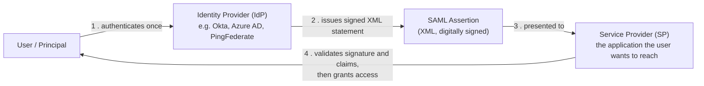

By the end of this chapter, a reader will be able to: explain SAML's three
core actors and how they differ from OIDC's equivalent roles; read and
validate the structure of a real SAML assertion, including why its XML
digital signature model is both more flexible and more historically
dangerous than a JWT's signature; trace both SP-initiated and Identity
Provider (IdP)-initiated SSO flows and articulate the real security gap
between them; read a SAML metadata document and explain what trust
relationship it establishes; and make a defensible architectural
recommendation about when a legacy SAML integration is the right call versus
when to push a vendor or internal team toward OIDC instead.

## 2. Historical Evolution

SAML's history is the history of enterprise identity federation trying to
solve the "who is this user" problem years before the modern web's
JSON/REST-first tooling existed to make that answer simple.

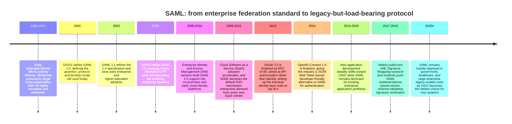

Two structural facts explain nearly everything about SAML's current place
in the industry. First, **SAML 2.0 (2005)** arrived when XML was the
default enterprise data format — Simple Object Access Protocol (SOAP) web
services, XML-based configuration, and XML Digital Signature were already
mature enterprise tooling, so SAML's design choices (a heavyweight,
extensible, deeply structured XML assertion, verified with the general-
purpose XML-DSig standard rather than a purpose-built compact signature
format) were not eccentric at the time — they were exactly what a
standards body building on 2002-2005 enterprise tooling would produce.
Second, **OIDC (2014)** arrived nearly a decade later into a completely
different default stack — JSON, REST, mobile applications, and single-page
applications that had no appetite for parsing and validating XML — and it
was explicitly designed to be simpler to implement correctly. That decade
gap is why SAML feels "old" architecturally even though it is not
insecure by design: it was built for the constraints and tooling of its
era, and enterprises that adopted it in that era have had fifteen-plus
years to build integrations, procurement contracts, and compliance
attestations around it, which is precisely the inertia Section 4.9
examines in depth.

## 3. Why It Exists

Before SAML, cross-organization authentication meant one of two bad
options: either every application maintained its own username/password
database (meaning users juggled dozens of credentials, and every
application became an independent target for credential-stuffing attacks),
or organizations built brittle, proprietary, point-to-point trust
integrations between specific pairs of systems that did not generalize and
could not scale past a handful of partners. Neither option lets a large
enterprise centralize authentication policy — multi-factor authentication
enforcement, password rotation, account deprovisioning on termination — in
one place while still letting employees reach dozens of independently
built and operated applications.

SAML exists to solve this with a specific architectural insight: separate
the party that *knows how to authenticate a user* (the Identity Provider)
from the party that *needs to know who the user is* (the Service Provider),
and standardize a signed, verifiable statement — the assertion — that lets
the second party trust the first party's authentication decision without
ever handling the user's credentials itself, and without the two parties
needing any integration beyond agreeing on a shared trust configuration
(Section 4.7).

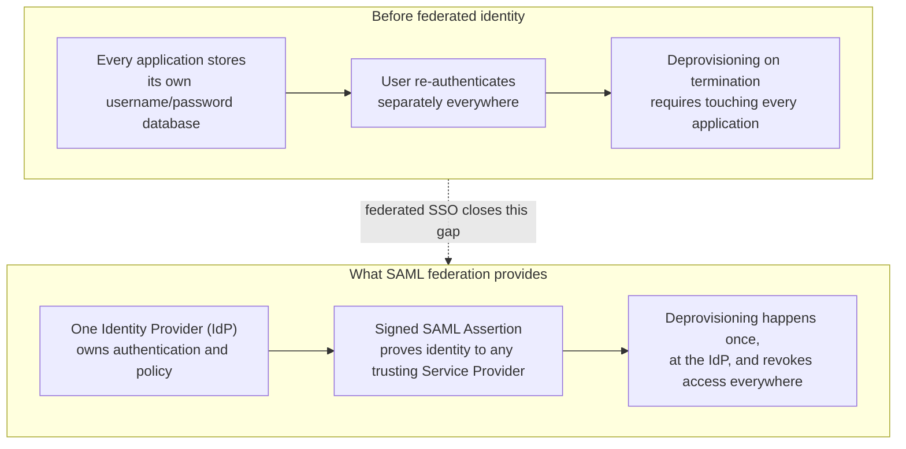

The architectural payoff is centralization without centralized coupling:
the IdP and each SP remain independently deployable systems, but identity
policy — who can authenticate, under what conditions, with what multi-
factor requirements — lives in exactly one place. This is the same
underlying motivation OIDC shares (recap:
[CH20_OIDC.md](CH20_OIDC.md) solves the identical centralization problem
for modern, JSON/REST-native applications); SAML simply solved it first,
for the enterprise web application estate of the mid-2000s, using the
XML tooling that estate already had.

## 4. Core Concepts

### 4.1 The three actors: Principal, Identity Provider, and Service Provider — and how they map to OIDC's roles

**Definition.** SAML defines three actors in every federation transaction:
the **Principal** (the end user, or more precisely the user agent —
typically a browser — acting on the user's behalf), the **Identity
Provider (IdP)** (the system that authenticates the Principal and issues
signed assertions about them), and the **Service Provider (SP)** (the
application the Principal wants to use, which trusts the IdP's assertions
instead of authenticating the Principal itself).

**Mechanism.** The Principal never presents credentials directly to the
SP. Instead, the SP redirects the Principal's browser to the IdP (Section
4.5), the IdP authenticates the Principal (via password, multi-factor
authentication, an existing session, or any mechanism the IdP chooses —
SAML deliberately does not standardize *how* the IdP authenticates, only
*what it asserts afterward*), and the IdP returns the Principal's browser
to the SP carrying a signed **SAML Assertion** (Section 4.2) as proof. The
SP validates the assertion's signature and claims and, if satisfied,
establishes its own local session for the Principal.

**Contrast with OIDC's roles (recap — full teaching in
[CH20_OIDC.md](CH20_OIDC.md)).** OIDC uses different vocabulary for a
structurally similar split: the **OpenID Provider (OP)** plays the same
role as SAML's IdP, and the **Relying Party (RP)** plays the same role as
SAML's SP. The deeper difference is not naming but the artifact each
protocol uses to carry the identity claim. SAML's IdP issues an XML
**Assertion**, signed with XML-DSig (Section 4.3), typically delivered by
having the *browser* carry it via an HTTP POST body (Section 4.8). OIDC's
OP issues a compact, JSON-based **ID Token**, signed as a JWT using JSON
Web Signature (JWS), typically delivered over a direct, back-channel
Hypertext Transfer Protocol Secure (HTTPS) call from the RP to the OP's
token endpoint rather than relayed through the browser. Both artifacts
assert the same fundamental thing — "this Principal authenticated, at this
time, with these attributes" — but the transport, format, and signature
model are genuinely different engineering choices, not just a rename.

**Decision implications.** As an architect evaluating an identity
integration, the actor names alone are not the discriminator — the
question that matters is which *artifact and transport* the counterparty
supports. A vendor that only supports "SAML 2.0 SP-initiated SSO" cannot
be integrated with an OIDC-only IdP without a translation layer (commonly
an enterprise IdP like PingFederate or Azure AD acting as a protocol
bridge — recap + forward link to
[CH23_PingFederate.md](CH23_PingFederate.md) for a concrete vendor-level
deep dive into exactly this bridging role).

**Common failure mode.** Assuming "SAML" and "SSO" are synonyms. SSO is the
general user experience goal (authenticate once, reach many applications);
SAML, OIDC, WS-Federation, and even Kerberos are all *implementations* of
SSO. An architect who says "we need SAML" when the actual requirement is
"we need SSO" risks locking a greenfield system into a fifteen-year-old
protocol when OIDC would serve the same user-facing goal with a simpler
implementation surface.

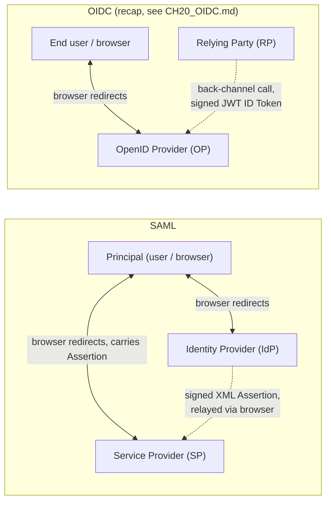

### 4.2 Anatomy of a SAML Assertion: Authentication Statement, Attribute Statement, and Conditions

**Definition.** A **SAML Assertion** is the XML document the IdP issues
that makes one or more statements about the Principal. In practice, a
production assertion almost always contains an **Authentication
Statement**, an **Attribute Statement**, and a **Conditions** block, all
wrapped inside a `<saml:Assertion>` element that itself carries the
digital signature (Section 4.3).

**Mechanism.**

- **Authentication Statement (`<saml:AuthnStatement>`)** — asserts *that*
  and *how* the Principal authenticated: the timestamp of authentication
  (`AuthnInstant`), the session index used later for logout correlation,
  and the `AuthnContextClassRef`, which tells the SP *what kind* of
  authentication occurred (e.g. password-only versus multi-factor). This
  last field matters architecturally: a SP protecting a sensitive
  operation can inspect `AuthnContextClassRef` and refuse access, or force
  step-up authentication, if the IdP only asserts a weak authentication
  context.
- **Attribute Statement (`<saml:AttributeStatement>`)** — carries
  arbitrary name/value claims about the Principal: email address, group
  memberships, department, employee ID, or any other attribute the IdP and
  SP have agreed to exchange. This is SAML's equivalent of OIDC's ID
  Token claims, but with no standardized claim set analogous to OIDC's
  `sub`, `email`, `name` — attribute names are negotiated per-integration,
  which is itself a recurring source of integration friction (Section 17).
- **Conditions (`<saml:Conditions>`)** — bounds *when* and *for whom* the
  assertion is valid: `NotBefore`/`NotOnOrAfter` timestamps (a narrow
  validity window, typically minutes, to limit replay value if the
  assertion is ever intercepted) and `AudienceRestriction`, which names the
  specific SP (by its entity identifier, Section 4.7) the assertion was
  issued for. An SP that fails to check `AudienceRestriction` will accept
  an assertion that was actually issued for a *different* SP — a real and
  recurring implementation mistake covered in Section 17.

**Decision implications.** Architecturally, `Conditions` is the assertion's
replay-defense boundary and `AuthnContextClassRef` is its step-up-
authentication signal — both deserve explicit validation logic in any SP
integration, not just "check the signature and move on." Attribute
Statement design deserves its own negotiation early in a SAML integration
project, since unlike OIDC's semi-standardized claims, every SAML
attribute name is a bespoke agreement between the specific IdP and SP.

**Common failure mode.** Treating a validly-signed assertion as
automatically trustworthy without checking `Conditions`. A signature only
proves the IdP issued *this exact byte sequence* — it says nothing about
whether the assertion has expired, was meant for this SP, or is being
replayed from an earlier session. Section 13 covers this failure mode as a
concrete security vulnerability class.

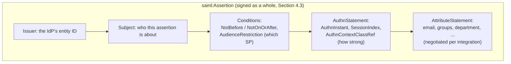

### 4.3 XML Digital Signature (XML-DSig): a more flexible, more complex trust mechanism than JWT signing

**Definition.** **XML Digital Signature (XML-DSig)**, standardized by the
World Wide Web Consortium (W3C), is the general-purpose signing mechanism
SAML uses to let an SP cryptographically verify that an assertion really
came from the IdP and was not altered in transit. Unlike a JWT's signature
— which covers the *entire* compact token as one opaque signed blob — an
XML-DSig signature can be attached to, and cover, an arbitrary XML element
*within* a larger document, which is the source of both its power and its
historical danger (Section 4.4).

**Mechanism.** Validating an XML-DSig signature is a multi-step process,
each step of which matters:

1. **Canonicalization (C14N)** — because XML allows semantically identical
   documents to be written with different whitespace, attribute ordering,
   and namespace prefixes, the signer and verifier must first transform
   the signed element into one deterministic, canonical byte sequence
   using an agreed canonicalization algorithm — otherwise a byte-for-byte
   hash comparison would fail even for two documents an XML parser
   considers identical.
2. **Digest computation** — the verifier computes a cryptographic hash
   (digest) of the canonicalized element and compares it against the
   digest value embedded in the signature's `<Reference>` element.
3. **Signature verification** — the verifier checks that the signature
   value, decrypted with the signing certificate's public key, matches the
   digest computed in step 2.
4. **Reference resolution** — critically, the `<Reference URI="...">`
   attribute names *which element in the document* was actually signed —
   this is not automatically "the whole assertion" unless the reference
   explicitly points at the assertion's own root element, and this single
   design choice is exactly what XML Signature Wrapping attacks (Section
   4.4) exploit.

**Why this is genuinely more complex than JWT signing.** A JWT's signature
covers the entire token — header and payload — as one opaque, concatenated
string; there is no equivalent of "which sub-element was signed" because
there is only one thing to sign. XML-DSig's ability to sign a sub-element
of a larger document is a deliberate, useful design property for SOAP-era
use cases (signing one part of a larger multi-part XML message while
leaving other parts editable), but for SAML specifically it introduces a
structural ambiguity — *the document structure itself*, separately from
the signature, determines what the SP treats as "the assertion" — that a
naive validator can get catastrophically wrong (Section 4.4).

**Decision implications.** Architects and implementers must never write
custom XML-DSig verification code. Every mainstream SAML library (e.g.
`OneLogin/python3-saml`, Spring Security SAML, `passport-saml` for
Node.js, or a vendor SDK) has already encoded the hard-won lessons from
years of XML Signature Wrapping research into its validation logic —
specifically, resolving the signed reference *and* independently locating
the assertion being processed, then confirming they are the *same node*,
not merely nodes with the same ID. Rolling a bespoke XML parser-plus-
signature-check is one of the highest-risk custom-crypto decisions an
architect can approve.

**Common failure mode.** A validator that finds *an* element with a
matching `ID` attribute anywhere in the document and treats it as "the
signed element," instead of confirming the signature's reference points at
the exact node the business logic subsequently reads claims from. This is
precisely the vulnerability class taught next.

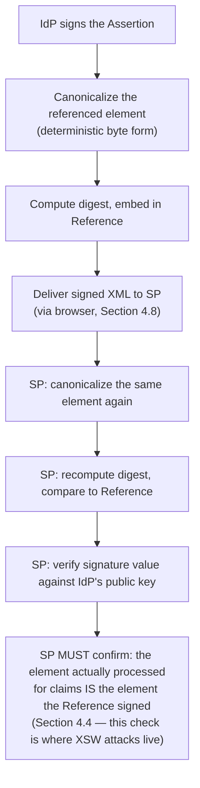

### 4.4 XML Signature Wrapping (XSW): the teachable vulnerability class unique to SAML's signature model

**Definition.** An **XML Signature Wrapping (XSW)** attack exploits the gap
between *what an XML-DSig signature covers* and *what element the
application logic actually reads claims from*. An attacker who can inject
or restructure the surrounding XML — without ever forging a signature —
can trick a poorly-written validator into checking a legitimately signed
element while the application's business logic silently reads attacker-
controlled claims from a different, unsigned element nearby.

**Mechanism.** A representative XSW attack works like this: the attacker
intercepts (or otherwise obtains) a legitimately signed assertion for their
own low-privilege account. They then construct a *new* XML document that
wraps the original, legitimately-signed assertion inside a decoy structure
— for example, moving the original signed assertion into a child position
and inserting a *new*, unsigned assertion (claiming to be an administrator,
or a different user entirely) as a sibling or ancestor with the *same*
element `ID` the signature's `Reference` still points to. A naive
validator does two things separately and never cross-checks them: it (a)
resolves the `Reference` by `ID` and confirms *that* element's signature is
valid — which succeeds, because it is the original, untouched, legitimately
signed element — and (b) separately hands "the assertion" to the
application's business logic by, say, taking the *first* `<saml:Assertion>`
element found in document order, which is the attacker's *forged, unsigned*
sibling. The signature check passes; the claims actually consumed are
entirely attacker-controlled.

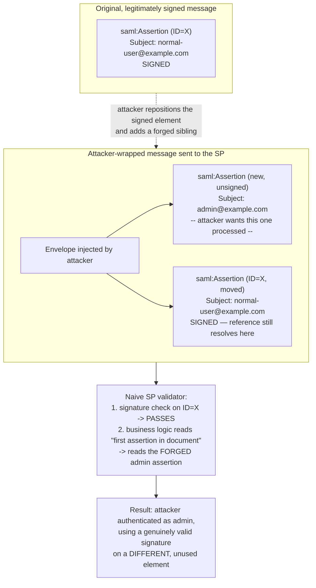

**Why this vulnerability class is specific to SAML's signing model, not
JWT's.** A JWT has no equivalent structural ambiguity to exploit — the
signature covers the entire token, and there is exactly one payload to
read claims from, so there is no "signed element versus processed element"
gap for an attacker to open up. This is the direct, concrete payoff of
Section 4.3's more abstract point: XML-DSig's flexibility (signing an
arbitrary sub-element) is genuinely useful for other XML use cases, but it
is also the root cause of a vulnerability class that has no analog in
OIDC's simpler, whole-token JWS signing model.

**Decision implications.** The architectural mitigation is process, not
just code: mandate a maintained, security-reviewed SAML library for every
SP integration (never hand-rolled XML parsing plus signature checks — see
Section 4.3), require that the validation logic resolves the assertion
strictly through the *signed reference's own node*, not through a separate
"find the first assertion" traversal, and where possible require the IdP
to encrypt the assertion (`saml:EncryptedAssertion`) in addition to signing
it, since an encrypted assertion is far harder for an on-path or
XML-manipulating attacker to restructure at all.

**Common failure mode.** Relying on a custom XML parsing layer (common in
older, hand-built Simple Object Access Protocol (SOAP)/enterprise
integration code) that was written before XSW research (roughly 2012-2019)
became widely known, and has never been re-audited against it. Section 13
returns to this as this chapter's primary security case study.

### 4.5 SP-initiated SSO flow

**Definition.** In **SP-initiated SSO**, the Principal starts at the
Service Provider (for example, by navigating directly to
`https://app.example.com`), and the SP redirects them to the IdP to
authenticate before returning them, with an assertion, back to the
originally requested resource.

**Mechanism.** The critical architectural detail is the **RelayState**
parameter: when the SP redirects the Principal to the IdP, it includes an
opaque `RelayState` value — commonly a signed or server-side-tracked token
encoding *which resource the Principal originally requested* — and the IdP
is required to echo this same `RelayState` value back to the SP alongside
the assertion. This gives the SP two things simultaneously: it can send the
Principal back to the exact page they originally wanted (not just a
generic post-login landing page), and — just as importantly for security —
it can verify that the assertion it just received corresponds to a login
attempt *this SP itself actually initiated*, because it can check the
returned `RelayState` against a value it tracked when the flow began.

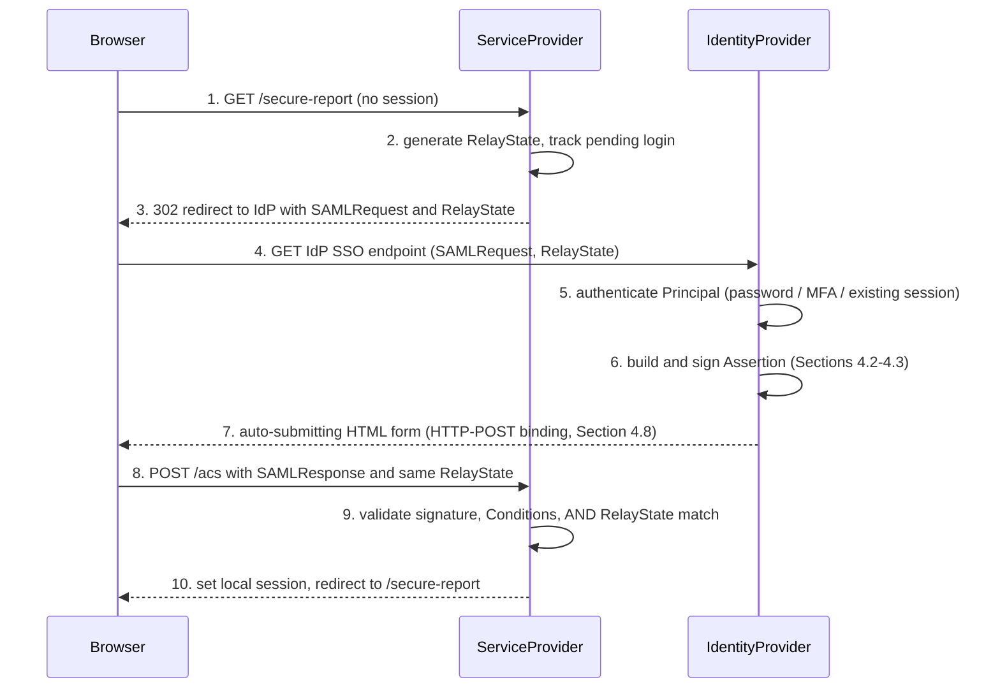

**Decision implications.** The `RelayState` round-trip is the closest
SAML equivalent to OIDC's `state` parameter, and it exists for the same
reason: to bind the response the SP receives back to a request the SP
itself initiated, closing off cross-site request forgery style attacks
where an attacker tries to inject an assertion the SP never asked for.
Section 4.6 examines exactly what breaks when this binding is absent.

**Common failure mode.** Implementing the Assertion Consumer Service (ACS)
endpoint (`/acs` above) to accept a `SAMLResponse` without checking that
the request also carried the exact `RelayState` value the SP itself
generated and tracked — this silently degrades an SP-initiated integration
into having the same weaker guarantee as an IdP-initiated flow, without
anyone realizing the protection was lost.

### 4.6 IdP-initiated SSO flow — and the security gap it doesn't close

**Definition.** In **IdP-initiated SSO**, the Principal starts at the
Identity Provider (for example, clicking an application tile on an
enterprise IdP's dashboard, such as Okta's or Azure AD's app launcher), and
the IdP sends the Principal directly to the SP with an assertion, without
the SP having issued any prior request.

**Mechanism.** Because there was no preceding `AuthnRequest` from the SP,
there is no `RelayState` the SP generated and can check on return — the
IdP simply POSTs an unsolicited `SAMLResponse` to the SP's ACS endpoint.
The SP can (and must) still validate the assertion's signature, Conditions,
and audience restriction — but it has no way to confirm that *this specific
assertion delivery corresponds to a login flow the SP itself is aware of
being in progress*, because from the SP's point of view, none was.

**The real security risk — explained precisely, not just labeled.** This
is architecturally analogous to the Cross-Site Request Forgery (CSRF)
problem in ordinary web applications: an attacker who can get a victim's
browser to submit an unsolicited, otherwise-valid SAML response to an SP's
ACS endpoint can potentially force a login the victim never initiated
(so-called SSO login CSRF), because the SP-initiated flow's one real
countermeasure — tracking a locally-generated `RelayState` and confirming
it round-trips unchanged — simply does not exist in the IdP-initiated
model. In practice, replaying a captured, still-valid assertion this way is
constrained by `Conditions` (Section 4.2, the narrow `NotOnOrAfter` window)
and by requiring the assertion to have been genuinely signed by the real
IdP, so this is not an unauthenticated bypass — but it removes a defense-
in-depth layer that SP-initiated flows have for free, and several real
identity-provider security advisories over the years have centered on
exactly this gap when an SP's ACS endpoint additionally failed to enforce
Conditions strictly.

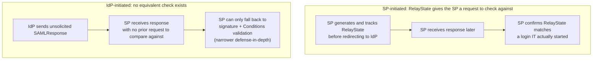

**Decision implications.** Where an SP supports both modes, architects
should prefer SP-initiated flows for anything security-sensitive, and treat
IdP-initiated support as a convenience feature that must be paired with
strict, non-negotiable `Conditions` enforcement (narrow validity windows,
strict `AudienceRestriction` checks, and ideally a one-time-use replay
cache keyed on the assertion's `ID`) precisely because the `RelayState`
safety net is unavailable.

**Common failure mode.** Enabling IdP-initiated SSO for convenience (it is
a common enterprise IdP default, since it powers app-launcher dashboards)
without also implementing an assertion replay cache — an assertion is only
protected by its narrow time window, and if that window is set too
generously (a real, recurring misconfiguration), a captured assertion
remains usable for longer than intended.

### 4.7 SAML metadata: the XML document that establishes trust

**Definition.** **SAML metadata** is a standardized XML document — either
the IdP's or the SP's — that declares everything the other party needs to
establish trust and communicate correctly: the entity's unique identifier
(`entityID`), its supported bindings and endpoint URLs (Section 4.8), and
critically, the signing (and optionally encryption) certificate the other
party must use to verify assertions or encrypt data.

**Mechanism.** An IdP publishes metadata describing its Single Sign-On
Uniform Resource Locator (URL), the SSO bindings it supports, and its
public signing certificate. An SP publishes metadata describing its
Assertion Consumer Service (ACS) URL(s), its `entityID` (used in
`AudienceRestriction`, Section 4.2), and optionally its own certificate if
it wants the IdP to encrypt assertions specifically for it. Establishing a
new SAML federation is, mechanically, the exchange of these two documents
— often via a metadata URL each side can periodically re-fetch, or via a
one-time manual exchange for smaller or offline-only integrations — after
which both sides can independently validate and construct requests without
any further out-of-band coordination.

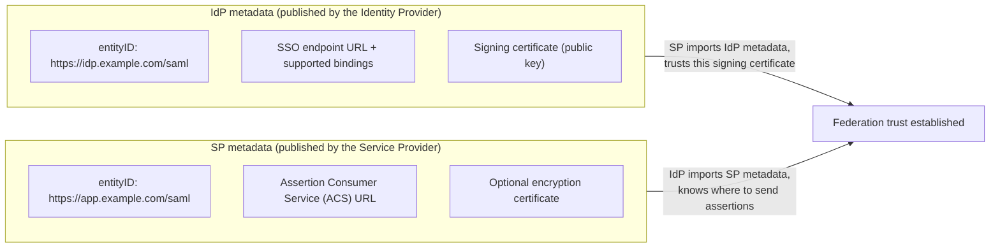

**Contrast with OIDC's discovery document (recap — full teaching in
[CH20_OIDC.md](CH20_OIDC.md)).** OIDC solves the equivalent trust-bootstrap
problem with a JSON discovery document
(`/.well-known/openid-configuration`) that an RP fetches from a single,
predictable, well-known URL to learn the OP's endpoints and signing keys
(via a linked JSON Web Key Set). SAML metadata is functionally analogous —
both exist to let one party learn the other's endpoints and public keys
without manual configuration — but SAML metadata is a heavier, more
XML-Schema-constrained document, commonly exchanged manually (uploaded as
a file into an admin console) rather than fetched live from a single
predictable, standardized path, which is itself part of why SAML
integrations are commonly perceived as more operationally heavyweight to
set up than an equivalent OIDC integration.

**Decision implications.** Architects should treat metadata exchange as a
governed, change-controlled artifact, not a one-time setup step: certificate
rotation at the IdP (a routine security practice) requires the SP to
refresh its trusted metadata, and a stale, unrefreshed SP-side metadata
cache is one of the most common causes of a sudden, fleet-wide SSO outage
after a routine IdP certificate rotation (Section 15).

**Common failure mode.** Manually pasting a certificate's contents into an
SP's configuration once, at initial setup, instead of configuring the SP
to periodically re-fetch the IdP's metadata URL — this quietly turns a
routine IdP-side certificate rotation into an unplanned, fleet-wide outage
the SP-side team discovers only when authentication starts failing.

### 4.8 SAML bindings: how the assertion actually travels between IdP and SP

**Definition.** A **binding** in SAML is the specific mechanism used to
transport a SAML request or response between parties. The three that
matter in practice are **HTTP-Redirect**, **HTTP-POST**, and (less
commonly today) **Artifact**.

**Mechanism.**

- **HTTP-Redirect binding** — used almost exclusively for the *request*
  leg (SP to IdP): the SP encodes the `AuthnRequest` (deflated and
  Base64-encoded) directly into the redirect URL's query string. This
  works because requests are relatively small, and Uniform Resource
  Locator (URL) length limits are rarely a practical constraint for them.
- **HTTP-POST binding** — used almost universally for the *response* leg
  (IdP to SP): because a full signed assertion is far too large to fit
  safely in a URL, the IdP instead returns an auto-submitting HTML form
  (the pattern shown in Section 4.5's sequence diagram, step 7) whose
  hidden field carries the Base64-encoded `SAMLResponse`, and whose
  JavaScript automatically submits the form to the SP's ACS URL the
  instant the page loads.
- **Artifact binding** — instead of sending the full assertion through the
  browser at all, the IdP sends only a small, opaque reference (an
  "artifact") through the browser, and the SP then makes a direct,
  back-channel call to the IdP to exchange that artifact for the actual
  assertion. This avoids ever putting assertion content in the browser's
  path, at the cost of requiring a live back-channel connection between SP
  and IdP at response time — a meaningfully heavier operational
  dependency, which is why most modern deployments prefer HTTP-POST.

**Decision implications.** For a Solution Architect reviewing a new SAML
integration, HTTP-Redirect for requests and HTTP-POST for responses is the
overwhelmingly standard, lowest-friction combination and should be the
default recommendation; Artifact binding is worth considering only when
policy specifically requires that assertion content never transit the
browser at all (some especially conservative government or financial
deployments do require this).

**Common failure mode.** Assuming the request and response legs use the
same binding — they very often do not, and misconfiguring an SP to expect
an HTTP-Redirect-bound response (which would silently truncate or fail on
a realistically sized signed assertion) is a straightforward, avoidable
integration bug.

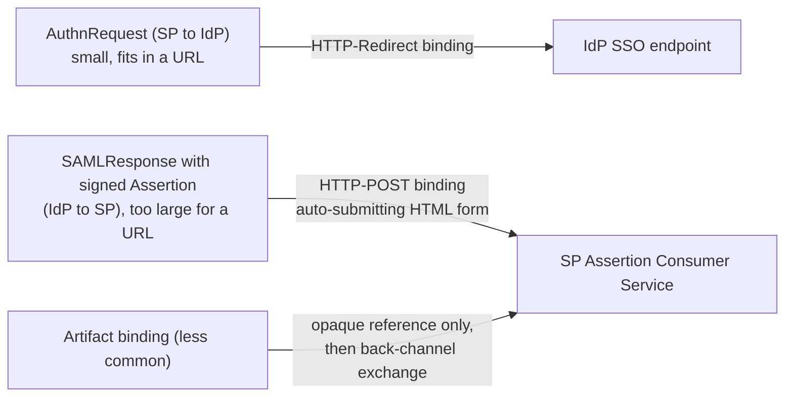

### 4.9 Why large enterprises still run SAML: a "why do old protocols persist" architecture lesson

**Definition.** Protocol persistence is the general architectural
phenomenon where a technically superseded standard remains in heavy
production use long after its replacement is available and widely
recommended, because the *cost of migration* — not the technical merit of
the old protocol — is the actual constraint governing the decision.

**Mechanism — the specific forces keeping SAML alive in enterprises.**

- **Sunk vendor and procurement investment.** Many large enterprise
  applications — ERP suites, human resources platforms, older SaaS
  vendors — were procured and integrated at a time when SAML was the only
  SSO option the vendor offered, sometimes under multi-year contracts.
  Migrating authentication protocol is rarely a standalone project; it
  competes for budget and engineering time against every other initiative,
  and "authentication already works" is a difficult line item to justify
  re-funding purely for protocol modernity.
- **Existing IdP investment and organizational trust boundaries.**
  Enterprises that built their IAM program around an on-premises or
  early-cloud IdP with mature SAML tooling, audited configurations, and
  established change-management processes face real switching costs —
  and real audit/compliance risk in the switch itself — in re-platforming
  to an OIDC-first identity stack, even where the destination stack is
  technically simpler.
- **Government and regulated-industry compliance requirements.** Some
  government and healthcare procurement standards were written against
  SAML-era federation requirements and have not been rewritten to
  reference OIDC explicitly; vendors selling into those markets must keep
  supporting SAML regardless of what they'd otherwise prefer to build.
- **Legacy application inability to be modified at all.** Some enterprise
  applications are maintained under support contracts with no engineering
  capacity (or source access) to add a new authentication protocol —
  SAML support, once integrated, effectively becomes permanent for the
  life of that application.

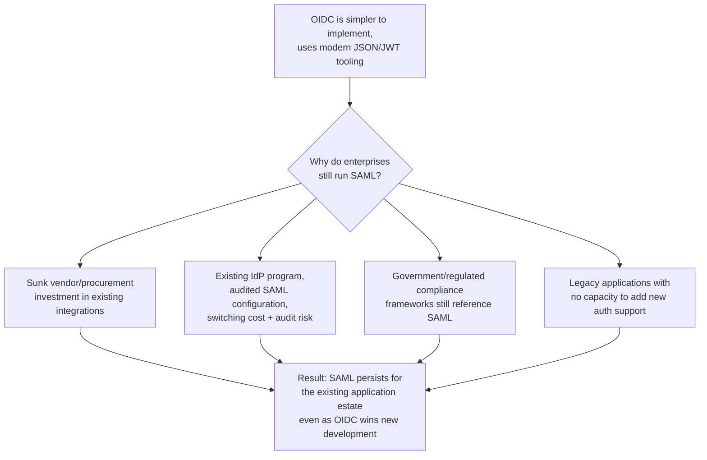

**Decision implications.** The correct architectural stance is not "rip out
SAML" or "SAML is obsolete, ignore it" — it is a portfolio decision: default
new application development to OIDC (owned in full by
[CH20_OIDC.md](CH20_OIDC.md)), while treating SAML support as an ongoing,
budgeted maintenance capability for the existing application estate, with
migration to OIDC considered opportunistically whenever an application is
being substantially re-platformed anyway, rather than as a standalone
protocol-migration initiative competing for its own dedicated budget.

**Common failure mode.** Architects who treat "we still use SAML" as
evidence of technical negligence, rather than recognizing it as a rational
response to real, quantifiable migration costs — this framing tends to
produce unfunded, deprioritized "someday" migration projects instead of the
realistic, opportunistic migration-on-replatform strategy that actually
succeeds in large enterprises.

### 4.10 Typical deployment context: enterprise Identity Providers

**Definition.** In production, very few enterprises build a SAML IdP from
scratch — they run a commercial or open-source **enterprise Identity
Provider** product that implements the full SAML (and usually OIDC)
protocol surface, provides an administrative console for managing SP
integrations and users, and handles the operational concerns (certificate
rotation, high availability, multi-factor authentication policy) this
chapter's protocol-level teaching assumes are already solved.

**Mechanism.** The most common enterprise IdP products an architect will
encounter are Okta, Microsoft Entra ID (formerly Azure Active Directory),
and Ping Identity's **PingFederate** — all of which expose the same core
SAML concepts this chapter has taught (metadata, assertions, bindings)
behind a vendor-specific administrative user interface and configuration
model, and all of which commonly act as protocol bridges, accepting a
login via one protocol (say, a corporate OIDC or Kerberos-based internal
login) and issuing a SAML assertion outward to a legacy SP that only
understands SAML, or vice versa.

**Recap and forward link.** This chapter deliberately does not re-teach any
specific vendor's administrative console, configuration screens, or
deployment topology — that concrete, vendor-specific depth belongs to
[CH23_PingFederate.md](CH23_PingFederate.md), which covers exactly this:
how a real enterprise Identity Provider is deployed, configured, and
operated as protocol-bridging infrastructure between an organization's
internal identity source of truth and both SAML and OIDC-based
applications.

**Decision implications.** When scoping an identity integration project,
architects should identify the enterprise IdP product in play early, since
the *protocol* teaching in this chapter is portable across vendors, but
practical concerns — certificate rotation cadence, attribute-mapping user
interface, support for encrypted assertions, IdP-initiated versus
SP-initiated defaults — vary meaningfully vendor to vendor and materially
affect an integration's timeline and risk.

**Common failure mode.** Scoping a SAML integration purely from the
protocol specification without confirming which specific enterprise IdP
product the counterparty runs, and what that product's specific defaults,
quirks, and administrative constraints are — protocol conformance does not
guarantee operational compatibility with a specific vendor's
implementation choices.

## 5. Internal Working

Tracing a single SP-initiated login end to end, at the level of what each
party actually does internally (not just what crosses the wire), makes
explicit every validation step an SP implementation must perform correctly.

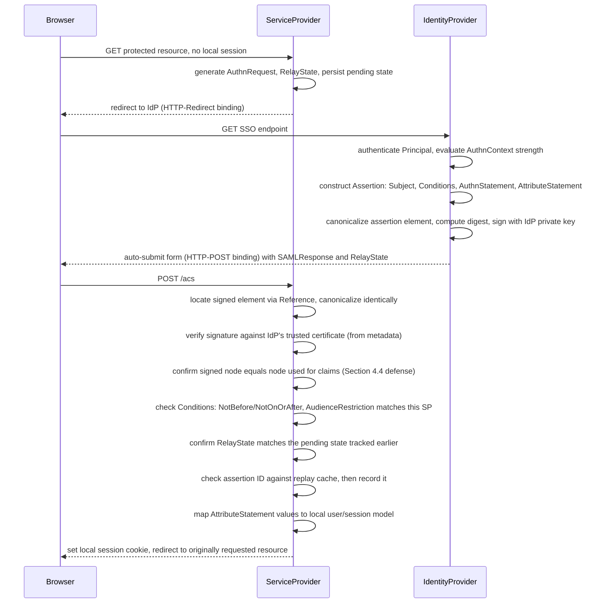

Every step after "verify signature against IdP's trusted certificate" is a
place implementations have historically cut corners — skipping the
signed-node-versus-processed-node check enables XML Signature Wrapping
(Section 4.4); skipping `Conditions` enforcement widens the replay window;
skipping the `RelayState` match degrades SP-initiated security to
IdP-initiated levels (Section 4.6); skipping the replay cache allows a
captured, still-valid assertion to be reused until it naturally expires.
A production-grade SP integration performs every one of these checks, not
just signature verification.

## 6. Design Principles

- **Trust the reference, not the position.** Never assume "the assertion"
  is whatever element appears first, or has the friendliest tag name, in a
  document — always resolve strictly through the signature's own
  `Reference`, and confirm that node is the one claims are read from
  (Section 4.4).
- **Bind requests to responses whenever the flow allows it.** SP-initiated
  flows should always track and verify `RelayState`; where IdP-initiated
  flows are unavoidable, compensate with strict `Conditions` and replay-
  cache enforcement (Section 4.6).
- **Treat metadata as a living trust contract, not a one-time file
  upload.** Certificate rotation is routine and expected; metadata
  refresh should be automated wherever the counterparty supports a
  fetchable metadata URL (Section 4.7).
- **Prefer library-verified cryptography over bespoke XML handling.**
  XML-DSig's flexibility is exactly what makes hand-rolled verification
  dangerous — always delegate to a maintained, security-reviewed SAML
  library (Section 4.3).
- **Design attribute contracts explicitly, in writing, per integration.**
  Because SAML has no standardized claim set analogous to OIDC's, every
  IdP-SP pair must agree on attribute names and semantics up front, and
  that agreement should be a documented artifact, not tribal knowledge.

## 7. Architecture Patterns

The most common enterprise pattern is not a single IdP talking to a single
SP, but a **hub-and-spoke federation**, where one enterprise IdP acts as the
hub trusted by many SPs (the spokes), and often additionally as a **protocol
bridge** translating between an organization's internal identity source
(which may itself be OIDC-based, Kerberos-based, or a proprietary directory)
and the SAML (or OIDC) protocol each individual SP requires.

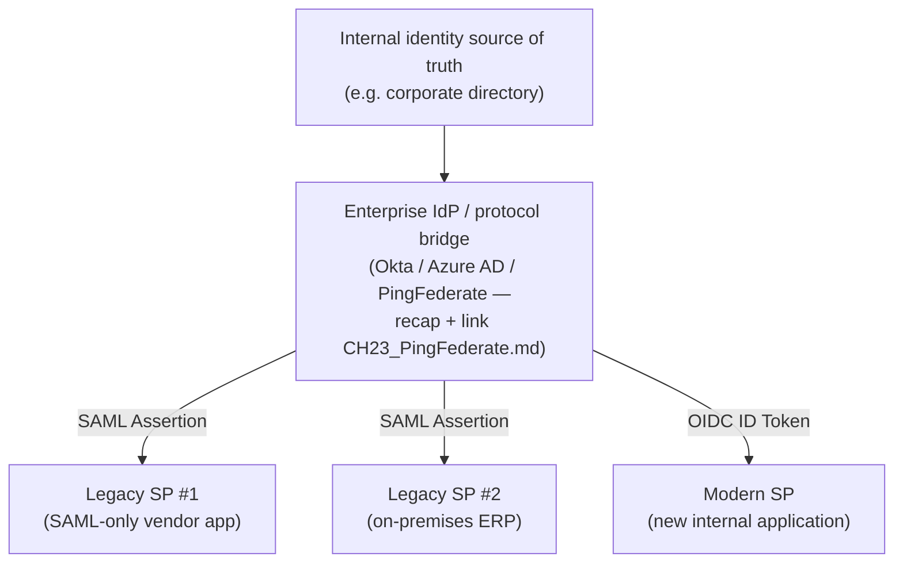

A second common pattern is **cross-domain B2B federation**, where two
separate organizations (a large enterprise and one of its enterprise
customers or partners) each run their own IdP, and establish a direct,
bilateral SAML metadata exchange (Section 4.7) so that the partner
organization's employees can SSO directly into the vendor's application
using their own employer's IdP, without the vendor ever managing those
users' credentials.

## 8. Production Architecture

A production SAML deployment is rarely just "an IdP and an SP" — it
typically includes a load-balanced pair (or cluster) of IdP nodes behind a
virtual IP or reverse proxy, a certificate lifecycle process for the
signing key (commonly backed by a Hardware Security Module (HSM) or a
managed key vault for the highest-value signing keys), and, for every SP,
an ACS endpoint that is itself part of the SP's normal deployed application
— there is no separate "SAML server" on the SP side in most architectures;
SAML validation logic is a library embedded directly in the application.

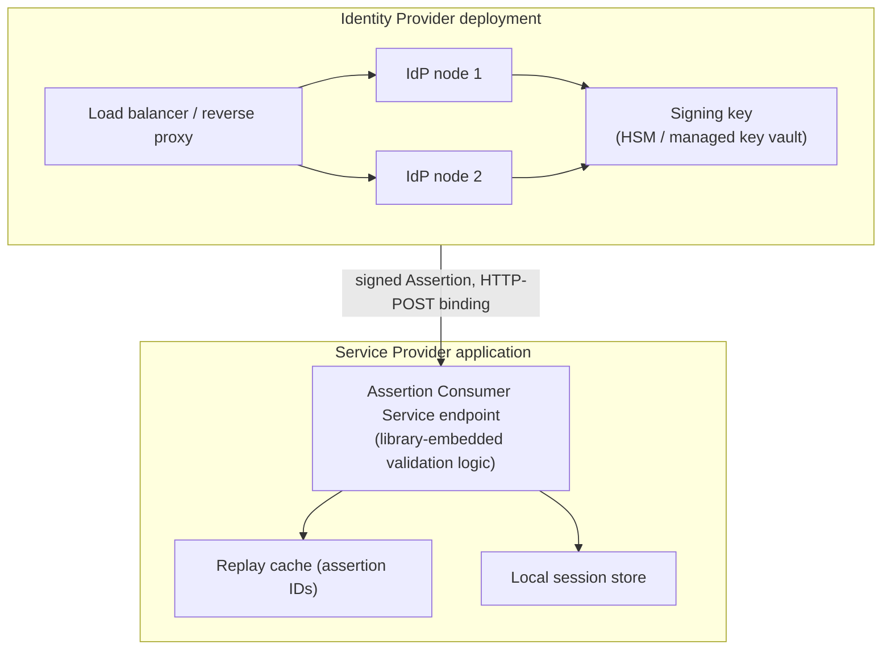

## 9. Implementation

Standing up a new SAML integration, from the SP side, typically follows
this sequence: (1) generate or obtain the SP's own signing/encryption key
pair and publish SP metadata (Section 4.7); (2) import the IdP's metadata
and pin its signing certificate as trusted; (3) implement (or, far more
commonly, configure a library for) the ACS endpoint, wiring in the checks
traced in Section 5; (4) agree the attribute contract with the IdP team
and map incoming `AttributeStatement` values to the SP's local user model;
(5) test both the happy path and the negative-path validations (expired
assertion, wrong audience, tampered signature) before go-live; (6)
establish a metadata-refresh or certificate-rotation runbook so a future
IdP key rotation does not become an unplanned outage.

## 10. Complete Code Examples

**Example 1 — A representative signed SAML Assertion (abridged, illustrative
structure).**

```xml
<saml:Assertion xmlns:saml="urn:oasis:names:tc:SAML:2.0:assertion"
                 ID="_a75adf55-01d7-40cc-929f-dbd8372ebdfc"
                 IssueInstant="2026-08-01T09:15:03Z" Version="2.0">
  <saml:Issuer>https://idp.example.com/saml</saml:Issuer>
  <ds:Signature xmlns:ds="http://www.w3.org/2000/09/xmldsig#">
    <ds:SignedInfo>
      <ds:CanonicalizationMethod
          Algorithm="http://www.w3.org/2001/10/xml-exc-c14n#"/>
      <ds:SignatureMethod
          Algorithm="http://www.w3.org/2001/04/xmldsig-more#rsa-sha256"/>
      <ds:Reference URI="#_a75adf55-01d7-40cc-929f-dbd8372ebdfc">
        <ds:Transforms>
          <ds:Transform
              Algorithm="http://www.w3.org/2000/09/xmldsig#enveloped-signature"/>
          <ds:Transform
              Algorithm="http://www.w3.org/2001/10/xml-exc-c14n#"/>
        </ds:Transforms>
        <ds:DigestMethod Algorithm="http://www.w3.org/2001/04/xmlenc#sha256"/>
        <ds:DigestValue>2jmj7l5rSw0yVb/vlWAYkK/YBwk=</ds:DigestValue>
      </ds:Reference>
    </ds:SignedInfo>
    <ds:SignatureValue>Base64EncodedSignatureValueHere==</ds:SignatureValue>
    <ds:KeyInfo>
      <ds:X509Data>
        <ds:X509Certificate>MIIDXTCCAkWgAwIBAgIJAP...</ds:X509Certificate>
      </ds:X509Data>
    </ds:KeyInfo>
  </ds:Signature>
  <saml:Subject>
    <saml:NameID Format="urn:oasis:names:tc:SAML:1.1:nameid-format:emailAddress">
      jordan.rivera@example.com
    </saml:NameID>
    <saml:SubjectConfirmation Method="urn:oasis:names:tc:SAML:2.0:cm:bearer">
      <saml:SubjectConfirmationData
          NotOnOrAfter="2026-08-01T09:20:03Z"
          Recipient="https://app.example.com/saml/acs"
          InResponseTo="_req-3f9c1e"/>
    </saml:SubjectConfirmation>
  </saml:Subject>
  <saml:Conditions NotBefore="2026-08-01T09:14:33Z"
                    NotOnOrAfter="2026-08-01T09:20:03Z">
    <saml:AudienceRestriction>
      <saml:Audience>https://app.example.com/saml</saml:Audience>
    </saml:AudienceRestriction>
  </saml:Conditions>
  <saml:AuthnStatement AuthnInstant="2026-08-01T09:15:00Z"
                         SessionIndex="_sess-88ab21">
    <saml:AuthnContext>
      <saml:AuthnContextClassRef>
        urn:oasis:names:tc:SAML:2.0:ac:classes:PasswordProtectedTransport
      </saml:AuthnContextClassRef>
    </saml:AuthnContext>
  </saml:AuthnStatement>
  <saml:AttributeStatement>
    <saml:Attribute Name="email">
      <saml:AttributeValue>jordan.rivera@example.com</saml:AttributeValue>
    </saml:Attribute>
    <saml:Attribute Name="department">
      <saml:AttributeValue>Platform Engineering</saml:AttributeValue>
    </saml:Attribute>
  </saml:AttributeStatement>
</saml:Assertion>
```

Note how `Reference URI` (pointing at this exact assertion's `ID`),
`Conditions` (narrow validity window, explicit `AudienceRestriction`), and
`AuthnContextClassRef` (asserting only password-based authentication
occurred) are the fields Sections 4.2-4.4 identified as the ones a
validator must check explicitly rather than assume.

**Example 2 — SP-initiated SSO flow trace (HTTP request/response level).**

```text
1. Browser -> SP:
   GET https://app.example.com/reports/q3 HTTP/1.1
   (no session cookie present)

2. SP -> Browser: 302 Found
   Location: https://idp.example.com/saml/sso
       ?SAMLRequest=fZFBa8...   (deflated, base64-encoded AuthnRequest)
       &RelayState=8f0af2c1-tracked-server-side

3. Browser -> IdP:
   GET /saml/sso?SAMLRequest=...&RelayState=8f0af2c1-tracked-server-side

   [IdP authenticates the Principal — password + MFA prompt shown here]

4. IdP -> Browser: 200 OK (auto-submitting HTML form)
   <form method="POST" action="https://app.example.com/saml/acs">
     <input type="hidden" name="SAMLResponse" value="PHNhbWxwOl...">
     <input type="hidden" name="RelayState" value="8f0af2c1-tracked-server-side">
     <script>document.forms[0].submit();</script>
   </form>

5. Browser -> SP:
   POST /saml/acs HTTP/1.1
   Content-Type: application/x-www-form-urlencoded
   SAMLResponse=PHNhbWxwOl...&RelayState=8f0af2c1-tracked-server-side

6. SP internally: validate signature, Conditions, RelayState match,
   replay cache check (Section 5) -> all pass

7. SP -> Browser: 302 Found
   Location: https://app.example.com/reports/q3
   Set-Cookie: app_session=...; Secure; HttpOnly; SameSite=Lax
```

**Example 3 — SAML metadata document (IdP side, abridged).**

```xml
<md:EntityDescriptor xmlns:md="urn:oasis:names:tc:SAML:2.0:metadata"
                      entityID="https://idp.example.com/saml">
  <md:IDPSSODescriptor
      protocolSupportEnumeration="urn:oasis:names:tc:SAML:2.0:protocol"
      WantAuthnRequestsSigned="true">
    <md:KeyDescriptor use="signing">
      <ds:KeyInfo xmlns:ds="http://www.w3.org/2000/09/xmldsig#">
        <ds:X509Data>
          <ds:X509Certificate>MIIDXTCCAkWgAwIBAgIJAP...</ds:X509Certificate>
        </ds:X509Data>
      </ds:KeyInfo>
    </md:KeyDescriptor>
    <md:SingleSignOnService
        Binding="urn:oasis:names:tc:SAML:2.0:bindings:HTTP-Redirect"
        Location="https://idp.example.com/saml/sso"/>
    <md:SingleSignOnService
        Binding="urn:oasis:names:tc:SAML:2.0:bindings:HTTP-POST"
        Location="https://idp.example.com/saml/sso"/>
  </md:IDPSSODescriptor>
</md:EntityDescriptor>
```

An SP imports this document (ideally via a periodically re-fetched
metadata URL, Section 4.7) to learn the IdP's `entityID`, trusted signing
certificate, and SSO endpoint — no other manual configuration should be
required.

## 11. Performance

SAML's cryptographic and XML-processing overhead is dominated by two
costs: RSA (or ECDSA (Elliptic Curve Digital Signature Algorithm))
signature verification (a fixed, small per-request cost, generally
sub-millisecond to a few milliseconds on modern hardware) and XML
canonicalization/parsing, which — unlike JWT's simple string-split-and-
Base64-decode — requires a full XML parse and a canonicalization pass over
the signed subtree. For typical enterprise login volumes (interactive,
human-driven SSO events rather than high-frequency API calls) this
overhead is immaterial to end-user latency; it becomes a genuine capacity
planning concern only in unusually high-volume federation scenarios (for
example, an IdP acting as a shared SSO hub for very large employee
populations logging in simultaneously at the start of a business day),
where IdP node horizontal scaling (Section 8) is the standard mitigation.

## 12. Scalability

IdP scalability is handled the same way any stateless-per-request
authentication service scales: horizontal replica scaling behind a load
balancer, since assertion issuance requires no shared mutable state beyond
the signing key itself (which every replica can share via an HSM or key
vault, Section 8). SP-side scalability is typically bound by the replay
cache (Section 5) rather than by signature verification cost — a
distributed cache (for example, keyed by assertion ID with a Time to Live
(TTL) matching `Conditions`' validity window) must be shared across every
SP application instance, or a captured assertion could be replayed against
a *different* instance's local, unsynchronized cache.

## 13. Security

This section consolidates the security teaching distributed through
Section 4 into an explicit checklist, since SAML security failures are
disproportionately implementation and configuration failures rather than
protocol-design failures.

- **XML Signature Wrapping (Section 4.4)** — the highest-severity, most
  SAML-specific vulnerability class; mitigated only by using a maintained
  library that strictly resolves claims through the signed reference node.
- **Missing or weak `Conditions` enforcement (Section 4.2)** — failing to
  check `NotBefore`/`NotOnOrAfter` or `AudienceRestriction` turns a
  narrowly-scoped assertion into a broadly reusable one.
- **IdP-initiated SSO without a replay cache (Section 4.6)** — the missing
  `RelayState` binding must be compensated for with strict, enforced
  one-time-use semantics.
- **Assertion encryption for sensitive attributes** — `saml:
  EncryptedAssertion` (or encrypting individual attributes) prevents an
  on-path party from reading sensitive claims even if they can observe the
  signed, browser-relayed traffic; this matters more for SAML than for a
  typical OIDC deployment because the assertion transits the user's
  browser rather than a direct back-channel call.
- **Certificate rotation discipline (Section 4.7)** — an SP that pins a
  certificate instead of trusting a refreshable metadata source turns a
  routine IdP key rotation into an outage; treat certificate lifecycle as
  an operational process, not a one-time setup step.
- **Logout is genuinely hard.** SAML Single Logout (SLO) requires the IdP
  to notify every SP that received an assertion tied to the terminated
  session, which is a fan-out operation that can partially fail (one SP's
  logout endpoint is unreachable) — architects should not assume SLO
  guarantees every SP session is actually terminated, and should design
  session-timeout defaults defensively rather than relying on SLO as the
  only termination mechanism.

## 14. Observability

Production SAML deployments should log, at minimum: every assertion's
`ID` (for replay-cache correlation and forensic tracing), the `Issuer` and
intended `Audience`, the `AuthnContextClassRef` (to detect unexpected
authentication-strength downgrades), and every validation failure with its
specific rejection reason (expired, wrong audience, signature mismatch,
RelayState mismatch, replay detected) rather than a single generic "SSO
failed" log line — because each of those failure reasons points to a
different root cause (a clock-skew problem, a metadata staleness problem,
an actual attack, or a genuine integration misconfiguration), and
collapsing them into one log line makes triage far slower.

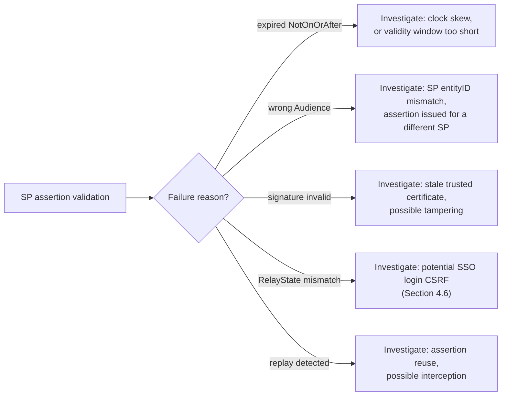

## 15. Failure Scenarios

- **IdP certificate rotation without SP metadata refresh** — every
  assertion suddenly fails signature verification fleet-wide immediately
  after the IdP rotates its signing key, because the SP's trusted
  certificate is stale (Section 4.7); the fix is automating metadata
  refresh, and the recovery is an emergency manual metadata re-import.
- **Clock skew between IdP and SP** — since `Conditions` validity windows
  are commonly just a few minutes, meaningful clock drift on either side
  causes intermittent, hard-to-reproduce assertion rejections that look
  like a signature problem but are actually a time-synchronization
  problem; Network Time Protocol (NTP) discipline on both sides is the
  preventative control.
- **ACS endpoint accepting an assertion missing `RelayState` validation**
  — silently downgrades an SP-initiated integration's security posture to
  IdP-initiated levels (Section 4.6) without any functional symptom,
  making this a latent risk rather than an outage.
- **SAML Single Logout partial failure** — a user's session is terminated
  at the IdP and at most SPs, but one SP's logout endpoint was unreachable
  during the fan-out, leaving that one SP's session active; monitoring
  logout fan-out success per SP is the detective control.

## 16. Testing

A defensible SAML integration test suite covers, at minimum: the happy
path (valid assertion, correct signature, valid Conditions, matching
RelayState); an expired assertion (`NotOnOrAfter` in the past); a
wrong-audience assertion (issued for a different SP's `entityID`); a
tampered assertion (modify any claim after signing and confirm the
signature check fails); a constructed XML Signature Wrapping attempt
(duplicate `ID` attribute with a forged sibling assertion, confirming the
validator resolves strictly through the signed reference and rejects the
forged claims); a replayed assertion (same `ID` submitted twice within its
validity window, confirming the replay cache rejects the second attempt);
and — where IdP-initiated SSO is supported — an unsolicited response with
no matching `InResponseTo`/`RelayState`, confirming the SP still enforces
`Conditions` and the replay cache strictly in that mode.

## 17. Common Mistakes

- Trusting the Subject `NameID` or attributes without verifying the
  signature covers the exact node being read (Section 4.4).
- Skipping `AudienceRestriction` checks, accepting assertions actually
  issued for a different SP.
- Treating attribute names as standardized across IdPs the way OIDC's
  common claims are — SAML attribute contracts must be negotiated per
  integration (Section 4.2).
- Hand-rolling XML parsing and signature verification instead of using a
  maintained SAML library (Section 4.3).
- Enabling IdP-initiated SSO without a replay cache or strict `Conditions`
  enforcement (Section 4.6).
- Pinning a certificate manually instead of configuring metadata refresh
  (Section 4.7), turning routine key rotation into an outage.
- Assuming Single Logout guarantees every SP session terminates (Section
  13/15).

## 18. Best Practices

- Default new application development to OIDC; reserve SAML integration
  effort for the existing enterprise/legacy estate and vendor-mandated
  cases (Section 4.9).
- Always use a maintained, security-audited SAML library on both IdP and
  SP sides — never hand-roll XML-DSig verification.
- Prefer SP-initiated flows for anything security-sensitive; treat
  IdP-initiated support as a convenience requiring extra compensating
  controls.
- Automate metadata refresh rather than manually pasting certificates.
- Log every validation failure with its specific reason, not a generic
  failure message (Section 14).
- Encrypt assertions (or sensitive attributes within them) when they carry
  data more sensitive than a bare identity claim.
- Document the attribute contract for every integration as a first-class,
  reviewed artifact.

## 19. Anti-Patterns

- **"Find the first assertion in the document"** parsing logic instead of
  resolving strictly through the signed `Reference` — the direct enabler
  of XML Signature Wrapping (Section 4.4).
- **"It has a valid signature, so it's trusted"** without also checking
  `Conditions`, `AudienceRestriction`, and replay status.
- **Manual, one-time certificate pinning** instead of governed metadata
  refresh (Section 4.7).
- **IdP-initiated SSO as the only supported mode**, removing the
  `RelayState` protection entirely with no compensating control.
- **Treating a SAML migration to OIDC as a pure technical-debt cleanup
  project** disconnected from any concrete business trigger, which
  reliably fails to get funded (Section 4.9) — bundle migration into
  planned re-platforming work instead.

## 20. Trade-off Analysis

| Dimension | SAML | OIDC (recap, CH20_OIDC.md) |
|---|---|---|
| Assertion format | XML, signed with XML-DSig | JSON (JWT), signed with JWS |
| Signature model complexity | Higher — sub-element signing enables XSW (Section 4.4) | Lower — whole-token signing, no equivalent wrapping surface |
| Typical transport | Browser-relayed HTTP-POST form | Back-channel HTTPS call to token endpoint |
| Trust bootstrap | XML metadata document exchange | JSON discovery document + JSON Web Key Set |
| Mobile / native app support | Poor — designed for browser redirect flows | Strong — designed with native/mobile flows in mind |
| Ecosystem maturity for new tooling | Declining — most new Software Development Kits (SDKs) prioritize OIDC | Strong and growing |
| Enterprise legacy footprint | Very large — still dominant in existing enterprise estate | Growing, dominant for new development |
| Best fit today | Existing enterprise/legacy federation, vendor-mandated cases | New application development, mobile/native apps |

## 21. Comparison Table

| Protocol | Era | Assertion/Token format | Primary use case today |
|---|---|---|---|
| SAML 2.0 | 2005 | Signed XML Assertion | Legacy enterprise/government SSO federation |
| OIDC | 2014 | Signed JWT ID Token | New web, mobile, and API-driven application SSO |
| WS-Federation | 2003 (with SAML tokens common) | Often wraps a SAML token | Older Microsoft-centric enterprise federation, now declining |
| Kerberos | 1980s | Ticket (not assertion-based) | Intranet-only Windows-domain authentication, not web federation |

## 22. Real-World Case Study

Consider a large insurance enterprise migrating its employee application
portfolio to a modern cloud IdP. The architecture team discovers that
roughly sixty applications integrate via SAML, spanning a fifteen-year
range of vintages: a handful of modern internally built applications that
could trivially adopt OIDC, a dozen mid-life vendor SaaS products that
support both protocols but were originally integrated via SAML years
earlier, and roughly a dozen genuinely legacy, vendor-frozen applications
(some running on support contracts with no available engineering capacity)
that can only ever speak SAML. The resulting architecture decision — and
the one this chapter's Section 4.9 argues is the generally correct pattern
— was not a blanket "migrate everything to OIDC" mandate, which would have
required unfunded, high-risk changes to vendor-frozen systems for no
measurable security gain. Instead: new internal development defaulted to
OIDC immediately; the mid-life SaaS integrations were migrated to OIDC
opportunistically, timed to each vendor's own next contract renewal or
platform upgrade (avoiding a stand-alone migration project); and the
genuinely frozen legacy applications kept their SAML integrations
indefinitely, with the IdP team instead investing in hardening the SAML
validation library version, enforcing strict `Conditions` and replay-cache
checks fleet-wide, and automating metadata refresh — closing the highest-
severity risks (Section 13) without requiring a rewrite of systems nobody
could safely change.

## 23. Interview Questions

1. Explain the difference between SP-initiated and IdP-initiated SSO, and
   the specific security property SP-initiated flows have that
   IdP-initiated flows lack.
2. What is an XML Signature Wrapping attack, and why does it have no
   direct analog in JWT-based signature schemes?
3. Walk through the fields inside a SAML assertion's `Conditions` element
   and explain what each one prevents.
4. What does SAML metadata establish, and how does it differ conceptually
   from OIDC's discovery document?
5. Why do large enterprises continue running SAML for years after OIDC
   became the recommended default for new development?
6. What operational failure occurs if an SP pins an IdP's certificate
   manually instead of refreshing it from metadata?
7. What is `RelayState` for, and what specifically breaks if an SP fails
   to validate it on the response leg?

## 24. Hands-on Exercises

1. Using an open-source Identity Provider (for example, a self-hosted
   test IdP) and a sample SAML Service Provider library in a language of
   your choice, stand up a working SP-initiated SSO flow end to end, and
   capture the full HTTP trace (matching the shape of Section 10, Example
   2).
2. Modify a captured, test-environment-only signed assertion to construct
   an XML Signature Wrapping attempt (duplicate the `ID`, insert a forged
   sibling assertion), and confirm your chosen SAML library correctly
   rejects it — then repeat against a naive, hand-rolled XML parser to see
   the vulnerability succeed, strictly in an isolated test environment.
3. Configure your test SP to support both SP-initiated and IdP-initiated
   flows, and demonstrate the concrete difference in what protection is
   (and is not) available on each path.

## 25. Design Exercises

1. Design the identity architecture for an enterprise with forty
   applications: five newly built internal apps, twenty mid-life SaaS
   vendor integrations, and fifteen vendor-frozen legacy applications.
   Decide which get OIDC, which stay on SAML, and justify the sequencing
   and triggers for any migration, applying Section 4.9's reasoning.
2. Design the metadata governance process for an organization with both
   an internal SAML IdP and thirty external SP integrations, covering
   certificate rotation cadence, automated refresh, and the fallback
   procedure when an SP cannot support automated metadata refresh.

## 26. Architecture Review Questions

- Does every SP integration validate `Conditions` (`NotBefore`/
  `NotOnOrAfter`, `AudienceRestriction`) explicitly, not just the
  signature?
- Does every SP's validation logic resolve claims strictly through the
  signed `Reference` node, with no separate "find the assertion"
  traversal?
- Is metadata refreshed automatically, or does any integration rely on a
  manually pasted, unrotated certificate?
- For any IdP-initiated SSO integration, is there a replay cache and
  strict `Conditions` enforcement compensating for the missing
  `RelayState` binding?
- Is there a documented, reviewed attribute contract for every SP
  integration, rather than an informal or undocumented agreement?
- Is SAML being proposed for a new, greenfield application without a
  concrete reason OIDC ([CH20_OIDC.md](CH20_OIDC.md)) wouldn't serve
  instead?

## 27. Summary

SAML is the XML-based federated SSO protocol that let enterprises
centralize authentication across independently operated applications more
than a decade before OIDC existed, built around three actors (Principal,
Identity Provider, Service Provider) exchanging a signed XML Assertion as
the trust artifact. Its assertion structure — Authentication Statement,
Attribute Statement, and Conditions — and its XML-DSig signature model are
genuinely more flexible, and genuinely more implementation-hazardous, than
OIDC's compact, whole-token JWT signing, most visibly in the XML Signature
Wrapping vulnerability class that has no direct analog in JWT-based
systems. SP-initiated flows carry a real security advantage over
IdP-initiated flows via the `RelayState` binding, SAML metadata performs
the same trust-bootstrap role as OIDC's discovery document in a heavier,
XML-based form, and SAML's continued dominance across large portions of
the enterprise and government application estate is best understood not as
technical stubbornness but as a rational response to procurement, IdP
investment, compliance, and legacy-application constraints — a pattern
architects will meet again and again whenever a newer, technically cleaner
protocol coexists with a large, working, expensive-to-replace installed
base. New development should default to OIDC
([CH20_OIDC.md](CH20_OIDC.md)); SAML remains this chapter's own,
still-essential competency for the legacy and enterprise federation estate
that a Solution Architect will keep encountering for years to come, most
often behind a concrete vendor Identity Provider such as the one covered in
[CH23_PingFederate.md](CH23_PingFederate.md).
