# Chapter 23: PingFederate

## 1. Introduction

Every chapter so far in this run of the Networking and Operating Systems
part has taught a *protocol*: [OAuth](CH19_OAuth.md) taught the
authorization framework, [OIDC (OpenID Connect)](CH20_OIDC.md) taught the
identity layer built on top of it, and [SAML (Security Assertion Markup
Language)](CH22_SAML.md) taught the older, XML (Extensible Markup
Language)-based federation protocol still load-bearing across enterprise
and government estates. None of those chapters answered a question every
enterprise Solution Architect eventually has to answer in a real
engagement: *what software actually runs these protocols in production,
and how do you design around it?* This chapter answers that question for
one of the most widely deployed answers: **PingFederate**, a commercial
federation server product built by Ping Identity.

PingFederate is not a protocol. It is a piece of deployable software — a
standalone Java-based server, installed on-premises, in a private cloud, or
consumed as a managed service — whose entire job is to *implement* SAML,
OIDC, OAuth 2.0, and WS-Federation (Web Services Federation) correctly, once,
so that no individual application team has to. This chapter recaps the
protocol mechanics it needs (from CH19-CH22, verbatim ownership, no
re-teaching) and spends its depth on the product-architecture questions
those chapters deliberately left unanswered: how does an enterprise avoid
building a bespoke integration between every identity source and every
application; how does a single federation server extend itself to talk to
authentication sources nobody standardized (a mainframe RADIUS server, a
homegrown Lightweight Directory Access Protocol (LDAP) directory, a
partner's proprietary Single Sign-On (SSO) cookie); how does a federation
server survive being a single point of failure for an entire company's
logins; and when should a Solution Architect recommend buying a product
like this at all, instead of writing the integration code directly against
the protocol libraries CH19-CH22 already taught?

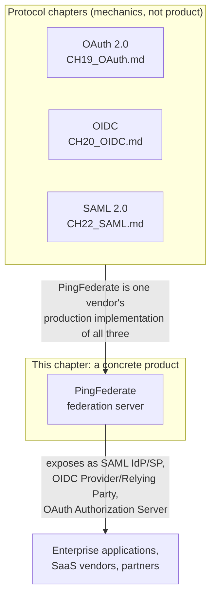

By the end of this chapter you will be able to explain precisely what
category of product PingFederate is (a standalone federation server, not an
identity store and not a full Identity and Access Management (IAM) suite);
articulate the N×M-to-N+M integration-cost argument that justifies deploying
one; design an adapter/connector-based integration for an authentication
source that speaks no standard protocol; design an attribute-mapping
pipeline that reconciles two identity providers' incompatible claim
vocabularies; design a highly available, clustered PingFederate topology
that survives a data-center failure without taking down enterprise login;
make a defensible build-vs-buy recommendation between a commercial
federation product (PingFederate, Okta, Microsoft Entra ID) and custom
protocol-library code; and use a federation hub as a migration abstraction
layer to move an enterprise's authoritative identity source (for example
on-premises Active Directory to a cloud directory) without every downstream
application changing.

## 2. Historical Evolution

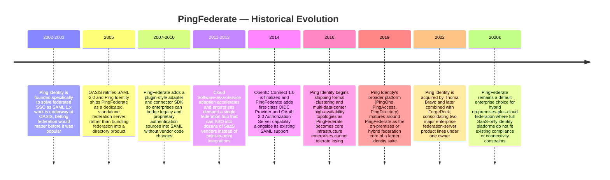

The through-line worth internalizing is that PingFederate was built as a
**dedicated federation server** from the start — not as a bolt-on feature
of a directory product, and not as a cloud-only Software as a Service
(SaaS). That single design choice explains almost everything distinctive
about it fifteen-plus years later: it can sit in an on-premises data center
next to a legacy directory a cloud-only identity platform cannot reach
directly, it was built assuming multiple simultaneous protocols (SAML
first, then OIDC/OAuth 2.0 added without replacing SAML support), and it was
built assuming enterprises would need to *extend* it to talk to
authentication sources nobody had standardized yet — which is exactly why
the adapter/connector Software Development Kit (SDK) (Section 4.4) exists as
a first-class extensibility mechanism rather than an afterthought.

The 2016-era shift toward formal clustering and multi-data-center topologies
is equally telling: it marks the moment the industry collectively
recognized that a federation server is not "just another application" — it
is the load-bearing wall for every other application's authentication, and
an outage in the federation server is categorically worse than an outage in
almost any individual downstream application (Section 4.5 examines exactly
why).

## 3. Why It Exists

Imagine a mid-size enterprise with 40 internal applications, an on-premises
Active Directory as its authoritative employee identity source, and
contracts with 25 external Software as a Service (SaaS) vendors (an
expense-reporting tool, a video-conferencing platform, a code-hosting
service, and so on) that every employee also needs to log into. Without a
federation hub, each of those 65 destinations (40 internal + 25 external)
needs its own direct integration against Active Directory or against
whatever identity source the SaaS vendor happens to support — and worse,
many SaaS vendors support only SAML, some only OIDC, and a few require
proprietary APIs. This is the **N×M integration problem**: N identity
sources times M relying applications, each pairing potentially needing its
own bespoke authentication code, credential-format translation, and
ongoing maintenance as either side changes.

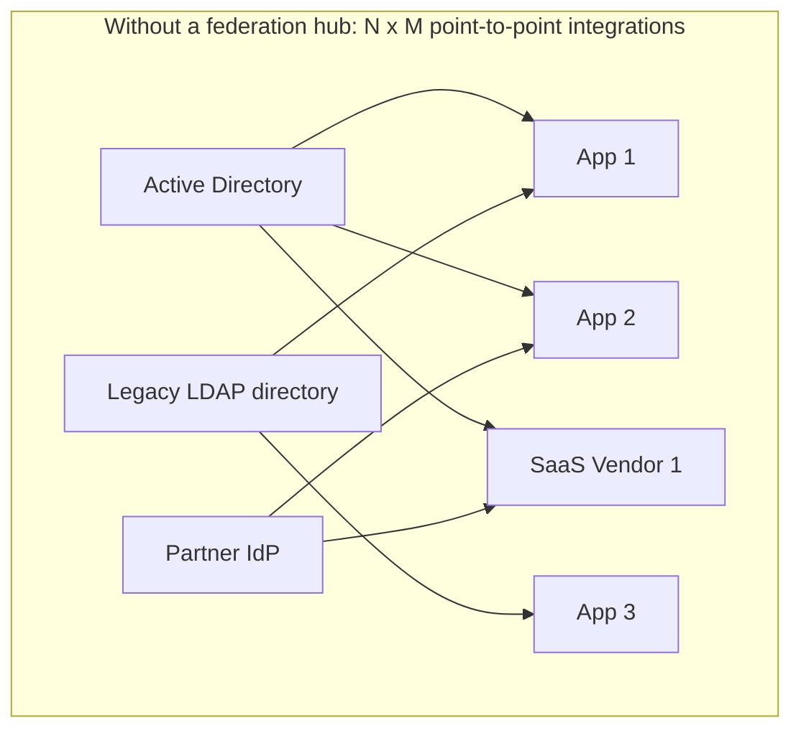

A federation hub collapses this to an **N+M problem**: every identity
source integrates with the hub exactly once (N integrations), and every
relying application or SaaS vendor integrates with the hub exactly once (M
integrations), for a total of N+M connections instead of the combinatorial
N×M. For the example above, that is 3 identity-source integrations plus 65
application/vendor integrations — 68 total connections instead of a
potential 195 (3×65) if every pairing had been wired directly. This is the
architectural justification a Solution Architect should be able to state
crisply in one sentence: **a federation hub trades a large number of
narrow, bespoke, protocol-mismatched integrations for a smaller number of
uniform integrations against one trusted intermediary.**

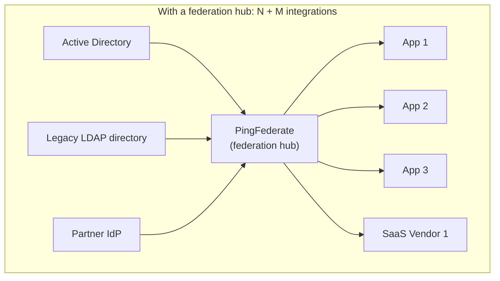

This does not mean a federation hub is free — Section 4.5 and Section 20
are explicit about the cost (a new single point of failure, a new piece of
infrastructure to operate, patch, and staff) and Section 6 covers the
build-vs-buy decision of whether a given enterprise's N and M are even large
enough to justify it. But for any enterprise past a modest handful of
identity sources and relying applications, the N+M reduction is large
enough, and the protocol-translation problem (SAML here, OIDC there,
something proprietary over there) is real enough, that a dedicated
federation server is the default answer among Solution Architects working
in enterprise identity today.

## 4. Core Concepts

### 4.1 What PingFederate architecturally *is*

**Definition.** PingFederate is a standalone federation server: a
separately deployed, separately scaled piece of software whose sole
responsibility is to broker trust between identity sources and relying
applications by speaking standard federation protocols (SAML 2.0, OIDC,
OAuth 2.0, and WS-Federation) on both sides of that brokering. It is *not*
a user directory (it does not natively store the master copy of user
accounts — it typically delegates to an existing LDAP directory, Active
Directory, or a Structured Query Language (SQL) database via an adapter,
Section 4.4), and it is *not* a full IAM suite by itself (functions like
password reset self-service, access-request workflow, and fine-grained
authorization policy are typically separate products, sometimes from the
same vendor, such as PingOne or PingAccess, sometimes from a competitor).

**Mechanism.** Architecturally, PingFederate sits at the network boundary
between "places that know how to authenticate a user" and "places that need
to trust an authentication decision," and terminates protocol traffic on
both sides:

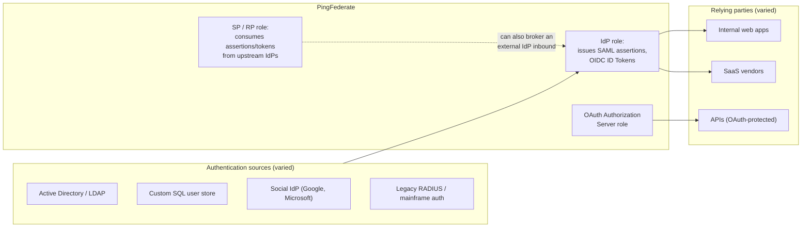

**Decision implications.** Because PingFederate is deliberately *not* the
directory itself, choosing it does not require ripping out an existing
Active Directory or LDAP investment — it sits in front of it. This is a
frequent point of confusion for architects new to the product: PingFederate
answers "prove to this relying party that this user authenticated," not
"store this user's password." Confusing the two leads to designs that try
to migrate user records into PingFederate itself, which is not what the
product is built to do.

**Common failure mode.** Treating PingFederate as "the identity system" and
skipping proper identity-source integration design — for example, pointing
it at a directory with no plan for how account provisioning/deprovisioning
happens — produces a federation layer that faithfully brokers trust for
accounts that should already have been disabled. PingFederate brokers
*authentication and attribute assertions*; it does not itself own the
account lifecycle (Section 15 covers this failure mode as a production
incident pattern).

**Concrete scenario.** A retailer has an on-premises Active Directory for
its 12,000 employees and needs SSO into Salesforce (SAML-only in this
example), a homegrown inventory system (OIDC), and a warehouse-scanner
fleet authenticating against a legacy RADIUS server that speaks neither
protocol. PingFederate integrates once with Active Directory (via its
built-in LDAP/AD adapter, Section 4.4) and once with the RADIUS system (via
a custom adapter, also Section 4.4), then exposes standard SAML and OIDC
endpoints to Salesforce and the inventory system respectively — none of
which need to know a RADIUS server or a legacy directory exists at all.

### 4.2 The IdP-of-IdPs / federation-hub pattern

**Definition.** The "IdP-of-IdPs" (Identity Provider of Identity Providers)
pattern — also called a federation hub — is the architectural role
PingFederate plays when it sits between *multiple* upstream identity
sources and *multiple* downstream relying parties simultaneously, acting as
a single Service Provider (SP) toward each upstream source and a single
Identity Provider (IdP) toward each downstream relying party. Section 3
already established the quantitative justification (N×M collapsing to
N+M); this subsection teaches the mechanism by which that collapse
actually happens inside the product.

**Mechanism.** Concretely, a federation hub performs two independent trust
brokerages joined by an internal "session" concept:

1. **Inbound brokerage** — the hub authenticates the user against
   *whichever* upstream source is appropriate (an internal directory for
   employees, a partner's IdP for a business partner's users, a social IdP
   for consumer-facing scenarios), normalizing the result into an internal,
   protocol-agnostic representation of "this user, these attributes, this
   authentication strength."
2. **Outbound brokerage** — the hub re-expresses that internal
   representation as whatever protocol and claim vocabulary the specific
   downstream relying party expects (a SAML assertion with one attribute
   naming convention for Salesforce, an OIDC ID Token with a different claim
   set for an internal application).

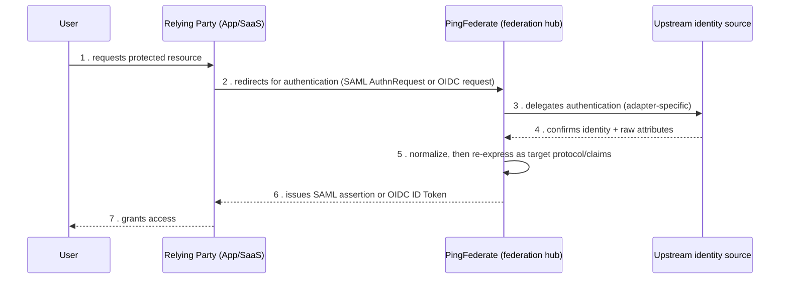

**Decision implications.** The critical design decision this pattern forces
is: what counts as "the same user session" across multiple relying parties?
A federation hub typically maintains its own session (often a browser
cookie scoped to the hub's domain) so that once a user has authenticated to
the hub, subsequent requests to *different* relying parties can be silently
re-brokered without prompting the user again — genuine Single Sign-On
across independently operated applications, not just single *login* to one
application. Getting this session model wrong (for example, no shared hub
session, so every relying party triggers a fresh credential prompt) defeats
the entire point of deploying a hub in the first place.

**Common failure mode.** Treating every relying-party integration as a
one-off, hand-tuned configuration instead of standardizing on a small
number of connection templates (Section 7) causes the hub's own
configuration to become exactly the tangled, hard-to-maintain mess the hub
was deployed to eliminate — just moved one layer inward.

**Concrete scenario.** A university federates with a national research
consortium's identity federation (many partner universities, one shared
trust framework) while also acting as the sole IdP for its own 200 campus
applications. Its PingFederate deployment is simultaneously an SP toward
the consortium (some students authenticate via their home institution) and
an IdP toward all 200 campus applications — the textbook IdP-of-IdPs shape.

### 4.3 Standard protocol recap (owned elsewhere, not re-taught here)

PingFederate's entire value proposition rests on protocols this chapter
does *not* re-teach. [SAML 2.0](CH22_SAML.md) owns the full assertion
structure, the SP-initiated and IdP-initiated flow mechanics, and the XML
Digital Signature model; PingFederate's SAML support is simply a
production-grade implementation of that specification acting in either the
IdP or SP role. [OIDC](CH20_OIDC.md) owns the ID Token, discovery document,
and standard claims set; PingFederate's OIDC Provider role issues exactly
the ID Tokens that chapter describes. [OAuth 2.0](CH19_OAuth.md) owns the
Authorization Code flow, Proof Key for Code Exchange (PKCE), Client
Credentials flow, and token lifecycle; PingFederate's OAuth Authorization
Server role issues and validates exactly those tokens. If any of the terms
in this paragraph are unfamiliar, stop and read those three chapters first
— everything from here forward assumes that vocabulary is already
comfortable and spends its depth on what a *product* adds on top of it.

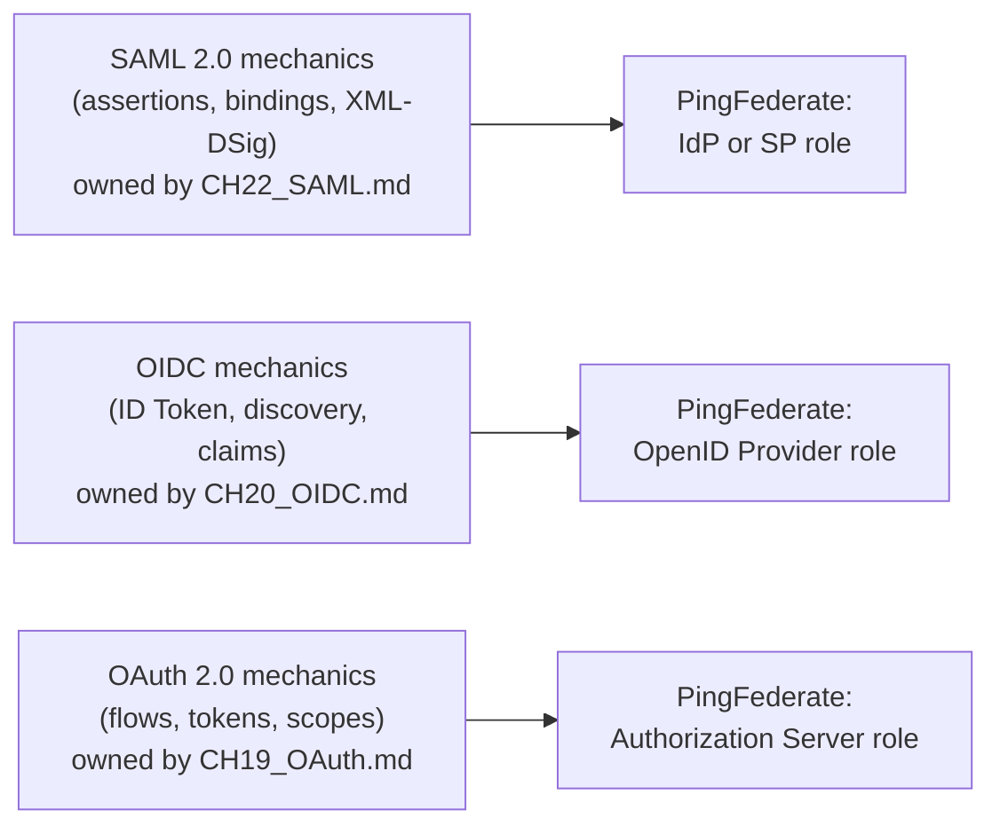

### 4.4 Adapter and connector architecture (the extensibility mechanism)

**Definition.** An **IdP adapter** is a pluggable module inside
PingFederate responsible for authenticating a user against one specific
authentication source (an LDAP directory, a Structured Query Language (SQL)
database, a Remote Authentication Dial-In User Service (RADIUS) server, a
Hypertext Transfer Protocol (HTTP) header injected by an upstream reverse
proxy that already authenticated the request, a hardware token validator,
or a fully custom scheme) and producing the normalized internal identity
representation Section 4.2 described. An **SP connector** (in SAML
terminology) or **OAuth client**/**OIDC Relying Party connection** (in
OIDC/OAuth terminology) is the paired, symmetric concept on the outbound
side: a pluggable, per-relying-party configuration describing exactly how
to package the normalized identity into that specific application's
expected assertion or token shape.

**Mechanism.** This adapter/connector split is what lets PingFederate speak
to authentication sources nobody standardized without ever touching the
product's own codebase. The vendor ships a Software Development Kit (SDK)
with a documented interface (roughly: "given an incoming request, return
either a redirect to continue authenticating, or a resolved identity plus
attributes"), and an enterprise (or a systems integrator) implements that
interface once per non-standard source. The adapter's output is always the
same shape regardless of how exotic the input source is, which is exactly
what lets the rest of the pipeline (attribute mapping, protocol
translation, Section 4.6) stay uniform.

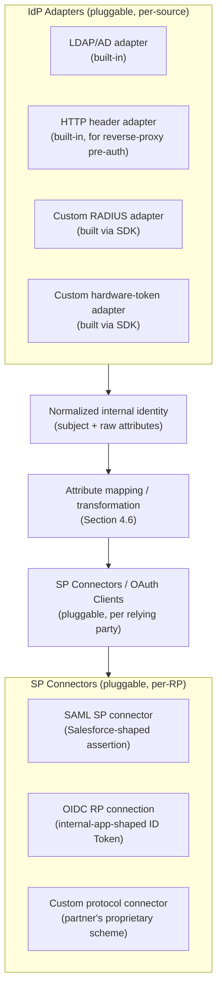

**Decision implications.** Whether to reach for a built-in adapter, a
vendor-provided adapter from the marketplace, or a fully custom
SDK-authored adapter is itself an architecture decision with real cost
trade-offs: built-in adapters (LDAP, HTTP header, database) require zero
custom code but only cover common cases; SDK-authored adapters require
Java development skill and a long-term maintenance commitment (someone has
to keep the adapter working across PingFederate version upgrades) but
unlock any authentication source imaginable. A Solution Architect should
treat "we need a custom adapter" as a signal to budget for ongoing
engineering ownership, not a one-time integration cost.

**Common failure mode.** Building a custom adapter that bypasses the
normalized-identity abstraction — for example, hardcoding a specific
downstream connector's expected attribute names directly inside the
adapter rather than emitting generic attributes and letting the mapping
layer (Section 4.6) do the translation — recreates point-to-point coupling
*inside* the hub, defeating the N+M benefit from Section 3 one layer down.

**Concrete scenario.** A logistics company has a 20-year-old mainframe
authentication scheme with no modern protocol support. Rather than
retrofitting the mainframe or requiring every new application to speak the
mainframe's proprietary handshake, the company builds one custom IdP
adapter that bridges the mainframe scheme into PingFederate, after which
every relying application only ever sees standard SAML or OIDC — the
mainframe's specifics are fully contained inside a single adapter.

### 4.5 High availability and clustering architecture

**Definition.** Because a federation server is the single trust broker for
authentication across an entire enterprise (Section 3), its own
availability becomes a first-order architectural concern distinct from any
individual downstream application's availability — an outage here does not
degrade one application, it can block logins to *every* application relying
on the hub simultaneously. PingFederate's high-availability (HA) and
clustering architecture exists specifically to prevent the federation
server itself from becoming the single point of failure it was deployed to
eliminate.

**Mechanism.** A production PingFederate deployment runs as a cluster of
multiple engine nodes behind a load balancer, with configuration
replicated across nodes so any node can service any request:

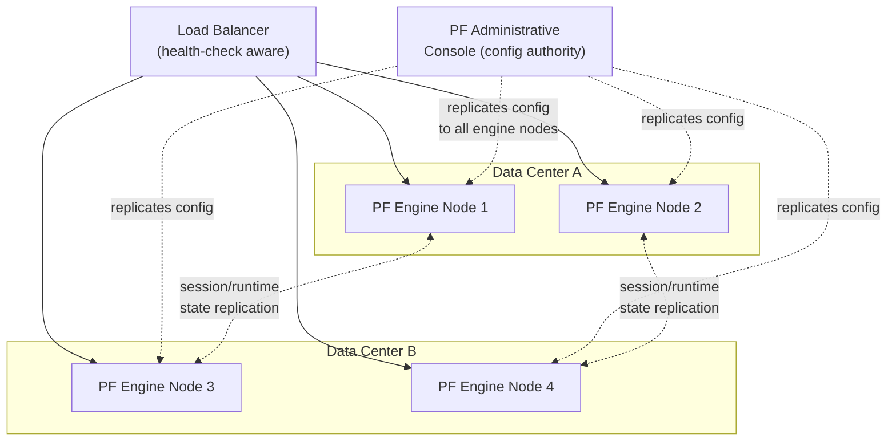

Two distinct replication concerns exist and are frequently conflated by
architects new to the product: **configuration replication** (adapters,
connectors, attribute-mapping rules — the *static* setup pushed out from
the administrative console to every engine node) and **runtime state
replication** (in-flight authentication sessions, issued tokens pending
validation — the *dynamic* data that must survive a node failure without
forcing every in-progress login to restart). Losing configuration
replication produces inconsistent behavior depending on which node handles
a request; losing runtime state replication produces failed logins exactly
at the moment a node or data center goes down, which is the worst possible
time for that failure to surface.

**Decision implications.** Because the failure blast radius of a federation
hub is "the entire enterprise's authentication," the HA bar for this
specific piece of infrastructure is typically set higher than for most
individual applications — active-active clustering across at least two
data centers or availability zones, not just within-data-center redundancy,
is the common enterprise baseline. A Solution Architect proposing a
single-node or single-data-center PingFederate deployment for a company of
any real size should expect that decision to be challenged in an
architecture review.

**Common failure mode.** Under-provisioning the administrative console's
own availability (treating it as "just a management tool") is a subtle
trap: while engine nodes keep serving already-configured requests if the
console goes down temporarily, an enterprise that cannot push emergency
configuration changes (revoking a compromised connector, rotating a signing
key) during an incident has effectively lost incident-response capability
for its entire identity layer.

**Concrete scenario.** A bank runs PingFederate as a four-node cluster split
across two geographically separate data centers, with a global load
balancer directing traffic to the nearer healthy data center and
automatically failing over if an entire data center becomes unreachable.
Section 10 provides a worked clustered-topology configuration example for
exactly this shape.

### 4.6 Attribute mapping and transformation architecture

**Definition.** **Attribute mapping** (sometimes called claims mapping or
attribute transformation) is the architectural layer inside a federation
hub that translates one identity source's vocabulary of user attributes
into whatever vocabulary a specific downstream relying party expects. This
is a genuinely hard enterprise-identity problem independent of any single
protocol: even when both sides speak the same protocol (SAML to SAML, or
OIDC to OIDC), the *names*, *formats*, and *semantics* of attributes rarely
match by default.

**Mechanism.** Consider a simple, realistic mismatch: an on-premises Active
Directory stores a user's group memberships as a multi-valued
`memberOf` attribute containing full Distinguished Names (for example
`CN=Finance-Admins,OU=Groups,DC=corp,DC=example,DC=com`), while a SaaS
application's SAML connector expects a single attribute named `role` with
one of a small fixed set of simple string values (`admin`, `user`,
`viewer`). A federation hub's attribute-mapping layer is exactly the place
this translation happens — extracting the group's Common Name (CN) portion,
matching it against a lookup table, and emitting the simplified `role`
value the downstream side actually expects.

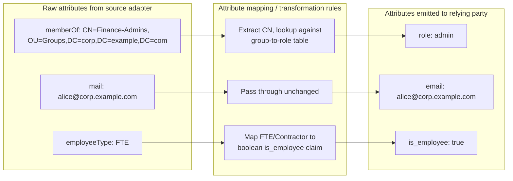

This mapping layer typically supports several transformation mechanisms in
combination: **direct pass-through** (source attribute name and value used
unchanged), **renaming** (same value, different attribute name expected by
the target schema), **value transformation** (a lookup table, a regular
expression extraction, or a scripted expression deriving a new value from
one or more source attributes), and **conditional/default logic**
(supplying a fallback value when a source attribute is absent, or
selecting a value based on which upstream adapter authenticated the user).
Section 10 provides a concrete, production-quality mapping rule set.

**Decision implications.** Attribute mapping should be designed and owned
centrally in the hub, not duplicated in every downstream application's own
code — precisely because a hub exists to collapse N×M integration cost
(Section 3), letting individual applications each implement their own
attribute-translation logic reintroduces the coupling the hub was meant to
eliminate. When an identity source's schema changes (a directory
reorganizes its group-naming convention), the fix should be a mapping-rule
update in one place, not a coordinated change across dozens of
applications.

**Common failure mode.** Attribute-mapping rules that silently drop or
mis-map an attribute (for example, a group rename in Active Directory that
the mapping table's lookup no longer matches) fail *open* in a dangerous
direction if the fallback logic defaults to a permissive role rather than
denying access — this is a genuine security defect class specific to
federation hubs, and mapping rules should be designed and tested with an
explicit deny-by-default fallback, not an accidental allow-by-default one.

**Concrete scenario.** Two companies merge. Company A's Active Directory
uses `department` as a flat string; Company B's Azure Active Directory uses
a structured `extension_costCenter` custom attribute. A shared internal
application needs a single `cost_center` claim regardless of which
company's directory a given employee authenticates against. The federation
hub's attribute-mapping layer resolves both into the same normalized
`cost_center` claim, so the application never has to know two different
identity sources exist upstream.

### 4.7 Trust configuration and metadata exchange

**Definition.** A **trust configuration** (frequently exchanged via
**metadata** — an XML document in SAML, or the discovery Uniform Resource
Locator (URL) and JSON Web Key Set (JWKS) in OIDC, both mechanics owned by
[CH22_SAML.md](CH22_SAML.md) Section 4.7 and [CH20_OIDC.md](CH20_OIDC.md)
Section 4.4-4.5 respectively) is the record of exactly which signing keys,
endpoints, and claim/attribute contracts a federation hub and a given
counterparty (an upstream identity source or a downstream relying party)
have agreed to trust each other with.

**Mechanism.** In a federation hub specifically, trust configuration exists
*per connection* — one trust record per upstream identity source, and one
per downstream relying party — rather than as a single global trust
relationship, because each counterparty may use different signing
algorithms, different claim vocabularies (Section 4.6), and different
protocol versions.

**Decision implications.** Because trust configuration directly encodes
which cryptographic keys are honored, its change-management process is a
security control in its own right: an enterprise should require a
documented review before adding a new trusted connection or rotating a
counterparty's signing key, not treat it as routine configuration
housekeeping.

**Common failure mode.** Accepting a counterparty's metadata document
without validating its signing certificate's chain of trust and expiration
(a mistake possible in any product, not unique to PingFederate) creates an
opening for a spoofed counterparty to be trusted. This is the same class
of certificate-trust discipline taught in general terms by
[CH15_Certificates.md](CH15_Certificates.md); this chapter applies it
specifically to federation trust records.

**Concrete scenario.** A partner organization rotates its signing
certificate ahead of an expiration date and sends updated metadata. The
enterprise's federation hub administrators must update the trust
configuration for that specific SP connector or IdP adapter before the old
certificate expires, or authentication for that one partner relationship
fails at the exact moment the old certificate lapses — while every other
trust relationship in the hub remains unaffected, illustrating the
per-connection isolation this architecture provides.

### 4.8 Session management across a federation hub

**Definition.** **Federation session management** is the set of rules
governing how long a user's authentication at the hub remains valid, how
that validity is communicated to (and revoked from) every downstream
relying party that relied on it, and how logout is coordinated across
applications that never directly communicate with each other.

**Mechanism.** A federation hub typically maintains its own session,
independent of (but derived from) whatever session the upstream identity
source itself maintains, and each downstream relying party maintains its
own separate, typically shorter-lived, local session seeded by the hub's
assertion or token. This produces three independently expiring session
layers, which is precisely why single logout is hard — logging out of one
relying party's local session does not automatically end the hub's session
or any other relying party's session unless the hub explicitly propagates
that logout, a mechanism both [CH20_OIDC.md](CH20_OIDC.md) (back-channel
logout) and [CH22_SAML.md](CH22_SAML.md) (Single Logout Profile) already
teach at the protocol level; PingFederate's role is to actually broker
that propagation across every relying party it has issued a session
assertion to.

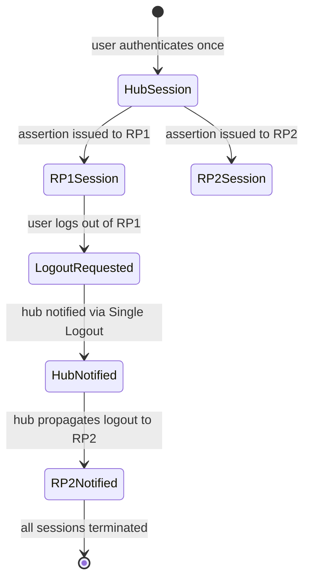

**Decision implications.** Session lifetime policy at the hub is a genuine
security-vs-usability trade-off distinct from any single application's own
session policy: a long hub session maximizes SSO convenience (fewer
re-authentication prompts) but extends the window an attacker with a stolen
hub session cookie can silently obtain new relying-party sessions; a short
hub session limits that exposure but increases re-authentication friction
across every downstream application simultaneously.

**Common failure mode.** Assuming logout at one relying party fully logs a
user out everywhere, without actually configuring and testing Single
Logout propagation, is a common and dangerous gap — particularly on shared
or public devices, where a user reasonably believes clicking "log out" on
one application ended their session everywhere.

**Concrete scenario.** An employee logs out of an expense-reporting SaaS
tool on a shared kiosk at the end of a shift. If Single Logout is not
correctly wired through the hub, the next employee to use that kiosk may
find the internal intranet application still authenticated as the
previous employee, purely because that application's local session was
never terminated.

### 4.9 The build-vs-buy decision for enterprise identity infrastructure

**Definition.** The build-vs-buy decision for federation infrastructure is
the architecture judgment of whether an enterprise should deploy a
dedicated commercial federation product (PingFederate, Okta, Microsoft
Entra ID, ForgeRock) versus writing custom integration code directly
against the OAuth/OIDC/SAML protocol libraries CH19-CH22 already teach.

**Mechanism — the decision framework.** This is not a binary "always buy" or
"always build" answer; it is a small set of concrete questions a Solution
Architect should work through:

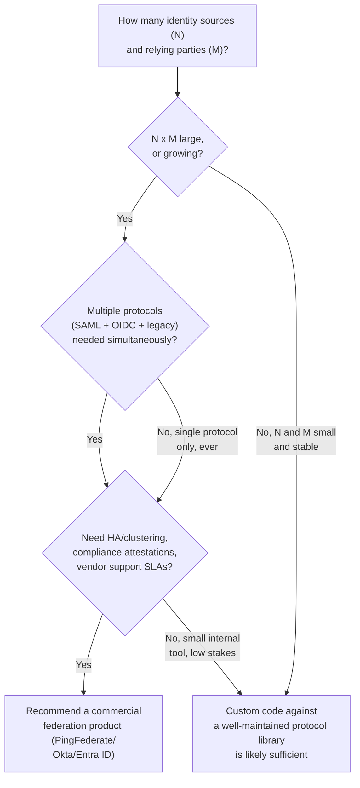

The key insight underneath this flowchart: protocol correctness itself
(implementing SAML's XML Digital Signature validation correctly, or OIDC's
JWKS rotation correctly) is genuinely hard to get right and easy to get
subtly wrong in ways that are exploitable — this is exactly why commercial
federation products exist and are worth their licensing cost once N and M
are large enough to amortize it. But for a small internal tool with one
identity source and one application, standing up a full commercial
federation server is disproportionate operational overhead compared to
using a mature, well-audited open-source protocol library directly.

**Decision implications.** The "buy" side of this decision is not just
about the software license — it includes staffing (someone has to operate,
patch, and monitor the federation server, Section 4.5's HA topology among
other things), the N+M integration benefit only materializing once N and M
are large enough, and vendor lock-in risk (Section 20 covers this as a
trade-off in more depth). The "build" side risk is underestimating how
often "just implement OAuth/SAML ourselves" turns into an under-tested,
under-maintained homegrown federation layer that quietly becomes just as
much infrastructure to operate as the commercial product would have been,
without the vendor support, compliance attestations (Section 13), or
clustering maturity that came free with the purchase.

**Common failure mode.** Recommending a commercial federation product by
reflex, without walking through the N/M and protocol-diversity questions
above, leads to over-provisioned infrastructure for genuinely small-scale
needs; recommending custom code by reflex, without acknowledging how
security-critical and easy-to-get-wrong protocol implementation details
are, leads to under-provisioned risk for genuinely enterprise-scale needs.

**Concrete scenario.** A 30-person startup with one internal application
and one identity source (its own user database) does not need
PingFederate — a well-maintained OIDC client library integrated directly
is proportionate. A 5,000-employee enterprise with an on-premises
directory, a legacy mainframe authentication scheme, and 40 SaaS vendor
relationships is exactly the N×M shape Section 3 described, and is a
textbook case for recommending a dedicated federation product.

### 4.10 Migration architecture: the federation hub as an abstraction layer

**Definition.** Beyond day-to-day SSO brokering, a federation hub can be
used deliberately as a **migration abstraction layer**: a stable interface
downstream applications integrate against once, behind which an enterprise
can change its *actual* authoritative identity source over time without
any downstream application needing to change its own integration.

**Mechanism.** Because every relying application talks to the hub, not
directly to the underlying identity source, swapping which adapter the hub
uses to authenticate a user is invisible to every downstream connector.

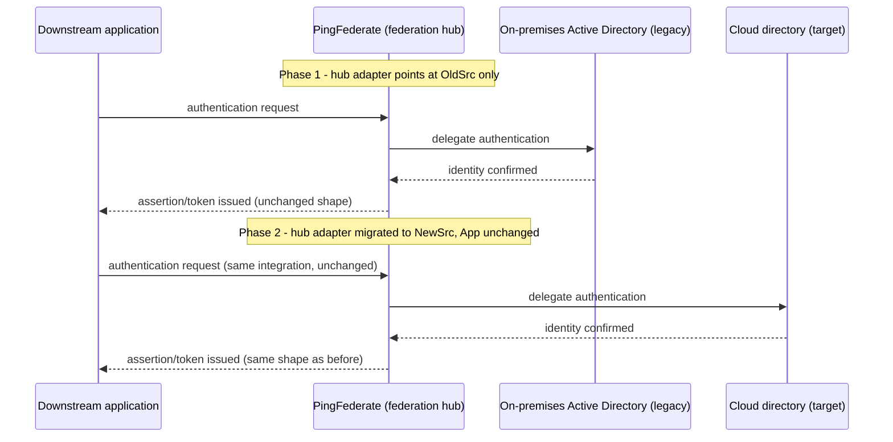

The migration typically proceeds in controlled phases: first, both the
legacy and target identity sources are synchronized (user accounts
provisioned in both); then the hub's adapter configuration is switched,
often cohort by cohort (a pilot group of users first, then the wider
population) rather than all at once; throughout, every downstream
application's own connector configuration remains completely unchanged,
because the hub continues issuing the exact same assertion or token shape
regardless of which upstream source actually authenticated the user.

**Decision implications.** This pattern is one of the strongest independent
justifications for deploying a federation hub even in an enterprise that
does not currently have a pressing N×M integration problem: it converts
"migrate our authoritative identity source" from a project touching every
application in the company into a project touching only the hub's
configuration. A Solution Architect proposing a directory migration (for
example on-premises Active Directory to Microsoft Entra ID, or a legacy
Lightweight Directory Access Protocol (LDAP) store to a modern cloud
directory) should treat "do we already have, or should we first deploy, a
federation hub" as one of the earliest questions in scoping that
migration's blast radius.

**Common failure mode.** Migrating the identity source without first
confirming every downstream connector's attribute-mapping rules (Section
4.6) still resolve correctly against the new source's attribute schema —
the hub decouples applications from the *source*, but does not
automatically guarantee the new source's raw attributes map to identical
values without re-verifying the mapping rules.

**Concrete scenario.** A manufacturing company spends eighteen months
migrating from an on-premises Active Directory forest to a cloud-hosted
directory as part of a broader cloud migration. Because every one of its
120 internal and vendor applications had integrated against PingFederate
rather than directly against Active Directory, the actual user-facing
migration was a phased adapter cutover behind the hub — no application
team needed to touch its own SSO integration code at all.

### 4.11 Distinguishing PingFederate from adjacent product categories

**Definition.** Solution Architects frequently need to explain precisely
where a federation server's responsibility ends and an adjacent product
category's begins, because vendors often bundle several categories
together and marketing material blurs the boundary.

**Mechanism — the boundary map:**

- **Federation server (PingFederate's category)** — brokers trust between
  identity sources and relying parties using standard protocols; the
  subject of this entire chapter.
- **Directory service (Active Directory, LDAP, a cloud directory)** — the
  authoritative store of user accounts and credentials; a federation server
  typically sits in front of one or more of these rather than replacing
  them.
- **Access management / reverse-proxy authorization (products like
  PingAccess, an API Gateway's authorization layer)** — enforces
  fine-grained, per-request authorization decisions (which specific
  Uniform Resource Locator (URL) paths a given authenticated user may reach)
  after the federation server has already established who the user is;
  distinct from, and usually deployed alongside, a federation server.
- **Full IAM suite** — a broader product category bundling federation,
  directory, access management, and often governance/lifecycle
  (provisioning, access reviews) together under one vendor umbrella;
  PingFederate is one component a full IAM strategy might include, not a
  synonym for the whole strategy.

**Decision implications.** A common architecture-review mistake is
evaluating a federation server against full-IAM-suite requirements it was
never meant to satisfy (for example, "why doesn't PingFederate have a
built-in access-request approval workflow?") — that capability belongs to
a governance product, not a federation server, and conflating the two
leads to either an unfair product evaluation or an unnecessary
vendor-lock-in purchase of capability an enterprise did not actually need
yet.

**Common failure mode.** Assuming a federation server alone constitutes a
complete IAM program, and skipping account lifecycle management
(provisioning/deprovisioning) entirely, is the same failure mode flagged in
Section 4.1 restated at the program level: a federation server faithfully
brokers trust for whatever accounts exist upstream, but does not itself
decide which accounts *should* exist.

**Concrete scenario.** An enterprise procurement team evaluates
PingFederate against a Request for Proposal (RFP) checklist that includes
"automated access certification campaigns" — a governance/IAM-suite
capability, not a federation-server capability — and incorrectly scores
PingFederate as deficient rather than recognizing the RFP itself
conflated two separate product categories.

## 5. Internal Working

Internally, a PingFederate engine node processes an incoming federation
request through a consistent pipeline regardless of which protocol
initiated it, which is precisely what lets the adapter/connector
architecture (Section 4.4) and attribute-mapping layer (Section 4.6) stay
uniform across SAML, OIDC, and OAuth traffic:

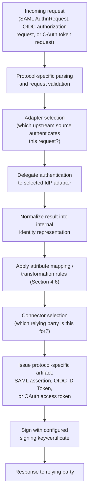

A few internal details matter for capacity planning and troubleshooting:
signing operations (Section 4.7) are computationally nontrivial, so
high-throughput deployments size engine nodes with signing performance in
mind, not just raw request-handling capacity; attribute-mapping rule
evaluation happens per-request, so deeply nested or scripted mapping rules
directly add request latency and should be profiled if login latency
becomes a complaint; and the administrative console (Section 4.5) pushes
configuration to engine nodes asynchronously, so a configuration change
(a new connector, an updated mapping rule) is not always instantaneously
live on every node — deployments needing strict change-consistency
guarantees should account for this propagation window in their change
process.

## 6. Design Principles

- **Separate the trust broker from the identity store.** PingFederate
  should sit in front of directories, not replace them (Section 4.1) —
  designs that try to migrate identity records into the federation server
  itself misunderstand the product's role.
- **Normalize once, translate many times.** The adapter/connector split
  (Section 4.4) exists so identity-source-specific quirks are handled in
  exactly one place, and relying-party-specific formatting is handled in
  exactly one other place — never let either concern leak into the other.
- **Design attribute mappings defensively.** Every mapping rule should have
  an explicit, tested fallback behavior for missing or unrecognized source
  values, and that fallback should deny by default, not silently grant
  broader access (Section 4.6).
- **Treat the hub's own availability as first-order infrastructure.** A
  federation server's HA design (Section 4.5) deserves the same rigor as
  the applications it protects logins for — often more, given its blast
  radius.
- **Use the hub as a migration seam deliberately, not accidentally.**
  Section 4.10's abstraction benefit only materializes if every downstream
  application was actually integrated against the hub in the first place —
  retrofitting this benefit after the fact requires re-pointing every
  existing direct integration at the hub first.

## 7. Architecture Patterns

**Connection templating.** Rather than hand-configuring every SP connector
or IdP adapter from scratch, mature PingFederate deployments define a small
set of reusable connection templates (for example, "standard SAML SaaS
connector," "standard internal OIDC application connector") with the
common attribute-mapping rules and security defaults pre-populated, and
apply a template to each new relying party rather than starting from a
blank configuration. This directly counters the Section 4.2 failure mode
of configuration sprawl.

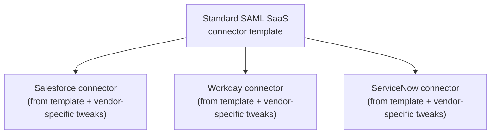

**Broker pattern for partner federations.** When an enterprise participates
in a multi-organization identity federation (a consortium, a regulated
industry's shared trust framework), PingFederate is configured as a broker
that maintains one trust relationship with the federation's central
metadata/discovery service rather than a separate trust relationship with
every individual partner organization — a second-order application of the
N+M reduction from Section 3, one level up the trust chain.

**Gateway-fronted federation server.** In many enterprise topologies, a
reverse proxy or API Gateway (concepts owned by
[CH11_Reverse_Proxy.md](CH11_Reverse_Proxy.md) and a future API Gateway
chapter) sits in front of the PingFederate cluster to terminate Transport
Layer Security (TLS), enforce network-level access controls, and route
traffic to the nearest healthy cluster node — the federation server itself
focuses purely on protocol brokering, not network edge concerns.

## 8. Production Architecture

A representative production topology combines the clustering pattern from
Section 4.5 with network segmentation appropriate for a system that
handles enterprise-wide authentication:

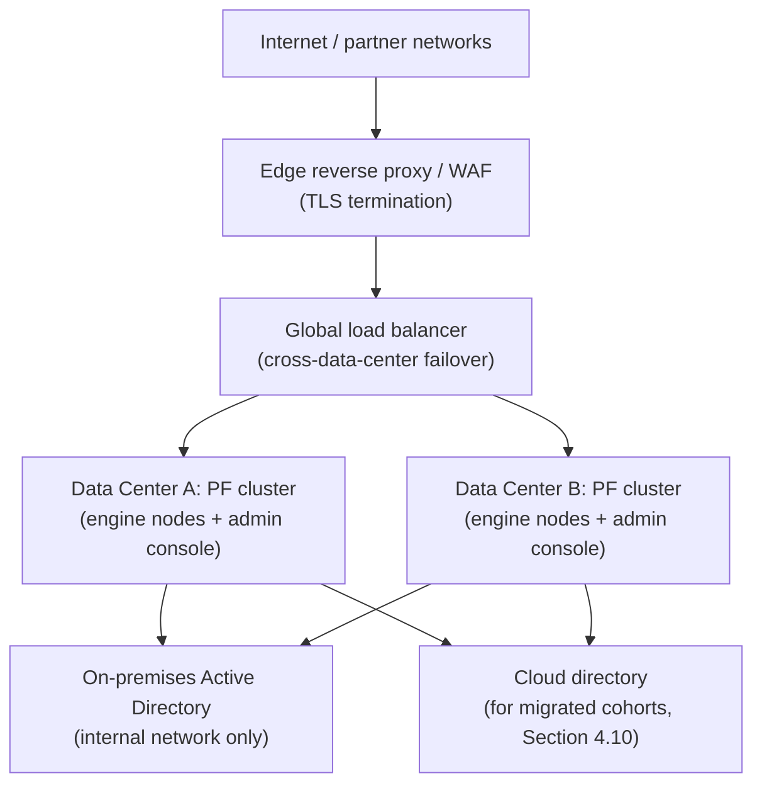

Network placement matters: engine nodes need connectivity to every upstream
identity source (often meaning at least one leg inside the internal
network, even when the federation server also serves external partners),
while the public-facing side is restricted to only the protocol endpoints
relying parties actually need, fronted by the edge tier for Transport
Layer Security (TLS) termination and basic traffic filtering before
requests ever reach a PingFederate engine node.

## 9. Implementation

Implementing a new relying-party integration on an existing PingFederate
deployment typically follows this sequence: (1) obtain the relying party's
metadata (SAML metadata XML, or an OIDC client registration) or manually
gather its required endpoints and signing keys; (2) select or clone a
connection template (Section 7); (3) configure the attribute-mapping rules
translating the enterprise's normalized identity attributes into whatever
the relying party's schema expects (Section 4.6); (4) configure the
signing/encryption key material for that specific connection (Section
4.7); (5) test in a non-production PingFederate environment against a test
account; (6) promote the validated configuration to production, typically
via the administrative console's environment-promotion tooling rather than
manual re-entry, to avoid configuration drift between environments.

## 10. Complete Code Examples

The following three examples represent the kinds of configuration
artifacts a Solution Architect should be able to read and reason about,
expressed in a vendor-neutral but PingFederate-realistic shape (actual
PingFederate configuration is normally done through its administrative
console or its configuration API, not hand-edited files — these are
illustrative outlines of that same configuration model).

**Example 1 — IdP adapter configuration outline (bridging a legacy RADIUS
authentication source):**

```yaml
# idp-adapter-config.yaml
# Illustrative outline of a custom IdP adapter configuration
adapter:
  id: legacy-radius-adapter
  type: custom-sdk-adapter
  implementationClass: com.example.federation.adapters.RadiusAdapter
  description: >
    Bridges the legacy warehouse-scanner RADIUS authentication scheme
    into PingFederate's normalized identity model (Section 4.4).
  connectionSettings:
    radiusServerHost: radius-internal.corp.example.com
    radiusServerPort: 1812
    sharedSecretRef: vault://secrets/radius-shared-secret   # never inline secrets
    timeoutMs: 3000
    retryCount: 2
  attributeContract:
    # Attributes this adapter promises to emit after successful auth,
    # consumed uniformly by the attribute-mapping layer (Section 4.6)
    - name: subject          # maps to RADIUS 'User-Name'
    - name: deviceGroup      # maps to a RADIUS vendor-specific attribute
    - name: authMethod
      defaultValue: "radius-legacy"
  failureBehavior:
    onTimeout: deny            # fail closed, never fail open
    onUnknownUser: deny
```

**Example 2 — Attribute mapping / transformation rule set (translating
Active Directory group membership into a simplified downstream role
claim, per Section 4.6):**

```yaml
# attribute-mapping-rules.yaml
mappingRuleSet:
  id: ad-to-saas-role-mapping
  sourceAttributeContract: ldap-ad-adapter    # from the AD/LDAP IdP adapter
  targetConnector: salesforce-sp-connector
  rules:
    - targetAttribute: role
      sourceAttribute: memberOf
      transformation: lookupTable
      lookupTable:
        # extracted CN portion of the DN is matched against this table
        "Finance-Admins": "admin"
        "Finance-ReadOnly": "viewer"
        "IT-Support": "admin"
      defaultValue: "user"          # deny-by-default: unknown group -> least privilege
    - targetAttribute: email
      sourceAttribute: mail
      transformation: passthrough
    - targetAttribute: is_employee
      sourceAttribute: employeeType
      transformation: expression
      expression: "sourceValue == 'FTE'"
      valueType: boolean
    - targetAttribute: cost_center
      sourceAttribute: department          # Company A's flat attribute
      fallbackSourceAttribute: extension_costCenter   # Company B's structured attribute (Section 4.6 merger scenario)
      transformation: passthrough
```

**Example 3 — Clustered HA deployment topology configuration (matching the
Section 4.5 / Section 8 diagrams):**

```yaml
# pf-cluster-topology.yaml
cluster:
  name: enterprise-federation-cluster
  replicationMode: active-active
  nodes:
    - id: pf-engine-dc1-01
      dataCenter: dc-a
      role: engine
      healthCheckPath: /pf/heartbeat.ping
    - id: pf-engine-dc1-02
      dataCenter: dc-a
      role: engine
      healthCheckPath: /pf/heartbeat.ping
    - id: pf-engine-dc2-01
      dataCenter: dc-b
      role: engine
      healthCheckPath: /pf/heartbeat.ping
    - id: pf-engine-dc2-02
      dataCenter: dc-b
      role: engine
      healthCheckPath: /pf/heartbeat.ping
    - id: pf-admin-console
      dataCenter: dc-a
      role: administrative-console
      standbyIn: dc-b               # console itself needs HA too (Section 4.5 failure mode)
  sessionReplication:
    mode: cross-data-center
    maxSessionAgeMinutes: 480
  configReplication:
    mode: push-on-change
    propagationTimeoutSeconds: 30
  loadBalancer:
    algorithm: least-connections
    healthCheckIntervalSeconds: 10
    failoverPolicy: nearest-healthy-data-center
```

## 11. Performance

Performance for a federation server is dominated by cryptographic signing
and validation operations (Section 5), not by request-body size or
business logic complexity — a login request is small, but signing a SAML
assertion or validating an incoming JWKS-based signature is CPU-intensive
relative to typical web-request handling. Capacity planning should be
expressed in signed-assertions-per-second, not generic requests-per-second,
and load testing should specifically exercise the signing path rather than
a simplified health-check endpoint that bypasses it. Attribute-mapping
rule complexity (Section 4.6) is the second-largest latency contributor;
deeply chained lookup tables or scripted expressions should be profiled
under realistic concurrency, not just correctness-tested in isolation.

## 12. Scalability

Scaling a federation hub is primarily horizontal — adding engine nodes
behind the load balancer (Section 4.5) — because federation requests are
largely stateless at the individual-request level once session state is
properly replicated (Section 4.5's runtime-state-replication concern).
The administrative console and its configuration store are the more common
scaling bottleneck in very large deployments (many thousands of connector
configurations), which is why connection templating (Section 7) also
serves a scalability purpose: fewer distinct configuration shapes to
validate and propagate on every change.

## 13. Security

A federation server's security posture is uniquely consequential because
compromising it compromises trust for every downstream relying party
simultaneously — it is a maximally attractive target. Key security
practices specific to this product category: signing and encryption keys
must be stored in a hardware security module (HSM) or equivalent secrets
manager, never as plain configuration files (Example 1's `vault://`
reference reflects this); trust configuration changes (Section 4.7) must
go through a reviewed change process, since adding a malicious or
compromised trust relationship is equivalent to granting that party the
ability to impersonate any user toward every relying party trusting the
hub; attribute-mapping fallback behavior must deny by default (Section
4.6); and compliance frameworks (Payment Card Industry Data Security
Standard (PCI DSS), System and Organization Controls 2 (SOC 2), Federal
Risk and Authorization Management Program (FedRAMP)) frequently name
"federation/identity provider" as an explicitly in-scope control boundary,
which is part of why commercial products with existing compliance
attestations are attractive in the build-vs-buy decision (Section 4.9).

## 14. Observability

Because a federation hub sits on the critical path for every downstream
application's logins, its observability requirements exceed a typical
application's: every authentication attempt (success and failure, by
adapter and by connector) should be logged with enough detail to
distinguish "this specific relying-party connector is misconfigured" from
"this specific upstream identity source is failing" from "this specific
user's credentials are invalid" — three very different remediation paths
that look identical from a generic error-rate dashboard alone. Signing-key
expiration and trust-configuration changes (Section 4.7 and Section 13)
should generate their own dedicated alerts well ahead of expiry, since a
lapsed signing certificate silently breaks authentication for every relying
party trusting that connector simultaneously.

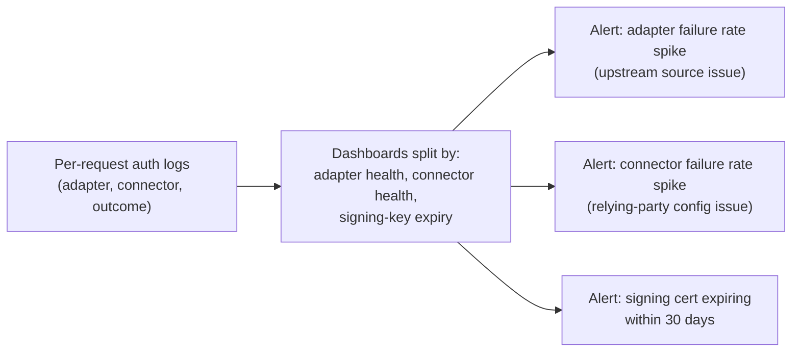

## 15. Failure Scenarios

- **Upstream identity source outage.** If Active Directory becomes
  unreachable, every relying party depending on that specific adapter fails
  to authenticate — but relying parties mapped to a *different* upstream
  source (Section 4.10's dual-source migration scenario) remain unaffected,
  illustrating the isolation the adapter architecture provides.
- **Signing key expiration.** An expired signing certificate on one SP
  connector breaks authentication only for that specific relying party,
  not the whole hub — provided connections are configured with distinct
  key material rather than one shared key reused everywhere (a design
  choice with its own trade-off: shared keys are simpler to manage but
  concentrate blast radius).
- **Cluster-wide outage.** If HA (Section 4.5) is misconfigured or
  under-provisioned, an entire data center failure can take down
  authentication for the whole enterprise simultaneously — the exact
  catastrophic scenario Section 3 and Section 4.5 exist to prevent, and
  the scenario every architecture review of a federation hub design should
  explicitly test against.
- **Attribute-mapping regression.** A well-intentioned mapping-rule change
  that mis-maps a critical attribute (for example, silently mapping every
  user to the same default role) does not cause visible authentication
  failures — logins still succeed — but silently grants incorrect
  authorization downstream, which is why mapping-rule changes need their
  own dedicated test suite (Section 16), not just "did login work" smoke
  testing.

## 16. Testing

Testing a federation hub configuration should cover, at minimum: adapter
-level tests (does authentication against each upstream source succeed and
fail correctly, including the deny-by-default fallback from Section 4.4);
connector-level tests (does each relying party receive an assertion or
token in the exact shape it expects, verified against that relying party's
own validation, not just the hub's own internal correctness); attribute
-mapping tests (does every mapping rule, including its fallback/default
path, produce the expected output for both known and deliberately unknown
input values, per Section 4.6's deny-by-default principle); and
failover/HA tests (does authentication continue correctly when one engine
node, or an entire data center, is taken offline, exercising Section 4.5's
topology under simulated failure, not just under normal operation).

## 17. Common Mistakes

- Treating PingFederate as a directory replacement rather than a broker in
  front of an existing directory (Section 4.1).
- Hardcoding relying-party-specific attribute names inside a custom
  adapter instead of keeping adapters generic and mapping in the dedicated
  attribute-mapping layer (Section 4.4's failure mode).
- Attribute-mapping fallback logic that defaults to an overly permissive
  role instead of denying by default (Section 4.6, Section 13).
- Under-provisioning the administrative console's own availability while
  over-focusing on engine-node redundancy (Section 4.5).
- Assuming Single Logout works without explicitly configuring and testing
  it (Section 4.8).
- Evaluating a federation server against full-IAM-suite feature
  expectations it was never meant to satisfy (Section 4.11).

## 18. Best Practices

- Design attribute-mapping rules with an explicit, tested deny-by-default
  fallback for every rule, not just the ones an author remembers to think
  about (Section 4.6, Section 13).
- Standardize on a small number of connection templates rather than
  hand-configuring every relying party from scratch (Section 7).
- Run engine nodes across at least two data centers or availability zones
  in an active-active configuration, and explicitly test full-data-center
  failover, not just single-node failure (Section 4.5, Section 15).
- Store all signing and encryption key material in a hardware security
  module or dedicated secrets manager, never inline in configuration files
  (Section 13, Example 1).
- Treat trust-configuration changes (new connectors, key rotations) as
  security-reviewed change events, not routine configuration edits
  (Section 4.7).
- When planning an identity-source migration, confirm the federation hub
  is already the integration point for every downstream application before
  counting on Section 4.10's abstraction benefit.

## 19. Anti-Patterns

- **The "everything through one shared signing key" anti-pattern** —
  simplifies key management but concentrates blast radius so that a single
  compromised or expired key breaks every relying party at once, defeating
  the per-connection isolation Section 4.7 and Section 15 describe as a
  benefit.
- **The "adapter as translator" anti-pattern** — building relying-party-
  specific logic into an IdP adapter instead of the attribute-mapping
  layer, quietly re-coupling the hub's internals the way Section 4.4
  warns against.
- **The "federation hub as full IAM" anti-pattern** — treating
  PingFederate deployment as a complete identity governance program and
  skipping account lifecycle management entirely (Section 4.1, Section
  4.11).
- **The "big bang migration" anti-pattern** — cutting every downstream
  application over to a new identity source simultaneously instead of the
  phased, cohort-based approach Section 4.10 describes, forfeiting the
  hub's ability to de-risk the migration incrementally.

## 20. Trade-off Analysis

| Decision | Choosing PingFederate (or similar commercial product) | Choosing custom protocol-library code |
|---|---|---|
| Upfront cost | Licensing + operational staffing cost | Lower upfront cost, engineering time only |
| Protocol correctness risk | Vendor-owned, tested across many customers | Fully owned in-house, easy to get subtly wrong |
| Multi-protocol support | Built-in (SAML + OIDC + OAuth simultaneously) | Each protocol is a separate integration effort |
| N x M integration cost | Collapses to N+M (Section 3) | Stays N x M unless a custom hub is also built |
| Vendor lock-in | Real risk; migration off the product is nontrivial | None, but "lock-in" to whatever was hand-built instead |
| Compliance attestations | Often pre-existing (SOC 2, FedRAMP, etc.) | Enterprise must independently attest its own code |
| Best fit | Large N and M, multiple protocols, compliance-heavy | Small N and M, single protocol, low-stakes internal tool |

## 21. Comparison Table

| Product | Deployment model | Primary strength | Notable trade-off |
|---|---|---|---|
| PingFederate | On-premises, private cloud, or hybrid | Deep adapter/connector extensibility for legacy and non-standard sources | Requires operational ownership of infrastructure (unless hosted) |
| Okta | Primarily cloud SaaS | Fast time-to-value, large pre-built app catalog | Less suited to deeply on-premises-integrated legacy sources |
| Microsoft Entra ID | Primarily cloud SaaS, deep Microsoft ecosystem ties | Tight integration with Microsoft 365/Azure-centric estates | Best fit assumes a largely Microsoft-centric environment |
| ForgeRock (now combined with Ping) | On-premises, private cloud, or hybrid | Strong full-IAM-suite breadth (directory + federation + governance) | Larger platform footprint than a federation-only need requires |

## 22. Real-World Case Study

A national retail chain operating 900 stores maintained a 15-year-old
on-premises Active Directory as its authoritative employee identity source
and had accumulated, over a decade, direct point-to-point SSO integrations
between that directory and roughly 30 separate applications and SaaS
vendors — exactly the N×M sprawl Section 3 describes, built up gradually
rather than designed deliberately. Two forcing events made the sprawl
untenable: a security audit flagged that several of the older, custom
integrations used outdated, weakly configured SAML signature validation
(the exact class of subtle protocol-implementation risk Section 4.9's
build-vs-buy framework warns about), and the company's broader cloud
strategy required migrating to a cloud-hosted directory over the following
two years.

The company deployed PingFederate as a federation hub, migrating existing
integrations one at a time onto standardized connection templates (Section
7), consolidating attribute-mapping logic that had previously been
duplicated, inconsistently, inside each of the 30 point-to-point
integrations (Section 4.6). Once every application was integrated against
the hub rather than directly against Active Directory, the subsequent
cloud-directory migration (Section 4.10) proceeded as a phased adapter
cutover, cohort by cohort, with zero of the 30 downstream applications
requiring their own code changes — the exact payoff the abstraction-layer
pattern promises. The federation hub itself was deployed as a four-node,
two-data-center active-active cluster (Section 4.5, Section 8), and the
company's subsequent PCI DSS assessment cycle explicitly cited the
centralized, auditable trust-configuration change process (Section 4.7,
Section 13) as a control improvement over the prior sprawl of
inconsistently maintained point-to-point integrations.

## 23. Interview Questions

1. What problem does a federation hub like PingFederate solve that
   individually implementing OAuth, OIDC, or SAML in every application does
   not? (Section 3, Section 4.2)
2. Explain the difference between an IdP adapter and an SP connector in
   PingFederate's architecture. Why does that split exist? (Section 4.4)
3. Why is attribute mapping considered a genuinely hard enterprise-identity
   problem, and what is the correct fallback behavior when a mapping rule
   encounters an unrecognized value? (Section 4.6)
4. Design an HA/clustering topology for a federation server that must
   survive a full data-center outage. What are the two distinct kinds of
   state that must replicate across nodes, and why does conflating them
   cause problems? (Section 4.5)
5. Walk through a build-vs-buy decision framework for enterprise identity
   infrastructure. What factors push toward a commercial federation product
   versus custom protocol-library code? (Section 4.9)
6. How can a federation hub be used as a migration abstraction layer? Give
   a concrete example. (Section 4.10)
7. What is the difference between a federation server, a directory service,
   and an access-management/reverse-proxy authorization product? Why does
   this distinction matter in a vendor evaluation? (Section 4.11)
8. Why does logging out of one relying party not automatically log a user
   out of every application relying on the same federation hub, and how is
   that gap closed? (Section 4.8)

## 24. Hands-on Exercises

1. Design (on paper or in a diagramming tool) an adapter configuration for
   bridging a fictional legacy authentication source (choose your own,
   e.g. a mainframe RACF-style system) into a federation hub's normalized
   identity model, following the shape of Example 1 in Section 10.
2. Write an attribute-mapping rule set that reconciles two different
   fictional identity sources' incompatible group/role vocabularies into a
   single normalized `role` claim, including an explicit deny-by-default
   fallback, following the shape of Example 2 in Section 10.
3. Sketch a two-data-center active-active clustering topology for a
   federation hub serving 50,000 users, including where the administrative
   console's own standby lives, following the shape of Example 3 in
   Section 10.

## 25. Design Exercises

1. An enterprise has 5 identity sources and 60 relying applications and
   currently integrates every pair directly. Produce a migration plan to a
   federation-hub architecture, including a phased application-cutover
   sequence that minimizes risk to any single application's availability
   during the transition.
2. A company is planning to migrate its authoritative directory from
   on-premises Active Directory to a cloud directory over 18 months.
   Design the federation-hub configuration sequence (dual-source period,
   cohort cutover order, rollback plan) that lets this migration proceed
   without any downstream application changing its own integration.
3. Propose a build-vs-buy recommendation, with explicit justification
   against the Section 4.9 framework, for a hypothetical 200-person SaaS
   company with one identity source and eight relying applications, none
   using SAML.

## 26. Architecture Review Questions

- Does the proposed federation-hub topology survive a full data-center
  failure without a manual failover step, and has that failure mode
  actually been tested, not just designed on paper? (Section 4.5, Section
  15)
- Does every attribute-mapping rule have an explicit, tested deny-by-default
  fallback, or could an unrecognized source value silently grant broader
  access than intended? (Section 4.6, Section 13)
- Is Single Logout actually configured and tested across every relying
  party, or is "SSO" being conflated with "single logout" without
  verification? (Section 4.8)
- Are custom IdP adapters kept generic, or have relying-party-specific
  assumptions leaked into adapter code, recreating point-to-point coupling
  inside the hub? (Section 4.4)
- Has the build-vs-buy decision been explicitly justified against the
  enterprise's actual N (identity sources) and M (relying parties), rather
  than defaulting to a commercial product or custom code by habit?
  (Section 4.9)
- If a directory migration is planned, has it been confirmed that every
  downstream application is already integrated against the hub rather than
  directly against the source being migrated away from? (Section 4.10)

## 27. Summary

PingFederate is a concrete answer to a question the OAuth, OIDC, and SAML
protocol chapters deliberately left open: what actually runs these
protocols in a large enterprise, and how does an architect design around
it? As a standalone federation server, it collapses the N×M integration
problem of many identity sources and many relying applications into an
N+M problem by acting as a single, trusted intermediary (Section 3,
Section 4.2). Its adapter/connector architecture (Section 4.4) is the
extensibility mechanism that lets it bridge arbitrary, non-standard
authentication sources into standard protocols without touching the
product's own codebase, while its attribute-mapping layer (Section 4.6)
solves the genuinely hard problem of reconciling different identity
sources' incompatible claim vocabularies — always with an explicit
deny-by-default fallback discipline. Because a federation server becomes
the load-bearing trust broker for an entire enterprise's authentication,
its own high-availability and clustering architecture (Section 4.5) is a
first-order design concern, not an afterthought. The build-vs-buy decision
(Section 4.9) between a commercial federation product and custom
protocol-library code hinges on the actual scale of N and M, protocol
diversity, and compliance needs — not reflexive preference either way.
Finally, once every application integrates against the hub rather than
directly against an identity source, that hub becomes a powerful migration
abstraction layer (Section 4.10), letting an enterprise change its
authoritative identity source without every downstream application
changing in turn. A Solution Architect who has internalized this chapter,
alongside [OAuth](CH19_OAuth.md), [OIDC](CH20_OIDC.md), and
[SAML](CH22_SAML.md), can move fluidly between protocol mechanics and the
concrete, vendor-specific product decisions enterprise identity
architecture actually requires in practice.
