# Chapter: Processes and Threads

Part: [05 — Networking and Operating Systems](PART_OVERVIEW.md) · Status: Drafted

## 1. Introduction

Every piece of software an architect designs — a monolith, a microservice, a
serverless function, a database engine, a Kubernetes pod — ultimately runs as
one or more **processes**, and inside each process as one or more
**threads**, scheduled by an Operating System (OS) kernel that has no idea
what "microservice" or "pod" mean. Container orchestration, language-level
concurrency models, and cloud autoscaling are all abstractions built *on top
of* these two primitives; none of them replace the process/thread model, they
just automate how it is provisioned and multiplexed. A Solution Architect who
cannot reason about what a process actually is — its own virtual address
space, its own file descriptor table, its own protection boundary enforced by
the Central Processing Unit (CPU) and kernel — will misjudge questions that
come up constantly in production: why one crashed worker did not take down
the whole fleet, why a "lightweight" thread pool still exhausted memory, why
two services on the same host could read each other's Inter-Process
Communication (IPC) channel but not each other's private memory, or why a
misconfigured lock ordering caused a full outage instead of a slow response.

This chapter is the first in Part 05's Operating Systems subsection, and it
is intentionally foundational: it teaches the process as the OS's unit of
**isolation** and the thread as the OS's unit of **concurrent execution**,
the mechanics of how the kernel creates, schedules, and switches between
them, the taxonomy of IPC mechanisms processes use to cooperate despite being
isolated, and the synchronization primitives — and their classic failure
modes, race conditions, deadlock, priority inversion — that threads need
because they are *not* isolated from each other. This chapter deliberately
does **not** re-teach any language runtime's concurrency model. Java's
virtual threads ([Java Architecture](../03_Software_Engineering_Foundations/CH01_Java_Architecture.md)),
Python's Global Interpreter Lock (GIL) and `multiprocessing` module
([Python Architecture](../03_Software_Engineering_Foundations/CH02_Python_Architecture.md)),
Node.js's single-threaded event loop
([Node.js](../03_Software_Engineering_Foundations/CH03_Nodejs.md)), Go's
goroutines ([Go](../03_Software_Engineering_Foundations/CH04_Go.md)), and
Rust's ownership-based concurrency
([Rust](../03_Software_Engineering_Foundations/CH05_Rust.md)) are all
different strategies for using — or, in some cases, deliberately working
around — the OS process/thread model this chapter teaches. Understanding
that model is the prerequisite for understanding *why* each of those
runtimes made the design choice it made; Section 4.11 draws that map
explicitly. This chapter also recaps rather than re-derives Unix domain
sockets, which are covered in full in [Sockets](CH16_Sockets.md) as one of
several IPC mechanisms.

**Quick orientation — where this chapter sits:**

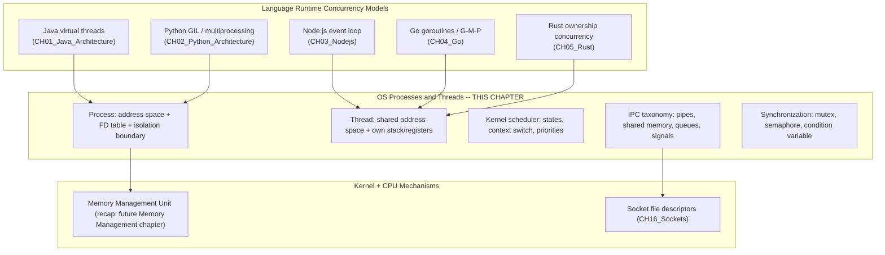

## 2. Historical Evolution

The process and thread abstractions were not invented together, and neither
was invented all at once — they emerged over three decades as hardware
gained the capability to run more than one program at a time and operating
system designers repeatedly re-drew the line between "isolated" and "shared."

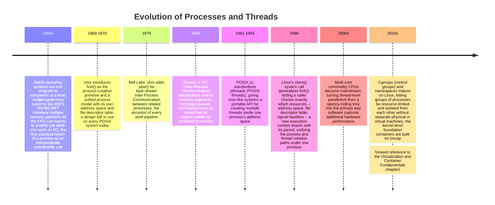

The through-line: processes appeared first, as the answer to "how do we let
multiple independent programs share one CPU safely." Threads appeared second,
as the answer to "now that isolation is solved, how do we let *cooperating*
code inside one program run concurrently without paying the full cost of a
separate address space per concurrent activity." Every later development —
`clone()`'s fine-grained resource sharing, cgroups, containers — is really a
variation on the same tension: how much isolation do we want, and how much
does that isolation cost.

## 3. Why It Exists

A CPU core executes one instruction stream at a time. Before multiprogramming,
that meant one program had exclusive use of the entire machine until it
finished or crashed — an enormous waste, since real programs spend a large
fraction of their time blocked waiting for disk or network I/O while the CPU
sits idle. The process abstraction exists to solve two problems
simultaneously: **utilization** (let the CPU switch to a different runnable
program while one is blocked, instead of idling) and **isolation** (make sure
that if one program has a bug — writes to a bad pointer, divides by zero,
enters an infinite loop — it cannot corrupt another program's memory or bring
down the whole machine). The OS achieves both by giving every process its own
virtual address space (enforced by the CPU's Memory Management Unit (MMU)
and the kernel's page tables) and by using the CPU's privilege levels to
prevent user-mode code from touching another process's memory or the
kernel's own memory directly.

The thread abstraction exists because the process's isolation, while
essential *between* unrelated programs, is often unwanted friction *within*
one program that wants several things happening concurrently — a web server
handling many connections, a Graphical User Interface (GUI) app keeping its
interface responsive while a background task runs, a database engine running
several query executors against the same buffer pool. Creating a full
process for each of those activities would mean duplicating the entire
address space and paying full context-switch cost for cooperation that does
not actually need isolation — the web server's connection handlers *want* to
share the connection pool and the in-memory cache, not fight the OS to
communicate across a process boundary. Threads exist to let a single process
have multiple independent flows of control that share one address space by
default, trading isolation for cheaper creation, cheaper context switching,
and free (if unsynchronized and unsafe) access to shared data.

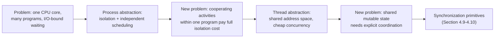

Both abstractions are, at their core, a trade-off dial between isolation and
cost. A process buys maximum isolation at maximum creation/switching cost; a
thread buys cheap concurrency at the cost of requiring the programmer to
explicitly protect any state shared across threads. Every higher-level
concurrency model in the handbook — virtual threads, goroutines, the GIL,
the event loop — is a different point on that same dial, built by a language
runtime on top of these two OS primitives, never replacing them.

## 4. Core Concepts

### 4.1 The Process: Its Own Address Space and File Descriptor Table

**Definition.** A process is the OS's unit of resource ownership and
isolation: an independently executing instance of a program, with its own
**virtual address space** (its own private view of memory, mapped by the
kernel to physical memory pages that no other process can address), its own
**file descriptor (FD) table** (the per-process array mapping small integers
to open files, sockets, pipes, and other kernel objects — recapped in depth
in [Sockets](CH16_Sockets.md) Section 4.1 for the specific case of socket
FDs), its own set of registers and program counter when running, and kernel
bookkeeping the OS calls the **Process Control Block (PCB)**: a kernel data
structure holding the process's Process Identifier (PID), its scheduling
state, its saved register values when not running, its memory-map
descriptors, its FD table, and its accounting information (CPU time used,
resource limits, and so on).

**Mechanism.** When the kernel creates a process, it allocates a fresh
virtual address space and populates the page tables that translate that
process's virtual addresses to physical memory frames. Critically, two
different processes can use the *identical* virtual address (for example,
both might have code at virtual address `0x400000`) and still never collide,
because the CPU's MMU, consulting each process's own page tables (selected by
the kernel on every context switch), translates that same virtual address to
completely different physical memory in each process. This is the actual
mechanism behind process isolation: it is not a convention or a promise the
kernel makes, it is hardware-enforced address translation that makes one
process's memory literally unreachable from another process's instruction
stream, because that instruction stream can only ever generate virtual
addresses that resolve through its *own* page tables.

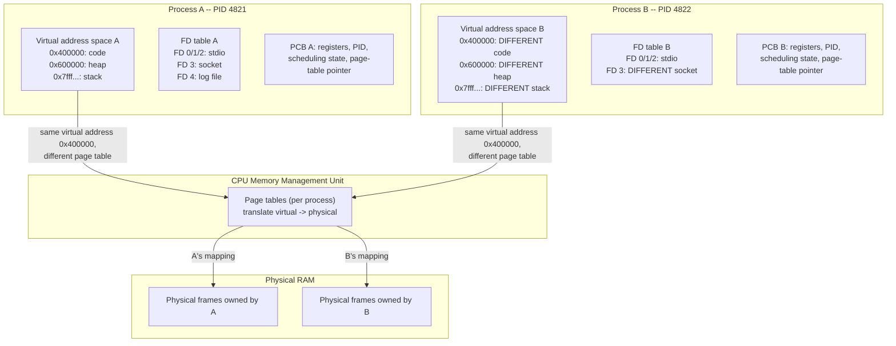

**Decision implications.** This is the single most load-bearing fact every
higher-level architecture assumes without stating it: a crashed process
cannot corrupt another process's memory, because there is no code path by
which its instructions could even address that memory. This is *why*
deploying independent services as separate OS processes (or separate
containers, which are groups of processes given extra namespace isolation —
recap, forward reference to the Virtualization and Container Fundamentals
chapter) is the default architectural pattern for fault isolation: if one
service's process segfaults, leaks memory until the kernel's out-of-memory
killer intervenes, or deadlocks internally, every other process on the same
machine keeps running untouched. It is also why a supervisor process (systemd,
a container runtime, a process manager like Kubernetes' kubelet) can safely
restart a crashed worker process without restarting anything else — the
crash's blast radius is bounded by the process boundary, by construction, not
by careful programming.

**Common failure mode.** Architects sometimes conflate "runs in its own
thread" with "runs in isolation," assuming a crashing background thread is as
safe to ignore as a crashing background process. It is not: an unhandled
fault in a thread (a segmentation fault from a bad pointer, a stack overflow)
typically brings down the *entire* process, including every other thread in
it, because all threads in a process share that one address space and, by
default, a fault handler installed at the process level (Section 4.2 revisits
this as the "shared fate" consequence of the thread model). Choosing a
process boundary versus a thread boundary is fundamentally a choice about how
large a blast radius is acceptable for a given kind of failure.

**Concrete scenario.** A payments service and a notifications service run as
two separate Linux processes on the same host (not yet containerized). The
payments process has a bug that dereferences a null pointer under a rare
input, causing a segmentation fault. The kernel terminates only that one
process; the notifications process, running independently with its own
address space, is completely unaffected and continues serving traffic. Had
both "services" instead been two threads inside one process (perhaps to save
on inter-process communication overhead), the same segmentation fault would
have terminated the entire process — taking notifications down with payments,
purely as a structural consequence of sharing an address space, regardless of
how well either service's code was written.

### 4.2 The Thread: Shared Address Space, Own Stack and Scheduling Context

**Definition.** A thread is the OS's unit of *scheduling* and concurrent
execution *within* a process. Every process starts with exactly one thread
(sometimes called the main thread); that thread — or code running on it —
can create additional threads that all live inside the same process. Every
thread has its own **stack** (for local variables and call-frame return
addresses), its own saved **register state** (including its own program
counter, so each thread can be at a different point in the program's code at
any instant), and its own kernel scheduling context (its own entry in the
kernel's scheduler, its own priority, its own scheduling state — Section 4.3).
What a thread does *not* have of its own is a separate address space: every
thread inside a process shares that one process's heap, global/static
variables, and open file descriptor table.

**Mechanism.** Because threads share the same virtual address space, no MMU
translation trick isolates one thread's memory from another's the way it
isolates one process from another. A pointer computed by thread A and handed
to thread B resolves to the exact same physical memory for both, because both
threads are translating through the *same* page tables. Threads are
distinguished purely by their own private stack region (allocated inside the
shared address space, but conventionally not written to by other threads)
and by having their own row in the kernel's scheduler — their own Thread
Identifier (TID) that the kernel can independently mark ready, running, or
blocked (Section 4.3), and independently context-switch (Section 4.4), even
though switching *between* threads of the *same* process does not require
changing which page tables the MMU consults, because they already share one
address space.

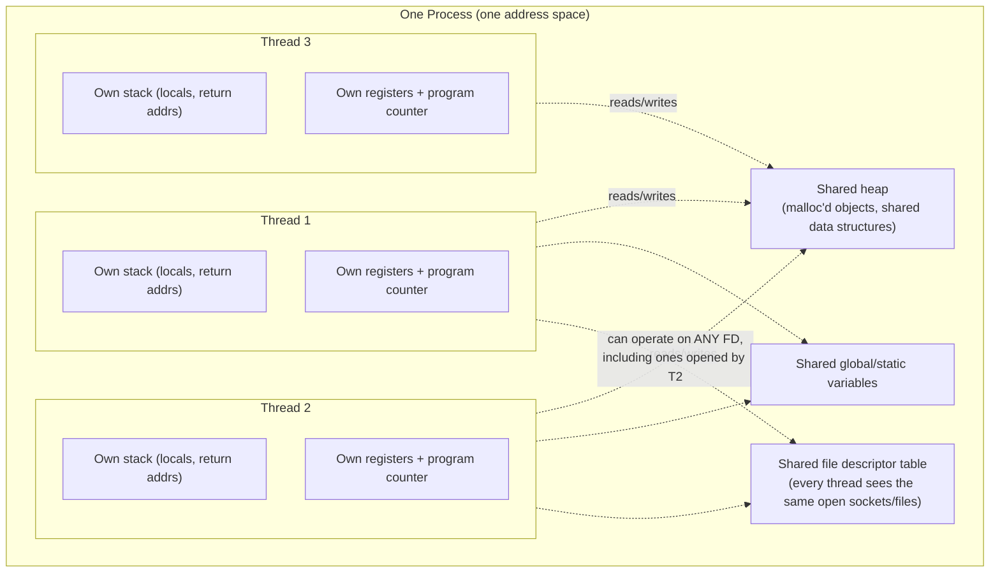

**Decision implications.** This is the direct architectural consequence
every concurrency model built on top of threads has to reckon with: threads
are far cheaper to create and switch between than processes — creating a
thread typically only requires allocating a new stack and a scheduler entry,
not a new address space and page-table hierarchy, and switching between two
threads of the same process can skip the (relatively expensive) step of
reloading the MMU's page-table pointer, because both threads already share
one address space — but that cheapness is paid for with two obligations the
process model didn't have. First, **shared fate**: an unrecovered fault in
any one thread (an illegal memory access, an unhandled signal) typically
terminates the whole process, taking every other thread in it down at once,
because the fault handler and the address space are shared. Second,
**explicit synchronization**: any mutable data more than one thread touches
needs deliberate coordination (Section 4.9), because nothing about the thread
model itself prevents two threads from reading and writing the same memory
at the same instant and producing a race condition (Section 4.9's failure
mode). Processes get memory isolation as a structural guarantee for free;
threads get concurrency-safety only if the programmer builds it.

**Common failure mode.** Treating "I moved this work into its own thread" as
equivalent to "I made this work safe to run concurrently." Spawning a thread
changes *where* code executes concurrently; it does nothing on its own about
*what data* that code touches concurrently. A very common production bug is
a background thread reading a shared configuration object or connection pool
that the main thread is simultaneously mutating, with no lock between them —
the thread boundary was added for concurrency, but the necessary
synchronization boundary (Section 4.9) was not.

**Concrete scenario.** A web server handles each incoming request on its own
thread from a fixed-size thread pool, all sharing one in-memory Least
Recently Used (LRU) cache object for looking up user session data. Because
every thread's stack is private but the cache's underlying hash map lives on
the shared heap, two threads handling two different requests can call the
cache's insert method concurrently; without an internal lock in the cache
implementation, this can corrupt the hash map's internal linked-list
pointers (a classic race condition, Section 4.9), producing crashes or
silently lost entries under concurrent load that never appear in
single-threaded testing.

### 4.3 Process and Thread Lifecycle: States and Transitions

**Definition.** At any instant, every process and every thread the kernel
knows about is in exactly one **scheduling state**. The canonical states,
present (with minor naming variations) in every general-purpose OS
scheduler, are: **New** (created but not yet admitted to the scheduler's
ready pool), **Ready** (able to run, waiting only for the CPU to become
available), **Running** (currently executing on a CPU core), **Blocked** /
**Waiting** (unable to make progress until some event occurs — I/O
completion, a lock becoming available, a timer firing), and **Terminated**
(finished executing, resources being reclaimed). The kernel's scheduler is
the component responsible for deciding, whenever a CPU core becomes free,
which Ready thread runs next.

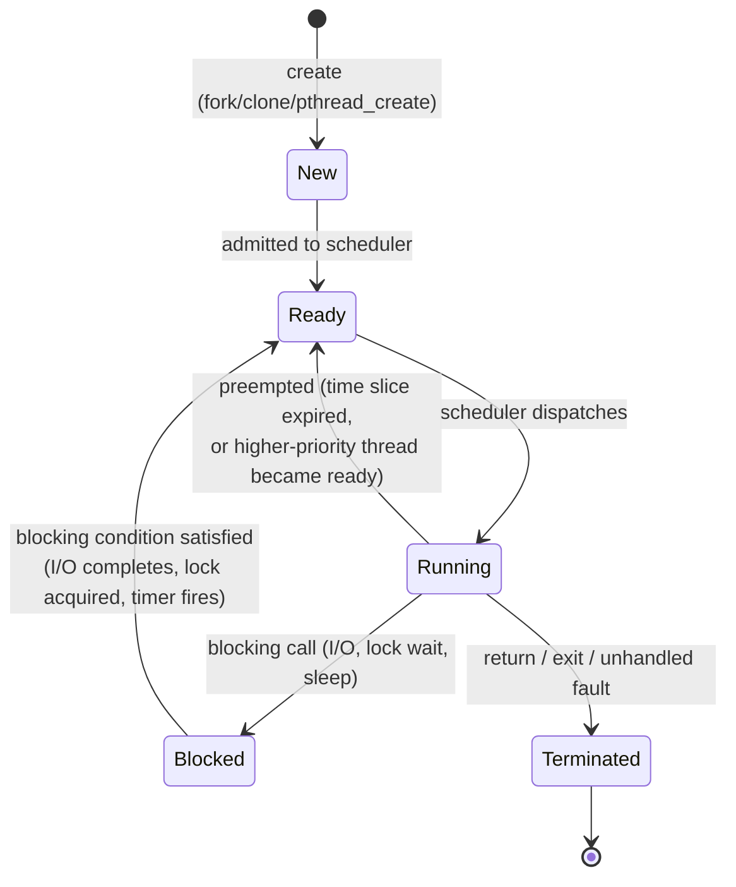

**Mechanism.** The transition from Running to Blocked happens whenever code
executing on that thread issues a call the kernel cannot satisfy immediately
— reading from a socket with no data yet available, waiting to acquire a lock
another thread holds, calling `sleep()`. The kernel removes that thread from
the CPU, records what it is waiting for, and picks a different Ready thread
to run instead; the CPU core is never left idle just because one thread has
nothing to do, as long as some other thread is Ready. The transition from
Ready to Running is the scheduler's core decision, governed by whichever
scheduling algorithm and priority scheme the kernel implements (Section 4.4
covers the cost of actually performing that transition; Section 5 covers
scheduling algorithms in depth).

**Decision implications.** A thread spending most of its life Blocked
(waiting on network I/O, waiting on a downstream database) is described as
**I/O-bound**; a thread spending most of its life Running (image
processing, cryptographic hashing, JSON parsing at scale) is described as
**CPU-bound**. This distinction is the single most important input to
concurrency-mechanism selection across every language runtime in this
handbook — it is *why* Python's concurrency trichotomy
([Python Architecture](../03_Software_Engineering_Foundations/CH02_Python_Architecture.md)
Section 4.1) chooses `asyncio`/threading for I/O-bound work and
`multiprocessing` for CPU-bound work, and *why* Go's runtime scheduler
(recap: [Go](../03_Software_Engineering_Foundations/CH04_Go.md) Section 4.2)
spins up extra OS threads specifically when a goroutine blocks in a system
call, so CPU-bound goroutines on other threads are not starved by one
goroutine sitting Blocked.

**Common failure mode.** Sizing a thread pool as if every thread will be
CPU-bound (one thread per CPU core) when the actual workload is I/O-bound
leaves most cores idle most of the time, because most threads spend most of
their life Blocked waiting on I/O rather than Running; the fix is a much
larger thread pool (or an event-driven, non-blocking model — recap:
[Sockets](CH16_Sockets.md) Section 4.5) sized around how long requests
Block, not around the CPU core count.

**Concrete scenario.** A service issues a downstream Hypertext Transfer
Protocol (HTTP) call that takes 100 milliseconds on a 4-core machine, and the
team sizes the thread pool at 4 threads "to match the cores." Under load,
throughput plateaus far below capacity because all 4 threads spend nearly all
their time Blocked waiting on the downstream response, while 3 of the 4 CPU
cores sit idle. Correctly modeling the workload as I/O-bound and increasing
the pool to, say, 200 threads (bounded by memory, not CPU count) lets far
more requests be in flight concurrently, because Blocked threads consume
essentially no CPU while waiting.

### 4.4 Context Switching: Mechanics and Real Cost

**Definition.** A **context switch** is the kernel operation of saving the
complete execution state of the currently Running thread (its registers,
program counter, stack pointer) and restoring the saved state of a different
thread so that thread resumes exactly where it left off. Context switches
happen constantly — whenever a thread blocks, whenever its time slice
expires, whenever a higher-priority thread becomes ready — and are the
mechanism that makes concurrent execution on a small number of CPU cores
*appear* simultaneous even though each core still only executes one
instruction stream at a time.

**Mechanism.** A context switch between two threads of the *same* process
only needs to save/restore CPU registers and the stack pointer; because both
threads already share the same virtual address space, the MMU's page-table
pointer does not need to change. A context switch that crosses a *process*
boundary is more expensive: it must also switch the MMU to a different
page-table hierarchy, which typically invalidates cached virtual-to-physical
address translations (the Translation Lookaside Buffer, or TLB — recapped
here, owned in full detail by the future Memory Management chapter), so the
new process's first several memory accesses after the switch are slower
until the TLB is repopulated. Both kinds of switch also disturb the CPU's
data and instruction caches, since the newly scheduled thread's working set
is usually different from the one that was just running — this is often the
larger real-world cost, not the register save/restore itself, which is a
handful of CPU cycles.

```mermaid
sequenceDiagram
    participant CPU as CPU Core
    participant Sched as Kernel Scheduler
    participant TA as Thread A (Process 1)
    participant TB as Thread B (Process 2)
    CPU->>TA: executing Thread A
    TA->>Sched: blocking syscall (e.g. read())
    Sched->>CPU: save Thread A's registers/PC into its PCB
    Sched->>CPU: switch page-table pointer to Process 2's tables
    Sched->>CPU: restore Thread B's saved registers/PC
    CPU->>TB: executing Thread B
    Note over CPU: TLB entries from Process 1 are now stale;<br/>next several memory accesses by B may miss and reload
```

**Decision implications.** Context switching is not free, and the number of
schedulable threads competing for a small number of CPU cores directly
determines how much total CPU time is spent switching versus doing useful
work. This is the concrete, mechanical reason "just spawn more threads" is
not a free scaling lever: past a certain thread count relative to core
count, the marginal thread adds more scheduling and cache-disruption
overhead than useful concurrency, and total throughput can *decrease* as
thread count increases further — the reason thread-per-connection servers
(recap: [Sockets](CH16_Sockets.md) Section 4.5) hit a wall well before
tens of thousands of connections, and the reason lightweight, runtime-managed
concurrency units — Java's virtual threads, Go's goroutines — exist
specifically to keep the *number of OS-level context-switchable entities*
much smaller than the number of logical concurrent activities, multiplexing
many logical units onto few OS threads.

**Common failure mode.** Attributing a latency regression under load purely
to "the code got slower" without checking whether thread (or process) count
has grown to the point that context-switch and cache-thrashing overhead now
dominates — a symptom typically visible as high time spent in kernel/system
mode (`sys` CPU time, as reported by tools like `top` or `vmstat`) rather
than user-mode application code, even though no application code change
occurred.

**Concrete scenario.** A service scales its thread-per-request pool from 100
to 5,000 threads under a traffic spike, expecting proportionally higher
throughput. Instead, p99 latency worsens and CPU utilization shows a rising
share of time in kernel mode. Profiling with `perf` or a kernel scheduling
trace shows an explosion in context-switch count and TLB/cache-miss rate;
capping the pool at a size proportioned to actual concurrency benefit
(informed by Section 4.3's I/O-bound-vs-CPU-bound classification) restores
throughput.

### 4.5 Preemptive vs. Cooperative Scheduling

**Definition.** A scheduler is **preemptive** if it can forcibly suspend a
Running thread — even one that has not voluntarily yielded — to give the CPU
to another Ready thread, typically enforced by a periodic hardware timer
interrupt the kernel uses to reclaim control. A scheduler is **cooperative**
if a Running thread keeps the CPU until it voluntarily yields control (by
blocking, calling an explicit yield function, or finishing), meaning one
badly behaved or long-running unit of work can starve every other unit
sharing that scheduler.

**Mechanism.** Every mainstream general-purpose OS kernel — Linux, Windows,
macOS — schedules OS threads **preemptively**: a hardware timer interrupts
the CPU at a fixed interval regardless of what the running thread is doing,
the kernel's interrupt handler runs, and the scheduler decides whether to let
the same thread continue or switch to a different Ready thread (for example,
because a higher-priority thread just became Ready, or the running thread's
allotted time slice expired). This guarantees no single thread can
monopolize a core forever purely by refusing to yield. Cooperative scheduling
appears at a *different* layer: several language runtimes implement their own
user-space scheduler *on top of* preemptively-scheduled OS threads, and that
user-space scheduler is often cooperative — Python's `asyncio` event loop
(recap: [Python Architecture](../03_Software_Engineering_Foundations/CH02_Python_Architecture.md)
Section 4.7) and Node.js's single-threaded event loop (recap:
[Node.js](../03_Software_Engineering_Foundations/CH03_Nodejs.md)) both switch
between logical units of work (coroutines, callbacks) only at explicit
suspension points (`await`, an I/O callback returning), not via a timer
interrupt — a long-running synchronous computation with no `await` inside it
blocks the *entire* single OS thread the event loop runs on, exactly the
starvation failure mode cooperative scheduling is prone to.

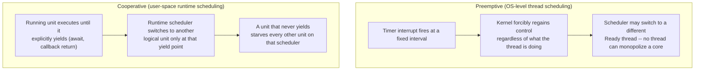

**Decision implications.** Preemptive scheduling is what makes it safe for a
kernel to run arbitrary, potentially misbehaving programs on shared hardware
without one program being able to hang the machine by looping forever;
cooperative scheduling inside a single-threaded runtime is *only* safe when
the runtime's own code disciplines itself to yield often enough — which is
precisely why Node.js documentation and Python's `asyncio` documentation both
warn explicitly against long synchronous, CPU-bound blocks of code on the
event loop, and why both runtimes' answer to unavoidable CPU-bound work is to
offload it to a *separate OS thread or process* (`worker_threads`/`cluster`
in Node.js, `ProcessPoolExecutor` in Python) rather than trying to make the
cooperative scheduler handle it.

**Common failure mode.** Writing a synchronous, tight-loop computation
(parsing a very large JavaScript Object Notation (JSON) payload, computing a
hash over a large buffer) directly inside an event-loop-based service and
being surprised that *every other concurrent request* stalls during that
computation — a direct consequence of cooperative scheduling providing no
preemption safety net the way the OS-level scheduler does for its threads.

**Concrete scenario.** A Node.js service parses an uploaded 200 MB JSON file
synchronously inside a request handler. For the several hundred milliseconds
that parse takes, the single event-loop thread cannot service *any* other
request — health checks time out, unrelated requests queue up — even though
the server has plenty of idle CPU capacity on other cores, because the
event loop's cooperative model has no preemption mechanism to interrupt the
parse and let another callback run.

### 4.6 Inter-Process Communication (IPC) Mechanism Taxonomy

**Definition.** Because processes are, by design, isolated from each other's
memory (Section 4.1), any two processes that need to cooperate — pass data,
signal an event, coordinate work — must use one of the kernel's explicit
**Inter-Process Communication (IPC)** mechanisms rather than simply sharing a
pointer the way two threads in one process can. IPC mechanisms trade off
along three axes: how much data they move efficiently, whether communicating
parties need to be related (parent/child) or can be arbitrary unrelated
processes, and whether they carry structured messages or an unstructured
byte stream.

**Mechanism — the mechanism taxonomy:**

- **Pipes** (`pipe()`, and named pipes / First-In-First-Out (FIFO) files for
  unrelated processes) are a unidirectional byte-stream channel the kernel
  buffers internally; a write on one end blocks once the kernel's pipe buffer
  is full, and a read on the empty end blocks until data or End-Of-File (EOF)
  arrives — the same shell-pipeline mechanism (`cmd1 | cmd2`) most engineers
  already use daily is exactly this primitive.
- **Shared memory** (`shmget`/`mmap` with `MAP_SHARED`) maps the *same*
  physical memory pages into two or more processes' otherwise-separate
  virtual address spaces, giving them the fastest possible data-transfer path
  (no copying through the kernel at all after setup) at the cost of
  reintroducing exactly the synchronization problem threads have (Section
  4.9) — shared memory removes isolation deliberately for that one region,
  so the processes sharing it must coordinate access just as carefully as
  threads sharing a heap would.
- **Message queues** (POSIX message queues, or System V message queues) let
  a sender enqueue discrete, typed messages that a receiver dequeues, with
  the kernel preserving message boundaries (unlike a pipe's undifferentiated
  byte stream) and, on some implementations, message priority ordering.
- **Signals** (`SIGTERM`, `SIGKILL`, `SIGHUP`, `SIGCHLD`, and many others)
  are the kernel's asynchronous notification mechanism: a process can send a
  signal to another process (if permitted) or the kernel can generate one on
  a process's behalf (delivering `SIGSEGV` on an illegal memory access,
  `SIGCHLD` to a parent when a child terminates), and the receiving process's
  execution is interrupted to run a registered signal handler (or take the
  signal's default action, commonly termination) — signals carry no
  payload beyond the signal number itself, making them suited for simple
  event notification, not data transfer.
- **Unix domain sockets** provide a bidirectional, socket-shaped IPC channel
  for processes on the *same* host, supporting both byte-stream and
  message-oriented modes and even the ability to pass open file descriptors
  between processes — this mechanism is recapped only here; its full
  mechanics, addressing, and comparison against TCP loopback sockets for
  local IPC are owned by [Sockets](CH16_Sockets.md) Section 4.9.

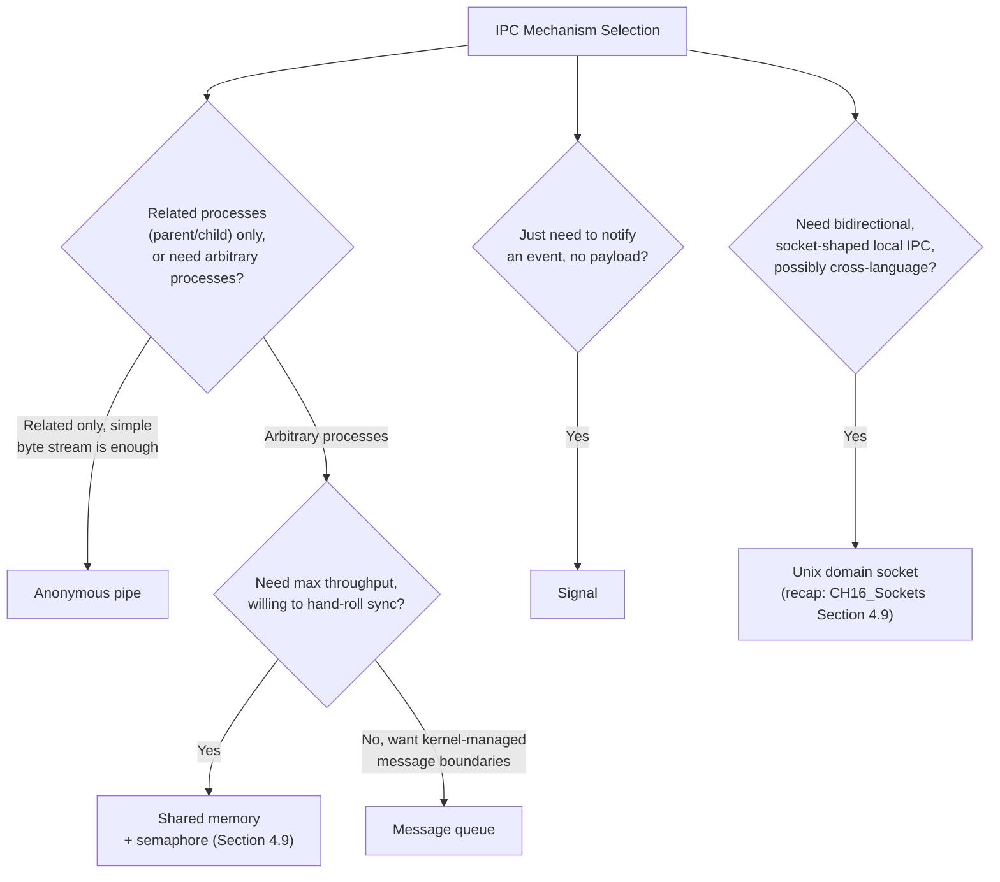

**Decision implications.** Choosing an IPC mechanism is choosing a specific
point on the trade-off between throughput, complexity, and coupling. Shared
memory is fastest but requires the sharing processes to re-implement the
synchronization discipline threads need; pipes are simplest but limited to
related processes and unstructured bytes; message queues add structure at
some throughput cost; signals are cheap but carry no data; Unix domain
sockets are the most flexible general-purpose choice for arbitrary local
processes that already think in terms of a socket API. Architects choosing
how two sidecars in the same Kubernetes pod should communicate, or how a
worker-process pool should hand results back to a parent, are making
exactly this decision.

**Common failure mode.** Reaching for shared memory purely because it is the
fastest option, without budgeting for the synchronization complexity it
reintroduces — a shared-memory region without a semaphore or mutex
disciplining access to it has exactly the same race-condition and
corruption risk multithreaded code has (Section 4.9), except now debugged
across process boundaries with separate address spaces, which is
considerably harder because a debugger attached to one process cannot
simply inspect the other's stack.

**Concrete scenario.** A video-transcoding pipeline splits work across four
worker processes on one host, passing large uncompressed video frames
between them. Using a message queue to pass full frame buffers by value
would mean four full memory copies (into the queue, out of the queue) per
frame per hop; the team instead maps a shared-memory ring buffer the workers
write frames into directly, paired with a small semaphore-protected index
(Section 4.9) coordinating which slots are free versus filled — the shared
memory removes the copy cost, and the semaphore restores the coordination
that removing full kernel-mediated messaging gave up.

### 4.7 Synchronization Primitives: Mutexes, Semaphores, and Condition Variables

**Definition.** Because threads share one address space (Section 4.2) and
processes can voluntarily share memory (Section 4.6), the OS provides a
small set of **synchronization primitives** — kernel-backed (or, for
uncontended fast paths, purely user-space) objects that let concurrent
executors coordinate access to shared state safely. The three foundational
primitives, present in every mainstream threading library (POSIX threads,
Windows threads, and every language runtime's own wrappers around them), are
the **mutex**, the **semaphore**, and the **condition variable**.

**Mechanism.**

- A **mutex** (mutual exclusion lock) allows only one thread at a time to
  hold it; a thread calls `lock()` (or `pthread_mutex_lock()`), and if
  another thread already holds the mutex, the calling thread blocks (Section
  4.3's Blocked state) until the holder calls `unlock()`. A mutex protects a
  **critical section** — a block of code that reads or writes shared state
  and must not be executed by more than one thread concurrently.
- A **semaphore** generalizes the mutex to an integer count rather than a
  binary held/not-held state: a semaphore initialized to N allows up to N
  concurrent holders, decrementing on `wait()`/`acquire()` and incrementing
  on `post()`/`release()`, blocking a caller only when the count has reached
  zero. A semaphore initialized to 1 (a **binary semaphore**) behaves like a
  mutex for exclusion, but semaphores are more commonly used to bound
  concurrent access to a *pool* of N interchangeable resources (N database
  connections, N worker slots) rather than to guard a single critical
  section.
- A **condition variable** lets a thread holding a mutex efficiently wait
  for some *condition* on the shared state to become true (a queue becoming
  non-empty, a counter reaching a target) without busy-spinning: the thread
  calls `wait()` on the condition variable (which atomically releases the
  mutex and blocks), and another thread that changes the shared state and
  makes the condition true calls `signal()`/`notify()` (waking one waiter)
  or `broadcast()`/`notify_all()` (waking all waiters), at which point the
  woken thread re-acquires the mutex and re-checks the condition before
  proceeding (always in a loop, since a woken thread can lose a race to
  re-acquire the mutex against another thread that makes the condition false
  again — the classic "spurious wakeup" and "stolen wakeup" hazards every
  condition-variable implementation's documentation warns about).

```mermaid
flowchart TB
    subgraph Mutex["Mutex: exclusive access"]
        M1["Thread A: lock() -- acquires"] --> M2["Thread B: lock() -- BLOCKS"]
        M1 --> M3["Thread A: critical section"]
        M3 --> M4["Thread A: unlock()"]
        M4 --> M5["Thread B: wakes, acquires, proceeds"]
    end
    subgraph Semaphore["Semaphore(N=3): bounded concurrent access"]
        S1["3 permits available"] --> S2["Threads A, B, C acquire<br/>(count now 0)"]
        S2 --> S3["Thread D: acquire() -- BLOCKS<br/>(count is 0)"]
        S3 --> S4["Thread A releases (count -> 1)"]
        S4 --> S5["Thread D wakes, acquires"]
    end
    subgraph CondVar["Condition variable: wait for a condition"]
        CV1["Thread A holds mutex,<br/>queue is empty, calls wait()<br/>(releases mutex, blocks)"] --> CV2["Thread B holds mutex,<br/>pushes item, calls notify()"]
        CV2 --> CV3["Thread A wakes, re-acquires mutex,<br/>re-checks queue -- proceeds"]
    end
```

**Decision implications.** Choosing among these three is choosing what kind
of coordination the shared state actually needs. A mutex is the right
primitive when at most one thread may touch a piece of state at a time
(protecting a hash map's internal pointers). A semaphore is the right
primitive when up to N threads may proceed concurrently against a bounded
pool of resources (limiting concurrent connections to a downstream service
to N). A condition variable is the right primitive whenever a thread must
wait for some state change rather than simply for exclusive access — a
producer/consumer queue, a worker pool waiting for work to arrive — and it is
almost always paired with a mutex, since checking "is the condition true"
and then waiting must be atomic with respect to other threads changing that
condition, or the check-then-wait sequence itself becomes a race condition.

**Common failure mode.** Using a condition variable's `wait()` inside an
`if` instead of a `while` loop around the condition check — waking up once
does not guarantee the condition is still true by the time the woken thread
re-acquires the mutex, because another thread may have raced it and changed
the state back; every mainstream synchronization library's documentation
requires re-checking the condition in a loop for exactly this reason, and
skipping the loop is a subtle, load-dependent bug that often only manifests
under real concurrent load, not in local testing.

**Concrete scenario.** A bounded producer/consumer work queue uses a mutex
plus two condition variables (`not_full`, `not_empty`). A consumer thread
calls `wait()` on `not_empty` inside a `while (queue.isEmpty())` loop rather
than an `if`; under high contention, two consumers can both wake from the
same `notify()` (one legitimately, one as a "stolen" wakeup against a
different thread's signal), but only one finds a non-empty queue when it
re-checks — the other correctly loops back into `wait()` instead of
incorrectly proceeding to dequeue from an empty queue and crashing or
blocking on an invalid pop.

### 4.8 Race Conditions

**Definition.** A **race condition** is a class of bug in which the
correctness of a program's outcome depends on the relative, unpredictable
timing or interleaving of two or more threads' (or processes', for
shared-memory IPC) execution, rather than being deterministic. Race
conditions are not a rare exotic bug class — they are the default,
structural risk of any shared mutable state touched by more than one thread
without synchronization (Section 4.7), because the thread and process
scheduling model this chapter teaches provides *no* implicit ordering
guarantee between independently scheduled execution contexts.

**Mechanism.** The canonical example is a simple, seemingly atomic-looking
operation like `counter++` (increment a shared counter), which on real
hardware is actually at least three separate steps: read the counter's
current value into a register, add one to that register, write the register
back to memory. If two threads both execute this three-step sequence
concurrently without a mutex, both can read the same starting value before
either writes back, and both then write back `starting_value + 1` — one
increment is silently lost, even though each thread individually executed
correct code, because the *interleaving* of their otherwise-correct steps
produced an incorrect combined result.

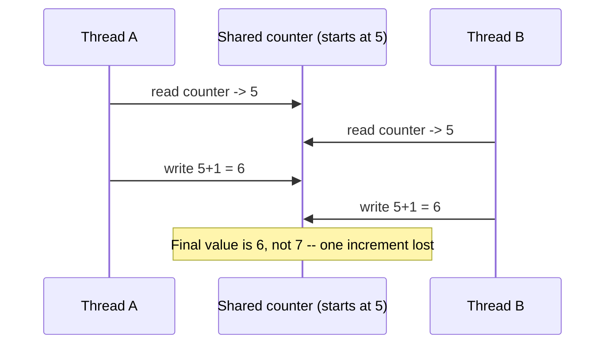

**Decision implications.** Race conditions are why "the code looked correct
in review and passed all tests" is not sufficient evidence of thread safety
— they are timing-dependent, so a race can be entirely absent under low
concurrency or on a single-core test machine and appear only in production
under real multi-core parallel load, at low but nonzero frequency, making
them notoriously hard to reproduce and root-cause after the fact. The
correct engineering response is not more testing under load (which reduces
but never eliminates the risk of missing a rare interleaving) but static
discipline: every piece of mutable state reachable from more than one thread
must have an explicit, documented synchronization strategy (a mutex
protecting it, an atomic operation, or a design that avoids sharing it at
all, such as message-passing between threads instead of shared state).

**Common failure mode.** Assuming an operation is "basically atomic" because
it looks like a single line of source code (`counter++`, `list.append(x)`,
a dictionary/hash-map insert) — source-level atomicity is not the same as
machine-level atomicity, and only a small, explicitly documented set of
operations (typically hardware-supported atomic instructions, or operations
explicitly guaranteed atomic by a language's memory model) are actually safe
without a lock.

**Concrete scenario.** A rate-limiting middleware increments a shared
in-memory request counter per client on every request across a thread pool,
without a mutex, reasoning "it's just an integer increment." Under
moderate concurrent traffic from the same client, the observed counter
under-counts real request volume because of lost updates exactly like the
diagram above, silently letting a client that should have been throttled
continue past the configured limit — a race condition that is invisible
under a single-threaded load test and only appears once real concurrent
traffic from the same client hits the service.

### 4.9 Deadlock and the Four Coffman Conditions

**Definition.** A **deadlock** is a state in which two or more threads (or
processes) are each waiting for a resource the *other* holds, and neither
can proceed, so both are blocked forever unless something external
intervenes (a timeout, a forced termination). Deadlock is the classic
failure mode of synchronization *done wrong* — not by forgetting to
synchronize (Section 4.8's race conditions), but by synchronizing
inconsistently across multiple locks.

**Mechanism — the four Coffman conditions.** Computer scientist Edward
Coffman formalized the four conditions that must **all** simultaneously hold
for deadlock to be possible; breaking any single one of the four makes
deadlock structurally impossible for that resource-acquisition pattern:

1. **Mutual exclusion** — at least one resource involved must be held in a
   non-shareable way (a mutex, by definition, is exclusive).
2. **Hold and wait** — a thread holding at least one resource is waiting to
   acquire additional resources currently held by other threads.
3. **No preemption** — a resource can only be released voluntarily by the
   thread holding it; the kernel or runtime cannot forcibly reclaim a lock
   from a thread that will not give it up.
4. **Circular wait** — there exists a cycle of two or more threads, each
   waiting for a resource held by the next thread in the cycle.

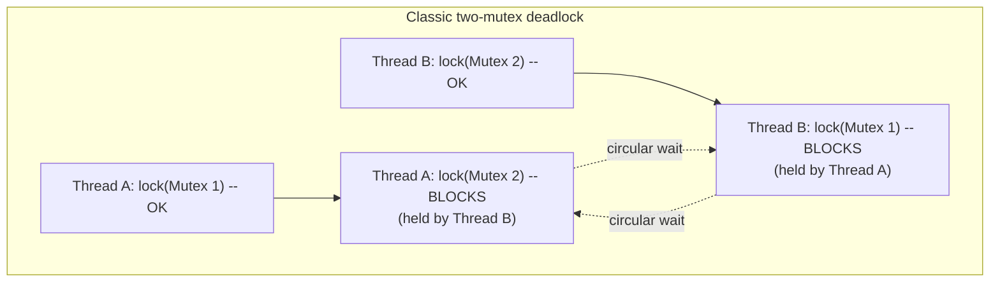

**Decision implications.** Because all four conditions must hold
simultaneously, the standard production-grade prevention technique is to
deliberately break **circular wait**, since it is usually the easiest
condition to eliminate without giving up mutual exclusion (which the
correctness requirement needs) or preemption (which most mutex
implementations do not support anyway): enforce a single, global, consistent
**lock ordering** across the entire codebase — for example, "always acquire
the lower account-ID's lock before the higher account-ID's lock" in a
funds-transfer system — so that no cycle of "waiting for the next thread's
resource" can ever form, because every thread always requests locks in the
same relative order. Section 10's code example demonstrates exactly this
fix. An alternative, more flexible but more complex technique is a
**try-lock with backoff**: attempt to acquire the second lock with a
timeout, and if it fails, release the first lock and retry from the
beginning after a short random delay — this breaks "hold and wait" instead
of circular wait, at the cost of needing to handle the retry path correctly.

**Common failure mode.** Acquiring multiple locks in different orders in
different code paths that both happen to need the same two locks — the
classic pattern is a "transfer funds" function that locks the source account
then the destination account, called concurrently with a second transfer
between the same two accounts in the opposite direction, locking destination
then source; each call individually looks correct, and the bug is invisible
until both directions execute concurrently and each holds the lock the other
needs.

**Concrete scenario.** A banking service's `transfer(from, to, amount)`
function locks `from.mutex` then `to.mutex` before moving money. Under
concurrent load, thread A calls `transfer(accountX, accountY, ...)` while
thread B concurrently calls `transfer(accountY, accountX, ...)`. Thread A
acquires `accountX`'s lock and then blocks waiting for `accountY`'s lock;
thread B, having already acquired `accountY`'s lock, blocks waiting for
`accountX`'s lock — both threads are now permanently stuck, and every other
request that also needs either account's lock queues up behind them,
eventually presenting to on-call as a full service outage with no single
obvious root-cause log line, only a growing pile of blocked request threads.
Section 10 shows the code for both the bug and the consistent-lock-ordering
fix.

### 4.10 Priority Inversion

**Definition.** **Priority inversion** is a scheduling pathology in which a
high-priority thread is indirectly blocked, for an unbounded amount of time,
by a low-priority thread — not because the low-priority thread is doing
anything wrong on its own, but because a *medium*-priority thread is
scheduled ahead of the low-priority thread, preventing the low-priority
thread from ever releasing a lock the high-priority thread needs.

**Mechanism.** The scenario requires exactly three threads at three
different priority levels contending, directly or indirectly, over one
shared resource: a low-priority thread (L) acquires a mutex; before L
releases it, a high-priority thread (H) becomes ready and needs the same
mutex, so H blocks waiting for L; but a medium-priority thread (M), which
needs no lock at all, is ready to run and — because the scheduler always
prefers the highest-priority Ready thread — preempts L and runs instead,
repeatedly, for as long as M has work to do. L cannot run (to finish its
critical section and release the mutex) because M keeps preempting it, and H
cannot run because it is blocked waiting on L's mutex — the *effective*
priority of the chain is now bounded by M, even though M has nothing to do
with the mutex at all, which is why this is called priority *inversion*: H's
higher priority has been effectively overridden by M's mere presence.

```mermaid
sequenceDiagram
    participant H as High-priority thread
    participant M as Medium-priority thread
    participant L as Low-priority thread
    L->>L: acquires mutex, enters critical section
    H->>L: becomes ready, needs same mutex -- BLOCKS
    M->>M: becomes ready (needs no lock)
    Note over M,L: Scheduler always prefers highest-priority<br/>Ready thread -- M preempts L repeatedly
    Note over H,L: L cannot finish/release the mutex while<br/>preempted by M; H stays blocked indefinitely
```

**Decision implications.** Priority inversion is a real, historically
documented production incident class, not a theoretical curiosity — the
Mars Pathfinder rover's 1997 software resets are the textbook public example,
traced to exactly this pattern between an information-bus-management task,
a communications task, and a low-priority meteorological data-gathering task
contending for a shared mutex. The standard fix is **priority inheritance**:
when a high-priority thread blocks on a mutex held by a lower-priority
thread, the kernel or the mutex implementation temporarily boosts the
holder's priority to match the highest-priority thread waiting on it, so
that medium-priority threads can no longer preempt the holder out from under
the higher-priority waiter — once the holder releases the mutex, its
priority reverts. Many real-time-capable mutex implementations (POSIX's
`PTHREAD_PRIO_INHERIT` mutex attribute, for example) support this directly;
an architect targeting latency-sensitive or real-time systems should verify
whether the platform's default mutex implementation provides priority
inheritance or must have it explicitly enabled.

**Common failure mode.** Assuming a strict, static thread-priority scheme by
itself guarantees that high-priority work always completes fastest — priority
alone says nothing about lock contention, and a naive priority assignment
without priority inheritance (or an equivalent protocol) can make a
high-priority thread's *actual* observed latency depend on an unrelated
medium-priority thread's behavior, defeating the entire purpose of assigning
priorities.

**Concrete scenario.** A low-priority background metrics-collection thread
holds a mutex briefly while writing to a shared in-memory stats buffer. A
burst of unrelated, medium-priority logging threads becomes runnable and
repeatedly preempts the metrics thread (which never gets enough CPU time to
finish its critical section and release the mutex), while a high-priority
request-handling thread that needs that same mutex sits blocked far longer
than its priority should allow, manifesting in production as sporadic,
hard-to-reproduce request-latency spikes correlated with logging bursts
rather than with any change to the request-handling code itself.

### 4.11 Fork/Exec: The POSIX Process-Creation Model

**Definition.** On POSIX systems, a new process is not created by directly
specifying "run this program" in one step; instead, process creation is
split into two distinct system calls with two distinct responsibilities:
**`fork()`**, which creates a new process that is an (almost) exact copy of
the calling process, and **`exec()`** (a family of calls: `execve()`,
`execv()`, `execl()`, and others), which replaces the *current* process's
program image — its code, data, and stack — with a different program
entirely, without creating a new process. Nearly every process-launching
operation on Unix-like systems — a shell running a command, a web server
spawning a Common Gateway Interface (CGI) script, a supervisor process
starting a worker — is `fork()` followed immediately by `exec()` in the
child.

**Mechanism.** `fork()` duplicates the calling process's address space,
open file descriptor table, and most other process state into a brand-new
process with its own PID; the duplication of memory is implemented lazily
via **copy-on-write**: rather than physically copying every page of memory
immediately (which would be slow for a large process), the kernel marks the
parent's and child's page-table entries as shared and read-only, and only
actually copies a given page the first time either process writes to it —
until a write happens, parent and child are quietly sharing the same
physical memory, which is why `fork()` is cheap even for large processes
despite conceptually "copying everything." `fork()` returns *twice*: once in
the parent, returning the new child's PID, and once in the child, returning
`0` — the same source code executes in both processes from that point
forward, and an `if (pid == 0)` check is the idiomatic way to branch into
child-only versus parent-only logic. `exec()`, called from the child branch,
discards the child's current program image entirely and loads a new
executable in its place, keeping the same PID and (by default) the same
open file descriptors — this is precisely how shell redirection and piping
work: the child duplicates its parent's descriptor table via `fork()`,
rearranges specific descriptors (redirecting FD 1 to a file, or to the write
end of a pipe) *before* calling `exec()`, and the newly `exec()`'d program
inherits those already-rearranged descriptors without needing to know
anything special about redirection itself.

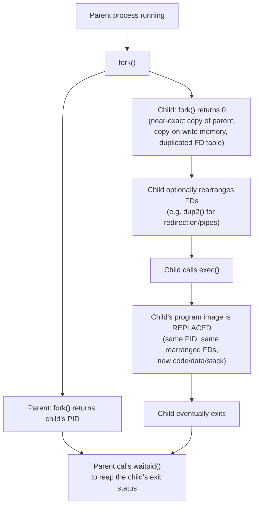

**Decision implications.** Splitting creation (`fork()`) from program
replacement (`exec()`) into two independent primitives — rather than one
combined "spawn a new program" call, as some other operating systems provide
— is what makes shell-style I/O redirection, pipelines, and environment
setup trivially composable in ordinary user-space code: any adjustment the
child needs before the new program starts (closing an inherited descriptor,
redirecting stdout, changing the working directory, dropping privileges) is
just ordinary code executed in the gap between `fork()` and `exec()`, with
no special OS API needed for each variant. This is also the mechanism every
higher-level "spawn a subprocess" Application Programming Interface (API) in
every language ultimately calls down to on POSIX systems (Python's
`subprocess` module, Node.js's `child_process.spawn`, Java's
`ProcessBuilder`) — this chapter owns the OS mechanism itself; each
language's specific subprocess API is only a thin wrapper and is not
re-taught here.

**Common failure mode.** Calling `fork()` from a process that already has
multiple threads and expects the *entire* multithreaded state to carry over
correctly into the child — POSIX only guarantees that the thread which
called `fork()` survives into the child; every *other* thread simply ceases
to exist in the child without being properly terminated, which means any
mutex one of those vanished threads happened to be holding at the moment of
`fork()` is now permanently, unrecoverably locked in the child (recap:
[Python Architecture](../03_Software_Engineering_Foundations/CH02_Python_Architecture.md)
Section 4.6 flags this exact hazard as the reason Python's `multiprocessing`
module moved away from defaulting to `fork` on some platforms in favor of
`spawn`, which starts a genuinely fresh interpreter process instead of
forking a possibly-multithreaded one).

**Concrete scenario.** A multithreaded server process calls `fork()` to
spawn a helper child for a one-off task, while a background logging thread
happens to be mid-write, holding an internal mutex inside the logging
library at the exact instant of the fork. That logging thread does not exist
in the child (only the forking thread survives the fork), so the mutex it
was holding is copied into the child in its "locked" state with no thread
that will ever unlock it — the very next time the child's own code tries to
log anything through that same library, it deadlocks against a lock nobody
in the child process can ever release, an extremely difficult-to-diagnose
class of bug that only manifests when the fork happens to race with the
logging thread's critical section.

## 5. Internal Working

The kernel's **scheduler** is the software component that implements the
state transitions of Section 4.3 and decides, on every context switch
(Section 4.4), which Ready thread runs next. Modern general-purpose kernels
(Linux's Completely Fair Scheduler (CFS), and its newer successor scheduling
classes) do not use simple fixed time-slice round-robin; instead they track
each thread's accumulated "virtual runtime" and always dispatch the Ready
thread that has received the least CPU time so far relative to its priority
weight, approximating an ideal, perfectly fair multitasking processor where
every thread gets its proportional share continuously. Threads can be
assigned a **nice value** (traditionally ranging from -20, highest priority,
to +19, lowest priority, on Linux), which scales how much virtual runtime
"weight" a thread accumulates per real unit of CPU time — a lower nice value
makes a thread accumulate virtual runtime more slowly relative to others, so
the scheduler picks it more often.

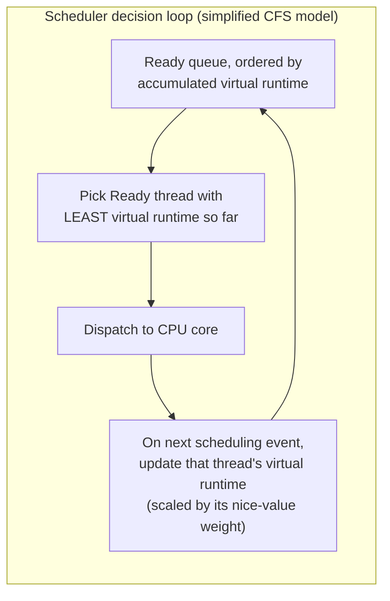

Multi-core scheduling adds **load balancing**: the kernel maintains a
per-core run queue and periodically migrates Ready threads between cores'
queues to avoid one core being overloaded while another sits idle, a
different mechanism from — but philosophically similar in intent to — the
work-stealing scheme Go's runtime uses for goroutines at the user-space
level (recap: [Go](../03_Software_Engineering_Foundations/CH04_Go.md) Section
4.3). Real-time scheduling classes (`SCHED_FIFO`, `SCHED_RR` on Linux) sit
above the normal fairness-based class entirely and are reserved for latency-
critical workloads that need bounded, predictable scheduling latency rather
than long-run fairness — a database's write-ahead-log flusher or an
audio-processing pipeline are typical real-world users of these classes,
traded off against the risk that a misbehaving real-time thread can starve
every normal-priority thread on that core, since real-time classes always
preempt normal ones.

## 6. Design Principles

- **Match the isolation boundary to the failure blast radius you can
  tolerate.** If a component's failure must never affect another component,
  put a process boundary (or a stronger, container/VM boundary) between
  them, not just a thread boundary — Section 4.1/4.2's shared-fate contrast
  is the deciding factor, not raw performance.
- **Classify workloads as I/O-bound or CPU-bound before choosing a
  concurrency mechanism.** Section 4.3's distinction determines whether more
  threads help (I/O-bound, up to a point) or hurt (CPU-bound, past the core
  count) — sizing thread pools without this classification is guessing.
- **Prefer the cheapest primitive that provides sufficient isolation.**
  Threads before processes when isolation is not required (cheaper creation
  and context-switch cost, per Section 4.4); processes before separate
  hosts/VMs when process-level isolation is sufficient.
- **Establish a global lock-ordering convention before multi-lock code
  exists, not after the first deadlock incident.** Section 4.9's circular-
  wait prevention only works if it is a codebase-wide discipline, not a
  fix applied to one function at a time.
- **Never assume a source-level "single operation" is machine-level
  atomic.** Section 4.8's race-condition mechanism means every piece of
  shared mutable state needs an explicit, reviewed synchronization strategy.
- **Prefer message-passing between concurrent units over shared mutable
  state where the workload allows it**, since a design that never shares
  memory across threads structurally eliminates entire classes of race
  conditions and deadlocks rather than requiring correct discipline every
  time shared state is touched — this is the core rationale channels
  (recap: [Go](../03_Software_Engineering_Foundations/CH04_Go.md) Section
  4.4) and actor-style models choose over locks wherever the workload fits.

## 7. Architecture Patterns

Three recurring server-side concurrency architectures are all direct
applications of this chapter's primitives, and are recapped here (not
re-taught in full, since [Sockets](CH16_Sockets.md) Section 4.5 already owns
the full networking-server framing of these same three patterns):

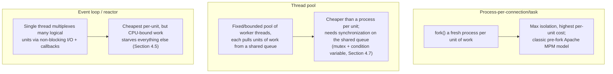

The **thread pool** pattern deserves emphasis here because it is the
pattern most directly built from Section 4.7's primitives: a bounded set of
worker threads block on a condition variable waiting for work to appear in a
shared, mutex-protected queue; a dispatcher (or the accepting thread itself)
pushes units of work onto that queue and signals the condition variable; an
idle worker wakes, dequeues one unit under the mutex, releases the mutex,
and processes the unit outside the lock so the queue is not held longer than
necessary. Sizing that pool correctly requires exactly the I/O-bound-vs-
CPU-bound classification from Section 4.3.

## 8. Production Architecture

In production, an architect rarely provisions raw OS processes and threads
directly — a **process supervisor** (systemd, a container runtime's `init`
process, Kubernetes' kubelet observing container liveness) owns restarting
crashed processes, and a language runtime or application framework owns
sizing and managing thread pools inside each process. The production
architecture question this chapter equips an architect to answer correctly
is: at each layer of the stack, is the isolation boundary a process boundary
or a thread boundary, and does that match the failure blast radius that
layer is actually responsible for containing? A common, correct pattern is
layered isolation: a container (a group of Linux namespaces and cgroups
around one or more processes — forward reference, owned in full by the
Virtualization and Container Fundamentals chapter) provides the outer
isolation boundary between unrelated services, an application process inside
that container provides isolation between that service and any sidecar
processes in the same container, and a thread pool inside that process
provides cheap concurrency for handling many requests without needing a
process per request.

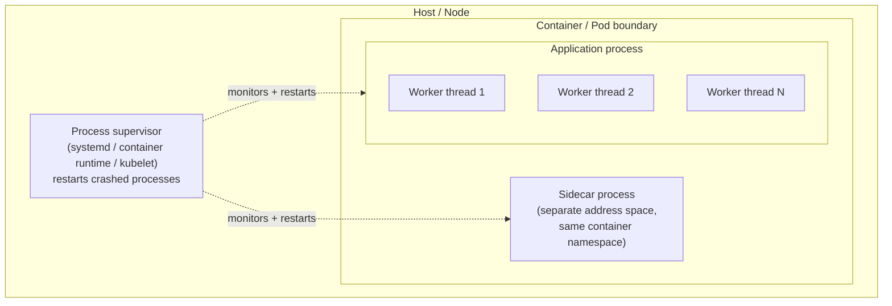

## 9. Implementation

Implementing correct concurrent code against these primitives means
choosing, for every unit of shared state, one of three disciplines: (1)
don't share it — keep it thread-local or pass ownership via message-passing
instead of shared references; (2) protect it with a mutex/semaphore/condition
variable (Section 4.7), documenting exactly which lock protects exactly
which fields, ideally enforced by the language's tooling rather than
convention alone (Rust's borrow checker is the strongest example of a
language making this a compile-time-enforced rule, recap:
[Rust](../03_Software_Engineering_Foundations/CH05_Rust.md) Section 4.1); or
(3) use a lock-free/atomic primitive for the narrow set of operations a
platform genuinely guarantees are atomic at the hardware level (compare-and-
swap-based counters, for example), reserved for hot paths that have been
profiled and shown to need it, since lock-free code is substantially harder
to reason about correctly than a straightforward mutex.

## 10. Complete Code Examples

### 10.1 `fork()`/`exec()` process creation with output redirection (C, POSIX)

```c
// fork_exec_example.c -- spawn a child, redirect its stdout to a file,
// exec a new program image, and reap its exit status in the parent.
#include <stdio.h>
#include <stdlib.h>
#include <unistd.h>
#include <sys/wait.h>
#include <fcntl.h>

int main(void) {
    pid_t pid = fork();

    if (pid < 0) {
        perror("fork failed");
        exit(EXIT_FAILURE);
    }

    if (pid == 0) {
        // Child branch: fork() returned 0 here.
        int fd = open("child_output.log", O_WRONLY | O_CREAT | O_TRUNC, 0644);
        if (fd < 0) {
            perror("open failed");
            _exit(EXIT_FAILURE);
        }
        // Redirect this process's stdout (FD 1) to the log file BEFORE exec,
        // so the new program image inherits the redirected descriptor.
        if (dup2(fd, STDOUT_FILENO) < 0) {
            perror("dup2 failed");
            _exit(EXIT_FAILURE);
        }
        close(fd);

        // Replace this process's program image entirely; PID is unchanged,
        // the redirected FD 1 carries over unchanged.
        execlp("ls", "ls", "-l", "/etc", (char *)NULL);

        // Only reached if exec() itself failed.
        perror("execlp failed");
        _exit(EXIT_FAILURE);
    }

    // Parent branch: fork() returned the child's PID here.
    int status;
    pid_t reaped = waitpid(pid, &status, 0);
    if (reaped < 0) {
        perror("waitpid failed");
        exit(EXIT_FAILURE);
    }

    if (WIFEXITED(status)) {
        printf("Child %d exited with status %d\n", pid, WEXITSTATUS(status));
    } else if (WIFSIGNALED(status)) {
        printf("Child %d killed by signal %d\n", pid, WTERMSIG(status));
    }
    return 0;
}
```

### 10.2 `pthread` creation with a mutex-protected shared counter (C, POSIX)

```c
// pthread_mutex_example.c -- N worker threads safely increment a shared
// counter, each protected by one mutex guarding the critical section.
#include <stdio.h>
#include <pthread.h>

#define NUM_THREADS 8
#define INCREMENTS_PER_THREAD 100000

static long shared_counter = 0;
static pthread_mutex_t counter_mutex = PTHREAD_MUTEX_INITIALIZER;

void *worker(void *arg) {
    for (int i = 0; i < INCREMENTS_PER_THREAD; i++) {
        pthread_mutex_lock(&counter_mutex);
        shared_counter++;   // critical section: protected read-modify-write
        pthread_mutex_unlock(&counter_mutex);
    }
    return NULL;
}

int main(void) {
    pthread_t threads[NUM_THREADS];

    for (int i = 0; i < NUM_THREADS; i++) {
        pthread_create(&threads[i], NULL, worker, NULL);
    }
    for (int i = 0; i < NUM_THREADS; i++) {
        pthread_join(threads[i], NULL);
    }

    long expected = (long)NUM_THREADS * INCREMENTS_PER_THREAD;
    printf("Expected: %ld, Actual: %ld\n", expected, shared_counter);
    // With the mutex in place, Actual always equals Expected --
    // remove the lock/unlock calls to reproduce Section 4.8's race condition
    // and observe Actual come in lower than Expected under real concurrency.
    return 0;
}
```

### 10.3 Deadlock demonstration and the consistent-lock-ordering fix (C, POSIX)

```c
// deadlock_demo.c -- reproduces the classic two-mutex circular-wait deadlock
// from Section 4.9, then shows the fix: a single global lock ordering.
#include <stdio.h>
#include <pthread.h>
#include <unistd.h>

static pthread_mutex_t mutex_a = PTHREAD_MUTEX_INITIALIZER;
static pthread_mutex_t mutex_b = PTHREAD_MUTEX_INITIALIZER;

// --- BUGGY VERSION: acquires locks in opposite order on each thread ---
void *thread_one_buggy(void *arg) {
    pthread_mutex_lock(&mutex_a);
    usleep(100000); // widen the race window to make the deadlock reliable
    pthread_mutex_lock(&mutex_b); // blocks forever if thread_two holds B and wants A
    printf("thread_one acquired both locks\n");
    pthread_mutex_unlock(&mutex_b);
    pthread_mutex_unlock(&mutex_a);
    return NULL;
}

void *thread_two_buggy(void *arg) {
    pthread_mutex_lock(&mutex_b);
    usleep(100000);
    pthread_mutex_lock(&mutex_a); // blocks forever if thread_one holds A and wants B
    printf("thread_two acquired both locks\n");
    pthread_mutex_unlock(&mutex_a);
    pthread_mutex_unlock(&mutex_b);
    return NULL;
}

// --- FIXED VERSION: both threads acquire locks in the SAME global order
// (mutex_a before mutex_b), eliminating the Coffman "circular wait" condition ---
void *thread_one_fixed(void *arg) {
    pthread_mutex_lock(&mutex_a);
    pthread_mutex_lock(&mutex_b);
    printf("thread_one (fixed) acquired both locks\n");
    pthread_mutex_unlock(&mutex_b);
    pthread_mutex_unlock(&mutex_a);
    return NULL;
}

void *thread_two_fixed(void *arg) {
    pthread_mutex_lock(&mutex_a); // same order as thread_one: A before B
    pthread_mutex_lock(&mutex_b);
    printf("thread_two (fixed) acquired both locks\n");
    pthread_mutex_unlock(&mutex_b);
    pthread_mutex_unlock(&mutex_a);
    return NULL;
}

int main(void) {
    pthread_t t1, t2;

    // Run the fixed version by default; swap in the *_buggy functions
    // below to reproduce the deadlock (the process will hang and never print).
    pthread_create(&t1, NULL, thread_one_fixed, NULL);
    pthread_create(&t2, NULL, thread_two_fixed, NULL);
    pthread_join(t1, NULL);
    pthread_join(t2, NULL);

    printf("Both threads completed -- no deadlock with consistent lock ordering\n");
    return 0;
}
```

### 10.4 Producer/consumer IPC over an anonymous pipe (C, POSIX)

```c
// pipe_ipc_example.c -- a parent process produces work items and a forked
// child process consumes them over an anonymous pipe (Section 4.6 IPC).
#include <stdio.h>
#include <stdlib.h>
#include <unistd.h>
#include <sys/wait.h>

int main(void) {
    int pipe_fds[2];
    if (pipe(pipe_fds) < 0) {
        perror("pipe failed");
        exit(EXIT_FAILURE);
    }
    int read_fd = pipe_fds[0];
    int write_fd = pipe_fds[1];

    pid_t pid = fork();
    if (pid < 0) {
        perror("fork failed");
        exit(EXIT_FAILURE);
    }

    if (pid == 0) {
        // Child: consumer. Close the write end -- it only reads.
        close(write_fd);
        int value;
        while (read(read_fd, &value, sizeof(value)) == sizeof(value)) {
            printf("consumer received: %d\n", value);
        }
        // read() returns 0 (EOF) once the parent closes write_fd and exits.
        close(read_fd);
        _exit(EXIT_SUCCESS);
    }

    // Parent: producer. Close the read end -- it only writes.
    close(read_fd);
    for (int i = 0; i < 5; i++) {
        write(write_fd, &i, sizeof(i));
    }
    close(write_fd); // signals EOF to the child's read()

    waitpid(pid, NULL, 0);
    return 0;
}
```

## 11. Performance

The dominant performance levers this chapter's model exposes are: (1) the
process-vs-thread choice, since process creation/context-switching costs
substantially more than thread creation/context-switching (Section 4.4), so
per-request process creation does not scale the way per-request thread
dispatch does; (2) thread pool sizing relative to the workload's I/O-bound
vs. CPU-bound mix (Section 4.3); (3) lock contention/hold time, since every
thread blocked waiting on a mutex is doing zero useful work and the more
threads contend for one lock, the worse aggregate throughput gets even
though no single thread's code is slow; and (4) cache/TLB locality, since
excessive context switching (Section 4.4) evicts CPU cache and TLB state
that would otherwise have been reused, a cost that does not show up as
"slow code" in a profiler focused only on wall-clock time inside functions,
only as elevated kernel/system CPU time.

## 12. Scalability

Vertical scalability within one process is bounded by how much true
parallelism the workload can extract from additional CPU cores, which in
turn is bounded by how much of the workload's critical path sits inside
mutex-protected sections (Amdahl's Law's practical consequence: a critical
section held serially across all threads caps the maximum speedup no matter
how many cores are added, since threads inside that critical section are
never running concurrently regardless of core count). Horizontal scalability
— adding more processes across more machines — sidesteps in-process lock
contention entirely at the cost of needing IPC or network-based coordination
(Section 4.6) between processes instead of in-memory locks, which is
precisely the trade-off Python's process-based scaling model makes to work
around the GIL (recap: [Python Architecture](../03_Software_Engineering_Foundations/CH02_Python_Architecture.md)
Section 4.6).

## 13. Security

The process boundary (Section 4.1) is the OS's primary security boundary,
not just a stability one: it is what prevents one compromised process from
directly reading another process's memory (credentials cached in memory,
decrypted secrets, session tokens) without an explicit, kernel-mediated
escalation (a privilege-escalation vulnerability, or a deliberately shared
IPC channel misconfigured with overly permissive access). This is why
running multiple tenants' or multiple trust levels' code in separate
processes — rather than as separate threads inside one process, which share
one address space with no memory isolation between them at all — is a
fundamental security control, and why a design that runs untrusted or
lower-trust code as a *thread* alongside trusted code inside the same
process should be treated as having effectively no memory-isolation boundary
between them. Shared-memory IPC (Section 4.6) and signals both widen a
process's attack surface slightly by definition, since they are explicit,
intentional channels through the isolation boundary; each such channel
should be reviewed for who else on the host can reach it (file-permission
bits on named pipes/shared-memory objects, and which processes can send a
given process a signal) rather than assumed private by default.

## 14. Observability

Operationally useful, OS-level signals for diagnosing process/thread
problems include: thread/process count over time (a steadily climbing
thread or process count with no corresponding drop is a strong signal of a
leak — recap: [Go](../03_Software_Engineering_Foundations/CH04_Go.md)
Section 4.1's goroutine-leak framing is the same underlying pattern one
level up); the proportion of CPU time reported as "system"/"kernel" versus
"user" time (a rising system-time share with unchanged application logic
often indicates excessive context switching, Section 4.4, or syscall
overhead, not application-code slowness); the count and duration of threads
in the Blocked state waiting specifically on lock acquisition (most
production runtimes and profilers can report "time spent waiting for a
lock" per call site, directly surfacing Section 4.7-4.9 contention); and, for
suspected deadlocks, taking a full thread dump (a snapshot of every thread's
current stack and the exact lock it is blocked on) — a deadlock is
recognizable in a thread dump as a set of threads each waiting on a lock
held by another thread in the same set, mirroring Section 4.9's diagram
exactly.

## 15. Failure Scenarios

- **Full-service deadlock outage** — the Section 4.9 lock-ordering violation
  scenario, where request-handling threads pile up behind a small number of
  permanently deadlocked threads until every worker is blocked and the
  service stops responding entirely, typically recovered only by a forced
  process restart, since deadlocked threads never release their locks
  voluntarily.
- **Fork-after-multithreaded-fork mutex hang** — Section 4.11's scenario,
  where a `fork()` call from a multithreaded process copies a lock into the
  child in a permanently-locked state because the thread that held it did
  not survive the fork, manifesting as the child hanging the very first time
  it touches that lock.
- **Priority-inversion latency spike** — Section 4.10's scenario, where a
  high-priority thread's latency becomes dependent on unrelated medium-
  priority thread activity, typically presenting as sporadic tail-latency
  spikes correlated with an unrelated workload rather than with any change
  to the affected request path's own code.
- **Thread-pool exhaustion under I/O-bound misclassification** — Section
  4.3's scenario, where a pool sized for CPU-bound work starves under an
  I/O-bound workload, presenting as throughput plateauing well below
  available downstream capacity while most CPU cores sit idle.
- **Silent race-condition data corruption** — Section 4.8's scenario, where
  incorrect results (lost counter updates, corrupted shared structures)
  accumulate slowly under real concurrent load without any crash or error
  log line, often first noticed via a downstream data-consistency check
  rather than an application-level alert.

## 16. Testing

Race conditions and deadlocks are both inherently timing-dependent, so
ordinary unit tests running on a lightly loaded, often single-core CI
runner frequently pass even when the code has a genuine concurrency bug —
absence of a failure in testing is not evidence of correctness for this
class of bug. Practical techniques: **thread-sanitizer tooling** (Clang/GCC's
ThreadSanitizer, or a language runtime's equivalent race detector) instruments
memory accesses at compile time and flags genuine data races even on
interleavings that did not happen to produce an observably wrong result
during that specific run, which is strictly more reliable than relying on a
wrong-answer assertion firing; **stress testing with artificially widened
race windows** (inserting a deliberate small sleep at a suspected race
point, exactly as Section 10.3's deadlock demo does with `usleep()`, to make
a low-probability interleaving reliably reproducible for a test run, then
removing it for production code); and **deadlock-detection timeouts in
integration tests** (asserting a multi-threaded operation completes within a
generous but bounded time limit, so a genuine deadlock fails the test
loudly with a hang-detected timeout rather than hanging the test suite
itself indefinitely).

## 17. Common Mistakes

- Assuming a background thread's crash is as contained as a background
  process's crash (Section 4.1/4.2's isolation-vs-shared-fate contrast).
- Sizing a thread pool around CPU core count for a workload that is
  actually I/O-bound, or vice versa (Section 4.3).
- Treating a source-level "single line" operation as machine-level atomic
  without verifying the platform's actual atomicity guarantee (Section 4.8).
- Acquiring multiple locks in inconsistent order across different code
  paths that touch the same set of locks (Section 4.9).
- Waiting on a condition variable inside an `if` instead of a `while` loop
  around the condition check (Section 4.7).
- Calling `fork()` from a multithreaded process without accounting for the
  fact that only the forking thread survives into the child (Section 4.11).
- Reaching for shared memory purely for its throughput advantage without
  budgeting for the synchronization discipline it reintroduces (Section
  4.6).

## 18. Best Practices

- Choose process vs. thread isolation deliberately based on the failure
  blast radius the component must contain (Section 4.1/4.2), not solely on
  raw creation/switching cost.
- Classify every concurrent workload as I/O-bound or CPU-bound before
  sizing any pool or choosing any concurrency mechanism (Section 4.3).
- Establish and document one global lock-ordering convention per codebase
  before multi-lock code is written, not after the first deadlock incident
  (Section 4.9).
- Prefer message-passing or thread-confinement over shared mutable state
  wherever the workload allows it, to structurally eliminate whole classes
  of race conditions (Section 4.8) rather than relying on disciplined
  locking everywhere.
- Enable priority inheritance (or an equivalent protocol) for any mutex a
  high-priority thread can block on, in latency-sensitive systems (Section
  4.10).
- Always re-check a condition variable's condition in a `while` loop after
  waking, never assume the first wakeup is valid (Section 4.7).

## 19. Anti-Patterns

- **"Just spawn a thread for it"** applied to unbounded, unclassified work,
  producing an ever-growing thread count with the same operational
  consequences as an unbounded connection-per-thread server (recap:
  [Sockets](CH16_Sockets.md) Section 4.5).
- **Lock-per-field micro-locking** — acquiring and releasing a separate,
  fine-grained lock for every individual field update inside one logical
  operation, which multiplies context-switch and contention overhead
  (Section 4.4) without actually improving correctness over one
  coarser-grained lock guarding the whole logical operation.
- **"It passed load testing" as proof of thread safety** — a race condition
  or deadlock (Sections 4.8-4.9) can be timing-dependent enough to never
  trigger in a given test environment while still being present and latent
  in production under different hardware, core counts, or load patterns.
- **Sharing raw memory across processes without any synchronization
  discipline**, treating shared memory (Section 4.6) as if it inherited
  the OS's memory-protection guarantees just because it is kernel-mediated
  IPC — it explicitly does not, by design.

## 20. Trade-off Analysis

| Choice | Favors | Costs |
|---|---|---|
| Process boundary | Strong fault isolation; independent crash/restart; OS-enforced security boundary | Higher creation/context-switch cost; needs explicit IPC for cooperation |
| Thread boundary | Cheap creation/switching; free shared-memory cooperation | Shared fate on crash; requires explicit synchronization discipline |
| Mutex | Simple exclusive-access correctness model | Blocks concurrency entirely during the critical section |
| Semaphore | Bounds concurrent access to a resource pool | Easy to misconfigure the count; doesn't itself express "wait for a condition" |
| Condition variable | Efficient wait-for-a-condition without busy-spinning | Must be paired correctly with a mutex; must always re-check in a loop |
| Consistent lock ordering | Eliminates deadlock's circular-wait condition entirely, cheaply | Requires whole-codebase discipline; hard to retrofit onto a large existing codebase |
| Shared memory IPC | Fastest inter-process data transfer (no kernel copy after setup) | Reintroduces full synchronization burden across the process boundary |

## 21. Comparison Table

| Aspect | Process | Thread |
|---|---|---|
| Address space | Own, isolated (MMU-enforced) | Shared with all threads in the process |
| File descriptor table | Own | Shared with all threads in the process |
| Creation cost | High (new address space + page tables) | Low (new stack + scheduler entry) |
| Context-switch cost | High (page-table/TLB switch) | Lower (no page-table switch needed) |
| Crash blast radius | Contained to that process | Entire process (all threads) |
| Communication mechanism | Explicit IPC (Section 4.6) | Direct shared-memory access |
| Needs synchronization for shared state | Only for explicitly shared IPC regions | Always, for any shared mutable state |

## 22. Real-World Case Study

The **Mars Pathfinder priority-inversion incident** (Section 4.10) is a
canonical, well-documented real-world case: the rover's software
periodically reset itself under otherwise-normal operating conditions, and
post-incident analysis (aided by the mission team reproducing the bug on an
identical ground-based unit once telemetry patterns pointed at scheduling
behavior) traced the resets to exactly the three-thread priority-inversion
pattern this chapter teaches — a low-priority meteorological data task
holding a mutex, a medium-priority communications task repeatedly preempting
it, and a high-priority information-bus-management task blocked waiting on
that same mutex for long enough to trip a watchdog timer that assumed a
deadlock and forced a system reset. The fix, uploaded to the rover in flight,
enabled priority inheritance on the contended mutex — a single scheduling-
protocol change, not a rewrite of any of the three tasks' own logic —
because the bug was structural (Section 4.10's mechanism), not a defect in
any individual task's code.

## 23. Interview Questions

1. What is the difference between a process and a thread, and what
   specifically does the OS isolate for one but not the other?
2. Explain why a crashed thread typically brings down its entire process
   but a crashed process does not affect other processes.
3. What are the four Coffman conditions for deadlock, and which one is
   most commonly targeted for prevention in production systems, and why?
4. Walk through what `fork()` and `exec()` each do, and explain why they
   are two separate system calls instead of one combined "spawn a program"
   call.
5. What is priority inversion, and how does priority inheritance fix it?
6. Why is `counter++` not necessarily atomic, and what actually happens at
   the machine level when two threads execute it concurrently without a
   lock?
7. When would you choose a semaphore over a mutex?
8. Why must a condition variable's wait be re-checked in a loop instead of
   an `if` statement after waking?
9. Explain the difference between preemptive and cooperative scheduling,
   and give a concrete failure mode specific to each.
10. What happens to a process's other threads when one thread calls
    `fork()`, and why is that a hazard for any mutex those other threads
    were holding?

## 24. Hands-on Exercises

1. Compile and run this chapter's Section 10.2 pthread/mutex example both
   with and without the `pthread_mutex_lock`/`unlock` calls, and observe the
   actual counter value diverge from the expected value in the unprotected
   version under a high enough thread/increment count.
2. Reproduce Section 10.3's deadlock by swapping in the `*_buggy` thread
   functions, observe the process hang, then confirm the fixed version
   completes reliably across repeated runs.
3. Use `strace -f` (Linux) to trace the Section 10.1 fork/exec example and
   identify the exact `fork`/`execve`/`dup2`/`wait4` system calls in the
   trace output.
4. Write a small program that intentionally leaks threads (spawns threads
   that block forever without ever being joined) and observe rising thread
   count and memory usage over time using `ps -eLf` or `/proc/<pid>/status`.
5. Using a thread-sanitizer-enabled build, compile a version of the Section
   10.2 example with the mutex removed and confirm the sanitizer reports a
   genuine data race even on a run where the final counter value happened,
   by chance, to come out correct.

## 25. Design Exercises

1. Design the thread-pool sizing strategy for a service that makes an
   average of 3 downstream calls per request, each averaging 50ms, on a
   machine with 8 CPU cores — justify your chosen pool size using Section
   4.3's I/O-bound/CPU-bound framework.
2. A funds-transfer service currently locks `from.mutex` then `to.mutex` in
   that literal parameter order. Redesign its locking strategy to eliminate
   deadlock risk under concurrent transfers in both directions between the
   same two accounts, and justify why your design satisfies Section 4.9's
   circular-wait-elimination requirement.
3. Design the IPC mechanism choice (Section 4.6) for a video-processing
   pipeline with four worker processes that must pass large uncompressed
   frame buffers between pipeline stages at the highest achievable
   throughput, and justify the specific synchronization primitive you would
   pair with it.
4. A latency-sensitive real-time system has three scheduling priority
   levels and a mutex shared between a high- and low-priority thread.
   Design the priority-inheritance configuration needed to prevent Section
   4.10's inversion pattern, and identify the observable symptom you would
   expect if inheritance were not enabled.

## 26. Architecture Review Questions

1. For each service boundary in this design, is the isolation mechanism a
   process boundary, a thread boundary, or neither — and does that match
   the failure blast radius this boundary is actually expected to contain?
2. Has every piece of state shared across more than one thread been given
   an explicit, documented synchronization strategy (a specific mutex, an
   atomic operation, or a deliberate thread-confinement design), or is any
   shared state relying on "it hasn't broken yet" as its correctness
   argument?
3. Is there a single, codebase-wide lock-ordering convention documented and
   enforced, or could two different code paths plausibly acquire the same
   two locks in different orders?
4. For any thread pool in this design, was its size derived from an
   explicit I/O-bound-vs-CPU-bound classification of the workload, or
   copied from a default/example without justification?
5. Does any code path call `fork()` from a process that may have other
   threads active at that moment, and if so, has the mutex-inherited-in-a-
   locked-state hazard (Section 4.11) been specifically ruled out?
6. For latency-sensitive paths, has priority inversion (Section 4.10) been
   considered for every mutex a high-priority thread can block on?

## 27. Summary

A process is the OS's unit of isolation — its own address space, its own
file descriptor table, hardware-enforced so that a crash in one process
cannot corrupt another's memory, the foundational fact every higher-level
architecture (services, containers, multi-tenant hosts) assumes without
restating it. A thread is the OS's unit of concurrent execution within that
isolation boundary — cheaper to create and switch between than a process,
but sharing the process's fate on a crash and requiring explicit
synchronization for any shared mutable state. The kernel scheduler moves
both through a small set of states (Ready, Running, Blocked) via context
switches whose real cost is dominated by cache and Translation Lookaside
Buffer disruption, not register save/restore, and it can schedule either
preemptively (every general-purpose OS thread scheduler) or, at a layer
above it, cooperatively (single-threaded event-loop runtimes). Processes
cooperate despite their isolation through a small taxonomy of Inter-Process
Communication mechanisms — pipes, shared memory, message queues, signals,
and Unix domain sockets (recapped from [Sockets](CH16_Sockets.md)) — each
trading throughput, structure, and coupling differently. Threads coordinate
shared state through mutexes, semaphores, and condition variables, and doing
so incorrectly produces two classic, production-relevant failure modes: race
conditions (from *insufficient* synchronization) and deadlock (from
*inconsistent* synchronization, formalized by the four Coffman conditions
and prevented in practice mainly by enforcing a global lock-ordering
convention), plus the subtler priority-inversion pathology when scheduling
priority and lock contention interact. The `fork()`/`exec()` pair is the
POSIX mechanism underlying process creation itself, and every language
runtime's subprocess API is a thin wrapper around it. Every concurrency
model taught elsewhere in this handbook — Java's virtual threads, Python's
GIL and multiprocessing model, Node.js's event loop, Go's goroutines, Rust's
ownership-checked concurrency — is a different strategy built on top of
exactly these OS-level primitives, never a replacement for them; understanding
this chapter is the prerequisite for understanding *why* each of those
runtimes made the specific trade-off it made.

**Further reading:** [Sockets](CH16_Sockets.md) (file descriptors, Unix
domain sockets, event-loop server architecture), [Java Architecture](../03_Software_Engineering_Foundations/CH01_Java_Architecture.md)
(virtual threads), [Python Architecture](../03_Software_Engineering_Foundations/CH02_Python_Architecture.md)
(GIL, multiprocessing, asyncio), [Node.js](../03_Software_Engineering_Foundations/CH03_Nodejs.md)
(event loop, worker_threads/cluster), [Go](../03_Software_Engineering_Foundations/CH04_Go.md)
(goroutines, G-M-P scheduler, channels), [Rust](../03_Software_Engineering_Foundations/CH05_Rust.md)
(ownership-based concurrency).
