# Chapter 25: Memory Management

## 1. Introduction

Every program an architect designs — a Java service, a Python worker, a Rust
binary, a Node.js API — is written as if it owns the entire computer's memory.
A developer writes `new byte[500_000_000]` or allocates a large buffer without
asking the operating system's permission, without knowing what physical
Random Access Memory (RAM) chip that memory lives on, and without any risk of
accidentally overwriting another program's data. This is not an accident of
convenience; it is one of the operating system's deepest architectural
guarantees, called **virtual memory**. Underneath every language runtime's
memory model — the Java Virtual Machine (JVM)'s generational garbage
collector, CPython's reference counting and cyclic garbage collector, Go's
concurrent tricolor collector — sits a single, shared, kernel-and-hardware
mechanism that decides what "memory" actually means on a modern computer.

This chapter teaches that mechanism: **virtual memory, paging, and the
kernel's memory-management subsystem** — the layer beneath every process,
every container, and every language runtime described elsewhere in this book.
It does not re-teach language-specific garbage collection (owned by
[Java Architecture](../03_Software_Engineering_Foundations/CH01_Java_Architecture.md)
and
[Python Architecture](../03_Software_Engineering_Foundations/CH02_Python_Architecture.md))
or process/thread creation semantics (owned by
[Processes and Threads](CH24_Processes_and_Threads.md)). Instead, it answers
the questions that sit *underneath* those chapters: why does a process believe
it has a full, private, contiguous address space when physical RAM is shared,
fragmented, and finite? What actually happens, in hardware and kernel code,
the first time a program touches a byte of memory it just allocated? What
happens when physical RAM runs out — and why is that event, on Linux, a
sudden kernel-issued `SIGKILL` rather than a graceful error? Why does
`fork()` (introduced conceptually in
[Processes and Threads](CH24_Processes_and_Threads.md)) not actually copy a
process's entire memory image, and why does that make it fast? And why do the
largest, most latency-sensitive production systems — databases, in-memory
caches, high-frequency trading engines — have to reason explicitly about
*where*, physically, a byte of memory lives relative to the CPU core that
wants it?

Architecturally, this chapter matters because memory-management decisions are
invisible until they fail catastrophically. A container silently killed by
the kernel's Out Of Memory (OOM) killer looks, from a monitoring dashboard,
identical to a network partition or a crashed process — until an architect
knows to check `dmesg` for an OOM-killer log line. A production incident where
"the server is at 100% CPU but doing nothing useful" is very often not a CPU
problem at all, but a *swapping* problem: physical memory exhausted, and the
kernel now paging active memory out to a disk that is a million times slower
than RAM. Understanding the mechanism — not just the symptom — is what lets a
Solution Architect distinguish "add more replicas" from "fix the memory
leak" from "the container's memory limit is wrong" as the correct remediation,
often within minutes of an incident starting.

## 2. Historical Evolution

Memory management is one of the oldest problems in computing, because early
computers had none of the abstractions we take for granted today — programs
addressed physical memory directly, and if two programs disagreed about which
bytes belonged to whom, the result was silent corruption or a full system
crash.

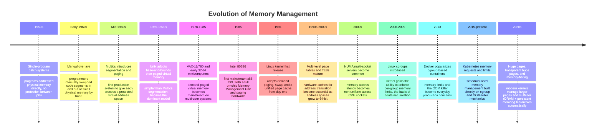

The throughline across seven decades is a single trend: memory management
moved from being the *application's* problem (early batch systems, manual
overlays) to being the *operating system's* problem (Multics, Unix, Linux),
and — most recently — the OS's memory-management primitives (cgroups, the OOM
killer) became the substrate that container orchestrators like Kubernetes
build their own resource-management model on top of. An architect designing a
Kubernetes memory limit today is, whether they realize it or not, directly
configuring a Linux kernel mechanism that traces its lineage to Multics'
1965 paging design.

## 3. Why It Exists

Virtual memory and the kernel's memory-management subsystem exist to solve
three problems simultaneously, and it is worth being precise about what each
one is, because architects who understand *why* reason correctly about memory
incidents; architects who only memorize symptoms do not.

**Problem 1 — Isolation and safety.** If every process addressed physical RAM
directly, one buggy or malicious process could read or overwrite another
process's data (or the kernel's own memory) simply by writing to the wrong
address. Virtual memory gives every process its own private view of memory,
enforced by hardware, so a bug in one process cannot corrupt another process's
state — a foundational security and reliability property, not a performance
optimization.

**Problem 2 — The illusion of abundance.** Physical RAM is finite (and was
historically *very* scarce). Virtual memory lets the operating system
overcommit — give every process the illusion of a large, contiguous address
space — while backing only the memory that is actually in active use with
real physical pages, and pushing rarely used pages to slower storage. This is
what makes it possible to run more programs, with larger apparent memory
footprints, than physical RAM could hold if every byte had to be resident at
once.

**Problem 3 — Simplicity for the programmer and the compiler.** Without
virtual memory, every program would need to be written to run at whatever
physical address happens to be free at load time, and would need to
coordinate with every other running program to avoid collisions. Virtual
memory lets every process (and every language runtime's compiler and linker)
assume it starts at a fixed, predictable address layout, radically simplifying
code generation, relocation, and shared-library loading.

The alternative — no virtual memory, direct physical addressing — was
precisely the situation on early mainframes and is still the situation inside
tiny embedded microcontrollers today, where a single trusted program runs with
no isolation requirement. The trade-off virtual memory makes is real: address
translation costs CPU cycles on every memory access (mitigated by hardware
caching, Section 4.2), and the "illusion of abundance" can fail
catastrophically when physical memory runs out and the kernel must make a
life-or-death decision — which is precisely the OOM killer mechanism this
chapter teaches in Section 4.7, and precisely why understanding this layer is
not optional for anyone who operates production systems.

## 4. Core Concepts

### 4.1 Virtual Memory as an Abstraction

**Definition.** Virtual memory is the abstraction, provided jointly by CPU
hardware and the operating system kernel, that gives every process its own
private, contiguous **virtual address space** — a range of addresses (on a
modern 64-bit system, conceptually up to 2^64 bytes) that the process can use
as if it owned all of memory, completely independent of what physical RAM
actually exists or what other processes are doing. A virtual address is not a
physical location; it is a lookup key that the hardware translates, on every
single memory access, into wherever the corresponding data actually lives in
physical RAM (or, if it isn't resident, triggers the kernel to make it
resident — Section 4.3).

**Mechanism.** Every process has its own **page table**, a kernel-maintained
data structure that maps ranges of that process's virtual addresses to ranges
of physical RAM addresses. Two processes can both believe they own virtual
address `0x00007f0000000000`, and both be correct — because each process's
page table maps that same virtual address to a *different* physical address
(or to no physical address at all, if that page has never been touched). This
is the essential trick: the address a program's own instructions and pointers
refer to is never the true hardware location of the data; it is always
mediated by a per-process translation table.

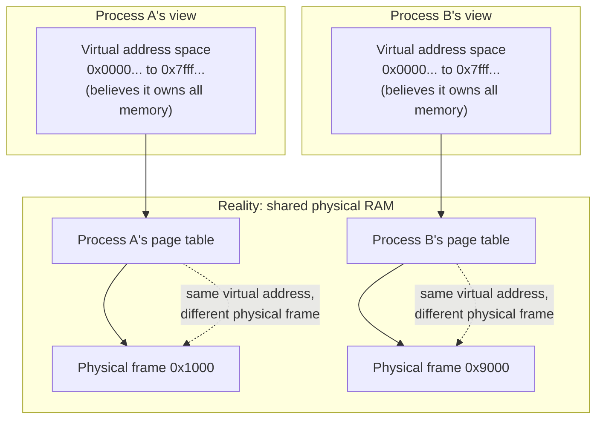

**Decision implications.** Because each process's address space is private
and independent, an architect can reason about a service's memory footprint
in isolation — a memory leak in Process A cannot directly corrupt Process B's
heap, and a crash in one process (a segmentation fault, precisely a hardware-
detected page-table access violation) does not bring down co-located
processes. This is the *hardware-enforced* isolation boundary that containers
build on top of (a container is, at the OS-process level, still just a
regular process or group of processes with its own page tables — namespaces
and cgroups add naming and resource-limit isolation on top, not memory-address
isolation, which the hardware already provides for free).

**Common failure mode.** Engineers new to systems programming sometimes
assume that a pointer value printed in one process (say, in a debugger, or in
a log line showing a heap address) means something in another process, or
that two processes sharing "the same address" in their logs are pointing at
the same data. They are not, unless memory has been explicitly and
deliberately shared (Section 4.6, memory-mapped files, are the mechanism for
deliberately sharing physical pages across process boundaries).

**Concrete scenario.** A Java Virtual Machine (JVM) process and a PostgreSQL
process running on the same host can both have heap objects that happen to
sit at virtual address `0x0000000600000000` in their own address spaces —
utterly unrelated, backed by different physical RAM, with no possibility of
collision, precisely because virtual memory guarantees each process's
translation is independent.

### 4.2 The Memory Management Unit and Page Tables

**Definition.** The **Memory Management Unit (MMU)** is a component built
into the CPU itself (not the operating system) whose sole job is to translate
every virtual address a running instruction touches into the corresponding
physical address, consulting the current process's page table on every single
memory access — a load, a store, or an instruction fetch. Because this
translation happens on literally every memory reference a CPU makes, it must
be done in hardware, in a handful of nanoseconds, or the entire computer would
be unusably slow.

**Mechanism — the page table walk.** A page table is not, in practice, one
giant flat array (a 64-bit address space would need an impossibly large table
if it were). Instead, modern architectures use a **multi-level page table**: a
virtual address is split into several index fields, each used to look up one
level of a tree of tables, terminating in a **Page Table Entry (PTE)** that
contains the physical frame number plus permission bits (readable, writable,
executable, present-or-not). On x86-64, this is a four- or five-level tree;
the CPU walks it on a translation, one memory access per level.

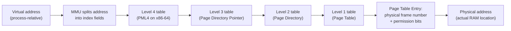

**Mechanism — the Translation Lookaside Buffer (TLB).** Walking four or five
levels of page tables on *every* memory access would still be too slow, so
the CPU caches the most recently used virtual-to-physical translations in a
small, extremely fast on-chip cache called the **Translation Lookaside Buffer
(TLB)**. A TLB hit skips the entire page-table walk; a TLB miss forces the
full walk described above. This is why workloads that touch memory in a
scattered, unpredictable pattern (poor **locality of reference**) run
measurably slower than workloads that touch memory sequentially or reuse a
small working set — every scattered access risks a TLB miss and the
multi-level walk cost that follows it. This is also the architectural
motivation for **huge pages** (2 MB or 1 GB pages instead of the default
4 KB): a single huge-page TLB entry covers far more memory, so a
memory-hungry, latency-sensitive workload (a large in-memory database, a JVM
with a multi-gigabyte heap) suffers far fewer TLB misses when huge pages are
enabled.

**Decision implications.** An architect evaluating a memory-bound,
latency-sensitive workload (an in-memory cache, a columnar analytics engine,
a large-heap JVM service) should treat "does this workload benefit from huge
pages, and does the platform support Transparent Huge Pages (THP) safely"
as a legitimate, first-class tuning question — not an exotic one. It directly
trades a small amount of memory-management flexibility (huge pages are harder
for the kernel to find contiguous physical space for, Section 4.8) for
measurably fewer TLB misses on every memory access.

**Common failure mode.** Transparent Huge Pages, when misconfigured or left
on a default "always" setting on database hosts, has caused well-documented
production latency spikes (notably with Redis and some PostgreSQL
deployments) because the kernel's background *defragmentation* work to
assemble huge pages can itself introduce unpredictable pause-like latency —
the opposite of the intended benefit. The correct operational stance for
latency-sensitive workloads is usually to test THP explicitly rather than
assume the default is safe.

### 4.3 Paging Mechanics: Fixed-Size Pages, Page Faults, and Demand Paging

**Definition.** A **page** is the fixed-size unit (typically 4 KiB on x86-64
and most Linux systems, though huge pages exist as noted above) in which the
operating system manages virtual and physical memory. Every virtual address
space is divided into pages, and physical RAM is divided into equally sized
**physical frames**; a page table entry maps one virtual page to one physical
frame. Using a fixed size (rather than variable-sized regions, as older
**segmentation** schemes did) is what makes the kernel's bookkeeping and the
MMU's hardware translation tractable — every mapping decision is "which frame
holds this page," never "how big is this region and where does it start."

**Mechanism — the page fault.** A **page fault** is a hardware-triggered
exception the CPU raises when a running instruction tries to access a virtual
address whose page table entry is marked "not present" — meaning that virtual
page currently has no backing physical frame. This is not, by itself, an
error condition; it is the fundamental mechanism the kernel uses to lazily
provision memory. When a page fault occurs, the CPU traps into the kernel,
which inspects why the page was missing and does one of several things:
allocates a fresh physical frame and zeroes it (a **minor fault**, for newly
allocated memory being touched for the first time); reads the page's contents
back in from disk (a **major fault**, if the page had been swapped out,
Section 4.5, or is part of a memory-mapped file, Section 4.6, not yet
loaded); or, if the address genuinely isn't valid for this process, delivers
a `SIGSEGV` (segmentation fault) that (absent a signal handler) terminates the
process.

**Mechanism — demand paging.** **Demand paging** is the policy, used by every
modern general-purpose operating system, of never eagerly backing a virtual
page with a physical frame until the program actually touches it for the
first time. When a program calls `malloc()` (or a language runtime requests
a large heap arena from the OS), the kernel typically just reserves virtual
address space and marks those pages "not present" — no physical RAM is
consumed yet. Only the first read or write to each individual page triggers a
minor fault, which is when the kernel actually commits a physical frame. This
is why a program that allocates a 10 GB buffer but only ever touches the
first 100 MB of it will, in practice, only ever consume roughly 100 MB of
real physical RAM — the rest remains virtual, unbacked, and free for other
processes to use.

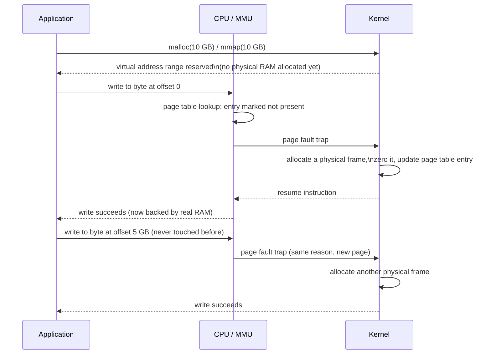

**Decision implications.** Demand paging is why "reserving" a large amount of
memory in code is cheap, but *touching* it is what actually costs physical
RAM and CPU time (each first-touch page fault). This has direct capacity-
planning consequences: a service that pre-allocates large buffers "just in
case" pays little cost until those buffers are actually used, but a workload
that scans or initializes a large data structure sequentially will incur a
burst of minor page faults exactly proportional to how much new memory it
touches — a legitimate, measurable cost that shows up as CPU time in
profiling, not "wasted" reservation.

**Common failure mode.** Engineers sometimes conflate "virtual memory
reserved" (shown as `VSZ`/virtual size in tools like `ps` or `top`) with
"physical memory actually used" (shown as `RSS`, Resident Set Size). A
process can legitimately show many gigabytes of virtual size while using only
a few hundred megabytes of real RAM — this is normal and expected for modern
language runtimes (which often reserve large virtual arenas upfront), not a
leak. The metric that matters for capacity planning and OOM risk is `RSS`
(and, at the cgroup level, `memory.current`, Section 4.7), not `VSZ`.

### 4.4 The Page Replacement Problem

**Definition.** **Page replacement** is the kernel's decision problem: when
physical RAM is fully committed and a new page needs a physical frame (either
a fresh allocation or a page being brought back in from swap or from a
memory-mapped file), which *currently resident* page should the kernel evict
to free up a frame? Getting this decision right is one of the highest-leverage
problems in operating-system design, because a poor choice directly causes
more page faults later, which directly costs latency.

**Mechanism — the ideal and the practical.** The theoretically optimal
policy would evict the page that will not be needed again for the longest
time in the future — but the kernel cannot see the future, so it must
approximate. The most intuitive approximation is **Least Recently Used
(LRU)**: evict whichever resident page has gone the longest without being
accessed, on the reasonable heuristic that recently used pages are likely to
be used again soon (temporal locality). True LRU is expensive to track
precisely at scale (it would require updating a timestamp or a linked-list
position on literally every memory access), so real kernels use a cheaper
**approximation**. Linux's core algorithm is a variant of the **clock
algorithm** (also called "second-chance"): each page has a hardware-
maintained "accessed" bit; the kernel sweeps through pages like a clock hand,
and if a page's accessed bit is set, it clears the bit and gives the page a
"second chance" (skips eviction this pass); if the bit is already clear, the
page is evicted. Linux additionally maintains **active** and **inactive**
Least Recently Used (LRU) lists, moving pages between them based on access
patterns, so that genuinely hot pages accumulate in the active list and are
the last candidates considered for eviction.

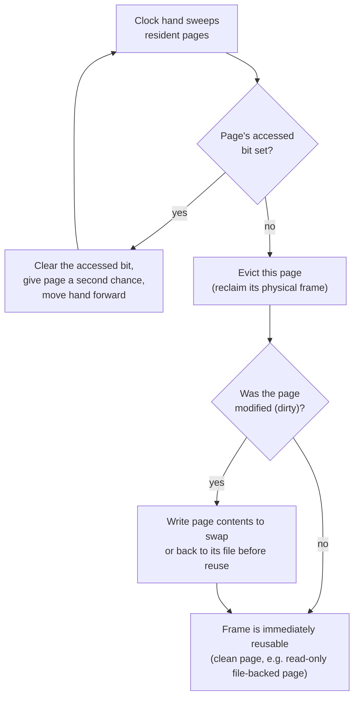

**Decision implications.** An architect does not tune the clock algorithm
directly, but understanding it explains real, observable behavior: a
workload with a genuinely large **working set** (the set of pages it
actively touches within a short time window) that exceeds available physical
RAM will cause continuous eviction-and-refault cycling, no matter how clever
the replacement algorithm is — this is a capacity problem, not an algorithm
problem, and is the direct precursor to thrashing (Section 4.5). Sizing a
service's memory allocation (a JVM heap, a container memory limit) to
comfortably exceed its actual working set, not just its average usage, is
what keeps the replacement algorithm doing productive work instead of
constant churn.

**Common failure mode.** Teams sometimes see "some memory is being evicted /
paged" in monitoring and treat any eviction as an emergency. Evicting cold,
long-unused pages (particularly clean, file-backed pages that can simply be
re-read from disk later, Section 4.6) is normal, healthy kernel behavior, not
a failure — the failure mode is specifically evicting pages that are still
part of the active working set, forcing them to be immediately re-faulted
back in, which is the definition of thrashing.

### 4.5 Swapping and the Performance Cliff

**Definition.** **Swapping** (or **paging out**) is the last-resort mechanism
by which the kernel, when physical RAM is exhausted and a swap device (a
dedicated disk partition or file) is configured, writes the contents of
rarely used *anonymous* pages (memory not backed by a file — heap, stack,
private mappings) out to that slower storage, freeing the physical frame for
more urgent use. If that page is touched again later, a **major page fault**
(Section 4.3) reads it back in from swap. The word "last resort" is doing
real architectural work here: swapping exists as a safety valve for
occasional memory pressure, not as a scalable substitute for having enough
physical RAM.

**Mechanism — why the cliff is so severe.** RAM access latency is measured in
single-digit nanoseconds; even a fast Solid State Drive (SSD)'s access latency
is measured in tens to low-hundreds of *microseconds* — a gap of roughly four
to five orders of magnitude, and a spinning hard disk is worse still. When a
system's working set genuinely exceeds physical RAM and the kernel begins
actively swapping pages that are still in use, the result is **thrashing**: a
self-reinforcing spiral where the CPU spends the overwhelming majority of its
time servicing major page faults (waiting on disk I/O) rather than executing
useful application code, and each swapped-in page displaces another
still-needed page, which itself must be swapped back in moments later.

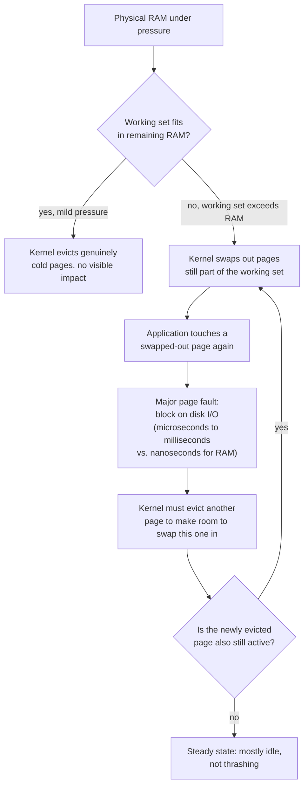

**Decision implications.** This is precisely why "swapping under load is a
production incident, not a graceful degradation": once a system enters
thrashing, throughput does not degrade gracefully in proportion to the memory
shortfall — it collapses, because CPU time that should run application code
is instead spent almost entirely waiting on disk I/O for major faults, and
the system frequently becomes so slow that even health checks and monitoring
agents stop responding in time, making the system look "hung" rather than
"slow." The correct architectural response to memory pressure is capacity
(more RAM, or a smaller working set via better data structures or eviction
policies at the application layer), not tuning swap parameters to "absorb" a
structurally undersized memory allocation. For this reason, many production
container platforms (including Kubernetes by default) either disable swap
entirely or treat swap-enabled nodes as a deliberate, carefully evaluated
exception — a node with swap enabled changes how the kernel's memory-pressure
and OOM-killer (Section 4.7) decisions behave, and most orchestrators are
designed and tested assuming swap is off.

**Common failure mode.** An architect sees a service with degraded p99
latency and 100% "CPU utilization" in a dashboard and assumes the fix is more
CPU cores or code-level optimization; the actual `vmstat`/`sar` data shows the
CPU is spending most of its time in `iowait` servicing major page faults from
active swapping — a memory-sizing problem masquerading as a CPU problem. The
diagnostic habit that catches this: always check `si`/`so` (swap-in/swap-out)
columns in `vmstat` before concluding a symptom is CPU-bound.

### 4.6 Memory-Mapped Files (mmap) and the Page Cache

**Definition.** `mmap()` is the system call that maps a file's (or a device's)
contents directly into a process's virtual address space, so that ordinary
memory reads and writes — not explicit `read()`/`write()` system calls —
transparently access the file's data, with the kernel handling the actual
disk I/O behind the scenes via the same demand-paging machinery already
described (Section 4.3). Reading byte 1000 of a memory-mapped file simply
triggers a page fault if that page isn't resident yet, exactly like touching
any other unbacked virtual page — the kernel loads that page's worth of file
content from disk to satisfy the fault, then the access proceeds as a normal
memory read.

**Mechanism — shared physical pages.** The single most architecturally
important property of `mmap()` is that when the same file is mapped by
multiple processes (or mapped `MAP_SHARED`), the kernel backs all of those
mappings with the *same* physical page frames — the file's data exists in
RAM exactly once, no matter how many processes have it mapped. This is a
direct, deliberate exception to the address-space isolation of Section 4.1:
`mmap()` is the *explicit, opt-in* mechanism for sharing physical memory
across process boundaries, in contrast to the default (each process's memory
is private and unshared).

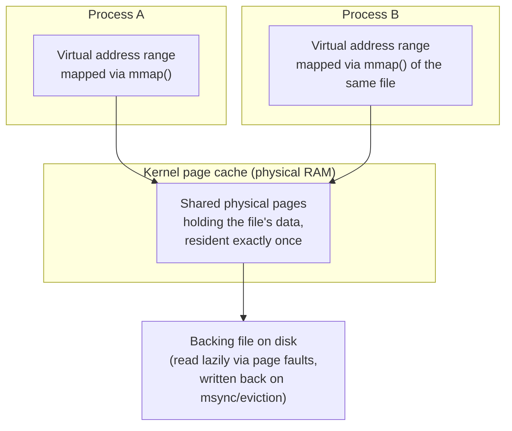

**Mechanism — reusing the page cache instead of application buffering.** The
Linux kernel already maintains a **page cache** — physical RAM holding
recently read or written file data, used to avoid repeated disk I/O for the
same blocks (the detailed page-cache/file-system interaction is owned by
[File Systems](CH26_File_Systems.md); this chapter's scope is the memory
mechanism it shares with the rest of virtual memory). A memory-mapped file's
pages *are* page-cache pages — there is no separate copy. This is why
`mmap()` is a genuinely important architecture tool, not just a convenience
Application Programming Interface (API): an application that memory-maps a
large file (a search index, a columnar data file, a shared configuration
blob) and reads through it with ordinary pointer/array access avoids ever
allocating a second, application-level copy of that data in its own heap, and
automatically benefits from the kernel's existing caching, read-ahead, and
eviction policies (Section 4.4) instead of reimplementing a bespoke caching
layer. Multiple processes on the same host mapping the same large read-only
data file (a common pattern for large machine learning model weights, or a
shared reference dataset) consume that memory's physical RAM exactly once, no
matter how many processes have it mapped — a direct, measurable, and often
dramatic memory-footprint saving compared to each process loading its own
copy into its private heap.

**Decision implications.** `mmap()` is the right tool when: (a) a large file
needs to be accessed in a sparse, random-access pattern rather than read
sequentially start-to-finish (avoiding explicit `seek`/`read` bookkeeping);
(b) multiple co-located processes need read access to the same large,
mostly-static data set and duplicating it in each process's private heap
would be wasteful; or (c) an application wants writes to a file to be
naturally, lazily flushed by the kernel's ordinary page-cache write-back
policy rather than managing its own buffering and flush timing. It is the
wrong tool when a file must be processed exactly once, sequentially, start to
end — ordinary buffered `read()` calls are simpler and no less efficient in
that case.

**Common failure mode.** Engineers sometimes assume `mmap()` "loads a file
into memory" eagerly, and are surprised that mapping a 50 GB file succeeds
instantly and appears to cost no memory — because, consistent with demand
paging (Section 4.3), only the pages actually touched are faulted in. The
failure mode in the other direction is forgetting that a memory-mapped file's
pages are subject to the same page-replacement eviction (Section 4.4) as any
other memory — under memory pressure, the kernel can and will evict clean,
unmodified mmap'd pages to reclaim RAM, silently re-reading them from disk on
next access, which shows up as a latency spike that is easy to misdiagnose as
"the file is slow" rather than "the host's memory pressure evicted cache
we were relying on staying resident."

### 4.7 The OOM Killer and Containerized Workloads

**Definition.** The **Out Of Memory (OOM) killer** is a Linux kernel
mechanism that activates when the kernel genuinely cannot satisfy a memory
allocation request — physical RAM and swap are both exhausted (or a relevant
cgroup memory limit, described below, has been reached) — and there is no
page it can reclaim or evict to free up space. Rather than let the entire
system deadlock or crash, the kernel selects a process to kill outright,
using a heuristic **badness score** (historically `oom_score`, weighted
primarily by how much memory a process is using, with adjustments for
process age, privilege, and an explicit administrator-settable
`oom_score_adj`), and sends that process an unblockable `SIGKILL`. This is a
fundamentally different failure mode from a language-runtime-level
`OutOfMemoryError` (a JVM concept) or a Python `MemoryError` — those are the
*runtime* politely detecting it cannot satisfy an allocation and raising a
catchable exception; the kernel OOM killer is an entirely separate,
uncatchable, external termination with no opportunity for the victim process
to clean up, log a stack trace, or flush any in-flight work.

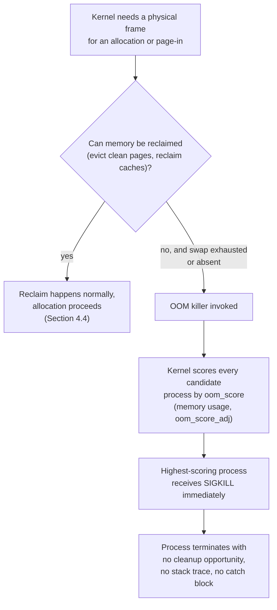

**Mechanism — cgroups and containerized OOM.** Modern container runtimes
(Docker, containerd) implement a container's memory limit using **Control
Groups (cgroups)**, a Linux kernel feature that partitions system resources
among groups of processes. A cgroup's `memory.max` (cgroup v2) or
`memory.limit_in_bytes` (cgroup v1) setting creates a *per-cgroup* memory
ceiling, independent of total host RAM. When a container's processes,
collectively, try to allocate beyond that cgroup's limit, the kernel invokes
the OOM killer *scoped to that cgroup* — it kills a process inside the
container, even if the host as a whole still has plenty of free RAM. This is
precisely why a container can be silently killed while `docker stats` or
`kubectl top` on the *node* shows abundant free memory: the OOM event was
triggered by the container's own cgroup limit, not by host-wide memory
exhaustion, and is visible only in `dmesg`/kernel logs (`Memory cgroup out of
memory: Killed process ...`) or the container runtime's own event log, not in
naive host-level memory dashboards.

**Kubernetes-specific implication.** Kubernetes memory `requests` and
`limits` map directly onto this mechanism: `requests.memory` primarily
influences scheduling (which node has enough allocatable memory for this
pod) and, on cgroup v2, contributes to relative OOM-kill priority under
node-level pressure; `limits.memory` is implemented as exactly the cgroup
`memory.max` described above. A pod that exceeds its `limits.memory` is
killed by the kernel cgroup OOM killer, and Kubernetes reports this
distinctively as container status `OOMKilled` with exit code 137 (128 + the
`SIGKILL` signal number 9) — a signature every architect operating Kubernetes
should recognize on sight as "kernel cgroup memory limit exceeded," distinct
from a crash loop caused by an application bug. (Full container-runtime and
Kubernetes resource-model mechanics are owned by
[Virtualization and Container Fundamentals](CH28_Virtualization_and_Container_Fundamentals.md);
this chapter's scope stops at the kernel memory-management mechanism those
higher layers are built on.)

**Decision implications.** Setting a Kubernetes `limits.memory` too close to
a workload's real peak usage guarantees eventual `OOMKilled` events under
normal load variance; setting `requests.memory` far below actual steady-state
usage causes the scheduler to over-pack nodes, so that many pods'
*aggregate* usage exceeds the node's real capacity even though each
individual pod is "within its request," producing node-level memory pressure
and unpredictable eviction. The architecturally sound practice is measuring
actual peak Resident Set Size (RSS) under realistic load (not guessing), and
setting `requests` close to typical steady-state usage with `limits` sized
to absorb legitimate peak/garbage-collection-driven spikes plus a safety
margin — not defaulting to round numbers with no empirical basis.

**Common failure mode.** Teams treat every `OOMKilled` pod restart as "the
application has a memory leak" and spend days profiling heap allocations,
when the actual root cause is a memory limit set below the workload's normal,
non-leaking peak usage (for example, a JVM heap plus off-heap buffers plus
metaspace, Section 4.5 territory covered in
[Java Architecture](../03_Software_Engineering_Foundations/CH01_Java_Architecture.md),
comfortably exceeding a limit that was copy-pasted from an unrelated,
smaller service's manifest). The correct first diagnostic step for any
`OOMKilled` event is comparing the container's configured `limits.memory`
against its actual historical RSS trend, not immediately assuming an
application bug.

```yaml
# Kubernetes Pod spec excerpt: memory request/limit tied directly to
# cgroup memory.max and OOM-killer behavior described above.
apiVersion: v1
kind: Pod
metadata:
  name: pricing-service
spec:
  containers:
    - name: pricing-service
      image: registry.example.com/pricing-service:1.4.2
      resources:
        requests:
          # Scheduling hint + baseline OOM-kill priority under node pressure.
          # Set close to measured steady-state RSS, not a guess.
          memory: "768Mi"
        limits:
          # Hard cgroup memory.max ceiling. Exceeding this triggers the
          # kernel cgroup OOM killer -> container status OOMKilled, exit 137.
          # Sized to absorb legitimate peaks (GC pauses, request bursts),
          # not padded arbitrarily "to be safe."
          memory: "1024Mi"
      # Optional: surface OOM-relevant signals to the app before the kernel
      # has to intervene, e.g. a JVM heap sized as a fraction of the limit.
      env:
        - name: JAVA_TOOL_OPTIONS
          value: "-XX:MaxRAMPercentage=70.0"
```

### 4.8 Memory Fragmentation

**Definition.** **Memory fragmentation** is the condition where free memory
exists but is unusable for a given request because it is not available in a
suitable form — split into two distinct kinds that architects must be able
to tell apart. **External fragmentation** is free memory scattered in many
small, non-contiguous chunks across the address space (or physical RAM),
none individually large enough to satisfy a request that needs a single
contiguous block, even though the *total* free memory would be more than
enough. **Internal fragmentation** is memory wasted *inside* an allocated
block because the allocator rounded a request up to a fixed size class larger
than what was actually requested (for example, an allocator with 64-byte size
classes handing out a full 64-byte block for a 40-byte request wastes 24
bytes internally, per allocation, that can never be reclaimed until the whole
block is freed).

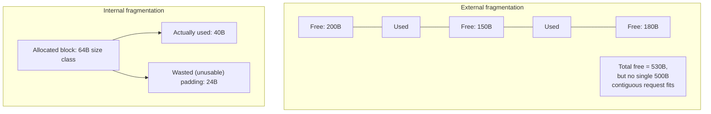

**Mechanism.** External fragmentation is fundamentally a *long-running-process*
concern: it accumulates as a program (or the kernel's own allocator, managing
physical frames for many processes) repeatedly allocates and frees blocks of
varying sizes over its lifetime, leaving an increasingly scattered pattern of
free-and-used regions. It rarely matters for a short-lived process (a
Command-Line Interface (CLI) tool that runs for milliseconds), and it matters
enormously for a long-running server process (a database, an application
server) that may run for weeks or months without restarting, since it has had
that much longer to fragment its own heap. Internal fragmentation is instead
a property of the *allocator's design* — most general-purpose allocators
(glibc's `malloc`, jemalloc, tcmalloc) use fixed size classes precisely to
make external fragmentation manageable and allocation itself fast, accepting
a bounded, predictable amount of internal fragmentation as the trade-off.

**Decision implications.** Fragmentation is why some long-running production
services benefit measurably from a periodic, planned restart (a
"defragmentation via restart" pattern, sometimes formalized as a rolling
restart schedule) even when no bug or leak is present — restarting resets the
process's heap to a single contiguous free region. It is also why choosing a
memory allocator is a legitimate architecture decision for allocation-heavy,
long-running services: allocators like jemalloc and tcmalloc were designed
specifically to reduce fragmentation and improve multi-threaded allocation
throughput compared to a default glibc `malloc`, and swapping the allocator
(a link-time or `LD_PRELOAD` change, not a code change) is a common,
low-risk optimization for memory-fragmentation-sensitive services.

**Common failure mode.** A service's RSS memory usage climbs steadily over
days or weeks even though the application has no logical memory leak (every
object is eventually freed) — profiling shows *allocated-and-freed* memory
matches expectations, but the process's RSS as reported by the OS never
shrinks back down. This is very often external fragmentation: the allocator
has genuinely freed the memory back to its own internal free lists, but
cannot return oddly shaped, scattered free regions back to the operating
system (via `sbrk`/`brk` shrinking or `munmap`), so RSS stays elevated even
though the application-level memory accounting looks correct. Distinguishing
this from a true leak requires comparing the allocator's own internal
free-list statistics (many allocators expose these, e.g. `malloc_stats()`)
against the OS-reported RSS, not relying on RSS alone.

### 4.9 Copy-on-Write and fork()

**Definition.** **Copy-on-Write (COW)** is the optimization that makes the
Unix `fork()` system call (which conceptually creates a full duplicate of the
calling process — the ownership and process-creation semantics of `fork()`
are owned by
[Processes and Threads](CH24_Processes_and_Threads.md); this chapter owns the
memory mechanism specifically) cheap in practice, despite conceptually
duplicating a process's entire address space. Rather than physically copying
every page of the parent's memory into a new set of physical frames for the
child (which would be prohibitively slow and wasteful for a process with a
large heap), the kernel instead gives the child process its *own* page table
whose entries point to the *exact same physical frames* as the parent's — but
marks every one of those shared pages read-only in both processes' page
tables.

**Mechanism.** Because both parent and child now share physical pages
read-only, either process can safely *read* that shared memory without any
copying at all. The moment either process attempts to *write* to one of those
shared pages, the write triggers a page fault (Section 4.3) — not because
the page is unbacked, but because it is marked read-only in that process's
page table. The kernel's fault handler recognizes this specific case (a COW
fault), allocates a fresh physical frame, copies the single page's contents
into it, updates the writing process's page table entry to point at the new,
private, writable copy, and only then lets the write proceed. The other
process's page table entry is untouched, still pointing at the original
shared frame. The copy happens lazily, one 4 KiB page at a time, only for
pages that are actually modified — never for the (very common) case where a
child process immediately calls `exec()` to replace its memory image
entirely (the classic `fork()`+`exec()` pattern for launching a new program),
in which case zero pages ever need to be copied at all.

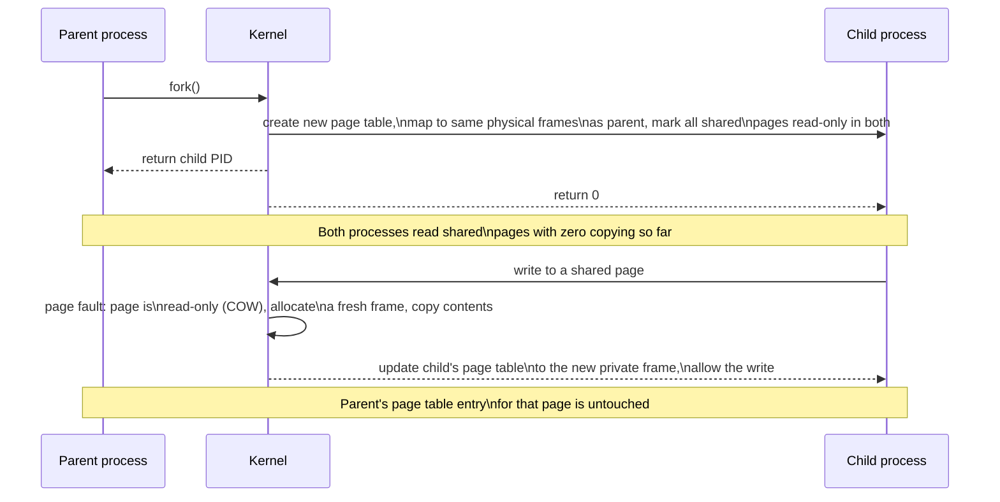

**Decision implications.** COW is precisely why `fork()`-based process models
(a pre-fork worker pool in a web server, or the CPython `multiprocessing`
module's default `fork` start method on Linux) are architecturally cheap to
scale up even for processes holding gigabytes of already-loaded data (a large
in-memory model, a warmed cache, a big configuration tree): forking a new
worker does not duplicate that memory, it shares it read-only until (and
unless) a worker actually mutates its own copy. This is the mechanism behind
the common Python deployment pattern of loading a large read-only object
*before* forking worker processes (in a pre-fork server like Gunicorn),
specifically so that all workers share the same physical pages for that data
via COW rather than each worker loading its own private copy.

**Common failure mode.** In garbage-collected or reference-counted runtimes
(notably CPython, whose per-object reference count lives *inside* the
object itself — see
[Python Architecture](../03_Software_Engineering_Foundations/CH02_Python_Architecture.md)
Section 4.2), merely *reading* an object from a forked worker still triggers
a write — incrementing and decrementing that object's reference count touches
the page it lives on. This silently defeats COW's memory-sharing benefit over
time: pages that "should" stay shared get copy-on-write-triggered anyway,
because the runtime's own bookkeeping (not application logic) is what writes
to them, causing memory usage across forked workers to creep upward even
when the application itself never explicitly mutates the shared data. This is
a well-known, non-obvious interaction between a language runtime's memory
model and the OS-level COW mechanism, and is exactly the kind of cross-layer
failure mode a Solution Architect needs to be able to explain, not just
observe.

### 4.10 NUMA: Non-Uniform Memory Access

**Definition.** **Non-Uniform Memory Access (NUMA)** describes a multi-socket
server architecture in which physical RAM is partitioned into **NUMA
nodes**, each node physically attached to (and fastest to access from) one
CPU socket, while still being technically addressable by every other CPU
socket in the system through an inter-socket interconnect. "Non-uniform"
means exactly what it says: a CPU core accessing memory on its own local
NUMA node pays a lower latency than the same core accessing memory that
physically lives on a different socket's node — the access is not uniform
across the whole system's memory, in contrast to a single-socket system where
every byte of RAM is equally close to the one CPU.

**Mechanism.** Modern multi-socket servers connect their CPU sockets via a
high-speed interconnect (Intel's UltraPath Interconnect (UPI) or AMD's
Infinity Fabric are current examples), and each socket has its own directly
attached memory controller and RAM. A "remote" memory access — a core on
socket 0 reading memory attached to socket 1 — must traverse that
interconnect, adding real, measurable latency (commonly 1.5x-2x or more
versus a local access, depending on the platform and topology) compared to a
"local" access on the requesting core's own node. The operating system is
NUMA-aware: it tracks which NUMA node each physical frame belongs to, and by
default tries to allocate a process's memory on the same node as the CPU
core it is currently running on (a policy generally called first-touch or
local allocation), and the scheduler tries (though cannot always guarantee)
to keep a process's threads running on cores local to the node holding its
memory.

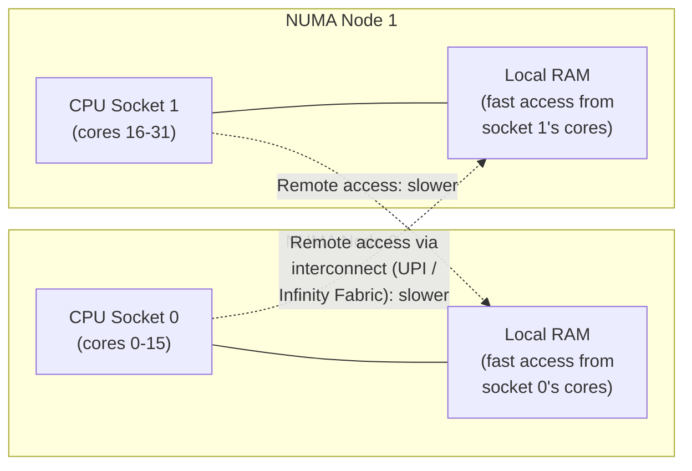

**Decision implications.** For most everyday services, NUMA is invisible and
irrelevant — the kernel's default first-touch policy and scheduler heuristics
handle it well enough. It becomes a first-class architecture concern
specifically for **high-performance, latency-sensitive production systems**:
large in-memory databases, high-frequency trading engines, and
high-throughput caches running on large multi-socket hosts, where a process's
memory can end up spread across NUMA nodes in a way that causes a meaningful
fraction of its memory accesses to pay the remote-access penalty, degrading
tail latency in a way that is invisible in average-latency metrics but shows
up sharply in p99/p999. The available remediations are all explicit and
deliberate: pinning a process (and its threads) to a single NUMA node with
tools like `numactl --cpunodebind` and `--membind`, so all of its memory
allocation and CPU execution stay on one node; sizing a service to fit
comfortably within a single NUMA node's memory capacity so it never needs to
spill onto a remote node in the first place; or, for services that must span
multiple nodes, deliberately partitioning data structures per-node (a
sharded, NUMA-aware design) rather than accepting whatever placement the
kernel's default heuristics produce under load.

**Common failure mode.** A large-heap JVM service or a large in-memory
database deployed on a dual-socket host, with no NUMA awareness configured,
runs with threads scheduled somewhat arbitrarily across both sockets while
its heap memory was originally allocated (via first-touch) on whichever
socket happened to run the initializing thread — over time, as the OS
scheduler migrates threads between sockets for load-balancing reasons, an
increasing fraction of that service's memory accesses become remote,
producing a slow, gradual latency degradation with no corresponding code
change, deploy, or traffic-pattern change to explain it. The diagnostic tool
that surfaces this directly is `numastat`, which shows per-process/per-node
memory allocation and a `numa_miss`/`numa_foreign` count quantifying exactly
how much cross-node memory traffic is occurring.

## 5. Internal Working

Tying the concepts above together, here is what actually happens end-to-end
when a running program allocates memory, touches it for the first time, and —
in a memory-constrained scenario — eventually has that memory reclaimed under
pressure.

```mermaid
sequenceDiagram
    participant App as Application
    participant Libc as Runtime allocator
    participant Kernel as Kernel
    participant MMU as CPU / MMU
    App->>Libc: request a new object / buffer
    Libc->>Kernel: mmap() or brk() to extend\nvirtual address space (if needed)
    Kernel-->>Libc: virtual range reserved,\nno physical frames yet (4.3)
    Libc-->>App: pointer to the (virtual) memory
    App->>MMU: write to the pointer
    MMU->>MMU: page table walk finds\nentry marked not-present
    MMU->>Kernel: page fault trap (4.3)
    Kernel->>Kernel: allocate a physical frame,\nzero it, update page table
    Kernel-->>MMU: resume
    MMU-->>App: write succeeds, page now resident
    Note over Kernel: Later, under memory pressure
    Kernel->>Kernel: clock algorithm sweeps pages (4.4)
    Kernel->>Kernel: evicts cold pages;\nif still insufficient and\nswap exhausted, invoke OOM killer (4.7)
```

This single flow is what every language runtime's memory model — the JVM's
heap arenas, CPython's object allocator, Go's runtime allocator — sits on
top of; none of them replace it, they all eventually call into the same
kernel primitives (`mmap`, `brk`, page faults) described here.

## 6. Design Principles

- **Isolation by default, sharing by explicit opt-in.** Every process's
  memory is private unless a mechanism (`mmap` with `MAP_SHARED`, `fork`'s
  COW pages) deliberately shares it — never the reverse. This is what makes
  memory safety reasoning tractable at the OS level.
- **Lazy provisioning over eager provisioning.** Demand paging defers the
  real cost (a physical frame, a page fault) until the moment memory is
  actually used, not the moment it is requested — this is a deliberate
  optimization for the common case where large reservations are rarely fully
  used.
- **Graceful degradation up to a hard limit, then fail fast.** The kernel
  reclaims and evicts gracefully as long as it can (Section 4.4), but once
  genuinely out of options, the OOM killer fails fast and loudly (a
  `SIGKILL`) rather than allowing the whole system to grind into
  unrecoverable thrashing (Section 4.5) — an explicit trade-off favoring
  system-wide liveness over any single process's survival.
- **Mechanism at the kernel layer, policy at higher layers.** The kernel
  provides primitives (page tables, cgroup limits, the OOM killer's scoring
  hook); orchestration layers (Kubernetes) and applications supply policy
  (requests/limits, `oom_score_adj`) on top — a clean separation that lets
  the same kernel mechanism serve very different policy needs.

## 7. Architecture Patterns

- **Pre-fork worker pools with shared read-only state.** Load large,
  immutable data once in a master process, then `fork()` workers, relying on
  Copy-on-Write (Section 4.9) to share that data's physical pages across all
  workers without duplicating it.
- **Memory-mapped shared caches.** Multiple co-located processes memory-map
  the same read-mostly data file (Section 4.6) instead of each maintaining
  its own private in-process cache, trading a small amount of access
  indirection for a large reduction in aggregate physical memory footprint.
- **Memory-limit-aware sidecar patterns.** In Kubernetes, sizing a
  container's `limits.memory` (Section 4.7) to account for both the main
  process and any sidecar containers sharing the pod's resource envelope,
  since cgroup limits in Kubernetes are typically enforced per-container,
  not per-pod, and a pod's overall memory ceiling is the sum of its
  containers' limits.
- **NUMA-pinned high-performance services.** Explicitly binding a
  latency-sensitive service to a single NUMA node (Section 4.10) rather than
  letting the kernel's general-purpose scheduling and allocation heuristics
  make that decision, trading flexibility for predictable tail latency.

## 8. Production Architecture

A production host or Kubernetes node's memory architecture, from the kernel's
perspective, layers as follows: physical RAM, partitioned into NUMA nodes
(Section 4.10) if multi-socket; on top of that, the kernel's global page
allocator and page cache (shared across every process and container on the
host); on top of that, per-cgroup memory limits (Section 4.7) partitioning
that shared pool among containers; and on top of that, each container's own
processes with their own private (or deliberately mmap-shared) virtual
address spaces.

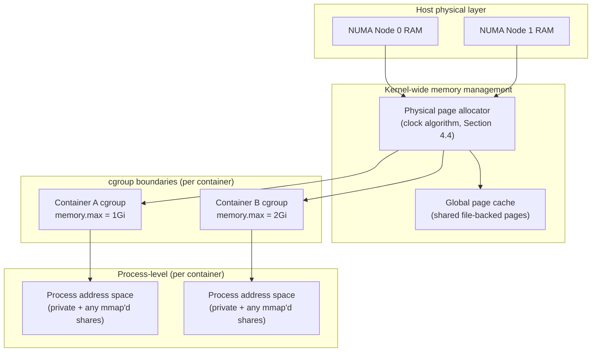

Operationally, this means a memory incident can originate at any of these
layers, and diagnosis has to walk down (or up) this stack rather than assume
the answer is always "the application": is a specific container hitting its
cgroup limit (`OOMKilled`, Section 4.7) while the node has free capacity?
Is the *node itself* under memory pressure because the sum of container
limits was over-provisioned relative to real physical RAM? Is a
latency-sensitive process suffering from cross-NUMA-node access (Section
4.10) despite having plenty of free memory overall? Each of these has a
different remediation, and conflating them wastes an incident's most
valuable early minutes.

## 9. Implementation

Concretely inspecting and reasoning about a host's or container's memory
state uses a small, standard set of Linux interfaces, all of which expose the
mechanisms taught in Section 4 directly.

```text
# /proc/meminfo — host-wide (or, inside a container without cgroup-aware
# tooling, still host-wide) physical memory accounting.
$ cat /proc/meminfo
MemTotal:       32882176 kB   # total physical RAM on this host
MemFree:          412048 kB   # genuinely unused RAM right now
MemAvailable:   18540212 kB   # estimate of memory available for new
                              # allocations without swapping, including
                              # reclaimable page cache (Section 4.4/4.6) -
                              # this is the number to alert on, NOT MemFree
Cached:         16210044 kB   # page cache (Section 4.6): file-backed pages
                              # the kernel is holding for reuse; reclaimable
                              # under pressure, not "used" in a leak sense
SwapTotal:       4194300 kB   # configured swap space (Section 4.5)
SwapFree:        4194300 kB   # unused swap; SwapFree < SwapTotal means
                              # active swapping has occurred - investigate
Dirty:               4120 kB  # modified page-cache pages not yet written
                              # back to disk

# cgroup v2 memory accounting for a single container — this is the number
# Kubernetes' OOMKilled decision (Section 4.7) is actually based on.
$ cat /sys/fs/cgroup/memory.current
798730240        # current memory usage in bytes for this cgroup

$ cat /sys/fs/cgroup/memory.max
1073741824       # the hard limit (== Kubernetes limits.memory); exceeding
                 # this triggers the cgroup-scoped OOM killer, not the
                 # host-wide MemFree/MemAvailable figures above

$ cat /sys/fs/cgroup/memory.events
low 0
high 0
max 12            # this cgroup has hit memory.max and triggered reclaim/OOM
                  # 12 times - a strong, direct signal of undersized limits
oom 3             # the OOM killer has actually fired 3 times for this cgroup
oom_kill 3
```

A memory-mapped file example, showing the mechanism from Section 4.6
directly, and how sharing across processes works in practice:

```c
// mmap_shared_cache.c — memory-map a read-only reference data file so that
// every worker process sharing this mapping backs it with the same
// physical page-cache frames (Section 4.6), instead of each process
// reading its own private copy into its own heap.
#include <fcntl.h>
#include <stdio.h>
#include <stdlib.h>
#include <sys/mman.h>
#include <sys/stat.h>
#include <unistd.h>

int main(int argc, char **argv) {
    if (argc != 2) {
        fprintf(stderr, "usage: %s <path-to-reference-data-file>\n", argv[0]);
        return 1;
    }

    int fd = open(argv[1], O_RDONLY);
    if (fd < 0) { perror("open"); return 1; }

    struct stat st;
    if (fstat(fd, &st) < 0) { perror("fstat"); return 1; }

    // MAP_SHARED + PROT_READ: this file's pages, once faulted in, are
    // backed by the kernel page cache and shared across every process
    // that maps this same file - not duplicated per process (Section 4.6).
    void *data = mmap(NULL, st.st_size, PROT_READ, MAP_SHARED, fd, 0);
    if (data == MAP_FAILED) { perror("mmap"); return 1; }

    // Touching bytes here triggers ordinary demand-paging page faults
    // (Section 4.3) for whichever pages of the file are actually read -
    // the whole file is never eagerly loaded into RAM.
    unsigned char first_byte = ((unsigned char *)data)[0];
    printf("First byte of mapped file: 0x%02x (size %ld bytes)\n",
           first_byte, (long)st.st_size);

    munmap(data, st.st_size);
    close(fd);
    return 0;
}
```

## 10. Complete Code Examples

A short Python example demonstrating the same `mmap()` mechanism at a higher
level, plus the observable effect of Copy-on-Write across a `fork()`:

```python
# cow_fork_demo.py — demonstrates that a large read-only buffer allocated
# before fork() is shared (Section 4.9's Copy-on-Write mechanism) across
# the parent and child, and only diverges in physical memory once the
# child actually writes to it.
import mmap
import os

# Allocate ~200 MB and touch every page once, so it is fully resident
# before we fork (isolating the demonstration from demand-paging noise).
large_buffer = mmap.mmap(-1, 200 * 1024 * 1024)
large_buffer.write(b"\x00" * len(large_buffer))
large_buffer.seek(0)

pid = os.fork()

if pid == 0:
    # Child: reading large_buffer here costs zero additional physical RAM -
    # the child's page table points at the exact same physical frames the
    # parent already populated (Section 4.9).
    checksum = sum(large_buffer[:1024])
    print(f"[child {os.getpid()}] read shared pages, checksum={checksum}")

    # The moment the child writes, the kernel's COW fault handler copies
    # only the specific 4 KiB page touched - not the whole 200 MB buffer -
    # into a fresh, private physical frame for the child alone.
    large_buffer[0] = 1
    print(f"[child {os.getpid()}] wrote one byte, "
          f"triggering a single-page COW fault")
    os._exit(0)
else:
    os.waitpid(pid, 0)
    # Parent's copy of that first byte is untouched - it never shared a
    # writable mapping with the child, only a read-only one pre-fault.
    print(f"[parent {os.getpid()}] byte 0 is still {large_buffer[0]} "
          f"(child's write never affected the parent's physical frame)")
```

Running this and inspecting `/proc/<pid>/status`'s `VmRSS` for both the
parent and child immediately after the fork (before the child's write) shows
both processes reporting close to the *same* RSS for the shared buffer —
direct, observable evidence of Copy-on-Write in action, not a coincidence of
accounting.

## 11. Performance

Memory-management overhead shows up in three distinct, separately
diagnosable places: **page-fault cost** (Section 4.3 — minor faults cost a
kernel trap plus a frame allocation, typically low microseconds; major
faults cost an actual disk read, orders of magnitude slower), **TLB-miss
cost** (Section 4.2 — a full multi-level page-table walk on a TLB miss,
mitigated by huge pages for large, hot memory regions), and **NUMA
remote-access cost** (Section 4.10 — a fixed, per-access latency penalty for
cross-socket memory traffic on multi-socket hosts). Profiling tools that
surface these directly: `perf stat` (hardware counters for page faults and
TLB misses), `vmstat` (system-wide fault rate and swap activity over time),
and `numastat` (per-node allocation and cross-node traffic). The single
highest-leverage performance habit this chapter teaches: before attributing a
latency regression to application code or CPU, rule out major page faults
(swapping, Section 4.5) and cross-NUMA-node access (Section 4.10) first,
since both produce symptoms (high `iowait`, unexplained latency variance)
that are easy to misattribute to the wrong layer.

## 12. Scalability

Memory management's scalability story is about *predictability under growth*,
not raw throughput: as a service's data volume or concurrency grows, its
working set (Section 4.4) grows with it, and the architectural question is
whether that growth stays within the physical memory (and NUMA-node
boundary, Section 4.10) the service is provisioned with, or whether it
crosses into swapping (Section 4.5) or cross-node access territory. Horizontal
scaling (adding more replicas, each with a smaller working set) is generally
the correct response to a working set outgrowing a single host's practical
memory ceiling; vertical scaling (a bigger host) only helps up to the point
where NUMA effects (Section 4.10) or fragmentation (Section 4.8) start
eroding the benefit of the additional RAM.

## 13. Security

Virtual memory's process isolation (Section 4.1) is itself a foundational
security boundary — the guarantee that one process cannot read or write
another's memory without an explicit, deliberate sharing mechanism
(Section 4.6, Section 4.9). This is also why memory-safety vulnerabilities
(buffer overflows, use-after-free) matter so much: they are, at their core,
a program tricking itself into writing outside its own intended data
structures but still *within its own legitimately mapped address space* —
the MMU (Section 4.2) does not and cannot protect against a process
misusing memory it does genuinely own. In a containerized environment, a
misconfigured `MAP_SHARED` mapping, an overly broad host-path volume mount
combined with `mmap`, or a cgroup memory limit set so loose that a single
compromised or buggy container can exhaust an entire node's memory (a
resource-based denial-of-service against every other workload on that node)
are the memory-management-specific security concerns an architect should
review in a production hardening pass.

## 14. Observability

The signals that matter, mapped back to the mechanisms above: `MemAvailable`
(not `MemFree`) from `/proc/meminfo` for genuine host-wide memory pressure
(Section 4.9's implementation example); `si`/`so` columns in `vmstat` for
active swapping (Section 4.5); `memory.current`/`memory.max`/`memory.events`
under `/sys/fs/cgroup/` for per-container pressure and OOM history
(Section 4.7); `dmesg`/kernel log lines containing `Killed process` or
`oom-kill` for confirming an OOM event actually occurred and which process it
targeted; and `numastat` for cross-node access ratios (Section 4.10). A
production dashboard for any memory-sensitive service should surface all
five, not just process-level RSS, because RSS alone cannot distinguish "this
process is fine but the node is under pressure from a noisy neighbor" from
"this specific process is the one growing."

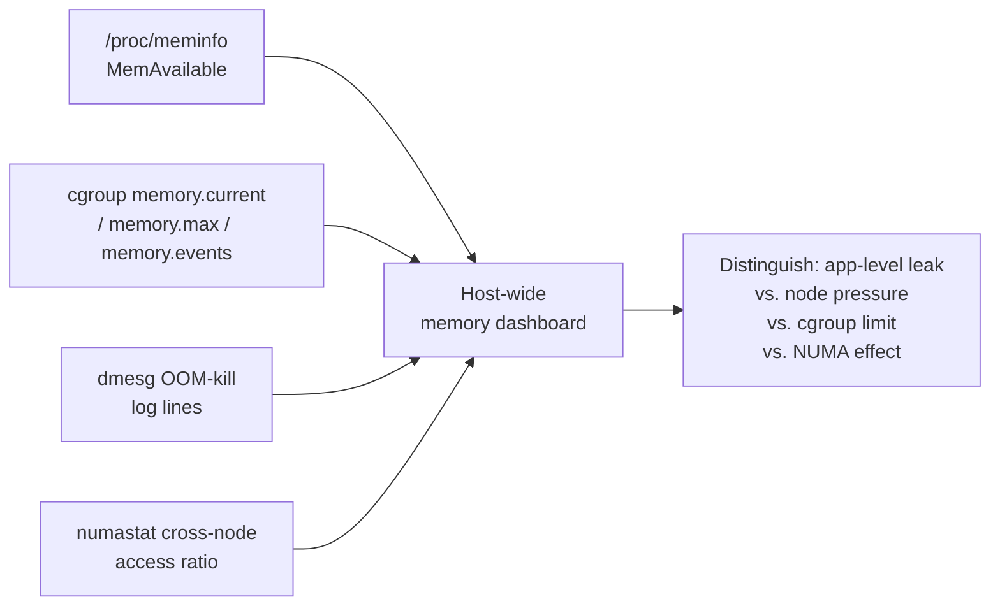

## 15. Failure Scenarios

- **Container `OOMKilled` under a tight limit (Section 4.7).** A pod's
  `limits.memory` is set below its real peak RSS; every load spike or
  garbage-collection-driven allocation burst crosses the cgroup ceiling and
  the kernel kills the container's main process, surfacing as exit code 137
  and a restart loop.
- **Node-wide thrashing (Section 4.5).** Aggregate container memory usage on
  a node exceeds physical RAM (often because `requests.memory` was set too
  low relative to actual usage, allowing over-scheduling); the node begins
  swapping (if enabled) or the kernel's node-level OOM killer starts
  terminating processes across multiple pods, an incident that looks like a
  generalized platform outage rather than a single service's problem.
- **Silent RSS growth from fragmentation (Section 4.8).** A long-running
  service's RSS climbs steadily with no corresponding application-level
  leak, eventually approaching its memory limit and triggering an OOM event
  that a naive investigation misattributes to a code-level leak.
- **Cross-NUMA latency degradation (Section 4.10).** A latency-sensitive
  service on a multi-socket host shows gradually worsening p99 latency with
  no code or traffic change, caused by the scheduler migrating threads away
  from the NUMA node holding the service's memory.
- **mmap'd cache eviction under pressure (Section 4.6).** A service relying
  on a large memory-mapped reference file assumes it stays fully resident;
  under host memory pressure the kernel evicts clean, unmodified pages of
  that mapping, and the next access re-faults them from disk, producing an
  unexpected latency spike that is easy to misdiagnose as "disk is slow"
  rather than "cache was evicted."

## 16. Testing

Memory-management-related behavior is validated primarily through load and
soak testing rather than unit tests: a **soak test** (sustained load over
hours, not minutes) is the standard technique for surfacing slow RSS growth
from fragmentation (Section 4.8) or a genuine leak, since both are invisible
in a short load test. Deliberately testing a service's behavior *at and
slightly above* its configured memory limit (Section 4.7) — inducing a
controlled `OOMKilled` event in a staging environment — validates that the
service's readiness/liveness probes and its orchestrator's restart policy
actually recover gracefully, rather than discovering the failure mode for the
first time in production. For latency-sensitive services, a NUMA-pinned vs.
unpinned A/B latency comparison (Section 4.10) under identical load is the
standard way to quantify whether NUMA effects are actually material for
that specific workload before investing in `numactl` pinning as a permanent
operational practice.

## 17. Common Mistakes

- Treating `VSZ`/virtual memory size as if it were real memory consumption,
  instead of `RSS` (Section 4.3).
- Alerting on `MemFree` instead of `MemAvailable`, causing false alarms
  because the kernel is deliberately holding reclaimable page cache
  (Section 4.6, Section 4.9's example).
- Assuming every `OOMKilled` restart indicates an application-level memory
  leak without first comparing the configured limit against measured peak
  RSS (Section 4.7).
- Copy-pasting a Kubernetes memory `limits`/`requests` value from an
  unrelated service's manifest instead of measuring the actual workload
  (Section 4.7).
- Enabling swap on latency-sensitive production nodes without understanding
  that it changes both performance characteristics (Section 4.5) and
  OOM-killer/kernel memory-pressure behavior in ways most container
  orchestrators do not expect or test against.
- Assuming `mmap()`-mapped data is always fully resident and never subject to
  eviction under memory pressure (Section 4.6).

## 18. Best Practices

- Size Kubernetes `requests.memory`/`limits.memory` from measured peak RSS
  under realistic load, not guesses (Section 4.7).
- Monitor `MemAvailable`, cgroup `memory.events`, `vmstat` swap activity, and
  `dmesg` OOM log lines together, not RSS alone (Section 14).
- Use memory-mapped files (Section 4.6) for large, shared, mostly-static
  reference data instead of duplicating it per process.
- Use pre-fork worker models with data loaded before `fork()` (Section 4.9)
  to maximize Copy-on-Write sharing for read-heavy workloads.
- Explicitly evaluate NUMA pinning (Section 4.10) for latency-sensitive
  services on multi-socket hosts rather than assuming default scheduling is
  adequate.
- Treat swap as a deliberate, tested exception on production hosts, not a
  default safety net (Section 4.5).

## 19. Anti-Patterns

- **"Just increase the memory limit"** as a reflexive response to every
  `OOMKilled` event, without first checking whether the limit was
  undersized or the application is genuinely leaking (Section 4.7).
- **Disabling the OOM killer or `oom_score_adj`-ing every process to "never
  kill me"** — this does not remove memory pressure, it only removes the
  kernel's ability to make an orderly choice, typically making a genuine
  exhaustion event worse (a full system stall) rather than better.
- **Tuning swappiness or swap size to "absorb" a persistently undersized
  memory allocation** instead of fixing the sizing itself (Section 4.5).
- **Ignoring RSS growth trends** because "it's not a hard leak, objects do
  get freed eventually" — external fragmentation (Section 4.8) can produce
  the same operational symptom (steadily rising memory) as a true leak.

## 20. Trade-off Analysis

| Decision | Favors | Costs |
|---|---|---|
| Tight memory limits (Section 4.7) | Fast detection of runaway processes, protects node neighbors | Higher risk of `OOMKilled` under legitimate load variance |
| Loose memory limits | Fewer false-positive OOM kills | Slower detection of real leaks, risk of node-level over-commit |
| Swap enabled (Section 4.5) | Absorbs brief, small memory spikes gracefully | Risk of severe latency cliff/thrashing if genuinely exceeded |
| Swap disabled | Predictable, bounded latency; matches most orchestrator defaults | No cushion at all for transient spikes; OOM killer fires sooner |
| Huge pages (Section 4.2) | Fewer TLB misses for large, hot memory regions | Harder for the kernel to find contiguous physical space; THP background compaction can add latency |
| NUMA pinning (Section 4.10) | Predictable, lower tail latency | Reduced scheduling flexibility; wasted capacity if the pinned node is under-loaded |

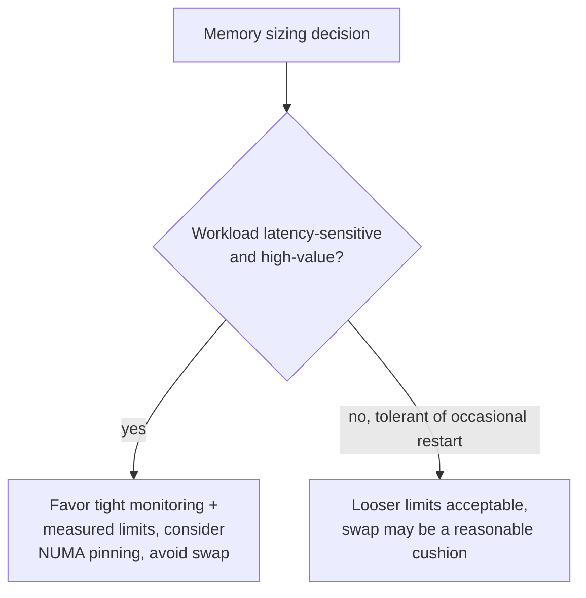

## 21. Comparison Table

| Mechanism | Triggered by | Scope | Typical latency cost |
|---|---|---|---|
| Minor page fault (Section 4.3) | First touch of a new virtual page | Single process | Low microseconds |
| Major page fault / swap-in (Section 4.5) | Access to a swapped-out page | Single process, but competes for disk I/O | Tens of microseconds to milliseconds |
| TLB miss (Section 4.2) | Address translation not cached | Single memory access | Nanoseconds, but multiplies under poor locality |
| COW fault (Section 4.9) | First write to a shared post-`fork()` page | Single process (the writer) | Comparable to a minor fault plus a page copy |
| cgroup OOM kill (Section 4.7) | cgroup `memory.max` exceeded, no reclaimable memory | Scoped to that cgroup/container | Immediate process termination |
| NUMA remote access (Section 4.10) | Memory access crosses a socket boundary | Per memory access | Fixed multiplier over local access, no fault involved |

## 22. Real-World Case Study

A mid-sized e-commerce platform migrated its recommendation service to
Kubernetes and set `limits.memory` to a round number copied from a template
manifest, well below the service's actual peak usage during nightly batch
re-scoring jobs. For weeks, the service ran fine under normal traffic, but
every night's batch job triggered a wave of `OOMKilled` restarts — invisible
to daytime on-call because the pattern was nocturnal and self-healing
(Kubernetes restarted the pods automatically), until a delayed batch run
overlapped with morning peak traffic and the restart storm caused a visible
customer-facing outage. The incident review found the root cause in minutes
once the responder checked `kubectl describe pod` for the `OOMKilled` reason
and exit code 137 (Section 4.7), then compared the pod's `limits.memory`
against its historical Prometheus RSS metric, which showed a clear nightly
spike crossing the limit. The remediation was not a code change: `requests`
and `limits` were re-sized from measured peak RSS with headroom, and the team
added an explicit alert on cgroup `memory.events`' `oom_kill` counter
(Section 14) so any future recurrence would page before it became
customer-visible, rather than relying on restart loops silently self-healing
until they didn't.

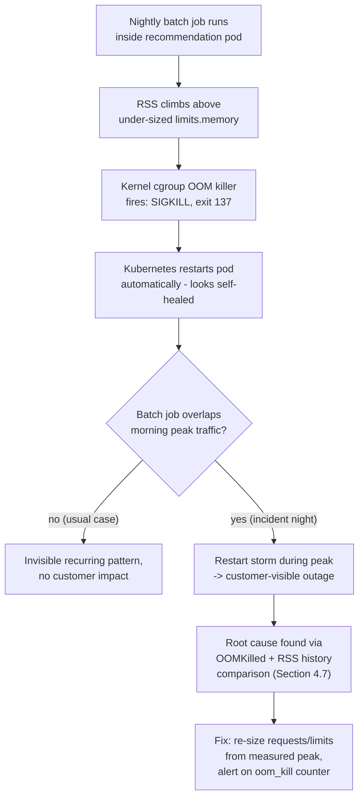

## 23. Interview Questions

1. Explain, in order, exactly what happens in hardware and kernel code the
   first time a program writes to a byte of memory it just requested from
   `malloc()`.
2. What is the difference between a minor and a major page fault, and why
   does that distinction matter operationally?
3. Why is swapping under sustained load considered a production incident
   rather than graceful degradation? Walk through the thrashing feedback
   loop.
4. A container is killed with exit code 137. Explain what this means at the
   kernel level and how you would confirm the root cause.
5. How does Copy-on-Write make `fork()` cheap, and what specifically makes a
   reference-counted runtime like CPython a partial exception to that
   benefit?
6. Distinguish external and internal memory fragmentation with a concrete
   example of each, and explain why fragmentation is specifically a
   long-running-process concern.
7. What problem does `mmap()` solve that ordinary buffered file I/O does
   not, and what is the mechanism that lets multiple processes share a
   memory-mapped file's physical pages?
8. Explain what NUMA is and describe a concrete symptom that would lead you
   to suspect a NUMA-related performance problem versus some other cause.
9. Why does the kernel's OOM killer represent a fundamentally different
   failure mode from a language-level `OutOfMemoryError`?
10. How do Kubernetes `requests.memory` and `limits.memory` map onto
    underlying Linux kernel mechanisms?

## 24. Hands-on Exercises

1. On a Linux host or Virtual Machine (VM), write and run a small C or Python
   program that allocates a large buffer, prints its own `VmRSS` from
   `/proc/self/status` before touching any of it, then touches every page and
   prints `VmRSS` again — observe the jump directly correlating with
   first-touch demand paging (Section 4.3).
2. Run the Copy-on-Write demo in Section 10, then use `/proc/<pid>/status`
   to compare `VmRSS` for the parent and child both before and after the
   child's write; confirm the shared-then-diverging pattern.
3. Configure a cgroup v2 memory limit (or a Docker container's `--memory`
   flag) below a test program's real peak usage, run it, and observe the
   `OOMKilled`/exit 137 behavior along with the corresponding `dmesg`
   log line and `memory.events` counter (Section 4.7).
4. Use `numactl --hardware` on a multi-socket host (or a cloud instance type
   with multiple NUMA nodes) to inspect the node topology, then compare
   `numactl --membind=0 --cpunodebind=0` versus unpinned execution of a
   memory-bandwidth-heavy benchmark, and quantify the latency difference.
5. Induce controlled swapping (a small VM with a modest swap file and a
   program allocating and touching more memory than physical RAM) and
   observe the `si`/`so` columns in `vmstat 1` along with the corresponding
   collapse in application throughput.

## 25. Design Exercises

1. Design the memory-request/limit strategy for a Kubernetes service whose
   memory usage has a predictable but sharp nightly batch-processing spike
   (as in Section 22's case study) — specify what data you would gather
   before setting numbers, and how you would validate the choice before it
   reaches production.
2. Design a shared reference-data distribution strategy for 50 co-located
   worker processes on a single host that each need read access to the same
   4 GB dataset, comparing an `mmap()`-based shared approach (Section 4.6)
   against each worker loading its own private copy, and quantify the
   physical memory difference.
3. A latency-sensitive in-memory database is being deployed on a
   dual-socket host with 512 GB of RAM total (256 GB per NUMA node). Design
   a deployment topology (single instance vs. two NUMA-pinned instances)
   that avoids cross-node memory access, and explain the trade-offs of each
   option.

## 26. Architecture Review Questions

- Have memory `requests`/`limits` (or equivalent host-level memory
  ceilings) been sized from measured peak usage, not copied from an
  unrelated template?
- Is the team monitoring `MemAvailable`, cgroup `memory.events`, and OOM
  kernel log lines — not just process-level RSS — for this service?
- For any latency-sensitive, high-value workload on multi-socket hardware,
  has NUMA topology been considered and, if relevant, addressed explicitly?
- Is swap enabled on any node running this workload, and if so, was that a
  deliberate, tested decision rather than a platform default left
  unexamined?
- For any service relying on `mmap()`-based shared data, has the team
  accounted for that data being evictable under memory pressure (not
  guaranteed permanently resident)?
- Does the team have a clear, rehearsed diagnostic path for distinguishing
  an application-level leak from cgroup-limit misconfiguration from
  node-level over-commit, before the next incident forces them to figure it
  out live?

## 27. Summary

Virtual memory is the foundational abstraction that lets every process
believe it owns a full, private address space, while the Memory Management
Unit (MMU) and per-process page tables transparently translate that illusion
into real, shared, finite physical Random Access Memory (RAM) — a mechanism
that every language runtime's own memory model (the Java Virtual Machine
(JVM)'s garbage collector, CPython's reference counting) is built directly on
top of, never around. Demand paging defers the real cost of memory to first
touch; the page-replacement algorithm (approximated by Linux's clock
algorithm) decides what to evict when physical memory is under pressure; and
swapping to disk is the last-resort mechanism whose severe performance cliff
makes it a production incident, not a graceful degradation, when it happens
under sustained load. Memory-mapped files (`mmap()`) are a genuinely
important architecture tool for sharing physical pages across processes and
leaning on the kernel's own page cache instead of reinventing application-
level buffering. The Linux kernel's Out Of Memory (OOM) killer, and its
direct extension into cgroup-scoped, containerized memory limits, is the
mechanism underneath every Kubernetes memory `request`/`limit` decision, and
produces a fundamentally different, uncatchable failure mode from a
language-level `OutOfMemoryError`. Memory fragmentation (external and
internal) is a long-running-process concern that can masquerade as a leak.
Copy-on-Write is what makes `fork()` cheap by sharing physical pages until a
write forces a private copy, one page at a time. And Non-Uniform Memory
Access (NUMA) awareness is the concern that separates ordinary services
(where the kernel's defaults are good enough) from high-performance,
latency-sensitive production systems, where an architect must reason
explicitly about where, physically, a byte of memory lives relative to the
CPU core that wants it. Every OS-level mechanism in this chapter is the
shared substrate underneath the process/thread model
([Processes and Threads](CH24_Processes_and_Threads.md)), language-runtime
memory management
([Java Architecture](../03_Software_Engineering_Foundations/CH01_Java_Architecture.md),
[Python Architecture](../03_Software_Engineering_Foundations/CH02_Python_Architecture.md)),
file-system page caching
([File Systems](CH26_File_Systems.md)), and container/orchestration resource
models
([Virtualization and Container Fundamentals](CH28_Virtualization_and_Container_Fundamentals.md))
covered elsewhere in this handbook — understanding it is what lets a
Solution Architect diagnose a production memory incident at the correct
layer instead of guessing.
