# Chapter 26: File Systems

## 1. Introduction

Every service an architect designs eventually touches a file: a configuration
file loaded at startup, a log file appended under load, a database's data
file fsynced after every committed transaction, a container image layer
unpacked onto disk, an upload streamed to object storage. Developers write
`open()`, `read()`, `write()`, and `close()` as if "the file" were a simple,
solid thing — a named container of bytes that either exists or doesn't. It is
not. A file is an abstraction constructed by the operating system's **file
system** layer on top of a much messier physical reality: spinning platters
or NAND flash cells organized into fixed-size blocks, with no inherent
concept of "name," "directory," or even "this sequence of blocks belongs
together."

This chapter teaches that construction: how an operating system turns raw
block storage into the named, hierarchical, byte-addressable abstraction that
every higher layer — language runtimes, databases, container engines, cloud
storage clients — depends on without a second thought. It builds directly on
[Memory Management](CH25_Memory_Management.md), which owns virtual memory and
the page cache as a general kernel mechanism; this chapter recaps the page
cache briefly but focuses on the question that chapter does not answer: what
happens, specifically, when a program calls `write()` on a file, and why does
a successful `write()` call not guarantee the data is safely on disk? It
answers questions architects must reason about directly: why did "everything
is a file" become a foundational Unix design philosophy, and what
architectural consequences does that choice still have forty years later?
Why do file systems keep a separate journal, and what specific failure does
that journal prevent? Why does a network file system behave differently under
concurrent access than a local one, in ways that can silently corrupt data if
an architect assumes otherwise? And why does cloud object storage — despite
looking like a file system from a distance — deliberately refuse to offer the
consistency guarantees a local file system offers, a decision every architect
choosing between "mount a network file system" and "call an object storage
API" must understand before committing to either?

These are not academic curiosities. A database team choosing between XFS and
ext4 for a write-heavy workload, a platform team deciding whether a stateful
service can safely run against a Network File System (NFS) mount, an
architect evaluating whether Amazon Simple Storage Service (S3) can serve as
a drop-in replacement for a shared file system, a Site Reliability Engineer
(SRE) debugging why "the write succeeded but the data disappeared after a
crash" — all of these decisions and incidents trace back to the specific
mechanics this chapter teaches. Getting them wrong produces some of the most
insidious production failures an architect will encounter: silent data loss,
corruption that only surfaces after an unrelated crash, and "eventually
consistent" surprises when a system was designed assuming immediate
consistency.

## 2. Historical Evolution

File systems evolved in direct response to the same physical constraint every
generation of storage hardware has faced: how to give programs a durable,
named way to store data on a medium that is fundamentally just an array of
numbered blocks, while surviving crashes, power loss, and (later) sharing
that storage across machines and geographies.

```mermaid
timeline
    title Evolution of File Systems
    1960s : Early flat file systems on tape and drum storage : no hierarchy, no metadata beyond a name and length
    1969-1970 : Unix v1 file system : introduces inodes, hierarchical directories, and the "everything is a file" philosophy
    1974 : Unix File System (UFS) published in Ritchie and Thompson's CACM paper : establishes the inode plus directory-entry model still used conceptually today
    1980s : Berkeley Fast File System (FFS) : introduces cylinder groups and block-size tuning for better locality and performance
    1991 : Linux ext2 : first mainstream Linux-native file system, no journaling, requires slow fsck after a crash
    1994 : Journaling file systems appear (Veritas VxFS, IBM JFS) : write-ahead journal added to make crash recovery fast and safe
    2001 : ext3 adds journaling to the Linux ext family : journaling becomes a mainstream Linux default
    2003 : XFS ported into mainline Linux : journaling file system optimized for large files and high parallel I/O
    2005 : Sun's ZFS ships : copy-on-write, checksummed, pooled storage with built-in snapshots and self-healing
    2006-2009 : NFSv4 and pNFS mature : network file system protocol adds strong stateful semantics and parallel access
    2008-2009 : ext4 becomes the Linux default : extents, delayed allocation, faster fsck, still journaling-based
    2009 : Btrfs merged into the Linux kernel : copy-on-write file system with built-in snapshots, aiming at ZFS-like features natively in Linux
    2006-2012 : Cloud object storage emerges (S3 2006, Azure Blob, Google Cloud Storage) : flat key-value namespace replaces hierarchical file semantics at internet scale
    2010s : Distributed file systems for big data (HDFS, GFS lineage) : file systems redesigned around replication and horizontal scale-out rather than a single machine
    2013-present : Container image layer file systems (OverlayFS, AUFS) : copy-on-write layering becomes the packaging format for application deployment
    2020s : NVMe, persistent memory, and cloud-native file systems (Amazon EFS/FSx, Azure Files) : file system design adapts again to flash speeds and elastic, managed cloud storage
```

The throughline is a pattern architects will recognize from other chapters:
each generation of file system design responded to a specific pain the
previous generation exposed under real workloads. Flat namespaces gave way to
hierarchical ones because a growing number of files needed organization.
Non-journaling file systems gave way to journaling ones because a full
disk-scan `fsck` after every unclean shutdown became operationally
unacceptable as disks grew from megabytes to terabytes. Single-machine file
systems gave way to network and distributed file systems as compute and
storage were pulled apart across machines, and eventually those gave way
again — for a large class of workloads — to object storage, which abandoned
strict hierarchical file semantics entirely in exchange for internet-scale
durability and availability. Understanding *why* each transition happened is
what lets an architect predict which trade-off a *new* storage technology is
making, rather than treating each one as an unrelated black box.

## 3. Why It Exists

A file system exists to solve three problems that raw block storage does not
solve on its own, and being precise about each one is what lets an architect
reason correctly about file system choices rather than treating "file
system" as an undifferentiated implementation detail.

**Problem 1 — Naming and organization.** A disk is just a numbered array of
fixed-size blocks (traditionally 512 bytes, now commonly 4096 bytes). There is
no built-in concept of "this file," "this directory," or "this file's name is
`invoice.pdf`." A file system exists to impose a naming and hierarchical
organization scheme on top of that flat block array, so that both humans and
programs can refer to data by meaningful, structured names instead of raw
block numbers.

**Problem 2 — Metadata and structure.** A file is more than its bytes: it has
a size, an owner, permissions, timestamps, and a mapping from "this is
logical byte offset 4096 of the file" to "this is physical block number
88213 on the device." A file system exists to maintain this metadata
separately from the data itself, so that operations like "list this
directory" or "check this file's permissions" can be answered without
scanning the file's actual content.

**Problem 3 — Crash consistency and durability.** Updating a file's data and
its metadata is not a single atomic hardware operation — it requires multiple
separate writes to different locations on the same physical device (a data
block write, an inode metadata update, a directory entry update, a free-space
bitmap update). If the machine loses power or crashes between those writes,
the file system's on-disk structures can be left in a state that is
internally inconsistent — for example, a directory entry pointing at an inode
that was never actually written, or blocks marked "in use" that belong to no
file. A file system exists to guarantee that, even after an unclean shutdown
at the worst possible moment, its own structures can be brought back to a
consistent state — a guarantee raw block storage provides no help with at
all.

Every mechanism this chapter teaches — inodes, journaling, the page cache's
interaction with `fsync()`, copy-on-write, POSIX semantics, and the deliberate
weakening of those semantics in network and object storage — is best
understood as a specific answer to one or more of these three problems, under
a specific set of engineering constraints (spinning disk vs. flash, single
machine vs. network, single writer vs. many).

## 4. Core Concepts

### 4.1 The File Abstraction and "Everything Is a File"

**Definition.** A *file* is a named, logically contiguous sequence of bytes
that a program can create, read, write, extend, truncate, and delete, without
needing to know anything about the physical device it is stored on. The file
system is the software layer — part of the operating system kernel — that
implements this abstraction: it decides how bytes are laid out on physical
storage, how names map to that layout, and how concurrent access to the same
file is coordinated.

**Mechanism.** In Unix and Unix-derived systems (Linux, macOS, the BSDs),
this abstraction was pushed one step further than most other operating
systems of its era: *everything a program interacts with is presented
through the same file interface* — regular files, directories, block
devices, character devices (terminals, `/dev/null`), pipes, sockets, and
even kernel-exposed process information (`/proc`). Every one of these is
opened with the same `open()` system call, referenced afterward by the same
small integer (a **file descriptor**), and manipulated with the same
`read()`, `write()`, `close()`, and `ioctl()` calls. The kernel dispatches
each of these calls to a different underlying implementation depending on
what the file descriptor actually refers to, but the calling program does
not need to know or care.

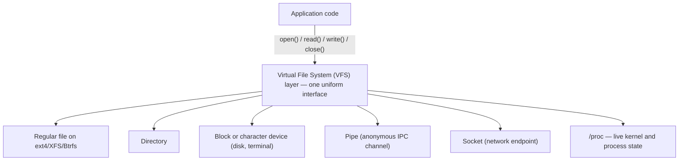

**Why this was a deliberate design choice, not an accident.** Before Unix,
most operating systems exposed fundamentally different Application
Programming Interfaces (APIs) for files, devices, and inter-process
communication — a program that wanted to read a file used one set of calls,
and a program that wanted to talk to a terminal or another process used a
completely different set. Unix's designers (Ken Thompson and Dennis Ritchie)
recognized that most of these interactions share the same essential shape:
open something, read a stream of bytes from it, write a stream of bytes to
it, close it. By unifying them behind one interface, Unix made an entire
category of programs *composable* by construction: a program never has to
know whether its standard input is a keyboard, a file, or the output of
another program piped into it, which is precisely what makes Unix pipelines
(`cat file | grep pattern | sort`) work without any special-casing in `cat`,
`grep`, or `sort`.

**Decision implications for architects, four decades later.** This design
choice still shapes production architecture directly:

- **Configuration-as-files.** Kubernetes ConfigMaps and Secrets are mounted
  into containers as files specifically so that any program — regardless of
  language or framework — can read its configuration the same way it reads
  any other file, with no special client library required.
- **`/proc` and `/sys` as an observability interface.** Monitoring agents,
  container runtimes, and `cgroup`-based resource limits (recapped from
  [Memory Management](CH25_Memory_Management.md#4-core-concepts)) are all
  read and written as ordinary files under `/proc` and `/sys`, letting
  standard file-reading tools introspect live kernel state.
- **Redirection and composition.** Log shipping pipelines, shell scripts in
  CI/CD systems, and Unix-style microservice tooling all lean on the fact
  that "a file" and "a stream from another process" are interchangeable at
  the file-descriptor level.
- **The limit of the abstraction.** "Everything is a file" is a *uniform
  interface*, not a *uniform performance or consistency model* — a socket
  and a regular file share the same four system calls but have completely
  different flush, ordering, and durability semantics, which is exactly the
  distinction Section 4.5 (page cache interaction) and Section 4.8 (network
  file systems) exist to unpack. A common failure mode is architects
  assuming that because two things are both "files," they behave alike under
  concurrent writers or after a crash — they frequently do not.

**Common failure mode.** Treating a `/proc` pseudo-file or a pipe as if it
had normal regular-file semantics — for example, assuming `lseek()` (seeking
to an arbitrary byte offset) works on a pipe, or that a `/proc/<pid>/status`
read returns a stable, cacheable snapshot rather than live, moment-in-time
kernel state. The uniform interface intentionally hides these differences at
the API level; an architect must still understand what concrete thing is
behind the file descriptor being used.

### 4.2 Inodes: Separating Metadata from Data

**Definition.** An **inode** ("index node") is the on-disk data structure a
Unix-style file system uses to store *everything about a file except its
name*: its type (regular file, directory, symlink, device), size,
permissions, owner, timestamps, link count, and — critically — the pointers
that describe *where on the physical device the file's actual data blocks
are located*. Every file, directory, and special file on the file system has
exactly one inode, identified by a numeric **inode number**.

**Mechanism.** Deliberately, a file's *name* is not stored inside the inode
at all. A directory is itself just a special kind of file whose data blocks
contain a list of (name, inode number) pairs — these pairs are called
**directory entries** (or "dentries" in the kernel's in-memory cache of
them). Looking up a path like `/var/log/app.log` means the kernel walks the
path component by component: read the root directory's inode, find its data
blocks, search them for the entry named `var`, follow that entry's inode
number to the `var` directory's inode, read *its* data blocks, find `log`,
follow to the `log` directory's inode, and finally find the entry named
`app.log` and follow it to the *file's* inode — which is what actually
contains size, permissions, and the pointers to the file's data blocks.

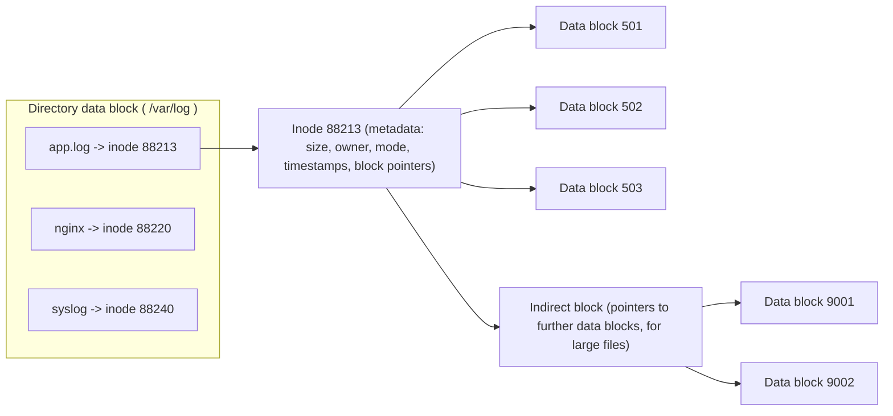

Historically, an inode stored a fixed small number of *direct* block
pointers (enough for a small file), plus one or more levels of *indirect*
pointers — a block that itself contains pointers to further data blocks — to
let a single inode address arbitrarily large files without making every
inode enormous. Modern file systems (ext4, XFS) replace this with **extents**:
instead of a pointer per block, an extent describes a contiguous run
("blocks 501 through 4500 belong to this file"), which is dramatically more
compact and efficient for large, contiguous files — a direct consequence of
disks growing from megabytes to terabytes since the original inode design.

**Decision implications.** Because a file's name lives in the *directory*,
not the inode, several behaviors follow directly, and each has architectural
weight:

- **Hard links** are simply a second directory entry pointing at the *same*
  inode number. Deleting one of the two names does not delete the file's
  data — it only removes that directory entry and decrements the inode's
  *link count*; the data is freed only when the link count reaches zero and
  no process still has the file open. This is why a very large log file can
  still consume disk space after `rm` was run if a process still holds an
  open file descriptor to it — the inode is unlinked from the directory, but
  its data blocks are not yet reclaimed. This is a routine operational
  surprise: "I deleted the file but `df` still shows the disk full."
- **Symbolic links (symlinks)**, by contrast, are files whose *data* is the
  text of a path to follow — a different inode, of a different type, that
  the kernel dereferences at lookup time. A symlink can point across file
  systems and can dangle (point at a path that doesn't exist); a hard link
  cannot do either, because it directly shares an inode number, and inode
  numbers are only meaningful within a single file system.
- **Renaming a file within the same file system** is cheap and (as Section
  4.4 explains) can be made atomic, because it only rewrites a directory
  entry — the inode number and data blocks never move.

**Common failure mode.** Assuming a hard link is "a copy" (it is not — both
names share one inode, one set of permissions, one size, and edits through
either name are visible through the other) or assuming deleting a file
immediately frees its disk space regardless of open file handles.

### 4.3 On-Disk Layout: Superblock, Block Groups, and Free Space

**Definition.** Beyond individual inodes, a file system maintains
device-wide bookkeeping structures: a **superblock** describing the file
system as a whole (total size, block size, inode count, file system type and
version, mount state), and per-region **allocation structures** (bitmaps or
B-trees) tracking which blocks and inodes are currently free versus in use.

**Mechanism.** Classic Unix File System (UFS)-derived designs (ext2/3/4)
divide the device into **block groups** — contiguous regions of the disk,
each with its own copy of key metadata (a backup superblock, an inode table,
and free-block/free-inode bitmaps for that group). This grouping exists for
two reasons: locality (an inode and the data blocks it points to are placed
near each other on a spinning disk to minimize seek time) and resilience (if
the primary superblock is corrupted, a backup copy from another block group
can be used to recover the file system). XFS instead organizes free space and
inodes using B-trees per **allocation group**, trading some of ext4's
simplicity for much better performance on large, heavily fragmented, or
highly parallel workloads — one of the reasons large database and big-data
platforms historically favored XFS.

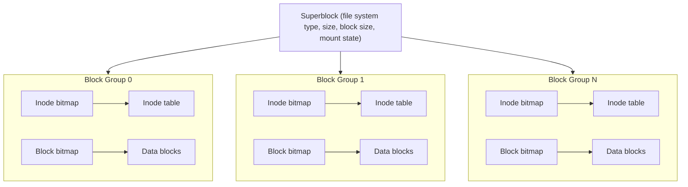

**Decision implications.** This is exactly where the crash-consistency
problem from Section 3 becomes concrete: creating a new file requires
updating *at minimum* the inode bitmap (mark an inode as used), the inode
table (write the new inode's metadata), a data block bitmap (mark data
blocks used), the data blocks themselves, and a directory's data block (add
the new name-to-inode entry) — five separate writes to five different
locations, none of which the underlying disk performs atomically as a group.
If the machine loses power after some of these writes land but not others,
the file system is left with structures that disagree with each other (for
example, an inode marked "in use" in the bitmap but never actually
initialized, or a directory entry pointing at an inode that was never
written). Section 4.4 (journaling) exists specifically to close this gap.

### 4.4 Journaling: Crash Consistency as a First-Class Mechanism

**Definition.** **Journaling** is the technique of writing a small,
sequential log ("the journal," sometimes called a write-ahead log at the
file-system level) describing an upcoming set of related metadata (and
optionally data) changes *before* those changes are applied to their final,
scattered on-disk locations — so that if the machine crashes mid-update, the
file system can replay or discard the journal on the next mount and recover
to a consistent state in a few seconds, instead of requiring a full-device
consistency scan that can take hours on a large disk.

**Mechanism.** A journaling file system groups a set of related on-disk
updates (for example, all five writes from Section 4.3's "create a file"
example) into a single **transaction**. Before touching the real inode
table, bitmaps, and directory blocks, the file system first writes a
description of the entire transaction into a dedicated journal region on
disk, and marks that journal entry as *committed* only once all of its
constituent writes are safely recorded there. Only after the transaction is
committed to the journal does the file system begin applying ("checkpointing")
those same changes to their real, final locations. If the system crashes
before checkpointing finishes, the next mount replays the journal: any
transaction that was fully committed in the journal is safely re-applied;
any transaction that was only partially written to the journal (because the
crash happened mid-write) is discarded entirely, as if it never started.

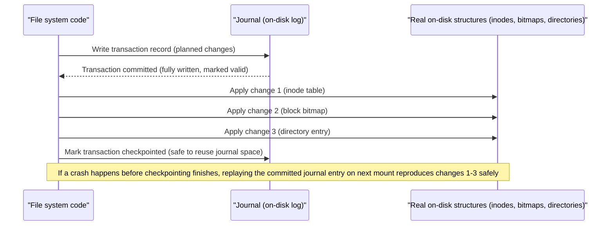

This is exactly the same **write-ahead logging** principle used by
relational databases for transaction durability, applied one layer down, to
the file system's own metadata — an architect who understands one
immediately recognizes the other.

**Journaling modes and the trade-off they represent.** ext3/ext4 expose
three journaling modes, and the choice between them is a genuine
durability-versus-performance trade-off an architect should be aware of when
tuning a storage-heavy workload:

- **`journal` mode** — both metadata *and* file data are journaled before
  being written to their final location. Strongest crash consistency
  (data is never left in a half-written state after a crash) but the
  slowest, because every byte is effectively written twice.
- **`ordered` mode (the default on ext4)** — only metadata is journaled, but
  the file system guarantees that a file's *data* blocks are written to
  disk *before* the metadata transaction that references them is committed.
  This prevents "metadata says the file is this size, but the new data
  hasn't actually landed yet" corruption, without paying the cost of
  journaling data twice.
- **`writeback` mode** — only metadata is journaled, with no ordering
  guarantee relative to data writes. Fastest, but after a crash a file can
  be the *correct* size with *stale or garbage* bytes in the newly-extended
  region, because metadata could be checkpointed before the corresponding
  data write actually reached disk.

XFS uses a broadly similar write-ahead metadata journal (it does not journal
file data), optimized with delayed logging and per-allocation-group
parallelism for high-throughput, highly concurrent workloads — one reason
XFS has historically been favored for large database and media-serving
file systems where many processes write concurrently.

**Why journaling exists (tying back to Section 3).** Before journaling
(ext2 and its predecessors), an unclean shutdown required `fsck` — a
full-device scan comparing every inode, bitmap, and directory entry against
every other, to detect and repair inconsistencies. On a multi-terabyte disk,
this could take hours, during which the file system (and everything depending
on it) was unavailable. Journaling exists to bound recovery time to "replay
a small, recent log," turning what used to be an hours-long outage into a
sub-second startup step — an availability improvement, not merely a
correctness one.

**Common failure mode.** Assuming journaling means "my data is always safe
after a crash." Journaling guarantees *file system metadata structural
consistency* (the file system itself won't be corrupted, and `fsck` won't be
needed) — it does **not**, by itself, guarantee that a specific application's
*most recent write* is durable, unless that application also correctly uses
`fsync()` (Section 4.6). These are two different guarantees that are commonly
conflated.

### 4.5 The Page Cache and File I/O: Recap and Application

**Recap (fully owned by
[Memory Management](CH25_Memory_Management.md#4-core-concepts)).** The
kernel's **page cache** is a memory-resident cache of recently read or
written disk blocks, indexed by file and offset. When a program calls
`read()`, the kernel checks the page cache first and only touches the
physical device on a cache miss; when a program calls `write()`, the kernel
normally copies the new bytes into the corresponding page-cache pages and
marks them **dirty**, returning control to the program immediately without
waiting for the physical device at all. A background kernel thread (`pdflush`
historically, now per-device writeback workers) later flushes dirty pages to
the physical device asynchronously. That chapter owns the cache's general
memory-management role — eviction, `mmap()`-backed shared pages, and how it
interacts with overall memory pressure and the Out Of Memory (OOM) killer.

**What this chapter adds: the file I/O contract implied by that design.**
The architectural consequence that matters most for anyone building durable
systems is this: **a successful `write()` system call means "the kernel has
accepted these bytes into its cache," not "these bytes are on physical
storage."** This is the single most common source of "we thought it was
safe, but a crash lost data" incidents in production systems, and it is
worth stating as plainly as possible because so much downstream reasoning
depends on it.

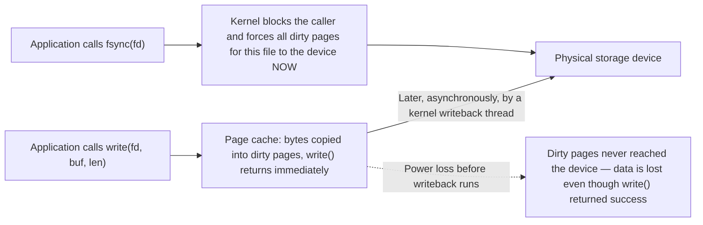

**Why this design exists.** Making every `write()` call wait for the physical
device would make ordinary file I/O as slow as the slowest storage medium
attached to the machine, for every single write, even when an application
does not need per-write durability (most log lines, most intermediate
temp-file writes, most cache files do not need this). Deferred, asynchronous
writeback is what makes file I/O throughput on modern operating systems
competitive with in-memory operations for the common case, while still
giving applications an explicit mechanism — `fsync()` — to opt into
synchronous durability exactly when they need it, and only then.

**Decision implications.**

- Any system that must survive a crash without losing acknowledged work
  (a database committing a transaction, a message queue acknowledging a
  message, a payment service recording that a charge succeeded) must call
  `fsync()` (or `fdatasync()`, `open()` with `O_DSYNC`/`O_SYNC`, or the
  platform equivalent) at the exact point where durability is promised to a
  caller — not rely on `write()` alone.
- Conversely, forcing an `fsync()` on every write when durability is not
  actually required (routine application logs, disposable cache files) is a
  common and measurable performance anti-pattern, because it collapses the
  asynchronous writeback path into a synchronous, per-call disk round-trip.
- Bulk-loading or batch-processing pipelines can deliberately *avoid*
  frequent `fsync()` calls and instead call it once at a natural checkpoint
  (end of a batch), trading a larger window of potential data loss on crash
  for significantly higher throughput — a legitimate trade-off as long as it
  is a *deliberate* one, not an accidental omission.

**Common failure mode.** Believing that closing a file (`close()`) or the
process exiting cleanly is equivalent to durability. Neither guarantees dirty
pages have been flushed to the physical device; only `fsync()` (or an
equivalent synchronous-write flag) does. This exact gap is what Section 4.6
demonstrates concretely with code.

### 4.6 `fsync()` as the Durability-Forcing Mechanism

**Definition.** `fsync(fd)` is the POSIX system call that blocks the calling
thread until all of a file's dirty data *and* the metadata needed to access
that data (its size, its block pointers) have been written from the page
cache to the underlying physical storage device — and, on hardware with a
volatile write cache of its own (many disks and Solid State Drives (SSDs)),
also issues a **cache flush** command to that device, so the data survives
not just an operating-system crash but a full power loss.

**Mechanism — why "just `fsync()` the file" is not always enough.** A subtle
but architecturally important detail: `fsync()` only guarantees durability
for the file descriptor it is called on. If a program creates a *new* file,
writes to it, and calls `fsync()` on that file, the file's *data* is durable
— but the *directory entry* that makes the file discoverable by name might
not be, unless the *directory* itself is also fsynced. This is why
crash-safe file creation on POSIX systems typically requires an explicit
sequence: write the data, `fsync()` the file, then `fsync()` the containing
directory (or, for a rename-based atomic replace pattern, `fsync()` the
directory after the `rename()` call). Missing this second `fsync()` is a
well-documented, easy-to-miss bug class even in mature database and
storage-engine codebases.

**Concrete scenario.** Consider a service that writes a configuration
snapshot to disk and wants the write to be crash-safe and atomic — readers
should never observe a half-written file, and after a crash the file should
either have the old complete contents or the new complete contents, never a
mix.

```c
/* Crash-safe, atomic file replacement using write-to-temp + fsync + rename + fsync(dir). */
#include <fcntl.h>
#include <unistd.h>
#include <stdio.h>
#include <string.h>

int write_config_durably(const char *dir_path, const char *final_name,
                          const char *tmp_name, const char *data, size_t len) {
    char tmp_path[512], final_path[512];
    snprintf(tmp_path, sizeof(tmp_path), "%s/%s", dir_path, tmp_name);
    snprintf(final_path, sizeof(final_path), "%s/%s", dir_path, final_name);

    /* 1. Write the new content to a temp file in the SAME directory
       (same file system, so rename() below is atomic). */
    int fd = open(tmp_path, O_WRONLY | O_CREAT | O_TRUNC, 0644);
    if (fd < 0) return -1;

    ssize_t written = write(fd, data, len);
    if (written != (ssize_t)len) { close(fd); return -1; }

    /* 2. Force the new file's DATA to physical storage before it can be
       observed under its final name. Without this, a crash right after
       rename() could leave "final_name" pointing at an inode whose data
       was never actually flushed. */
    if (fsync(fd) != 0) { close(fd); return -1; }
    close(fd);

    /* 3. Atomically replace the old file with the new one. On POSIX,
       rename() within the same file system is a single atomic directory
       update -- readers never see a partially-written "final_name". */
    if (rename(tmp_path, final_path) != 0) return -1;

    /* 4. Fsync the DIRECTORY itself. Step 3 changed a directory entry;
       that metadata change also lives in the page cache until flushed.
       Skipping this step is the most commonly missed line in "durable
       file write" code -- the data can be safe while the rename that
       exposes it is not yet durable. */
    int dir_fd = open(dir_path, O_RDONLY);
    if (dir_fd < 0) return -1;
    if (fsync(dir_fd) != 0) { close(dir_fd); return -1; }
    close(dir_fd);

    return 0;
}
```

**Observing the gap with `strace`.** The following is an annotated,
strace-style trace of exactly this write-then-fsync sequence, showing what
the kernel actually does at each step and why the naive assumption ("the
`write()` call returned, so the data is on disk") is wrong until the
`fsync()` line:

```text
$ strace -T -e trace=openat,write,fsync,rename,close ./write_config_durably

openat("/etc/app/config.json.tmp", O_WRONLY|O_CREAT|O_TRUNC, 0644) = 3
                                                        <0.000041>
# fd 3 now refers to the new temp file's inode -- created, but empty.

write(3, "{\"maxConnections\": 200, ...}", 412) = 412  <0.000019>
# Only 19 microseconds: this is a page-cache memory copy, NOT a disk
# write. The 412 bytes now sit in dirty page-cache pages for fd 3.
# If the machine loses power right now, these bytes are GONE despite
# write() having returned success with the full byte count.

fsync(3)                                               = 0  <0.004832>
# 4.8 milliseconds: this call blocks until the dirty pages for fd 3 are
# handed to the block layer, the physical device writes them, and (on
# devices with a volatile write cache) a cache-flush/FUA command
# completes. THIS is the line after which the data is actually durable.

close(3)                                               = 0  <0.000006>
# Closing the fd does not, by itself, add any durability guarantee here
# -- fsync() already did the durability-relevant work.

rename("/etc/app/config.json.tmp", "/etc/app/config.json") = 0
                                                        <0.000028>
# Atomic directory update: "config.json" now points at the new inode.
# This directory-entry change is itself sitting in dirty page-cache
# pages for the DIRECTORY, not yet guaranteed durable.

openat("/etc/app", O_RDONLY)                           = 4  <0.000015>

fsync(4)                                               = 0  <0.003991>
# Forces the directory's own dirty metadata (the renamed entry) to
# physical storage. Only after THIS line completes is the entire
# create-write-publish sequence crash-safe end to end.

close(4)                                               = 0  <0.000005>
```

The microsecond-scale durations on `write()` versus the millisecond-scale
duration on `fsync()` is the trace-level proof of Section 4.5's claim: the
`write()` call is a fast memory operation, and the `fsync()` call is the one
that actually waits on the physical device.

**Common failure mode.** Calling `fsync()` on the file but never on the
containing directory after a `create` or `rename`, which leaves a narrow but
real crash window where the durable data exists on disk under a temporary
name, but the rename that exposes it under its real name can be lost.
Database engines, log-structured storage engines, and configuration
management tools that get this exactly right (PostgreSQL's WAL writer,
etcd's Raft log, SQLite's default journal mode) are worth studying as
reference implementations precisely because this sequencing is easy to get
subtly wrong.

### 4.7 Copy-on-Write File Systems and Native Snapshots

**Definition.** A **copy-on-write (COW) file system** (ZFS, Btrfs) never
overwrites a live data block or metadata block in place. Instead, any
modification writes the new version of the block to a *new*, previously free
location, and then atomically updates the parent metadata structure (in ZFS
and Btrfs, both organized as trees of blocks, ultimately rooted at a single
superblock-like pointer) to point at the new block instead of the old one.
The old block is left untouched until nothing references it anymore, at
which point it becomes reclaimable free space.

**Mechanism and why this gives "free" snapshots.** Because updates never
touch existing blocks, and the file system's structure is a tree of blocks
that all lead back to one root pointer, taking a **snapshot** is simply a
matter of keeping an *old* root pointer alive alongside the current one. The
snapshot's tree and the live tree can share almost all of their blocks (every
block that has not changed since the snapshot was taken); only the blocks
that were modified after the snapshot need to actually be duplicated
(copy-on-write, applied at the moment of the *next* modification, not at
snapshot time). This is what makes ZFS and Btrfs snapshots effectively
instantaneous and cheap in space, compared to a traditional journaling file
system, where a "snapshot" requires either a full block-level copy or
external Logical Volume Manager (LVM)-level machinery bolted on from outside
the file system.

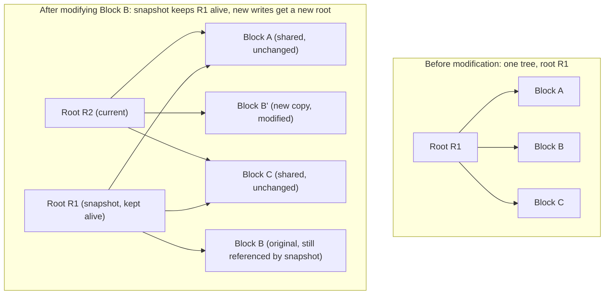

**Additional consequence: end-to-end checksumming and self-healing.** Because
COW file systems already maintain a tree of block pointers, ZFS (and, to a
more limited extent, Btrfs) stores a checksum of each block's contents
alongside the pointer to it, in the *parent* block rather than next to the
data itself — meaning corruption of the data block is detected on every read
by comparing it against a checksum stored somewhere the corruption could not
have touched. Combined with redundancy (mirroring or parity, ZFS's RAID-Z),
this lets the file system detect **and automatically repair** *silent data
corruption* ("bit rot") that a traditional file system without built-in
checksumming would never notice at all — the disk would simply return wrong
bytes with no error.

**Decision implications.** COW file systems trade some write amplification
and a more complex allocator for three properties that matter enormously for
specific workloads: cheap, frequent, space-efficient **snapshots** (valuable
for database backup strategies, "instant" point-in-time rollback before a
risky migration, and container/VM image layering); **built-in data
integrity verification** (valuable for long-term archival storage and any
workload where silent corruption is unacceptable); and native **atomic
multi-block updates** (a write either fully lands via a new root pointer
swap, or the old root is still intact — there is no window where a crash
leaves a *partially* written large structure, reducing reliance on a separate
journal for many operations). The cost is generally higher CPU overhead
(checksums, copy-on-write bookkeeping) and, for certain random-write-heavy
workloads, more fragmentation than an in-place-update journaling file system
— a genuine trade-off, not a strict upgrade, which is why ext4/XFS remain
the default choice for many general-purpose Linux workloads even though
ZFS/Btrfs have existed for close to two decades.

**Common failure mode.** Treating a ZFS/Btrfs snapshot as a full backup.
A snapshot lives on the *same* underlying storage pool as the live data; it
protects against logical mistakes (an accidental `DROP TABLE`, a bad
deployment overwriting a config directory) and gives instant rollback, but
it does **not** protect against physical device failure, pool-level
corruption, or the entire machine being destroyed — a genuine backup still
requires replicating data to independent storage, ideally in a different
physical location.

### 4.8 Network File Systems: NFS and the Cost of Distance

**Definition.** A **network file system** lets a client machine mount a
directory tree that physically lives on a remote server, and access it
through the same `open()`/`read()`/`write()` system calls used for local
files — the file system abstraction is preserved across the network, but the
physical reality underneath (a network round-trip instead of a local device
access) inevitably leaks through in latency and, more importantly, in
*consistency* behavior.

**Mechanism.** NFS, the dominant network file system on Unix-like systems,
has evolved through several major protocol versions, and the version in use
materially changes its consistency and performance characteristics:

- **NFSv3** is largely **stateless** at the protocol level: the server does
  not track which clients have which files open, and consistency between
  multiple clients writing to the same file is only loosely defined. NFSv3
  clients typically implement **close-to-open consistency**: when a client
  closes a file after writing it, its changes are flushed to the server; when
  *another* client subsequently opens that file, it is guaranteed to see
  those changes — but two clients with the file open *simultaneously* have
  no strong guarantee about seeing each other's writes in real time, because
  each client caches reads and writes locally and only reconciles with the
  server at open/close boundaries (and periodically, via cache-timeout
  settings).
- **NFSv4** introduces genuine server-side **state** (open files, byte-range
  locks, and delegations — a mechanism where the server temporarily grants a
  client exclusive control over a file so the client can cache aggressively
  without round-tripping every operation) and integrated strong
  authentication (Kerberos-based `RPCSEC_GSS`), closing many of NFSv3's
  looser edges, at the cost of more server-side complexity and state to
  manage (including recovery after a server restart, which NFSv4 handles
  with an explicit grace-period reclaim protocol).
- **pNFS (Parallel NFS, part of NFSv4.1)** further splits the *metadata*
  path (which server owns which file) from the *data* path (which storage
  node a client actually reads/writes bytes from), allowing large-scale
  deployments to parallelize data transfer across many storage servers
  instead of funneling everything through one NFS server.

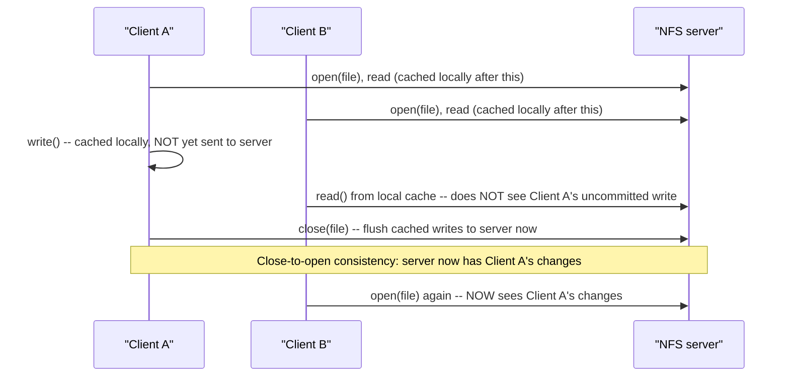

**Why this matters architecturally.** An architect who assumes an NFS mount
behaves exactly like a local disk for concurrent readers and writers is
making a specific, falsifiable mistake: two processes on two different
machines, both writing to the same NFS-mounted file at the same time,
without their own application-level locking, can produce results a local
file system would never produce — lost updates, a reader seeing stale data
for longer than expected, or (without careful use of NFS's own locking
protocol, `NLM`/`flock` semantics, which are famously inconsistent across
NFS implementations) two writers believing they each hold an exclusive lock
simultaneously. This is precisely why most databases explicitly document
that they must **not** be run with their primary data files on NFS (or
support it only with very specific mount options and heavy caveats) — the
consistency model a database's storage engine assumes (Section 4.6's
`fsync()` durability guarantees, in particular) is weaker or differently
timed over NFS than on local block storage.

**Concrete mount configuration.** The mount options used for an NFS mount
directly control this trade-off between performance and consistency
strictness — this is a live architecture decision, not a fixed default to
accept blindly:

```text
# /etc/fstab entry for an NFSv4 mount used by a shared application config
# directory that multiple app servers read, with consistency-relevant
# options called out explicitly.

nfs-server.internal:/exports/app-config  /mnt/app-config  nfs4  \
    hard,\
    proto=tcp,\
    vers=4.2,\
    timeo=50,\
    retrans=3,\
    actimeo=5,\
    sec=krb5p \
    0 0

# hard      : retry indefinitely on a server timeout rather than
#             returning an I/O error to the application (soft mounts can
#             silently return errors or, worse, truncated reads on
#             timeout -- "hard" trades availability-during-outage for
#             correctness, which is almost always the right default for
#             anything beyond a read-only, best-effort mount).
# proto=tcp : reliable, ordered transport (default on modern NFS; avoid
#             UDP, which has no delivery/ordering guarantee of its own).
# vers=4.2  : use NFSv4.2's stateful protocol (locking, delegations)
#             rather than the looser NFSv3 semantics.
# timeo/retrans : how long/how many times to retry an unresponsive
#             server before surfacing an error to the application, under
#             a "hard" mount.
# actimeo=5 : attribute cache timeout in seconds -- how long a client
#             will trust its cached view of file metadata (size, mtime)
#             before re-validating with the server. Lower values reduce
#             the close-to-open staleness window at the cost of more
#             round-trips; setting actimeo=0 (or noac) disables client-side
#             attribute caching almost entirely, trading throughput for
#             the freshest possible view -- appropriate for a
#             frequently-updated shared config directory, inappropriate
#             for a large, rarely-changing media share.
# sec=krb5p : Kerberos-authenticated AND encrypted transport, rather than
#             the default AUTH_SYS (trusts client-supplied UID/GID with no
#             cryptographic verification) -- a genuine security decision
#             layered on top of the consistency ones above.
```

**Common failure mode.** Choosing `soft` (return an error/interrupt after a
timeout instead of retrying forever) for a mount that a critical application
writes through, without handling the resulting partial-I/O error paths
correctly — `soft` mounts can, in some NFS client implementations, return a
"success" to a write that was actually only partially applied on the server
before the timeout, which is a correctness hazard most applications are not
written to detect.

### 4.9 Distributed File Systems and Object Storage: The Cloud-Native Evolution

**Recap (deep dive owned by a future
[Databases and Storage](../06_Databases_and_Storage/PART_OVERVIEW.md)
chapter once drafted).** Distributed file systems (the Google File System
(GFS)/Hadoop Distributed File System (HDFS) lineage) and cloud **object
storage** services (Amazon S3, Azure Blob Storage, Google Cloud Storage) are
the scale-out answer to the same problem NFS solves at small scale: letting
many machines share access to data that does not fit on, or should not be
tied to the lifecycle of, any single machine. This chapter teaches only the
architectural boundary an architect must understand *before* reaching for
object storage as if it were a file system; a future storage-focused chapter
owns the deep internals of replication, erasure coding, and object-store
request routing at scale.

**Mechanism and the key structural difference.** A traditional (or network)
file system exposes a **hierarchical namespace**: directories containing
files and other directories, navigable path component by path component, with
strongly-defined rename, move, and directory-listing operations. Object
storage exposes a **flat namespace**: every object is stored and retrieved
by a unique key (often *formatted* to look hierarchical, like
`invoices/2026/08/inv-1042.pdf`, but the storage system itself has no real
concept of a "directory" — that slash-delimited prefix is a naming
convention its clients and console tools interpret, not a structural
guarantee the store enforces the way a file system enforces an inode tree).

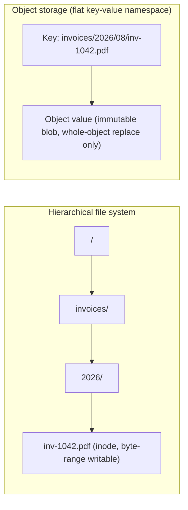

**Decision implications.**

- **Whole-object semantics vs. byte-range mutation.** A file system lets a
  program open a file and rewrite an arbitrary byte range in the middle of
  it. Classic object storage APIs are built around *whole-object* operations
  — `PUT` replaces an entire object, `GET` retrieves an entire object (or, in
  many implementations, an explicitly-requested byte range for reading, but
  not for in-place partial writes). An application designed around
  "open a file, seek, write a few bytes, close" cannot be pointed at an
  object storage bucket without a redesign.
- **Consistency model.** Modern major object stores (S3 since December 2020,
  for example) now offer **strong read-after-write consistency** for new
  object writes and overwrites within a single region — a meaningful
  improvement over the earlier "eventually consistent" model many
  architects still associate with object storage from experience or older
  documentation. However, "strongly consistent within a region for a single
  key" is still a narrower guarantee than full POSIX file system semantics
  (Section 4.10): there is generally no cross-object transactional
  guarantee, no directory-rename atomicity (because there are no real
  directories), and cross-region replication remains asynchronous and
  eventually consistent by design in virtually every major provider.
- **No POSIX file locking, no partial in-place append (mostly).** Object
  storage has no equivalent of `flock()`/byte-range locks, and append-style
  writes are either unsupported or bolted on with specific, provider-specific
  APIs (rather than a universal `O_APPEND` flag) — application code written
  against POSIX file assumptions (log rotation via append, lock files for
  mutual exclusion) does not translate directly.

**Why this trade-off was made deliberately.** Full POSIX semantics — byte-
range mutation, strong global consistency, directory rename atomicity, file
locking — are expensive to provide correctly at the scale and geographic
distribution cloud object stores target (many trillions of objects, exabytes
of data, replicated across multiple facilities for durability). By narrowing
the API surface to key-based, whole-object, mostly-immutable operations,
object storage providers can horizontally scale storage nodes, shard by key,
and replicate asynchronously without needing distributed locking or a
single, globally-consistent metadata tree — the same fundamental "relax the
consistency contract to buy scale and availability" trade-off examined
generally in distributed systems, applied specifically to storage. Section
4.10 examines exactly what is given up, in POSIX terms, when this trade-off
is made.

**Common failure mode.** Assuming an object storage bucket "mounted" through
a File System in Userspace (FUSE) adapter (`s3fs`, `goofys`, or similar)
behaves like a real file system for a demanding workload. These adapters
translate POSIX-style calls into object storage API calls underneath, but
they cannot manufacture guarantees the underlying object store does not
provide — a database or any workload depending on `fsync()`-level durability
timing, byte-range locking, or fast partial-file mutation will behave
incorrectly or perform poorly through such an adapter, even though it looks,
at the shell, exactly like a normal directory.

### 4.10 POSIX Semantics and Why Object Storage Deliberately Breaks Them

**Definition.** **POSIX (Portable Operating System Interface) file system
semantics** are the specific behavioral guarantees the POSIX standard
specifies for file operations on a conforming system — the contract every
local Unix-style file system (and, with caveats, NFS) is expected to honor,
and the contract most existing application code implicitly assumes when it
calls `open()`, `write()`, `read()`, `rename()`, `flock()`, and similar
calls.

**The specific guarantees that matter most for this comparison:**

- **Strong, immediate read-after-write consistency**: once a `write()` call
  returns, any subsequent `read()` from *any* process on the *same* machine
  is guaranteed to see that write, immediately, with no propagation delay.
- **Atomic rename**: `rename(old, new)` is a single, indivisible operation —
  no process can ever observe a state where both `old` and `new` exist
  simultaneously as a result of an in-progress rename, nor a state where
  neither exists.
- **Byte-range mutability and partial writes**: a program can open an
  existing large file and modify ten bytes in the middle without touching
  the rest of the file.
- **File locking**: `flock()`/`fcntl()` byte-range locks let cooperating
  processes coordinate exclusive or shared access to a file or a region of
  it.
- **Directory listing consistency**: a directory listing reflects a
  well-defined snapshot of names present at (approximately) the time of the
  call, with clearly defined behavior for concurrent creates/deletes during
  the listing.

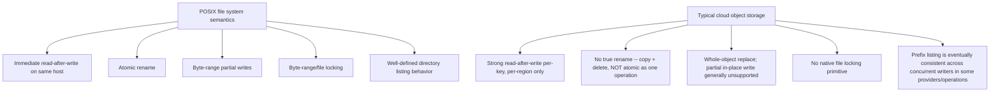

**Why cloud object storage does not offer this contract, on purpose.**
Providing every one of these guarantees simultaneously, across a globally
distributed, horizontally scaled, multi-tenant storage fleet, would require
either a single global sequencer for all operations (a scalability and
availability bottleneck at cloud scale) or an extremely sophisticated
distributed consensus and locking layer paid for on every single request —
directly contradicting the scale, cost, and availability goals object
storage exists to serve. Object storage providers made an explicit, informed
trade: give up strict POSIX semantics (particularly atomic rename, native
locking, and universal strong cross-region consistency) in exchange for
massive horizontal scalability, very high aggregate throughput, extreme
durability (S3's advertised eleven nines of object durability, achieved
through erasure coding and geographic replication), and low marginal storage
cost.

**Decision implications — what an architect must check before treating
object storage as a drop-in file system replacement:**

- **Never assume atomic rename.** A "move" operation implemented as
  copy-then-delete leaves a real window where both old and new keys exist,
  or where a crash between the copy and the delete leaves a duplicate. If a
  workflow depends on atomic promotion of a file from "staging" to "final,"
  this must be re-designed (for example, using object versioning, or a
  separate strongly-consistent index that records "the winning key," rather
  than relying on the object store's own rename behavior — which mostly
  doesn't exist as a single operation at all).
- **Never assume in-place partial mutation.** Any workload doing small,
  frequent, in-place byte-range writes (a database file, a write-ahead log,
  an append-heavy log file) is fundamentally mismatched with typical object
  storage APIs and belongs on a real (local, network, or distributed) file
  system, or must be redesigned around object storage's actual model
  (write new immutable objects, and use a separate index to track the
  current logical state — the pattern most log-structured merge-tree and
  object-store-backed database engines actually use).
- **Check the specific consistency guarantee your provider documents for
  the specific operation you rely on** — "strongly consistent" claims are
  frequently scoped narrowly (single key, single region, specific operation
  types like `PUT`-then-`GET`) and do not automatically extend to
  cross-region replication, bucket-wide listing operations under heavy
  concurrent writes, or multi-object transactional guarantees.
- **Locking must move up a layer.** Coordination that used to rely on
  `flock()` on a shared NFS-mounted file must be redesigned around a
  dedicated coordination service (a distributed lock built on a consensus
  store, or a database's own row-level locking) rather than assuming the
  storage layer itself can arbitrate exclusive access.

**Common failure mode.** Migrating an application that was written assuming
a POSIX-mounted shared file system (NFS, or a local disk on a single
long-lived server) directly onto an object storage bucket via a FUSE-style
adapter, without re-examining every place the application relies on atomic
rename, byte-range writes, or file locking — producing intermittent,
hard-to-reproduce corruption or lost-update bugs that only appear under
concurrent load, long after the migration was declared complete.

### 4.11 Mount Namespaces: How Containers Get Their Own File System View

**Recap (full container-runtime mechanics owned by the forthcoming
[Virtualization and Container Fundamentals](CH28_Virtualization_and_Container_Fundamentals.md)
chapter).** A Linux **mount namespace** is a kernel mechanism that gives a
process (or group of processes) its own private view of what is mounted
where — its own root directory, its own set of mounted file systems — fully
isolated from the host's and from other containers' mount namespaces, even
though all of them are ultimately backed by the same physical storage
devices and the same kernel. This is the specific primitive that lets a
container "see" what looks like its own complete, independent root file
system (`/`), while in reality sharing the host kernel and, very often, a
layered, copy-on-write image file system (commonly OverlayFS) assembled from
read-only image layers plus a thin writable layer per container.

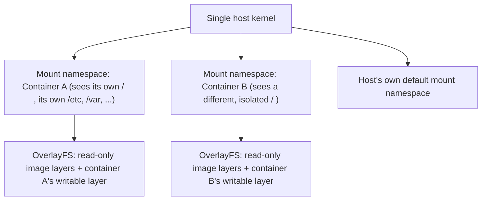

This chapter stops at that recap: the mount namespace is what makes "each
container has its own file system" true at the kernel level, and OverlayFS's
copy-on-write layering (conceptually similar in spirit to Section 4.7's COW
file systems, though implemented very differently, as a stacked-directory
scheme rather than a native block-tree file system) is what makes container
images shareable and space-efficient across many running containers built
from the same base image. The full mechanics of namespaces (mount, PID,
network, and the others), `cgroups`-based resource limits (recapped from
[Memory Management](CH25_Memory_Management.md#4-core-concepts)), and
container runtime internals belong to that forthcoming chapter and are not
re-derived here.

## 5. Internal Working

Tying Sections 4.2 through 4.6 together, the following sequence traces what
actually happens, layer by layer, for an ordinary `write()` call followed
later by an `fsync()`, on a local journaling file system such as ext4 in its
default `ordered` mode:

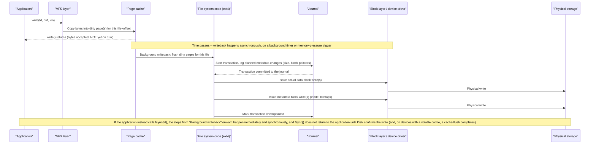

The critical architectural insight this diagram makes visible is the gap
between the second step (`write()` returning) and the much later, normally
*asynchronous* steps that actually reach physical storage — exactly the gap
Section 4.5's flowchart and Section 4.6's code and trace examples make
concrete from the application's point of view.

## 6. Design Principles

Several recurring principles explain *why* file systems are designed the way
they are, and they generalize well beyond storage:

- **Separate the fast path from the durable path.** The page cache exists so
  that the overwhelmingly common case (a write that does not need immediate
  durability) is fast, while an explicit, more expensive mechanism
  (`fsync()`) exists for the less common case that does. This "optimize the
  common path, provide an escape hatch for the rare, expensive requirement"
  principle recurs throughout systems design.
- **Bound recovery time, don't eliminate failure.** Journaling does not
  prevent crashes; it bounds how long recovery from a crash takes and
  guarantees the recovered state is structurally consistent. Architects
  should look for this same pattern (accept that failure will happen; design
  for fast, safe recovery) in other subsystems, not just file systems.
- **Make the common operation cheap by restructuring the data, not by
  skipping correctness.** Copy-on-write's snapshot cheapness and extents'
  large-file efficiency both come from choosing a data structure (a
  block tree, a contiguous-range descriptor) that makes the common
  operation cheap by construction, rather than by cutting corners on
  correctness.
- **Match the consistency model to the actual failure domain.** NFS's
  close-to-open model and object storage's per-key strong consistency are
  both deliberate choices to offer the *strongest* consistency that is
  *actually achievable* at their respective scale and failure domain,
  rather than either overpromising (and quietly breaking under load) or
  underdelivering (and sacrificing scale unnecessarily).
- **Expose durability as an explicit choice, not an implicit default.**
  `fsync()`'s existence as a separate call, rather than making every write
  synchronous, reflects a deliberate belief that the *application* is best
  positioned to know when a specific write needs to survive a crash — the
  file system layer should not guess.

## 7. Architecture Patterns

Common architectural patterns built directly on the mechanisms in Section 4:

- **Write-ahead logging (WAL) at the application layer**, mirroring
  Section 4.4's file-system-level journal: databases (PostgreSQL, MySQL's
  InnoDB) and consensus systems (etcd's Raft log) maintain their own
  application-level journal, fsynced before acknowledging a transaction or
  a consensus entry as committed — the same pattern as the file system's
  journal, one layer up, for the same reason (bound recovery time, guarantee
  structural consistency after a crash).
- **Write-to-temp, fsync, atomic rename, fsync-directory** (Section 4.6),
  used throughout configuration management tools, package managers, and
  storage engines whenever a file must be replaced without ever exposing a
  half-written version to readers.
- **Copy-on-write snapshotting for pre-deployment safety nets**: taking a
  ZFS/Btrfs (or cloud block-storage) snapshot immediately before a risky
  schema migration or configuration change, specifically to make rollback
  a cheap, instantaneous operation rather than a restore-from-backup
  exercise.
- **Log-structured storage over immutable object storage**: rather than
  fighting object storage's whole-object, no-partial-write model (Section
  4.9), storage engines designed for object storage backends (many modern
  data lake table formats, some time-series databases) write small,
  immutable, append-only segment files and maintain a separate, more
  frequently updated index or manifest describing which segments are
  currently valid — sidestepping the need for in-place mutation entirely.
- **Sidecar or dedicated coordination service replacing file-based
  locking**: when moving a workload off a POSIX-locking-capable file system
  (local disk, NFS) onto object storage, replacing `flock()`-based mutual
  exclusion with a dedicated distributed lock (built on a strongly
  consistent coordination store) rather than attempting to emulate file
  locks on a store that does not support them.

## 8. Production Architecture

A production storage architecture for a stateful service typically layers
these mechanisms as follows:

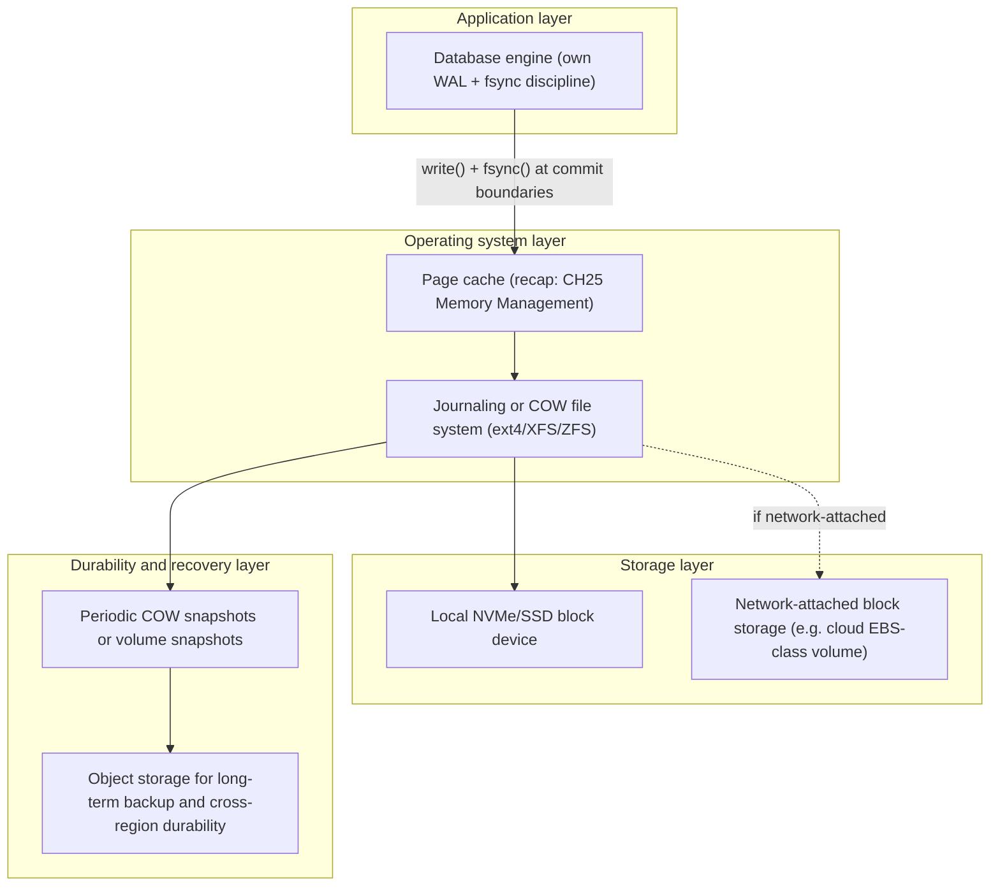

Each layer in this stack makes an independent, explicit decision about
durability and consistency; a well-designed production architecture ensures
those decisions are *consistent with each other* end to end — for example,
it is a common and dangerous mistake to run a database whose engine assumes
`fsync()` durability on top of a network-attached volume type whose own
write-caching or replication behavior does not actually honor that
`fsync()` call as synchronously as the local block device the database was
originally validated against.

## 9. Implementation

Implementing correct, durable file handling in application code means
applying Section 4.6's pattern consistently, and choosing the right
durability primitive for the actual requirement:

- **`fsync()` / `fdatasync()`**: `fdatasync()` skips flushing metadata that
  does not affect the ability to retrieve the file's data correctly (such as
  pure timestamp updates), making it slightly cheaper than `fsync()` when a
  file's size and content, but not its access-time metadata, must be durable.
- **`O_DSYNC` / `O_SYNC` open flags**: make every subsequent `write()` on
  that file descriptor synchronous by default, rather than requiring an
  explicit `fsync()` call after each write — useful for write-ahead log
  files where every single append must be durable before the writer
  proceeds.
- **`msync()`** for memory-mapped files (`mmap()`, recapped from
  [Memory Management](CH25_Memory_Management.md#4-core-concepts)): mapped
  pages are also subject to the page cache's asynchronous writeback;
  `msync(addr, len, MS_SYNC)` is the equivalent durability-forcing call for
  memory-mapped I/O.
- **Directory fsync discipline** (Section 4.6): any code path that creates,
  renames, or deletes a file and needs that structural change to survive a
  crash must fsync the containing directory, not only the file.

## 10. Complete Code Examples

Section 4.6 already provided the fsync-correctness example and its
strace-style trace. The following adds a small, runnable example
demonstrating the same write-back-versus-fsync gap directly, in Python,
useful for teaching or reproducing the effect in a lab environment (see
Section 24's hands-on exercise):

```python
import os

def durable_append(path: str, data: bytes) -> None:
    """Append `data` to `path` and make the append crash-durable.

    Demonstrates the write()-then-fsync() pattern from Section 4.6 in a
    higher-level language: os.write() here maps directly onto the
    write(2) system call, and os.fsync() onto fsync(2).
    """
    fd = os.open(path, os.O_WRONLY | os.O_CREAT | os.O_APPEND, 0o644)
    try:
        os.write(fd, data)   # Fast: lands in the page cache, not yet on disk.
        os.fsync(fd)         # Slow: blocks until the data is physically durable.
    finally:
        os.close(fd)


def append_without_durability(path: str, data: bytes) -> None:
    """Same append WITHOUT fsync -- returns fast, but the write can be
    lost on a crash or power loss before the kernel's writeback thread
    happens to flush it. Useful for contrasting timing in Section 24's
    lab exercise (e.g. measure elapsed time for 10,000 calls of each).
    """
    fd = os.open(path, os.O_WRONLY | os.O_CREAT | os.O_APPEND, 0o644)
    try:
        os.write(fd, data)
    finally:
        os.close(fd)
```

And a `mkfs`-time tuning example addressing Section 16's small-files
problem, choosing an inode density and block size appropriate for a
workload dominated by very large numbers of small files (for example, a
shared object cache or a maildir-style mail store):

```text
# ext4, tuned for a small-files-heavy workload (many small files relative
# to total disk size): a smaller bytes-per-inode ratio reserves MORE
# inodes up front, because the default ratio (one inode per 16KB) can
# otherwise exhaust available inodes long before the disk itself is full
# of a small-files workload -- "disk has free space but 'No space left
# on device' " is a classic symptom of inode exhaustion, not block
# exhaustion.
mkfs.ext4 -b 4096 -i 4096 -O extent,dir_index /dev/nvme1n1

# -b 4096       : 4KB block size (matches common flash/page size; ext4's
#                 practical default on most modern hardware).
# -i 4096       : one inode reserved per 4KB of disk space, instead of
#                 ext4's default of one inode per 16KB -- a deliberate
#                 trade of some fixed metadata overhead for a much
#                 higher small-file capacity ceiling.
# -O dir_index  : hashed B-tree directory indexing, so a directory
#                 containing tens of thousands of small files does not
#                 degrade to a linear scan on every lookup.
```

## 11. Performance

File system performance is governed by a small number of recurring levers:

- **Block/cluster size vs. workload file-size distribution.** A block size
  that is large relative to the typical file size wastes space (a 4KB block
  size storing millions of 200-byte files wastes roughly 95% of allocated
  space per file, since a block is the smallest unit of allocation); a block
  size that is too small relative to typical file size increases the number
  of metadata operations needed to read or write a large file. This is a
  genuine, workload-specific tuning decision, not a one-size-fits-all
  default.
- **Journaling mode** (Section 4.4): `ordered` balances safety and speed for
  most workloads; `writeback` trades away data-ordering guarantees for
  throughput on workloads that do not need it (and have their own
  application-level durability mechanism instead); `journal` mode is rarely
  worth its cost outside of workloads with no other durability net.
- **Read-ahead and sequential-access detection**: file systems and the block
  layer detect sequential access patterns and prefetch subsequent blocks
  into the page cache speculatively, dramatically improving throughput for
  large sequential reads (media files, backups, bulk data loads) but adding
  no benefit — and some wasted I/O — for genuinely random-access workloads.
- **Extents vs. per-block pointers** (Section 4.2): extents collapse
  metadata overhead for large, contiguous files from "one pointer per block"
  to "one descriptor per contiguous run," a large win for big-file-heavy
  workloads (video, backups, database data files).
- **`fsync()` granularity and batching** (Sections 4.5-4.6): the single
  biggest performance lever available to application authors — batching
  multiple logical writes between `fsync()` calls where the durability
  contract allows it (rather than fsyncing after every single small write)
  routinely produces order-of-magnitude throughput differences.

## 12. Scalability

File system scalability has two largely independent dimensions architects
must reason about separately:

- **Scaling a single file system's capacity and file count**: modern
  journaling and COW file systems scale to tens or hundreds of terabytes and
  billions of inodes on a single machine, but per-directory and per-volume
  metadata operations (creating millions of files in one directory, for
  example) still eventually bottleneck on a single machine's CPU and the
  file system's own metadata structures (Section 4.3's per-block-group
  bitmaps and inode tables, or a COW file system's block tree) — this is
  precisely the small-files problem examined in Section 16.
- **Scaling beyond a single machine**: NFS (Section 4.8) scales read/write
  access across many client machines against one (or, with pNFS, several)
  server(s), but does not scale the *underlying storage* itself beyond what
  that server can hold and serve. True horizontal scale-out — data sharded
  and replicated across many storage nodes, with no single machine owning
  the whole dataset — is the domain of distributed file systems and object
  storage (Section 4.9), which trade file system semantics for that
  scale-out property specifically because a single-server bottleneck cannot
  be engineered away within the traditional file system model.

## 13. Security

File system security spans several distinct mechanisms:

- **Discretionary access control**: the classic Unix owner/group/other
  permission bits stored in the inode (Section 4.2), supplemented on modern
  Linux by POSIX Access Control Lists (ACLs) for finer-grained, per-user
  permission grants beyond the traditional three-tier model.
- **Mandatory access control**: SELinux and AppArmor add a policy-enforced
  layer on top of discretionary permissions, restricting which processes
  may access which files regardless of standard Unix permission bits — a
  meaningful defense-in-depth layer when a process is compromised but its
  Unix user account's permissions alone would otherwise still allow broad
  file access.
- **Encryption at rest**: full-disk encryption (LUKS on Linux, BitLocker on
  Windows) and file-system-level or per-file encryption (ext4's native
  encryption, ZFS's native encryption) both protect data confidentiality if
  the physical storage medium is lost, stolen, or improperly decommissioned
  — a control operating at a different layer than access permissions, and
  necessary even when permissions are configured correctly, because
  permissions do not protect data read directly off a removed disk.
- **NFS-specific exposure** (Section 4.8): the classic `AUTH_SYS` NFS
  authentication mode trusts the numeric User Identifier (UID) and Group
  Identifier (GID) values a client asserts, with no cryptographic
  verification — meaning any machine that can reach the NFS server on the
  network and can set its own UID (any machine where a user has root/admin
  access) can impersonate any user's file access. `sec=krb5`/`krb5i`/`krb5p`
  (Section 4.8's mount example) close this gap with genuine cryptographic
  authentication (and, for `krb5p`, encryption in transit).
- **Object storage access control** (Section 4.9): rather than Unix
  permission bits, cloud object storage relies on identity- and
  resource-based policies (Identity and Access Management (IAM) policies,
  bucket policies, pre-signed URLs) — architecturally a very different model
  from POSIX permissions, and a common source of real incidents when a
  bucket's access policy is misconfigured to be broader than intended
  (the recurring "publicly readable S3 bucket" class of breach).

## 14. Observability

Diagnosing file-system-related production issues relies on a specific set of
signals:

- **`df -i` and `df -h`**: disk-space and inode-usage percentages
  separately — a full disk can mean either out of *blocks* or out of
  *inodes* (Section 10's `mkfs` tuning example), and the two are diagnosed
  and fixed differently.
- **`iostat`/`vmstat` writeback and I/O wait metrics**: high `%iowait` or a
  large, persistently growing count of dirty pages awaiting writeback
  (visible in `/proc/meminfo`'s `Dirty:` line, recapped from
  [Memory Management](CH25_Memory_Management.md#4-core-concepts)) indicates
  the storage device cannot keep up with the rate at which the application
  is generating dirty data.
- **`strace -T -e trace=write,fsync`** (Section 4.6): the direct way to
  confirm, empirically, whether a specific application is actually calling
  `fsync()` at the points its durability contract requires, and how long
  those calls are taking on the current storage backend.
- **File system-specific health tools**: `xfs_info`/`xfs_repair` for XFS,
  `tune2fs -l`/`e2fsck` for ext4, and `zpool status`/`zpool scrub` for ZFS
  (which surfaces checksum-detected corruption events directly, per Section
  4.7).
- **NFS-specific counters**: `nfsstat` and `nfsiostat` expose retransmission
  counts, round-trip times, and cache-hit ratios that directly diagnose
  whether an NFS mount's `timeo`/`retrans`/`actimeo` settings (Section 4.8)
  are well matched to the actual network and server load.

## 15. Failure Scenarios

- **Unclean shutdown with a non-journaling or improperly configured file
  system**: full `fsck` on next mount, extending an outage from seconds to
  potentially hours on a large volume — the exact failure mode journaling
  (Section 4.4) exists to eliminate.
- **Application assumes `write()` durability, storage loses power before
  writeback**: silent data loss of recently "successfully written" data,
  with no error ever surfaced to the application — because, from the
  kernel's point of view, nothing went wrong; the application simply never
  asked for synchronous durability (Section 4.5).
  Missing the directory-fsync step (Section 4.6): a file's data is durable,
  but the rename that exposes it under its final name is lost on crash,
  leaving a temp file where the expected final file should be.
- **Silent data corruption ("bit rot") on a non-checksummed file system**:
  a disk returns subtly wrong bytes with no I/O error; without ZFS/Btrfs-style
  checksumming (Section 4.7), this corruption is undetected until it causes
  a visible downstream failure, often much later and far from its actual
  cause.
- **Split-brain-like lost update over NFS** (Section 4.8): two clients
  writing to the same file concurrently without external locking discipline
  produce a result where one client's changes silently overwrite the
  other's, with neither client receiving any error.
- **Object storage "rename" race** (Section 4.9-4.10): a copy-then-delete
  "move" operation crashes between the copy and the delete, leaving both the
  old and new keys present, silently duplicating data or leaving stale data
  visible to a reader that expected the "move" to be atomic.
- **Inode exhaustion with free disk space remaining** (Sections 4.3, 10, 16):
  workloads that create very large numbers of tiny files exhaust the
  file system's fixed inode count before exhausting its block space,
  producing a "No space left on device" error that a naive `df -h` check
  (showing free space) does not explain — `df -i` is required to diagnose it.

## 16. Testing

- **Crash-consistency testing**: tools like `dm-flakey`/`dm-log-writes`
  (device-mapper targets that can simulate a crash mid-write, or record and
  replay the exact sequence of writes issued) let engineers verify that a
  storage engine's `fsync()` discipline (Section 4.6) actually produces a
  recoverable, consistent state if power is cut at any point in that
  sequence — rather than merely trusting the code review of the fsync
  placement.
- **`strace`/`ltrace`-based verification** (Section 4.6): asserting, in an
  automated test, that a code path under test actually issues the expected
  `fsync()` calls at the expected points, not just that it "looks correct"
  in source review.
- **Fault-injection on NFS mounts**: deliberately introducing network
  partitions, packet loss, or server restarts against a test NFS mount to
  validate that an application's `hard`/`soft` mount choice (Section 4.8)
  and its own retry/error-handling logic behave as intended under real
  failure, not just under a happy-path network.
- **Small-files stress testing**: creating millions of small files against a
  candidate file system configuration (Section 10's `mkfs` tuning) before
  committing to it in production, to surface inode-exhaustion or
  directory-scan-performance problems (Section 16) in a controlled
  environment rather than in production.
- **Object storage consistency testing**: for any workload built on a
  "eventually consistent in some scenarios" object store operation
  (cross-region replication, certain listing operations), writing explicit
  tests that assert the application tolerates a delay between a write and
  that write becoming visible elsewhere, rather than assuming the provider's
  best-case single-region latency numbers as a hard guarantee.

## 17. Common Mistakes

- Assuming `write()` returning success means data is durable (Section 4.5).
- Fsyncing a file but never fsyncing its containing directory after a
  create/rename (Section 4.6).
- Running a database or any `fsync()`-dependent storage engine's primary
  data files on NFS without reading that engine's specific documented
  guidance and caveats for network storage (Section 4.8).
- Treating a COW file system snapshot as a substitute for an independent,
  off-machine backup (Section 4.7).
- Assuming cloud object storage supports atomic rename or in-place partial
  writes, and discovering the gap only under concurrent production load
  (Sections 4.9-4.10).
- Choosing a default block size/inode ratio without considering the actual
  file-size distribution of the workload, then hitting inode exhaustion or
  wasted space in production (Section 16).
- Assuming a FUSE-based object-storage-as-a-filesystem adapter provides the
  same durability and locking guarantees as the underlying object store's
  native API plus a real POSIX file system (Section 4.9).

## 18. Best Practices

- Call `fsync()` (or the platform equivalent) explicitly and deliberately at
  every point where a durability guarantee is made to a caller — and audit
  for the directory-fsync step whenever a create/rename is part of that
  guarantee (Section 4.6).
- Choose journaling mode (Section 4.4) and file system type (Section 4.7)
  based on the workload's actual durability and performance requirements,
  not on unexamined defaults.
- For NFS-backed workloads, explicitly choose `hard` vs. `soft` and tune
  `actimeo` based on how stale a reader can safely be, rather than accepting
  distribution defaults (Section 4.8).
- Before migrating a POSIX-file-based workload onto object storage, audit
  every place the code relies on atomic rename, byte-range mutation, or file
  locking, and redesign those specific paths deliberately (Sections
  4.9-4.10).
- Tune inode density and block size at file-system-creation time for
  workloads with an unusually large or small typical file size, rather than
  discovering the mismatch after production data has accumulated (Section
  16, Section 10).
- Use COW snapshots as a fast rollback safety net for risky changes, backed
  by independent, off-machine/off-pool backups for genuine disaster recovery
  (Section 4.7).

## 19. Anti-Patterns

- **"fsync everywhere, just to be safe"**: calling `fsync()` after every
  single small write regardless of actual durability requirements, collapsing
  the performance benefit of the page cache entirely for no correctness gain
  beyond what a coarser fsync boundary would already provide.
- **"NFS as a database data directory" without engineering review**:
  pointing a database's data files at an NFS mount because "it's just a
  file system" without validating the specific consistency and locking
  guarantees that database's storage engine actually requires (Section
  4.8).
- **"S3 bucket as a POSIX file system" via an unaudited FUSE mount**:
  adopting a FUSE-based object-storage adapter as a wholesale replacement
  for a local or network file system without re-examining the application's
  reliance on rename atomicity, partial writes, or locking (Sections
  4.9-4.10).
- **Snapshot-as-backup**: relying solely on COW snapshots on the same
  storage pool as a disaster recovery strategy, with no independent,
  geographically separate backup copy (Section 4.7).
- **Ignoring inode limits**: sizing a volume purely by capacity (gigabytes)
  without considering the expected file count, then hitting inode
  exhaustion well before the disk is actually full (Sections 4.3, 16).

## 20. Trade-off Analysis

| Decision | Trade-off |
|---|---|
| Journaling mode: `ordered` vs `writeback` vs `journal` | Increasing safety (data-ordering, then full data journaling) costs increasing write throughput; `ordered` is the right default absent a specific reason to move either direction. |
| ext4/XFS (journaling, in-place update) vs. ZFS/Btrfs (copy-on-write) | COW buys cheap snapshots and built-in checksummed self-healing at the cost of higher CPU overhead and, for some random-write workloads, more fragmentation. |
| `fsync()` on every write vs. batched `fsync()` at checkpoints | More frequent fsyncs narrow the crash-loss window at a direct, often order-of-magnitude, throughput cost. |
| NFS `hard` vs. `soft` mount | `hard` favors correctness and availability-through-outage (retry forever) at the cost of an application appearing to hang during a server outage; `soft` avoids hanging but risks silent partial-I/O errors some applications do not handle correctly. |
| Local/network file system vs. cloud object storage | Object storage buys massive horizontal scale, durability, and low marginal cost by giving up atomic rename, in-place partial writes, native locking, and (outside a single key/region) strict consistency. |
| Small block size / high inode density vs. large block size / low inode density | Matching the ratio to actual file-size distribution avoids both wasted space (blocks too large for typical files) and inode exhaustion (too few inodes for a small-files-heavy workload). |

## 21. Comparison Table

| Storage type | Namespace model | Consistency | Partial in-place writes | Native locking | Typical use case |
|---|---|---|---|---|---|
| ext4 (journaling) | Hierarchical | Strong, local | Yes | Yes (`flock`/`fcntl`) | General-purpose Linux root/data volumes |
| XFS (journaling) | Hierarchical | Strong, local | Yes | Yes | Large files, high-parallelism workloads, databases |
| ZFS/Btrfs (copy-on-write) | Hierarchical | Strong, local, checksummed | Yes | Yes | Snapshot-heavy, integrity-critical workloads |
| NFSv3 | Hierarchical, network-shared | Close-to-open (weaker) | Yes, with caveats | Weak/inconsistent across implementations | Shared config, shared read-mostly data across machines |
| NFSv4/pNFS | Hierarchical, network-shared, stateful | Stronger (delegations, byte-range locks) | Yes | Yes, standardized | Shared stateful access across machines needing real locking |
| Cloud object storage (S3-class) | Flat key-value | Strong per-key/per-region; eventual cross-region | No (whole-object replace) | No native primitive | Backups, static assets, data lakes, immutable object storage |

## 22. Real-World Case Study

A mid-sized SaaS platform migrated its shared file-upload storage from a
single large NFS-mounted volume to Amazon S3 as part of a broader move to
multi-region deployment. The existing upload service had been written years
earlier assuming POSIX semantics: it wrote an uploaded file to a temporary
name, then called `rename()` to atomically publish it under its final name,
and a separate cleanup job listed the upload directory and deleted files
older than a retention window.

After the migration to an S3-backed implementation (using a `PUT` for the
temp key, then a copy-plus-delete to simulate "rename," and the bucket's
`ListObjectsV2` API for the cleanup job), two failure modes appeared under
production load that had never occurred on NFS. First, under high concurrent
upload volume, occasional crashes or retried requests during the
copy-plus-delete step left both the temporary and final keys present
simultaneously — because, unlike a real `rename()`, the two operations were
not atomic — resulting in duplicate objects and, in a handful of cases, the
cleanup job deleting a file that had *just* been "published" because it
still matched the temp-name pattern the cleanup job's logic expected to be
transient. Second, the cleanup job's listing operation, run immediately after
a large batch of uploads, occasionally missed objects that had been written
moments earlier, because the specific listing operation the team used had
weaker read-after-write guarantees for newly-created keys than the
`PUT`-then-`GET` path the team had validated in testing.

The remediation applied the lessons of Sections 4.9-4.10 directly: the
copy-plus-delete "rename" emulation was replaced with a design that never
depended on atomicity between two separate object operations — new uploads
were written directly under their final key with a versioned suffix, and a
separate, strongly consistent database table (not the object store's own
listing) recorded which version was "current," making promotion a single
database row update rather than a storage-layer rename. The cleanup job was
redesigned to key off that same database table's timestamps rather than
relying on object storage listing freshness. The broader organizational
lesson, captured afterward in the platform team's own post-incident review,
was explicit: object storage's API surface *resembles* a file system closely
enough to tempt a literal one-to-one migration of POSIX-based logic, but
every place that logic depended on rename atomicity or listing freshness had
to be identified and redesigned around the object store's actual, narrower
guarantees — not discovered accidentally under production concurrency.

## 23. Interview Questions

1. Why does a successful `write()` system call not guarantee data is on
   physical storage, and what call actually forces that guarantee?
2. Explain what a journaling file system's journal protects against, and
   what it does *not* protect against.
3. What is the architectural difference between a hard link and a symbolic
   link, and why can a hard link not cross file systems while a symlink can?
4. Why do copy-on-write file systems like ZFS and Btrfs make snapshots cheap,
   when a traditional journaling file system does not offer the same
   capability natively?
5. What is "close-to-open consistency" in NFS, and what specific concurrent
   access pattern can violate an architect's naive expectations under it?
6. Why does cloud object storage generally not support an atomic rename
   operation, and what design pattern replaces "rename" for workloads that
   need atomic promotion of an object?
7. What is the difference between "the file system won't be corrupted after
   a crash" (a journaling guarantee) and "my application's last acknowledged
   write survived the crash" (an fsync-dependent guarantee)?
8. Why might a workload run out of disk space ("No space left on device")
   while `df -h` shows free capacity remaining?
9. What POSIX file system guarantees does most cloud object storage
   deliberately not provide, and why was that trade-off made?
10. What is the role of a mount namespace in giving a container its own
    file system view, and how does that relate to OverlayFS layering?

## 24. Hands-on Exercises

1. On a Linux virtual machine, use `strace -T -e trace=write,fsync,rename`
   to trace a small program that writes a file, calls `fsync()`, renames it,
   and fsyncs the directory (Section 4.6's example). Confirm empirically
   which calls are microsecond-scale (page-cache operations) and which are
   millisecond-scale (actual device operations).
2. Run the Python `durable_append` and `append_without_durability` functions
   from Section 10 in a loop of 10,000 iterations each, and measure and
   compare their elapsed time, to feel the concrete performance cost of
   per-write `fsync()`.
3. Create a small ext4 loopback file system with a deliberately small inode
   count (`mkfs.ext4 -N <small_number>`), then write a script that creates
   many small empty files until it hits "No space left on device" while
   `df -h` still reports free space — confirm the cause with `df -i`.
4. Set up a local NFS server and client (or two containers sharing an NFS
   export), open the same file from both clients, write from one without
   closing it, and observe that the second client does not see the change
   until the first client closes the file (Section 4.8's close-to-open
   demonstration).
5. Using a cloud provider's object storage CLI, simulate a copy-plus-delete
   "rename" and interrupt it (or reason through the failure window) to
   identify the exact moment at which both the old and new keys would
   coexist if the process were interrupted there.

## 25. Design Exercises

1. Design a crash-safe, atomic "publish a new configuration version" pipeline
   for a service whose configuration files are stored in cloud object
   storage rather than a local file system, given that atomic rename is not
   available (Sections 4.9-4.10). Specify exactly what makes "which version
   is current" durable and race-free.
2. A team wants to run a write-heavy relational database with its data files
   on a network-attached volume for operational flexibility (easy volume
   detachment/reattachment across hosts). Design the validation checklist
   you would require before approving this, covering the specific `fsync()`
   and consistency guarantees the network-attached volume type must honor.
3. Design an inode/block-size sizing plan for a new volume that will store
   approximately 500 million small (average 2KB) files over its lifetime,
   justifying your chosen block size and inode density against Section 16's
   trade-offs.
4. A platform team wants to give each tenant "instant, cheap rollback" before
   risky migrations. Design a snapshot strategy using a copy-on-write file
   system, explicitly specifying what it does and does not protect against,
   and what independent backup mechanism complements it.
5. Design the NFS mount configuration (mount options and rationale) for two
   different workloads sharing the same NFS server: a frequently-updated
   shared configuration directory read by many application servers, and a
   large, rarely-changing shared media asset library. Justify each option
   choice per workload.

## 26. Architecture Review Questions

1. For every durability guarantee this system claims to a caller (a
   transaction commit, a message acknowledgment, a file publish), can we
   point to the exact `fsync()` (or equivalent) call that enforces it, and
   is the containing directory also fsynced where a create/rename is
   involved?
2. If this workload's storage is network-attached (NFS or a network block
   volume), have we validated its actual consistency and durability
   behavior against what our storage engine assumes, rather than assuming
   parity with local block storage?
3. If this workload uses cloud object storage, have we audited every code
   path that assumes atomic rename, in-place partial writes, or file
   locking, and replaced each with an object-storage-appropriate pattern?
4. Is our chosen file system's journaling mode (or the presence/absence of
   copy-on-write) an explicit, documented decision matched to this
   workload's durability and performance requirements, or an unexamined
   default?
5. Do we have an independent, off-machine/off-pool backup strategy, distinct
   from any copy-on-write snapshot mechanism we also rely on for fast
   rollback?
6. Have we sized inode density and block size deliberately for this
   volume's expected file-count and file-size distribution, and do we
   monitor `df -i` alongside `df -h` in production?
7. For any container or virtualized workload, do we understand which parts
   of its file system view are ephemeral (container-writable layer) versus
   persisted (mounted volumes), and is that boundary intentional?

## 27. Summary

A file system is the kernel's construction of a named, hierarchical,
byte-addressable abstraction on top of raw, numbered blocks of physical
storage — and every mechanism in this chapter exists to answer one of three
foundational problems: naming and organization, metadata management, and
crash consistency. Unix's "everything is a file" philosophy unified files,
devices, pipes, and sockets behind one interface, enabling composability that
still shapes how configuration, observability, and inter-process
communication are built today. Inodes separate a file's metadata and block
layout from its name, which is why hard links share data while symlinks
merely point at a path, and why deleting a name does not always free space
immediately. Journaling exists specifically to bound crash-recovery time and
guarantee structural consistency after an unclean shutdown, without
guaranteeing that any single application's most recent write survived — that
guarantee belongs to `fsync()` alone, and the gap between "`write()` returned"
and "the data is durable" is the single most consequential fact in this
chapter, demonstrated concretely by the fsync-correctness code and the
annotated `strace` trace in Section 4.6. Copy-on-write file systems like ZFS
and Btrfs trade some write overhead for cheap, space-efficient snapshots and
built-in corruption detection. Network file systems extend the file
abstraction across machines but weaken its consistency guarantees in
specific, learnable ways (close-to-open consistency, locking caveats), and
cloud object storage goes further still, deliberately abandoning atomic
rename, in-place partial writes, and universal strong consistency in
exchange for massive horizontal scale and durability — a trade-off architects
must actively design around, not discover under production concurrency, as
the Section 22 case study demonstrated. Mount namespaces, recapped here and
owned in full by the forthcoming
[Virtualization and Container Fundamentals](CH28_Virtualization_and_Container_Fundamentals.md)
chapter, are the kernel mechanism that lets each container believe it has
its own complete, independent file system. And file system performance and
scalability both ultimately trace back to how well a chosen block size,
inode density, journaling mode, and consistency model match the actual shape
of the workload running on top of them — making file system choice, for any
storage-heavy production system, a genuine architecture decision rather than
an interchangeable implementation detail.

## Further Reading

- [Memory Management](CH25_Memory_Management.md) — virtual memory, the page
  cache's general mechanics, and `mmap()`.
- [Processes and Threads](CH24_Processes_and_Threads.md) — process/thread
  fundamentals underpinning file descriptor ownership and IPC.
- [Virtualization and Container Fundamentals](CH28_Virtualization_and_Container_Fundamentals.md)
  (forthcoming) — full mount/PID/network namespace mechanics and container
  runtime internals.
- [Sockets](CH16_Sockets.md) — the file-descriptor abstraction applied to
  network endpoints, contrasted with regular files.
