# Chapter 27: I/O and Scheduling

## 1. Introduction

Every production incident that looks like "the application randomly slows
down for no reason" eventually traces back to one of two resources: Input/
Output (I/O) — moving bytes to or from disk, network, or another process —
or Central Processing Unit (CPU) scheduling — deciding which runnable thread
actually gets a core next. These two resources are usually taught
separately, as if disk latency and scheduler fairness were unrelated topics.
They are not. A thread blocked on a slow disk read is a scheduling event (the
kernel must decide what runs while it waits); a CPU-starved thread that
finally gets scheduled still has to walk the same I/O stack to satisfy any
pending request. Solution Architects who treat "the box is slow" as a single
undifferentiated symptom will misdiagnose it every time, because the fix for
an I/O-bound service (more I/O bandwidth, a different I/O model, a faster
storage tier) and the fix for a CPU-bound one (more cores, better
parallelism, CPU affinity) are often mutually irrelevant to the wrong
diagnosis.

This chapter treats I/O and scheduling as one unified production-performance
discipline: the path a byte travels from an application's `read()` call down
through the kernel to physical storage or network hardware and back, the
algorithms the kernel uses to decide *which* pending I/O request or *which*
runnable thread goes next, and the multi-tenant failure modes — noisy
neighbors, CPU throttling, I/O bandwidth contention — that make a
perfectly-written application behave unpredictably purely because of what
else is sharing the same physical or virtual machine. This chapter recaps,
rather than re-teaches, two closely related topics already owned elsewhere:
process/thread scheduling fundamentals and the cost model of context
switching are owned by
[Processes and Threads](CH24_Processes_and_Threads.md), and the
`select`/`poll`/`epoll` socket-level I/O multiplexing mechanism is owned by
[Sockets](CH16_Sockets.md). This chapter's own territory is everything about
*how the kernel actually moves bytes* (the I/O stack, disk scheduling, the
modern asynchronous I/O interfaces built on top of multiplexing) and *how
the kernel actually allocates CPU time* (the Completely Fair Scheduler,
real-time scheduling classes, CPU affinity) as a unified capacity-planning
and incident-diagnosis discipline.

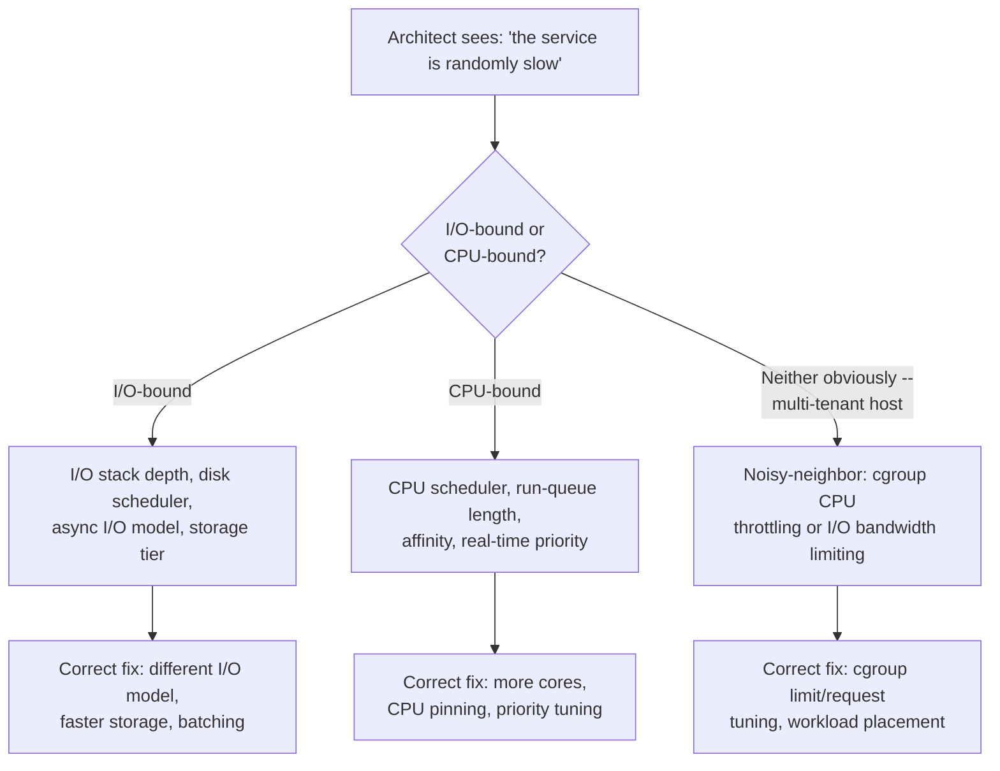

## 2. Historical Evolution

The history of I/O and scheduling on Unix-like systems is a history of one
recurring lesson: architectures tuned for one generation of hardware become
actively counterproductive on the next, and the kernel — and the architects
who configure it — must periodically unlearn assumptions that used to be
correct.

- **1970s-1980s — synchronous, spinning-disk-only world.** Early Unix I/O
  was purely blocking: a process calling `read()` on a file simply stopped
  running until the disk controller returned data. Disks were mechanical —
  a spinning platter and a physically moving read/write head — so the
  dominant cost of any disk operation was **seek time** (moving the head to
  the right track) plus **rotational latency** (waiting for the right
  sector to spin under the head). Scheduling disk requests to minimize head
  movement was the single highest-leverage optimization available.
- **1990s — the elevator algorithm and its refinements.** Linux's early
  disk I/O scheduler implemented something like an elevator in a building:
  service requests in the order their target track appears while sweeping
  in one direction across the disk, rather than in arrival order, so the
  head doesn't zig-zag across the platter. This is exactly analogous to a
  building elevator serving floor requests in physical order rather than
  request order to avoid wasted travel.
- **2000s — CFQ and I/O fairness.** The Completely Fair Queuing (CFQ)
  scheduler (default on Linux for over a decade) extended the seek-time
  optimization with **per-process fairness**: each process got its own I/O
  queue and a time slice to issue requests, sorted internally to minimize
  seeks, so that one I/O-heavy process couldn't starve every other
  process's disk access — the disk-I/O analogue of CPU time-slicing.
- **Late 2000s-2010s — flash and the seek-time assumption's collapse.**
  Solid-State Drives (SSDs) have no moving parts and no seek time: any
  logical block address costs roughly the same to access as any other.
  Every disk scheduler optimization built around minimizing head movement
  became pure overhead — computing an optimal seek order for a device
  that has no seek penalty is wasted CPU work that only adds latency.
  Linux's `noop` (and later `none`) scheduler — literally "do nothing,
  submit requests in arrival order" — started **outperforming** CFQ on SSDs
  precisely because it skipped work that used to be essential and had
  become pure waste.
- **2010s — the multi-queue block layer and NVMe.** Non-Volatile Memory
  Express (NVMe) SSDs attach over the PCI Express (PCIe) bus rather than
  the legacy SATA/SCSI command protocols designed for spinning disks, and
  support thousands of parallel hardware command queues instead of one.
  Linux's legacy single-queue block layer became a lock-contention
  bottleneck at NVMe's speeds, so the kernel replaced it with the
  **multi-queue block layer (`blk-mq`)**, matching hardware parallelism
  with software parallelism, and introduced `mq-deadline` and `kyber` as
  the schedulers designed for that reality.
- **2019 — `io_uring`.** Linux 5.1 introduced `io_uring`, a fundamentally
  new asynchronous I/O interface built around a pair of ring buffers shared
  between userspace and the kernel, specifically to eliminate the
  per-operation system call overhead that had limited every earlier attempt
  at high-performance asynchronous I/O (`aio`, epoll-based readiness
  models) — a redesign motivated by the same underlying force as the disk
  scheduler transition: hardware (NVMe SSDs capable of millions of I/O
  operations per second, 100+ Gbps network interfaces) had outpaced the
  software interface built for an earlier, slower generation of devices.

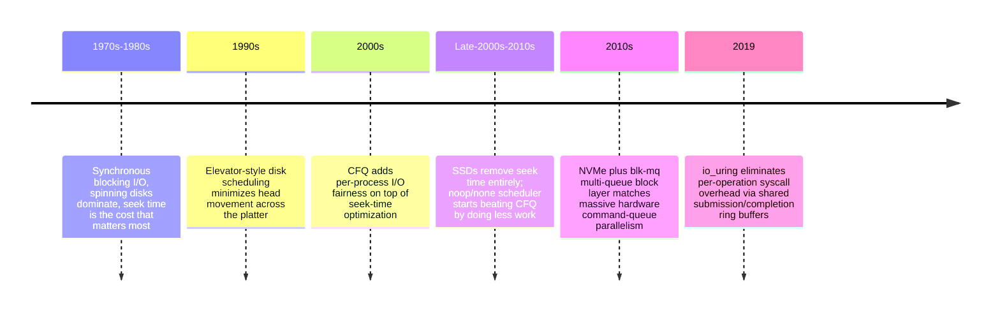

## 3. Why It Exists

I/O and CPU scheduling exist to solve one structural problem: a computer has
far more runnable work, in aggregate, than it has physical resources (cores,
disk spindles, network interfaces) to run it all simultaneously, and the
speed mismatch between those resources is enormous and uneven. A CPU
executing an instruction takes on the order of a nanosecond; a network round
trip to another data center can take tens of milliseconds — seven orders of
magnitude slower. Without a scheduler making deliberate decisions about what
runs when, and without an I/O subsystem making deliberate decisions about
what request gets serviced next, a machine sharing these wildly
mismatched-speed resources across many workloads would either waste enormous
amounts of CPU time waiting idle for slow devices, or let one demanding
workload starve every other workload sharing the same hardware.

CPU scheduling specifically exists because — as
[Processes and Threads](CH24_Processes_and_Threads.md#44-context-switching-mechanics-and-real-cost)
established — a modern system runs far more threads than it has physical
cores, and the kernel must decide, many times per second, which of the many
Ready threads gets the next slice of core time, balancing throughput
(getting the most total work done), fairness (no thread starves
indefinitely), and latency (interactive/latency-sensitive work gets
attention quickly) — three goals that are frequently in direct tension.

I/O scheduling exists because the same tension appears one layer down: many
concurrent I/O requests compete for a shared, much-slower storage or network
resource, and the order in which the kernel services them measurably changes
both total throughput and individual request latency — sometimes by an
order of magnitude, depending on whether the underlying device rewards
request reordering (spinning disks) or is indifferent to it (flash,
network).

This chapter exists as a distinct capacity-planning and incident-diagnosis
discipline because production incidents caused by scheduling and I/O
contention are extremely common, frequently misdiagnosed as "flaky
infrastructure" or "the network," and are entirely explainable — and
preventable — once an architect understands the mechanisms underneath.

## 4. Core Concepts

### 4.1 The I/O stack: where a byte actually travels, and where latency accumulates

**Definition.** The **I/O stack** is the layered path a read or write
request travels between an application and physical storage: application
code issues a system call, the kernel's Virtual File System (VFS) layer
dispatches to the concrete file system, the **page cache** intercepts the
request before touching a device at all, the **block layer** translates
file-system-level operations into device-addressable block requests and
applies I/O scheduling, and finally a **device driver** issues the actual
command to the physical storage hardware.

**Mechanism.** Concretely, a `read()` system call for a regular file
travels through these stages:

1. **Application → system call.** The application calls `read(fd, buf,
   count)`, which traps into kernel mode — a mode switch, not a full
   context switch, but still real overhead (recap:
   [Processes and Threads §4.4](CH24_Processes_and_Threads.md#44-context-switching-mechanics-and-real-cost)
   covers the general context-switch cost model this inherits from).
2. **VFS dispatch.** The kernel's Virtual File System layer is an
   abstraction that lets `read()` work identically regardless of whether
   the underlying file system is ext4, XFS, Btrfs, or a network file
   system — it dispatches the call to the concrete file system driver
   registered for that mount point.
3. **Page cache check.** Before doing anything with a physical device, the
   kernel checks whether the requested data already resides in the **page
   cache** — a cache of recently-read or recently-written file data kept in
   otherwise-unused RAM. If the data is present (a **cache hit**), the
   kernel copies it directly to the application's buffer and returns —
   no device I/O occurs at all, and the operation completes in
   microseconds rather than milliseconds.
4. **Block layer.** On a cache miss, the request proceeds to the **block
   layer**, which translates the file-system-level request (logical byte
   ranges inside a file) into device-level **block requests** (fixed-size
   sectors or blocks at specific device addresses), merges and reorders
   pending requests according to the active **I/O scheduler** (Section
   4.2), and hands the resulting request queue to the device driver.
5. **Device driver → physical storage.** The device driver translates the
   block-layer request into the specific command protocol the hardware
   understands (NVMe command, SCSI command, etc.), the hardware performs
   the physical read or write, and an interrupt (or, for high-performance
   NVMe, a polled completion queue) signals completion back up the stack.
6. **Completion propagates back up.** The block layer marks the request
   complete, the page cache is populated (for a read) so a future request
   for the same data can hit the cache, and the original system call
   returns to the application.

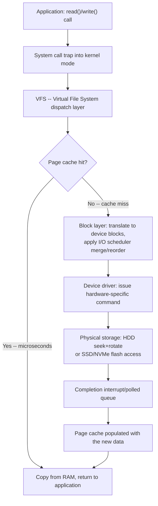

**Where latency actually accumulates.** Each layer contributes latency very
unevenly, and the single most important architectural fact in this whole
chapter is this: **a page cache hit is roughly 1,000-10,000x faster than
even a fast NVMe device access**, because RAM latency is measured in tens of
nanoseconds while even the fastest flash access is measured in tens to
hundreds of *microseconds*, and a spinning disk seek is measured in
*milliseconds* — another 1,000x slower again. The practical implication:
almost every serious storage-performance problem is really a **page cache
hit-rate problem** in disguise. An application that appears to have "slow
disk I/O" frequently just has a working set larger than available RAM, or a
cache being evicted too aggressively by memory pressure (recap: page cache
eviction is a facet of the same reclaim machinery covered in
[Memory Management](CH25_Memory_Management.md), which owns page-cache-as-
reclaimable-memory in depth) — the fix is rarely "get a faster disk," it's
"make more of the working set fit in the page cache," or, if that isn't
possible, accept and design around the physical latency floor of the
storage tier actually being used.

**Decision implications.** When an architect is sizing a service, the
question "how much RAM does this need" is inseparable from "how much of the
hot data set needs to live in page cache to hit our latency Service Level
Objective (SLO)." A database server with 64 GB of hot data and only 32 GB of
RAM will show inconsistent, hard-to-explain tail latency that has nothing to
do with query complexity — it's a cache-hit-rate problem masquerading as a
database performance problem.

**Common failure mode.** Diagnosing "disk is slow" by looking only at raw
disk throughput/latency metrics, without first checking the page cache
hit rate — teams frequently upgrade to faster storage hardware to fix a
problem that was actually a cache-sizing or memory-pressure problem, and see
little to no improvement because the bottleneck was never the physical
device in the first place.

**Concrete scenario.** A search service's p99 latency degrades from 20ms to
400ms after a deploy that added an unrelated background job to the same
host. The background job's large sequential file scan evicts the search
index's hot pages from the page cache under memory pressure; every search
query that used to be a page-cache hit against the search index now
faults through to disk. The fix isn't tuning the search service at all —
it's isolating the background job's memory footprint (a cgroup memory limit,
recap: [Memory Management](CH25_Memory_Management.md#49-cgroup-memory-limits-and-oomkilled))
or scheduling it on separate hardware.

### 4.2 Disk I/O scheduling: why the "right" algorithm depends entirely on the physical device

**Definition.** An **I/O scheduler** (also called an **elevator**, from the
building-elevator analogy) is the block-layer component that decides the
order in which pending block I/O requests are dispatched to the underlying
device, and whether adjacent requests should be **merged** into a single
larger request before being issued.

**Mechanism — spinning-disk era.** On a Hard Disk Drive (HDD), the dominant
cost of any request is **seek time**: physically moving the read/write head
across the platter to the target track, which takes milliseconds — an
eternity compared to the microsecond-scale cost of actually reading data
once the head is positioned. This means the *order* requests are serviced in
has an enormous effect on total throughput: servicing requests in arrival
order might send the head zig-zagging back and forth across the platter,
while servicing them sorted by track position lets the head sweep in one
direction, picking up every request whose track it passes, exactly like a
building elevator serving floor requests in the order the floors are
physically passed rather than the order the buttons were pressed.

- **The elevator/`deadline` family** sorts pending requests by target
  block address and services them in a sweep, while also enforcing a
  maximum wait time per request (a "deadline") so a request for a distant
  track doesn't starve indefinitely while nearer requests keep arriving.
- **CFQ (Completely Fair Queuing)** added **per-process fairness** on top:
  each process (or cgroup) gets its own internal queue and a scheduling
  time slice, so that a single I/O-heavy process sharing a disk with
  others can't monopolize the device — conceptually the I/O-layer
  equivalent of CPU time-slicing (Section 4.4), applied to disk access
  instead of CPU cycles.

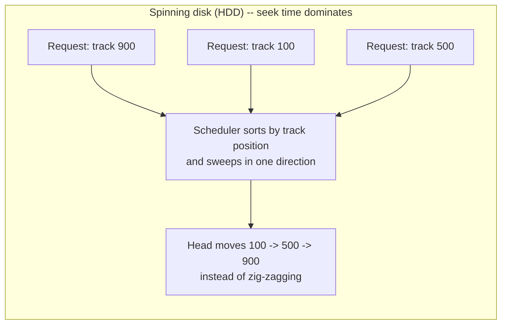

**Mechanism — flash/NVMe era.** An SSD has no moving head and no
meaningfully different cost for accessing one logical block versus another
— the seek-time assumption every scheduler above was built around simply
does not hold. Computing an "optimal" seek order for a device with no seek
penalty is pure wasted CPU work: the scheduler burns cycles solving a
problem the hardware no longer has, adding latency and CPU overhead without
any corresponding benefit. This is why:

- **`none`** (the modern successor to `noop`) does essentially nothing —
  requests are submitted in the order received (with only trivial merging
  of adjacent requests), and on a fast NVMe device this frequently
  **outperforms** a "smarter" scheduler, because the smart scheduling work
  itself was the overhead.
- **`mq-deadline`** keeps the deadline-based starvation protection
  (still useful — some hardware-level fairness matters even on flash) but
  drops the seek-minimizing sort logic that flash gets no benefit from,
  and is built on top of the multi-queue block layer (`blk-mq`) so it
  doesn't become a single-queue lock-contention bottleneck at NVMe's
  request rates.
- **`kyber`** and **`bfq`** are latency-target-driven schedulers for
  workloads that need explicit read/write latency prioritization even on
  flash (for example, prioritizing latency-sensitive reads over background
  writeback), useful on lower-end flash or shared multi-tenant storage
  where fairness still matters despite the lack of a seek penalty.

**The genuine lesson for architects.** This is a textbook case of "the
hardware changed, so the correct architecture changed with it" — and it
generalizes far beyond disk schedulers. Any optimization that exists to work
around a specific physical hardware limitation (here: seek time) becomes,
at best, dead weight and, at worst, an active regression once the hardware
limitation it was compensating for disappears. An architect inheriting a
system tuned for a prior hardware generation should periodically ask "what
physical constraint was this design compensating for, and does that
constraint still exist?" — the same question applies well beyond storage
(e.g., buffer-pool tuning built around slow network links that no longer
apply on a modern data-center fabric).

**Decision implications.** Choosing an I/O scheduler is a device-and-
workload-specific decision, not a universal default: `none` or
`mq-deadline` for NVMe SSDs in most cloud/production deployments, `bfq` when
fine-grained latency fairness matters more than raw throughput on
lower-tier storage, and legacy `cfq`/`deadline` only relevant to genuinely
spinning-disk hardware, which is now rare in cloud environments but still
common in on-premises archival/cold-storage tiers.

**Common failure mode.** Leaving a default scheduler tuned for spinning
disks active on an all-flash cloud instance (or, worse, manually copying an
old on-premises tuning guide's scheduler recommendation onto new NVMe-backed
infrastructure) — the system still works, but pays a real, invisible
throughput/latency tax from scheduling overhead solving a problem the
hardware doesn't have.

**Concrete scenario.** A team migrates a database from spinning-disk-backed
on-premises servers to NVMe-backed cloud instances, carrying over their
entire sysctl/tuning playbook unchanged, including an explicit `cfq`
scheduler pin left over from years of prior tuning wisdom. Benchmarks show
15-20% lower throughput than a freshly-provisioned instance with the
distribution's flash-aware default (`none`/`mq-deadline`) — the "battle-
tested" tuning was battle-tested for hardware that no longer exists in
their fleet.

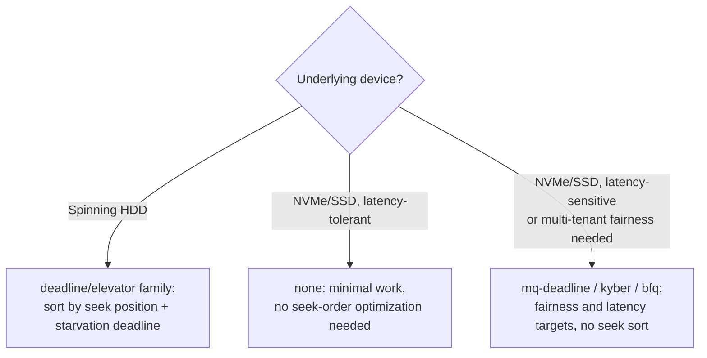

### 4.3 Synchronous versus asynchronous I/O models: blocking read/write, POSIX AIO, and `io_uring`

**Definition.** A **synchronous (blocking) I/O** call suspends the calling
thread until the operation completes; the thread cannot do anything else in
the meantime. An **asynchronous I/O** call returns immediately after
submitting the request, letting the calling thread continue other work, and
notifies the caller (via a callback, a completion event, or a pollable
handle) once the operation actually finishes.

**Mechanism — blocking I/O.** A plain `read()`/`write()` call is the
simplest model: the calling thread traps into the kernel and is put in a
**blocked/waiting** state (recap: the full process/thread state-transition
model is owned by
[Processes and Threads §4.3](CH24_Processes_and_Threads.md#43-process-and-thread-lifecycle-states-and-transitions))
until the I/O completes, at which point the scheduler marks it Ready again.
This is simple to reason about and is the right default for most
application code, but it means one thread can service exactly one
in-flight I/O operation at a time — scaling to many concurrent I/O
operations requires many threads (thread-per-request, expensive per the
context-switch and memory-footprint cost model already covered in
[Processes and Threads](CH24_Processes_and_Threads.md)) or a non-blocking/
multiplexed model.

**Mechanism — readiness-based non-blocking I/O (recap only).** Socket-level
non-blocking I/O and the `select`/`poll`/`epoll`/`kqueue` readiness-
notification model — "tell me which of these file descriptors *won't*
block right now" — is owned in full by
[Sockets §4.3-4.4](CH16_Sockets.md#44-the-io-multiplexing-evolution-select-poll-epoll-and-kqueue).
This chapter's contribution is the layer above and below that model: how
true asynchronous I/O (the kernel actually performing the operation on the
caller's behalf, not just notifying readiness) evolved, and why it
struggled for file I/O specifically for so long.

**Mechanism — POSIX AIO and its limitations.** POSIX Asynchronous I/O (AIO)
(`aio_read`/`aio_write`) let an application submit a real asynchronous
operation — the kernel (or, in Linux's glibc implementation, a hidden
userspace thread pool) performs the operation and signals completion later.
In practice, POSIX AIO on Linux was widely considered unreliable and
underused: the glibc implementation for file I/O was frequently just a
thread pool doing blocking calls underneath a nominally async Application
Programming Interface (API) — not a genuine kernel-level asynchronous path
— and it interacted poorly with buffered (page-cache-backed) file I/O,
frequently blocking anyway under specific conditions the API contract
didn't clearly rule out. It saw meaningfully more real use for **Direct I/O**
(bypassing the page cache) in a narrower set of high-performance database
engines, but never became the general-purpose high-performance async I/O
answer for ordinary applications.

**Mechanism — `io_uring`.** `io_uring` (Linux 5.1+) is the interface that
finally delivered a genuinely fast, general-purpose asynchronous I/O model,
and it does so through a specific architectural choice: **two ring buffers
shared between userspace and the kernel** — a Submission Queue (SQ) and a
Completion Queue (CQ) — both mapped into memory both sides can read and
write directly.

- To submit an I/O operation, the application writes a Submission Queue
  Entry (SQE) describing the operation directly into the shared submission
  ring — no system call is required just to *describe* the request.
- A single system call (`io_uring_enter`) can then flush **many** queued
  submissions to the kernel at once, and can also be told to block until
  completions are available — meaning one syscall can submit a batch of
  operations *and* reap a batch of completions in one round trip.
- Completions appear as Completion Queue Entries (CQEs) in the shared
  completion ring; the application reads them directly out of shared
  memory with no syscall required just to *check* for completions.
- In its most aggressive configuration (`SQPOLL`), a dedicated in-kernel
  thread polls the submission ring continuously, so a well-tuned
  application can submit large volumes of I/O with **zero** syscalls in
  the steady state at all.

This is precisely why `io_uring` eliminates the overhead that plagued
earlier async I/O attempts: every prior model (blocking I/O, POSIX AIO, even
`epoll`-based readiness notification driving subsequent blocking calls) paid
a system call cost **per operation, or at minimum per readiness check** —
and a system call is not free (a mode switch plus, on modern CPUs,
interaction with speculative-execution security mitigations that make traps
more expensive than they were before Meltdown/Spectre-era patches). At
millions of I/O operations per second — routine for modern NVMe hardware —
per-operation syscall overhead becomes the dominant cost, not the actual
I/O. `io_uring`'s batched-submission, batched-completion, shared-memory
design amortizes that fixed syscall cost across many operations instead of
paying it per operation.

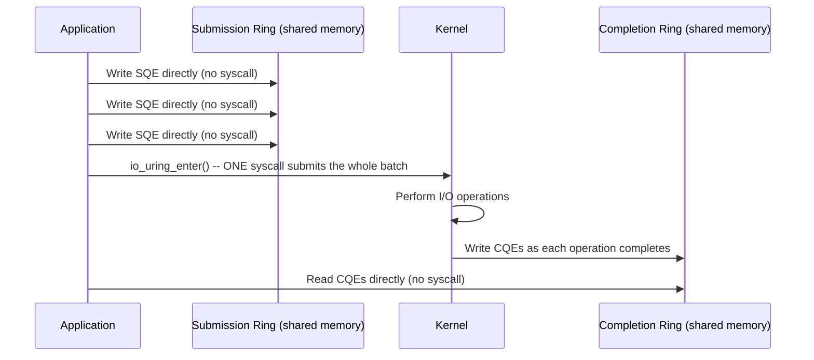

**Decision implications.** For most application code, blocking I/O behind a
thread pool (or an async runtime built on `epoll`, recap:
[Sockets §4.5](CH16_Sockets.md#45-server-architecture-models-thread-per-connection-event-loop-and-async-io))
remains the right default — it's simpler, well-understood, and adequate at
typical request rates. `io_uring` earns its complexity budget specifically
for I/O-intensive infrastructure software operating at very high operation
rates: storage engines, high-throughput proxies, and modern language-runtime
I/O backends (recent versions of several server runtimes have adopted
`io_uring` as an optional high-performance backend precisely for this
reason). Adopting it purely because it's the newest interface, for a
service whose I/O volume doesn't come close to syscall-overhead-bound
territory, adds real implementation and debugging complexity for no
measurable benefit.

**Common failure mode.** Assuming "async I/O" always means "faster" — POSIX
AIO's history is the clear counter-example: an asynchronous-shaped API with
a blocking-thread-pool implementation underneath delivers none of the
promised benefit while adding all of the API complexity. The lesson
generalizes: judge an async I/O interface by its actual kernel-level
completion mechanism, not by its function signature.

**Concrete scenario.** A team building a custom high-throughput log-ingestion
service benchmarks a naive thread-per-connection blocking design against an
`io_uring`-based design at 500,000 small writes/second. The blocking design
saturates on context-switch and syscall overhead well before disk bandwidth
is the limiting factor; the `io_uring` design, batching thousands of writes
per `io_uring_enter` call, drives the same disk close to its actual physical
throughput ceiling — the redesign paid off specifically because the
workload's operation rate was high enough for per-operation overhead to
dominate.

### 4.4 CPU scheduling: the Completely Fair Scheduler and how "fairness" is actually computed

**Definition.** The **Completely Fair Scheduler (CFS)** has been Linux's
default scheduler for ordinary (non-real-time) processes since 2007. Its
design goal is to give every runnable thread a share of CPU time
proportional to its weight (derived from its "nice" priority value) over
any sufficiently long observation window, approximating an idealized model
in which every runnable thread gets an equal, infinitesimally small slice of
the CPU in perfect round-robin, as if the CPU were perfectly divisible
among all runnable threads simultaneously.

**Mechanism.** CFS tracks, for every runnable thread, a **virtual runtime
(`vruntime`)** — a measure of how much CPU time the thread has actually
consumed, weighted by its priority (a lower-priority "nicer" thread
accumulates virtual runtime faster per real millisecond of CPU time, so it
gets scheduled less often relative to higher-priority threads). The
scheduler organizes all runnable threads in a **red-black tree keyed by
`vruntime`**, and always picks the thread with the **smallest `vruntime`**
to run next — the thread that, relative to its priority weight, has
received the *least* CPU time so far. Once running, a thread's `vruntime`
increases as it consumes CPU; eventually another thread's `vruntime` becomes
smaller, and the scheduler preempts the running thread in favor of it. This
is why the scheduler is called "completely fair": rather than dividing time
into literal fixed time slices per thread (as older schedulers did), it
continuously tracks an accounting metric and always favors whoever is
currently "owed" the most CPU time relative to their priority weight.

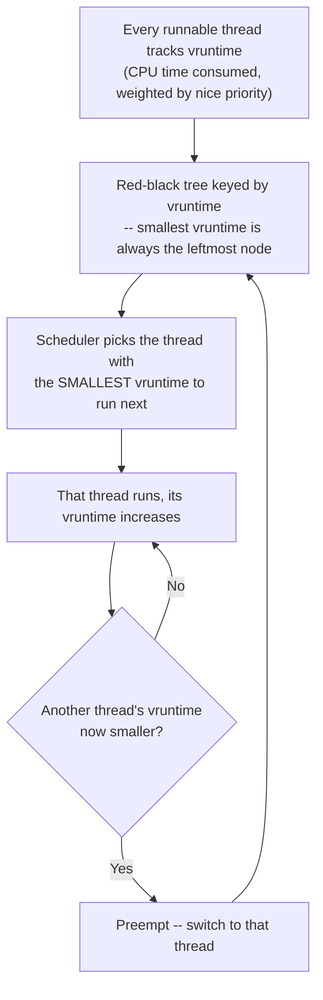

**Decision implications.** CFS's fairness model means a thread's `nice`
value (or, in containerized environments, its cgroup CPU weight/shares —
recap forward reference: Section 4.6 covers the cgroup CPU **quota**
mechanism, which is a distinct, harder limit layered on top of this
proportional-share fairness model, not a replacement for it) determines its
*relative* share of contested CPU time, not an absolute guarantee — on an
idle system, every thread gets as much CPU as it wants regardless of
priority, because there's no contention to be fair about. Architects sizing
compute capacity for latency-sensitive workloads need to reason about
*contention*, not just raw core count: a service pinned to cores shared with
noisy batch jobs will see its actual scheduled CPU time vary with what else
is runnable, even with generous `nice` weighting, because CFS's fairness is
proportional-share, not a hard reservation.

**Common failure mode.** Assuming a process given a "higher priority" via
`nice` is guaranteed a fixed amount of CPU time — CFS's proportional-share
model means its actual wall-clock CPU allocation still depends on what else
is contending for the same cores; `nice` shifts the ratio, it doesn't
reserve capacity, and on a genuinely CPU-saturated multi-tenant host, even
a "high priority" niced process can still experience real scheduling delay.

**Concrete scenario.** An on-call engineer sees a latency-sensitive service
occasionally missing its 50ms Service Level Agreement (SLA) despite having
a favorable `nice` value, and initially assumes a code regression. Run-queue
length metrics (Section 4.9) show the host was running significantly more
concurrent runnable threads than cores during the exact latency spikes — the
service's CFS-scheduled share of CPU time was proportionally favorable but
still a smaller absolute amount of wall-clock CPU time when contention
spiked, because `nice` weighting doesn't create additional cores.

### 4.5 Real-time scheduling classes for latency-sensitive workloads

**Definition.** Linux offers scheduling classes beyond CFS specifically for
threads that need **bounded, predictable latency** rather than proportional
fairness: `SCHED_FIFO` (First-In-First-Out — a real-time thread runs until
it blocks, yields, or is preempted by a higher real-time priority thread; no
time-slicing between equal-priority real-time threads) and `SCHED_RR`
(Round-Robin — like `SCHED_FIFO` but time-slices between real-time threads
of equal priority). Real-time-class threads always preempt any CFS
("normal"-class) thread, regardless of how favorably the CFS thread is
weighted — real-time priority sits structurally above the entire CFS
fairness model, not as an extreme point within it.

**Mechanism.** CFS's proportional-fairness model is explicitly *not*
designed to bound worst-case latency for any individual thread — it
optimizes for overall throughput-fairness over time, which is exactly wrong
for a thread that must respond to an event within a hard microsecond-scale
deadline (audio processing, industrial control loops, certain trading
system components). Real-time scheduling classes exist to give such threads
scheduling priority that is not subject to the fairness accounting CFS
applies to everything else — when a real-time thread becomes runnable, it
preempts whatever CFS-class thread is currently running, immediately,
regardless of that thread's `vruntime` standing.

**Decision implications.** Real-time scheduling is a sharp tool: because a
misbehaving `SCHED_FIFO` thread that never blocks can **starve every other
thread on that core indefinitely** (there is no fairness mechanism forcing
it to yield to anything except a higher-priority real-time thread), it is
reserved for a small, carefully-audited set of components, typically with
watchdog timers or deliberately bounded work per scheduling opportunity —
never applied broadly "to make things faster," because doing so risks
starving the rest of the system, including components the real-time thread
itself may depend on (like a logging thread or a network stack worker).

**Common failure mode.** Assigning real-time priority to an ordinary
application thread to "fix" a latency problem without auditing that the
thread reliably yields — a real-time thread with a latent infinite loop or
an unexpected blocking call under load can freeze an entire core, taking
down unrelated services co-located on that core, a far worse outcome than
the original latency problem.

**Concrete scenario.** A media-processing pipeline assigns `SCHED_FIFO`
priority to its audio-frame-decoding thread to guarantee it is never
delayed by unrelated batch work sharing the host. This is architecturally
sound *because* the team also added a hard per-frame time budget and a
watchdog that demotes the thread back to CFS if it ever exceeds that
budget — without that safeguard, a single frame that hangs (e.g., on a
corrupt input) would freeze the core indefinitely rather than merely
producing one bad frame.

### 4.6 CPU affinity and pinning for high-performance production systems

**Definition.** **CPU affinity** restricts which specific CPU core(s) a
thread is allowed to be scheduled onto; **CPU pinning** is the practice of
setting a thread's affinity to a single, dedicated core (or small fixed
set), removing the scheduler's freedom to migrate it elsewhere.

**Mechanism.** By default, CFS is free to migrate a runnable thread between
any core in its affinity mask as load balancing dictates — generally good
for overall throughput, but it has real costs for latency-sensitive or
extremely high-throughput workloads: migrating to a different core means
losing the warm CPU cache state (L1/L2 cache contents specific to that
core, and potentially crossing a Non-Uniform Memory Access (NUMA) node
boundary — recap: NUMA locality is owned by
[Memory Management](CH25_Memory_Management.md#413-numa-non-uniform-memory-access)
— re-fetching data from a farther memory node). Pinning a thread to a
specific core (and, ideally, isolating that core from the general scheduler
entirely via kernel boot parameters like `isolcpus`, so ordinary CFS traffic
never lands there) keeps its cache state warm and its memory access local,
at the cost of losing the load-balancer's ability to move that thread to a
less-contended core if its pinned core becomes busy with something else.

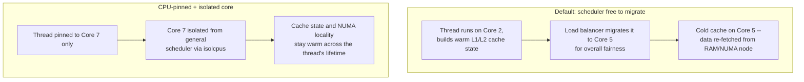

**Decision implications.** Pinning trades scheduling flexibility for cache
and memory locality, and is a targeted optimization for a specific class of
workload: high-throughput network packet processing, low-latency trading
systems, and dedicated database engine worker threads are common
beneficiaries, because the cost of a cold cache/cross-NUMA memory fetch is
measurable and repeated constantly at their operation rates. For ordinary
application services, pinning is rarely worth the operational complexity —
it removes the scheduler's ability to route around a noisy neighbor on the
same core, which can make a pinned thread's latency *worse*, not better, in
a genuinely contended multi-tenant environment unless the pinned core is
also properly isolated.

**Common failure mode.** Pinning a thread to a specific core without also
isolating that core from general scheduling — the thread is now stuck
sharing its one allowed core with whatever unrelated work the scheduler
places there, with none of the load-balancer's freedom to route around
that contention, which can be strictly worse than leaving it unpinned.

**Concrete scenario.** A team pins a latency-critical worker thread to Core
3 to "guarantee" its performance, but doesn't isolate Core 3 from the
general scheduler. A routine kernel housekeeping task and an unrelated
service's thread both get scheduled onto Core 3 during a traffic spike, and
the pinned thread's tail latency gets *worse* than before pinning, because
it lost the ability to migrate away from the contention it now shares that
one core with.

### 4.7 I/O-bound versus CPU-bound workload classification as a capacity-planning discipline

**Definition.** A workload is **I/O-bound** if its throughput is limited
primarily by how fast it can complete I/O operations (disk, network, or
inter-process), with the CPU spending most of its time idle/blocked waiting
for those operations; a workload is **CPU-bound** if its throughput is
limited primarily by computation, with the CPU almost always busy and I/O
operations comparatively rare or fast relative to compute time.

**Mechanism — recap and extension.** This classification builds directly on
the process/thread cost model established in
[Processes and Threads](CH24_Processes_and_Threads.md): a thread performing
blocking I/O spends its time in the **blocked/waiting** state, consuming no
CPU while it waits — which is why I/O-bound workloads scale well with
*more concurrent threads/coroutines per core* (each additional concurrent
unit is mostly idle, so many can share one core without much contention),
while CPU-bound workloads scale only with **more cores**, because extra
threads beyond the core count simply queue for CPU time rather than making
genuine forward progress.

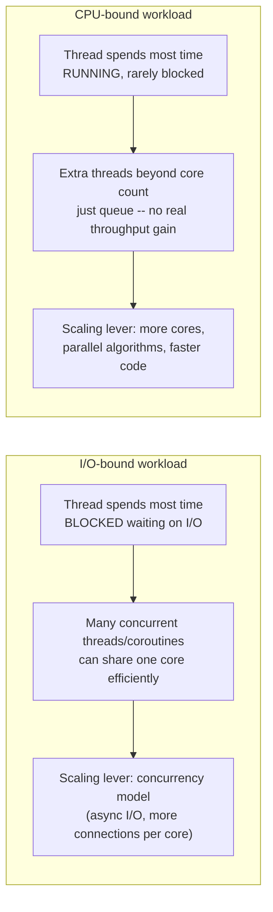

**Decision implications.** This classification directly drives sizing: an
I/O-bound service (a typical Create-Read-Update-Delete (CRUD) Application
Programming Interface (API) spending most of its time waiting on database
round trips) benefits from a high-concurrency async I/O model on modest core
counts, because the bottleneck is *elsewhere*; over-provisioning cores for
such a service wastes money without improving throughput. A CPU-bound
service (image transcoding, cryptographic signing, machine learning
inference) benefits from more cores and parallel work distribution, and
adding concurrency beyond the core count buys nothing but scheduling
overhead. Misclassifying a workload leads directly to the wrong capacity
decision: over-provisioning cores for an I/O-bound service, or
over-provisioning connection-handling concurrency for a CPU-bound one that
just needs more compute.

**Common failure mode.** "Scaling by adding more application threads" for a
service that is actually CPU-bound — thread count climbs, but throughput
plateaus (or degrades, from added context-switch and scheduling overhead)
because the bottleneck was never the number of concurrent units of work,
it was the fixed amount of computation each unit requires and the fixed
number of cores available to do it.

**Concrete scenario.** A team observes a service is "slow under load" and
doubles its thread pool size, expecting proportional throughput gains.
Profiling shows the service is compressing large payloads synchronously on
every request — genuinely CPU-bound work — so throughput barely moves
(the cores were already saturated) while p99 latency gets *worse* from
increased scheduling contention among the now-larger thread pool. The
correct fix is either more cores, or moving the compression to a
purpose-built worker pool sized to the actual core count, not blindly
scaling thread count.

### 4.8 The noisy-neighbor problem: CPU throttling via cgroup Completely Fair Scheduler quotas

**Definition.** The **noisy-neighbor problem** is the failure mode in
which one tenant's (container, virtual machine, or process group's) resource
consumption on shared hardware degrades another co-located tenant's
performance, even though the affected tenant's own code, configuration, and
resource requests haven't changed. **cgroup (control group) CPU quotas**
are the primary Linux mechanism for bounding a container or process group's
CPU consumption to prevent exactly this.

**Mechanism.** Linux **control groups (cgroups)** let the kernel group
processes/threads together and apply resource limits to the group as a
whole. For CPU, the CFS **bandwidth controller** (the mechanism behind
Kubernetes CPU `limits` and Docker `--cpus`) enforces a **quota** within a
fixed **period**: a cgroup is allowed to consume at most `quota`
microseconds of CPU time out of every `period` microseconds (commonly a
100ms period). If the cgroup's aggregate CPU consumption hits its quota
before the period ends, **every thread in that cgroup is throttled** —
made non-runnable, regardless of how idle the rest of the machine is —
until the next period begins and the quota resets.

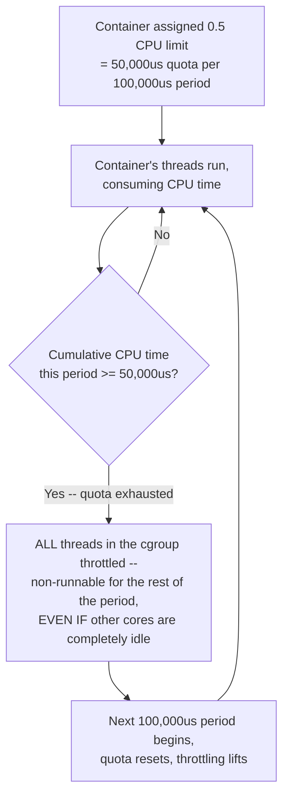

**This is precisely why a container hitting its CPU quota looks like the
application "randomly" slowing down.** From inside the container, nothing
observable has changed — no error, no exception, no log entry — the
process is simply not being scheduled for a portion of every period,
producing latency spikes and stalls that recur with a period-aligned
rhythm (commonly visible as request latency spiking in a sawtooth pattern
correlated with the 100ms accounting window) but leave zero trace in
application-level logs or Application Performance Monitoring (APM) traces,
because the throttling happens entirely below the application's visibility
— the kernel simply isn't giving the process any CPU time to even *notice*
it isn't running. This is one of the most common, hardest-to-diagnose
production incidents in containerized environments precisely because every
obvious first instinct (check the application logs, check the code, check
downstream dependencies) turns up nothing, since the cause is a scheduling
decision made entirely outside the container's observable world.

**Decision implications.** Diagnosing this requires looking at cgroup-level
throttling metrics specifically — `nr_throttled` (how many periods the
group was throttled in) and `throttled_time` (cumulative time spent
throttled) from `/sys/fs/cgroup/.../cpu.stat` (cgroup v2) — not
application-level metrics, which show no direct evidence of the cause.
Setting CPU **limits** meaningfully below the actual burst requirement of a
bursty workload (one that is idle most of the time but needs a full core
briefly and often) is the single most common root cause: the *average*
utilization looks low and the limit looks generously sized in aggregate,
but the workload's short bursts repeatedly exceed the per-period quota,
producing frequent throttling despite low overall utilization.

**Common failure mode.** Setting a Kubernetes CPU `limit` based on average
observed CPU usage rather than burst/peak usage, then being confused when
p99 latency is poor despite average CPU utilization looking comfortably
under the limit — average utilization is exactly the wrong metric to size
a hard quota against, because the quota is enforced per 100ms period, not
as a rolling average.

**Concrete scenario.** A team sets a container's CPU limit to `500m` (0.5
cores) based on an average utilization measurement of 20%, assuming
generous headroom. The service actually does a burst of JSON serialization
work on every request that briefly needs close to a full core for a few
milliseconds; because that burst exceeds the 50ms-per-100ms-period quota
during request spikes, the container is repeatedly throttled for the
remainder of each period, producing exactly the sawtooth latency pattern
described above. Raising the limit to `1000m` (matching the actual burst
requirement, not the average) eliminates the throttling entirely, even
though average CPU utilization barely changes.

```yaml
# Kubernetes Pod spec demonstrating a CPU limit sized against BURST need,
# not average utilization -- the quota that actually caused throttling above.
apiVersion: v1
kind: Pod
metadata:
  name: json-serializer
spec:
  containers:
    - name: app
      image: registry.example.com/json-serializer:1.4.0
      resources:
        requests:
          cpu: "250m"   # scheduling guarantee -- reserved share, not a ceiling
        limits:
          cpu: "1000m"  # hard CFS quota ceiling: 100,000us quota / 100,000us period
                        # sized to the observed BURST requirement (~1 full core
                        # for a few ms per request), not the ~20% AVERAGE
                        # utilization that under-sized the previous "500m" limit
```

### 4.9 I/O bandwidth limiting via the cgroup I/O controller

**Definition.** The cgroup **I/O controller** (`io` controller in cgroup
v2, formerly `blkio` in v1) applies the same group-based resource-limiting
philosophy as the CPU controller (Section 4.8), but to storage I/O
bandwidth and Input/Output Operations Per Second (IOPS) instead of CPU
time: it can cap how many bytes per second or operations per second a
cgroup is permitted to issue against a given block device.

**Mechanism.** Similar in spirit to CPU quotas, the I/O controller can
enforce either **hard limits** (`io.max` in cgroup v2 — a strict cap on
bytes/sec or IOPS per device for the group, with excess requests queued or
throttled) or **proportional weights** (`io.weight` — relative priority
when the device is contended, without a hard ceiling), giving operators the
same throughput-vs-fairness trade-off the CPU controller offers, applied to
storage. This exists for exactly the analogous reason CPU quotas exist:
without it, one noisy tenant issuing heavy sequential I/O (a backup job, a
large batch export) can saturate a shared block device's bandwidth,
starving every other tenant's I/O on the same physical disk or network
storage volume — a storage-layer noisy-neighbor problem that produces the
same symptom pattern as the CPU case: elevated latency with no obvious
cause inside the affected tenant's own logs.

**Decision implications.** In multi-tenant storage environments (shared
Elastic Block Store (EBS)-style network-attached volumes, shared local
NVMe pools backing many containers), I/O bandwidth limiting is the storage
analogue of CPU quota management, and should be reasoned about the same
way: size limits against actual burst I/O requirements, and monitor
device-level queue depth and latency (Section 4.10) rather than assuming a
generous-looking average I/O rate rules out contention.

**Common failure mode.** Provisioning cloud block storage purely by
capacity (gigabytes) without checking its associated IOPS/throughput
ceiling — many cloud storage tiers scale IOPS with provisioned capacity, so
a small, low-throughput volume attached to a demanding workload throttles
I/O even though "disk space" was never the actual constraint, a distinct
but closely related failure to the CPU-quota case in Section 4.8.

**Concrete scenario.** Several containers share a network-attached storage
volume with a fleet-wide IOPS ceiling. A nightly log-rotation and
compaction job in one container issues a burst of small random writes that
consumes most of the shared IOPS budget for several minutes; every other
container's I/O on that same volume queues behind it, and their unrelated
services show latency spikes precisely correlated with the compaction
job's schedule — diagnosed by correlating device-level I/O wait metrics
with the compaction job's cron schedule, not by anything visible in the
affected services' own logs.

### 4.10 Observability of I/O and scheduling bottlenecks: interpreting `iostat`, `vmstat`, and run-queue metrics

**Definition.** Diagnosing whether a system is I/O-bound, CPU-bound, or
contended at the scheduler level requires a specific, ordered set of
operating-system-level metrics — not application logs — because, as
Sections 4.8-4.9 established, the actual bottleneck frequently produces no
application-visible symptom at all.

**Mechanism — the core metrics and what they actually mean.**

- **Run-queue length** (`vmstat`'s `r` column, or `procs_running` in
  `/proc/stat`) — the number of threads that are Ready to run **right now**
  but don't currently have a core to run on. A run-queue length
  consistently higher than the number of available cores is direct
  evidence of **CPU contention**: there is more runnable work than the
  machine has cores to service it, and threads are queuing for CPU time
  regardless of priority weighting.
- **I/O wait percentage** (`%iowait` in `vmstat`/`top`) — the percentage of
  time the CPU was idle *specifically because* it was waiting on an
  outstanding I/O operation to complete (as opposed to being idle because
  there was simply no runnable work at all). High `%iowait` with otherwise
  low CPU utilization is the classic signature of an **I/O-bound**
  workload: the CPU has work queued, but that work is blocked on I/O, not
  on CPU availability.
- **`iostat` per-device metrics** — `%util` (percentage of time the device
  had at least one outstanding request — approaching 100% indicates the
  device itself is saturated), `await` (average time, in milliseconds, an
  I/O request spent from submission to completion, including queuing
  delay — the end-to-end latency an application actually experiences), and
  `avgqu-sz`/queue depth (how many requests are queued at the device at
  once — a rising queue depth alongside rising `await` indicates the
  device can't keep up with the request rate).

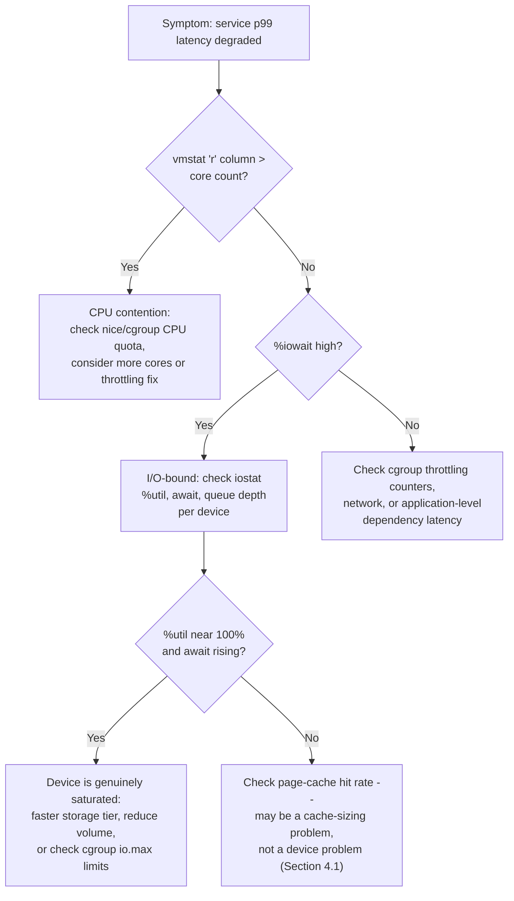

**Worked interpretation walkthrough.**

```text
$ vmstat 1 5
procs -----------memory---------- ---swap-- -----io---- -system-- ------cpu-----
 r  b   swpd   free   buff  cache   si   so    bi    bo   in   cs us sy id wa st
 9  3      0 812340  45200 3102456    0    0  1840  9620 4102 8850 22  6 12 60  0
 8  4      0 809112  45200 3105890    0    0  2010 10240 4210 9012 20  7 11 62  0
 7  2      0 805440  45200 3108120    0    0  1920  9880 4088 8790 21  6 13 60  0

$ iostat -x 1 3
Device            r/s     w/s   rkB/s   wkB/s  await  %util
nvme0n1          420.0   980.0  16800   58400   38.2   96.5
```

Reading this together: the `r` column (run-queue) is 7-9 against, say, an
8-core host — right at the edge, showing real but not extreme CPU
contention. Far more striking is `wa` (I/O wait) sitting at 60-62% — the
majority of otherwise-idle CPU time is being spent waiting on outstanding
I/O, not on lack of runnable work. `iostat` confirms why: `nvme0n1` is at
96.5% utilization with `await` of 38.2ms — for an NVMe device, which should
typically show sub-millisecond-to-low-single-digit-millisecond latency
under healthy conditions, an `await` in the tens of milliseconds alongside
near-100% `%util` is a clear signal the device itself is the saturated
resource, not merely a symptom of application-level slowness. The
diagnostic conclusion: this host is **I/O-bound**, specifically **device-
saturated** (not a page-cache-sizing problem, since `%util` is genuinely
near its ceiling) — the fix is reducing I/O volume against this device,
distributing it across more devices, or moving to a higher-throughput
storage tier, not adding CPU cores, which the `wa`-dominated idle time
shows would sit idle waiting on the same saturated device regardless.

**Decision implications.** These metrics should be checked in a specific
order precisely because they're causally layered: run-queue length answers
"is the CPU the bottleneck," `%iowait` and `iostat` answer "is storage the
bottleneck," and cgroup throttling counters (Section 4.8) answer "is a
resource *limit*, rather than genuine physical scarcity, artificially
creating the bottleneck." Skipping straight to application-level profiling
without first ruling these three out is the single most common reason
production performance investigations stall — the profiler correctly shows
the application "waiting," but can't show *why* it's waiting, because the
cause is a layer below what application-level tooling observes.

**Common failure mode.** Interpreting high `%iowait` as "the disk is slow"
without checking whether `%util` is actually near saturation — a low
`%util` alongside high `%iowait` more often indicates a small number of
slow, possibly serialized requests (for example, synchronous small writes
with no batching) rather than a device that is out of physical capacity;
the fix in that case is application-level I/O batching/concurrency, not a
storage upgrade.

## 5. Internal Working

Tying the Core Concepts together end to end: when an application thread
calls a blocking `read()` on a file not in the page cache, the kernel moves
that thread from Running to Blocked (recap:
[Processes and Threads §4.3](CH24_Processes_and_Threads.md#43-process-and-thread-lifecycle-states-and-transitions)),
CFS immediately picks the Ready thread with the lowest `vruntime` to occupy
the freed core (Section 4.4), the block layer enqueues the request under
whichever scheduler is active for that device (Section 4.2) — reordering it
against other pending requests if the device benefits from that (spinning
disk) or passing it through with minimal work if it doesn't (NVMe) — the
device driver issues the hardware command, and completion is signaled back
up through an interrupt that eventually makes the original thread Ready
again, at which point CFS's `vruntime` accounting determines when it
actually gets a core back. If that same request happens on a cgroup that
has already exhausted its CPU quota for the current period (Section 4.8) or
its I/O bandwidth allotment (Section 4.9), the completion notification
still fires, but the thread sits Ready-but-throttled rather than
Ready-and-imminently-scheduled — invisible to the application, visible only
in cgroup accounting.

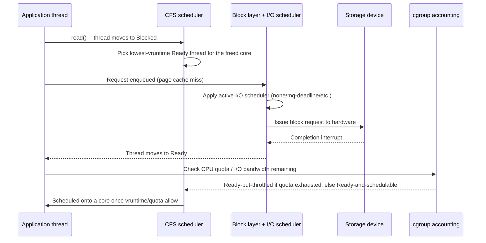

## 6. Design Principles

- **Match the scheduling/I/O mechanism to the actual physical constraint,
  not to inherited convention** — Section 4.2's disk-scheduler lesson
  generalizes: verify the hardware assumption a given tuning choice depends
  on still holds before carrying it forward to new infrastructure.
- **Classify workloads (I/O-bound vs. CPU-bound) before sizing capacity** —
  Section 4.7's discipline should run before any core-count or concurrency
  decision, not after a service is already underperforming in production.
- **Size resource limits against burst, not average, utilization** —
  Sections 4.8-4.9's throttling failure mode is caused overwhelmingly by
  limits set against average metrics that hide the actual constraining
  bursts.
- **Prefer the simplest I/O model that meets the latency/throughput
  requirement** — blocking I/O and `epoll`-based async models remain
  correct defaults; reach for `io_uring` only once per-operation syscall
  overhead is demonstrably the bottleneck (Section 4.3).
- **Isolate, don't just prioritize, latency-critical work sharing hardware
  with everything else** — `nice` weighting and CPU pinning without core
  isolation both leave a latency-sensitive thread exposed to contention
  from co-located work; genuine isolation (isolated cores, dedicated
  cgroup limits, or dedicated hardware) is the only mechanism that removes
  that exposure entirely.

## 7. Architecture Patterns

- **Async I/O event-loop pattern.** A small, fixed pool of OS threads
  (often one per core) each drive an `epoll`/`io_uring`-based event loop
  handling many thousands of concurrent I/O operations, avoiding the
  memory and context-switch cost of thread-per-connection at scale (recap:
  [Sockets §4.5](CH16_Sockets.md#45-server-architecture-models-thread-per-connection-event-loop-and-async-io)
  owns the general event-loop-vs-thread-per-connection trade-off; this
  chapter adds the `io_uring` variant specifically for file/block I/O
  rather than just sockets).
- **Dedicated I/O thread pool pattern.** CPU-bound work and blocking I/O
  are explicitly separated onto different thread pools sized independently
  — a small pool matching core count for CPU-bound work, a larger pool for
  blocking I/O calls that spend most of their time waiting rather than
  computing — so one workload type's sizing decision doesn't distort the
  other's.
- **Resource-isolated tenancy pattern.** Every tenant sharing a host or
  cluster gets an explicit cgroup CPU and I/O bandwidth allocation sized to
  its actual burst profile, with monitoring on the throttling counters
  themselves (not just utilization), directly preventing the noisy-
  neighbor failure mode of Sections 4.8-4.9 rather than discovering it
  after an incident.
- **Latency-isolated core pattern.** A small number of cores are excluded
  from general scheduling (`isolcpus`) and reserved exclusively for pinned,
  latency-critical threads, combined with real-time scheduling only where
  genuinely warranted and safeguarded (Section 4.5).

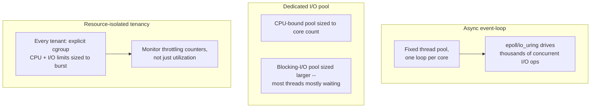

## 8. Production Architecture

A production host or cluster node's scheduling/I/O architecture typically
layers: (1) the underlying storage tier and its I/O scheduler, chosen for
the actual device class (Section 4.2); (2) the kernel's async I/O interface
in use by the runtime or database engine (blocking, `epoll`-driven, or
`io_uring`, Section 4.3); (3) cgroup CPU and I/O limits per tenant/container
enforcing multi-tenant isolation (Sections 4.8-4.9); (4) CPU affinity/
isolation configuration for any latency-critical pinned workloads (Section
4.6); and (5) a monitoring stack scraping run-queue length, `%iowait`,
per-device `iostat` metrics, and per-cgroup throttling counters
continuously, feeding alerting thresholds tuned to catch throttling and
device saturation *before* they manifest as customer-visible latency, not
just after.

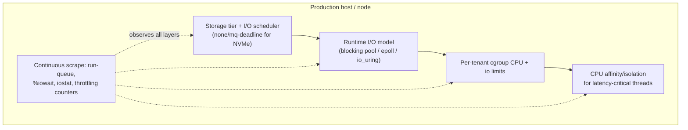

## 9. Implementation

Implementing this discipline in a real production stack means: choosing
and verifying the I/O scheduler per storage class at provisioning time
(cloud instance types typically default sensibly for their attached storage,
but custom on-premises deployments should verify explicitly); selecting the
I/O model (blocking, async/`epoll`, or `io_uring`) at the runtime/framework
level based on measured operation-rate requirements rather than by default;
setting cgroup CPU/I/O limits deliberately during container/Kubernetes
resource-request and -limit definition, informed by burst profiling rather
than guesswork; and wiring `iostat`/`vmstat`-equivalent metrics plus cgroup
throttling counters into the standard observability pipeline (recap:
general observability pipeline architecture is owned by
[Observability](../14_Observability/PART_OVERVIEW.md), this chapter owns
which specific OS-level metrics matter and how to interpret them, Section
4.10).

## 10. Complete Code Examples

**Example 1 — `io_uring` usage sketch (C, liburing).** Demonstrates the
submission/completion ring pattern from Section 4.3: batching multiple
reads into a single kernel round trip rather than issuing one blocking
`read()` per file.

```c
// io_uring_batch_read.c -- submit N reads in one syscall, reap completions
// via the shared completion ring. Illustrative sketch, error handling
// trimmed for clarity -- see liburing's official examples for production use.
#include <liburing.h>
#include <fcntl.h>
#include <stdio.h>

#define QUEUE_DEPTH 32
#define READ_SIZE   4096

int main(void) {
    struct io_uring ring;
    // Set up the shared submission/completion rings with the kernel.
    io_uring_queue_init(QUEUE_DEPTH, &ring, 0);

    int fds[4];
    char *bufs[4];
    struct iovec iovecs[4];
    const char *paths[4] = {"a.dat", "b.dat", "c.dat", "d.dat"};

    for (int i = 0; i < 4; i++) {
        fds[i] = open(paths[i], O_RDONLY);
        bufs[i] = malloc(READ_SIZE);
        iovecs[i].iov_base = bufs[i];
        iovecs[i].iov_len = READ_SIZE;

        // Get a submission queue entry and describe the read --
        // NO system call happens here, this just writes into shared memory.
        struct io_uring_sqe *sqe = io_uring_get_sqe(&ring);
        io_uring_prep_readv(sqe, fds[i], &iovecs[i], 1, 0);
        io_uring_sqe_set_data(sqe, (void *)(intptr_t)i);
    }

    // ONE syscall submits all 4 queued reads and can wait for completions.
    io_uring_submit_and_wait(&ring, 4);

    for (int i = 0; i < 4; i++) {
        struct io_uring_cqe *cqe;
        io_uring_wait_cqe(&ring, &cqe);   // reaps from shared completion ring
        int idx = (int)(intptr_t)io_uring_cqe_get_data(cqe);
        printf("read %d completed, result=%d\n", idx, cqe->res);
        io_uring_cqe_seen(&ring, cqe);    // mark this completion consumed
    }

    io_uring_queue_exit(&ring);
    return 0;
}
```

**Example 2 — cgroup v2 CPU quota configuration demonstrating throttling**
(Section 4.8). Sets an explicit quota/period pair directly via the cgroup
v2 filesystem interface, and shows the throttling counters that reveal the
noisy-neighbor symptom.

```bash
# Create a cgroup, set a CPU quota, and observe throttling directly --
# this is the raw mechanism Kubernetes/Docker CPU limits configure for you.

# 1. Create the cgroup (cgroup v2 unified hierarchy).
sudo mkdir -p /sys/fs/cgroup/batch_job

# 2. Quota=50000us out of a 100000us period == 0.5 CPU cores, hard ceiling.
echo "50000 100000" | sudo tee /sys/fs/cgroup/batch_job/cpu.max

# 3. Add the target process (PID) to this cgroup.
echo $PID | sudo tee /sys/fs/cgroup/batch_job/cgroup.procs

# 4. Watch throttling counters while the process runs a CPU-heavy burst --
#    nr_periods: total accounting periods observed
#    nr_throttled: periods in which this cgroup was actually throttled
#    throttled_time: cumulative nanoseconds spent throttled
watch -n1 cat /sys/fs/cgroup/batch_job/cpu.stat
# Sample output during a sustained CPU burst exceeding the 0.5-core quota:
#   usage_usec 4820213
#   nr_periods 482
#   nr_throttled 311        <-- throttled in the majority of periods
#   throttled_time 8123004102  <-- ~8.1 seconds cumulative stall
```

**Example 3 — `iostat`/`vmstat` output interpretation walkthrough.** See
the worked walkthrough in Section 4.10, which annotates a real
`vmstat 1 5` / `iostat -x 1 3` capture and derives an I/O-bound,
device-saturated diagnosis from `r`, `wa`, `%util`, and `await` together
rather than any single metric in isolation.

## 11. Performance

The single highest-leverage performance lever this chapter teaches is
maximizing page cache hit rate (Section 4.1) before touching anything else
— storage tier upgrades, scheduler tuning, and async I/O redesigns all
matter far less than whether the working set fits in RAM in the first
place. Beyond that: match the I/O scheduler to the device class (Section
4.2), adopt `io_uring` only once per-operation syscall overhead is
demonstrably the bottleneck (Section 4.3, a batching redesign is real
engineering cost and should be justified by measurement, not assumption),
and verify CPU/I/O cgroup limits are sized against burst, not average,
utilization (Sections 4.8-4.9) before assuming a performance problem
requires more hardware.

## 12. Scalability

I/O-bound and CPU-bound workloads scale along genuinely different axes
(Section 4.7): I/O-bound services scale primarily via concurrency model
(more connections/coroutines efficiently multiplexed per core), while
CPU-bound services scale primarily via horizontal core/instance count and
parallel algorithm design. At the multi-tenant/cluster level, scalability
also depends on avoiding the noisy-neighbor failure modes of Sections
4.8-4.9 — a cluster that scales node count without also scaling per-tenant
resource isolation just multiplies the number of places contention can
hide, rather than actually removing it.

## 13. Security

Real-time scheduling priority (Section 4.5) and unrestricted CPU/I/O access
are both privilege-sensitive: an unprivileged process able to request
`SCHED_FIFO` priority or unlimited I/O bandwidth on shared infrastructure is
effectively a Denial-of-Service (DoS) vector against every co-located
tenant, which is precisely why Linux requires elevated capability
(`CAP_SYS_NICE`) to set real-time priority, and why cgroup limits
(Sections 4.8-4.9) are a security control, not merely a performance one, in
any multi-tenant environment — they bound the blast radius of a single
tenant's runaway or malicious resource consumption. `io_uring`'s expanded
kernel attack surface (a relatively new, complex interface directly
processing userspace-supplied ring buffer contents) has also been a source
of real kernel vulnerabilities; several security-conscious container
runtimes and hardened kernel configurations have historically restricted or
disabled `io_uring` by default for exactly this reason, a trade-off
architects adopting it for performance should be aware of and evaluate
against their own threat model.

## 14. Observability

Section 4.10's metric-interpretation discipline (run-queue length,
`%iowait`, `iostat` per-device `%util`/`await`, and cgroup throttling
counters `nr_throttled`/`throttled_time`) is this chapter's core
observability contribution and should be wired into standard dashboards and
alerting, not reserved for manual incident investigation — alerting on
rising `nr_throttled` or sustained near-100% device `%util` catches the
noisy-neighbor and device-saturation failure modes *before* they surface as
customer-visible latency degradation.

## 15. Failure Scenarios

- **Silent CPU throttling** (Section 4.8) — a container hits its cgroup CPU
  quota repeatedly; symptoms are periodic latency spikes with zero
  application-log evidence; root cause found only via `cpu.stat`.
- **I/O bandwidth starvation from a co-located batch job** (Section 4.9) —
  a shared storage volume's IOPS ceiling is consumed by one tenant's burst,
  starving others; root cause found via device-level `iostat` correlated
  against the offending job's schedule.
- **Page-cache eviction from unrelated memory pressure** (Section 4.1) — a
  co-located workload's memory footprint evicts a service's hot working
  set from page cache, producing latency degradation that looks like a
  storage problem but is actually a memory-sizing problem.
- **Cooperative-scheduling starvation inside an event loop** (recap: owned
  in depth by
  [Processes and Threads §4.5](CH24_Processes_and_Threads.md#45-preemptive-vs-cooperative-scheduling))
  — a CPU-bound synchronous block inside an `epoll`/`io_uring`-driven event
  loop stalls every other concurrent operation sharing that loop.
- **Unbounded real-time thread starving a core** (Section 4.5) — a
  `SCHED_FIFO` thread without a yield/watchdog safeguard hangs, freezing
  every other thread scheduled on that core, including unrelated
  co-located services.

## 16. Testing

Validate I/O and scheduling assumptions under realistic contention, not
just isolation: load-test a service alongside a deliberately noisy
co-located workload to confirm cgroup limits actually bound its impact
(Sections 4.8-4.9); benchmark an `io_uring` migration against the existing
blocking/`epoll` baseline at production-representative operation rates
before committing to the added complexity (Section 4.3); and include
chaos-style tests that deliberately saturate a shared block device or CPU
quota to confirm alerting on Section 4.10's metrics actually fires before
customer-visible latency does.

## 17. Common Mistakes

- Diagnosing "slow disk" without first checking page cache hit rate
  (Section 4.1).
- Carrying forward spinning-disk-era I/O scheduler tuning onto all-flash
  infrastructure (Section 4.2).
- Assuming an asynchronous-shaped API is automatically fast, without
  verifying its actual kernel-level completion mechanism (Section 4.3,
  POSIX AIO's history).
- Sizing cgroup CPU/I/O limits against average utilization instead of
  burst requirements (Sections 4.8-4.9).
- Pinning a thread to a core without isolating that core from general
  scheduling (Section 4.6).
- Scaling a CPU-bound service by adding more threads instead of more cores
  (Section 4.7).

## 18. Best Practices

- Profile page cache hit rate before any storage-tier upgrade decision.
- Verify the active I/O scheduler matches the actual device class in use.
- Size cgroup CPU/I/O limits against measured burst profiles, and alert on
  throttling counters directly, not just on utilization.
- Classify each service as I/O-bound or CPU-bound explicitly before sizing
  capacity, and revisit the classification after material code changes.
- Reserve real-time scheduling and CPU pinning for narrowly-scoped,
  safeguarded components, never as a blanket "make it faster" default.

## 19. Anti-Patterns

- **Tuning by folklore** — copying scheduler/kernel tuning parameters from
  an old playbook onto new hardware without verifying the underlying
  physical assumption still holds (Section 4.2).
- **Priority as a substitute for isolation** — relying on `nice` values or
  CPU pinning alone to protect a latency-critical workload on genuinely
  contended shared hardware, without an actual isolation boundary (Section
  4.6).
- **Average-based capacity sizing** — sizing any hard limit (cgroup CPU/I/O
  quota, storage IOPS tier) against average observed usage instead of peak
  burst requirements (Sections 4.8-4.9).
- **Blind async adoption** — migrating to `io_uring` or another async I/O
  model without first confirming per-operation syscall overhead is the
  actual bottleneck (Section 4.3).

## 20. Trade-off Analysis

| Decision | Favors | Costs |
|---|---|---|
| `none`/`mq-deadline` vs. `bfq` scheduler on flash | Raw throughput, lower CPU overhead | Less per-tenant I/O fairness under contention |
| Blocking I/O vs. `io_uring` | Simplicity, easier debugging | Lower ceiling on operations/sec before syscall overhead dominates |
| CPU pinning + core isolation | Predictable cache/NUMA locality | Reduced scheduler flexibility to route around contention |
| Real-time scheduling class | Bounded worst-case latency | Can starve the entire core if the thread misbehaves |
| Tight cgroup CPU/I/O limits | Strong tenant isolation, predictable neighbors | Throttling risk if sized against average rather than burst |

## 21. Comparison Table

| Mechanism | Solves | Introduced | Modern default context |
|---|---|---|---|
| `select()`/`poll()` (recap, owned by [Sockets](CH16_Sockets.md)) | Readiness notification across many FDs | 1983/1986 | Superseded by `epoll`/`kqueue` |
| `epoll`/`kqueue` (recap, owned by [Sockets](CH16_Sockets.md)) | O(1) readiness at scale (C10K) | 2000-2002 | Default async socket I/O foundation |
| POSIX AIO | Async file I/O attempt | 1990s standard, weak Linux impl. | Rare; mostly superseded |
| `io_uring` | Batched async I/O, eliminates per-op syscall cost | 2019 | High-performance storage/network infra |
| CFQ | Per-process I/O fairness on spinning disks | 2000s | Legacy, spinning disks only |
| `none`/`mq-deadline` | Minimal-overhead I/O scheduling on flash | 2010s | Default for NVMe/SSD in cloud |
| CFS | Proportional-share CPU fairness | 2007 | Default Linux CPU scheduler |
| `SCHED_FIFO`/`SCHED_RR` | Bounded real-time latency | Long-standing POSIX classes | Narrow, safeguarded latency-critical use |

## 22. Real-World Case Study

A payments platform running on Kubernetes experienced recurring, seemingly
random p99 latency spikes on its transaction-authorization service,
occurring roughly every few minutes and lasting a few hundred milliseconds
each time — invisible in application logs, invisible in downstream
dependency latency, and initially blamed on "network flakiness" because no
other explanation surfaced in the usual dashboards. The team eventually
pulled `cpu.stat` for the service's cgroup and found `nr_throttled`
incrementing in lockstep with every latency spike: the service's CPU
`limit` had been set based on average observed utilization (around 30%),
but the service's actual workload was bursty — a batch-signature-
verification step on each transaction briefly needed close to a full core
for tens of milliseconds, repeatedly exceeding the 100ms-period quota
during traffic peaks. Raising the CPU limit to match the measured burst
requirement (not the average) eliminated the throttling and the associated
latency spikes entirely, with negligible change to the service's actual
average CPU utilization or its Kubernetes cluster-wide resource footprint
at scale — a direct instance of Section 4.8's noisy-neighbor-via-self-
throttling failure mode, caused entirely by a limit sized against the wrong
metric, not by any code defect.

## 23. Interview Questions

1. Walk through the full path a `read()` system call takes from application
   code down to physical storage, and identify where the largest latency
   contributions typically occur.
2. Why did Linux's default I/O scheduler change as SSDs replaced spinning
   disks, and what specific physical assumption stopped holding?
3. Explain why `io_uring` is faster than POSIX AIO for high-throughput
   workloads, in terms of system call overhead specifically.
4. How does the Completely Fair Scheduler decide which thread to run next,
   and what does a thread's `nice` value actually change about that
   decision?
5. A containerized service shows periodic latency spikes correlated with a
   roughly-fixed interval, but nothing appears in its application logs.
   What would you check first, and why?
6. What is the difference between a cgroup CPU `limit` and a CPU
   `request` in Kubernetes, in terms of the underlying scheduling
   mechanism each maps to?
7. When would you reach for CPU pinning and core isolation, and what
   safeguard is required to make pinning actually beneficial rather than
   harmful?
8. How would you determine whether a given service is I/O-bound or
   CPU-bound, and why does that classification change how you'd scale it?

## 24. Hands-on Exercises

1. On a Linux host (or container with cgroup v2 access), create a cgroup,
   set a deliberately tight CPU quota, run a CPU-bound loop inside it, and
   observe `nr_throttled`/`throttled_time` incrementing in `cpu.stat` in
   real time.
2. Compare `vmstat`/`iostat` output while running a page-cache-friendly
   repeated-read workload versus a working-set-larger-than-RAM workload
   against the same file, and identify the shift in `%iowait` and cache
   behavior.
3. Write a small program using blocking `read()` calls in a loop against
   many small files, then rewrite it using `io_uring` batched submission,
   and measure the throughput difference at increasing operation rates.
4. Inspect the active I/O scheduler for a block device (`cat
   /sys/block/<device>/queue/scheduler`) on both a spinning-disk-backed and
   an NVMe-backed system if available, and explain why the defaults
   differ.

## 25. Design Exercises

1. Design the CPU and I/O cgroup limit strategy for a multi-tenant
   Kubernetes cluster hosting a mix of latency-sensitive API services and
   bursty nightly batch jobs, explicitly addressing how you'd prevent the
   batch jobs from becoming noisy neighbors to the API services.
2. Design an observability dashboard and alerting policy specifically for
   catching CPU-quota throttling and I/O bandwidth contention *before*
   customer-visible latency degrades, using the metrics from Section 4.10.
3. Given a new I/O-intensive storage engine expected to sustain millions of
   small I/O operations per second, design its I/O model (blocking pool,
   `epoll`-driven async, or `io_uring`) and justify the choice against the
   operation-rate threshold discussed in Section 4.3.

## 26. Architecture Review Questions

1. Have I/O scheduler choices been verified against the actual storage
   device class in use, rather than inherited from prior infrastructure?
2. Are cgroup CPU/I/O limits sized against measured burst profiles, and is
   throttling explicitly monitored and alerted on?
3. Is any use of CPU pinning paired with actual core isolation, and any use
   of real-time scheduling paired with a yield/watchdog safeguard?
4. Has each service been explicitly classified as I/O-bound or CPU-bound,
   and does its capacity plan reflect that classification?
5. Does the observability stack surface run-queue length, `%iowait`,
   per-device `iostat` metrics, and cgroup throttling counters, or only
   application-level metrics?

## 27. Summary

I/O and CPU scheduling are two faces of the same underlying problem: a
machine with far less physical capacity than the aggregate demand placed on
it must make continuous, deliberate decisions about what runs next and what
I/O request gets serviced next, and those decisions have direct,
measurable, and frequently invisible-to-the-application performance
consequences. The I/O stack accumulates latency very unevenly — page cache
hits are orders of magnitude faster than any physical device access, making
cache sizing the single highest-leverage lever available. Disk scheduling
is a clear lesson in matching architecture to physical hardware reality:
seek-time-optimizing schedulers were correct for spinning disks and became
pure overhead once flash removed the seek penalty they existed to
compensate for. `io_uring` solved async I/O's long-standing syscall-
overhead problem through a shared-memory submission/completion ring design.
CFS gives every runnable thread a proportional, fairness-accounted share of
CPU time, while real-time scheduling classes and CPU pinning trade that
fairness for bounded latency and cache locality where genuinely warranted.
And the noisy-neighbor problem — CPU quota throttling and I/O bandwidth
contention in shared, multi-tenant, containerized environments — is one of
the most common and hardest-to-diagnose production incidents precisely
because it produces symptoms with zero trace in application-level
telemetry, discoverable only through the OS-level observability discipline
this chapter teaches: run-queue length, `%iowait`, per-device `iostat`
metrics, and cgroup throttling counters, checked in that order, before ever
assuming the application's own code is at fault.

## Further Reading

- [Processes and Threads](CH24_Processes_and_Threads.md) — process/thread
  lifecycle, context-switch cost model, preemptive vs. cooperative
  scheduling, IPC.
- [Sockets](CH16_Sockets.md) — `select`/`poll`/`epoll`/`kqueue` I/O
  multiplexing, blocking vs. non-blocking sockets, event-loop server
  models.
- [Memory Management](CH25_Memory_Management.md) — page cache as
  reclaimable memory, cgroup memory limits and OOM-killer behavior, NUMA
  locality.
- [Observability](../14_Observability/PART_OVERVIEW.md) — general
  observability pipeline architecture underlying the metrics collection
  described in Section 4.10 and Section 14.
