# Chapter 28: Virtualization and Container Fundamentals

Part: [05 — Networking and Operating Systems](PART_OVERVIEW.md) · Status: Drafted

## 1. Introduction

Every workload a Solution Architect places on a diagram — a monolith on a
Virtual Machine (VM), a microservice in a container, a serverless function
inside a sandboxed runtime — ultimately runs on top of one of a small number
of **isolation mechanisms**, each drawing the line between "shared with the
neighbor" and "private to me" at a different layer of the stack. This chapter
teaches those mechanisms from first principles: full **hardware
virtualization** (Type 1 and Type 2 hypervisors, and the CPU extensions that
made them fast), **operating-system-level virtualization** (containers, built
from Linux namespaces and Control Groups (cgroups)), and the newer hybrid
point on that spectrum, **microVMs**. Two earlier chapters in this part —
[Processes and Threads](CH24_Processes_and_Threads.md) and
[Memory Management](CH25_Memory_Management.md) — both forward-referenced this
chapter every time they touched cgroups, namespaces, or the phrase
"container": Processes and Threads' historical-evolution timeline noted that
"cgroups and namespaces mature on Linux, letting groups of processes be
resource-limited and isolated... the kernel-level foundation containers are
built on," and Memory Management's Section 4.7 walked through cgroup
`memory.max` and the container-scoped OOM killer in detail while explicitly
deferring "full container-runtime... coverage" to this chapter. This chapter
is where those two forward references resolve: it does not re-teach what a
process is, what a Process Control Block (PCB) holds, how the kernel's Memory
Management Unit (MMU) walks page tables, or how the OOM killer scores
processes — all of that is assumed as background and recapped only in a
sentence or two where needed. What this chapter *does* teach in full is how
those already-understood primitives *compose* into the isolation boundary an
architect actually reasons about when deciding "does this workload get a VM,
a container, or a microVM" — and why that decision is not merely an
operational preference but a load-bearing security and cost boundary.

The chapter's scope is deliberately bounded at the **single-host primitive**
level. It teaches what a hypervisor is and does, what a container actually
is at the kernel level, how container images are built and distributed, what
standardized the container ecosystem, and where the shared-kernel security
model reaches its limits. It stops short of teaching **container
orchestration** — how a fleet of hosts schedules, network-meshes, and
self-heals thousands of these containers is Kubernetes' domain, and per the
Concept Ownership Rule that full teaching belongs to Part 10's dedicated
Kubernetes chapters (not yet drafted at the time of writing); this chapter
recaps only the *hand-off point* in Section 4.11 and Section 22 so the
orchestration layer's forward reference to this chapter's primitives is
answered without duplicating work a future chapter must still do in full.

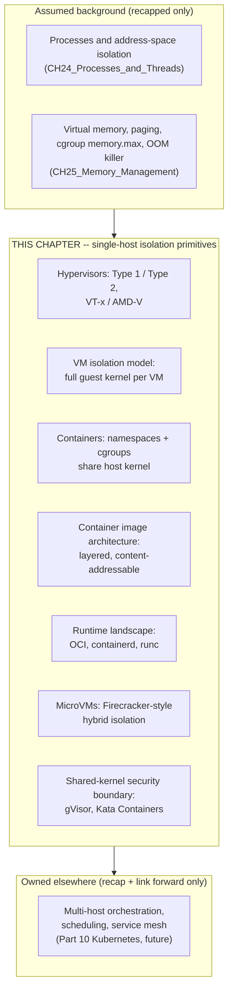

A Solution Architect who conflates "container" with "lightweight VM," or who
does not know that a kernel vulnerability can escape a container in a way it
categorically cannot escape a VM, will misjudge multi-tenant isolation
requirements, misprice compute for a workload that actually needs VM-grade
isolation, and misdiagnose "why did one tenant's compromised workload see
another tenant's data" incidents. This chapter exists to close that gap.

## 2. Historical Evolution

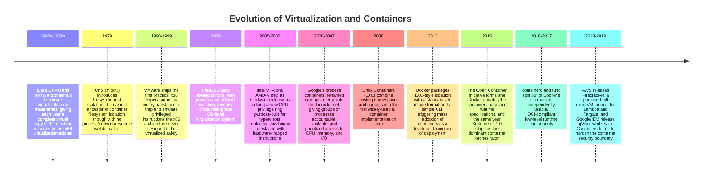

The through-line across six decades is a repeated re-negotiation of the same
question this chapter's Introduction posed: how much isolation does a given
workload actually need, and what is the cheapest mechanism that provides it?
Mainframes started at maximum isolation (a full virtual machine per tenant)
because the hardware of the era had no cheaper alternative. `chroot()` and
FreeBSD Jails explored the opposite end — share as much as possible, isolate
only what is strictly necessary — decades before Linux containers made that
approach mainstream. Hardware virtualization extensions (VT-x/AMD-V) then
made the *expensive* end of the spectrum (full VMs) cheap enough to be a
default rather than a mainframe-only luxury, while cgroups and namespaces
simultaneously made the *cheap* end (containers) rigorous enough to be
production-safe rather than a filesystem trick. MicroVMs and gVisor/Kata,
arriving last, are the industry admitting that neither historical endpoint
was universally correct — some workloads (multi-tenant serverless) need a
third point on the spectrum that borrows the speed of one approach and the
isolation guarantee of the other.

## 3. Why It Exists

Virtualization and containerization both exist to answer one question that
recurs at every layer of computing: **how do I run multiple independent
workloads on one physical machine without letting one workload's failure,
resource hunger, or compromise affect another's?** [Processes and
Threads](CH24_Processes_and_Threads.md#4-core-concepts) already answered a
version of this question at the single-process level — the kernel's
page-table-enforced address-space isolation keeps one process's crash or bug
from corrupting another process's memory. But that answer has a scope limit:
two processes on the same host still share the *same kernel*, the *same
device drivers*, the *same filesystem namespace* (by default), and, at least
historically, the *same view of "who else is running here."* For many
workloads that shared context is exactly what you want — it is cheap and
processes on one host are usually meant to cooperate. But for two mutually
distrusting tenants, or for a service you want to move, resource-cap, or
patch independently of its neighbors, process isolation alone is not enough;
you need to isolate more of the machine's identity — its process ID space,
its network stack, its filesystem root, and even, in the strongest case, its
entire kernel.

Virtualization and containerization exist to extend the isolation dial past
the single process, at two different costs and two different strengths:

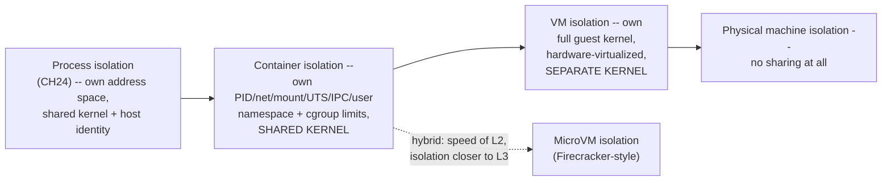

Each rightward step buys stronger isolation and costs more: more memory
overhead, slower startup, coarser-grained scheduling. The reason this chapter
exists — rather than simply saying "use VMs for strong isolation and
containers for cheap isolation" — is that the *architectural reasoning
behind* that dial is what lets a Solution Architect make a defensible,
non-obvious call: when is a shared kernel an acceptable risk for a
multi-tenant platform, and when does a kernel vulnerability's blast radius
make that unacceptable regardless of cost? When does the operational value of
"deploy in milliseconds, pack thousands per host" outweigh giving up a
hardware-enforced isolation boundary? These are not settled questions with
one universal answer — they are trade-offs this chapter equips you to reason
about explicitly, the same way [Processes and Threads Section
3](CH24_Processes_and_Threads.md#3-why-it-exists) framed process vs. thread
as an isolation-versus-cost dial rather than a rule to memorize.

## 4. Core Concepts

### 4.1 Full Hardware Virtualization: The Hypervisor

**Definition.** A **hypervisor** (also called a Virtual Machine Monitor
(VMM)) is a software layer that creates and runs **virtual machines** — each
VM believes it is running directly on physical hardware, with its own
virtual Central Processing Unit (CPU), virtual memory, virtual disks, and
virtual network interfaces, and each VM boots and runs its own complete,
independent guest operating system kernel. The hypervisor's job is to
multiplex a single physical machine's real CPU cores, memory, and devices
across several VMs while making each VM's guest kernel believe it has
exclusive ownership of the hardware it can see.

**Mechanism — Type 1 vs. Type 2.** Hypervisors come in two architectural
shapes, distinguished by what runs directly on the hardware:

- A **Type 1 (bare-metal) hypervisor** runs directly on the physical
  hardware, with no general-purpose host operating system underneath it —
  the hypervisor itself is the most privileged software on the machine.
  VMware ESXi and Kernel-based Virtual Machine (KVM, which turns a Linux
  kernel itself into a Type 1 hypervisor via a kernel module) are the
  canonical examples used in production data centers and cloud platforms
  (Amazon Web Services (AWS), Microsoft Azure, and Google Cloud Platform
  (GCP) all run Type 1 hypervisors, mostly KVM-derived, under their VM
  offerings).
- A **Type 2 (hosted) hypervisor** runs as an application on top of a
  conventional host operating system (Windows, macOS, or Linux), relying on
  that host OS for device drivers and scheduling. VMware Workstation,
  VirtualBox, and Parallels Desktop are Type 2 hypervisors, chosen for
  developer laptops and desktops where convenience and compatibility with
  the host OS's existing driver ecosystem matter more than the last
  percentage point of performance.

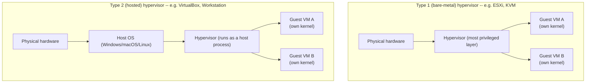

**Decision implications.** Type 1 hypervisors dominate production
infrastructure — cloud provider fleets, enterprise data centers — because
removing the general-purpose host OS from the privileged path removes an
entire layer of scheduling overhead, attack surface, and potential
instability between the hardware and the guest VMs; every CPU cycle and I/O
operation is one hop closer to bare metal. Type 2 hypervisors trade that
efficiency for convenience: a developer's laptop already runs a full desktop
OS for other purposes, so paying the extra hop is worth not needing to
dedicate the whole machine to virtualization. An architect designing a
production VM-hosting platform should default to Type 1; an architect
advising a development team on local multi-OS testing should default to
Type 2 (or, more often today, to containers if kernel-level guest isolation
is not actually required — see Section 4.4).

**Common failure mode.** Teams sometimes assume "hypervisor" is synonymous
with "cloud," and lose track of the fact that the guest OS inside a VM is a
**complete, independently patchable operating system** — its own kernel, its
own package manager, its own security update cadence, entirely separate from
the hypervisor's. A VM's guest kernel being unpatched is a real, independent
vulnerability surface regardless of how well-hardened the underlying Type 1
hypervisor is; "the cloud provider patches the hypervisor" does not mean
"the guest OS is patched," and conflating the two is a recurring source of
unpatched-CVE audit findings.

**Concrete scenario.** A bank runs two workloads that must never share a
kernel for regulatory reasons: a payments-processing VM and a reporting VM,
both on the same physical ESXi host. Each VM boots its own independent Linux
kernel; a kernel panic or privilege-escalation exploit inside the reporting
VM's guest kernel cannot touch the payments VM's guest kernel, memory, or
disk, because the hypervisor — not the guest kernel — is the thing arbitrating
hardware access, and each guest's page tables, device emulation, and
interrupt handling are kept in hypervisor-enforced isolation from the other
guest's. This is precisely the isolation strength Section 4.3 names as the
VM's defining property, and precisely what Section 4.4's containers do not
provide by default.

### 4.2 Hardware-Assisted Virtualization: Intel VT-x and AMD-V

**Definition.** **Hardware-assisted virtualization** refers to CPU
instruction-set extensions — Intel's Virtualization Technology for x86
(VT-x) and AMD's AMD Virtualization (AMD-V) — that add a new, more-privileged
CPU operating mode purpose-built for running a hypervisor, letting the CPU
itself trap and hand off sensitive instructions from a guest VM to the
hypervisor instead of requiring the hypervisor to rewrite the guest's code.

**Mechanism.** Before 2005-2006, the x86 instruction set was notoriously
**not classically virtualizable**: a handful of "sensitive" instructions
(instructions that read or modify privileged CPU state) did not reliably
trap into a more-privileged mode when executed by less-privileged guest
code, meaning a hypervisor running a guest kernel unmodified could not
reliably detect when the guest tried to do something privileged, like
"read/write control registers" or "invoke a device I/O instruction." Early
x86 hypervisors (VMware's original engine) solved this with **binary
translation**: as the guest kernel's instruction stream ran, the hypervisor
scanned it, found the handful of problematic instructions, and rewrote them
on the fly into safe equivalents — correct, but a meaningful, layer of
software-level interpretation overhead on every problematic instruction and
a large ongoing engineering burden to keep correct across kernel versions.

VT-x and AMD-V solved the problem at the hardware level instead. Both
introduce a new CPU mode — Intel calls it VMX root/non-root operation, AMD
calls it Secure Virtual Machine (SVM) host/guest mode — where the hypervisor
runs in "root"/"host" mode and every guest VM's vCPU runs in "non-root"/
"guest" mode. The CPU itself, in hardware, knows the difference: certain
instructions and events (an attempt to modify a control register, a page
fault the guest cannot service, an external interrupt) automatically cause a
**VM exit**, transferring control from the guest vCPU straight to the
hypervisor without any binary translation or instruction rewriting needed.
The hypervisor handles the trapped event (emulating the effect the guest
expected) and then issues a **VM entry** to resume the guest exactly where
it left off.

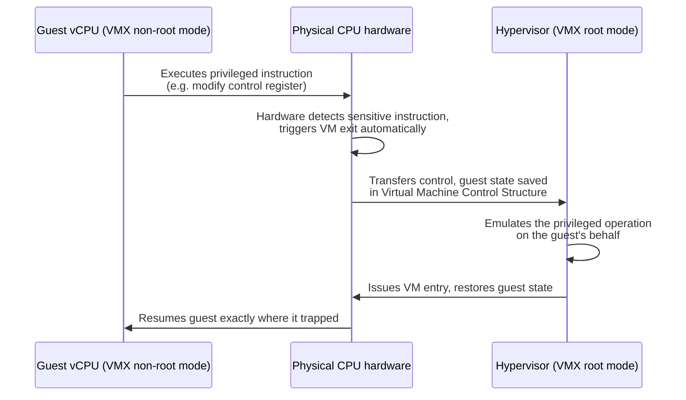

Modern extensions built on top of the base VT-x/AMD-V trap-and-emulate model
push even more of the hot path into hardware: **Extended Page Tables (EPT)**
on Intel and **Nested Page Tables (NPT)** on AMD let the CPU's MMU walk a
second level of page tables (guest-physical to host-physical) entirely in
hardware, removing the need for the hypervisor to intercept every guest page
fault the way early **shadow page table** software techniques did.
**Input/Output Memory Management Unit (IOMMU)** extensions (Intel VT-d,
AMD-Vi) extend the same hardware-trap idea to Direct Memory Access (DMA),
letting a VM be granted safe, direct access to a physical device (a Peripheral
Component Interconnect Express (PCIe) card via **passthrough** or
**Single Root I/O Virtualization (SR-IOV)**) without the hypervisor having to
emulate every I/O operation in software.

**Decision implications.** Hardware-assisted virtualization is *why* full VM
virtualization is a viable default for cloud infrastructure today rather than
a niche, slow technique — it is the single architectural development that
took hypervisor overhead from "noticeably slower than bare metal" to
"single-digit-percent overhead for most CPU-bound workloads." An architect
evaluating a VM-based platform's performance should specifically confirm
nested virtualization support (VT-x/AMD-V exposed *inside* a guest VM) is
available when a workload itself needs to run a hypervisor — a common
requirement in Continuous Integration (CI) runners and lab/test environments
that build and test other VMs or containers inside a cloud VM.

**Common failure mode.** Teams occasionally provision a cloud VM instance
type or a bare-metal-adjacent environment that does not expose nested
virtualization extensions to the guest, then discover mid-project that a
tool requiring a nested hypervisor (an Android emulator, a nested KVM lab,
certain CI runners) simply cannot start — the fix requires either a
different instance family or bare-metal instances, not a configuration
change, because the extension either is or is not exposed at the hardware/
hypervisor-configuration level.

**Concrete scenario.** A cloud provider's Type 1 hypervisor (KVM) uses VT-x's
VM exit/entry mechanism to run thousands of tenant VMs per physical host with
near-native CPU performance for compute-bound work; the same provider's
"bare-metal" instance type exists specifically for the minority of customers
who need nested virtualization or full, uncontended hardware access that a
virtualized VT-x layer cannot itself expose to a second level of guest
hypervisor without support for nested VMX, illustrating that "hardware
virtualization is fast" still has edges an architect must check against a
specific workload's requirements.

### 4.3 The VM Isolation Model: A Full Guest Kernel Per VM

**Definition.** The defining architectural property of a virtual machine is
that **each VM runs its own complete, independent operating system kernel**,
scheduled and memory-managed by the hypervisor as an opaque unit. This is
the strongest practical isolation boundary available on commodity hardware
short of separate physical machines, and it is the reason VMs, not
containers, remain the default choice whenever the isolation requirement is
"these workloads must not be able to affect each other even if one of them
is fully compromised down to kernel level."

**Mechanism.** Everything the guest kernel does — schedule its own
processes, manage its own virtual memory via its own page tables, talk to
its own (virtual) devices, enforce its own user/group permissions — happens
entirely inside that guest's own kernel code, which the hypervisor never
needs to trust or even understand. The hypervisor's job stops at
virtualizing CPU, memory, and I/O for the VM as a whole; a compromised or
buggy guest kernel can corrupt *its own* virtual memory and crash *its own*
processes, but it has no shared kernel code path, no shared kernel memory,
and (short of exploiting the hypervisor itself, a categorically harder and
rarer class of vulnerability) no way to directly affect a sibling VM's
kernel or a different sibling VM's processes.

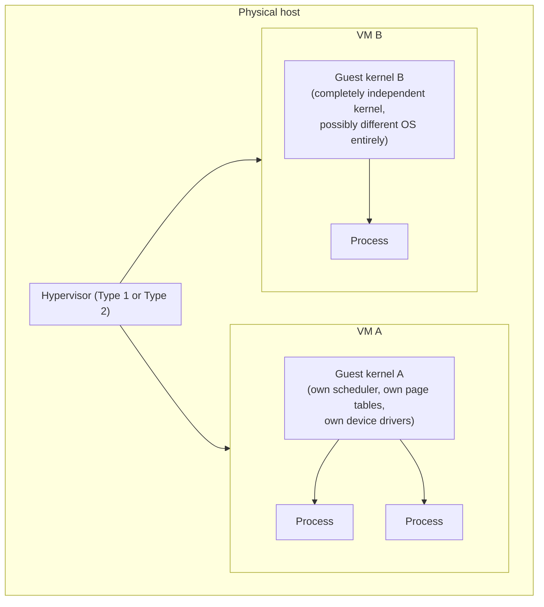

**Decision implications.** Because each VM's kernel is fully independent, VMs
can run *entirely different operating systems* side by side on one physical
host (a Windows Server VM and a Linux VM on the same ESXi host), which no
container mechanism can do (Section 4.4's containers all share one host
kernel, so they must all be compatible with that one kernel's Application
Binary Interface (ABI) — in practice, all Linux containers on a Linux host).
This is the correct choice whenever a workload legitimately needs a
different kernel/OS than its neighbors, or whenever regulatory or
multi-tenant trust requirements demand that a kernel-level compromise in one
workload provably cannot reach another's memory or processes.

**Common failure mode.** The heaviest cost of this isolation model is
resource overhead that architects sometimes underestimate at planning time:
every VM pays the fixed cost of booting and holding in memory an *entire*
independent kernel and userland (often hundreds of megabytes to gigabytes of
memory and several seconds to tens of seconds of boot time), even for a
workload that itself needs only a few megabytes of application memory and
starts in milliseconds. Packing many small workloads as one-VM-each is a
common cause of both wasted compute spend and slow horizontal-scaling
response time compared to the container model in Section 4.4.

**Concrete scenario.** A financial-services platform runs a
Payment Card Industry (PCI) Data Security Standard (DSS)-scoped payment
authorization service in its own dedicated VM, physically and logically
separated (via the hypervisor, not merely a namespace) from every
non-PCI-scoped workload on the estate, specifically so that a compromise
anywhere in the much larger, less-tightly-controlled non-PCI fleet cannot
reach the PCI-scoped kernel or memory even in the worst case — a textbook
case where the VM's isolation strength is worth its overhead cost, and where
substituting a container (Section 4.10) would not meet the actual security
requirement.

### 4.4 Containers as OS-Level Virtualization: Sharing the Host Kernel

**Definition.** A **container** is a group of one or more processes given
the *illusion* of running on their own isolated machine — their own process
ID space, their own filesystem root, their own network stack, their own
hostname — while in fact running as ordinary processes scheduled directly by
the **one shared host kernel**, with no guest kernel, no hypervisor, and no
hardware-assisted virtualization involved at all. [Processes and
Threads](CH24_Processes_and_Threads.md#4-core-concepts) already established
that a process is the kernel's unit of resource ownership and isolation; a
container does not introduce a new kernel-level entity on top of that — it
is the kernel *extending* the same process abstraction with two additional
kernel mechanisms this section teaches in full: **namespaces**, which change
what a process can *see*, and **cgroups**, which change how much of the
host's resources a process (or a group of processes) can *use*.

**Mechanism — the precise architectural contrast with VMs.** This is the
single most important distinction in this chapter, and the one most
frequently stated imprecisely in industry discussion: a VM virtualizes
*hardware*, so each guest gets its own kernel; a container virtualizes
*kernel resources*, so every container on a host shares that one host
kernel's actual scheduler, actual memory manager, and actual system call
table. A container is not a "lightweight VM" in any literal sense — it is a
normal Linux process (or process group) that the kernel has been told, via
namespaces and cgroups, to give a restricted view and a resource ceiling to.

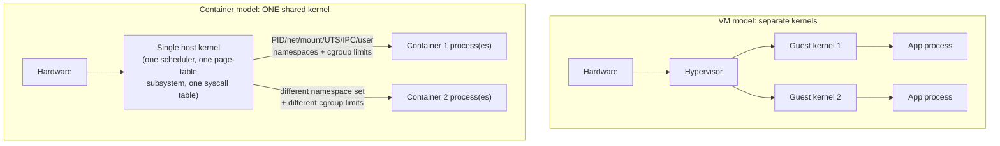

**Decision implications.** Sharing one kernel is exactly what makes
containers cheap: there is no second kernel to boot, no second scheduler
maintaining a separate view of CPU time, no device emulation layer — a
container starts as fast as any other process (milliseconds) and its steady-
state memory overhead is just the memory its own processes actually use,
not a whole second OS's worth. This is the correct default for the vast
majority of stateless application workloads within a single trust boundary
(different services owned by the same team, deployed to the same cluster,
none of them deliberately hostile to the others) — which is why containers,
not VMs, became the default unit of deployment for microservices and cloud-
native platforms. It is the *wrong* default the moment two containers on the
same host must be treated as mutually untrusted, because — as Section 4.10
teaches in full — a kernel-level vulnerability is reachable from inside any
container on that host, in a way it categorically is not from inside a VM.

**Common failure mode.** The recurring architectural mistake is treating
"containerized" as synonymous with "as isolated as a VM" when evaluating
multi-tenant security requirements — assuming that because a container
*looks* like a separate machine (its own hostname, its own process tree
starting at PID 1, its own filesystem) it therefore *is* as separate as a
VM. It is not: every container on a host is, underneath the namespace
illusion, still making system calls into the exact same kernel binary
running on that host, and any kernel vulnerability reachable via a syscall a
container is permitted to make is reachable from inside that container.

**Concrete scenario.** A platform team runs twenty different internal
microservices, all owned by the same organization, as containers on a shared
Kubernetes-managed fleet of hosts — the right call, because none of those
twenty services is treated as adversarial toward the others, and the speed
and density benefit of sharing one kernel per host vastly outweighs a
theoretical (and, for this internal-only, single-tenant case, irrelevant)
kernel-escape risk. The same team, when asked to run untrusted, customer-
submitted code as part of a code-execution product feature, correctly
escalates to a stronger isolation mechanism (Section 4.9's microVMs or
Section 4.10's hardened-runtime containers) rather than treating "just put
it in a container" as sufficient, because in that second scenario the
workloads genuinely are mutually distrusting.

### 4.5 Linux Namespaces: Six Kinds of "What Can I See"

**Definition.** A **namespace** is a Linux kernel feature that gives a
process (or group of processes) its own, isolated view of a specific global
kernel resource, so that two processes in different namespaces of the same
type can each believe they have the entire resource to themselves even
though they are running on one shared kernel. Namespaces answer "what can
this process see," which is a strictly different question from what cgroups
answer (Section 4.6, "how much can this process use").

**Mechanism — the six namespace types a container runtime combines.** A
container is, mechanically, a process launched with several of these
namespace types active simultaneously:

| Namespace | Isolates | What a process inside sees |
|---|---|---|
| **PID** | Process ID numbers | Its own PID 1 as the "init" of its own process tree; cannot see or signal host or sibling-container processes at all |
| **Network** | Network stack | Its own network interfaces, IP addresses, routing table, and port space — port 80 inside one container's network namespace is unrelated to port 80 in another's |
| **Mount** | Filesystem mount table | Its own root filesystem and mount points; changes to mounts inside the namespace do not appear on the host or in other containers |
| **UTS** | Hostname and domain name | Its own hostname (`uname -n` returns the container's own name, not the host's) |
| **IPC** | System V IPC objects and POSIX message queues | Its own IPC namespace, so it cannot access or collide with another container's shared-memory segments or semaphores |
| **User** | User and group ID mappings | Its own user/group ID space, so a process can appear to run as root (UID 0) *inside* the container while actually mapping to an unprivileged, non-root UID on the host — a significant hardening technique |

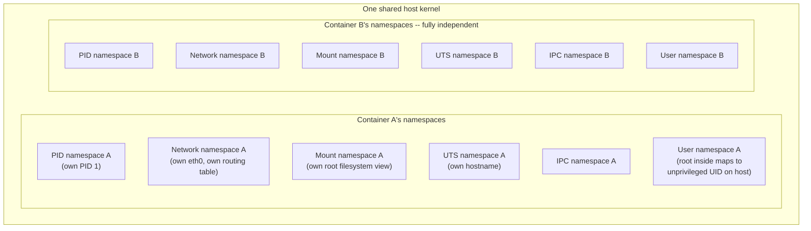

**Decision implications.** Namespaces are composable and independent — a
container runtime does not have to use all six for every container, and
understanding that grants an architect real diagnostic and design leverage.
For example, Kubernetes deliberately shares the *network* and *IPC*
namespaces across every container within one Pod (so sidecar containers can
talk to the main application container over `localhost` and share IPC
objects) while still giving each container in that Pod its own *mount* and
(usually) *PID* namespace — Section 4.11 revisits this exact composition as
the hand-off point to the orchestration layer. Recognizing which namespace
provides which isolation lets an architect answer precise questions like
"can process A see process B's PID" (no, if different PID namespaces) or
"can two sidecar containers reach each other over `localhost`" (yes, if they
share a network namespace, which is exactly how a Kubernetes Pod's
containers communicate).

**Common failure mode.** The **user namespace** is the one most often left
disabled or misconfigured in practice, because it is also the trickiest to
get right with filesystem permissions and volume mounts — and skipping it
means a process that is root *inside* a container is genuinely UID 0 on the
host too. That single fact is the difference between "a container escape
gives an attacker an unprivileged host account" and "a container escape
gives an attacker root on the host," which is why user-namespace remapping
("rootless containers") is a specifically named, high-value hardening
technique architects should ask about explicitly during a security review
rather than assuming it is automatically on.

**Concrete scenario.** A raw demonstration with the Linux `unshare` command
(Section 10's first code example) shows the mechanism directly: running
`unshare --pid --fork --mount-proc /bin/bash` starts a new shell in a fresh
PID namespace, and inside that shell `ps aux` shows only that shell and its
own children as PIDs 1 and 2 — every other process on the host is genuinely
invisible, not merely hidden by a filtered view, because the new shell's PID
namespace has no entry for the host's other processes at all. This is
exactly the low-level primitive every container runtime (Docker, containerd,
CRI-O) builds on top of, just with several namespace types combined and
wrapped in a friendlier interface.

### 4.6 Control Groups (cgroups): Bounding How Much a Container Can Use

**Definition.** **Control Groups (cgroups)** are the complementary Linux
kernel mechanism to namespaces: where a namespace restricts *what a process
can see*, a cgroup restricts and accounts for *how much of a resource a
group of processes can use* — CPU time, memory, block I/O bandwidth, and
more — and is what [Memory Management Section
4.7](CH25_Memory_Management.md#47-the-oom-killer-and-containerized-workloads)
already covered in depth for the memory-limit and container-scoped OOM-killer
case specifically; this section recaps that finding and extends the same
mechanism to CPU and I/O, which Memory Management deliberately left to this
chapter.

**Mechanism.** cgroups organize processes into a hierarchical tree of
groups, and each group can have limits, guarantees, and accounting attached
via **controllers** — the memory controller (`memory.max`, already covered),
the CPU controller (`cpu.max`, `cpu.weight`), the I/O controller (`io.max`),
and others. Cgroup v2 (the modern, unified hierarchy that has replaced the
older, per-controller cgroup v1 hierarchy in current kernels and container
runtimes) exposes these limits as plain files under `/sys/fs/cgroup/`,
readable and writable directly, which is exactly what a container runtime
does under the hood every time you set `--cpus` or `--memory` on a `docker
run` command or a Kubernetes Pod's `resources.limits`.

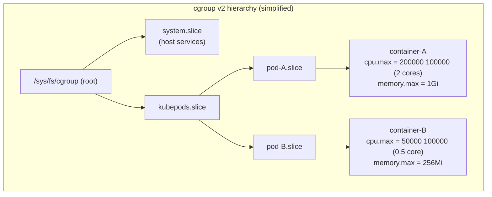

**Decision implications.** cgroups are what turns "run many containers on
one host" from a hope into an enforceable guarantee: without them, one
noisy or misbehaving container could consume unbounded CPU or memory and
starve every other container sharing that host kernel, defeating the whole
point of packing workloads densely. Setting explicit cgroup-backed resource
requests and limits (via a container runtime or Kubernetes) is therefore not
an optional tuning knob but the mechanism that makes multi-tenant density on
a shared kernel operationally safe — the CPU analog of the memory-limit
discipline Memory Management Section 4.7 already argued for.

**Common failure mode.** Teams frequently set a memory limit (learning the
hard way, per Memory Management's `OOMKilled` discussion) but skip CPU
limits, assuming CPU is "elastic" in a way memory is not. It is not risk-free
either: an under-limited or unlimited container can still starve its
neighbors of CPU time (`cpu.max` unset effectively means "unlimited," and
even `cpu.weight`-only configuration only provides *relative*, not
*absolute*, fairness under contention) — a common cause of intermittent
latency spikes in co-located workloads that "look like" a networking problem
until someone checks `cpu.stat`'s throttling counters.

**Concrete scenario.** Section 10's third code example configures a cgroup
v2 resource limit directly: a `systemd`-managed service (or, equivalently, a
container runtime) writes `200000 100000` to `cpu.max` (meaning "200ms of CPU
time allowed per 100ms period," i.e. two full cores' worth) and `1073741824`
to `memory.max` (1 GiB) for a given cgroup — and the kernel then enforces
both limits directly, throttling the group's processes if they exceed their
CPU quota within a period and invoking the cgroup-scoped OOM killer if they
exceed their memory ceiling, exactly as Memory Management Section 4.7
described for the memory side alone.

### 4.7 Container Image Architecture: Layered, Content-Addressable Filesystems

**Definition.** A **container image** is not a single filesystem snapshot —
it is an ordered stack of **layers**, each layer a filesystem diff (files
added, changed, or deleted relative to the layer below it), addressed and
deduplicated by the cryptographic hash (a **content-addressable** identifier)
of its own contents, combined at container-start time into one merged view
via a **union filesystem** (commonly OverlayFS on Linux).

**Mechanism.** Each instruction in a Dockerfile (or equivalent build
definition) that changes the filesystem — installing a package, copying
application code — produces exactly one new, immutable layer, identified by
the SHA-256 hash of that layer's own content. A finished image is simply an
ordered list of layer hashes (with mutable-looking image tags like
`myapp:1.4` acting only as a human-friendly pointer to that specific ordered
list) plus a small JSON manifest describing how to combine them. When a
container starts, OverlayFS stacks every read-only image layer bottom-to-top
and adds one thin, writable layer on top for that specific running
container's own filesystem changes — the image's layers themselves are never
modified, so ten containers started from the same image all share the exact
same underlying read-only layers in memory and on disk, each paying only for
its own small writable layer and whatever memory pages it actually touches.

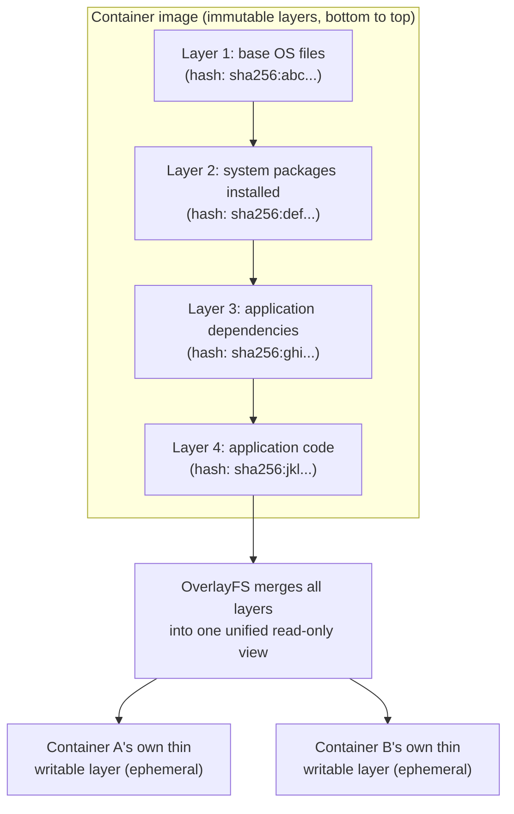

**Decision implications — why layer caching/reuse is the key architectural
property.** Because layers are content-addressed and shared, an image build
system and an image registry both get **caching for free**: if a Dockerfile's
first three instructions are unchanged since the last build, the build tool
reuses those three layers' existing hashes without re-executing anything,
and rebuilds only the layers *after* the first changed instruction. The same
sharing applies to distribution: pulling a new image onto a host that
already has some of its lower layers cached (from a previous image sharing
the same base) downloads only the *missing* layers, not the whole image —
which is exactly why Dockerfile *instruction order* is an architectural
decision, not a stylistic one (Section 10's first code example demonstrates
ordering a Dockerfile so that rarely-changing layers — the base image, system
packages, dependency installation — come before frequently-changing layers
— application source code — so that a code-only change invalidates only the
last, cheap-to-rebuild layer).

**Common failure mode.** A Dockerfile that copies application source code
*before* installing dependencies forces a full dependency reinstall on every
single code change, because the dependency-install layer's cache key depends
on everything above it in the layer stack — a subtle but very common
performance and cost mistake that shows up as slow CI build times and
unnecessarily large image-push bandwidth, entirely fixable by re-ordering
instructions with no functional change to the running application.

**Concrete scenario.** A platform team's CI pipeline builds a Node.js
service image on every commit. Structuring the Dockerfile so that
`package.json`/lockfile copy and `npm install` happen in a layer *before* the
`COPY . .` of application source code means a typical commit (which changes
application code but not dependencies) invalidates only the final layer;
the multi-hundred-megabyte dependency-install layer is reused unchanged from
cache, cutting a multi-minute CI build step down to seconds and shrinking the
bytes that must be re-pushed to the registry to just the changed application
layer.

### 4.8 The Container Runtime Landscape: OCI, containerd, and runc

**Definition.** The **Open Container Initiative (OCI)** is a governance body
(under the Linux Foundation) that publishes two vendor-neutral
specifications — the **OCI Image Format Specification** (what a container
image's layers and manifest must look like) and the **OCI Runtime
Specification** (what a low-level runtime must do to actually create a
namespaced, cgroup-limited container from an unpacked image bundle) — so
that any tool producing an OCI-compliant image can be run by any
OCI-compliant runtime, regardless of vendor.

**Mechanism — the layered runtime stack.** Modern container platforms are
built from a stack of components with clearly separated responsibilities,
not one monolithic "Docker" binary:

- **runc** is the reference **low-level (OCI) runtime** — a small program
  that takes an already-unpacked filesystem bundle and an OCI runtime
  configuration file, and does the actual kernel work: creates the
  namespaces (Section 4.5), sets up the cgroup (Section 4.6), and execs the
  container's process. runc's job ends the moment that process is running.
- **containerd** is a **high-level container runtime** (a daemon) that sits
  above runc: it manages image pulling and unpacking, storage of layers,
  and the lifecycle of many containers over time, delegating the actual
  namespace/cgroup creation for each container down to runc (or an
  alternative OCI runtime, Section 4.9/4.10's gVisor or Kata Containers
  runtimes included) via the OCI Runtime Specification.
- **Docker**, today, is itself a client on top of containerd, adding the
  developer-facing CLI, image build tooling, and networking conveniences
  that made containers accessible in the first place, but delegating actual
  container execution down through containerd to runc.
- **Kubernetes**, via the **Container Runtime Interface (CRI)**, talks
  directly to a CRI-compatible high-level runtime — typically containerd or
  CRI-O — bypassing Docker entirely in modern clusters (Kubernetes deprecated
  and removed direct "dockershim" support; it never needed the Docker CLI or
  daemon specifically, only an OCI-compliant execution path).

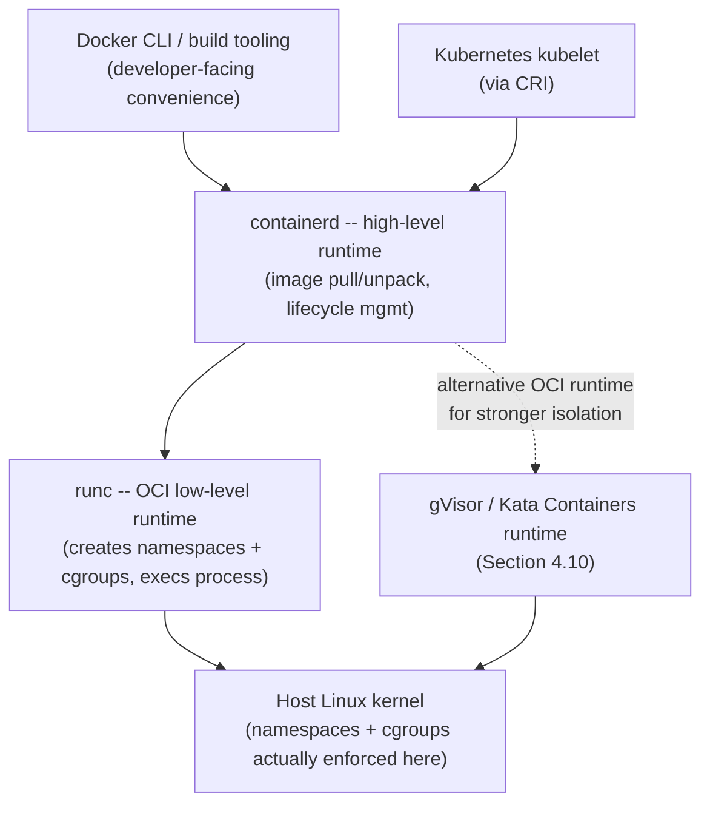

**Decision implications — why standardization mattered architecturally.**
Before OCI (pre-2015), an image built for one vendor's tooling could not
reliably run under a different vendor's runtime, and every orchestrator had
to write bespoke integration code against each runtime's own API — an N×M
integration problem. OCI collapsed that to an N+M problem: any
image-producing tool need only target the OCI Image Specification once, and
any runtime need only implement the OCI Runtime Specification once, for the
two to interoperate automatically. This is the direct architectural enabler
of today's ecosystem in which an image built by one Continuous
Integration/Continuous Delivery (CI/CD) vendor's build tool runs unmodified
under Kubernetes on any cloud, executed by containerd or CRI-O, with no
per-vendor compatibility shims required anywhere in that chain — exactly the
kind of ecosystem interoperability payoff standardization is supposed to
deliver, realized here concretely.

**Common failure mode.** Engineers sometimes assume "we use Docker" and
"we use containers" are the same statement, and are surprised when a
Kubernetes cluster with no Docker daemon installed anywhere still runs their
Docker-built images perfectly — the image format (OCI-compliant, whether or
not it was ever built with the `docker` CLI) is what actually matters for
portability, not the presence of the Docker daemon at runtime.

**Concrete scenario.** A platform team migrates a Kubernetes cluster's
container runtime from Docker (via the now-removed dockershim shim) straight
to containerd with no change to any application's Dockerfile, CI pipeline,
or deployed image tags required — because every image already conformed to
the OCI Image Specification and containerd already spoke the CRI Kubernetes
expects, the runtime swap is transparent to every workload, a direct,
practical payoff of the standardization this section describes.

### 4.9 MicroVMs: A Hybrid Architecture Between Containers and VMs

**Definition.** A **microVM** is a minimal virtual machine, launched by a
purpose-built, stripped-down VM monitor rather than a general-purpose
hypervisor, designed to start in tens of milliseconds and consume only a few
megabytes of overhead while still providing a **full, separate guest
kernel** and the same hardware-virtualized isolation boundary Section 4.3
described for conventional VMs. AWS's **Firecracker** is the canonical
example, purpose-built for and open-sourced from AWS Lambda and Fargate.

**Mechanism.** Firecracker achieves its speed and low overhead by
deliberately *not* trying to emulate a generic PC. It exposes a radically
minimized device model — a handful of virtio devices for network and block
storage, no BIOS, no legacy PC hardware emulation, no graphics — running
under Kernel-based Virtual Machine (KVM) using the same hardware-assisted
VT-x/AMD-V trap-and-emulate mechanism Section 4.2 taught, just with almost
none of a conventional hypervisor's general-purpose device-emulation
overhead. The result is a guest kernel that still boots as an independent,
fully isolated kernel (the same isolation guarantee as Section 4.3's VM
model) but reaches "ready to run the workload" in single-digit tens of
milliseconds rather than the seconds a conventional full-OS VM typically
needs, with steady-state overhead in the low tens of megabytes rather than
hundreds.

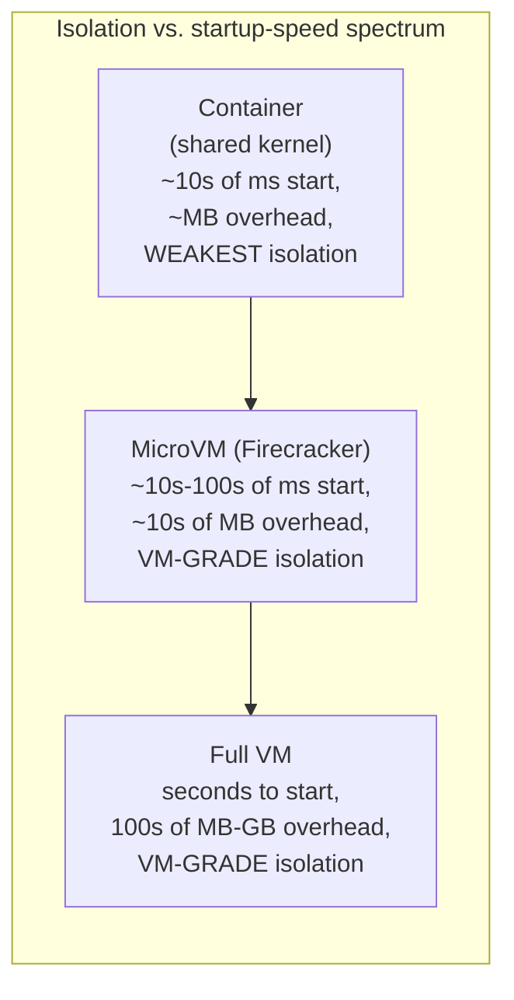

**Decision implications — the genuine architectural motivation.** MicroVMs
exist to answer a specific, real architectural problem: **multi-tenant
serverless platforms** run functions or short-lived tasks from many
different, mutually distrusting customers, often on the same physical host,
invoked and torn down at extremely high frequency. Ordinary containers
(Section 4.4) are fast enough for that invocation rate but share a kernel —
unacceptable for a platform whose entire business model depends on
guaranteeing that one customer's function cannot compromise another's data
via a kernel exploit. Ordinary full VMs (Section 4.3) provide the needed
isolation but are far too slow to boot and far too heavy in per-instance
overhead to serve a workload pattern where a given function might run for a
few hundred milliseconds. Firecracker-style microVMs are the deliberate
architectural answer to exactly that gap: near-container startup latency,
with the same hardware-virtualized, separate-kernel isolation guarantee a
full VM provides, purpose-built for high-density, high-churn, mutually
distrusting workloads — this is a genuine trade-off resolution, not a
marketing repackaging of either existing approach.

**Common failure mode.** Teams sometimes reach for microVMs as a default
"more secure container" for workloads that are not actually mutually
distrusting or high-churn, paying real added operational complexity (a
specialized VM monitor, a narrower device/driver ecosystem, generally less
mature tooling than mainstream container runtimes) without the multi-tenant
threat model that justifies it — the decision to adopt microVMs should be
driven by the specific "mutually distrusting, high density, high churn"
combination Section 4.9 describes, not by a generic desire for "more
isolation" that a properly-configured container (with user namespaces,
seccomp, and the hardening Section 4.10 covers) might already satisfy at
much lower operational cost.

**Concrete scenario.** AWS Lambda runs each customer's function invocation
inside its own Firecracker microVM, allowing thousands of different
customers' code to run on shared physical hardware while guaranteeing that
even a full kernel-level compromise inside one customer's function's microVM
guest kernel cannot reach another customer's microVM, because — exactly as
Section 4.3 established for conventional VMs — each microVM's guest kernel
is entirely separate and hardware-isolated from every other microVM's,
regardless of physical co-location, while still meeting Lambda's
cold-start-latency Service Level Agreement (SLA) that a conventional full VM
per invocation could never hit.

### 4.10 Container Security Boundary Limitations: The Shared-Kernel Attack Surface

**Definition.** Because every container on a host makes system calls into
that same one shared host kernel (Section 4.4), any exploitable
vulnerability in that kernel's system-call handling, memory management, or
device-driver code is, in principle, reachable from inside any container
permitted to make the syscalls involved — a **container escape**. This is a
structural property of the shared-kernel model, not a specific product bug,
and it is the one category of risk a VM's separate-guest-kernel model
(Section 4.3) does not share, because a VM guest's syscalls never reach the
host kernel at all — they are trapped and emulated by the hypervisor, at a
categorically different, hardware-enforced boundary.

**Mechanism — why this is a genuine, current trade-off, not a solved
problem.** Container hardening reduces this risk substantially but does not
eliminate the underlying structural fact that a shared kernel is a shared
attack surface:

- **Seccomp (secure computing mode)** filters restrict which system calls a
  container's processes are even allowed to attempt, shrinking the kernel
  surface reachable from inside a hardened container considerably (a
  container that can never call the syscalls involved in a specific known
  kernel vulnerability cannot trigger that vulnerability at all) — but a new
  vulnerability in a syscall the workload legitimately needs (e.g. something
  reachable via ordinary networking or filesystem syscalls) is not addressed
  by this mitigation.
- **User namespace remapping** (Section 4.5) means a successful escape still
  lands as an unprivileged host user rather than root, meaningfully limiting
  (but not eliminating) what an attacker can do next.
- **gVisor** takes a different architectural approach: it interposes a
  userspace-implemented kernel (written in Go, running as a sandboxing
  process) between the container's processes and the real host kernel,
  intercepting and reimplementing most system calls itself rather than
  passing them straight through — so most of a container's syscalls never
  actually reach the vulnerable surface of the real host kernel at all, at
  the cost of syscall-emulation overhead and occasional compatibility gaps
  for syscalls gVisor does not fully support.
- **Kata Containers** takes yet another approach: it runs each "container"
  inside its own lightweight VM (conceptually similar in spirit to
  Firecracker's microVM model, Section 4.9) while still presenting the
  standard OCI/CRI container interface to the orchestrator above it — trading
  some of the container model's raw density and startup-speed advantage to
  regain the VM's separate-kernel isolation guarantee for specifically the
  workloads that need it.

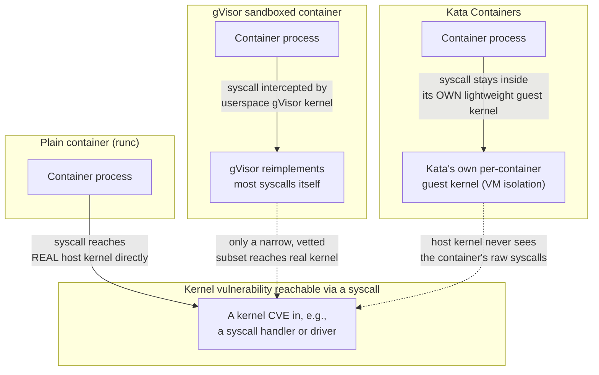

**Decision implications.** This is deliberately taught as an ongoing,
current architectural trade-off rather than a solved problem, because it is
one: gVisor's userspace syscall reimplementation adds measurable latency
overhead and does not support every syscall every workload might need; Kata
Containers reintroduces much of the VM-model's startup and memory overhead
that made plain containers attractive in the first place; plain, unhardened
containers remain the fastest and cheapest option precisely because they
accept the shared-kernel risk. An architect's job is to map a given
workload's actual trust model onto this spectrum explicitly — "internal,
single-tenant, low-risk" workloads can reasonably accept plain containers;
"multi-tenant, running untrusted or third-party code" workloads should
default to gVisor, Kata Containers, or Firecracker-style microVMs (Section
4.9), not plain containers, regardless of how well-patched the host kernel
currently is, because the risk being priced is a *future*, currently-unknown
kernel vulnerability, not a specific known one.

**Common failure mode.** Treating a container's namespace-and-cgroup
boundary as equivalent to a VM's hypervisor boundary for a multi-tenant,
untrusted-code product feature is the single most consequential
architectural security mistake this chapter warns against — it is a category
error, not a matter of degree, and no amount of additional seccomp/AppArmor/
SELinux policy tuning on top of a plain container changes the structural fact
that the workload's syscalls still reach the real, shared host kernel.

**Concrete scenario.** A Software-as-a-Service (SaaS) product that lets
customers upload and run their own custom data-transformation scripts
initially runs each customer's script in a plain, network-isolated container
per invocation. A security review correctly flags this as insufficient for
the actual threat model (arbitrary customer-supplied code, explicitly
mutually distrusting tenants) and the team migrates that specific execution
path to gVisor-sandboxed containers (keeping the same OCI/Kubernetes
tooling and developer workflow, since gVisor implements the standard OCI
runtime interface) — while leaving the company's own internal,
single-tenant microservices on plain containers, because that internal
workload's trust model never justified the added overhead in the first
place. The differentiated decision, not a blanket policy either way, is the
architecturally correct outcome.

### 4.11 The Orchestration Layer's Relationship to These Primitives

**Definition.** Everything Sections 4.1-4.10 taught operates at the
**single host** level: one hypervisor managing VMs on one physical machine,
one kernel's namespaces and cgroups managing containers on one host. A
**container orchestrator** (Kubernetes being the dominant example) is the
layer *above* this chapter's primitives, responsible for questions this
chapter deliberately does not answer: across a fleet of many hosts, which
host should a given container run on, how does a container on one host
discover and reach a container on another host, what happens when a host
fails entirely, and how are these primitives declaratively described and
reconciled at fleet scale.

**Mechanism — the hand-off point, recapped only.** A Kubernetes **Pod** is,
mechanically, a direct application of Section 4.5's namespace composability:
every container within one Pod shares that Pod's network and IPC namespaces
(so sidecar containers can reach each other via `localhost` and share IPC
objects, exactly as Section 4.5 described) while typically retaining its own
mount and, depending on configuration, PID namespace — Kubernetes did not
invent a new isolation primitive for this, it composed the existing Linux
namespace mechanism this chapter already taught in a specific, opinionated
way. Above that Pod-level composition, the **kubelet** on each host talks to
a CRI-compatible high-level runtime (containerd or CRI-O, Section 4.8) to
actually create containers, and the **scheduler**, **control plane**, and
cluster networking/service-discovery layers reconcile desired state across
the whole fleet — all of which is genuinely new architecture belonging to
the orchestration layer, not a repackaging of anything in Sections 4.1-4.10.

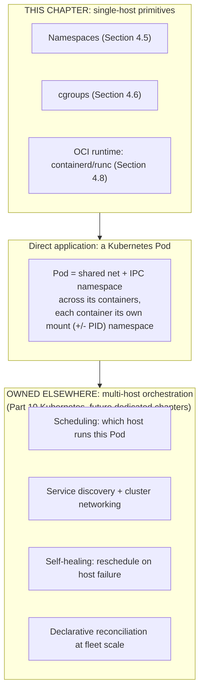

**Decision implications.** This section is intentionally a recap-and-link,
not a full teaching, per the Concept Ownership Rule: Kubernetes'
architecture — its control plane, scheduler, networking model (Container
Network Interface (CNI), Services, Ingress), and storage abstractions — is
substantial enough to be its own dedicated set of chapters (Part 10, not yet
drafted at the time of writing), and duplicating that teaching here would
violate the same anti-repetition principle this chapter itself benefited
from when it recapped rather than re-derived process isolation and virtual
memory from Sections 24 and 25. What this chapter owes the future
Kubernetes chapters — and delivers here — is a precise, correct foundation:
by the time a reader reaches a Pod-scheduling or CNI discussion, they already
know exactly what a namespace is, exactly what a cgroup enforces, and exactly
what the OCI runtime chain (containerd/runc) actually executes underneath
`kubectl run`, so that future chapter can build on solid primitives instead
of re-explaining them.

## 5. Internal Working

Tracing one concrete request end to end — "start this container" — ties
Sections 4.5-4.8 together as a single pipeline rather than separate facts.

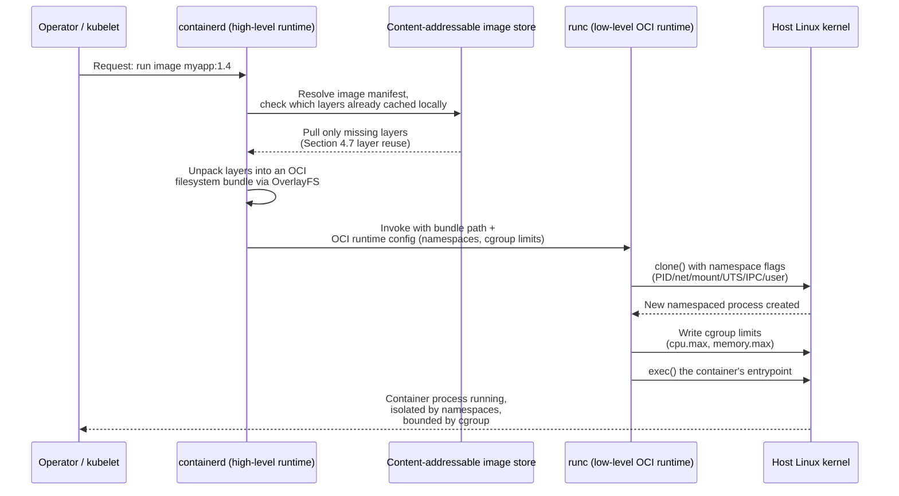

The pipeline makes the architectural boundary explicit: containerd owns
everything about *images* (resolution, caching, unpacking); runc owns
everything about *kernel enforcement* (namespaces, cgroups, exec); and the
kernel is the only component that ever actually creates the isolation — no
userspace tool "is" the isolation, it only asks the kernel to create it via
the same `clone()`/`unshare()` system calls a raw demonstration (Section 10)
uses directly.

## 6. Design Principles

- **Match isolation strength to the actual trust boundary, not to habit.**
  Section 4.10's differentiated decision (plain containers for internal,
  single-tenant workloads; gVisor/Kata/microVMs for genuinely untrusted,
  multi-tenant workloads) generalizes: choose the cheapest mechanism that
  actually satisfies the workload's real trust model, and re-evaluate that
  choice explicitly whenever the trust model changes (e.g. a formerly
  internal-only tool starts accepting third-party plugins).
- **Prefer shared-kernel density by default; escalate deliberately.** Because
  containers are dramatically cheaper than VMs (Section 4.4), the default
  starting point for a new workload should be a container, with VM- or
  microVM-grade isolation reserved for workloads that specifically justify
  the cost — not the reverse.
- **Treat image layer order as a caching decision, not cosmetics.** Section
  4.7's layer-caching architecture rewards structuring build definitions so
  that low-churn layers precede high-churn layers; this is a design decision
  with measurable build-time and bandwidth consequences, not a stylistic
  preference.
- **Set resource limits (cgroups) as a first-class part of every container's
  design, not an afterthought.** Both CPU and memory limits (Section 4.6)
  are what makes shared-kernel density safe for neighbors; skipping either
  reintroduces the noisy-neighbor risk containers were supposed to control.
- **Design for OCI portability, not vendor lock-in.** Building and testing
  against the OCI Image and Runtime Specifications (Section 4.8) rather than
  a specific vendor's proprietary extensions keeps a workload portable across
  any compliant runtime and cloud, which is precisely what standardization
  was meant to guarantee.

## 7. Architecture Patterns

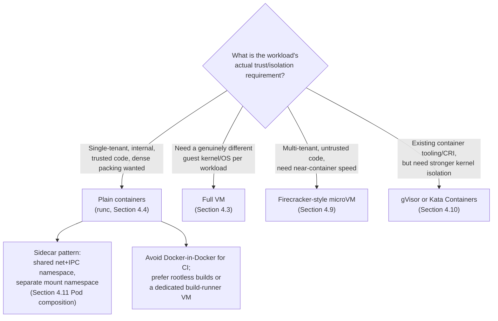

Two patterns deserve explicit naming because they recur across nearly every
container platform an architect will design or review:

- **The sidecar pattern**, mechanically a direct consequence of Section
  4.5's namespace composability (Section 4.11): a Pod's containers share a
  network and IPC namespace while keeping independent mount namespaces,
  letting a sidecar (a logging agent, a service-mesh proxy) observe or
  intercept the main container's traffic over `localhost` without either
  container needing to know about the other's filesystem.
- **Avoiding privileged Docker-in-Docker for CI/CD build pipelines**: running
  a full container runtime *inside* a container to build other containers
  typically requires disabling key namespace/cgroup protections (running the
  outer container `--privileged`), which reintroduces exactly the
  shared-kernel risk Section 4.10 warns about for a use case (arbitrary,
  frequently third-party CI build steps) that often *is* the untrusted-code
  scenario that should escalate to a hardened runtime or a dedicated,
  disposable VM-per-build-job instead.

## 8. Production Architecture

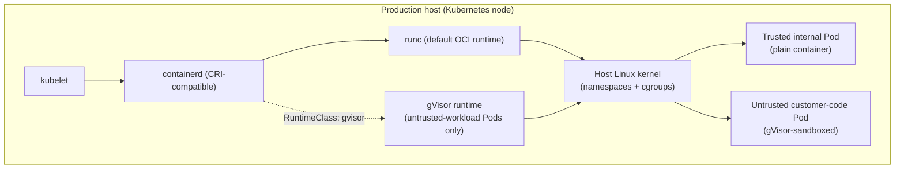

A production cluster in practice does not make one isolation choice for the
whole fleet — Kubernetes' `RuntimeClass` feature lets different Pods on the
same node select different OCI runtimes (plain runc for trusted internal
workloads, gVisor or Kata for a specific untrusted-code product feature),
which is the direct, practical expression of Section 4.10's "differentiate,
don't blanket-decide" principle at the infrastructure-configuration level.

## 9. Implementation

Implementing this chapter's primitives directly (rather than only through
Kubernetes) means working with three concrete surfaces: a Dockerfile that
respects layer-caching order (Section 4.7), a raw namespace demonstration
using `unshare` (Section 4.5), and a direct cgroup v2 configuration (Section
4.6) — all three are provided as complete, runnable examples in Section 10.

## 10. Complete Code Examples

**Example 1 — a layer-caching-aware Dockerfile.** Dependency installation is
placed in its own layer *before* application source code is copied, so a
source-only change invalidates only the final, cheap layer (Section 4.7).

```dockerfile
# syntax=docker/dockerfile:1
FROM node:20-slim AS base
WORKDIR /app

# Dependency manifests copied FIRST: this layer's cache key depends only on
# package.json/lockfile, not on application source, so it survives across
# every commit that only touches code (Section 4.7 layer-caching rationale).
COPY package.json package-lock.json ./
RUN npm ci --omit=dev

# Application source copied LAST: only this layer (and any layer built on
# top of it) is invalidated by a code-only change.
COPY . .

# Run as a non-root user inside the container -- combined with user
# namespace remapping (Section 4.5) at the runtime level, this narrows the
# blast radius of a process compromise even before any container-escape
# question (Section 4.10) is considered.
RUN useradd --uid 10001 --shell /usr/sbin/nologin appuser
USER appuser

EXPOSE 3000
CMD ["node", "server.js"]
```

**Example 2 — a raw namespace demonstration with `unshare`.** This shows
Section 4.5's PID namespace mechanism directly, with no container runtime
involved at all — the same primitive every container runtime builds on.

```bash
# Start a new shell in a fresh PID namespace (plus mount namespace so that
# /proc reflects the new PID namespace's own view, not the host's).
# --fork is required so the shell itself becomes PID 1 of the new namespace.
sudo unshare --pid --mount --fork --mount-proc /bin/bash

# Inside the new namespace's shell, this now shows ONLY this shell and its
# own children -- every other process on the host is genuinely invisible,
# not filtered, because this PID namespace has no entry for them at all.
ps aux
# PID   USER  COMMAND
# 1     root  /bin/bash
# 12    root  ps aux

# From a second, ordinary host terminal (different, default PID namespace),
# the same host still shows the full, real process list including the
# unshared bash and everything else -- demonstrating the isolation is
# one-directional-in-view, not a fork of the actual host process table.
```

**Example 3 — a cgroup v2 resource-limit configuration.** Directly writing
to the cgroup v2 filesystem interface, the same interface a container
runtime (Section 4.6, Section 5) writes to on a container's behalf.

```bash
# Create a new cgroup for a workload (run as root; cgroup v2 unified
# hierarchy assumed, mounted at /sys/fs/cgroup).
mkdir /sys/fs/cgroup/my-workload

# CPU limit: allow 200ms of CPU time per 100ms period == 2 full cores.
# Format is "<quota> <period>" in microseconds; "max" would mean unlimited.
echo "200000 100000" > /sys/fs/cgroup/my-workload/cpu.max

# Memory limit: hard ceiling of 1 GiB. Exceeding this triggers the
# cgroup-scoped OOM killer described in CH25_Memory_Management Section 4.7,
# not a graceful application-level error.
echo "1073741824" > /sys/fs/cgroup/my-workload/memory.max

# Move the current shell (and everything it subsequently launches) into
# this cgroup; every child process inherits the same CPU/memory limits.
echo $$ > /sys/fs/cgroup/my-workload/cgroup.procs

# Verify current usage and any past limit-triggered events for this group.
cat /sys/fs/cgroup/my-workload/memory.current
cat /sys/fs/cgroup/my-workload/memory.events
```

**Example 4 — a Kubernetes Pod spec expressing the same cgroup limits
declaratively.** Ties Example 3's raw mechanism directly to the abstraction
most architects actually configure in production (Section 4.11's hand-off).

```yaml
apiVersion: v1
kind: Pod
metadata:
  name: my-workload
spec:
  containers:
    - name: app
      image: myapp:1.4
      resources:
        requests:
          cpu: "1"        # scheduling guarantee; also informs cpu.weight
          memory: "512Mi"
        limits:
          cpu: "2"        # translated to cgroup cpu.max = 200000 100000
          memory: "1Gi"   # translated to cgroup memory.max, exactly as
                          # demonstrated by hand in Example 3
```

## 11. Performance

Performance in this chapter's domain is dominated by three costs: **startup
latency** (a container starts in milliseconds because no kernel boots;
Section 4.4's shared-kernel model; a full VM takes seconds to tens of
seconds to boot an entire guest kernel and userland, Section 4.3; a
Firecracker microVM sits in between, tens of milliseconds, Section 4.9),
**steady-state memory overhead** (a container's overhead is close to zero
beyond its own application memory, because there is no second kernel to
hold in memory; a VM's overhead is the fixed cost of an entire guest OS's
kernel and base userland), and **I/O/syscall overhead introduced by hardening
layers** (gVisor's userspace syscall reimplementation, Section 4.10, adds
measurable per-syscall latency compared to a plain container's direct
syscalls, a cost that must be benchmarked against the specific workload's
syscall pattern rather than assumed to be negligible or prohibitive in the
abstract).

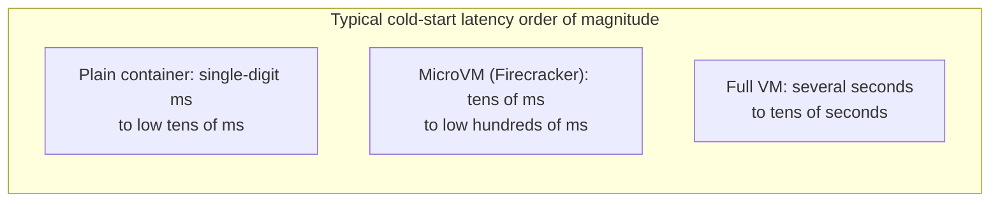

## 12. Scalability

Density — how many isolated workloads a single physical host can run — is
directly a function of which isolation mechanism is chosen: containers
(Section 4.4) allow the highest density because there is no per-workload
guest-kernel memory tax; full VMs (Section 4.3) allow the lowest density for
the same physical host because every VM pays that tax; microVMs (Section
4.9) sit close to container-level density while retaining VM-grade isolation,
which is precisely why serverless platforms — which need both very high
density *and* strong multi-tenant isolation simultaneously — adopted them
rather than accepting either extreme. Scaling a fleet horizontally (adding
more hosts) is an orchestration-layer concern (Section 4.11, owned
elsewhere); this chapter's contribution to scalability is choosing the
per-host isolation mechanism that determines how many workload instances a
given amount of hardware can actually hold.

## 13. Security

Section 4.10 is this chapter's primary security teaching and should be
treated as the canonical reference for the shared-kernel-versus-separate-
kernel trade-off; this section adds the operational checklist an architect
should apply when reviewing a container platform's security posture:
confirm user-namespace remapping is enabled (Section 4.5) so a
container-root compromise does not yield host-root; confirm seccomp
profiles are applied (default profiles are a reasonable floor, custom
profiles narrow the surface further for specific workloads); confirm
`RuntimeClass` (or equivalent) routes any genuinely untrusted-code workload
to gVisor, Kata Containers, or a microVM rather than a plain container
(Section 4.10); confirm images are pulled from a registry with content
verification (image digest/signature checks) so a compromised registry or a
tag-mutation attack cannot silently substitute a malicious image layer
(Section 4.7's content-addressable hashing is exactly what makes digest
pinning possible and meaningful); and confirm cgroup limits (Section 4.6)
are set on every workload so a compromised or runaway container cannot
starve its neighbors as a secondary denial-of-service vector even absent a
full kernel escape.

## 14. Observability

Diagnosing an isolation-layer incident requires knowing which layer to
inspect: `dmesg`/kernel logs surface OOM-killer events scoped to a specific
cgroup (Memory Management Section 4.7's territory, directly relevant here
because that same signal is how an architect distinguishes "this container
hit its own `memory.max`" from "the whole node is under memory pressure");
`cgroup.procs`, `cpu.stat` (specifically its `nr_throttled` and
`throttled_usec` fields), and `memory.current`/`memory.events` under
`/sys/fs/cgroup/` give direct, ground-truth resource usage and limit-hit
counts for a specific container's cgroup, independent of whatever a
higher-level dashboard reports; and, for a hardened runtime like gVisor,
its own runtime logs are the place to look for syscall-emulation errors or
compatibility gaps that would otherwise present only as an opaque
application-level failure.

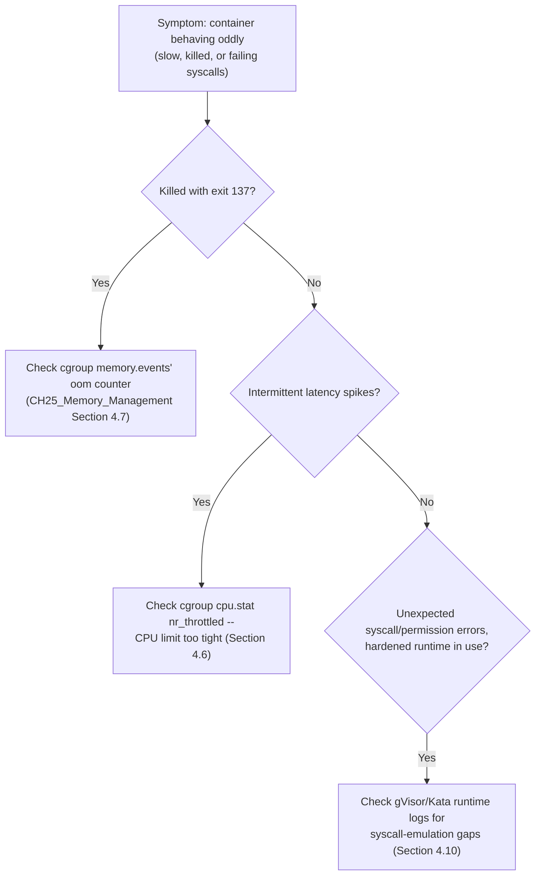

## 15. Failure Scenarios

- **cgroup memory limit exceeded → `OOMKilled`.** Already taught in full by
  Memory Management Section 4.7; this chapter's contribution is only the
  reminder that the same cgroup mechanism (Section 4.6) applies identically
  to CPU, so an under-provisioned `cpu.max` produces a *different* failure
  signature (throttled latency, not a kill) that is easy to misdiagnose as a
  networking or application-code problem if the responder only knows the
  memory-side failure mode.
- **Container escape via an unpatched host kernel vulnerability.** Section
  4.10's structural risk realized: an attacker with code execution inside
  one container reaches the shared host kernel via a permitted syscall,
  exploits a kernel bug, and gains capability outside that container's
  intended boundary — the mitigation set (seccomp, user namespaces, or
  escalating to gVisor/Kata/microVMs) is exactly Section 4.10's content, not
  a new failure category.
- **Noisy-neighbor CPU starvation from a missing cgroup CPU limit.** A
  container with no `cpu.max` set can consume all available CPU time on a
  host, starving co-located containers of scheduling time even though none
  of them individually crashed — visible only via `cpu.stat` throttling
  counters on the *starved* containers, not the offending one, which is a
  common source of confusing incident triage.
- **Image-layer cache poisoning or tag confusion.** Because a mutable image
  tag (`myapp:latest`) can be repointed to a different underlying layer
  digest at any time, a build or deployment pipeline that trusts a tag
  rather than pinning a specific content-addressed digest (Section 4.7) can
  silently deploy different bits than were tested, a supply-chain risk
  distinct from, but related to, the container-escape risk above.

## 16. Testing

Testing this chapter's primitives means testing at the right layer:
verifying a Dockerfile's layer structure by measuring which layers actually
invalidate on a representative set of changes (a code-only commit should
invalidate only the final layer, per Section 4.7); load-testing a
cgroup-limited container under CPU and memory pressure to confirm the
configured limits (Section 4.6) actually trigger the expected throttling or
OOM behavior rather than silently being ignored due to a misconfigured
hierarchy; and, for any workload routed to a hardened runtime (gVisor, Kata),
running the workload's actual syscall pattern against that runtime in a
staging environment specifically to catch syscall-compatibility gaps
(Section 4.10) before they surface as a production incident.

## 17. Common Mistakes

- Assuming a container provides VM-equivalent isolation for a genuinely
  multi-tenant, untrusted-code workload (Section 4.10's central warning).
- Ordering Dockerfile instructions so that application source code
  invalidates the dependency-installation layer on every commit (Section
  4.7).
- Setting a memory limit but skipping a CPU limit, leaving a container free
  to starve neighbors of scheduling time (Section 4.6).
- Running Docker-in-Docker with a privileged container in CI/CD pipelines,
  reintroducing shared-kernel risk for a workload category (arbitrary,
  often third-party build steps) that frequently deserves stronger isolation
  (Section 7).
- Trusting a mutable image tag instead of a content-addressed digest in a
  deployment pipeline, undermining the supply-chain guarantee Section 4.7's
  content-addressability is supposed to provide.
- Leaving user-namespace remapping disabled, so that a container-root
  compromise directly yields host-root (Section 4.5's common failure mode).

## 18. Best Practices

- Default new workloads to plain containers; escalate explicitly and only
  when the trust model genuinely requires it (Section 4.10, Section 7).
- Structure every Dockerfile with low-churn layers before high-churn layers
  (Section 4.7).
- Set both CPU and memory cgroup limits/requests on every container, never
  only one (Section 4.6).
- Enable user-namespace remapping and default seccomp profiles as a
  baseline, not an opt-in hardening step (Section 4.5, Section 13).
- Pin deployments to image digests, not mutable tags, for anything
  security- or compliance-sensitive (Section 4.7, Section 15).
- Use `RuntimeClass` (or the equivalent mechanism) to route specifically
  untrusted-code workloads to gVisor, Kata Containers, or microVMs, rather
  than making one isolation choice for an entire fleet (Section 8).

## 19. Anti-Patterns

- **"One VM per microservice, always."** Ignores that most microservices do
  not need VM-grade isolation and pays unnecessary overhead and slower
  scaling for no corresponding security benefit (Section 4.3 vs. 4.4).
- **"Containers are basically VMs, just smaller."** The conflation Section
  4.4 and Section 4.10 both warn against directly; leads to under-securing
  genuinely multi-tenant workloads.
- **Privileged Docker-in-Docker as a default CI pattern**, rather than a
  rootless build tool or a dedicated, disposable build VM (Section 7).
- **Blanket-applying one runtime class fleet-wide** regardless of individual
  workload trust models, instead of differentiating per Section 4.10 and
  Section 8's `RuntimeClass` pattern.

## 20. Trade-off Analysis

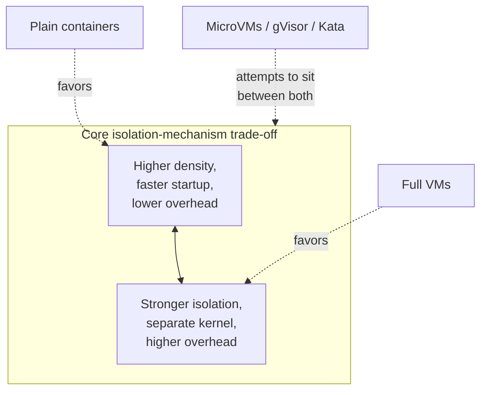

No single mechanism dominates on every axis: plain containers win on density
and startup speed but concede the shared-kernel risk (Section 4.10); full
VMs win on isolation strength but concede density, cost, and startup speed
(Sections 4.3, 11, 12); microVMs and hardened-runtime containers each
recover part of the isolation gap at a real, measurable cost in either
tooling maturity, syscall-emulation overhead, or engineering complexity
(Section 4.9, 4.10) — the correct choice is always workload-specific, not
universal.

## 21. Comparison Table

| Mechanism | Isolation unit | Kernel sharing | Typical startup | Typical overhead | Best fit |
|---|---|---|---|---|---|
| Full VM (Type 1 hypervisor, e.g. ESXi/KVM) | Guest kernel per VM | None — separate kernel | Seconds to tens of seconds | Hundreds of MB to GB | Different OS needed; strongest, non-negotiable isolation requirement (Section 4.1, 4.3) |
| Plain container (runc) | Namespaces + cgroup, shared host kernel | Full — one host kernel | Milliseconds to low tens of ms | Near-zero beyond app memory | Trusted, single-tenant, high-density internal workloads (Section 4.4) |
| MicroVM (Firecracker) | Guest kernel per microVM, minimized device model | None — separate kernel | Tens to low hundreds of ms | Low tens of MB | Multi-tenant serverless/high-churn, untrusted code needing near-container speed (Section 4.9) |
| gVisor-sandboxed container | Namespaces + cgroup + userspace syscall interception | Partial — most syscalls intercepted in userspace | Similar to plain container plus small overhead | Slightly above plain container | Existing OCI/Kubernetes tooling, need stronger isolation without a new VM (Section 4.10) |
| Kata Containers | Lightweight VM per "container," standard OCI/CRI interface | None — separate guest kernel | Between plain container and full VM | Between plain container and full VM | Same OCI/CRI workflow, but genuinely need VM-grade isolation (Section 4.10) |

## 22. Real-World Case Study

A mid-size SaaS platform runs three distinct workload classes on the same
Kubernetes fleet, and its architecture team makes three different, explicitly
justified isolation choices rather than one blanket policy: its own internal
microservices (billing, notifications, internal admin tools) run as plain
containers under `runc`, because all of them are owned and trusted by the
same organization and the priority is density and fast iteration (Section
4.4, 7); a customer-facing "run your own data pipeline script" product
feature runs under a `gvisor` `RuntimeClass`, because that workload's threat
model is explicitly untrusted, third-party code sharing infrastructure with
other customers, and the team judged gVisor's syscall-interception overhead
an acceptable cost for meaningfully narrowing the shared-kernel attack
surface (Section 4.10) without the full engineering cost of standing up a
separate microVM platform; and a small, highly regulated payments-adjacent
service, subject to strict kernel-level isolation requirements from a
compliance audit, runs on dedicated VMs outside the shared Kubernetes fleet
entirely, accepting the density and cost penalty because the compliance
requirement is explicit and non-negotiable (Section 4.3). This differentiated
outcome — not any single mechanism "winning" — is exactly the reasoning
pattern Section 4.10 and Section 7 both argue an architect should apply.

## 23. Interview Questions

1. Explain the precise architectural difference between a container and a
   VM — what does each one actually virtualize, and what does each one
   share with its host?
2. What problem did Intel VT-x/AMD-V solve that pre-2005 x86 hypervisors had
   to work around with binary translation, and how do VM exit/VM entry work?
3. Name the six Linux namespace types this chapter covers and, for each,
   state precisely what it isolates.
4. How do namespaces and cgroups divide responsibility in implementing a
   container's isolation, and why are they two separate mechanisms rather
   than one?
5. Why does container image layer caching depend on content-addressable
   hashing, and how does Dockerfile instruction order affect it?
6. What specific problem did the OCI specifications solve for the container
   ecosystem, and what is the difference in responsibility between
   containerd and runc?
7. What genuine architectural gap do Firecracker-style microVMs fill that
   neither plain containers nor full VMs fill on their own?
8. Why can a kernel vulnerability escape a container's isolation boundary in
   a way it cannot escape a VM's, and what are two concrete mitigations
   (name the tools) and their trade-offs?
9. How does a Kubernetes Pod's shared network/IPC namespace with separate
   mount namespaces per container directly apply this chapter's namespace
   composability?
10. A container is repeatedly hitting exit code 137 versus another
    experiencing intermittent latency spikes with no crashes — what cgroup
    signals would you check for each, and why are they different limits?

## 24. Hands-on Exercises

1. Run the `unshare --pid --mount --fork --mount-proc /bin/bash` command
   from Section 10, then, from a separate host terminal, compare `ps aux`
   output inside versus outside the new namespace and explain what you
   observe.
2. Build the Dockerfile from Section 10 twice: once unmodified, and once
   with `COPY . .` moved before the dependency-install step. Change only the
   application source and re-build both versions, timing each rebuild and
   noting which layers show as cached versus rebuilt.
3. Create the cgroup v2 configuration from Section 10 by hand, move a CPU-
   bound test process into it, and observe `cpu.stat`'s `nr_throttled`
   counter increment once the process exceeds its configured quota.
4. Inspect a running Docker or Kubernetes container's actual cgroup files
   directly under `/sys/fs/cgroup/` and match the values you find to the
   `--memory`/`--cpus` flags or `resources.limits` you configured.

## 25. Design Exercises

1. Design the isolation strategy for a platform that lets customers upload
   and execute arbitrary Python scripts against their own data. Justify your
   choice of plain containers, gVisor, Kata Containers, or Firecracker-style
   microVMs against the specific threat model, and state what would change
   your recommendation.
2. A team wants to reduce CI pipeline build time by 50% without changing
   application behavior. Propose a Dockerfile restructuring plan applying
   Section 4.7's layer-caching principles and estimate which layers would
   become cacheable.
3. Design a `RuntimeClass`-based routing policy for a Kubernetes cluster that
   hosts both fully-trusted internal workloads and a smaller set of
   customer-code-execution workloads, specifying exactly which workload
   class maps to which OCI runtime and why.

## 26. Architecture Review Questions

- For each workload under review, has the team explicitly stated its trust
  model (single-tenant/trusted vs. multi-tenant/untrusted), and does the
  chosen isolation mechanism (Section 21's comparison table) actually match
  that stated model?
- Are both CPU and memory cgroup limits set for every container, not just
  memory (Section 6, Section 17)?
- Is user-namespace remapping enabled, and if not, what is the stated
  justification for accepting container-root-equals-host-root risk (Section
  4.5, Section 13)?
- Are deployments pinned to content-addressed image digests, or only to
  mutable tags, for anything security- or compliance-sensitive (Section 15)?
- Does any workload run a privileged Docker-in-Docker pattern, and if so, has
  that specific risk been evaluated against Section 7's guidance?
- Is there a documented, host-by-host or `RuntimeClass`-by-`RuntimeClass`
  mapping from workload trust model to isolation mechanism, or is one
  mechanism applied blanket-wide without differentiation (Section 8, Section
  19)?

## 27. Summary

This chapter closed the forward references [Processes and
Threads](CH24_Processes_and_Threads.md) and [Memory
Management](CH25_Memory_Management.md) both left open around cgroups,
namespaces, and containers, by teaching the full architecture of
single-host isolation: hardware virtualization's Type 1/Type 2 hypervisor
split and the VT-x/AMD-V extensions that made it fast (Sections 4.1-4.2); the
VM's defining property of a full, separate guest kernel per VM as the
strongest practical isolation boundary (Section 4.3); containers as OS-level
virtualization built from namespaces (what a process can see) and cgroups
(how much it can use), sharing one host kernel by design (Sections 4.4-4.6);
container image architecture's layered, content-addressable structure and
why that makes layer caching and efficient distribution possible (Section
4.7); the OCI specifications and the containerd/runc runtime stack that
standardized the ecosystem (Section 4.8); Firecracker-style microVMs as a
genuine, purpose-built hybrid answering multi-tenant serverless platforms'
speed-and-isolation requirement simultaneously (Section 4.9); the
shared-kernel attack surface as a real, current, unsolved architectural
trade-off, with gVisor and Kata Containers as partial, cost-bearing
mitigations rather than a closed question (Section 4.10); and, finally, the
precise hand-off point to container orchestration — Kubernetes Pods as a
direct, opinionated application of this chapter's own namespace
composability — while deliberately stopping short of teaching multi-host
scheduling, cluster networking, or self-healing, which belong to Part 10's
future Kubernetes chapters (Section 4.11). The throughline across all 27
sections is the same isolation-versus-cost dial [Processes and
Threads](CH24_Processes_and_Threads.md#3-why-it-exists) introduced at the
single-process level: every mechanism in this chapter is a different,
deliberately chosen point on that same dial, and the Solution Architect's job
is to place each workload at the point its actual trust model and cost
budget justify — never by default, and never by habit.

## Further Reading

- [Processes and Threads](CH24_Processes_and_Threads.md) — process/thread
  isolation and scheduling primitives this chapter builds on.
- [Memory Management](CH25_Memory_Management.md) — virtual memory, paging,
  and the cgroup memory-limit/OOM-killer mechanics recapped in Section 4.6.
- [Sockets](CH16_Sockets.md) — the network-namespace-scoped socket layer
  containers isolate per Section 4.5.
- Part 10 Kubernetes chapters (not yet drafted) — multi-host orchestration,
  scheduling, and cluster networking built on this chapter's primitives
  (Section 4.11).
