# Chapter 29: Linux Internals for Architects

Part: [05 — Networking and Operating Systems](PART_OVERVIEW.md) · Status: Drafted

## 1. Introduction

This is the capstone chapter of Part 05's Operating Systems subsection, and it
is deliberately different in shape from the five chapters before it. Where
[Processes and Threads](CH24_Processes_and_Threads.md),
[Memory Management](CH25_Memory_Management.md),
[File Systems](CH26_File_Systems.md),
[I/O and Scheduling](CH27_IO_and_Scheduling.md), and
[Virtualization and Container Fundamentals](CH28_Virtualization_and_Container_Fundamentals.md)
each teach one mechanism in first-principles depth — how a process is
isolated, how virtual memory is translated, how a file becomes bytes on
disk, how the kernel decides which runnable task gets the Central Processing
Unit (CPU) next, how a container is really just processes wrapped in
namespaces and cgroups — this chapter does not re-derive any of that
machinery. Instead it answers the question a practicing Solution Architect
actually asks under production pressure: **given everything those five
chapters taught individually, how do I use that knowledge, right now, to
diagnose a system that is slow, crashing, or consuming resources it should
not be consuming?**

That reframing matters because in the field, incidents rarely announce which
subsystem is at fault. A ticket that says "the checkout service is slow"
could be a CPU-scheduling problem, a memory problem, an Input/Output (I/O)
problem, a thread-contention problem, or a container-isolation problem — and
the on-call engineer has minutes, not hours, to figure out which. The five
prior chapters gave you the vocabulary and the mental models for each
individual subsystem. This chapter gives you the **operating system as a
single observable system**: the kernel/userspace boundary and system calls
as the one interface everything else is built on, the `/proc` and `/sys`
virtual filesystems as the primary window into a running kernel's state, a
systematic diagnostic order-of-operations for separating CPU from memory
from I/O from process/thread from container-isolation problems, why kernel
version and distribution choice are architecture decisions and not just
patching hygiene, extended Berkeley Packet Filter (eBPF) as the modern
mechanism for safely extending kernel behavior without writing kernel
modules, and the small, high-leverage toolkit (`top`/`htop`, `strace`,
`perf`, `ss`) an architect actually reaches for.

**Quick orientation — how this chapter sits above its five siblings:**

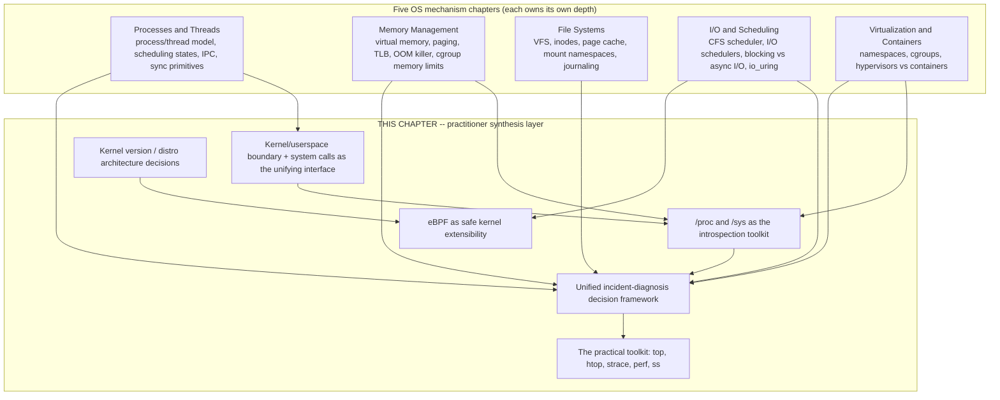

This chapter does not introduce new low-level mechanisms competing with the
five siblings above; every mechanism it touches is recapped in two or three
sentences with a link back to the chapter that owns the full explanation.
What it introduces is new *synthesis*: the diagnostic framework in Section
4.4, and eBPF as a genuinely new capability class (Section 4.7) that the
prior chapters only gestured at.

## 2. Historical Evolution

Linux's introspection and extensibility model did not appear as a single
design; it accumulated over three decades as production operators kept
asking the same question in different forms — "what is this running kernel
actually doing right now, and can I find out without rebooting it or
crashing it?"

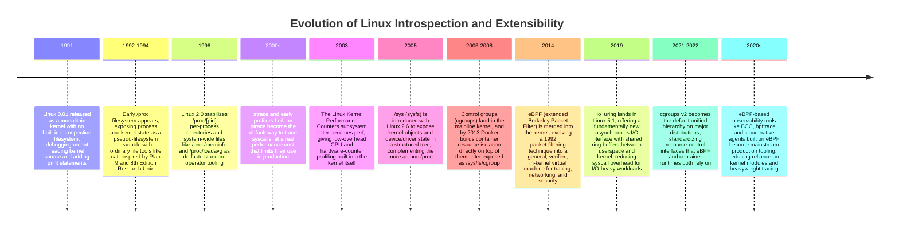

The through-line across all of this: every generation of tooling exists to
answer the same operator question with less overhead and less risk than the
generation before it. `/proc` replaced reading kernel memory by hand. `perf`
replaced high-overhead sampling hacks. eBPF replaced writing and loading a
custom, unverified kernel module just to answer one observability question.
The trend is monotonic: safer, lower-overhead, more structured introspection
into a system that never has to stop running to be understood.

## 3. Why It Exists

An architect could, in principle, treat "the operating system" as an opaque
box and reason only about the application layer — this is exactly what most
cloud platforms and container orchestrators encourage by design. That
abstraction holds until it doesn't: a service degrades, a container gets
killed, a fleet-wide latency spike appears with no application-level commit
around the time it started, and the actual root cause lives at exactly the
layer the abstraction was hiding. The reason this chapter — and this
subsection of Part 05 — exists is that **every symptom an architect diagnoses
in production ultimately reduces to a small, closed set of kernel-managed
resources**: CPU time, memory, storage I/O, network I/O, and process/thread
scheduling, all mediated by system calls crossing the kernel/userspace
boundary. [Processes and Threads](CH24_Processes_and_Threads.md) taught what
a process and thread are; this chapter's job is to make explicit the idea
that *every one of those five kernel-managed resources is only ever visible
or controllable through a system call* — there is no other path. Reading a
file, allocating memory, spawning a thread, sending a packet, checking the
clock: all of it is a system call, or a library function that eventually
makes one. That single fact is why `/proc`, `/sys`, `strace`, `perf`, and
eBPF all exist — they are different ways of observing or intercepting that
one narrow interface.

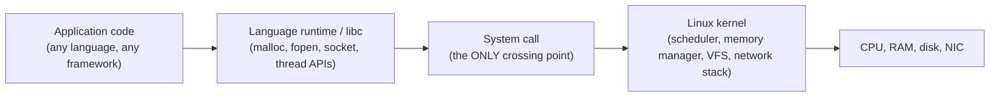

The second reason this chapter exists is a gap in most engineers' training:
university curricula and even most production-engineering guides teach the
five mechanisms in isolation, then leave the *synthesis* — "given an
ambiguous symptom, in what order do I check things" — as tribal knowledge
passed down informally on each team. That tribal knowledge is exactly what
Section 4.4 makes explicit and repeatable.

## 4. Core Concepts

### 4.1 The kernel/userspace boundary and system calls as the fundamental interface

**Definition.** The kernel/userspace boundary is a hardware-enforced
privilege separation: the CPU runs in a privileged mode (kernel space, "ring
0" on x86) where it can execute any instruction and touch any physical
memory, and in an unprivileged mode (user space, "ring 3") where ordinary
application code runs with restricted instructions and only the virtual
memory the kernel has mapped for it. A **system call** is the only sanctioned
mechanism for user-space code to request that the kernel do something on its
behalf — open a file, allocate memory, create a thread, send a packet — by
triggering a controlled trap (historically a software interrupt, on modern
x86-64 the `syscall`/`sysret` instruction pair) that switches the CPU into
kernel mode at a fixed, kernel-chosen entry point, never at an address
user-space code supplies.

**Mechanism.** [Processes and Threads](CH24_Processes_and_Threads.md#4-core-concepts)
already established that a process owns its own virtual address space and
file descriptor table, enforced by this same boundary. What that chapter did
not need to make explicit — because it was teaching process/thread
mechanics, not the OS-as-observable-system view this chapter takes — is that
literally every operation those two chapters describe is implemented as one
or more system calls: `fork()`/`clone()` to create a process or thread,
`mmap()`/`brk()` to grow the address space that
[Memory Management](CH25_Memory_Management.md) describes, `open()`/`read()`/
`write()` to touch the files [File Systems](CH26_File_Systems.md) describes,
`epoll_wait()`/`io_uring_enter()` for the I/O multiplexing
[I/O and Scheduling](CH27_IO_and_Scheduling.md) describes, and
`clone(CLONE_NEWPID | CLONE_NEWNET | ...)` plus cgroup filesystem writes for
the isolation [Virtualization and Container Fundamentals](CH28_Virtualization_and_Container_Fundamentals.md)
describes. There is no back door: a Java thread pool, a Python `asyncio`
event loop, a Go goroutine scheduler, and a Kubernetes container runtime are
all, at the bottom of their call stack, issuing system calls through this one
interface.

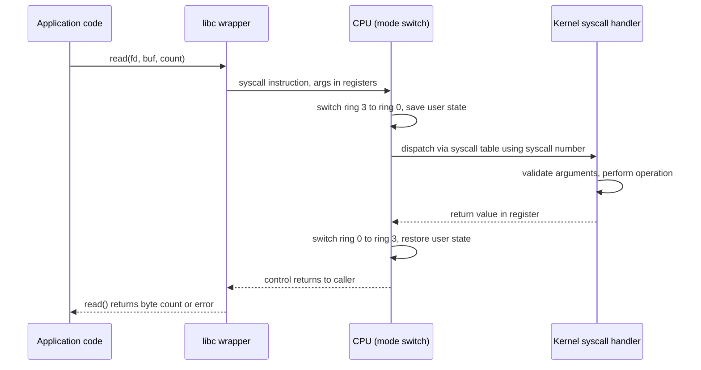

**Decision implications.** Understanding this boundary tells an architect two
practical things. First, every system call is a real, measurable cost — a
mode switch, a Translation Lookaside Buffer (TLB) consideration, cache
pollution — which is exactly why high-performance I/O designs (batched
syscalls, `io_uring`'s shared ring buffers, vectored I/O) exist: they exist
to reduce the *number* of boundary crossings, not to avoid the kernel
entirely, because the kernel is the only place memory protection, scheduling
fairness, and file system consistency are enforced. Second, this boundary is
exactly what `strace` (Section 4.8) intercepts, what `seccomp` filters (a
container security mechanism recapped from
[Virtualization and Container Fundamentals](CH28_Virtualization_and_Container_Fundamentals.md))
restrict, and what eBPF (Section 4.7) can attach to — every one of this
chapter's tools is, at some level, an instrument pointed at this one narrow
interface.

**Common failure mode.** Engineers sometimes assume a "lightweight" runtime
abstraction (a green thread, a coroutine, an async task) has escaped this
boundary and its costs. It has not — it has only changed *which* code decides
when to make the underlying system call and how many user-space threads
share the resulting kernel threads. A Node.js `fs.readFile` call, a Python
`asyncio` socket read, and a raw C `read()` all still cross this exact same
boundary; the difference is entirely in how much user-space scheduling sits
on top of it before the syscall happens.

**Concrete scenario.** A team reports that a Java service handling file
uploads is "spending all its time in the kernel" per a CPU flame graph. Recall
[Processes and Threads](CH24_Processes_and_Threads.md#4-core-concepts) taught
that context switches are not free; here the flame graph confirms the cost is
concentrated in syscalls like `write()` and `fsync()`, meaning the fix is at
the I/O-batching layer (buffered writes, fewer `fsync()` calls per request) —
not a "the JVM is slow" problem, and not something more application threads
would fix, since more threads just mean more concurrent crossings of the
same boundary contending for the same disk.

### 4.2 The /proc virtual filesystem as the architect's primary introspection tool

**Definition.** `/proc` is a virtual (in-memory, kernel-generated) filesystem
that exposes live kernel and per-process state as ordinary files and
directories, readable with `cat`, `less`, or any programming language's
normal file Input/Output (I/O), with no special Application Programming
Interface (API) required. Nothing under `/proc` is stored on disk; every read
triggers the kernel to format current in-memory state into text on demand.

**Mechanism.** [Memory Management](CH25_Memory_Management.md#4-core-concepts)
already introduced `/proc/meminfo` as the canonical way to read system-wide
memory statistics (total, free, cached, swap). This chapter extends that same
mental model to the rest of `/proc`'s surface area, because the pattern is
identical everywhere: a fixed-format text file that reflects one slice of
kernel state at the instant it is read.

- `/proc/[pid]/status` — a single process's memory (`VmRSS`, `VmSize`),
  thread count (`Threads`), signal masks, and state (matching the
  process-state model from
  [Processes and Threads](CH24_Processes_and_Threads.md#4-core-concepts)).
- `/proc/[pid]/fd/` — a directory of symlinks, one per open file descriptor,
  letting you see exactly which files, sockets, or pipes a running process
  holds open (useful for diagnosing file-descriptor exhaustion or a
  mysteriously held socket).
- `/proc/[pid]/stack` and `/proc/[pid]/status`'s `State` field — whether a
  thread is running, sleeping, or stuck in uninterruptible I/O wait (`D`
  state), the single most useful field for distinguishing "waiting on the
  CPU scheduler" from "blocked in the kernel on disk I/O."
- `/proc/loadavg` — the 1/5/15-minute exponentially-weighted count of
  runnable-or-uninterruptible tasks, a single-line system-wide pressure
  signal (Section 4.4 explains precisely how to interpret it, since a high
  load average alone does not tell you *which* resource is under pressure).
- `/proc/meminfo`, `/proc/vmstat` — system-wide memory and paging counters
  (recap: [Memory Management](CH25_Memory_Management.md#4-core-concepts)
  owns full paging/swapping mechanics; this chapter only recaps how to read
  the counters).
- `/proc/diskstats`, `/proc/[pid]/io` — cumulative disk-I/O counters, at the
  device and per-process level respectively (recap:
  [I/O and Scheduling](CH27_IO_and_Scheduling.md) owns the scheduler
  mechanics that produce these numbers).

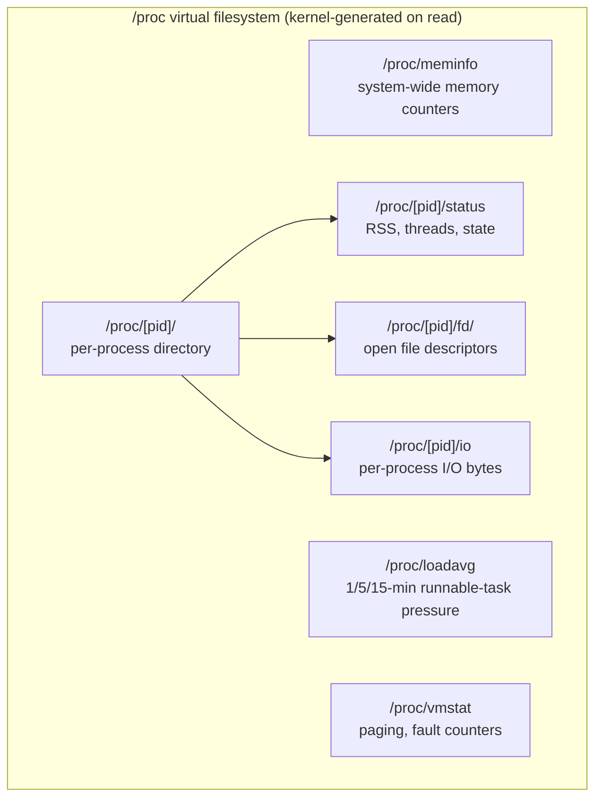

**Decision implications.** `/proc` is the lowest-overhead, most universally
available introspection tool an architect has: it requires no agent
installation, no elevated tooling beyond normal file read permissions (some
fields require root or the same user as the target process), and works
identically across every mainstream Linux distribution and kernel version
back to the mid-1990s. The practical heuristic: reach for `/proc` first for
"what is the current state of this specific number," and reach for
`strace`/`perf`/eBPF (Sections 4.7-4.8) only when you need to see *events
happening over time* rather than a snapshot.

**Common failure mode.** Treating a single `/proc` read as authoritative
without taking two samples over a time interval. Cumulative counters
(`/proc/diskstats`, `/proc/[pid]/io`, `/proc/stat` CPU ticks) are running
totals since boot or process start — a single read tells you nothing about
*rate*; you must subtract two reads taken a known interval apart (which is
exactly what `top`, `iostat`, and `vmstat` do internally, per Section 4.8).

**Concrete scenario.** An architect suspects a process is leaking file
descriptors. `ls /proc/[pid]/fd | wc -l`, sampled every few seconds, shows a
monotonically increasing count with no plateau — confirming a leak (probably
unclosed sockets or file handles) well before the process hits its
`ulimit -n` ceiling and starts throwing "too many open files" errors, letting
the team ship a fix before the failure actually occurs in production.

### 4.3 The /sys virtual filesystem and cgroup hierarchies as the resource-control view

**Definition.** `/sys` (sysfs) is a second virtual filesystem, introduced
later than `/proc`, that exposes kernel *objects* — devices, drivers, kernel
subsystems, and control groups (cgroups) — as a structured directory tree,
in contrast to `/proc`'s more historically ad hoc, process-centric layout.
For an architect, the most operationally important part of `/sys` is the
cgroup hierarchy mounted at `/sys/fs/cgroup`.

**Mechanism.** [Memory Management](CH25_Memory_Management.md#4-core-concepts)
already covers cgroup memory limits and the Out Of Memory (OOM) killer in
depth, and [Virtualization and Container Fundamentals](CH28_Virtualization_and_Container_Fundamentals.md)
covers cgroups as one of the two pillars (alongside namespaces) that make a
container a container. This chapter's contribution is narrower: treating
`/sys/fs/cgroup/<path>/` as a *readable diagnostic surface*, not just a
configuration mechanism. Under cgroups v2's unified hierarchy, every
container or systemd service gets a directory such as
`/sys/fs/cgroup/system.slice/myapp.service/` (or a container-runtime-specific
path under Kubernetes) containing live, readable files:

- `memory.current` / `memory.max` — current usage versus the configured
  ceiling, the exact numbers that determine whether the OOM killer will
  intervene.
- `memory.events` — a counter of `oom_kill` events for this cgroup
  specifically, letting you attribute an OOM kill to one container even on a
  host running many.
- `cpu.stat` — cumulative CPU time consumed and, critically, `nr_throttled`
  and `throttled_usec` — direct evidence a container hit its CPU quota and
  was throttled by the kernel, which looks like "slow" from the application's
  point of view but is not a code-level performance problem at all.
- `io.stat` — per-device bytes and I/O operations attributed to this cgroup.

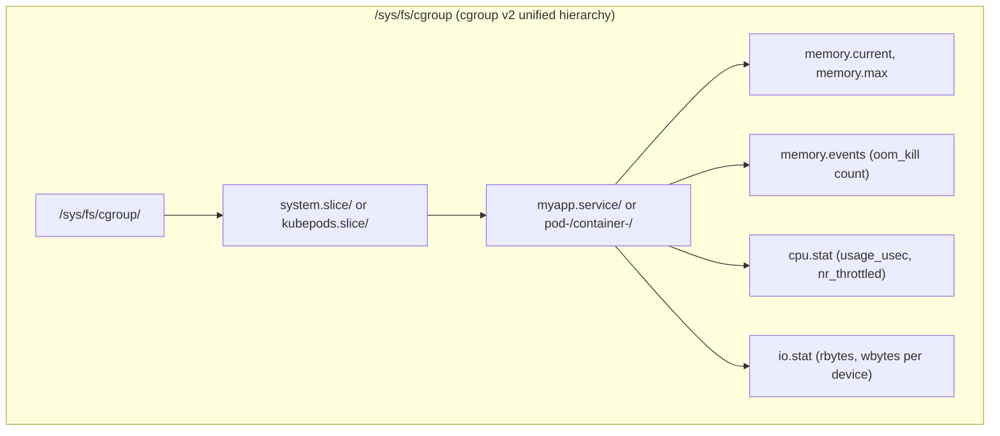

**Decision implications.** For any workload running inside a container or a
systemd resource slice, the cgroup files are more accurate than host-wide
`/proc` counters, because `/proc/meminfo` reports *host* memory, while
`memory.current` under that container's cgroup reports what the container
itself is charged with — the number the OOM killer actually acts on. An
architect diagnosing "why did this one pod get killed while the node had
free memory" must look at the pod's cgroup, not the node's `/proc/meminfo`.

**Common failure mode.** Conflating host-level and cgroup-level memory
pressure. A node can show plenty of free memory in `/proc/meminfo` while an
individual container is still OOM-killed, because the container's own
`memory.max` ceiling — not host memory exhaustion — triggered the kill. This
is one of the most common false leads in container incident response.

**Concrete scenario.** A container is killed and restarted repeatedly.
Reading `memory.events` for that container's cgroup shows a rising
`oom_kill` counter while the *node's* `/proc/meminfo` shows healthy free
memory throughout — definitive evidence the container's own memory limit
(set too low relative to real usage) is the cause, not a node-wide capacity
problem, redirecting the fix to "raise the container's memory limit or fix
the leak," not "add more nodes."

### 4.4 A unified production-incident diagnostic framework (this chapter's signature contribution)

**Definition.** This is the practical synthesis this chapter exists to
provide: given an ambiguous incident report — "the service is slow," "the
service is crashing," "the service is OOMing" — a systematic, ordered
sequence of checks that separates a CPU-scheduling problem
([I/O and Scheduling](CH27_IO_and_Scheduling.md)'s CPU-scheduler half), a
memory problem ([Memory Management](CH25_Memory_Management.md)), an I/O
problem ([File Systems](CH26_File_Systems.md) and
[I/O and Scheduling](CH27_IO_and_Scheduling.md)'s I/O-scheduler half), a
process/threading problem
([Processes and Threads](CH24_Processes_and_Threads.md)), or a
container-isolation problem
([Virtualization and Container Fundamentals](CH28_Virtualization_and_Container_Fundamentals.md)),
using only the tools this chapter has already introduced.

**Mechanism.** The framework works because each of the five failure classes
leaves a distinct, checkable signature in `/proc`, `/sys`, and a small set of
commands — you do not need to guess; you need to check signals in the right
order, because some checks are cheap and disambiguating (do first), and some
are expensive or only meaningful once cheaper checks have ruled out simpler
explanations (do later).

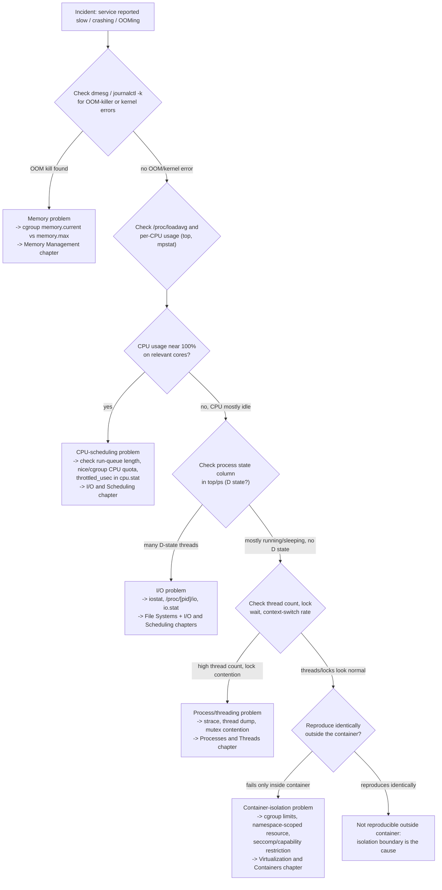

Walking the tree in words: **first**, always check for an OOM kill or kernel
error before anything else — `dmesg`/`journalctl -k`, or the cgroup's
`memory.events` counter — because a killed-and-restarted process can produce
symptoms (a request timing out, a connection reset) that look identical to a
CPU or network problem, and this check costs seconds. **Second**, check
system and per-core CPU usage; if a relevant core is pegged, this is a CPU
problem (throttling, an inefficient algorithm, GC pauses, or a run-queue
backlog exceeding what the CFS scheduler can service on time), not a memory
or I/O problem. **Third**, if CPU is not saturated, check whether threads are
sitting in uninterruptible sleep (`D` state in `ps`/`top`) — that is the
kernel's own signal that a thread is blocked on I/O, meaning the fix search
should move to disk latency, network filesystem stalls, or a saturated I/O
scheduler queue. **Fourth**, if none of the above, look at thread count and
lock contention — a growing thread count with high context-switch rate but
low CPU usage often signals lock convoying or priority inversion, both
mechanisms taught in
[Processes and Threads](CH24_Processes_and_Threads.md#4-core-concepts).
**Fifth**, and only after the first four checks are inconclusive, test
whether the symptom reproduces outside the container/pod boundary at all —
if it does not, the cause is a resource limit or isolation artifact
(cgroup CPU quota, a network namespace's Maximum Transmission Unit (MTU)
mismatch, a seccomp-denied syscall) rather than anything intrinsic to the
application.

**Decision implications.** The order matters because each step is
progressively more expensive or more disruptive: `dmesg` and `/proc` reads
are free and non-invasive; `strace`, discussed in Section 4.8, has real
overhead and should be reached for only once cheaper checks have narrowed
the search. Skipping straight to attaching a profiler or debugger to a
production process before ruling out an OOM kill or CPU saturation wastes
the most valuable resource in an incident: time.

**Common failure mode.** Anchoring on the first plausible-looking metric
(commonly, "CPU is at 60%, that's fine" or "memory looks okay") without
checking the *specific* resource the incident actually implicates — 60%
aggregate CPU can hide one core pegged at 100% while seven idle, and "memory
looks okay" from `/proc/meminfo` can hide a cgroup-scoped OOM kill entirely
(Section 4.3). The framework's insistence on checking cgroup-scoped and
per-core signals, not just host aggregates, exists specifically to prevent
this anchoring failure.

**Concrete scenario.** An on-call architect receives "checkout service p99
latency spiked 8x." Following the tree: `dmesg` shows no OOM kill; `top`
shows the container's assigned cores at 100%; `cpu.stat` shows a nonzero and
climbing `nr_throttled` — the service hit its Kubernetes CPU limit and is
being throttled by the kernel's CFS bandwidth controller every scheduling
period. The fix is raising the CPU limit or reducing per-request CPU work,
not restarting pods (which does nothing, since the limit is still too low)
and not adding replicas alone (which helps only if the limit-vs-load ratio
per pod was the actual problem, and even then is treating a symptom).

### 4.5 Kernel version and distribution architecture decisions

**Definition.** The Linux kernel version and distribution (and its kernel
patch/backport policy) running under a workload is not merely a patching
housekeeping detail — it is an architecture decision that determines which
capabilities are even available to the platform layer above it: container
runtimes, service meshes, observability agents, and storage engines.

**Mechanism.** Long-Term-Support enterprise distributions (for example,
Red Hat Enterprise Linux, Ubuntu LTS) intentionally freeze a kernel's
*version number* for years while backporting security fixes, which means the
running kernel can be, in practice, five or more years behind mainline
feature-wise even while fully patched for Common Vulnerabilities and
Exposures (CVEs). Three concrete capability gaps illustrate the real-world
consequence:

- **cgroups v2** — the unified hierarchy this chapter's Section 4.3 and
  [Memory Management](CH25_Memory_Management.md) both depend on for accurate
  per-container resource accounting became the default only around 2021 on
  major distributions; an older enterprise kernel may still default to the
  legacy cgroups v1 hybrid hierarchy, where memory/CPU/I/O controllers are
  mounted separately and some modern container-runtime features (unified
  resource pressure metrics, certain Kubernetes QoS behaviors) are
  unavailable or behave differently.
- **io_uring** (introduced in Linux 5.1, 2019) — the asynchronous I/O
  interface referenced in Section 2 and recapped from
  [I/O and Scheduling](CH27_IO_and_Scheduling.md); workloads or storage
  engines built assuming `io_uring`'s throughput characteristics will
  silently fall back to older, higher-syscall-overhead I/O paths (or fail to
  start) on a kernel that predates it.
- **eBPF feature maturity** — early eBPF (2014 onward) supported only
  simple packet-filtering programs; features this chapter's Section 4.7
  depends on for full observability tooling (BPF Type Format for
  cross-kernel-version portability, ring buffers for efficient event
  delivery, sleepable programs) arrived incrementally through Linux
  4.x-5.x; an eBPF-based observability agent qualified against a recent
  kernel may silently degrade or refuse to load specific probes on an older
  enterprise kernel.

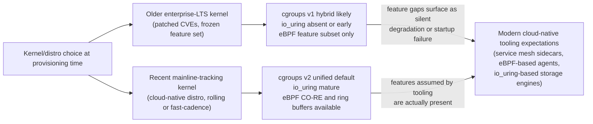

**Decision implications.** When an architecture standardizes on a container
platform, service mesh, or observability stack whose vendor documentation
assumes "a modern Linux kernel," that assumption is a real dependency, not
boilerplate — the architect must verify the target kernel version against
that tool's minimum-supported-kernel documentation *before* committing to the
platform, not discover the gap when a sidecar fails to start in production.
The trade-off is real: an older enterprise kernel offers a longer, better
tested security-patch lifecycle and vendor support contract; a newer kernel
offers current feature availability at the cost of a shorter support window
and less field-tested patch history for that exact kernel build.

**Common failure mode.** Assuming distribution version and kernel version
move together. Two hosts can report the same distribution "major version"
label while running meaningfully different kernel feature sets, because
enterprise distributions frequently backport individual kernel subsystems
(occasionally including partial cgroups v2 or eBPF support) onto an
otherwise old kernel base — checking `uname -r` and the specific feature
(for example, `cat /sys/fs/cgroup/cgroup.controllers` to confirm cgroups v2)
directly is more reliable than trusting the distribution's marketing version
number alone.

**Concrete scenario.** A platform team standardizes on a service mesh whose
sidecar relies on eBPF-based transparent traffic redirection instead of
`iptables`. Rollout succeeds on cloud-native worker nodes running a recent
kernel, but fails silently on a set of on-premises hosts still running an
older enterprise-LTS kernel whose eBPF subsystem predates the required hook
type — the sidecar falls back to a slower `iptables`-based path with no
alert, and the team only discovers the discrepancy weeks later while
investigating an unrelated latency difference between the two node pools.

### 4.6 cgroups v2 as the unified resource-control substrate (recap + integration)

**Definition.** cgroups v2 is the kernel's single, unified hierarchy for
attaching resource limits (memory, CPU, I/O, process count) and accounting
metrics to a group of processes, replacing the earlier v1 model where each
resource controller (`memory`, `cpu`, `blkio`) had its own independent,
potentially inconsistent hierarchy.

**Mechanism.** Full mechanics of cgroup memory limits and the OOM killer are
owned by [Memory Management](CH25_Memory_Management.md#4-core-concepts), and
cgroups as a container-isolation primitive are owned by
[Virtualization and Container Fundamentals](CH28_Virtualization_and_Container_Fundamentals.md#4-core-concepts) —
this chapter does not re-derive either. What this chapter adds is treating
cgroups v2 as the *unifying substrate* that makes Sections 4.3 and 4.4's
diagnostic reads possible at all: because v2 uses one hierarchy instead of
per-controller trees, a single directory
(`/sys/fs/cgroup/<slice>/<unit>/`) contains the memory, CPU, and I/O
accounting for one workload together, which is precisely why the diagnostic
framework in Section 4.4 can walk memory, CPU, and I/O signals for the same
container from one location instead of reconciling three separate
hierarchies.

**Decision implications.** When evaluating an observability or resource
-governance tool, confirm it targets cgroups v2's unified interface rather
than the legacy v1 per-controller layout; a tool built only against v1 will
either fail outright or silently report incomplete data on a v2-only host,
and vice versa.

**Common failure mode.** Running a mixed fleet — some hosts still on the
cgroups v1 hybrid hierarchy, some fully migrated to v2 — and applying the
same diagnostic script or dashboard query path to both, producing silent
gaps on whichever hierarchy the tooling was not written for.

**Concrete scenario.** A resource-governance script written against
`/sys/fs/cgroup/memory/<path>/memory.usage_in_bytes` (the v1 path) is rolled
out fleet-wide; on hosts already migrated to v2, that path does not exist,
the script silently reports "no data" instead of erroring loudly, and a
real memory-pressure condition on those hosts goes undetected until the OOM
killer intervenes.

### 4.7 eBPF as the modern observability and extensibility architecture

**Definition.** Extended Berkeley Packet Filter (eBPF) is a kernel
subsystem that runs small, sandboxed programs *inside* the kernel, triggered
by events (a system call, a network packet arrival, a kernel function entry,
a scheduling decision), without requiring a custom kernel module and without
the crash-the-whole-kernel risk a buggy kernel module carries.

**Mechanism.** eBPF programs are written in a restricted subset of C (or
generated by higher-level tooling such as bpftrace), compiled to eBPF
bytecode, and loaded into the kernel through the `bpf()` system call — itself
just another instance of the kernel/userspace boundary from Section 4.1.
Before any eBPF program is allowed to run, the kernel's **verifier** performs
static analysis to prove the program terminates (no unbounded loops before
kernel 5.3's bounded-loop support), never accesses memory outside its
permitted bounds, and never crashes the kernel — this verification step is
exactly what makes eBPF safe where a hand-written kernel module is not: a
bug in a kernel module can panic the entire machine, while a rejected eBPF
program simply fails to load. Verified programs attach to one of several
hook types (kprobes on kernel functions, tracepoints, network-driver hooks,
scheduler hooks) and communicate results back to user space through **eBPF
maps** — shared key-value data structures the kernel program writes into and
a user-space process reads from.

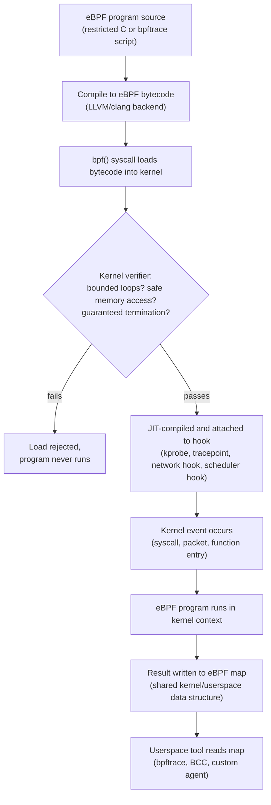

This is exactly the mechanism underlying the observability tooling
[I/O and Scheduling](CH27_IO_and_Scheduling.md) references conceptually when
it discusses modern I/O tracing — this chapter teaches eBPF itself as the
underlying capability, rather than re-deriving how any single I/O-tracing
tool built on it works.

**Decision implications.** eBPF changes the cost/risk calculus for
production observability and extensibility: capabilities that previously
required either accepting high overhead (full `strace`-style tracing of
every syscall), or accepting the risk of a custom kernel module (a
kernel-panic blast radius), can now be built as verified, low-overhead,
hot-attachable programs that can be loaded and unloaded without a reboot or
even a process restart. This is why modern service meshes, security tools,
and observability agents increasingly implement traffic capture, syscall
auditing, and performance tracing via eBPF rather than `iptables` rules or
kernel modules — recapped from Section 4.5's kernel-version discussion,
since older kernels may lack the eBPF features these tools assume.

**Common failure mode.** Treating "it's eBPF, so it's free" as true.
Verification and safety do not mean zero cost — an eBPF program still runs on
every triggering event (potentially millions of times per second for a
syscall-entry probe), and a poorly scoped probe (attached too broadly, or
copying too much data per event into a map) can measurably affect the
performance of the exact system it is trying to observe. eBPF trades away
kernel-module crash risk, not runtime cost.

**Concrete scenario.** An architecture team wants continuous, fleet-wide
visibility into slow disk I/O operations without deploying a kernel module
or paying `strace`'s full per-syscall overhead on every host. An eBPF program
attached to the block-I/O tracepoints records only operations exceeding a
latency threshold into a ring buffer, which a lightweight user-space agent
drains and exports — giving targeted, low-overhead, always-on visibility that
neither a kernel module (too risky to run everywhere) nor `strace` (too
expensive to run everywhere, all the time) could provide at fleet scale.

### 4.8 The architect's practical Linux toolkit: what question each tool answers

**Definition.** A small set of tools covers the overwhelming majority of
production diagnostic needs. The goal here is not an exhaustive flag
reference (each tool has its own manual page for that) but a map of *which
question* each tool is the right instrument for, so the diagnostic framework
in Section 4.4 can be executed quickly under pressure.

**Mechanism and mapping:**

- **`top` / `htop`** — answers "which processes are consuming CPU and memory
  right now, and how is that changing second to second." Both read `/proc`
  repeatedly and compute deltas between samples (Section 4.2's "two samples,
  not one" rule, automated). `htop` adds an interactive, color-coded,
  per-core view and tree-mode process hierarchy, but reads the same
  underlying data as `top`.
- **`ss`** — answers "what network sockets exist on this host right now, in
  what state, with how much data queued." A modern, faster replacement for
  the older `netstat`, reading socket state directly from the kernel's
  netlink interface rather than parsing `/proc/net/tcp` line by line. Useful
  for confirming connection-pool exhaustion, a backlog of `SYN-RECV`
  sockets, or a socket stuck with data queued but unread.
- **`strace`** — answers "exactly which system calls is this specific
  process making, with what arguments, and how long is each one taking."
  Built on `ptrace`, which intercepts every syscall the traced process makes
  — powerful but with real overhead (each syscall now round-trips through
  the tracer), which is why the diagnostic framework (Section 4.4) reaches
  for `strace` only after cheaper checks have narrowed which process and
  which resource class to look at, not as a first move.
- **`perf`** — answers "where, across the entire call stack including
  kernel code, is CPU time actually being spent," using low-overhead
  hardware performance counters and sampling rather than intercepting every
  event, making it suitable for production use in ways `strace`'s
  syscall-by-syscall tracing is not. This is the tool that turns "CPU is at
  100%" (from Section 4.4's framework) into "100% CPU inside this specific
  function, called from this specific code path."
- **`bpftrace`** — answers targeted, ad hoc questions that `strace`/`perf`
  cannot answer cheaply at production scale, by writing a short eBPF program
  (Section 4.7) on the command line — for example, "show me a histogram of
  read() latency for this one process over the next 30 seconds," with
  negligible overhead compared to `strace`ing every read.

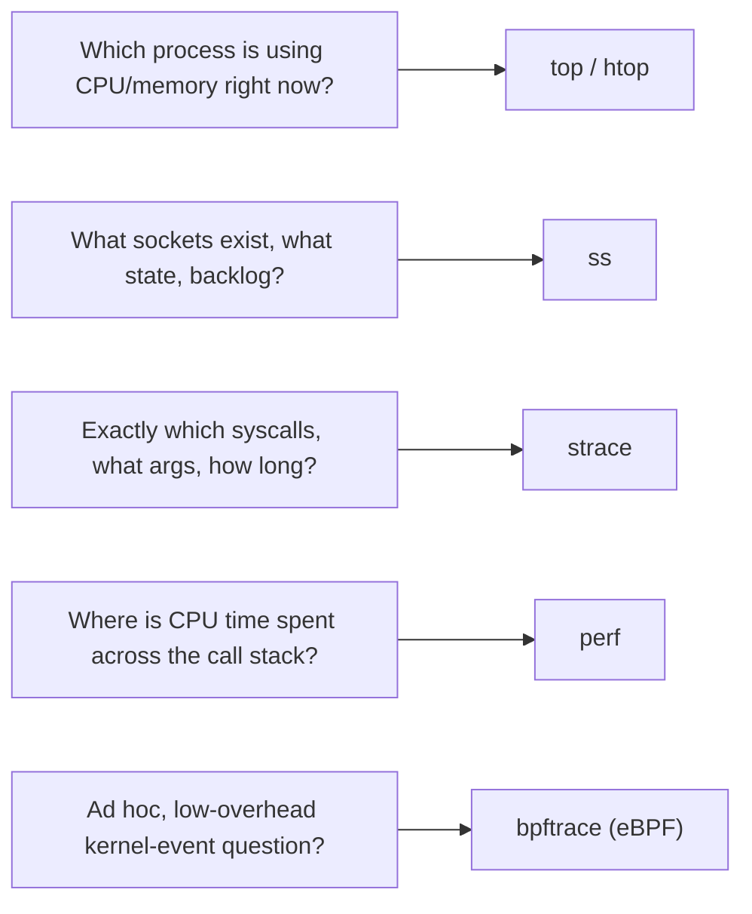

**Decision implications.** Order these tools by overhead and specificity,
matching Section 4.4's diagnostic sequence: `top`/`htop`/`ss` first (near
zero overhead, broad view), `perf` next (low overhead, precise), `strace`
and targeted `bpftrace` scripts last (higher overhead or requiring you to
already know roughly what to look for).

**Common failure mode.** Reaching for `strace -f` on a busy production
process as a first diagnostic step. Tracing every syscall of every thread in
a high-throughput service can slow it down enough to *cause* the very
latency spike being investigated, and can flood the terminal with output
that obscures the signal — always narrow with `top`/`ss`/`perf` first.

**Concrete scenario.** `perf top` on a suspect host shows an unexpectedly
large percentage of samples inside a Time-To-Live (TLS) library's memory-copy
routine. That single, low-overhead observation redirects the investigation
toward TLS buffer-size configuration rather than requiring a full `strace`
capture of every connection to reach the same conclusion.

## 5. Internal Working

Section 4.1 already traced one system call end to end at the sequence-diagram
level. This section adds the two remaining internal mechanisms this chapter
relies on that the prior sibling chapters did not need to cover: how the
kernel actually decides *when* to interrupt user-space code to check for
scheduling or signal work (relevant to interpreting `/proc/[pid]/status`'s
state field correctly), and how an eBPF program's lifecycle proceeds once
attached.

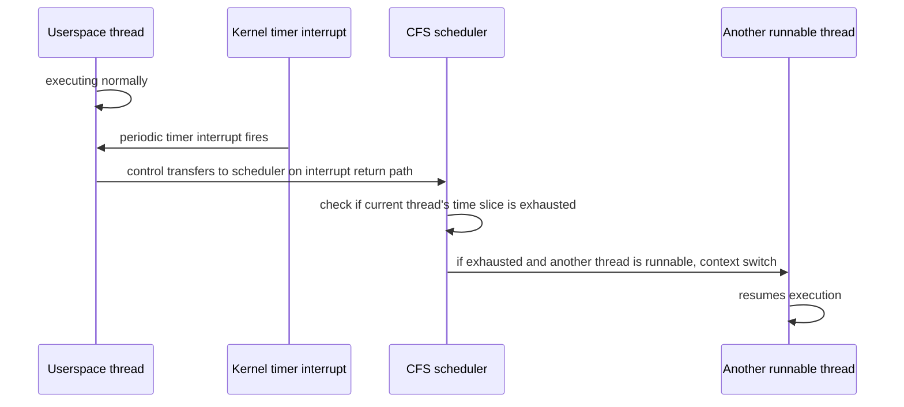

This is why `/proc/[pid]/status`'s `State` field and `/proc/stat`'s
context-switch counters are trustworthy diagnostic signals: they are not
estimates, they are the direct byproduct of this same timer-interrupt-driven
scheduling loop that every process on the system is subject to, including
the very tool (`top`) reading them.

For eBPF, the attach-to-detach lifecycle matters for the practical toolkit in
Section 4.8: a `bpftrace` one-liner's program is loaded, verified, JIT
-compiled, and attached at invocation, and automatically detached and
unloaded when the `bpftrace` process exits — there is no persistent kernel
-side state left behind, which is part of why ad hoc production tracing with
`bpftrace` is considered low-risk compared to installing a permanent kernel
module.

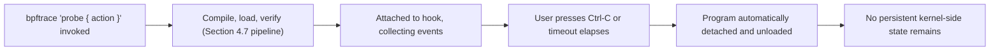

## 6. Design Principles

Four design principles run through everything this chapter teaches, and an
architect can apply them even to tools and mechanisms not explicitly covered
here:

1. **Prefer observation over interception.** `/proc` and `/sys` reads
   (observation) cost nothing extra and change nothing; `strace` (full
   interception of every syscall) is powerful but expensive and invasive.
   Always reach for the cheapest form of visibility that answers the
   question.
2. **Cumulative counters need two samples, not one.** Nearly every kernel
   -exposed counter (CPU ticks, I/O bytes, page faults) is monotonically
   increasing since boot or process start; a rate, not a single reading, is
   almost always the actually useful number.
3. **Attribute resource pressure to the correct scope.** Host-wide,
   cgroup-scoped, and per-process signals answer different questions
   (Section 4.3); checking the wrong scope produces confidently wrong
   conclusions, not just incomplete ones.
4. **Verified, event-driven extensibility beats blanket interception or
   custom kernel modules.** eBPF's core design insight — sandboxed,
   verified, narrowly-scoped programs attached to specific events — is a
   reusable pattern for extending any system safely, not just the kernel.

## 7. Architecture Patterns

**Pattern: the always-on, low-overhead observability sidecar.** Rather than
deploying `strace`-level tracing reactively during incidents, many
architectures now run a persistent, low-overhead eBPF-based agent
(Section 4.7) on every host or node, continuously exporting the kind of
`/proc`/`/sys`-derived and syscall-latency signals this chapter describes
into a centralized observability platform (recapped, not re-taught, from
[Observability](../14_Observability/PART_OVERVIEW.md)'s broader
metrics/logs/traces architecture). This turns Section 4.4's diagnostic
framework from something an engineer runs manually during an incident into
pre-collected data an engineer queries after the fact.

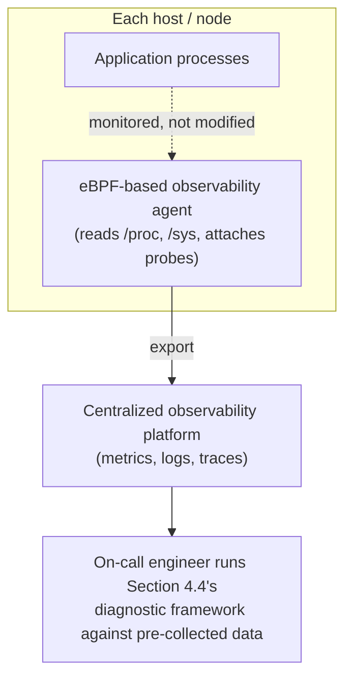

**Pattern: kernel-version gating in platform provisioning.** Given Section
4.5's kernel-version dependency risk, mature platform teams encode a minimum
kernel version (and confirmation of the specific feature, such as cgroups v2
being active, per Section 4.5's common failure mode) as an explicit
provisioning-time check — failing node bring-up loudly rather than allowing
silent feature degradation discovered later in production.

## 8. Production Architecture

In a realistic production estate, this chapter's tools and framework operate
across three tiers: the individual host/node (where `/proc`, `/sys`, `top`,
`ss` operate directly), the container/cgroup layer (where resource
attribution actually happens, per Section 4.3), and the fleet-wide
observability platform (where eBPF-based agents aggregate signals across
every host, per Section 7's pattern). A production-grade Linux internals
practice makes sure all three tiers are queryable *before* an incident: node
-level SSH access and diagnostic tooling installed, cgroup-scoped dashboards
per workload rather than only host aggregates, and an eBPF-based agent
already running (not something to be installed mid-incident, which both
costs time and risks perturbing the very system under investigation).

## 9. Implementation

Implementing this chapter's framework operationally means codifying Section
4.4's decision tree as an actual runbook or automated script (Section 10's
first code example does exactly this), wiring cgroup-scoped metrics
(Section 4.3) into whatever metrics platform the organization already uses,
and confirming — as part of onboarding any new host image or Kubernetes node
pool — that the kernel version and cgroup mode meet the baseline established
in Section 4.5.

## 10. Complete Code Examples

**Example 1 — systematic incident-diagnosis shell sequence.** A direct,
runnable implementation of Section 4.4's decision tree, suitable for a
runbook or an automated first-response script.

```bash
#!/usr/bin/env bash
# incident-triage.sh -- follows Section 4.4's diagnostic decision tree
# Usage: ./incident-triage.sh <pid-or-cgroup-path>
set -euo pipefail

TARGET_PID="${1:?Usage: $0 <pid>}"
CGROUP_PATH="/sys/fs/cgroup$(awk -F: '{print $3}' "/proc/${TARGET_PID}/cgroup" | head -1)"

echo "== Step 1: OOM / kernel error check =="
dmesg --time-format iso 2>/dev/null | grep -iE "out of memory|oom_kill" | tail -5 || true
if [[ -f "${CGROUP_PATH}/memory.events" ]]; then
    echo "cgroup memory.events (look for rising oom_kill count):"
    cat "${CGROUP_PATH}/memory.events"
fi

echo "== Step 2: CPU saturation check =="
echo "Load average (1/5/15 min): $(cat /proc/loadavg)"
if [[ -f "${CGROUP_PATH}/cpu.stat" ]]; then
    echo "cgroup CPU throttling (nonzero nr_throttled = CPU-quota problem):"
    grep -E "nr_throttled|throttled_usec" "${CGROUP_PATH}/cpu.stat"
fi

echo "== Step 3: I/O-wait (D-state) check =="
STATE=$(awk '/^State:/{print $2}' "/proc/${TARGET_PID}/status")
echo "Process state: ${STATE} (D = uninterruptible sleep, usually I/O wait)"
if [[ -f "/proc/${TARGET_PID}/io" ]]; then
    echo "Per-process I/O counters:"
    cat "/proc/${TARGET_PID}/io"
fi

echo "== Step 4: thread count / context-switch check =="
THREADS=$(awk '/^Threads:/{print $2}' "/proc/${TARGET_PID}/status")
echo "Thread count: ${THREADS}"
grep -E "^voluntary_ctxt_switches|^nonvoluntary_ctxt_switches" \
    "/proc/${TARGET_PID}/status" 2>/dev/null || true

echo "== Step 5: reproduce outside container? =="
echo "Manual step: re-run the workload outside its cgroup/namespace and compare."
```

**Example 2 — `/proc`-based introspection script.** A small Python 3
utility that reads Section 4.2's per-process files directly, computing a
rate (not a raw counter) for I/O throughput, following the "two samples, not
one" design principle from Section 6.

```python
#!/usr/bin/env python3
"""Sample /proc/[pid]/io twice and report read/write throughput deltas."""
import sys
import time

def read_io_counters(pid: int) -> dict[str, int]:
    counters = {}
    with open(f"/proc/{pid}/io") as f:
        for line in f:
            key, value = line.strip().split(": ")
            counters[key] = int(value)
    return counters

def main(pid: int, interval_seconds: float = 1.0) -> None:
    first = read_io_counters(pid)
    time.sleep(interval_seconds)
    second = read_io_counters(pid)

    read_bytes_per_sec = (second["read_bytes"] - first["read_bytes"]) / interval_seconds
    write_bytes_per_sec = (second["write_bytes"] - first["write_bytes"]) / interval_seconds

    print(f"PID {pid} over {interval_seconds}s window:")
    print(f"  read_bytes/sec  = {read_bytes_per_sec:,.0f}")
    print(f"  write_bytes/sec = {write_bytes_per_sec:,.0f}")

if __name__ == "__main__":
    target_pid = int(sys.argv[1])
    main(target_pid)
```

**Example 3 — minimal `bpftrace` one-liner.** Demonstrates Section 4.7's
eBPF mechanism end to end: a single event-driven probe attached to every
`read()` system call entry/return pair, histogramming latency system-wide
with negligible overhead compared to `strace`.

```bash
# Histogram of read() syscall latency (microseconds), system-wide, for 30 seconds.
# Requires bpftrace installed; run as root.
sudo timeout 30 bpftrace -e '
    tracepoint:syscalls:sys_enter_read
    {
        @start[tid] = nsecs;
    }
    tracepoint:syscalls:sys_exit_read
    /@start[tid]/
    {
        @read_latency_us = hist((nsecs - @start[tid]) / 1000);
        delete(@start[tid]);
    }
'
```

**Example 4 — cgroup v2 resource snapshot script.** Ties Section 4.3 and
4.6 together: a shell one-liner suitable for a health-check endpoint or a
scheduled job that surfaces the exact numbers the diagnostic framework in
Section 4.4 checks first for a given systemd unit or container.

```bash
#!/usr/bin/env bash
# cgroup-snapshot.sh -- print the cgroup v2 numbers Section 4.4 checks first
set -euo pipefail
CGROUP_DIR="${1:?Usage: $0 /sys/fs/cgroup/<slice>/<unit>}"

echo "Memory: $(cat "${CGROUP_DIR}/memory.current") / $(cat "${CGROUP_DIR}/memory.max") bytes"
echo "Memory events:"; cat "${CGROUP_DIR}/memory.events"
echo "CPU stats:"; cat "${CGROUP_DIR}/cpu.stat"
echo "I/O stats:"; cat "${CGROUP_DIR}/io.stat" 2>/dev/null || echo "(no I/O controller enabled)"
```

## 11. Performance

Every tool in Section 4.8 has a measurable performance cost, and choosing the
wrong one for the situation is itself a performance mistake. `/proc`/`/sys`
reads (Sections 4.2-4.3) are effectively free — a few microseconds of kernel
formatting work per read. `top`/`htop`/`ss` (Section 4.8) add negligible
overhead by sampling periodically. `perf`'s hardware-counter-based sampling
adds low, generally production-safe overhead. `strace`'s `ptrace`-based
interception can add order-of-magnitude slowdowns to syscall-heavy
workloads, because every traced syscall now involves two extra context
switches to the tracer process. eBPF programs (Section 4.7) sit between
these extremes: overhead scales with how often the attached event fires and
how much work the program does per event, which is why narrowly scoped
probes (a specific tracepoint, a latency threshold filter) are preferred
over broad, unconditional ones.

## 12. Scalability

The diagnostic framework in Section 4.4 and the toolkit in Section 4.8 both
scale from a single host to a fleet only through the "always-on
observability sidecar" pattern in Section 7 — running `strace` or an ad hoc
`bpftrace` script by hand across thousands of hosts during an incident does
not scale; pre-aggregated cgroup-scoped and eBPF-derived metrics, queryable
centrally, do. Kernel-version and cgroup-mode consistency (Section 4.5)
becomes more important, not less, as fleet size grows, because a
heterogeneous fleet multiplies the number of feature-availability edge cases
an architect must account for.

## 13. Security

eBPF's verifier (Section 4.7) is itself a security-relevant design: it is
the mechanism that lets unprivileged-adjacent tracing and networking
functionality run without granting a full custom-kernel-module's blast
radius. Loading eBPF programs still requires `CAP_BPF`/`CAP_PERFMON` (or
root, on older kernels) capabilities, so the security boundary is not
"anyone can attach eBPF programs," it is "verified programs, loaded only by
sufficiently privileged callers, cannot crash or escape the kernel the way
an unverified kernel module can." `strace`'s `ptrace`-based interception
similarly requires the tracer to have permission to trace the target process
(same user, or `CAP_SYS_PTRACE`), which is why production environments
increasingly restrict raw `ptrace` access (some container runtimes disable
it by default via seccomp, recapped from
[Virtualization and Container Fundamentals](CH28_Virtualization_and_Container_Fundamentals.md))
even though it complicates ad hoc debugging — a deliberate security
trade-off, not an oversight.

## 14. Observability

This entire chapter is, in one sense, about observability infrastructure
itself — Sections 4.2-4.3 are the raw data sources, Section 4.7 is the
modern low-overhead collection mechanism, and Section 7's sidecar pattern is
how those pieces compose into a fleet-wide observability architecture. The
distinct contribution versus the dedicated
[Observability](../14_Observability/PART_OVERVIEW.md) part of this
handbook is depth at the kernel-signal layer specifically — this chapter
teaches where the numbers *come from*, while the Observability part (recap
only, not re-taught here) teaches how to structure metrics, logs, and traces
as a discipline once you have them.

## 15. Failure Scenarios

**Scenario: OOM kill masquerading as a network partition.** A downstream
service reports intermittent connection resets from a container. Naive
triage assumes a network problem. Following Section 4.4's framework's first
step, `dmesg`/cgroup `memory.events` shows a rising `oom_kill` count timed
exactly to each reported reset — the container is being killed and restarted
by the kernel's OOM killer (owned in full by
[Memory Management](CH25_Memory_Management.md#4-core-concepts)), and the
"connection reset" symptom is simply what a client sees when a server
process disappears mid-connection, not evidence of a network fault at all.

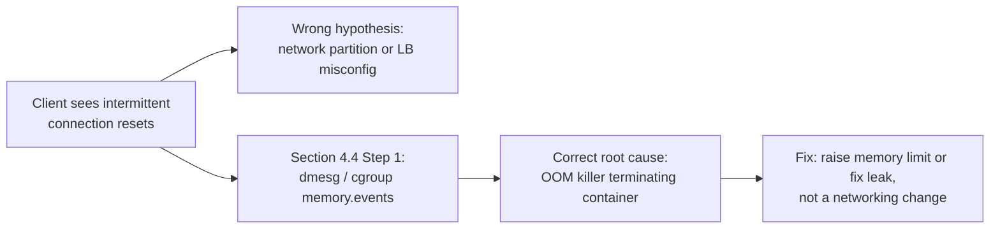

**Scenario: CPU throttling misdiagnosed as inefficient code.** A team spends
a sprint profiling application code for a latency regression before checking
`cpu.stat`'s `nr_throttled` counter (Section 4.3), which shows the container
has been hitting its CPU quota under a recent traffic increase — the fix was
a one-line resource-limit change, not an application optimization effort.

## 16. Testing

Section 4.4's diagnostic framework itself should be exercised before an
incident, not during one: chaos-engineering-style drills that deliberately
induce each of the five failure classes (a memory leak triggering an OOM
kill, a CPU-bound busy loop, an artificially throttled cgroup, a
lock-contention bug, a seccomp-restricted syscall) in a staging environment
let an on-call rotation practice walking the decision tree under low-stakes
conditions, confirming the runbook script from Section 10's first example
actually surfaces the right signal for each induced failure.

## 17. Common Mistakes

- Reading a cumulative `/proc` counter once and treating it as a rate
  (Section 4.2/Section 6).
- Checking only host-wide `/proc/meminfo` and missing a cgroup-scoped OOM
  kill (Section 4.3/Section 15).
- Reaching for `strace -f` on a live production process as a first
  diagnostic step instead of a last one (Section 4.8).
- Assuming a distribution's marketing version implies a specific kernel
  feature set instead of checking `uname -r` and the feature directly
  (Section 4.5).
- Assuming eBPF-based tooling has zero runtime cost simply because it is
  "verified" (Section 4.7).
- Rolling out cgroup-v1-specific tooling or dashboards onto a fleet that has
  partially migrated to cgroups v2 (Section 4.6).

## 18. Best Practices

- Walk Section 4.4's diagnostic tree in order — cheap, non-invasive checks
  first — rather than jumping straight to the most powerful (and most
  expensive/invasive) tool available.
- Instrument cgroup-scoped metrics (Section 4.3), not only host-wide
  metrics, for every containerized workload.
- Treat kernel version and cgroup mode as an explicit, checked platform
  prerequisite (Section 4.5) before adopting tooling that depends on modern
  kernel features.
- Run an always-on, narrowly scoped eBPF-based observability agent
  (Section 7) rather than relying solely on reactive, incident-time tracing.
- Keep the incident-triage script from Section 10 versioned and rehearsed
  (Section 16), not written for the first time during a live incident.

## 19. Anti-Patterns

- **Tool-first triage**: reaching for the most familiar tool (often
  `strace` or a language-level profiler) regardless of what the symptom
  actually suggests, instead of following Section 4.4's resource-class-first
  ordering.
- **Host-only monitoring for containerized workloads**: dashboards that show
  only node-level `/proc` aggregates, systematically blind to cgroup-scoped
  OOM kills and CPU throttling (Section 4.3).
  Container isolation problems in general are owned by
  [Virtualization and Container Fundamentals](CH28_Virtualization_and_Container_Fundamentals.md);
  this chapter only recaps the diagnostic symptom, not the isolation
  mechanism itself.
- **Kernel-feature assumption without verification**: adopting a tool or
  platform because its documentation says "requires a modern Linux kernel"
  without checking the actual target kernel version and feature flags
  (Section 4.5).

## 20. Trade-off Analysis

| Decision | Option A | Option B | Trade-off |
|---|---|---|---|
| Introspection method | `/proc`/`/sys` reads | `strace`/full syscall tracing | Free and safe vs. expensive and invasive but exhaustive |
| Extensibility mechanism | Custom kernel module | eBPF program | Full capability + full crash risk vs. verified, sandboxed, slightly narrower capability |
| Kernel/distro choice | Enterprise LTS (frozen version) | Recent mainline-tracking kernel | Long support lifecycle vs. current feature availability |
| Observability posture | Reactive (tool installed during incident) | Always-on sidecar (Section 7) | Zero standing cost vs. standing overhead but pre-collected data |
| cgroup hierarchy | v1 (legacy, per-controller) | v2 (unified) | Broad legacy tool compatibility vs. modern unified accounting |

## 21. Comparison Table

| Tool/Mechanism | Overhead | Best for | Owning depth (if applicable) |
|---|---|---|---|
| `/proc`, `/sys` | Effectively free | Point-in-time and cgroup-scoped state | This chapter (4.2-4.3); mechanisms owned by CH24/CH25/CH28 |
| `top` / `htop` | Negligible | Broad CPU/memory overview, sampled | This chapter (4.8) |
| `ss` | Negligible | Socket/connection state | This chapter (4.8); socket mechanics owned by [Sockets](CH16_Sockets.md) |
| `perf` | Low | Precise CPU call-stack attribution | This chapter (4.8) |
| `strace` | High | Exact syscall arguments/timing, targeted use only | This chapter (4.8); syscall boundary owned by 4.1 |
| `bpftrace` / eBPF | Low, scales with event rate | Ad hoc, low-overhead, targeted kernel-event questions | This chapter (4.7) |

## 22. Real-World Case Study

A mid-size e-commerce platform's checkout service began intermittently
failing health checks under normal (not peak) traffic. Initial triage
assumed a networking issue, since the symptom looked like dropped
connections. Applying Section 4.4's framework in order: `dmesg` and the
container's `memory.events` showed no OOM kills, ruling out memory as the
first hypothesis. `top` scoped to the container's assigned cores showed
CPU pegged at the container's configured limit during exactly the windows
health checks failed. `cpu.stat` confirmed a rapidly climbing
`nr_throttled` counter. Root cause: a recent dependency upgrade had made a
JSON-serialization library measurably more CPU-hungry per request, and the
container's CPU limit — sized against the old dependency's profile — was
now too tight for the new one, causing the kernel's CFS bandwidth controller
to throttle the container mid-burst, right when health-check requests
happened to compete with regular traffic for the same CPU quota.

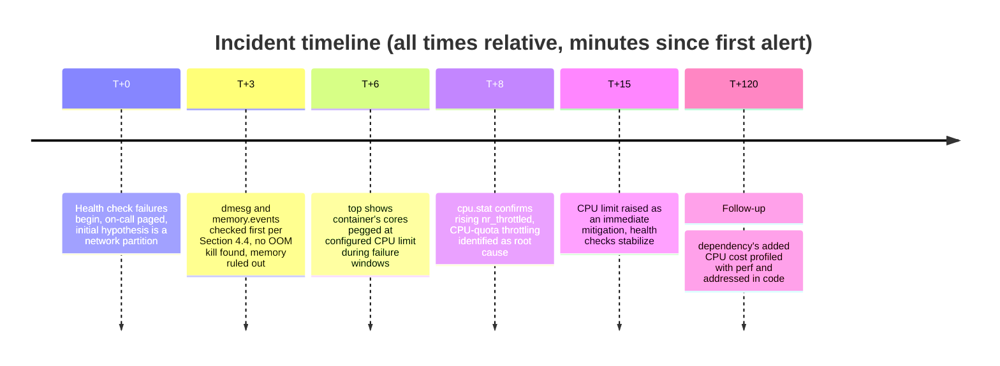

The fix that actually resolved the immediate incident took fifteen minutes
once the framework pointed at the right resource class; without it, the team
would likely have spent the first hour investigating the network layer
before circling back to CPU limits by elimination.

## 23. Interview Questions

1. Walk through what happens, at the kernel/userspace-boundary level, when
   an application calls `read()`. (Section 4.1)
2. A container is killed and restarted repeatedly, but the host shows
   plenty of free memory. What do you check next, and why? (Sections 4.3,
   15)
3. Given a report of "the service is slow," describe your diagnostic order
   of operations and why that order matters. (Section 4.4)
4. Why can an eBPF program not crash the kernel the way a buggy kernel
   module can? (Section 4.7)
5. Why might an observability agent that works fine on one node fail to
   load correctly on another, seemingly identical, node? (Section 4.5)
6. What is the difference between what `top`, `perf`, and `strace` each
   answer, and when would reaching for the wrong one waste time during an
   incident? (Section 4.8)
7. Why is a single read of `/proc/[pid]/io` insufficient to answer "how much
   I/O is this process doing"? (Section 4.2, Section 6)

## 24. Hands-on Exercises

1. On a Linux host or Virtual Machine (VM), run the Section 10 Example 1
   triage script against a deliberately memory-constrained cgroup running a
   memory-hungry process, and confirm it surfaces the OOM signal correctly.
2. Run the Section 10 Example 3 `bpftrace` one-liner while generating file
   I/O load, and compare its overhead (observed via `top`) against running
   `strace -f -e read` against the same workload.
3. Use Example 2's Python script to measure I/O throughput for a process
   copying a large file, and verify the reported rate matches an independent
   measurement (for example, `time cp` divided by file size).
4. Check `uname -r` and `cat /sys/fs/cgroup/cgroup.controllers` on two
   different hosts in your environment and confirm whether they are running
   the same cgroup mode, per Section 4.5's common failure mode.

## 25. Design Exercises

1. Design an always-on observability sidecar architecture (Section 7) for a
   200-node Kubernetes fleet that surfaces Section 4.4's five failure
   classes into a single dashboard per workload. Specify what each of your
   five failure-class panels reads from (which `/proc`/`/sys` file or eBPF
   probe) and how you would validate it, per Section 16, before trusting it
   during a real incident.
2. Your organization is evaluating migrating from an enterprise-LTS kernel
   distribution to a faster-cadence, mainline-tracking distribution to gain
   `io_uring` and modern eBPF feature support (Section 4.5). Write the
   decision memo: what capabilities does the migration unlock, what support
   -lifecycle risk does it introduce, and what would you check on each node
   before and after migration to confirm the expected features are actually
   present.

## 26. Architecture Review Questions

1. For each containerized workload in this system, is resource pressure
   monitored at the cgroup scope, or only at the host-aggregate scope?
   (Section 4.3)
2. Is there a documented, rehearsed incident-diagnosis runbook that follows
   an order-of-operations similar to Section 4.4, or does triage rely on
   individual engineers' undocumented tribal knowledge?
3. Has the minimum kernel version and cgroup mode required by every
   platform-level tool (service mesh, observability agent, container
   runtime) been explicitly verified against the actual fleet, per Section
   4.5?
4. Is any production tracing tool (`strace` or equivalent) used reactively
   only, or is it ever left running continuously in a way that could itself
   be contributing to load?
5. Does the observability architecture rely on an always-on, low-overhead
   collection mechanism (Section 7), or does it depend on installing new
   tooling reactively during incidents?

## 27. Summary

Every mechanism the five sibling chapters in this Operating Systems
subsection taught — process and thread isolation
([Processes and Threads](CH24_Processes_and_Threads.md)), virtual memory and
the OOM killer ([Memory Management](CH25_Memory_Management.md)), how files
become bytes on disk ([File Systems](CH26_File_Systems.md)), how the kernel
schedules CPU time and I/O
([I/O and Scheduling](CH27_IO_and_Scheduling.md)), and how namespaces and
cgroups build containers
([Virtualization and Container Fundamentals](CH28_Virtualization_and_Container_Fundamentals.md)) —
is only ever visible to an architect through the kernel/userspace boundary
and its system calls (Section 4.1), and only ever readable, in practice,
through `/proc` and `/sys` (Sections 4.2-4.3). This chapter's central,
reusable contribution is the unified diagnostic framework in Section 4.4: a
concrete, ordered sequence — OOM/kernel-error check, CPU saturation check,
I/O-wait state check, thread/lock contention check, container-isolation
reproduction check — that turns five separately-taught mechanisms into one
practical incident-response tool. Layered on top of that framework, kernel
version and distribution choice (Section 4.5) determine which modern
capabilities — cgroups v2, `io_uring`, mature eBPF — are even available, and
eBPF itself (Section 4.7) represents a genuinely new class of capability: safe,
verified, event-driven kernel extensibility that is reshaping how production
observability is built. None of this replaces deep expertise in any one
subsystem; it is the connective layer that lets an architect move from "I
know what a process is" and "I know what virtual memory is" to "I know what
to check, in what order, at 2 a.m., to find out which of the five things it
actually is."
