# Chapter: Normalization (Database Design)

Part: [06 — Databases and Storage](PART_OVERVIEW.md) · Status: Drafted

## 1. Introduction

Normalization is the discipline of organizing the tables of a relational
database so that every fact is stored in exactly one place, derivable from
the table's key and nothing else. It is the first schema-design decision a
Solution Architect makes on any Online Transaction Processing (OLTP) system,
and it is the *owning* chapter for functional dependencies, the normal-form
hierarchy (1NF through 5NF and BCNF — Boyce-Codd Normal Form), and the
update/insert/delete anomaly taxonomy, per the Concept Ownership Rule in
[STYLE_GUIDE.md](../STYLE_GUIDE.md). As the first chapter of Part 06, there
are no sibling chapters yet to recap — this chapter teaches these concepts
from first principles so that every later chapter in this part (the future
Denormalization chapter, and every specific-database chapter such as
PostgreSQL, MySQL, or MongoDB) can recap this chapter's normal-form
definitions in two or three sentences rather than re-deriving them.

Normalization is not a purity ritual and it is not "more tables is always
better." It is a mechanical, provable procedure — grounded in relational
algebra developed by Edgar F. Codd at IBM — for detecting a specific,
narrow class of data-integrity bugs *before* they exist, by examining the
functional dependencies between a table's columns rather than waiting to
discover the bugs in production. A schema designer who understands
normalization can look at a table and predict, without writing a single row
of test data, exactly which UPDATE, INSERT, or DELETE statements will
silently corrupt data or reject valid data. A schema designer who does not
understand it will discover the same bugs later, in production, as
mysterious data inconsistencies that no one can explain because the schema
never made the dependency explicit.

This chapter also treats the other half of the story honestly: normalization
has a well-understood cost (more tables, more JOIN operations, more
round trips under naive access patterns), and real production OLTP schemas
routinely stop short of the highest normal forms, or selectively
denormalize specific hot paths, once that cost is measured against a
concrete latency or throughput requirement. The goal is not "normalize
everything to 5NF" — it is to know exactly which anomaly each normal form
eliminates, so that any decision to stop short of it, or to denormalize
later, is a deliberate, reasoned trade-off instead of an accident of not
knowing the rule existed.

## 2. Historical Evolution

- **1970 — Codd's relational model (E. F. Codd, "A Relational Model of Data
  for Large Shared Data Banks")** — the foundational paper that introduced
  relations (tables), tuples (rows), and the idea that data should be
  queried through a declarative algebra rather than navigated through
  hand-coded pointers, as the hierarchical and network databases of the era
  required.
- **1971 — First, Second, and Third Normal Form (Codd)** — in a follow-up
  paper, Codd formalized 1NF, 2NF, and 3NF as a sequence of provably
  stronger integrity guarantees, each one eliminating a specific class of
  update anomaly that the previous form still permitted.
- **1974 — Boyce-Codd Normal Form (Raymond Boyce and E. F. Codd)** — a
  tightening of 3NF that closes a subtle gap 3NF's original definition left
  open: 3NF is silent about certain anomalies that only appear when a table
  has more than one candidate key (Section 4.5).
- **1977 — Fourth Normal Form (Ronald Fagin)** — introduced multivalued
  dependencies as a distinct kind of dependency (beyond functional
  dependencies) and defined 4NF to eliminate the redundancy they cause even
  in tables that are already in BCNF.
- **1979 — Fifth Normal Form / Project-Join Normal Form (Fagin)** — the
  final classical normal form, addressing join dependencies that cannot be
  decomposed via a sequence of binary (two-table) splits, only recoverable
  by joining three or more tables back together without introducing spurious
  rows.
- **1980s-1990s — normalization becomes standard relational database
  management system (RDBMS) design practice** — as commercial RDBMS
  products (Oracle, DB2, SQL Server, later PostgreSQL and MySQL) matured,
  normalized schema design became the default taught discipline for OLTP
  system design, formalized in university curricula and RDBMS vendor
  certification material.
- **2000s — the NoSQL and denormalization-by-default reaction** — as
  web-scale systems ran into the JOIN and multi-node transaction costs of
  fully normalized schemas, document and key-value stores (MongoDB,
  DynamoDB, Cassandra) popularized denormalized, embedded-document schema
  design as the *default* for high-throughput read paths, explicitly trading
  Codd's redundancy-elimination guarantees for locality and horizontal
  scalability — a trade-off this chapter's Section 12 and Section 20 examine
  in depth, and which the future Denormalization chapter in this part
  explores as its central topic.
- **2010s-present — normalization as one deliberate layer of a
  polyglot-persistence architecture** — the current mainstream position (and
  this chapter's position) is neither "always normalize" nor "always
  denormalize," but rather: normalize the OLTP system of record to
  eliminate anomalies where correctness matters most, and layer
  purpose-built denormalized read models (materialized views, caches,
  search indexes, read replicas) on top for the access patterns that need
  them — a pattern this chapter's Section 7 develops.

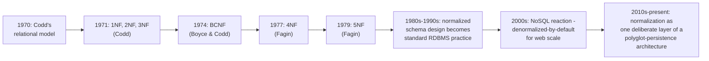

## 3. Why It Exists

A relational database's core promise is that a fact is stored once, and
every query that needs that fact reads the same single, current copy of it.
Without a disciplined design process, nothing stops a schema author from
storing a customer's email address on every order row that customer ever
places — the database will happily accept that schema, and it will work
correctly for `SELECT` queries. The problem surfaces the moment the data
needs to *change*: if the customer updates their email, an application (or a
DBA — Database Administrator — running an ad-hoc script) must find and
update every one of those repeated copies, and if even one row is missed,
the database now contains two different "true" answers to "what is this
customer's email?" with no way to know which one is current. Normalization
exists to make this class of bug structurally impossible rather than
relying on application discipline to catch every place a fact is
duplicated: by mechanically decomposing a table so that every non-key
column depends on the *whole* key and *nothing but* the key, each fact
ends up stored in exactly one row, in exactly one table, and every write to
that fact is a single, atomic, unambiguous operation. This matters most
precisely where an OLTP system's core integrity guarantee lives — order
totals, account balances, inventory counts — because an anomaly there is
not a cosmetic bug, it is corrupted business data that downstream reports,
invoices, and financial reconciliations will silently propagate.

## 4. Core Concepts

### 4.1 Functional dependencies

**Definition.** A functional dependency, written `X -> Y` ("X determines
Y"), holds between two sets of columns in a table when knowing the value of
`X` for any row is always enough to determine the value of `Y` for that same
row — no two rows can share the same `X` value while disagreeing on `Y`. `X`
is called the *determinant*; the table's primary key is, by definition, a
determinant for every other column in the table (that is what "primary key"
means relationally).

**Mechanism.** Functional dependencies are discovered, not invented — a
schema designer studies the real-world business rules the data represents
and asks, for every pair of columns, "if I know this column's value, is the
other column's value always fixed?" For example, in an `order_items` table
keyed by `(order_id, line_number)`: does `product_sku` alone determine
`product_name`? Yes — every row with `SKU-100` will always show "Wireless
Mouse," so `product_sku -> product_name` is a functional dependency that
does *not* require the full composite key. This is the mechanical test every
subsequent normal form (2NF onward) is built on: find every functional
dependency in a table, then check whether each one's determinant is the
whole key, part of the key, or not the key at all.

**Decision implications.** Every normalization decision in this chapter
reduces to correctly identifying functional dependencies. Get this step
wrong — miss a real dependency, or assume a dependency that isn't actually
guaranteed by the business rules — and every downstream normal-form
classification is wrong too. This is why normalization is fundamentally a
*modeling* skill, not a mechanical column-shuffling exercise: it requires
understanding what the data actually means, not just what shape it currently
has.

**Common failure mode.** Confusing a functional dependency that happens to
be true of the *current sample data* with one that is guaranteed by the
business rule. If a demo dataset happens to have exactly one product per
price point, `product_price -> product_sku` might look like a valid
functional dependency in that sample — but the business rule ("each SKU has
one price, not each price maps to one SKU") is the opposite direction, and
the first new product added at an existing price point breaks the false
assumption immediately.

**Scenario.** A payroll table stores `(employee_id, department_id,
department_budget_code)`. If every department has exactly one budget code,
`department_id -> department_budget_code` is a valid functional dependency,
and — crucially — it does *not* depend on `employee_id` at all. This single
observation is what later flags this table as violating 3NF (Section 4.4):
`department_budget_code` depends on `department_id`, which is itself just a
non-key attribute of the employee row, not the table's key.

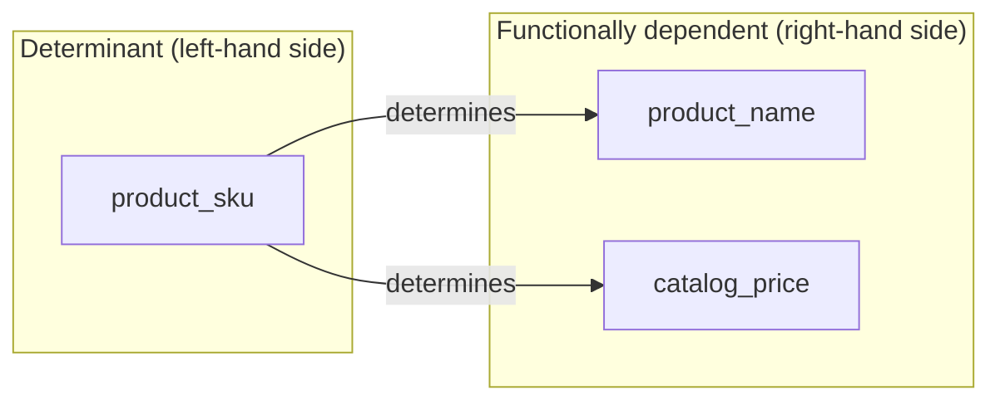

### 4.2 First Normal Form (1NF)

**Definition.** A table is in 1NF when every column holds a single, atomic
value (no repeating groups of columns, and no comma-separated or nested
lists stuffed into one cell), and every row is uniquely identifiable by a
key.

**Mechanism.** The mechanical test is: can this table represent "two of
something" only by adding a whole new row, or does it instead need a whole
new *column* (like `product_2_sku`, `product_3_sku`, ...) to represent a
second occurrence of the same kind of fact? A table with `product_1_sku`,
`product_2_sku`, `product_3_sku` columns is not in 1NF, because "which
product" is really one repeating fact (a product on an order), and the
schema is encoding "how many times it repeats" into the table's column list
instead of its row count. The fix is always the same: pull the repeating
group into its own table, keyed by the original table's key plus a new
column that numbers or otherwise identifies each repetition (`line_number`
in the order-items example in Section 10).

**Decision implications.** 1NF is the only normal form that is close to
non-negotiable in modern relational database management: violating it
doesn't just risk an anomaly, it actively breaks basic SQL operations —
`SUM(product_1_price + product_2_price)` cannot generalize to an order with
15 line items, `WHERE product_sku = 'SKU-100'` cannot search across an
unknown number of repeating columns, and adding a 3rd item to a
2-item-capacity schema requires an `ALTER TABLE` migration in production.
Whenever a schema shows numbered-suffix columns (`phone_1`, `phone_2`,
`address_1`, `address_2`) or a single column holding a serialized list
(`"SKU-100,SKU-204"`), that is the 1NF violation signature.

**Common failure mode.** "Solving" a repeating group by storing it as a
single delimited string or JSON array in one column (e.g. `line_items =
'[{"sku":"SKU-100","qty":2}]'`) instead of a proper child table. This
technically avoids the numbered-column problem, but it reintroduces the same
underlying issue in a different shape: the database engine can no longer
enforce referential integrity, indexed lookups, or aggregate functions on
the individual items without parsing the string/JSON blob in every query,
which defeats most of what a relational engine is for. (Modern engines with
native JSON column types, discussed in Section 12, are a deliberate,
narrower exception to this — used when the embedded structure is genuinely
schema-flexible and rarely queried by its internal fields, not as a default
substitute for 1NF.)

**Scenario.** A retail order form UI naturally captures "up to 2 items" per
order in its first release. The database designer, mirroring the UI form
exactly, creates `product_1_sku`/`product_2_sku` columns. Eight months later
a large B2B customer submits an order with 40 line items, and the team
discovers there is no way to represent it without a schema migration under
production load — the 1NF violation, invisible during the UI-driven design
phase, becomes an emergency the moment real-world cardinality exceeds the
column count the schema hard-coded.

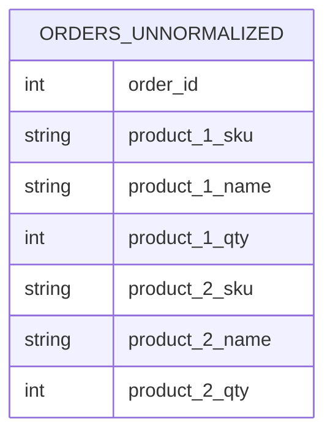

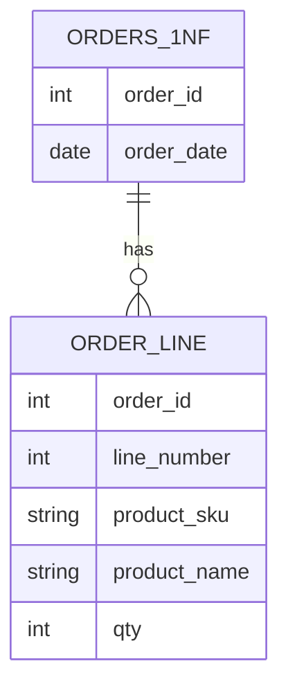

### 4.3 Second Normal Form (2NF)

**Definition.** A table is in 2NF when it is already in 1NF, and every
non-key column depends on the *entire* primary key — not on just part of a
composite (multi-column) key. This rule is vacuously true for any table
whose key is a single column; 2NF violations only exist in tables with
composite keys.

**Mechanism.** The mechanical test is a "partial dependency" check: for a
table keyed on `(A, B)`, does any non-key column actually depend on just
`A` (or just `B`) alone, ignoring the other half of the key? In the 1NF
`order_items`-shaped table keyed on `(order_id, line_number)`, does
`product_name` depend on the whole key, or just on `product_sku` (which
itself depends on just part of the key's *context*, not literally
`line_number`)? More precisely: `product_name` is fully determined by
`product_sku` alone once `product_sku` is a column on the row — and since
`product_sku` is not part of the key at all, this reveals that
`product_name` doesn't need `order_id` or `line_number` to be pinned down.
The fix is to split `product_sku`/`product_name`/`catalog_price` into their
own `products` table keyed on `product_sku`, leaving `order_items` with only
columns that genuinely depend on both `order_id` and `line_number`
(`quantity`, `unit_price` — the price actually charged, as distinct from the
catalog price, Section 17).

**Decision implications.** A 2NF violation means the same non-key fact
(e.g. `product_name` for `SKU-100`) is repeated on every order line that
references that product, which reproduces the identical update-anomaly risk
described in Section 3, just scoped to product data instead of customer
data. Splitting the table is not optional polish — every additional row
referencing the same product is another place the same fact must stay in
sync by discipline alone if the schema isn't fixed.

**Common failure mode.** Assuming 2NF only matters for "large" repeated
values (like a long customer address) and skipping the split for what looks
like a "small" value (like a `product_name`). Anomaly risk is about
*repetition*, not the byte size of the value being repeated — a two-column
partial dependency on a million-row order-items table is a million-row
update-anomaly risk the moment a product is renamed.

**Scenario.** A retailer renames "USB-C Hub" to "USB-C Hub (v2)" in its
catalog. In the 1NF-only schema, this requires an `UPDATE ... WHERE
product_sku = 'SKU-204'` across every historical order line that ever sold
that SKU — potentially millions of rows, and a query that is easy to get
subtly wrong (e.g. matching on `product_name` instead of `product_sku`,
updating some but not all rows). In the 2NF-corrected schema, it is a
single-row `UPDATE` against the `products` table.

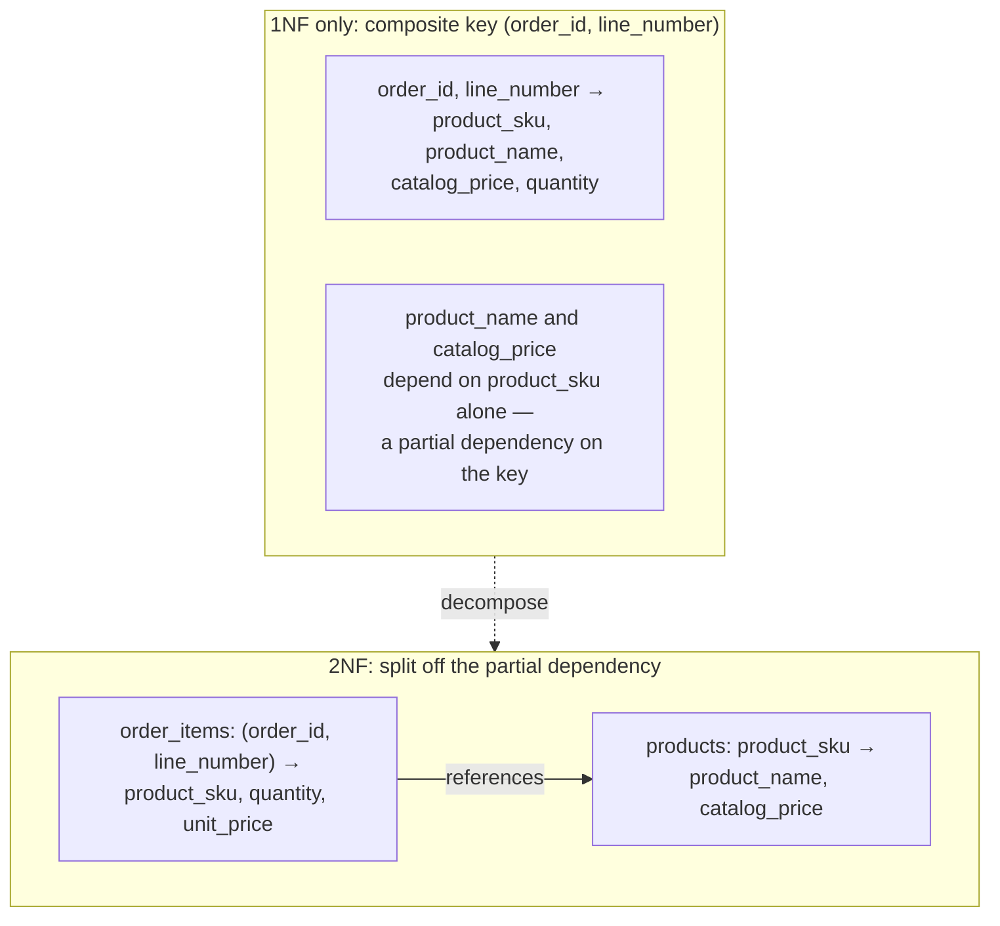

### 4.4 Third Normal Form (3NF)

**Definition.** A table is in 3NF when it is already in 2NF, and every
non-key column depends *directly* on the key, with no transitive
dependency — that is, no non-key column determines another non-key column.

**Mechanism.** The mechanical test: for every non-key column `Y`, does `Y`
depend on the primary key directly, or does it actually depend on some
*other* non-key column `Z`, which in turn depends on the key (`key -> Z ->
Y`)? In the running example, `orders(order_id, order_date, customer_id,
customer_name, customer_email, customer_address)` has
`order_id -> customer_id` (each order belongs to one customer) and
separately `customer_id -> customer_name, customer_email, customer_address`
(each customer has one name/email/address) — so
`order_id -> customer_name` only holds *transitively*, through
`customer_id`, not directly. The fix mirrors 2NF's: split the transitively
dependent columns into their own table (`customers`, keyed on
`customer_id`), leaving `orders` with only `customer_id` as a foreign key
reference, not the customer's actual attributes.

**Decision implications.** 3NF is, in practice, the normal form most OLTP
schema reviews target as the default baseline — it eliminates the two
most common and most damaging anomaly patterns (repeated non-key facts
tied to *any* other non-key column, not just part of a composite key) while
remaining intuitive to reason about, and it is the normal form assumed by
default in most "is this schema normalized?" reviews unless a specific
reason (Section 12, Section 20) argues for stopping earlier or going
further.

**Common failure mode.** Stopping the transitive-dependency search too
early — finding and fixing the obvious case (customer attributes on the
orders table) but missing a second, less obvious transitive chain in the
same table, such as `sales_rep_id -> sales_rep_region` also living
inline on `orders` instead of in its own `sales_reps` table. 3NF review
requires checking *every* non-key column pair for a hidden `key -> Z -> Y`
chain, not stopping after the first one found.

**Scenario.** A sales rep is reassigned from the "South" region to the
"West" region. Under a 3NF-violating schema that stores `sales_rep_region`
directly on every order row, every historical order that rep has ever
touched now silently shows the *old* region unless every row is bulk
updated — and worse, if the update *is* run, historical reports mistakenly
attribute past South-region performance to the rep's new West-region
territory, corrupting historical reporting instead of just fixing a
data-entry typo. Under the 3NF-corrected schema, the rep's region lives in
exactly one row of `sales_reps`, and a single, correct, semantically
intentional decision — "should historical orders retroactively show the
new region, or the region at the time of sale?" — becomes an explicit
design choice (a slowly-changing-dimension question) rather than an
accidental side effect of a bulk `UPDATE`.

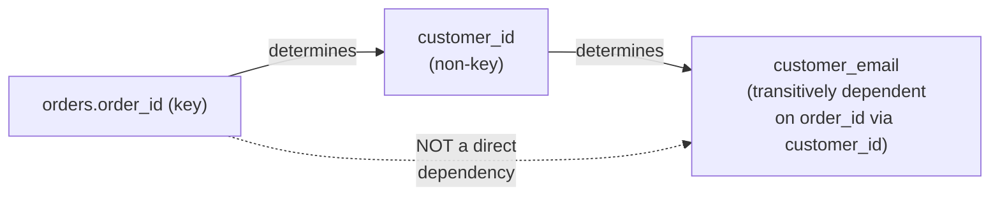

### 4.5 Boyce-Codd Normal Form (BCNF)

**Definition.** A table is in BCNF when, for every functional dependency
`X -> Y` in the table, `X` is a superkey (a candidate key, or a superset of
one) — a strictly stronger requirement than 3NF, which allows a narrow
exception 3NF's original definition carved out for certain cases involving
overlapping candidate keys.

**Mechanism.** 3NF's exception clause allows a non-key determinant to exist
*if* the columns it determines are themselves part of some candidate key.
BCNF removes that exception entirely: every determinant, no exceptions,
must be a candidate key. The classic textbook case where this distinction
actually bites: a table `enrollments(student_id, subject, instructor)`
where the business rule is "each instructor teaches exactly one subject"
(`instructor -> subject`) but "each subject can be taught by several
instructors, and a student can take a subject from any of them"
(so `(student_id, subject)` is one candidate key, and `(student_id,
instructor)` is another). This table can satisfy 3NF's relaxed rule (because
`subject` is part of a candidate key) while still permitting a genuine
anomaly: if `instructor` values are unique per row, editing an instructor's
subject assignment (e.g. Professor Diallo now teaches "Databases" instead
of "Networks") requires updating every enrollment row for every student
in that instructor's class, and forgetting even one row leaves that student
associated with an instructor teaching a subject the row still claims they
teach differently.

**Decision implications.** BCNF matters specifically when a table has
*more than one* candidate key and those keys overlap in columns — a
narrower, less common situation than the plain 2NF/3NF cases, but one that
3NF alone will not catch. A schema review should specifically check for
BCNF whenever more than one column combination could serve as a unique
identifier for a row, because that overlap is exactly the condition 3NF's
exception was designed around.

**Common failure mode.** Treating "my table passed a 3NF checklist" as
equivalent to "this table has no update anomalies." 3NF is necessary but
not sufficient whenever multiple overlapping candidate keys exist — the
BCNF check is a distinct, additional pass, not a redundant re-check of the
same rule.

**Scenario.** A university course-scheduling system stores
`(student_id, subject, instructor)` directly, following the assumption
"one row per student-subject enrollment is simple and sufficient." A
department reorganization moves an instructor to a different subject
mid-semester. The registrar's office runs an update script that changes
`instructor` for that subject on new enrollments going forward, but a
batch job that also touches historical rows (matched on `instructor`, not
`(student_id, subject)`) silently rewrites `subject` on old enrollment
rows to match the instructor's *new* subject — because the schema never
enforced that `instructor -> subject` should live in exactly one place.
Decomposing into `instructor_subject(instructor PRIMARY KEY, subject)` and
`enrollments(student_id, instructor)` (or an equivalent decomposition
preserving both candidate keys) removes the possibility of this class of
mistake entirely.

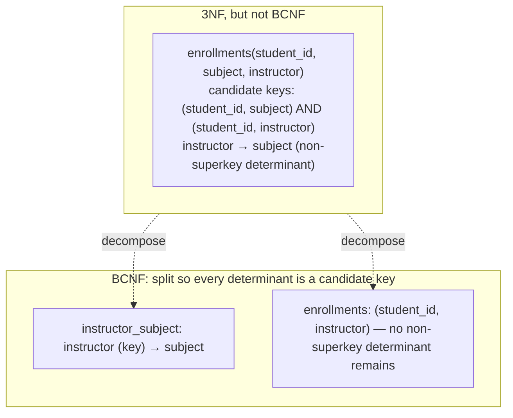

### 4.6 Fourth and Fifth Normal Form (4NF / 5NF)

These forms are rarely applied deliberately in production OLTP schema
design — most schemas that are in 3NF/BCNF never encounter the specific
multivalued or join-dependency patterns 4NF and 5NF address — but a
Solution Architect should recognize the shape of the problem when it
appears, because it produces a distinctive kind of redundancy that neither
3NF nor BCNF catches.

**Definition (4NF).** A table is in 4NF when it is in BCNF and contains no
non-trivial *multivalued dependency* — a dependency `X ->> Y` where, for a
given `X`, the set of `Y` values that can appear is fixed and independent
of any other column in the table, distinct from a functional dependency
because `Y` isn't a single determined value but an independent set.

**Mechanism.** The classic case: a table `employee_skills_languages
(employee_id, skill, language)` recording that an employee has a set of
skills *and independently* a set of spoken languages, with no relationship
between which skill pairs with which language. If Employee 7 has skills
{SQL, Python} and languages {English, Spanish}, a single flat table must
carry all four combinations (SQL/English, SQL/Spanish, Python/English,
Python/Spanish) just to represent two independent facts, or it must
tolerate the redundancy of listing (say) English against every skill row.
Neither table is in 4NF, because `employee_id ->> skill` and
`employee_id ->> language` are independent multivalued dependencies forced
into an artificial cross-product. Decomposing into two tables —
`employee_skills(employee_id, skill)` and
`employee_languages(employee_id, language)` — removes the artificial
cross-product entirely.

**Definition (5NF).** A table is in 5NF (also called Project-Join Normal
Form) when it cannot be decomposed into any smaller set of tables without
losing information or introducing spurious rows on rejoin, even via a
*join dependency* spanning three or more tables — a strictly rarer,
more subtle pattern than 4NF's pairwise multivalued case, typically
arising only in tables recording a genuine three-way business
relationship (e.g. `(supplier, part, project)` where a supplier supplies
a part to a project only under specific combined constraints that can't
be derived from any two of the three columns alone).

**Decision implications.** The practical value of knowing 4NF/5NF exist is
recognition, not routine application: when a table stores two or more
*independent* multi-valued facts about the same entity in one place (the
skills/languages shape), that is the 4NF smell, and the fix (split into
separate tables) is usually obvious once named. 5NF issues are rare enough
in ordinary OLTP design that most architects will go entire careers without
deliberately designing to it — it mainly matters when modeling complex
three-or-more-way business relationships (multi-party contracts, routing
constraints) where the naive two-table decomposition genuinely loses
information on rejoin.

**Common failure mode.** Building the artificial cross-product table
described above (every skill combined with every language) because it
"looked like one entity's data," then discovering that adding one more
language for an employee also requires inserting one new row *per existing
skill* for that employee — a redundancy-driven insert anomaly directly
caused by not recognizing the two dependencies were independent.

**Scenario.** An HR system needs to answer "what languages does this
employee speak?" and "what skills does this employee have?" A junior
schema designer, seeing both facts belong to "employee," puts them in one
table with one row per (skill, language) pair "to keep it in one place."
Six months later, product asks for a report on "employees who speak
exactly one language" — a trivial `GROUP BY employee_id HAVING COUNT(DISTINCT
language) = 1` query — but the query returns wrong counts, because the
cross-product duplicates each language once per skill the employee has.
Splitting into two independent tables, per 4NF, makes the report correct
by construction.

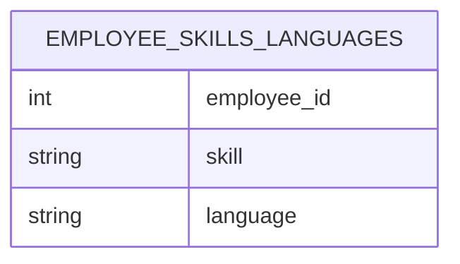

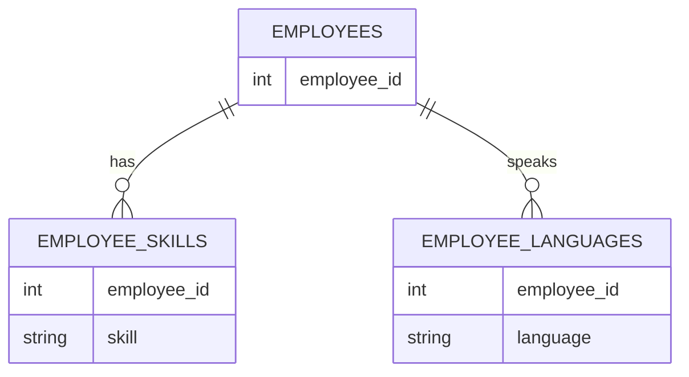

### 4.7 Detecting normal-form violations

**Definition.** Normal-form violation detection is the systematic process
of auditing an existing (or proposed) schema against each normal form's
mechanical test, in order — 1NF, then 2NF, then 3NF, then BCNF, then 4NF —
rather than jumping straight to "does this feel normalized?"

**Mechanism.** In practice this is a repeatable four-question checklist run
per table: (1) does any column hold more than one atomic value, or does the
column *list* itself repeat with numbered suffixes — if yes, it's a 1NF
violation; (2) for tables with a composite key, does any non-key column
depend on only part of that key — if yes, 2NF violation; (3) does any
non-key column determine another non-key column (a transitive chain) — if
yes, 3NF violation; (4) does any determinant fail to be a candidate key,
even if the dependent columns happen to be part of a different candidate
key — if yes, BCNF violation. Tooling can partially automate this: schema
linters and some database design tools can flag likely 1NF violations
(numbered columns) and can enumerate functional dependencies observed in
sample data as *candidates* for a human to confirm against the actual
business rule — but the final judgment about which dependencies are
guaranteed by the business rule, versus merely true of current sample data,
remains a human modeling decision (Section 4.1's common failure mode).

**Decision implications.** Running this checklist during schema *review*
(before a migration ships), not only during initial design, catches
normalization regressions introduced by well-intentioned later changes —
for example, a column added directly to `orders` for "convenience" that
actually depends on `customer_id`, silently reintroducing a 3NF violation
that code review missed because no one re-ran the checklist against the
changed table.

**Common failure mode.** Auditing normal forms visually, by "does this
schema look normalized," instead of mechanically tracing each functional
dependency. Visual review reliably catches obvious 1NF violations
(numbered columns are easy to spot) but reliably misses subtler 3NF/BCNF
transitive-dependency violations, because those require tracing dependency
chains across the whole table, not scanning column names.

**Scenario.** A schema-review checklist item ("run the four-question audit
on every table touched by this migration") catches a proposed migration
that adds `warehouse_region` directly to a `shipments` table "for
convenience" in a report query — a transitive dependency
(`shipment_id -> warehouse_id -> warehouse_region`) that the report author
didn't intend as a schema decision at all, they just wanted a fast query.
The audit redirects the fix to a `JOIN` (or, if performance genuinely
requires it, a deliberate, documented denormalization — Section 12) instead
of an accidental, unreviewed 3NF violation shipping to production.

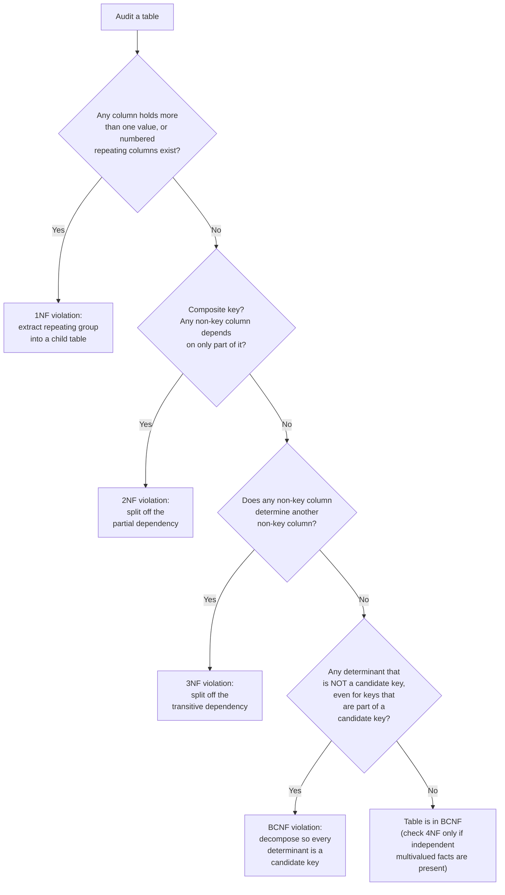

### 4.8 The anomaly taxonomy (update / insert / delete anomalies)

**Definition.** The anomaly taxonomy classifies the three distinct ways an
unnormalized (or under-normalized) table can produce incorrect or
impossible data operations: **update anomalies** (a single logical fact
requires multiple physical writes to stay consistent, and missing even one
leaves the data self-contradictory), **insert anomalies** (a valid,
independent fact cannot be recorded without also supplying an unrelated,
possibly unknown fact, because both facts are jammed into one table), and
**delete anomalies** (deleting one fact accidentally destroys a second,
logically independent fact that happened to be stored in the same row).

**Mechanism.** Every anomaly in this taxonomy traces back to the same root
cause identified in Sections 4.1-4.5: a functional (or multivalued)
dependency that is not reflected in the table's decomposition. An update
anomaly happens when a fact with a low-cardinality determinant (e.g.
`customer_id -> customer_email`) is repeated across many rows keyed by a
higher-cardinality key (`order_id`) — every repeat is a chance for the
copies to disagree. An insert anomaly happens when two independent facts
share one table and one of them isn't known yet — a new product cannot be
cataloged without also assigning it to an order line, if `products` and
`order_items` were never split apart. A delete anomaly happens when the
*only* row recording fact A also happens to record fact B — deleting the
last order from a first-time customer deletes the only stored copy of that
customer's contact information, if `customers` was never split out from
`orders`.

**Decision implications.** This taxonomy is the practical "why" behind
every normal form: 1NF prevents a variant of the insert anomaly caused by a
fixed repeating-group column count; 2NF and 3NF directly target update and
delete anomalies caused by partial and transitive dependencies; BCNF closes
the specific update-anomaly gap 3NF's exception leaves open for
overlapping candidate keys. When explaining *why* a proposed schema change
is a normalization regression to a teammate or a reviewer, naming the
specific anomaly it reintroduces (rather than citing "3NF" as an abstract
rule) is almost always the more persuasive and more concrete argument.

**Common failure mode.** Treating the three anomaly types as
interchangeable "data quality risk," rather than diagnosing which specific
one a given schema shape produces. The fix for an insert anomaly (allow the
independent fact to exist without the other) is not the same fix as for a
delete anomaly (preserve the independent fact after the triggering row is
removed) — misdiagnosing which anomaly a review comment is pointing at
leads to fixing the wrong table.

**Scenario.** A support ticketing system stores `(ticket_id, customer_id,
customer_tier, assigned_agent, agent_department)` in one table. Three
separate incidents in the same quarter show all three anomaly types
originating from the same design: (1) *update* — a customer is
upgraded from "Standard" to "Enterprise" tier, and a batch job updates
`customer_tier` only on open tickets, leaving closed tickets showing the
stale tier in historical reports; (2) *insert* — a new agent is hired but
cannot be entered into the system until they are assigned their first
ticket, because `assigned_agent`/`agent_department` only exist as columns
on the `tickets` table; (3) *delete* — closing and archiving (deleting) the
one ticket ever filed against a since-resolved billing dispute also deletes
the only record that the customer's tier was ever "Enterprise," because no
independent `customers` table retained that fact. All three trace to the
same missing decomposition: `customers`, `agents`, and `tickets` should
have been three separate tables from the start.

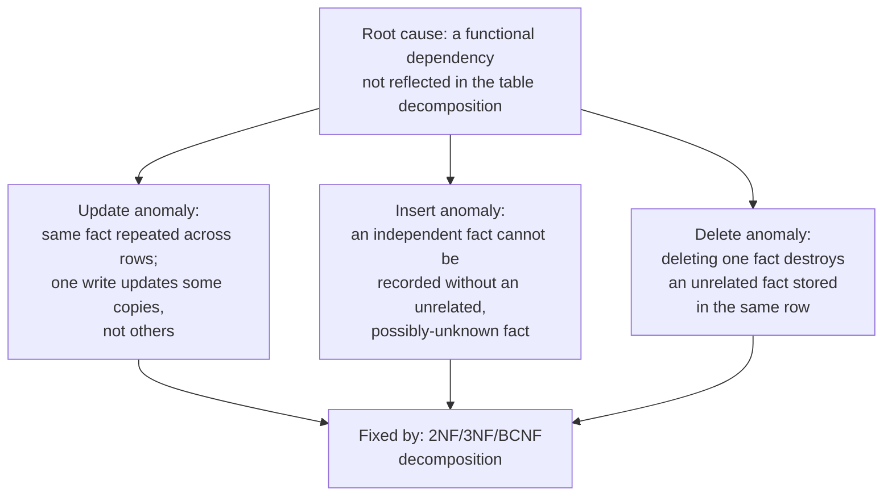

## 5. Internal Working

Once a schema has been decomposed per Sections 4.2-4.5, the resulting set
of tables and foreign-key relationships forms the actual physical shape the
RDBMS query planner has to work with. Understanding that shape — and what
the engine does with it at query time — is what separates "I normalized
this schema" from "I understand what normalizing this schema costs and
buys me at runtime."

The running example from Section 4 fully decomposed to 3NF/BCNF looks like
this:

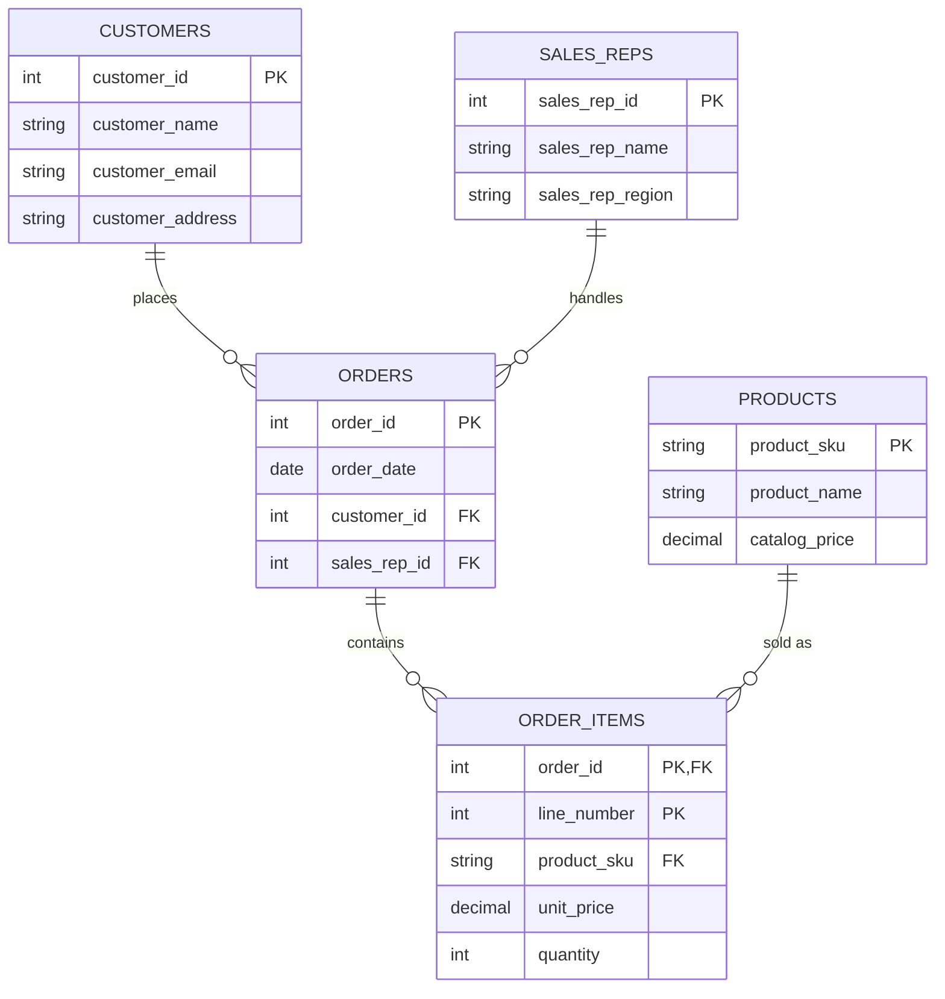

Every one of these foreign-key edges is a JOIN the query planner must
execute to reconstruct a "flat" view of an order — the exact query in
[code/python/normalization-chapter/query_normalized_schema.py](../code/python/normalization-chapter/query_normalized_schema.py)
joins all five tables to answer "show me this order's line items with
human-readable names." The planner's job is to choose a join order and join
algorithm (nested-loop, hash join, or merge join) that minimizes total work,
using the primary-key and foreign-key indexes that a well-normalized schema
naturally creates (every foreign key column is a strong index candidate,
because it is exactly the join predicate the query planner will use).

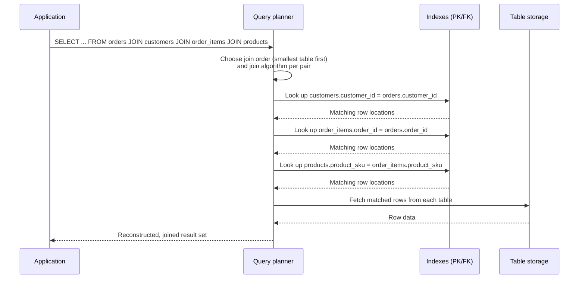

Each write, by contrast, becomes cheaper and more localized precisely
*because* the schema is normalized: an `UPDATE customers SET
customer_email = ... WHERE customer_id = 1` touches one row in one table,
regardless of how many orders that customer has ever placed, because the
fact lives in exactly one place. This asymmetry — normalization makes reads
more expensive (more JOINs) and writes cheaper and safer (fewer rows to
touch, no risk of partial updates) — is the central engineering trade-off
this chapter returns to repeatedly, most concretely in Section 11
(Performance) and Section 20 (Trade-off Analysis).

## 6. Design Principles

- **Model the business rule, not the sample data.** A functional dependency
  must be justified by an actual business invariant ("each SKU has exactly
  one catalog price"), never inferred solely from what happens to be true
  of the rows currently in the table (Section 4.1).
- **Normalize the system of record; denormalize deliberately, downstream.**
  Target 3NF/BCNF as the default for the OLTP schema that owns writes and
  enforces integrity constraints; treat any read-optimized denormalized
  copy (a materialized view, a cache, a search index) as a derived,
  rebuildable artifact, never the source of truth.
- **One fact, one home.** Before adding a column to an existing table, ask
  whether that column's value is determined by the table's key, or by some
  other column already on the table — if the latter, it belongs in a new or
  different table, not bolted onto this one for convenience.
- **Every foreign key should be indexed.** A normalized schema's JOIN-heavy
  read pattern depends on the planner being able to look up matching rows
  via an index rather than a full table scan — an un-indexed foreign key
  silently turns every JOIN against that table into the slowest possible
  execution plan.
- **Distinguish "this value never changes for a given key" from "this value
  currently doesn't change."** Slowly-changing facts (an employee's
  department, a product's price) are exactly where 2NF/3NF violations hide,
  because the dependency is real but changes rarely enough that early test
  data never exposes the bug.
- **Prefer natural detection over memorized rules.** Running the four-step
  audit in Section 4.7 against every table in a schema review catches
  regressions that "this team knows 3NF" does not, because normalization
  violations are usually introduced by someone who understood the rule in
  the abstract but didn't apply the mechanical check to *this specific*
  column addition.

## 7. Architecture Patterns

- **Normalized OLTP core, denormalized read replica.** The write path
  (order placement, payment capture, inventory decrement) writes to a fully
  normalized schema enforcing referential integrity; a read replica or a
  Change Data Capture (CDC) pipeline feeds a separate, deliberately
  denormalized reporting schema or search index optimized for the read
  patterns the normalized schema is expensive to serve directly.
- **Command Query Responsibility Segregation (CQRS) with a normalized write
  model.** The command (write) side persists to a normalized relational
  schema that guarantees the anomaly-free properties this chapter teaches;
  the query (read) side maintains one or more purpose-built, denormalized
  projections rebuilt from the same event stream or CDC feed, so the
  "denormalization" decision is scoped to specific, named read models
  rather than compromising the system of record.
- **Reference-data lookup tables.** Low-cardinality, rarely-changing
  dimensions (regions, statuses, categories) are modeled as small
  normalized lookup tables referenced by foreign key, rather than repeated
  as literal strings — this both enforces a controlled vocabulary (a
  `CHECK` constraint or foreign key rejects an invalid status value the
  application forgot to validate) and gives a single place to rename or
  add a code value.
- **Snapshot/point-in-time tables for temporal facts.** Where Section 4.4's
  scenario noted the ambiguity of "should historical orders show the rep's
  new region," an explicit `order_sales_rep_region_at_sale` snapshot column
  (populated once, at write time, from the normalized `sales_reps` table)
  resolves the ambiguity by design, rather than leaving it as an accidental
  side effect of whether a later `UPDATE` touches historical rows.

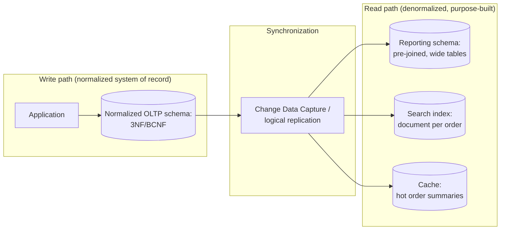

## 8. Production Architecture

A production OLTP database enforcing the normalized schema from Section 5
typically layers the following around the raw tables: **foreign-key and
`CHECK` constraints** at the database level (not just application-level
validation) so that the anomaly-freedom normalization provides is actually
guaranteed even if a bug, a migration, or a direct database console session
bypasses the application; **connection pooling** sized around the
JOIN-heavy read workload normalized schemas produce, since each connection
holds open transactions and prepared statement plans for these
multi-table queries; **read replicas** to absorb the JOIN-heavy read
traffic separately from the write path, keeping write latency insulated
from read-side query complexity; and **migration tooling** (schema
migration frameworks like Flyway, Liquibase, or Alembic) that can safely
apply the kind of table-splitting decomposition Sections 4.2-4.5 describe
against a live, populated production table without downtime — typically via
an expand-migrate-contract sequence (add the new normalized tables and dual
population logic, backfill historical data, migrate reads, then remove the
old denormalized columns).

```mermaid
flowchart TB
    App[Application tier] --> LB[Connection pool /<br/>PgBouncer or equivalent]
    LB --> Primary[(Primary: normalized<br/>OLTP schema, enforces<br/>FK + CHECK constraints)]
    Primary -->|logical replication| Replica1[(Read replica 1)]
    Primary -->|logical replication| Replica2[(Read replica 2)]
    App -->|writes| Primary
    App -->|JOIN-heavy reads| Replica1
    App -->|JOIN-heavy reads| Replica2
    Migration["Migration tool<br/>(Flyway/Liquibase/Alembic)"] -.->|expand-migrate-contract<br/>schema changes| Primary
```

## 9. Implementation

Implementing a normalization pass on an existing table follows the same
sequence regardless of RDBMS vendor: (1) identify the functional
dependencies per Section 4.1, using both the actual business rules and a
tool-assisted scan of sample data as a cross-check; (2) create the new,
decomposed tables with correctly chosen primary keys (Section 5's ER
diagram); (3) backfill the new tables from the existing denormalized
table's distinct values; (4) add foreign-key constraints from the original
table (now trimmed to reference the new tables) back to the new tables,
which both documents and enforces the dependency the decomposition was
designed around; (5) update application code to write to and read from the
new shape, typically behind a data-access-layer abstraction so the schema
change doesn't ripple through every call site at once; (6) drop the old
denormalized columns only after confirming no code path still depends on
them (the "contract" step of an expand-migrate-contract migration,
Section 8). The full worked SQL sequence for the running example — from
the unnormalized starting table through the 3NF/BCNF end state — is in
Section 10.

## 10. Complete Code Examples

**Example 1 — the unnormalized starting schema**, showing the repeating
groups (1NF violation) that Section 4.2 describes, and the anomaly-prone
denormalized customer/sales-rep columns:
[code/sql/normalization-chapter/01_unnormalized_schema.sql](../code/sql/normalization-chapter/01_unnormalized_schema.sql)

```sql
CREATE TABLE orders_unnormalized (
    order_id            INTEGER,
    order_date          DATE,
    customer_name       VARCHAR(100),
    customer_email      VARCHAR(100),
    customer_address    VARCHAR(200),
    -- Repeating group: line item 1, line item 2, ... (violates 1NF)
    product_1_sku       VARCHAR(20),
    product_1_name      VARCHAR(100),
    product_1_price     DECIMAL(10, 2),
    product_1_qty       INTEGER,
    product_2_sku       VARCHAR(20),
    product_2_name      VARCHAR(100),
    product_2_price     DECIMAL(10, 2),
    product_2_qty       INTEGER
);
```

**Example 2 — 1NF: eliminating the repeating group** by giving each line
item its own row instead of its own numbered column set:
[code/sql/normalization-chapter/02_first_normal_form.sql](../code/sql/normalization-chapter/02_first_normal_form.sql)

```sql
CREATE TABLE orders_1nf (
    order_id            INTEGER,
    line_number         INTEGER,
    order_date          DATE,
    customer_name       VARCHAR(100),
    customer_email      VARCHAR(100),
    product_sku         VARCHAR(20),
    product_name        VARCHAR(100),
    quantity            INTEGER,
    PRIMARY KEY (order_id, line_number)
);
```

**Example 3 — 2NF and 3NF/BCNF: the full decomposition**, splitting
customers, sales reps, and products into their own tables so every
determinant is a candidate key of its own table:
[code/sql/normalization-chapter/03_second_and_third_normal_form.sql](../code/sql/normalization-chapter/03_second_and_third_normal_form.sql)

```sql
CREATE TABLE customers (
    customer_id     INTEGER PRIMARY KEY,
    customer_name   VARCHAR(100) NOT NULL,
    customer_email  VARCHAR(100) NOT NULL,
    customer_address VARCHAR(200) NOT NULL
);

CREATE TABLE orders (
    order_id        INTEGER PRIMARY KEY,
    order_date      DATE NOT NULL,
    customer_id     INTEGER NOT NULL REFERENCES customers(customer_id),
    sales_rep_id    INTEGER NOT NULL REFERENCES sales_reps(sales_rep_id)
);

CREATE TABLE order_items (
    order_id        INTEGER NOT NULL REFERENCES orders(order_id),
    line_number     INTEGER NOT NULL,
    product_sku     VARCHAR(20) NOT NULL REFERENCES products(product_sku),
    unit_price      DECIMAL(10, 2) NOT NULL,
    quantity        INTEGER NOT NULL CHECK (quantity > 0),
    PRIMARY KEY (order_id, line_number)
);
```

**Example 4 — query-side (Python)**, reading the normalized schema back
into the "flat" shape a reporting screen needs, demonstrating the JOIN cost
Section 5 and Section 11 discuss:
[code/python/normalization-chapter/query_normalized_schema.py](../code/python/normalization-chapter/query_normalized_schema.py)

```python
ORDER_SUMMARY_QUERY = """
SELECT o.order_id, o.order_date, c.customer_name, c.customer_email,
       p.product_name, oi.quantity, oi.unit_price,
       (oi.quantity * oi.unit_price) AS line_total
FROM orders AS o
JOIN customers AS c    ON c.customer_id = o.customer_id
JOIN order_items AS oi ON oi.order_id = o.order_id
JOIN products AS p     ON p.product_sku = oi.product_sku
ORDER BY o.order_id, oi.line_number;
"""
```

## 11. Performance

The direct performance cost of normalization is JOIN count: a fully
normalized "order summary" read touches five tables (Section 5), where a
single flat table would touch one. For a well-indexed schema (every
foreign key indexed, per Section 6) and a modern RDBMS query planner, a
four- or five-table JOIN against properly sized indexes is typically a
low-single-digit-millisecond operation — the cost is real but usually
small relative to network and application-layer latency, until either row
counts grow into the hundreds of millions or the query pattern requires
JOINs the planner cannot satisfy with an index (a missing or wrong-order
composite index turning a hash join into a full scan). The corresponding
performance *benefit* of normalization is on the write path: an `UPDATE`
against a normalized `customers` table touches one row regardless of order
volume, where the same logical change against a denormalized schema
touches every repeated copy — for a customer with 50,000 historical
orders, that is the difference between a single-row update and a
50,000-row update, with correspondingly different lock contention, write
amplification, and replication-lag impact.

## 12. Scalability

Normalized schemas scale writes well (Section 11) but JOIN-heavy reads can
become the scaling bottleneck first, particularly once a schema is sharded
(a future chapter's topic) and a JOIN would need to span shards — this is
the concrete, mechanical reason many horizontally-scaled systems
deliberately denormalize specific hot read paths (embedding a copy of
`customer_name` directly on the `orders` document in a sharded or
document-oriented store) rather than paying a cross-shard JOIN on every
read. The general pattern that keeps both properties — normalized
integrity guarantees *and* JOIN-free reads at scale — is to keep the
normalized schema as the write-side system of record and materialize a
denormalized projection (a summary table, a search index, a cache) as a
derived artifact that can be rebuilt from the source of truth if it
diverges, rather than denormalizing the system of record itself.

## 13. Security

A normalized schema's foreign-key constraints double as a defense-in-depth
integrity control: an `INSERT` into `order_items` referencing a
nonexistent `product_sku` is rejected by the database itself, independent
of whether the application layer's validation has a bug — this closes a
class of data-integrity vulnerability that a denormalized schema (with no
foreign key to violate) would silently accept. Normalization also narrows
the blast radius of a compromised or buggy write path: because a fact like
`customer_email` lives in exactly one row, an attacker or bug that corrupts
one order record cannot simultaneously corrupt that customer's email
address as a side effect, the way it could in a schema that repeats
`customer_email` on every order row.

## 14. Observability

Instrument the JOIN-heavy read queries a normalized schema produces with
query-level tracing (execution plan capture, per-table row counts scanned)
so that a slow "order summary" report can be attributed to a specific
missing index or a specific mis-ordered JOIN, rather than a vague
"database is slow" alert. Track index usage statistics per foreign key
(most RDBMS engines expose this — e.g. PostgreSQL's `pg_stat_user_indexes`)
to catch the common regression where a foreign key is added without its
supporting index, silently turning a planned index-nested-loop join into a
sequential scan under production data volume.

## 15. Failure Scenarios

A missing foreign-key index is the most common normalization-adjacent
production incident: the schema is correctly normalized, but the
`order_items.product_sku` foreign key was never indexed, so every order
summary query executes a full table scan of `products` (or, worse, of
`order_items` if the join direction is reversed) once `order_items` grows
past the point where the planner's cardinality estimate still favors a
scan — this presents as a sudden, non-obvious latency cliff correlated with
data growth, not with any code deployment, which makes it a common source
of confused incident response.

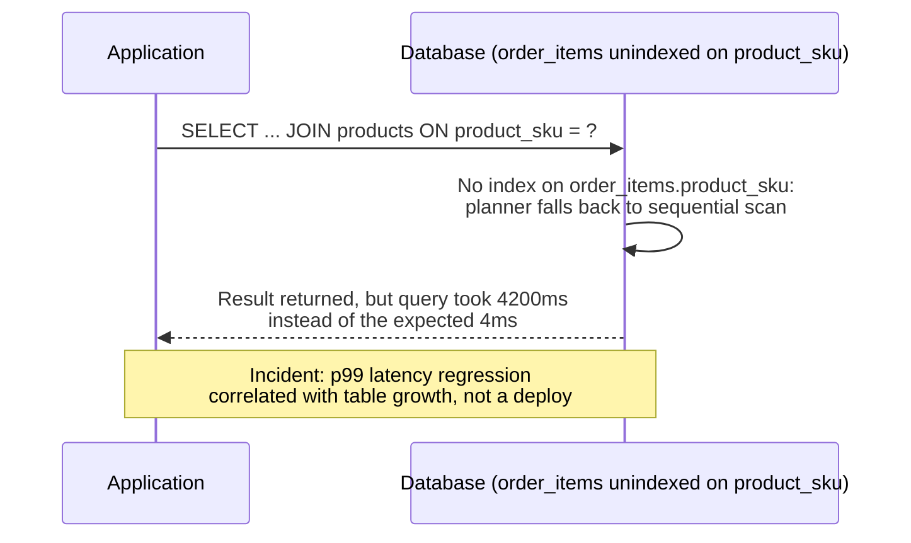

A second common failure: a denormalized "convenience" column silently
drifts out of sync with its source of truth because an update path was
added that writes to the copy but not the original (or vice versa) — this
is the update anomaly from Section 4.8 manifesting as a live production
data-integrity incident rather than a theoretical schema-review finding,
usually discovered when a customer reports that two different screens in
the same product show two different values for what should be the same
fact.

## 16. Testing

Test normalization decisions with anomaly-reproduction tests, not just
schema-shape assertions: for each normal form a table is claimed to
satisfy, write a test that attempts the specific anomaly that normal form
prevents and asserts it is now structurally impossible or correctly
handled — e.g. a test that inserts an order line referencing a
nonexistent `product_sku` and asserts the database rejects it (proving the
foreign-key constraint from the 2NF decomposition is actually enforced,
not just present in the DDL), or a test that updates a customer's email
once and asserts every order's JOIN-derived view reflects the change
immediately (proving no denormalized copy of `customer_email` still exists
somewhere). Schema migration tests should also assert the
expand-migrate-contract sequence (Section 8) is reversible at each step,
so a partially-applied normalization migration can be rolled back without
data loss.

## 17. Common Mistakes

- **Conflating catalog price with transaction price.** Storing only
  `products.catalog_price` and joining it into historical order reports
  silently rewrites what a customer was actually charged whenever the
  catalog price later changes — `order_items.unit_price` must be captured
  at write time as an independent fact, not derived from the current
  catalog value (Section 10's schema captures this correctly on purpose).
- **Normalizing rarely-changing, high-read-volume reference data as
  aggressively as frequently-changing transactional data.** A `countries`
  or `currencies` lookup table changes almost never and is read on nearly
  every request; over-normalizing it into multiple joined tables (e.g.
  splitting currency symbol into its own table keyed by currency code)
  adds JOIN cost for a dependency that will essentially never produce an
  anomaly in practice.
- **Treating "3NF" as a single yes/no property of a whole schema.**
  Normalization is evaluated per table, not per database — a schema can
  correctly have some tables at 3NF, some intentionally denormalized
  reporting tables at 1NF, and a rare BCNF-specific table, all within one
  well-reasoned design.
- **Skipping the foreign-key constraint after the logical decomposition.**
  Splitting a table into `customers` and `orders` but leaving
  `orders.customer_id` without an actual `REFERENCES customers(customer_id)`
  constraint keeps the *shape* of normalization without its *enforcement* —
  orphaned or invalid `customer_id` values become possible again the
  moment a bug or a bulk-load script bypasses application validation.
- **Assuming normalization alone prevents concurrency anomalies.**
  Normalization eliminates *redundancy*-driven inconsistency; it says
  nothing about race conditions between two concurrent transactions
  reading and writing the same row (a distinct topic owned by a future
  Transactions/Locking chapter in this part) — a normalized schema can
  still suffer lost updates or write skew without proper transaction
  isolation.

## 18. Best Practices

- Default new OLTP table designs to 3NF/BCNF; require an explicit,
  documented justification (with the specific read pattern and measured
  latency requirement) before denormalizing any part of the system of
  record.
- Run the four-question audit (Section 4.7) on every table touched by a
  schema-change pull request, not only on brand-new tables.
- Index every foreign key by default; treat an un-indexed foreign key as a
  schema-review finding, not an optional optimization.
- Capture point-in-time facts (prices actually charged, statuses actually
  set) as their own columns at write time, rather than relying on a JOIN
  to a mutable reference table to reconstruct history.
- When denormalizing a specific read path for performance, do it as a
  separate, explicitly named, rebuildable projection (a materialized view,
  a cache, a search index) fed from the normalized system of record — never
  by adding redundant columns directly to the normalized write-path tables.
- Document the anomaly each foreign-key/`CHECK` constraint is preventing in
  a migration's commit message or accompanying comment, so future
  reviewers understand *why* the constraint exists, not just that it does.

## 19. Anti-Patterns

- **The "just add a column" anti-pattern.** Repeatedly adding convenience
  columns to a high-traffic table (`orders.customer_email_cached`,
  `orders.sales_rep_region_cached`) instead of joining to the normalized
  source, one column at a time, until the table has silently regressed
  into a 3NF-violating denormalized shape with no single review ever
  having approved that overall outcome.
- **The "one true mega-table" anti-pattern.** Modeling an entire domain
  (customers, orders, products, shipments) as one wide table with dozens of
  nullable columns, reasoning that "fewer JOINs is always faster" without
  measuring — this reproduces every anomaly in Section 4.8 simultaneously
  and makes the schema resistant to any future correctness fix, because so
  much application code has grown to depend on the flat shape.
- **The "EAV (Entity-Attribute-Value) escape hatch" anti-pattern.**
  Reaching for a generic `(entity_id, attribute_name, attribute_value)`
  table to avoid "having to decide the schema," which technically satisfies
  1NF but destroys the database's ability to enforce types, foreign keys,
  or `NOT NULL` constraints on any individual attribute, and turns every
  query into a self-join against the same table — appropriate only for
  genuinely dynamic, user-defined-schema use cases, not as a substitute for
  proper normalization of a well-understood domain.
- **BCNF-chasing without a measured need.** Decomposing every table to the
  maximum normal form the data technically permits, including 4NF/5NF
  splits for dependencies that are theoretically present but practically
  irrelevant (e.g. splitting a two-column, rarely-queried combination into
  its own table "because it's technically a multivalued dependency"),
  adding JOIN complexity with no corresponding anomaly risk it actually
  prevents.

## 20. Trade-off Analysis

Normalization trades read-path simplicity and (at extreme scale) read
latency for write-path integrity and simplicity. A fully normalized 3NF/
BCNF schema minimizes the surface area for update/insert/delete anomalies
(Section 4.8) and keeps every fact in one place, at the cost of requiring
JOINs to reconstruct any "flat" view a report or Application Programming
Interface (API) response needs. A denormalized schema inverts this trade:
reads are fast and simple (no JOINs), but every write that touches a
repeated fact must either update every copy (reintroducing the update
anomaly this chapter exists to eliminate) or accept that copies can drift.
The resolution most production systems land on (Section 7, Section 12) is
not choosing one universally, but scoping the trade-off per table or per
access pattern: normalize the write-path system of record, and denormalize
specific, named, rebuildable read projections only where a measured
latency or throughput requirement justifies the anomaly risk being
explicitly and narrowly accepted (never silently).

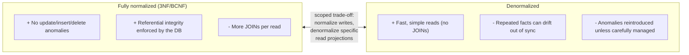

## 21. Comparison Table

| Normal Form | Eliminates | Requires | Typical Production Usage |
|---|---|---|---|
| 1NF | Repeating groups / non-atomic values | Every column atomic; a defined key | Mandatory baseline for any relational table |
| 2NF | Partial dependency on a composite key | 1NF + every non-key column depends on the whole key | Default for any table with a composite primary key |
| 3NF | Transitive dependency between non-key columns | 2NF + no non-key column determines another non-key column | Default target for OLTP system-of-record tables |
| BCNF | Non-superkey determinants (overlapping candidate keys) | 3NF + every determinant is a candidate key | Applied when a table has multiple overlapping candidate keys |
| 4NF | Independent multivalued dependencies | BCNF + no non-trivial multivalued dependency | Rare; applied when a table holds two+ independent multi-valued facts |
| 5NF | Non-decomposable join dependencies (3+ tables) | 4NF + no join dependency implied by candidate keys | Very rare; niche multi-party relationship modeling |

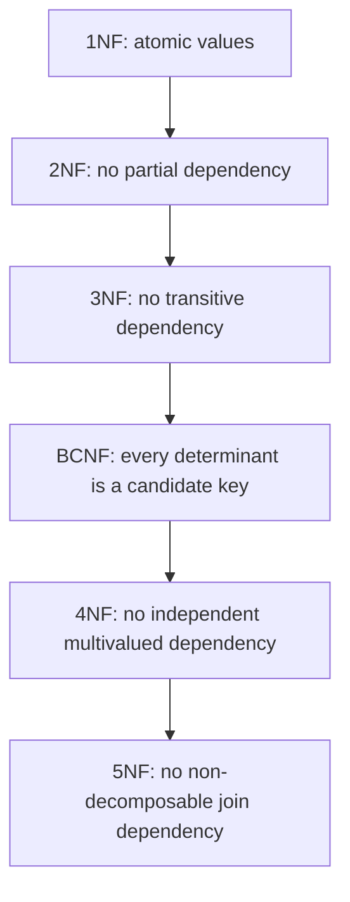

## 22. Real-World Case Study

A mid-sized e-commerce company launched its original order system with the
"orders_unnormalized"-shaped table from Section 10's Example 1 — a single
table with `customer_name`/`customer_email` repeated on every order and two
fixed line-item column groups, mirroring the checkout form's initial
"limit 2 items" UI constraint. Within the first year, three separate
production incidents traced back to this single design decision: a
customer support escalation where a customer's corrected email address
appeared correctly on new orders but stale on all historical orders
(update anomaly); a blocked B2B sales deal because the checkout form's
2-item cap could not represent a 40-line-item purchase order without an
emergency schema migration (a 1NF-shaped limitation); and a data-quality
audit that discovered several products existed only as a `product_1_name`
string on a handful of orders, with no canonical product record anyone
could safely rename without a fragile string-matching script (an insert/
maintenance anomaly for product data that was never given its own table).
The team's subsequent redesign followed exactly the decomposition sequence
in Sections 4.2-4.5 and Section 10: `customers`, `sales_reps`, `products`,
`orders`, and `order_items` as five separate 3NF/BCNF tables, connected by
foreign keys. The measured cost was a 12% increase in p50 latency on the
order-summary API endpoint (from the added JOINs); the measured benefit was
zero further customer-data-consistency incidents in the following two
years, and a same-day schema change (adding a `discount_code` column to
`order_items`) that would previously have required auditing every place
`product_1_price`-style columns were referenced across the codebase. The
company's next iteration, six months later, added a materialized
`order_summary_reporting` table (Section 7's read-model pattern) rebuilt
nightly from the normalized schema, recovering the JOIN-latency regression
for its highest-traffic reporting dashboard without reintroducing any
anomaly risk into the write-path system of record.

## 23. Interview Questions

1. What is a functional dependency, and how does it differ from a
   correlation that merely happens to hold in a sample dataset?
2. Explain the difference between a partial dependency (2NF) and a
   transitive dependency (3NF) using a concrete example.
3. Why does BCNF exist as a separate normal form from 3NF — what specific
   anomaly can a 3NF-compliant table still have?
4. Describe the three anomaly types (update, insert, delete) and give an
   example of each that is *not* simply "the same bug in different words."
5. When would a Solution Architect deliberately choose not to normalize a
   table fully to 3NF/BCNF, and how would they mitigate the anomaly risk
   they're accepting?
6. What is a multivalued dependency, and why doesn't 3NF or BCNF catch the
   redundancy it causes?
7. Given an unnormalized table's column list, walk through how you would
   identify its functional dependencies and decompose it step by step.
8. Why should catalog price and transaction (order-line) price be modeled
   as two distinct facts rather than one, even though they are often equal?
9. How does normalization interact with database sharding — why might a
   sharded system deliberately denormalize a JOIN that a single-node
   system would keep normalized?
10. What database-level mechanism actually *enforces* a normalized schema's
    integrity guarantees at runtime, and what happens if that mechanism is
    missing even though the tables are logically decomposed correctly?

## 24. Hands-on Exercises

1. Using [code/sql/normalization-chapter/01_unnormalized_schema.sql](../code/sql/normalization-chapter/01_unnormalized_schema.sql),
   load the sample data into a local SQLite or PostgreSQL instance and
   write the exact `UPDATE` statement(s) required to correct a typo in
   Aria Chen's email across all her orders. Count how many rows the
   statement touches, and compare against the single-row `UPDATE` shown in
   [code/sql/normalization-chapter/03_second_and_third_normal_form.sql](../code/sql/normalization-chapter/03_second_and_third_normal_form.sql).
2. Extend the normalized schema in Example 3 with a `shipping_addresses`
   table, reasoning explicitly about whether `shipping_address` is a
   functional dependency of `customer_id` or of `order_id` — justify your
   answer with a concrete business rule (can a customer ship different
   orders to different addresses?).
3. Run [code/python/normalization-chapter/query_normalized_schema.py](../code/python/normalization-chapter/query_normalized_schema.py),
   then modify it to compute the total revenue per sales rep per region,
   observing how many tables the query must JOIN to answer that question.
4. Take the `employee_skills_languages` example from Section 4.6, populate
   it with sample data for three employees with overlapping skills and
   languages, and write a query that (incorrectly) counts languages per
   employee against the un-decomposed table versus the correctly
   decomposed two-table version — compare the results.
5. Identify one table in a codebase you maintain (or a public open-source
   project) and run the four-question audit from Section 4.7 against it by
   hand. Document which normal form it actually satisfies and whether that
   is a deliberate, documented decision or an accidental byproduct of how
   the table grew over time.

## 25. Design Exercises

1. Design a normalized (3NF/BCNF) schema for a hotel booking system that
   must track guests, rooms, room types, bookings, and a nightly rate that
   can change over time without altering the historical rate a past
   booking was actually charged. Identify every functional dependency you
   used to justify each table split.
2. A junior engineer proposes storing `order_status_history` as a single
   comma-separated string column (`"placed,shipped,delivered"`) on the
   `orders` table. Redesign this as a properly normalized child table,
   and explain which normal form the original design violated.
3. Design a schema for a university's course-enrollment system that
   correctly handles the BCNF case from Section 4.5 (an instructor teaches
   exactly one subject, but a subject can have multiple instructors), and
   write the `CREATE TABLE` statements that make the anomaly this chapter
   describes structurally impossible.
4. Given a legacy `customers` table with 40 columns mixing customer
   identity, billing address, shipping address, marketing preferences, and
   support-ticket counts, propose a decomposition plan using the
   expand-migrate-contract sequence from Section 8 — specify the order of
   migration steps and what must be true before each step is safe to run
   in production.
5. Design the read-side materialized projection (Section 7's pattern) for
   a "customer 360" dashboard that needs sub-50ms response time, given a
   fully normalized six-table write-side schema — specify what triggers a
   refresh of the projection and how staleness is surfaced to the
   dashboard's users.

## 26. Architecture Review Questions

1. For each table in this schema, has the reviewer traced every non-key
   column's functional dependency back to the table's key, or only
   spot-checked a few obvious columns?
2. Is every foreign key backed by an actual `REFERENCES` constraint and a
   supporting index, or does the decomposition exist only in application
   code's understanding of the schema?
3. Where a column appears to be denormalized (a cached or repeated value),
   is there a documented, deliberate justification with a measured
   performance requirement, or is it an unreviewed accretion?
4. Does the schema distinguish point-in-time facts (price at time of sale,
   status at time of action) from current reference-data lookups, or does
   it risk silently rewriting history through a JOIN to a mutable table?
5. If this schema needs to scale beyond a single node in the future
   (sharding, read replicas), which JOINs would become cross-node, and has
   that cost been considered against the current fully-normalized design?
6. Are the specific anomalies (update/insert/delete) this schema's
   normalization choices prevent documented anywhere reviewers and future
   maintainers can find them, or does the schema's rationale exist only in
   the original author's memory?

## 27. Summary

Normalization is a mechanical, provable procedure for eliminating a
specific, well-understood class of data-integrity bug — the update,
insert, and delete anomalies of Section 4.8 — by ensuring every functional
dependency in a table's data is reflected in that table's key structure.
1NF removes repeating groups; 2NF and 3NF remove partial and transitive
dependencies, the two most common and most damaging anomaly sources in
ordinary OLTP schemas; BCNF closes a narrower gap 3NF leaves open for
tables with overlapping candidate keys; 4NF and 5NF address rarer
multivalued and join-dependency patterns most architects will only
occasionally encounter directly, but should recognize by shape. The
practical craft is not maximizing normal form for its own sake, but
correctly identifying real functional dependencies, decomposing a schema's
system of record to 3NF/BCNF as the default, and treating any decision to
denormalize — whether for a hot read path, a sharded system, or a reporting
projection — as an explicit, measured, and reversible trade-off rather than
an accident of convenience. The chapters that follow in this part
(Denormalization, and every database-specific chapter) build directly on
these definitions rather than re-deriving them.

## Further Reading

- [Denormalization](CH02_Denormalization.md) — the deliberate, measured
  reversal of specific normalization decisions for read-path performance
  (not yet drafted; this chapter's Section 7/12/20 previews the trade-off).
- [Indexes](CH05_Indexes.md) — how the foreign-key indexes this chapter
  recommends actually accelerate the JOINs a normalized schema requires
  (not yet drafted).
- [Transactions](CH08_Transactions.md) and [Locking](CH09_Locking.md) — the
  concurrency-control guarantees normalization does *not* provide on its
  own (Section 17's common mistake); not yet drafted.
- [Sharding](CH04_Sharding.md) — how cross-shard JOINs change the
  normalization/denormalization trade-off calculus at horizontal scale
  (Section 12); not yet drafted.
