# Chapter: Denormalization

Part: [06 — Databases and Storage](PART_OVERVIEW.md) · Status: Drafted

## 1. Introduction

Denormalization is the deliberate, engineered reintroduction of redundancy
into a data model that a normalized design would otherwise eliminate — not a
mistake, not a shortcut taken under deadline pressure, but a first-class
architecture decision made in service of read performance, read simplicity,
or both. Where [Normalization](CH01_Normalization.md) teaches how to
organize data so that every fact is stored exactly once (removing insertion,
update, and deletion anomalies by decomposing tables according to functional
dependencies), this chapter teaches the opposite move: identifying which
reads are expensive or complex *because* of that decomposition, and
deliberately duplicating, precomputing, or restructuring data so those reads
become cheap — while explicitly owning the write-amplification and
consistency risk that duplication always creates. This chapter is the
*owning* chapter for materialized views (and their refresh strategies),
precomputed aggregates and rollups, read-model duplication in the CQRS
(Command Query Responsibility Segregation) sense, and the star-schema/
snowflake-schema decision for analytical (OLAP — Online Analytical
Processing) modeling, per the Concept Ownership Rule in
[STYLE_GUIDE.md](../STYLE_GUIDE.md). A Solution Architect who only knows
normalization can design a data model that is provably free of update
anomalies and still ships a system that falls over under real read load —
denormalization is the other half of the same skill: knowing when
correctness-by-construction should yield, in a carefully bounded and
monitored way, to a performance requirement that normalization alone cannot
satisfy.

**Recap: normal forms and the anomaly taxonomy (owned by
[Normalization](CH01_Normalization.md)).** A database is normalized by
decomposing tables so that every non-key attribute depends on the whole key
and nothing but the key, progressively eliminating insertion, update, and
deletion anomalies as tables satisfy 1NF through 5NF/BCNF (Boyce-Codd Normal
Form). The practical effect for this chapter's purposes is that a fully
normalized schema stores each fact in exactly one place — which is precisely
why a query that needs several related facts together (an order with its
customer's name, its line items, and each item's product name) must *join*
several tables to reassemble them, and why that join cost is the thing
denormalization exists to avoid paying on every read.

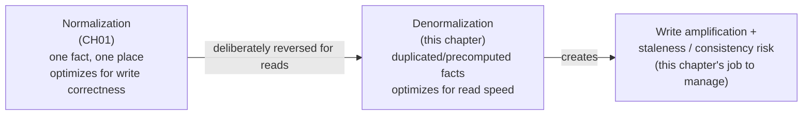

## 2. Historical Evolution

- **1970s — E.F. Codd's relational model and normal forms.** Codd's original
  relational papers, followed by his and Boyce's normal-form theory, gave
  database designers a rigorous way to eliminate redundancy — the implicit
  assumption at the time was that storage was expensive and joins were cheap
  enough on the hardware and query engines of the era, so a fully normalized
  design was close to a strictly dominant choice.
- **1980s — decision-support systems and the first denormalization
  pressure.** As relational databases moved from pure transaction processing
  into early reporting and decision-support use cases, database
  administrators began hand-denormalizing hot reporting tables (adding
  redundant columns, precomputed totals) because join-heavy reporting
  queries against fully normalized OLTP (Online Transaction Processing)
  schemas were too slow for interactive use — an ad hoc, per-shop practice
  long before it had a name or a methodology.
- **1990s — Ralph Kimball's dimensional modeling and the star schema.**
  Kimball formalized denormalization for analytics as a discipline in its
  own right: the star schema (Section 4.5), with a central fact table and
  deliberately denormalized dimension tables, became the standard
  architecture for data warehouses, explicitly optimizing for the
  read-heavy, join-light query patterns of business intelligence tools.
- **Late 1990s-2000s — materialized views become a first-class database
  feature.** Oracle, and later PostgreSQL, SQL Server, and others, added
  native `MATERIALIZED VIEW` support, turning what had been a manually
  maintained "summary table plus a trigger" pattern into a database-managed
  object with built-in (if often limited) refresh mechanics.
- **2000s — web-scale NoSQL (Not Only SQL) systems make denormalization the
  default, not the exception.** Systems like Bigtable, DynamoDB, and
  Cassandra were designed around query-first, denormalized data modeling from
  the outset — because these systems generally do not support efficient
  server-side joins, every access pattern a query needs to serve must be
  modeled as its own denormalized table or item shape at write time, an
  entirely different design discipline covered in this Part's NoSQL
  chapters (recapped only here).
- **2010s — CQRS and event sourcing formalize read-model duplication as an
  architecture pattern.** Greg Young's CQRS pattern, and event sourcing
  alongside it, gave "duplicate the write model into one or more
  purpose-built read models, kept in sync via events" a name, a set of
  consistency semantics, and a place in mainstream microservices
  architecture, rather than treating it as an ad hoc reporting-table trick.
- **2010s-present — change data capture (CDC) and streaming platforms
  industrialize the sync problem.** Tools like Debezium, Kafka Connect, and
  managed CDC services turned "keep a denormalized copy in sync with its
  source of truth" from a bespoke dual-write problem (Section 15) into a
  standardized, log-based pipeline pattern, materially reducing (though not
  eliminating) the consistency risk this chapter is concerned with.

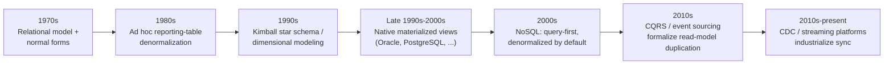

## 3. Why It Exists

A join is not free. Every join a query engine performs at read time costs
CPU cycles, memory (for hash joins or sort-merge buffers), and, for large
tables without well-chosen indexes, disk I/O — and that cost is paid *on
every single read*, no matter how many times the same underlying facts have
already been assembled before. Normalization's core promise — store each
fact once, so a write only ever touches one place — has a mirror-image cost:
a read that needs several related facts together must now do the
work, at read time, of reassembling them from wherever they're
each stored. For a low-traffic internal tool, that reassembly cost is
irrelevant. For a consumer-facing product serving tens of thousands of reads
per second against a schema with a half-dozen-table join chain, or an
analytics dashboard scanning billions of fact rows to answer "total revenue
by quarter and category," that reassembly cost becomes the dominant
bottleneck in the entire system — and it is a bottleneck that adding more
compute to the write path does nothing to fix, because the problem isn't
write capacity, it's the *shape* of the data relative to how it's read.
Denormalization exists because the cheapest way to make an expensive read
fast is often to stop computing it at read time at all — to do the
expensive assembly work once, in advance (at write time, on a schedule, or
incrementally as changes arrive), and let every subsequent read simply fetch
the already-assembled answer. The price of that speed is that the
already-assembled answer is now a *second* copy of information that also
exists (or is derivable from) the source of truth, and every future write to
that source of truth must somehow find its way to updating the copy too —
which is precisely the write-amplification and staleness trade-off this
chapter exists to teach an architect how to reason about, rather than
stumbling into by accident.

## 4. Core Concepts

### 4.1 The denormalization decision: what redundancy buys, and what it costs

**Definition.** Denormalization is the practice of storing derived or
duplicated data — a copy of a value that also lives elsewhere, or a computed
summary of several rows — specifically so that a read query can retrieve it
directly, without recomputing it from a normalized source at query time.

**Mechanism.** Every denormalization technique in this chapter (materialized
views, precomputed aggregates, read-model duplication, star schemas) follows
the same underlying shape: identify a read pattern that is either too slow
(join-heavy, aggregation-heavy) or too complex (spans multiple
bounded contexts, requires business logic to interpret) to serve directly
from the normalized source of truth; build a second, purpose-shaped copy of
the data that answers exactly that read pattern with minimal work; and
establish a synchronization mechanism — synchronous, scheduled, or
event-driven — that propagates every relevant write from the source of
truth into that copy. The read path then never touches the normalized
tables at all; it only ever reads the precomputed copy.

**Decision implications.** Denormalization is not a replacement for
normalization — it is layered *on top of* a normalized (or otherwise
correct) source of truth, never instead of one. The normalized tables remain
the place where writes are validated and where the single, authoritative
fact lives; the denormalized copy is always a *derived*, replaceable
artifact that could, in principle, be entirely regenerated from the source
of truth if it were deleted. This distinction matters enormously in
practice: if a team ever finds itself unable to answer "if we deleted this
denormalized table and rebuilt it from scratch, would we get the same data
back," that is a strong signal the denormalized copy has silently become a
second source of truth (drifted, or now holding data unrecoverable from
anywhere else) — which reintroduces exactly the anomaly risk normalization
was designed to prevent, just via a different mechanism.

**Common failure mode.** Denormalizing reactively, one hotspot at a time,
without a policy for *how* each copy stays in sync — a team adds a
`total_amount` column to an `orders` table to avoid summing `order_items` on
every read, updates it manually in application code at one call site, and
six months later a second code path (a bulk-import job, an admin
correction) writes to `order_items` directly without updating
`total_amount`, silently corrupting the read path for every order that
bulk-import job touched. Denormalization done without an explicit, singular,
enforced synchronization mechanism is not a performance optimization; it is
a slow-motion data-integrity bug factory.

**Scenario.** A support engineer investigating a customer complaint
("my order total is wrong") discovers the precomputed `total_amount` column
disagrees with `SUM(quantity * unit_price)` computed live from
`order_items` — the right first question isn't "which number is correct"
(the live-computed sum from the normalized source of truth always is,
by definition) but "which write path bypassed the synchronization
mechanism," because that's the actual defect to fix.

### 4.2 Materialized views and refresh strategies

**Definition.** A materialized view is a database object whose contents are
the *persisted, physically stored* result of a query — unlike an ordinary
(virtual) view, which is just a saved query re-executed against live tables
on every read, a materialized view's rows already exist on disk before a
read arrives, so reading it costs a plain table scan/index lookup, not a
re-execution of the underlying joins and aggregations.

**Mechanism.** A materialized view is defined once, by a `SELECT` query
(often join-heavy or aggregation-heavy) against one or more source tables.
The database (or an external job, for engines without native support)
periodically re-executes that query and writes the results into the view's
storage; readers query the materialized view directly and never touch the
underlying tables. The central design question is *when* that
re-execution happens — the refresh strategy:

1. **Eager (synchronous) refresh** — the materialized view is updated in
   the same transaction as the write to its source tables (via a trigger, an
   application-level write-through, or a database feature that supports it).
   Readers always see fresh data; every write pays the extra cost of
   updating the view, and if the view's query is itself expensive, this can
   turn a cheap write into a slow one.
2. **Lazy (on-demand or TTL-based) refresh** — the view is refreshed on a
   schedule (every N minutes) or the next time it's queried after a staleness
   threshold has passed, decoupling write latency from view-maintenance
   cost entirely. Readers accept a bounded staleness window (the view is
   correct "as of the last refresh," not "as of right now") in exchange for
   writes that never pay the view's maintenance cost directly.
3. **Incremental refresh** — instead of recomputing the entire view from
   scratch, the refresh job identifies only the rows in the source tables
   that changed since the last refresh (via a watermark/timestamp, a
   change-log table, or CDC) and updates only the corresponding view rows.
   This gets much closer to eager refresh's freshness at a fraction of the
   cost of a full lazy rebuild, but requires the underlying query to be
   decomposable into per-row or per-key deltas — not every aggregation
   (e.g. a running median) supports this cleanly.

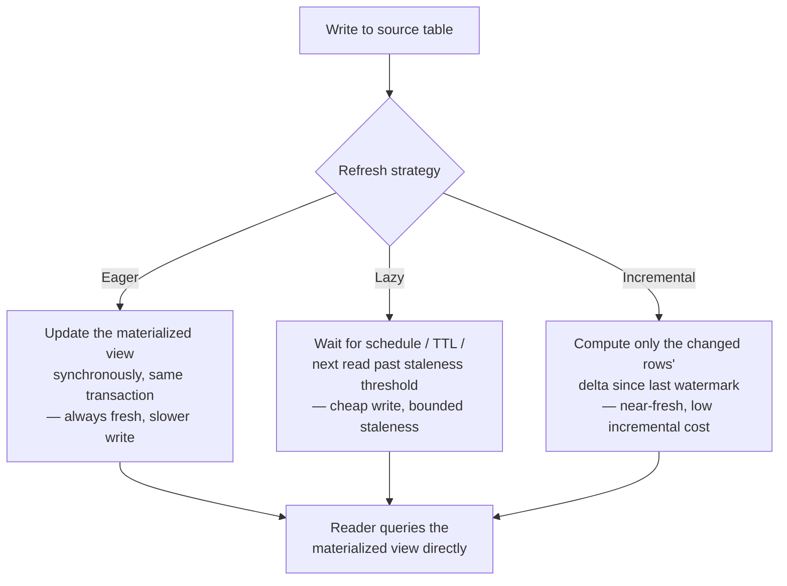

**Decision implications.** The refresh-strategy choice is a direct trade
between write latency, operational complexity, and how stale a reader is
willing to tolerate the view being. Eager refresh is appropriate only when
the view's maintenance cost is genuinely cheap (a single-row upsert, not a
full aggregation) and freshness is non-negotiable (e.g. a account-balance
view that must never lag behind the ledger it's derived from). Lazy refresh
is the simplest to operate and is the right default for dashboards and
reports where "as of 15 minutes ago" is perfectly acceptable and the
underlying query is too expensive to run synchronously on every write.
Incremental refresh is the usual production answer once a lazy full rebuild
becomes too slow to complete within its own refresh interval (a rebuild that
takes 20 minutes but is scheduled every 15 minutes will never catch up) — it
is more code to write and reason about correctness for, but it's what makes
materialized views viable at real data volume. See
[code/sql/denormalization-chapter/star_schema_analytics.sql](../code/sql/denormalization-chapter/star_schema_analytics.sql)
for a `MATERIALIZED VIEW` example and
[code/python/denormalization-chapter/materialized_view_refresh.py](../code/python/denormalization-chapter/materialized_view_refresh.py)
for a worked eager-vs-incremental refresh job.

**Common failure mode.** Scheduling a lazy full-rebuild refresh at a fixed
interval without measuring how long the rebuild actually takes as data
volume grows — the refresh job silently falls further and further behind
(a 15-minute-scheduled job that now takes 25 minutes means every refresh
starts before the previous one finished, either serializing into a growing
backlog or, worse, running concurrently and producing an inconsistent
partial result) until a reader notices the view is hours stale, by which
point the fix requires an emergency migration to incremental refresh under
pressure rather than a planned one.

**Scenario.** An e-commerce platform's product-detail page needs a
`review_summary` (average rating, review count) per product. Recomputing
this from the `reviews` table on every page view would mean an aggregation
query on every single product-page load; instead, the platform maintains
`review_summary` as an incrementally refreshed materialized view, updated
within seconds of a new review being submitted via a CDC pipeline reading
the `reviews` table's write-ahead log — page views become a single indexed
row lookup, and the several-second staleness window is invisible to users
who just submitted a review and refresh the page.

### 4.3 Precomputed aggregates and rollups

**Definition.** A precomputed aggregate (or rollup) is a single stored value
— a count, a sum, a running total, a min/max — that represents the result of
an aggregation function over a set of rows, maintained incrementally at
write time so that reading it never requires scanning or aggregating the
underlying rows at all.

**Mechanism.** Unlike a materialized view (which stores an entire derived
*table*, potentially many rows), a precomputed aggregate is typically a
single denormalized column or a small, targeted summary row: a `like_count`
column on a `posts` table, a `total_amount` column on an `orders` table, an
`inventory_on_hand` counter maintained alongside a stream of stock
movements. The write path increments/decrements the stored aggregate
directly (`UPDATE posts SET like_count = like_count + 1 WHERE post_id = ?`)
at the same time as (or immediately after) the underlying event that changes
it (a row inserted into a `likes` table); the read path is then a plain
column read with no aggregation function evaluated at query time at all.
Rollups extend this idea across a time or category dimension — a
`daily_revenue_rollup` table with one row per day, updated as orders come in,
answers "revenue by day" without scanning every order row for every query.

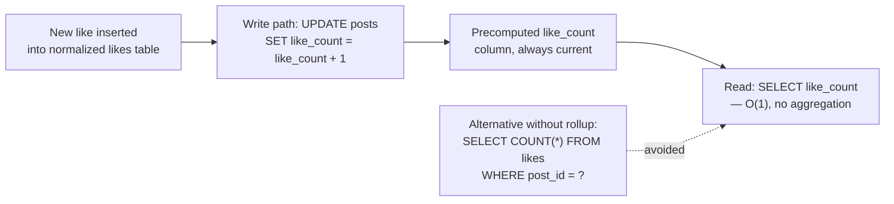

**Decision implications.** Precomputed aggregates are the right tool when
the *only* thing a read needs is the aggregate itself, not the underlying
rows — if a page needs both "47 likes" and "who liked this," a rollup alone
doesn't remove the need to also query the underlying rows for the second
part, so the rollup's benefit is narrower than it first appears. They are
also considerably higher-risk for drift than a full materialized-view
rebuild, precisely because there's no "recompute from scratch" step baked
into the everyday write path — an increment that's applied twice, or never
applied because a write failed after the increment but before the
underlying insert committed, leaves a wrong number with no self-correcting
mechanism, which is why production systems that rely on rollups almost
always pair them with a periodic reconciliation job (see
[code/java/denormalization-chapter/DenormalizedCounterCache.java](../code/java/denormalization-chapter/DenormalizedCounterCache.java)
for a worked example of exactly this reconcile-on-a-schedule pattern) that
recomputes the true value from the source of truth and corrects any
detected drift.

**Common failure mode.** Incrementing a counter as a separate statement or
separate service call from the write that logically causes it, with no
shared transaction and no idempotency key — under retry (a common,
expected condition in distributed systems, not an edge case), the increment
can be applied more than once for a single logical event, and the counter
silently drifts upward over time with no error ever surfacing.

**Scenario.** A social platform's post `like_count` and the underlying
`likes` table disagree after an incident where a message queue redelivered a
batch of "like" events during a consumer restart; a nightly reconciliation
job that recomputes `like_count` from `SELECT COUNT(*) FROM likes` and
corrects any mismatch is what catches and fixes this automatically — without
that reconciliation job, the drift would persist indefinitely and slowly
erode trust in every number derived from the rollup.

### 4.4 Read-model duplication (CQRS-style)

**Definition.** Read-model duplication is the practice of maintaining one or
more independent, purpose-built representations of data specifically shaped
for how a particular read (or class of reads) needs to consume it, kept in
sync with a separate write model (the source of truth) via an explicit
synchronization mechanism — most commonly an event stream. This is the
data-modeling technique underlying CQRS, which separates the *command* side
(the model that validates and processes writes, usually normalized or
event-sourced) from the *query* side (one or more denormalized read models,
each shaped for a specific query need).

**Mechanism.** A write (a "command") is processed against the write model,
which validates business rules and, if accepted, produces one or more
domain events describing what happened (`OrderPlaced`, `OrderCancelled`).
Those events are published to an event stream (a message broker, an
event-sourced event store, or a CDC feed off the write model's own storage).
One or more **projectors** subscribe to that stream and update their own
independent read model in response to each event — a search-optimized
read model might denormalize product and category data into a
search-engine index; an "order history" read model might denormalize
customer name and product name directly into each order row so a page
render needs zero joins; an analytics read model might feed the star schema
in Section 4.5. Critically, each read model is free to use a completely
different storage technology and shape best suited to its own query
pattern — the write model's shape need not (and usually should not)
constrain any read model's shape at all.

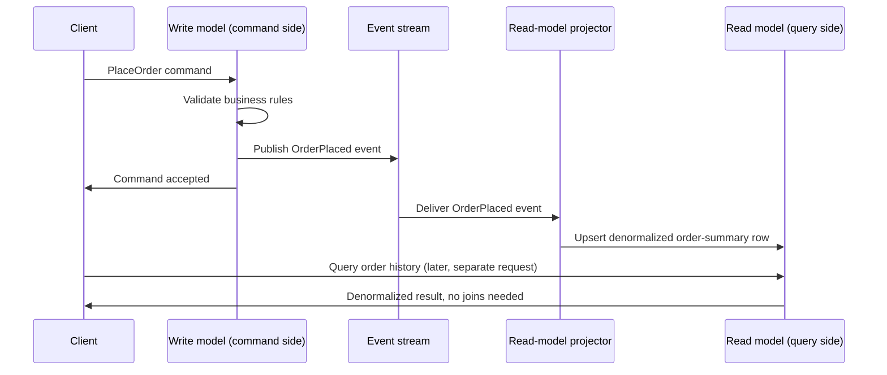

**Decision implications.** Read-model duplication buys two things
simultaneously that normalization-plus-live-query cannot: read models can be
independently scaled (a read-heavy search index can run on entirely separate
infrastructure from the write model's transactional database), and each read
model can be optimized purely for its own access pattern without
compromising the write model's design for anyone else's query needs. The
cost is that the read model is, by construction, **eventually consistent**
with the write model — there is always some propagation delay between a
command being accepted and every read model reflecting it, and the
architecture must decide, per read model, what staleness window is
acceptable and how the system behaves if a client reads its own write before
the corresponding read model has caught up (a common UX problem: "I just
placed an order and it's not showing in my order history yet"). See
[code/node/denormalization-chapter/cqrs_read_model_projector.js](../code/node/denormalization-chapter/cqrs_read_model_projector.js)
for a worked projector, including the idempotency handling this pattern
requires.

**Common failure mode.** Building a projector that assumes events arrive
exactly once, in order, forever — real message brokers routinely redeliver
events (at-least-once delivery is the common default) and, without careful
partitioning, can deliver events for the same entity out of order across
consumer restarts or rebalances; a projector that isn't explicitly
idempotent (tracking an applied-sequence watermark per entity, as in the
referenced code example) will double-apply a redelivered event and corrupt
its read model in a way that's often silent until someone notices a wrong
total.

**Scenario.** A ride-sharing platform's write model processes trip-state
commands (`RequestTrip`, `AcceptTrip`, `CompleteTrip`) against a normalized,
strongly consistent store; a separate "rider trip history" read model,
denormalized to embed the driver's name and vehicle details directly into
each trip record, is maintained by a projector consuming the same event
stream — this lets the rider-history page render with a single read-model
lookup, entirely decoupled from (and unable to slow down) the
latency-critical trip-matching write path.

### 4.5 Star schema for analytics (OLAP)

**Definition.** A star schema is a dimensional data-modeling pattern for
analytical (OLAP) workloads: one central **fact table** holding numeric
measures (quantities, amounts) at a fine grain (typically one row per
transaction or event), surrounded by several **dimension tables** — each
fully denormalized, containing every descriptive attribute relevant to that
dimension flattened into a single table — joined to the fact table by a
single foreign key each, forming a shape that resembles a star when
diagrammed.

**Mechanism.** Each dimension table (date, customer, product, store) is
deliberately *not* further normalized: a `dim_product` table embeds the
product's category name and brand name directly as plain text columns,
rather than a `category_id` foreign key pointing to a separate
`categories` table. This means every analytical query needs at most one join
per dimension to reach any descriptive attribute — "revenue by category" is
a single join from `fact_sales` to `dim_product`, not a two- or
three-table join chain through `products -> categories -> category_groups`.
See
[code/sql/denormalization-chapter/star_schema_analytics.sql](../code/sql/denormalization-chapter/star_schema_analytics.sql)
for a complete worked schema and a query that exploits this single-hop shape.

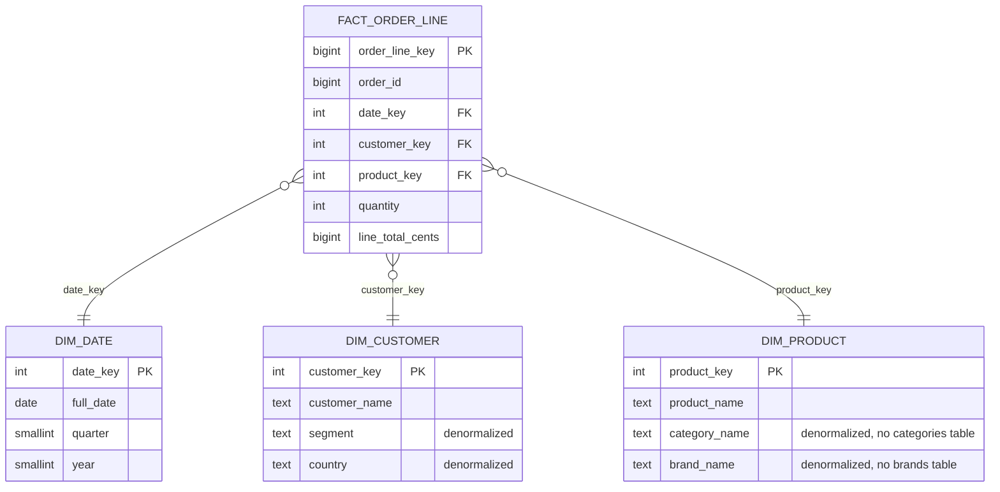

**Decision implications.** The star schema trades dimension-table storage
size and (rare) dimension-attribute update cost for dramatically simpler and
faster analytical queries — updating a category's name means updating it in
every `dim_product` row that references it (a batch update, not a single-row
change), but that update happens rarely (categories are renamed
occasionally, not constantly), while analytical queries against the fact
table happen constantly and benefit from every join being as cheap as
possible. This is the correct trade for OLAP workloads specifically because
their read-to-write ratio is extreme and their queries are join-sensitive at
a scale (billions of fact rows) where every additional join level has a
real, measurable cost — a trade-off that would be the wrong call for an OLTP
system with a much more balanced read/write ratio and much smaller data
volume per query.

**Common failure mode.** Applying strict normalization discipline to a data
warehouse's dimension tables out of habit — a data engineer who
normalizes `dim_product` into `products`, `categories`, and `brands`
tables (because "that's how you're supposed to model data") has recreated
exactly the join overhead the star schema exists to avoid, and analytical
queries against the resulting snowflake schema (Section 4.6) will be
measurably slower at scale for no corresponding write-side benefit, since
dimension writes are rare in the first place.

**Scenario.** A retail analytics team building a quarterly-revenue-by-category
dashboard against a normalized OLTP schema finds the underlying query joins
five tables and takes 40 seconds against a year of transaction history;
after migrating the same data into a star schema with denormalized
dimensions, the equivalent query drops to under a second, because the
query planner now only needs to join the fact table to three flat dimension
tables instead of walking a deeper normalized hierarchy for each one.

### 4.6 Snowflake schema — normalizing the dimensions back

**Definition.** A snowflake schema is a variant of the star schema in which
one or more dimension tables are *further normalized* into sub-dimension
tables (e.g. `dim_product` split into `products`, `categories`, and
`category_groups`), so that the dimension side of the schema resembles a
normalized hierarchy branching out from the fact table, rather than a single
flat table per dimension.

**Mechanism.** Where a star schema's `dim_product` inlines `category_name`
and `brand_name` directly, a snowflake schema instead gives `dim_product` a
`category_key` foreign key pointing to a separate `dim_category` table
(which may itself reference a `dim_category_group` table), removing the
redundant repetition of category/brand attributes across every product row
at the cost of requiring an extra join to reach them.

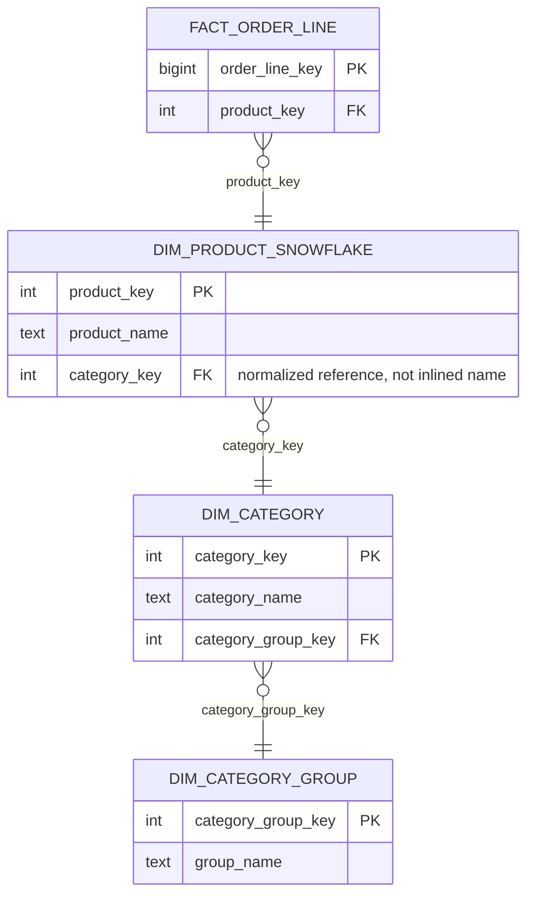

**Decision implications.** A snowflake schema is the right choice when a
dimension's attributes change often enough, or are large enough, that the
star schema's repetition cost genuinely outweighs its query-simplicity
benefit — a rapidly-changing, high-cardinality category taxonomy that gets
restructured every quarter is far cheaper to maintain normalized (update one
`dim_category` row) than denormalized across millions of `dim_product`
rows. For most business-intelligence workloads with relatively stable,
low-cardinality dimensions (a `dim_date` table, a `dim_country` table), the
star schema's flat, single-hop-join shape remains the better default, and
snowflaking should be applied selectively to the specific dimensions where
it earns its extra join cost back, not uniformly across the whole warehouse
by default.

**Common failure mode.** Snowflaking every dimension uniformly "for
consistency" without checking whether each dimension actually has the
update-frequency or storage-size profile that justifies it — this produces
a warehouse where every analytical query pays extra join overhead across
the board, for storage savings that, for genuinely low-cardinality slowly-
changing dimensions like `dim_date`, were never worth having in the first
place.

**Scenario.** A data warehouse team snowflakes `dim_geography` (country ->
region -> continent) because geographic hierarchies are reused across many
fact tables and rarely change, while deliberately keeping `dim_product`
fully star-flattened because product/category/brand attributes are queried
far more frequently than they're restructured — a mixed star/snowflake
design (sometimes called a "galaxy" or "fact constellation" schema) applied
per-dimension based on each dimension's own change-frequency and reuse
profile, not a single dogmatic choice for the whole warehouse.

### 4.7 The write-amplification and staleness trade-off

**Definition.** Write amplification is the multiplicative increase in write
work caused by maintaining N denormalized copies of a fact instead of one —
a single logical write (an order placed) now requires updates to the source
of truth *and* every materialized view, precomputed aggregate, and read
model derived from it. Staleness is the corollary: at any given moment,
some or all of those derived copies reflect the source of truth as it
existed at some point *before* now, not as it exists at this instant, and
the size of that gap is a direct function of how the synchronization
mechanism is designed (Section 4.2's refresh-strategy spectrum applies
generally here, not just to materialized views specifically).

**Mechanism.** Every denormalization technique in this chapter sits
somewhere on the same two-axis trade-off: how much extra write work does
maintaining this copy cost, and how stale can that copy be before it's
useful? Eager, synchronous synchronization (Section 4.2's eager refresh, or
a same-transaction counter increment) pushes staleness toward zero at the
cost of making every write slower and, if the synchronization can fail
independently of the source-of-truth write, introduces a partial-failure
risk (Section 15). Asynchronous, event-driven or scheduled synchronization
decouples write latency from the derived copy's maintenance cost, at the
cost of a nonzero, must-be-explicitly-bounded staleness window that every
downstream consumer of the derived copy must be designed to tolerate.

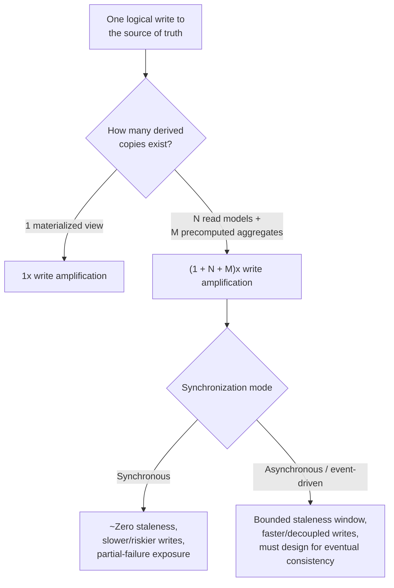

**Decision implications.** There is no "correct" point on this trade-off in
the abstract — the right answer is set by the actual business tolerance for
staleness on that specific read, not by a general preference for
consistency or performance. A bank balance display and a "recommended for
you" product carousel have wildly different staleness tolerances (near-zero
versus minutes-to-hours), and an architecture that applies the same
synchronization strategy to both is either overpaying for freshness the
carousel doesn't need or underpaying for freshness the balance display
requires. The number of derived copies matters as much as each one's
synchronization mode: a write that fans out to five differently-synchronized
downstream copies has five independent places where propagation can lag,
fail, or partially apply, and the operational burden of monitoring "is
every derived copy caught up" grows linearly with that fan-out.

**Common failure mode.** Adding denormalized copies one at a time, in
response to individual performance problems, without ever totaling up the
resulting write amplification for the busiest write paths — a single
`OrderPlaced` event that, over several years of incremental "just add one
more read model" decisions, now fans out to eleven different consumers,
several of which were added without anyone re-measuring the write path's
end-to-end latency or failure-mode surface area since the last one was
added.

**Scenario.** An architecture review for a checkout service discovers that
placing a single order now triggers sixteen synchronous side effects
(inventory decrement, three separate analytics counters, a search-index
update, a recommendation-engine cache invalidation, and more), several of
which were each individually justified but were never evaluated together —
the fix is not to remove denormalization, but to reclassify each side
effect by its real staleness tolerance and move the ones that can tolerate
delay onto an asynchronous, event-driven path, cutting the synchronous
critical path down to only the handful of updates that genuinely cannot
wait.

## 5. Internal Working

This section traces what actually happens, mechanically, when a denormalized
copy is kept in sync via the two dominant real-world mechanisms: a
trigger-based synchronous write-through, and a change-data-capture-driven
asynchronous pipeline. Understanding both at this level of detail is what
lets an architect predict failure modes (Section 15) rather than discover
them in production.

### 5.1 Synchronous write-through via database trigger

A database trigger fires as part of the same transaction as the triggering
write, giving the strongest consistency guarantee available (the trigger's
effect either commits atomically with the original write, or the whole
transaction rolls back) at the cost of adding the trigger's own work to the
critical path of every write that fires it.

```mermaid
sequenceDiagram
    participant App as Application
    participant DB as Database
    participant Trigger as AFTER INSERT trigger
    participant Rollup as Denormalized rollup table
    App->>DB: BEGIN; INSERT INTO likes (post_id, user_id) VALUES (...)
    DB->>Trigger: Fire AFTER INSERT trigger
    Trigger->>Rollup: UPDATE posts SET like_count = like_count + 1
    Rollup->>DB: Row updated (same transaction)
    DB->>App: COMMIT (both writes durable together, or neither is)
```

The atomicity here is the entire point: if the `UPDATE` to `like_count`
fails for any reason (a lock timeout, a constraint violation), the original
`INSERT` into `likes` rolls back too — the two copies can never observe a
state where one succeeded and the other didn't. The cost is that the
trigger's execution time is now part of the original statement's latency,
and if many rows fan out to the same rollup row (a viral post accumulating
thousands of likes per second), the rollup row itself becomes a write
hotspot and a lock-contention point that the original `likes` table, being
insert-only, would never have been.

### 5.2 Asynchronous synchronization via change data capture

Change data capture reads a database's write-ahead log (or equivalent
commit log) directly, rather than requiring the application or a trigger to
explicitly emit an event — every committed write is captured, in commit
order, as a stream of change events, with no risk of a code path
"forgetting" to publish an event because the mechanism operates below the
application layer entirely.

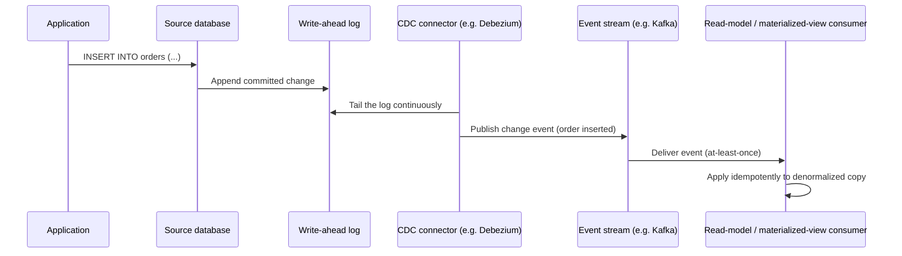

The write path here is entirely unaware that any downstream copy exists —
the `INSERT` commits and returns to the application with no added latency
from any denormalization concern at all. The cost is shifted entirely to
the read side of the trade-off: there is now an unavoidable propagation
delay between commit and the downstream copy reflecting it (typically
milliseconds to low seconds for a healthy pipeline, but unbounded if the CDC
connector or the stream falls behind), and every consumer must be built to
handle redelivery (the `Consumer->>Consumer` idempotency step above is not
optional, per Section 4.4's common failure mode).

## 6. Design Principles

- **Denormalize the read, not the whole model.** Identify the *specific*
  slow or complex read first, then build the minimal derived artifact that
  satisfies exactly that read — resist the urge to "denormalize everything"
  as a general performance posture; every derived copy is ongoing
  maintenance liability, not a free win.
- **The source of truth is always normalized (or otherwise authoritative)
  first.** Every denormalized artifact must be reconstructable from the
  source of truth; if it isn't, it has quietly become a second source of
  truth, and the system now has two places that can disagree about the same
  fact with no way to resolve the disagreement.
- **Pick a staleness budget before picking a synchronization mechanism.**
  "How stale can this read be before it causes a real problem" is a business
  question that should be answered explicitly, in writing, before choosing
  eager, lazy, or event-driven synchronization — choosing the mechanism
  first and discovering the staleness tolerance later leads to
  overengineered synchronous paths or under-engineered stale ones.
- **Every derived copy needs an explicit reconciliation path.** Because
  every synchronization mechanism can fail partially (a crashed process
  mid-update, a redelivered or dropped event), assume drift will happen and
  build a way to detect and correct it — a scheduled job that recomputes
  from the source of truth and compares, not a hope that the primary
  synchronization mechanism never fails.
- **Make write amplification visible.** Track, for each source-of-truth
  write path, how many derived copies it fans out to and how each is
  synchronized — this list should be an explicit, reviewed architecture
  artifact (an entry in an Architecture Decision Record, per
  [Architecture Thinking](../01_Architecture_Mindset/CH03_Architecture_Thinking.md)),
  not implicit tribal knowledge scattered across a dozen pull requests.
- **Match the technique to the workload shape, not to fashion.** A star
  schema is right for OLAP fact/dimension workloads; a precomputed counter
  is right for a single scalar aggregate; a CQRS read model is right when
  multiple, differently-shaped reads need to be served from one write model
  — reach for the specific technique whose mechanics actually fit the read
  pattern in front of you, not the one most recently discussed in an
  architecture conference talk.

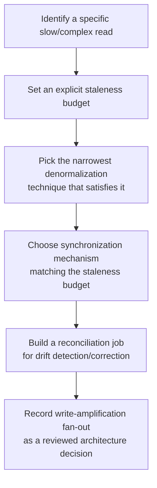

## 7. Architecture Patterns

### 7.1 Write-through cache/rollup pattern

The synchronous trigger-based pattern from Section 5.1, generalized: any
time a precomputed aggregate or single-row denormalized field is maintained
in lockstep with its source write, inside the same transaction or the same
atomic operation. Appropriate when the derived artifact is cheap to update
(a counter increment, not a full aggregation) and near-zero staleness is a
hard requirement.

### 7.2 CQRS with event-driven projections

The pattern detailed in Section 4.4: a write model emits domain events; one
or more independent projectors consume those events and maintain their own
denormalized read models, each optimized for a distinct query need. This is
the standard pattern once a system has multiple, genuinely different read
shapes derived from one write model, and where those reads can each tolerate
an explicit eventual-consistency window.

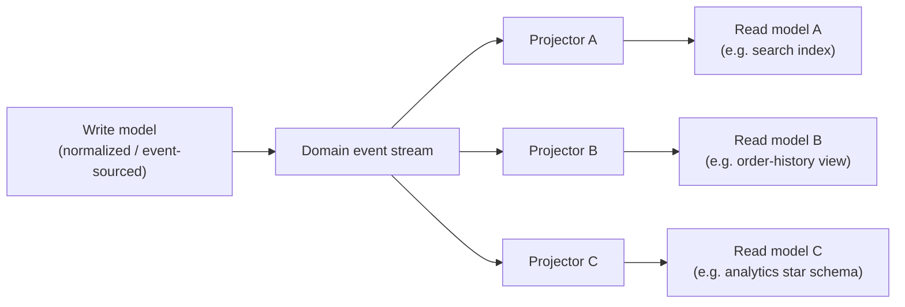

### 7.3 ETL/ELT into a dimensional data warehouse

A batch or streaming pipeline periodically extracts data from one or more
OLTP sources, transforms it into the star-schema shape (Section 4.5), and
loads it into a dedicated analytical store — deliberately separating the
transactional workload (many small, latency-sensitive writes and point
reads) from the analytical workload (few, very large, scan-heavy queries)
onto different storage systems entirely, so neither workload's resource
profile degrades the other's.

### 7.4 CDC-fed materialized-view pipeline

The pattern detailed in Section 5.2: a CDC connector tails a source
database's commit log and streams every change to one or more consumers
that maintain materialized views or read models. This is the modern,
lower-operational-burden alternative to hand-written dual writes or triggers
for cross-service or cross-database synchronization, because the capture
mechanism operates below the application layer and cannot be bypassed by a
code path that "forgot" to publish an event.

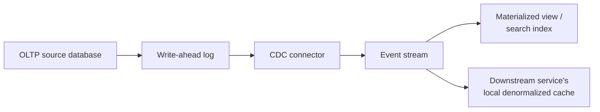

## 8. Production Architecture

A production system typically layers several of Section 7's patterns
together rather than choosing exactly one. A representative production
topology for a mid-sized e-commerce platform:

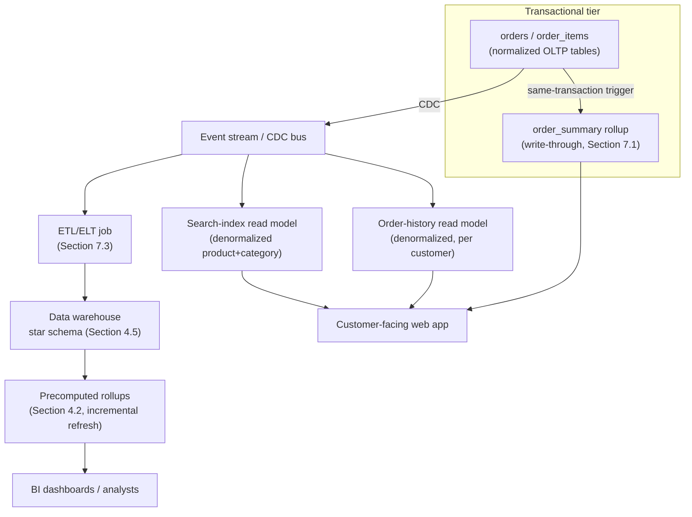

The transactional tier's rollup (`order_summary`) is kept synchronous
because it feeds an order-confirmation page that must reflect the just-placed
order immediately. Everything downstream of the CDC bus is intentionally
asynchronous: the search index, order-history view, and data warehouse can
all tolerate a staleness window measured in seconds to minutes, and
decoupling them from the transactional write path is what keeps checkout
latency from being held hostage by, say, a slow nightly ETL job or a
temporarily backed-up search-indexing pipeline.

## 9. Implementation

Implementing denormalization correctly is less about the SQL/DDL syntax
(which is usually simple) and more about the surrounding operational
machinery: refresh scheduling, idempotent event application, and drift
detection. A practical implementation checklist, in the order these
decisions should actually be made:

1. **Name the specific read this artifact serves**, and write down its
   acceptable staleness in explicit units (milliseconds, seconds, minutes) —
   not "as fresh as possible," which is not a testable requirement.
2. **Choose the narrowest technique that satisfies it**: a single
   precomputed column (Section 4.3) before a full materialized view
   (Section 4.2); a materialized view before standing up an entirely new
   CQRS read model and projector (Section 4.4).
3. **Choose the synchronization mechanism** matching the staleness budget:
   same-transaction trigger/write-through for near-zero staleness; scheduled
   or incremental materialized-view refresh, or CDC-driven async projection,
   for anything that can tolerate a bounded delay.
4. **Build the reconciliation job before shipping the derived artifact**,
   not after the first drift incident — treat "can we detect and correct
   drift" as a launch-blocking requirement, not a follow-up task.
5. **Instrument the synchronization pipeline's lag** (Section 14) so
   staleness is a measured, alertable number, not an assumption.
6. **Document the write-amplification fan-out** for the source-of-truth
   write path this artifact adds to, so future reviewers can see the
   cumulative cost rather than rediscovering it one denormalized copy at a
   time.

## 10. Complete Code Examples

The following examples are complete, runnable, and referenced from the
relevant Section 4/5 concepts above. Full source lives under
`code/<language>/denormalization-chapter/`.

1. **[Materialized-view refresh job (Python)](../code/python/denormalization-chapter/materialized_view_refresh.py)**
   — implements both an eager full-rebuild refresh and an incremental,
   watermark-based refresh of an `order_summary` materialized view against a
   normalized `orders`/`order_items` schema, illustrating the Section 4.2
   refresh-strategy trade-off directly in code.

2. **[CQRS read-model projector (Node.js)](../code/node/denormalization-chapter/cqrs_read_model_projector.js)**
   — a `CustomerOrderProjector` that consumes an at-least-once domain-event
   stream and maintains a denormalized `customerOrderView` read model,
   explicitly demonstrating the idempotent, sequence-watermarked event
   application that Section 4.4 identifies as mandatory for production CQRS
   projectors.

3. **[Star schema + precomputed rollup (SQL)](../code/sql/denormalization-chapter/star_schema_analytics.sql)**
   — a complete PostgreSQL star schema (`fact_order_line` plus three
   denormalized dimension tables), an analytical query exploiting its
   single-hop-join shape, and a `MATERIALIZED VIEW` rollup
   (`mv_quarterly_category_revenue`) with a `CONCURRENTLY`-refreshable
   unique index, tying together Sections 4.2 and 4.5.

4. **[Denormalized counter cache (Java)](../code/java/denormalization-chapter/DenormalizedCounterCache.java)**
   — a write-through precomputed-aggregate cache (`like_count`) with an
   explicit `reconcile()` method modeling the drift-correction job Section
   4.3 identifies as a required companion to any production rollup.

Each example is intentionally self-contained (no external service
dependencies beyond a standard library or an in-memory store) so it can be
read and run directly to build intuition before adapting the pattern to a
real database/broker stack.

## 11. Performance

Denormalization's entire justification is a performance argument, so it is
worth being precise about *which* performance dimension each technique
improves, and at what cost:

- **Read latency** is the primary, intended win across every technique in
  this chapter — replacing an N-table join or a full-table aggregation with
  a single indexed row lookup routinely takes a query from tens or hundreds
  of milliseconds (or, for large analytical scans, seconds) down to
  single-digit milliseconds.
- **Read throughput** improves correspondingly, since a cheaper
  per-query cost means a fixed amount of database CPU/IO capacity can serve
  proportionally more queries per second — this matters more than raw
  latency for capacity planning on high-QPS (queries-per-second) endpoints.
- **Write latency** is the cost side of eager/synchronous techniques: a
  trigger-maintained rollup adds the trigger's own execution time to every
  write that fires it, and a hot rollup row (many concurrent writers
  incrementing the same counter) can become a lock-contention bottleneck
  that the original insert-only table never had.
- **Storage cost** grows with every derived copy — a star schema's
  denormalized dimensions, a materialized view's persisted result set, and
  a CQRS read model's independent storage all consume additional disk/memory
  beyond the source of truth; for most workloads this is a favorable trade
  (storage is comparatively cheap), but it should be sized and budgeted for
  explicitly at genuinely large scale.
- **Refresh/synchronization cost** is its own resource line item —
  incremental materialized-view refreshes and CDC pipelines consume CPU, IO,
  and (for streaming platforms) broker throughput that must be capacity
  planned alongside the primary transactional workload, not treated as free
  background work.

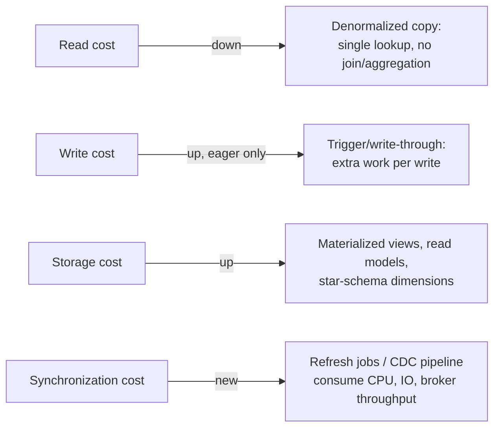

## 12. Scalability

Denormalization is frequently the specific technique that unlocks
scalability past a point a purely normalized design cannot reach, because it
converts an O(joins/rows-scanned) read cost into an O(1) or O(log n) lookup
cost that stays flat as data volume grows — a star schema's single-hop
dimension joins keep an analytical query's cost roughly constant per
additional billion fact rows scanned with proper partitioning, where the
equivalent query against a deeply normalized schema would need to touch
proportionally more tables and rows per query. The scalability trade-off
moves to the write/synchronization side instead: as write volume grows, an
eager, synchronous rollup update can become the bottleneck that limits
overall write throughput (every write now pays the rollup's cost too), and
an asynchronous CDC or event-driven pipeline must itself scale (partitioning
the event stream, scaling out projector consumers) to keep pace with source
write volume without its staleness window growing unboundedly. A common
scalability pattern is therefore to keep the *synchronous* critical path as
narrow as possible (Section 6's "denormalize the read, not the whole model"
principle) and push everything that can tolerate asynchrony onto a
horizontally scalable event pipeline, so the transactional write path's
scalability is never coupled to the read side's fan-out at all.

## 13. Security

Denormalization introduces security considerations distinct from those
already owned by other chapters (recap only, per the Concept Ownership
Rule):

- **Duplicated sensitive data multiplies the attack surface.** If a
  denormalized read model embeds personally identifiable information (PII)
  — a customer's name and address duplicated into an order-history read
  model — that data must now be protected, access-controlled, and included
  in data-retention/deletion policies in *every* location it's copied to,
  not just in the source of truth; a "right to be forgotten" deletion
  request that only purges the normalized source table while leaving PII in
  three denormalized read models and a search index is a compliance gap, not
  a completed deletion.
- **Star-schema dimension tables often aggregate cross-domain data for
  analytics** in ways that can inadvertently combine data that would
  otherwise be access-controlled separately in the OLTP source — a
  `dim_customer` table that joins financial-segment data with contact
  information for BI convenience should be reviewed for whether every
  consumer of the warehouse actually has a legitimate need to see the
  combination, not just each piece individually.
- **CDC pipelines and event streams are a new data-exfiltration surface.**
  Any service subscribed to a change-data-capture feed or event stream now
  has visibility into every field that stream carries, whether or not that
  service's actual read model needs all of them — event/CDC payloads should
  be scoped to what downstream consumers genuinely need, not simply "the
  whole row," to avoid quietly widening the blast radius of a compromised
  downstream consumer.
- **Reconciliation jobs need the same access controls as the data they
  reconcile.** A drift-correction job that reads the full source of truth to
  recompute a derived value is, by necessity, a component with broad read
  access across the system — it should be scoped, audited, and monitored
  like any other privileged batch process, not treated as an implementation
  detail exempt from the access-control review the rest of the system gets.

## 14. Observability

Because a denormalized copy can silently drift or lag without producing an
error (there is no exception thrown when a read model is stale — it just
answers with old data), observability is not optional polish here; it is the
only mechanism that makes staleness and drift visible before a customer or
an auditor finds them first.

- **Replication/refresh lag as a first-class metric.** For every
  materialized view, precomputed aggregate, and CQRS read model, instrument
  and dashboard "how far behind the source of truth is this copy right
  now" (e.g. `now() - last_refreshed_at`, or the CDC connector's own
  consumer-lag metric on its event-stream offset) — this single number is
  the direct, measurable proxy for the staleness budget set in Section 6.
- **Drift metrics from reconciliation jobs.** Every reconciliation job
  (Section 4.3, 9) should emit a metric for how many rows it corrected on
  each run — a nonzero, non-decreasing trend in corrected rows is an early
  warning that the primary synchronization mechanism has a systemic bug, not
  an occasional, expected blip.
- **Alerting thresholds tied to the staleness budget, not arbitrary
  defaults.** If the business-agreed staleness budget for a search index is
  five minutes, the alert should fire meaningfully before that budget is
  breached (e.g. at three minutes of lag), not only once data is already
  unacceptably stale.
- **Tracing write-amplification fan-out.** Distributed tracing across a
  write path that fans out to multiple synchronous and asynchronous
  downstream updates makes the actual, current fan-out visible per request —
  this is the operational counterpart to Section 6's "make write
  amplification visible" design principle, turning a static architecture
  document into a live, verifiable signal.

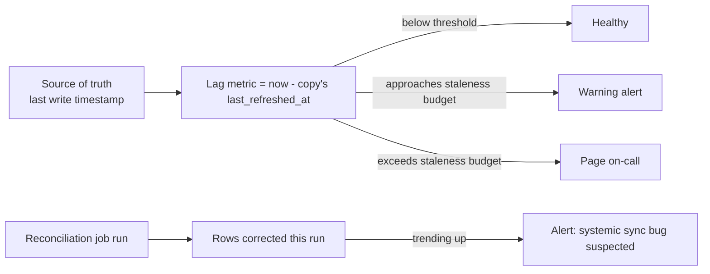

## 15. Failure Scenarios

- **The dual-write problem.** An application that writes to the source of
  truth and the denormalized copy as two separate, non-transactional
  operations (common when the copy lives in a different database or
  service entirely) can fail between the two writes — the first succeeds,
  the process crashes or the network call to the second fails, and the two
  are now permanently inconsistent with no automatic recovery. This is the
  single most common root cause of denormalization drift in practice, and
  it is exactly what CDC-based synchronization (Section 5.2) is designed to
  eliminate, by deriving the second write from the first one's already-
  committed log rather than issuing it as an independent operation.
- **Refresh job falling behind its own schedule.** A lazy or incremental
  materialized-view refresh that takes longer to run than its scheduled
  interval either backs up into a growing queue of overdue refreshes or, if
  runs are allowed to overlap, can produce an internally inconsistent
  partial result if a run is still in progress when the next one starts
  reading the same source rows.
- **Redelivered or out-of-order events corrupting a read model.** A
  projector or trigger-driven counter that isn't idempotent double-applies
  a redelivered event (a like counted twice, an order total added twice) or
  applies events out of order (a cancellation processed before the
  corresponding placement, which the projector then can't find a matching
  order for) — see Section 4.4's common failure mode for the concrete
  mechanics.
- **Reconciliation job itself becoming a source of incorrect data.** A
  reconciliation job with a bug in its own recomputation logic (an
  off-by-one in a date-range filter, a join that silently drops rows) can
  "correct" a derived copy to a *wrong* value that then looks authoritative
  because it just ran — reconciliation logic needs its own test coverage and
  review rigor, not less scrutiny because it's "just a fix-up job."
- **Cascading staleness across a chain of derived copies.** A read model
  that is itself derived from another derived copy (rather than directly
  from the source of truth) accumulates the staleness of every link in that
  chain — a dashboard built on a data-warehouse table that's itself refreshed
  from a materialized view that's refreshed every 15 minutes can be
  reporting numbers 30+ minutes stale without anyone realizing there were two
  staleness windows stacked, not one.

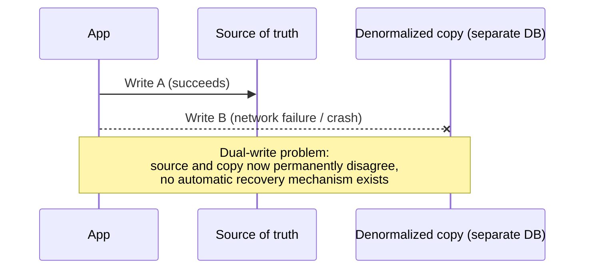

## 16. Testing

- **Test the reconciliation job as rigorously as the primary
  synchronization path.** Give it dedicated unit and integration tests
  covering drift-detection correctness (does it correctly identify a known
  injected discrepancy?) and idempotency (does running it twice against
  already-correct data change nothing?).
- **Test idempotent event application explicitly**, including redelivery
  and out-of-order scenarios: replay the same event twice and assert the
  read model's state is unchanged after the second application; deliver
  events out of their natural order and assert the projector either handles
  it correctly or fails loudly rather than silently producing a wrong
  result.
- **Test refresh-strategy behavior under load**, not just correctness in
  isolation — measure whether an incremental refresh job's runtime stays
  bounded as source-table volume grows, and whether concurrent
  reads against a materialized view mid-refresh see a consistent
  (pre-refresh or post-refresh) snapshot rather than a partially-updated
  state.
- **Test the "rebuild from scratch" path.** Periodically (in a staging
  environment, or as part of a game-day exercise) delete a denormalized
  artifact entirely and rebuild it from the source of truth, verifying the
  rebuilt result matches production — this is the concrete test of Section
  4.1's core invariant that a derived copy must always be reconstructable.
- **Contract-test the event schema between write model and projectors.** If
  the write model changes an event's shape without a projector being
  updated to match, the projector should fail a contract test in CI, not
  silently misinterpret the new event shape in production.

## 17. Common Mistakes

- **Denormalizing before measuring.** Adding a materialized view or rollup
  speculatively, based on an assumption a query will be slow, rather than
  measuring the actual query first — denormalization has a real ongoing
  cost (Sections 11, 13, 14), and it should be justified by a measured
  problem, not a guess.
- **No single, enforced write path for a denormalized copy.** Allowing
  multiple code paths (an API handler, a bulk-import script, a manual
  admin action) to write to the source of truth without all of them going
  through the same synchronization mechanism, so some writes silently skip
  updating the derived copy.
- **Treating a materialized view or read model as directly writable.** Once
  application code starts writing directly to a "derived" artifact (patching
  a rollup value to "fix" a bug, rather than fixing the source of truth and
  letting the refresh mechanism recompute it), it has stopped being a
  derived artifact and has become an undocumented second source of truth.
- **No staleness budget, so no way to know if the system is behaving
  correctly.** Without an explicit, agreed staleness tolerance, "the search
  index is 10 minutes behind" has no defined meaning — it might be fine, or
  it might be a serious incident, and nobody can tell without the budget
  having been set in advance.
- **Ignoring the write-amplification total.** Adding the fifth, sixth, and
  seventh downstream consumer to a hot write path without ever
  re-measuring that path's aggregate latency and failure surface, because
  each individual addition looked small in isolation.
- **Assuming eventual consistency is "eventually" in a meaningfully short
  window without verifying it.** A CDC pipeline or event stream that falls
  behind under load (a broker partition backing up, a downstream consumer
  crash-looping) can turn "eventually consistent within seconds" into
  "eventually consistent within hours" with no code change at all — this
  needs to be monitored (Section 14), not assumed.

## 18. Best Practices

- Denormalize the narrowest artifact that satisfies a specific, measured
  read problem — prefer a single precomputed column over a full
  materialized view, and a materialized view over standing up an entire new
  read model, whenever the narrower option actually suffices.
- Route every write to a denormalized artifact through exactly one
  synchronization mechanism (a trigger, a CDC pipeline, a single
  application-level write-through function) — never let more than one code
  path be independently responsible for keeping the same derived copy in
  sync.
- Set and document an explicit staleness budget for every derived artifact
  before choosing its synchronization mechanism, and treat that budget as a
  monitored SLO (Service-Level Objective), not an assumption.
- Build the reconciliation/drift-correction job at the same time as the
  denormalized artifact itself, not as a follow-up after the first
  incident.
- Prefer CDC-based synchronization over hand-written dual writes wherever
  the infrastructure supports it — deriving downstream updates from the
  source's own commit log removes an entire class of "forgot to publish the
  event" bugs by construction.
- Make idempotency a hard requirement for every event-driven projector or
  consumer, verified by an explicit test (Section 16), because at-least-once
  delivery is the practical default for most real message brokers and event
  streams.
- Periodically test the "delete and rebuild from the source of truth" path
  for every denormalized artifact to keep Section 4.1's core invariant
  (the copy is always reconstructable) true in practice, not just in
  theory.

## 19. Anti-Patterns

- **The undocumented second source of truth.** A denormalized artifact that
  application code has started writing to directly (Section 17), that can
  no longer be safely deleted and rebuilt, and that nobody remembers is
  supposed to be derived rather than authoritative.
- **Denormalization sprawl.** Dozens of ad hoc precomputed columns and
  rollups accumulated over years, each added for a specific past incident,
  with no central inventory of what exists, what it depends on, or what its
  staleness budget is supposed to be.
- **The synchronous everything anti-pattern.** Making every downstream
  update to every derived copy synchronous "to be safe," regardless of each
  one's actual staleness tolerance, needlessly coupling write latency (and
  write availability) to the health of every downstream consumer.
- **Denormalizing across a genuine consistency boundary without accepting
  eventual consistency.** Building a synchronous, transactional dual-write
  across two separate databases or services (rather than either keeping the
  copy in the same database/transaction, or explicitly accepting an
  asynchronous, eventually-consistent design) — this configuration gets
  neither strong consistency (there's no shared transaction across two
  separate systems) nor the operational simplicity of an accepted
  asynchronous design; it is the worst of both trade-offs at once.
- **Snowflaking (or star-flattening) every dimension uniformly**, as
  covered in Section 4.6's common failure mode, rather than deciding
  per-dimension based on its actual change-frequency and reuse profile.
- **Skipping reconciliation because "the pipeline is reliable."** Every
  synchronization mechanism can fail partially under conditions rare enough
  to not show up in normal testing (a specific crash timing, a specific
  broker partition-rebalance sequence) — a reconciliation job is not an
  admission the pipeline is badly built, it is the standard, expected
  companion to any derived copy.

## 20. Trade-off Analysis

Every denormalization technique trades read performance for a combination
of write cost, storage cost, and staleness/consistency risk. The
architect's job is not to eliminate this trade-off (it cannot be eliminated
— it is the direct, structural cost of removing a join or an aggregation
from the read path) but to place each derived artifact at the point on the
trade-off that actually matches its read's requirements:

- **Read speed vs. write speed.** Every technique in this chapter buys read
  speed by spending some amount of write speed or write-path complexity —
  the eager/synchronous end of the spectrum spends the most write speed for
  the least staleness; the asynchronous end spends the least write speed for
  a nonzero, must-be-bounded staleness window.
- **Consistency vs. availability/latency of the write path.** A
  synchronous, same-transaction update ties the availability of the
  original write to the availability of the derived-copy update (if the
  rollup update fails, does the whole transaction fail?) — an asynchronous
  design decouples these, at the cost of the write path no longer being
  able to guarantee the derived copy is updated by the time it returns.
- **Storage/operational cost vs. query simplicity.** A star schema's
  denormalized dimensions, a CQRS read model's independent storage, and a
  materialized view's persisted rows all cost storage and (for
  event-driven copies) pipeline infrastructure, in exchange for queries that
  no longer need to reconstruct the same joins/aggregations repeatedly.
- **Flexibility vs. specialization.** A purpose-built, denormalized read
  model answers its specific query extremely well but doesn't generalize —
  a new, differently-shaped query need usually requires a *new* denormalized
  artifact rather than a small tweak to an existing one, unlike a normalized
  schema's ability to answer novel ad hoc queries via new join
  combinations.

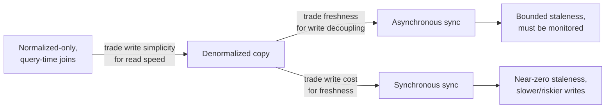

## 21. Comparison Table

| Technique | Read benefit | Write/storage cost | Typical staleness | Best fit |
|---|---|---|---|---|
| Precomputed aggregate/rollup (4.3) | O(1) read of a single value, no aggregation query | Small, but every write path must update it consistently | Near-zero (write-through) or bounded (async) | A single scalar per entity (like count, running total) read very frequently |
| Materialized view — eager (4.2) | Fresh, join-free reads | Highest write cost; write pays full view-maintenance cost | Near-zero | Cheap-to-maintain views where freshness is non-negotiable |
| Materialized view — lazy/scheduled (4.2) | Join-free reads, simplest to operate | Low write cost; periodic full-rebuild cost | Bounded by refresh interval (minutes+) | Dashboards/reports tolerant of "as of last refresh" data |
| Materialized view — incremental (4.2) | Join-free reads, near-fresh | Moderate; only delta rows reprocessed | Bounded by refresh cadence (seconds-minutes) | High-volume views where full rebuild is too slow |
| CQRS read-model duplication (4.4) | Purpose-shaped, zero-join reads per query type | Highest overall (independent storage + projector infra per read model) | Bounded by event-stream propagation (ms-seconds typically) | Multiple, structurally different read patterns off one write model |
| Star schema (4.5) | Single-hop joins for analytical queries at scale | Dimension updates touch many rows; extra storage for repeated attributes | Bounded by ETL/refresh cadence | OLAP workloads with stable, low-cardinality dimensions |
| Snowflake schema (4.6) | Reduced dimension redundancy/storage | Extra join per normalized dimension level | Same as star schema (modeling choice, not a sync-timing choice) | Dimensions with frequent structural change or very high cardinality |

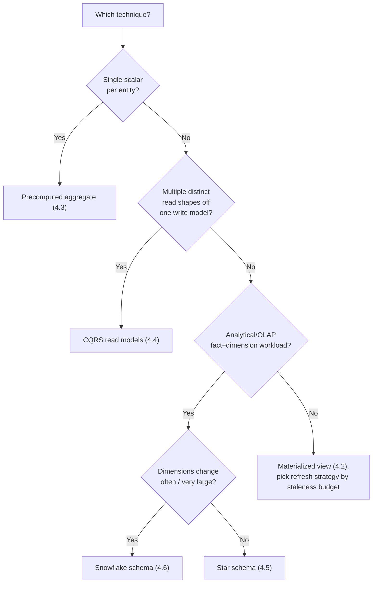

## 22. Real-World Case Study

A mid-sized subscription video platform's catalog-browsing service
originally served its "titles in this genre, with rating and availability"
page directly from a normalized OLTP schema: a `titles` table, a
many-to-many `title_genres` join table, a `ratings` table requiring an
aggregation per title, and an `availability` table keyed by region and
license window. As the catalog grew past roughly 50,000 titles and traffic
grew alongside it, this page's query — a four-table join plus a per-title
rating aggregation — began taking 800ms-1.2s at the 95th percentile during
peak hours, well past the product's 200ms budget for this page.

The team's first instinct was to add database read replicas and more
caching at the HTTP layer, which helped only marginally, because the
underlying query cost per cache-miss was unchanged and the catalog's
long-tail nature (thousands of distinct genre/region/language combinations)
meant cache hit rates stayed low. Root-causing the actual bottleneck — not
"we need more capacity" but "this specific read is structurally expensive
because of a four-table join plus a per-title aggregation" — led to a
denormalization redesign combining three techniques from this chapter:

1. A **precomputed `avg_rating` and `rating_count` column** was added
   directly to the `titles` row (Section 4.3), maintained via a CDC
   pipeline reading the `ratings` table's change log rather than a
   synchronous trigger, since a rating's effect on the displayed average
   could tolerate a few seconds of staleness with no user-visible impact.
2. A **denormalized `catalog_browse` read model** (Section 4.4), separate
   from the OLTP schema entirely, embedded each title's genre names,
   precomputed rating, and per-region availability flag directly into a
   single document per (title, region) pair, built by a projector consuming
   the same CDC event stream as the rating rollup — the browsing page's
   query became a single indexed lookup against this read model with zero
   joins.
3. **Availability-window changes** (which happen in scheduled batches, not
   continuously) were deliberately left synchronous within the CDC
   pipeline's normal latency rather than given any special-cased low-latency
   path, because the business confirmed a licensing change taking effect a
   few seconds later than the source system was an acceptable, already-
   existing operational reality (license changes are scheduled well in
   advance, not instantaneous business events).

The result brought the browsing page's 95th-percentile latency down to
roughly 40ms, driven almost entirely by removing the join and aggregation
from the read path rather than by adding hardware. The team explicitly
budgeted for the new write-amplification and staleness this introduced: a
dashboard tracking CDC consumer lag for the `catalog_browse` projector was
built alongside the read model itself (not after an incident), with an
alert threshold set at 30 seconds of lag against a business-agreed 60-second
staleness budget, and a nightly reconciliation job recomputes a sample of
`catalog_browse` documents from the OLTP source and pages the on-call
engineer if more than 0.1% of sampled documents disagree — turning "is our
denormalized copy correct" from an assumption into a continuously verified
fact.

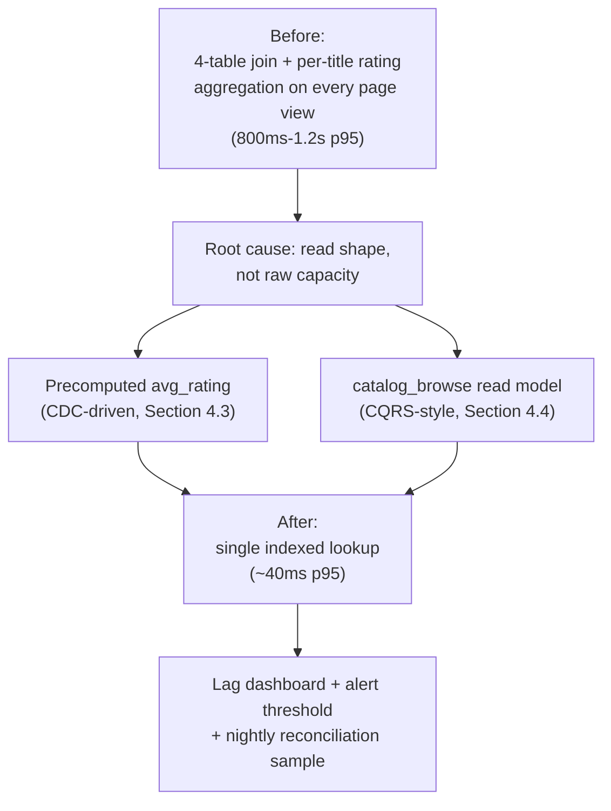

## 23. Interview Questions

1. What is the fundamental trade-off denormalization makes, and why can it
   never be "free" — what does it always cost, even when done well?
2. Walk through the difference between eager, lazy, and incremental
   materialized-view refresh strategies. What determines which one is
   appropriate for a given read?
3. What is write amplification, and how would you measure it for a given
   write path in a production system?
4. Explain the dual-write problem. Why does change data capture (CDC)
   reduce, but not entirely eliminate, this risk?
5. In a CQRS architecture, why must read-model projectors be idempotent?
   What concretely goes wrong if they aren't?
6. When would you choose a star schema over a snowflake schema for a data
   warehouse, and vice versa? Give a concrete dimension for each case.
7. How would you design a reconciliation job for a precomputed counter (like
   a "like count")? What would make you trust its output?
8. A denormalized read model is reporting data that's 20 minutes stale
   against a 60-second staleness budget. Walk through how you'd diagnose the
   root cause.
9. Why is a materialized view (or any denormalized artifact) not itself a
   place application code should ever write to directly? What breaks if it
   is?
10. Describe a real (or plausible) system where you would explicitly choose
    *not* to denormalize a slow read, and explain why.

## 24. Hands-on Exercises

1. Run [materialized_view_refresh.py](../code/python/denormalization-chapter/materialized_view_refresh.py)
   locally. Modify it to add a third refresh strategy — a hybrid that
   performs an eager update for `status` changes but an incremental
   (batched) update for `order_items` changes — and justify in a short
   comment why this split makes sense for that specific field.
2. Extend [cqrs_read_model_projector.js](../code/node/denormalization-chapter/cqrs_read_model_projector.js)
   to handle a new event type, `OrderRefunded`, that should subtract the
   refunded amount from `lifetimeTotalCents` without double-counting a
   redelivered `OrderRefunded` event — write a test that proves your
   implementation is idempotent under redelivery.
3. Load [star_schema_analytics.sql](../code/sql/denormalization-chapter/star_schema_analytics.sql)
   into a local PostgreSQL instance, populate it with a few thousand
   synthetic rows, and measure the analytical query's execution time before
   and after adding the `mv_quarterly_category_revenue` materialized view —
   confirm the `EXPLAIN ANALYZE` plan shows the materialized view being read
   directly rather than the fact table being re-aggregated.
4. Take [DenormalizedCounterCache.java](../code/java/denormalization-chapter/DenormalizedCounterCache.java)
   and introduce a deliberate race condition by removing the `AtomicLong`
   and using a plain `long` instead; write a concurrent test that
   demonstrates lost updates, then revert the change and show the same test
   passes — this is meant to make the "why atomics/locking matter for a
   write-through counter" lesson concrete, not abstract.
5. Design (on paper, no code required) a staleness-budget document for
   three different denormalized artifacts you might build for an e-commerce
   product: a checkout order-confirmation total, a "customers also bought"
   recommendation widget, and a monthly revenue dashboard. Justify each
   budget in one sentence tied to its actual business impact if breached.

## 25. Design Exercises

1. You are asked to speed up a "user profile page" that currently performs
   six joins to assemble a user's basic info, recent activity, follower
   count, and badge list. Design a denormalization strategy: which pieces
   would you precompute, which would you leave as live queries, and why?
   Sketch the synchronization mechanism for each piece you denormalize.
2. Design the read-model architecture for a ride-sharing platform's "trip
   receipt" feature, which must show the rider a complete, correct receipt
   (fare breakdown, driver name, route) within 5 seconds of trip completion,
   99.9% of the time. Specify your synchronization mechanism, staleness
   budget, and what happens if the read model isn't ready when the rider
   opens the receipt screen at exactly the 5-second mark.
3. A data warehouse team asks you to review their proposed schema: every
   dimension table is fully snowflaked (three to four normalization levels
   deep) "for consistency with our OLTP modeling standards." Write the
   architecture review feedback you would give, referencing the specific
   trade-offs from Section 4.6 and Section 20.
4. Design a drift-detection and correction strategy for a system with five
   independently synchronized denormalized copies of order data (a rollup
   column, two CQRS read models, a search index, and a data-warehouse fact
   table). How would you avoid building five bespoke reconciliation jobs,
   and what would a shared reconciliation framework need to support?
5. Propose a monitoring dashboard layout (metrics, thresholds, and alert
   routing — no code required) for the production architecture in Section 8,
   covering every synchronous and asynchronous synchronization path shown in
   that diagram.

## 26. Architecture Review Questions

- For every denormalized artifact in this design: what specific read
  problem, measured with real numbers, does it solve?
- Is there an explicit, documented staleness budget for each derived copy,
  and is that budget currently being monitored against?
- Can each denormalized artifact be deleted and correctly rebuilt from its
  source of truth today — has this actually been tested, or only assumed?
- Is there exactly one write path (mechanism) responsible for keeping each
  derived copy in sync, or can more than one code path update it
  independently?
- What is the total write-amplification fan-out for the busiest write path
  in this system, and has that total been reviewed together, not just
  incrementally as each derived copy was added?
- Does every event-driven projector or consumer in this design handle
  redelivery and out-of-order delivery idempotently, and is that covered by
  a test?
- Is there a reconciliation job for every derived artifact, and does it have
  its own test coverage and monitored output?
- For any duplicated PII or otherwise sensitive data, do data-retention and
  deletion processes correctly reach every denormalized copy, not only the
  source of truth?

## 27. Summary

Denormalization is normalization's deliberate, disciplined inverse: instead
of decomposing data to guarantee each fact lives in exactly one place, it
reintroduces redundancy — precomputed aggregates, materialized views,
duplicated read models, denormalized analytical schemas — specifically to
remove expensive joins and aggregations from a read path that cannot afford
to pay for them at query time. Every technique in this chapter buys that
read-side win by spending something else: write latency or write-path
complexity for synchronous techniques, a bounded staleness window for
asynchronous ones, and additional storage and synchronization
infrastructure in every case. None of that spending is inherently wrong —
it is the correct, necessary cost of the performance the business actually
needs — but it must be spent deliberately, against a measured problem and an
explicit staleness budget, with a synchronization mechanism that's
monitored for lag and paired with a reconciliation job that can detect and
correct drift. An architect who treats every denormalized copy as a
first-class artifact with an owner, a staleness contract, and a rebuild
path avoids the failure mode this chapter warns about most: a derived
convenience quietly becoming an undocumented, unreconcilable second source
of truth. Read [Normalization](CH01_Normalization.md) for the discipline
that keeps the source of truth itself correct; use this chapter's
techniques deliberately, on top of that discipline, wherever a specific,
measured read genuinely needs them.

**Further reading:**
[Normalization](CH01_Normalization.md) ·
[Architecture Thinking — ADRs and trade-off analysis](../01_Architecture_Mindset/CH03_Architecture_Thinking.md) ·
[STYLE_GUIDE.md](../STYLE_GUIDE.md)
