# Chapter: Indexes

Part: [06 — Databases and Storage](PART_OVERVIEW.md) · Status: Drafted

## 1. Introduction

An index is a secondary data structure that trades extra storage and write
cost for dramatically faster reads on a specific access pattern. Without an
index, answering "find the row where `customer_id = 123456`" requires reading
every row in a table (a full table scan) and checking each one; with an
index, the same query can jump directly to the matching rows by walking a
small, purpose-built lookup structure instead. Every relational database
(PostgreSQL, MySQL/InnoDB, Oracle, SQL Server) and most NoSQL stores
(MongoDB, DynamoDB, Cassandra, Elasticsearch) build on the same handful of
underlying index data structures — overwhelmingly the B-tree/B+tree family,
with hash indexes as a narrower special case — so understanding how those
structures work, and how a query planner decides whether to use them, is
foundational to almost every performance and data-modeling decision a
Solution Architect makes.

This chapter is the *owning* chapter for index data structures (B-tree/
B+tree internals, hash indexes), index design decisions (composite indexes,
column-order sensitivity, covering indexes), the clustered-vs-non-clustered
storage distinction, selectivity/cardinality estimation, and the write-side
cost of maintaining indexes, per the Concept Ownership Rule in
[STYLE_GUIDE.md](../STYLE_GUIDE.md). Two sibling chapters cover adjacent
schema-design ground that this chapter deliberately does not re-teach:
[Normalization](CH01_Normalization.md) owns normal forms and functional
dependencies, and [Denormalization](CH02_Denormalization.md) owns
materialized views and star schemas. This chapter is strictly about *how
indexes are built and how to decide which ones to create* — it assumes a
schema already exists and asks "what should point at this data, and at what
cost?"

## 2. Historical Evolution

- **Sequential/sorted files with binary search (1960s)** — the earliest
  "index" was simply keeping a file sorted and binary-searching it; fast to
  read, but every insert required rewriting large portions of the file to
  keep it sorted, which was untenable for write-heavy workloads.
- **ISAM (Indexed Sequential Access Method, IBM, 1960s)** — introduced a
  separate, static index structure pointing into a sequential data file, so
  lookups didn't require scanning the data file itself; still suffered from
  index staleness and overflow-chain degradation as the underlying file grew,
  since the index structure itself was not easily rebalanced.
- **B-tree (Bayer & McCreight, 1970s)** — solved ISAM's rebalancing problem
  with a self-balancing tree structure whose nodes could hold many keys (wide
  fanout) and whose height grew only logarithmically with data volume,
  making it a natural fit for block-oriented disk storage where minimizing
  the number of disk seeks mattered more than minimizing CPU comparisons.
- **B+tree variant (1970s-1980s)** — a refinement where only leaf nodes store
  the actual data pointers (internal nodes are purely routing structures),
  and leaf nodes are linked together in sorted order. This became the
  dominant index structure in relational databases because it makes range
  scans (`BETWEEN`, `ORDER BY`, prefix `LIKE`) cheap: once you find the start
  of a range, you can walk sibling leaf pointers instead of re-traversing the
  tree.
- **Hash indexes (1980s onward)** — database engines added hash-table-based
  indexes as a narrower, O(1)-average-case alternative for pure equality
  lookups, at the cost of losing all ordering information (no range scans,
  no `ORDER BY` support from the index).
- **Bitmap indexes (Oracle, 1990s, data-warehouse workloads)** — for very
  low-cardinality columns in read-heavy analytical workloads, bitmap indexes
  (one bit vector per distinct value) became a specialized alternative to
  B-trees, which are inefficient for the "sequential file" and low-selectivity
  case — outside this chapter's core scope but worth knowing exists.
- **Covering/included columns (2000s-2010s, e.g. SQL Server `INCLUDE`,
  PostgreSQL 11+ `INCLUDE`)** — engines added the ability to store extra,
  non-key columns in an index's leaf nodes purely to satisfy a query without
  a second lookup, formalizing the covering-index/index-only-scan pattern
  that had previously been achieved only by accident (making the index's key
  columns wide enough to include everything needed).
- **LSM-tree-based indexing (2000s-2010s, e.g. Cassandra, RocksDB,
  Bigtable)** — write-optimized NoSQL and embedded stores popularized the
  Log-Structured Merge tree as an alternative to the B+tree for workloads
  dominated by writes, deferring index reorganization to background
  compaction rather than paying it synchronously on every write — a distinct
  structural trade-off recapped briefly in Section 6.

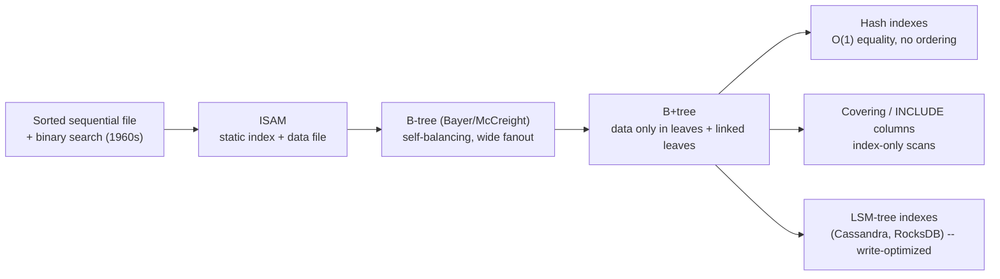

## 3. Why It Exists

A table without any index is stored as an unordered (or insertion-ordered)
heap of rows. Finding a specific row by any criterion other than its
physical storage position means reading every row — an O(n) operation whose
cost scales linearly with table size. As tables grow from thousands to
billions of rows, a full scan that took milliseconds becomes a scan that
takes minutes, and a query pattern that runs constantly (e.g. "look up a
user by email on every login") becomes the dominant cost driver of the
entire system. Indexes exist to convert that O(n) linear search into an
O(log n) tree traversal (B-tree/B+tree) or an O(1) average-case hash lookup,
at the cost of extra storage for the index structure itself and extra write
work to keep that structure correct every time the underlying data changes.
This chapter's core tension — read speed vs. write cost vs. storage — is the
lens through which every index-design decision in this chapter should be
read. Schema-level decisions that also affect this trade-off, such as
normal-form choice (recap: normalization reduces redundancy and update
anomalies by decomposing tables based on functional dependencies — see
[Normalization](CH01_Normalization.md) for the full theory) and materialized
denormalized views for read-heavy analytical access (recap: see
[Denormalization](CH02_Denormalization.md) for star schemas and materialized
views), operate one layer up from indexing and are out of this chapter's
scope beyond these recaps.

## 4. Core Concepts

### 4.1 What an index is, and the fundamental trade-off

**Definition.** An index is an auxiliary, ordered (or hashed) data structure
that maps values of one or more columns to the physical location of the rows
containing those values, maintained automatically by the database engine as
the underlying table changes.

**Mechanism.** Instead of storing a pointer to *every* row inline in the
table itself, an index is a separate structure — typically a B+tree — whose
entries are `(key, row locator)` pairs, sorted by key. To satisfy a query,
the engine walks the index structure to find matching keys, then follows the
row locators to fetch the actual row data (unless the index itself already
contains everything the query needs — covering indexes, Section 4.6).

**Decision implications.** Every index you create is a standing commitment:
the engine must update it on every `INSERT`, `UPDATE` that touches an indexed
column, and `DELETE`. An index is worth that cost only if the read pattern it
accelerates is frequent and expensive enough (relative to table size) to
justify the ongoing write tax — this is why indiscriminately indexing every
column is itself an anti-pattern (Section 19), not a safe default.

**Common failure mode.** Treating "add an index" as a free performance lever.
Teams under load frequently add an index to fix one slow query without
checking whether the table is already write-heavy, and are surprised when
overall write throughput drops or replication lag increases because every
write now updates five index structures instead of one.

**Scenario.** A `users` table with 50 million rows and no index on `email`
takes 8 seconds to satisfy `WHERE email = ?` (a full sequential scan). Adding
a B-tree index on `email` turns that into a sub-millisecond index-scan
lookup, at the cost of roughly 15-20% additional storage for the index
itself and a small, constant per-write overhead on every `INSERT`/`UPDATE`
that changes `email`.

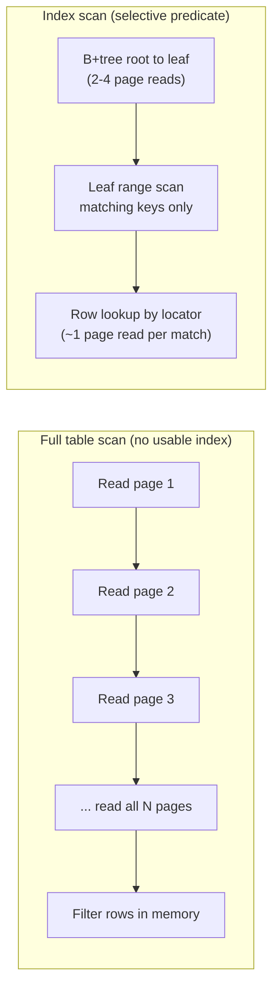

### 4.2 B-tree/B+tree internals — why B+tree specifically for disk-backed indexes

**Definition.** A B-tree is a self-balancing tree structure where each node
can hold many keys (not just one or two, as in a binary tree) and has
correspondingly many children; a B+tree is a variant where only the leaf
level stores the actual row locators, internal nodes exist purely to route a
search toward the correct leaf, and leaf nodes are linked to their siblings
in sorted order.

**Mechanism.** Disk storage (and even SSD storage, though less dramatically)
is organized in fixed-size pages (commonly 4-16 KB), and reading one page
costs roughly the same as reading a handful of bytes from it — the dominant
cost is the *seek*, not the byte count. A B+tree exploits this by making each
node exactly one page and packing as many keys into that page as will fit
(high *fanout* — often hundreds of keys per internal node). A tree with
fanout 200 needs only 4 levels to index over 1.6 billion rows
(200^4 ≈ 1.6 x 10^9), meaning a lookup by primary key touches only 3-4 pages
regardless of table size — this is why B+tree lookups are described as
O(log n) but in practice behave close to O(1) for realistic data volumes: the
base of that logarithm is the fanout, not 2. The B+tree design specifically
(versus a plain B-tree) keeps row locators *only* in leaf nodes so internal
nodes stay small and highly cacheable, and it links leaves together so a
range scan (`BETWEEN`, `>`, `ORDER BY`) can walk forward through sibling
pointers after one initial root-to-leaf descent, instead of re-descending the
tree for every subsequent key.

**Decision implications.** Because B+tree cost is dominated by tree height
(page reads), and height grows logarithmically, B+tree indexes remain
efficient from thousands to billions of rows without redesign — this is why
it is the default index type in virtually every relational database and why
an architect rarely needs to reason about "will a B-tree index still work at
this scale," and can instead focus on *which* columns to index and in what
combination.

**Common failure mode.** Assuming index lookup cost scales linearly with
table size the way a table scan does. Engineers sometimes avoid adding an
index to a "huge" table out of a mistaken belief that the index itself will
become slow to search — in reality the tree only grows one or two levels
deeper as data grows by orders of magnitude, so lookup cost stays nearly
flat; the real cost that scales with size is index *maintenance* (Section
4.8), not index *lookup*.

**Scenario.** An orders table grows from 1 million to 1 billion rows over
several years. A B+tree index on `order_id` that took 2 page reads to search
at 1 million rows takes perhaps 4 page reads at 1 billion rows — a
negligible difference in practice, especially once the top 1-2 levels are
cached in memory (which is nearly always true, since the root and first
level are tiny and extremely hot).

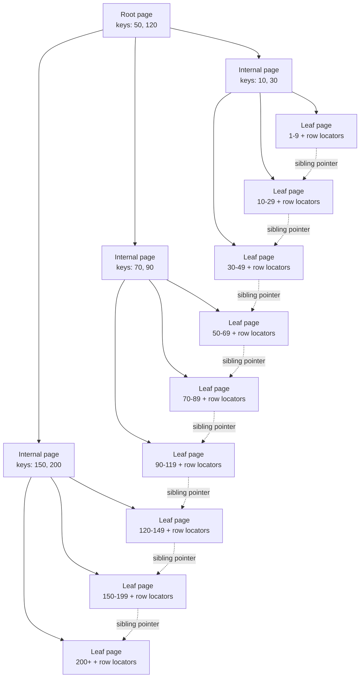

### 4.3 Hash indexes and the equality-only limitation

**Definition.** A hash index maps a key to a bucket via a hash function, and
stores `(key, row locator)` pairs within that bucket, giving average-case
O(1) lookup for exact-match ("equality") queries.

**Mechanism.** On lookup, the engine computes `hash(key)` and jumps directly
to the corresponding bucket (typically a small in-memory or single-page
structure), then scans the (usually short) chain of entries in that bucket
for an exact match. Because a good hash function deliberately scrambles the
input's ordering (`hash(4)` and `hash(5)` land in unrelated buckets), a hash
index carries no information about relative order between keys — there is no
way to walk "the next key after this one" without recomputing hashes for
every candidate, which defeats the purpose.

**Decision implications.** A hash index is a good fit only when the access
pattern is *exclusively* equality lookups (`WHERE key = value`) and never
range predicates, sorting, or prefix matching. This is why most relational
engines default every ordinary index to B-tree and offer hash indexes only
as an explicit, narrower option (e.g. PostgreSQL's `CREATE INDEX ... USING
HASH`) — the B+tree's O(log n) equality lookup is close enough to a hash
index's O(1) in practice that most teams don't accept giving up range-scan
capability for the marginal gain.

**Common failure mode.** Choosing a hash index for a column that later needs
`ORDER BY`, `BETWEEN`, or `>`/`<` predicates, then discovering the index is
silently unusable for those queries and the planner falls back to a full
scan — the failure is often invisible until a new query shape is added
months later, since the original equality queries continue to work fine.

**Scenario.** A distributed key-value store (or a database's internal
primary-key hash index) uses hash-based sharding: `partition = hash(user_id)
% num_partitions`. This is an ideal hash-index use case because the only
question ever asked is "does this exact key exist, and where," never "give
me all keys between X and Y" — range queries on a hash-partitioned key space
would have to fan out to every partition anyway.

### 4.4 Clustered vs. non-clustered (secondary) indexes

**Definition.** A clustered index is one where the table's actual row data
is physically stored in the leaf nodes of the index itself, in index-key
order — there is no separate "heap" file. A non-clustered (secondary) index
stores only the indexed column(s) plus a row locator in its leaves, pointing
to where the full row lives elsewhere (either a separate heap, or — in
engines where the primary key is clustered — the primary key value, which is
then used to search the clustered index).

**Mechanism.** A table can have at most one clustered index, because rows
can only be physically sorted one way at a time; every other index on that
table is necessarily non-clustered. Reading via a non-clustered index
therefore costs two tree traversals in the worst case: one through the
secondary index to find the row locator, then one more (through the heap, or
through the clustered index by primary key) to fetch the full row — unless
the secondary index is also a covering index for the query (Section 4.6),
which avoids the second traversal entirely.

**Decision implications.** Because the clustered index also determines
physical storage order, its choice of key affects *every* query that
benefits from data locality — range scans by the clustered key are
essentially free sequential reads, while range scans by any other column
require jumping around the heap unpredictably. This is why primary keys are
frequently chosen with insertion order in mind (e.g. an auto-incrementing
integer, or a time-ordered UUID/ULID) rather than a naturally "meaningful"
but randomly-ordered column, since a randomly-ordered clustering key causes
every insert to land in a random, likely cold page (a problem sometimes
called "clustering-key fragmentation").

**Common failure mode.** Assuming all indexes behave identically regarding
how many page reads a lookup costs. A team migrating from MySQL/InnoDB
(where the primary key is *always* clustered, and every secondary index
implicitly stores the primary key as its row locator) to a database with a
heap-organized default table structure (e.g. PostgreSQL, where *no* index is
clustered by default and every index — including the primary key's — points
at heap tuples) can be surprised that a query which was fast in one engine
needs an explicit covering index in the other to reach the same performance.

**Scenario.** An `orders` table clustered on `order_id` (auto-incrementing)
answers `SELECT * FROM orders WHERE order_id BETWEEN 1000 AND 2000` as one
contiguous sequential read. The same table has a non-clustered secondary
index on `customer_id`; answering `WHERE customer_id = 42` first walks the
secondary index's B+tree to collect matching `order_id` row locators, then
performs a second lookup per matching row against the clustered structure —
each of those second lookups can land on a different, possibly-uncached page,
which is why non-clustered index scans over many matching rows are
noticeably more expensive per row than a clustered range scan.

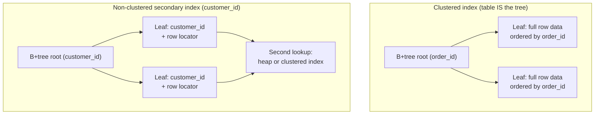

### 4.5 Composite indexes and column-order sensitivity

**Definition.** A composite (multi-column) index is a single B+tree index
built over two or more columns, with leaf entries sorted lexicographically —
first by the leading column, then by the second column within each value of
the first, and so on.

**Mechanism.** Because entries are sorted by the *leading* column first, the
tree can only be used as a direct seek (binary-search-style traversal) for
predicates that constrain a contiguous prefix of the indexed columns starting
from the first one — this is the "leftmost-prefix rule." A predicate on
`(country, city)` from an index on `(country, city, last_name)` can seek
efficiently, because both are a prefix; a predicate on `city` alone cannot
seek efficiently through that same index, because entries are not grouped by
city independent of country — the engine would have to inspect every
country's entries to find city matches, which is no better than a full index
scan.

**Decision implications.** Column order in a composite index should be
chosen based on the query patterns it needs to serve, generally: put the
column(s) used in equality predicates first (they narrow the search the
most and the most predictably), followed by a column used in a range
predicate or `ORDER BY` last (since a range predicate on a non-final column
prevents the remaining columns from being useful for further narrowing
within that range). A single well-ordered composite index can serve several
related query shapes; a poorly-ordered one may need to be duplicated with
different orderings, doubling maintenance cost for the same logical intent.

**Common failure mode.** Creating one composite index per query shape
without checking whether reordering columns in an *existing* index would
have covered the new query shape too, leading to redundant indexes (Section
17) that each carry independent write cost for largely overlapping benefit.

**Scenario.** A support-ticket system frequently queries `WHERE tenant_id = ?
AND priority = ?` and separately `WHERE tenant_id = ? AND priority = ? AND
created_at >= ?`. A single index on `(tenant_id, priority, created_at)`
serves both: the first query uses the first two columns as an exact-match
prefix, and the second query additionally uses `created_at` as a range bound
within that prefix. See the working demonstration in
[02_composite_index_column_order.sql](../code/sql/indexes-chapter/02_composite_index_column_order.sql).

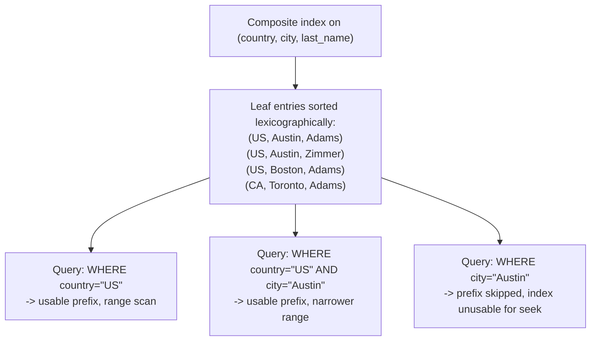

### 4.6 Covering indexes and index-only scans

**Definition.** A covering index is an index that contains every column a
given query needs — both the columns used in the `WHERE`/`JOIN` predicates
and the columns in the `SELECT` list — allowing the engine to answer the
query entirely from the index's leaf entries, without a second lookup against
the heap or clustered index. The resulting execution plan is called an
index-only scan.

**Mechanism.** Some engines support a dedicated syntax for adding
"payload-only" columns to an index (e.g. PostgreSQL/SQL Server's `INCLUDE`
clause) — these columns are stored in leaf entries but not part of the sort
key, so they don't affect the leftmost-prefix seek behavior from Section
4.5, but they do let the query planner skip the second (heap/clustered)
lookup entirely when the query only selects included/indexed columns. An
index-only scan is only guaranteed to skip the heap check entirely when the
engine can also confirm row *visibility* from the index structure alone
(PostgreSQL, for example, uses a "visibility map" for this and still falls
back to a heap fetch for pages not yet marked all-visible after a bulk write).

**Decision implications.** Covering indexes are most valuable for narrow,
high-frequency read queries (dashboards, list views, hot-path lookups) where
avoiding a second random-access read per row measurably matters; they cost
more storage per index (each included column duplicates that column's data)
and add write overhead for every included column that changes, so covering
every column of every table indiscriminately is not the goal — a covering
index is defined relative to a *specific* query shape, not a table.

**Common failure mode.** Adding a wide `SELECT *` to a query that used to
select only indexed columns, silently turning a fast index-only scan back
into a slower index-scan-plus-heap-fetch plan — this regression is easy to
introduce during routine feature work (adding one more displayed field) and
easy to miss because the query still "works," just measurably slower.

**Scenario.** A product-catalog dashboard runs `SELECT product_id,
price_cents FROM product_catalog WHERE category_id = ?` thousands of times
per minute. A non-covering index on `category_id` alone still requires a
heap fetch per matching row to read `price_cents`; adding `INCLUDE
(price_cents)` lets the same query resolve entirely from the index. See
[03_covering_index_only_scan.sql](../code/sql/indexes-chapter/03_covering_index_only_scan.sql)
for the before/after `EXPLAIN` output.

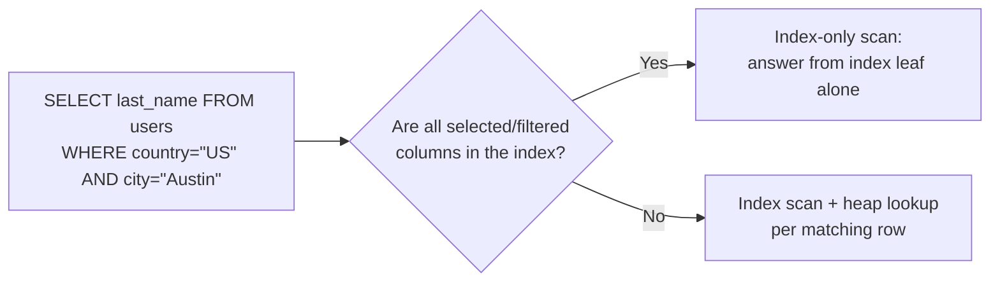

### 4.7 Selectivity and cardinality estimation

**Definition.** Cardinality is the number of distinct values a column takes
across all rows; selectivity is cardinality expressed as a fraction of the
total row count (`distinct_values / total_rows`), and it estimates what
fraction of the table a single equality predicate on that column will match.

**Mechanism.** A query planner maintains statistics (usually a sampled
histogram, most-common-values list, and distinct-value estimate per column,
refreshed by an `ANALYZE`-style command) and uses them to estimate how many
rows a given predicate will match *before* choosing an execution plan. If a
predicate is estimated to match a small fraction of rows (high selectivity),
an index scan — which pays a small, roughly-constant cost per matched row
via random access — beats a sequential scan. If a predicate is estimated to
match a large fraction of rows (low selectivity, e.g. a boolean flag or a
4-value status column), a sequential scan reading the whole table
sequentially is often cheaper *even with an index present*, because random
access to a large fraction of the table's pages costs more in aggregate than
one sequential pass.

**Decision implications.** Selectivity should be estimated *before* creating
an index, not assumed. A column like `user_id` (near-unique) is almost
always a strong standalone index candidate; a column like `status` (a
handful of values) is usually a poor standalone candidate and is more useful
as a secondary (non-leading) column in a composite index, or left unindexed
if it's rarely combined with anything more selective. The demonstration in
[04_selectivity_estimation.py](../code/python/indexes-chapter/04_selectivity_estimation.py)
computes this ratio directly.

**Common failure mode.** Assuming "the planner will use my index because I
created it." Planners choose plans based on cost estimates, not on index
existence — an index on a low-selectivity column is frequently present in
the schema and silently unused by the planner for most queries, which
confuses engineers who expect `EXPLAIN` to show an index scan simply because
the index exists (see the `status` column example in
[01_index_scan_vs_table_scan.sql](../code/sql/indexes-chapter/01_index_scan_vs_table_scan.sql)).

**Scenario.** An `orders` table has `customer_id` (500,000 distinct values
over 5,000,000 rows, selectivity 0.10, ~10 rows per value) and `status` (4
distinct values over the same 5,000,000 rows, selectivity 0.0000008, ~1.25M
rows per value). An index on `customer_id` is used by the planner for
`WHERE customer_id = ?`; an index on `status` alone is typically ignored by
the planner for `WHERE status = 'PENDING'` in favor of a sequential scan,
because matching a quarter of the table via random index lookups is more
expensive than reading it all sequentially.

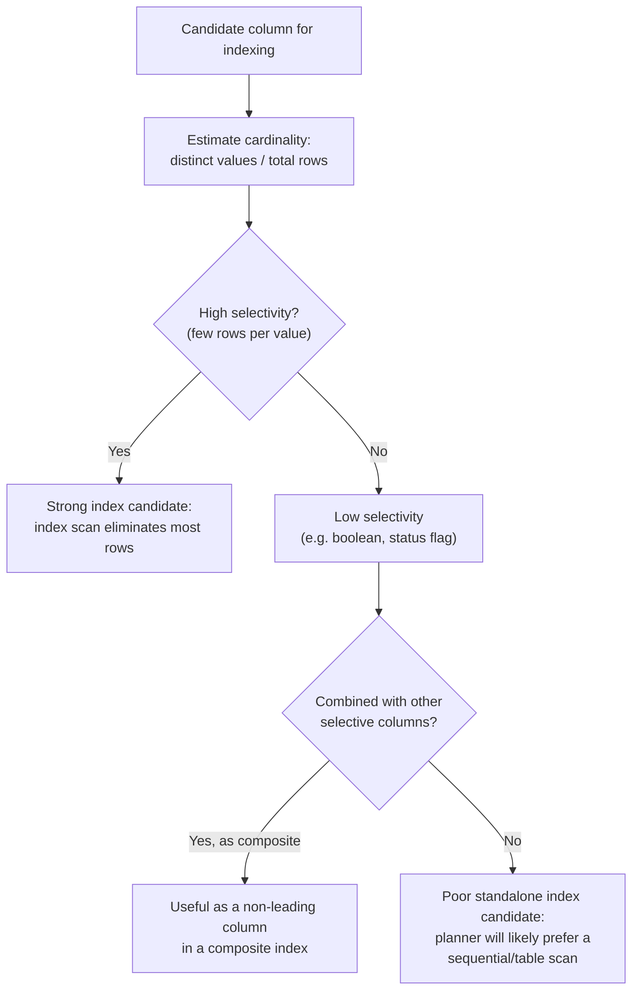

### 4.8 Write amplification from index maintenance

**Definition.** Write amplification, in the indexing context, is the fact
that a single logical write to a row (`INSERT`, `UPDATE` of an indexed
column, or `DELETE`) requires physically updating not just the row's storage
location but also every index defined on the columns that changed —
multiplying the physical I/O and log volume generated by one logical write.

**Mechanism.** On `INSERT`, the engine must add a new leaf entry to every
index on the table (not just the ones on "important" columns) — each of
those insertions can trigger a page split (Section 5.2) if the target leaf
page is full, which itself requires writing two new pages, updating the
parent, and logging all of it for crash recovery (write-ahead log or
equivalent). On `UPDATE`, only indexes on the *changed* columns need
updating (an update to a non-indexed column touches only the row's own
storage), but on `DELETE`, every index that referenced the deleted row must
also remove or tombstone that entry. This is why the number of indexes on a
table has a roughly linear relationship to the marginal write cost per row,
even though reads only benefit from the specific indexes relevant to a given
query.

**Decision implications.** Every index is a standing tax on write
throughput, replication/log volume, and (for many engines) vacuum/compaction
overhead — it is not a one-time cost paid at creation. Tables with heavy
write volume (event/audit logs, high-frequency IoT ingestion, queue-backed
tables) need deliberately minimal indexing, often just the columns required
for the write path itself (e.g. a primary key and perhaps one partitioning
column), with additional indexes reserved for columns actually queried, not
columns that merely "seem useful."

**Common failure mode.** Adding indexes reactively, one per slow query,
without ever removing indexes that stopped being useful (e.g. after a query
pattern changed) — this steadily degrades write throughput over the life of
a system, and because the effect is gradual and distributed across many
small increments, it is rarely caught by any single code review.

**Scenario.** An `orders` table with 4 secondary indexes (`customer_id`,
`order_date`, `status`, and a composite `(customer_id, status)`) pays roughly
5x the raw index-maintenance I/O of the same table with just its primary
key, for every single `INSERT` — this is a deliberate, necessary cost if all
4 indexes serve real, frequent queries, but a wasted, avoidable cost for any
index that turns out to serve none.

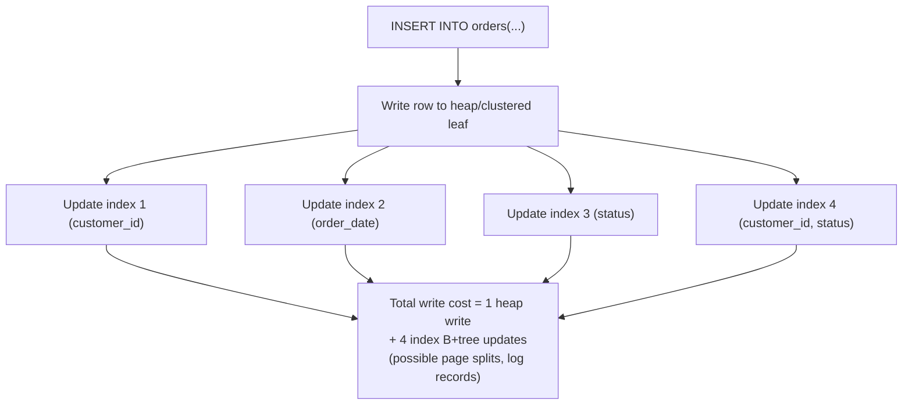

## 5. Internal Working

Beyond the per-concept mechanics in Section 4, two additional internals
shape how indexes behave in production: page splits/merges during structural
changes, and how a query planner actually chooses between competing plans at
execution time.

**Page splits and merges.** When a B+tree leaf page fills up and a new entry
needs to be inserted into it, the engine splits the page into two: the
existing entries are divided roughly in half between an old and a new page,
and a new separator key is inserted into the parent internal page pointing
at the new page. If the parent is also full, the split propagates upward,
and in the (rare) case the root itself splits, the tree gains a new level —
this is the *only* way a B+tree grows taller, which is why growth is so slow
relative to data volume (Section 4.2). The reverse operation — page merging
on delete, when a leaf becomes under-populated — is implemented by some
engines eagerly and by others (notably PostgreSQL) deferred to background
vacuum/maintenance processes, trading immediate space reclamation for lower
per-delete latency.

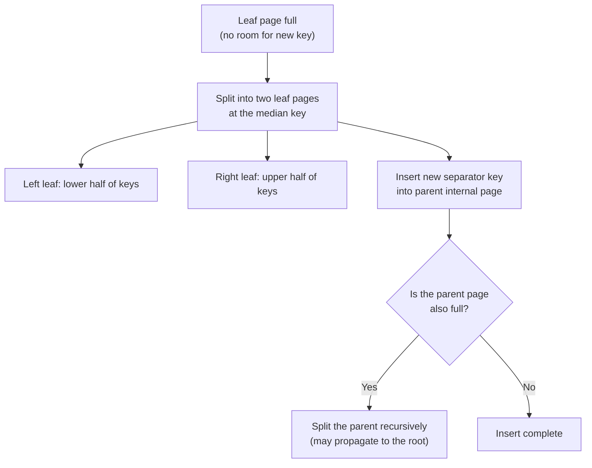

**Planner-time plan selection.** At query time, the planner does not simply
"use an index if one exists" — it estimates the cost of every viable plan
(sequential scan, one or more index scans, bitmap-heap scans that combine
several index results) using the column statistics from Section 4.7, and
picks the cheapest estimated plan. This is why the exact same query can use
different plans on different databases (or the same database at different
times) as row counts, statistics freshness, or even bind-variable values
change — plan choice is a cost estimate, not a fixed rule tied to index
existence.

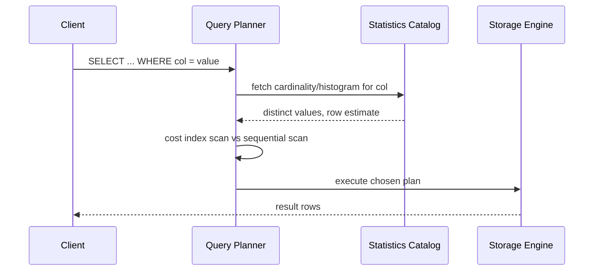

## 6. Design Principles

- **Index for queries, not for tables.** Decide which indexes to create by
  enumerating actual, frequent query shapes (`WHERE`/`JOIN`/`ORDER BY`
  patterns from real traffic or planned access patterns), not by reflexively
  indexing every foreign key or every column that "might" be queried.
- **Put the most selective, equality-filtered column first in a composite
  index**, and a range-filtered or sort column last, per Section 4.5's
  leftmost-prefix mechanics.
- **Prefer one well-ordered composite index over several overlapping
  single-column indexes** when the same set of queries can be served by a
  shared prefix — this halves (or better) the write-side index-maintenance
  cost for equivalent read coverage.
- **Choose the clustering key deliberately.** For engines with a clustered
  primary key (e.g. MySQL/InnoDB), prefer a monotonically increasing key
  (auto-increment, time-ordered ID) over a naturally "meaningful" but
  randomly distributed key, to avoid clustering-key fragmentation
  (Section 4.4).
- **Treat covering indexes as a targeted optimization, not a default.** Add
  `INCLUDE`/covering columns only for specific hot-path queries where the
  second lookup is measurably expensive, not to every index defensively.
- **Re-evaluate indexes when query patterns change**, not only when adding
  new ones — an index that stopped being used is exactly as costly to
  maintain as one that never was, and unlike an unused query, an unused
  index gives no natural signal that it should be reconsidered.
- **Match index strategy to write/read ratio.** Write-heavy, append-mostly
  tables (logs, events, telemetry) warrant deliberately sparse indexing; an
  LSM-tree-based store (recap: Log-Structured Merge trees batch and defer
  index/data reorganization to background compaction rather than paying
  reorganization cost synchronously per write, trading read amplification
  for write throughput — full mechanics belong to a future storage-engine
  chapter, not re-derived here) is often a better underlying engine choice
  than adding many B+tree indexes to a write-dominated relational table.

## 7. Architecture Patterns

- **Read-model index specialization.** In CQRS-style architectures, a
  read-optimized projection of the data is maintained with indexes (or an
  entirely different index-oriented store, e.g. Elasticsearch) tuned purely
  for query shapes, decoupled from the write model's index minimalism —
  avoiding the tension between write-path index cost and read-path index
  need by physically separating the two.
- **Index-backed uniqueness/constraint enforcement.** A unique index is both
  a performance structure and a correctness mechanism — enforcing that no
  two rows share a key value is typically *implemented* as a side effect of
  a B+tree index's insert path detecting a duplicate key before the insert
  completes, unifying "fast lookup" and "constraint enforcement" into one
  structure rather than two.
- **Partial/filtered indexes.** Some engines support indexing only a subset
  of rows matching a condition (e.g. `WHERE status = 'ACTIVE'`), which keeps
  the index small and highly selective for a hot subset of data while
  avoiding the write cost of indexing rows that are never queried by that
  predicate (e.g. archived/soft-deleted rows).
- **Denormalized read-path indexing vs. index-only design.** Where a
  materialized view (recap: a precomputed, stored query result refreshed on
  a schedule or trigger, avoiding recomputation on every read — full
  construction and refresh-strategy mechanics owned by
  [Denormalization](CH02_Denormalization.md)) could serve a read pattern, an
  architect must choose between building a wider covering index on the
  existing table versus materializing a separate denormalized structure —
  the index approach keeps one source of truth with faster, always-current
  reads at write-cost expense; the materialized-view approach isolates
  write-path cost from the read-optimized structure at the expense of
  refresh-lag and duplicated storage.

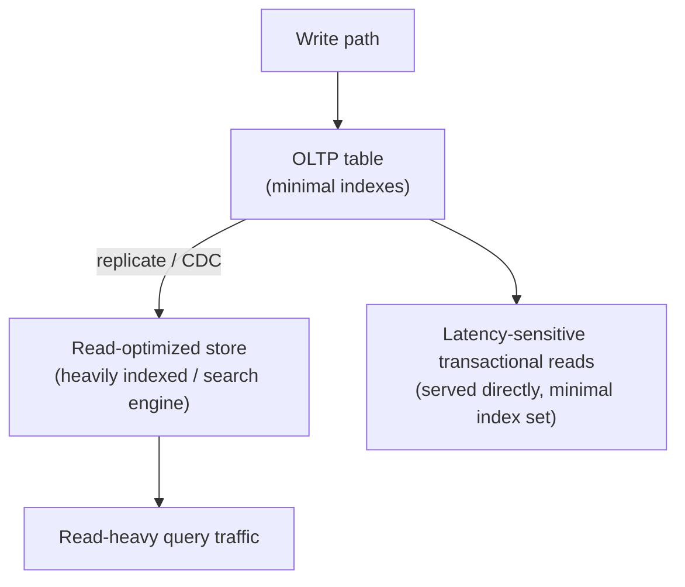

## 8. Production Architecture

In production, index decisions are rarely made once and left alone — they
are part of an ongoing operational loop: (1) capture slow-query logs and
`EXPLAIN`/execution-plan telemetry, (2) identify recurring sequential scans
on large tables or index-scan plans with unexpectedly high heap-fetch
counts, (3) validate candidate indexes against real statistics (selectivity,
Section 4.7) rather than intuition, (4) roll out new indexes with
concurrency-safe build options (e.g. PostgreSQL's `CREATE INDEX
CONCURRENTLY`, which avoids holding a long write-blocking lock at the cost of
a slower, two-pass build) to avoid outages on large, live tables, and (5)
periodically audit for unused indexes via the engine's index-usage
statistics (e.g. PostgreSQL's `pg_stat_user_indexes`, MySQL's
`sys.schema_unused_indexes`) and remove them. Index changes on large
production tables are treated as capacity-affecting operational events, not
purely logical schema changes — a naive, non-concurrent index build can lock
out writes for the duration of a full-table scan-and-sort, which on a
billion-row table can be measured in hours.

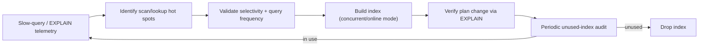

## 9. Implementation

Implementing index decisions well requires three concrete, repeatable steps
regardless of database engine: (1) instrument and read execution plans
(`EXPLAIN [ANALYZE]` in PostgreSQL/MySQL, `SET SHOWPLAN` / execution plan XML
in SQL Server) to see the *actual* chosen plan and row-count estimates versus
reality, not just guess; (2) build indexes using the engine's non-blocking
build mode on any table large enough that a blocking build would be
operationally risky; and (3) validate the outcome by re-running `EXPLAIN`
after the index exists and after statistics have been refreshed, confirming
the plan actually changed to use it — an index that exists but isn't chosen
by the planner delivers none of its intended benefit while still paying its
full write-side cost. Section 10 below implements all three steps as
runnable examples.

## 10. Complete Code Examples

All examples are runnable and live under
[code/sql/indexes-chapter/](../code/sql/indexes-chapter/) and
[code/python/indexes-chapter/](../code/python/indexes-chapter/).

1. **[01_index_scan_vs_table_scan.sql](../code/sql/indexes-chapter/01_index_scan_vs_table_scan.sql)**
   — builds a 5-million-row PostgreSQL table, captures an `EXPLAIN (ANALYZE,
   BUFFERS)` plan before and after adding a B-tree index on a high-selectivity
   column (`customer_id`), then contrasts that with a low-selectivity column
   (`status`) where the planner keeps preferring a sequential scan even after
   an index exists — directly demonstrating Section 4.1 and Section 4.7.

2. **[02_composite_index_column_order.sql](../code/sql/indexes-chapter/02_composite_index_column_order.sql)**
   — builds a composite index on `(tenant_id, priority, created_at)` and
   walks through which query shapes can and cannot use it as a seek,
   demonstrating the leftmost-prefix rule from Section 4.5 with real
   `EXPLAIN` output for each case.

3. **[03_covering_index_only_scan.sql](../code/sql/indexes-chapter/03_covering_index_only_scan.sql)**
   — contrasts a plain secondary index (which still requires a heap fetch)
   with a covering index using `INCLUDE`, showing the plan change from
   `Index Scan` to `Index Only Scan` with `Heap Fetches: 0`, per Section 4.6.

4. **[04_selectivity_estimation.py](../code/python/indexes-chapter/04_selectivity_estimation.py)**
   — builds a sample SQLite dataset with columns of deliberately different
   cardinality and computes selectivity and a standalone-index
   recommendation per column, mirroring the estimate a planner's statistics
   catalog performs internally (Section 4.7).

Run the SQL examples against a scratch PostgreSQL database (row counts are
tuned to make the planner's choice visible; reduce `generate_series` bounds
for a faster, lower-fidelity run on constrained hardware). Run the Python
example directly: `python 04_selectivity_estimation.py` (no external
dependencies beyond the standard library).

## 11. Performance

- **Index scans dominate for high-selectivity predicates**; sequential scans
  dominate for low-selectivity predicates, per Section 4.7 — the crossover
  point depends on the ratio of random-access cost to sequential-access cost
  for the underlying storage (historically much starker on spinning disks
  than on SSD/NVMe, where random reads are far cheaper relative to
  sequential ones, but the crossover still exists).
- **Composite index ordering changes measured latency by orders of
  magnitude** for queries that don't match the leftmost prefix — the
  difference between "seek + narrow range scan" and "scan the whole index"
  is the same order-of-magnitude gap as index vs. no index at all.
  Verified in
  [02_composite_index_column_order.sql](../code/sql/indexes-chapter/02_composite_index_column_order.sql).
- **Covering indexes remove one random I/O per matched row.** For queries
  matching thousands of rows, eliminating the heap-fetch step can cut
  latency by half or more, since random-access reads are typically the
  single most expensive operation in an index-scan plan.
- **Write throughput degrades roughly linearly with index count** on
  write-heavy tables — benchmark index changes on a representative write
  workload, not just the target read query, before rolling out to
  production.
- **Statistics staleness causes misestimated selectivity**, which causes the
  planner to choose the wrong plan even when the "right" index exists —
  scheduled `ANALYZE`/statistics-refresh jobs are a performance dependency,
  not an optional maintenance nicety.

## 12. Scalability

- **Index size scales with row count and key width**, not with query
  volume — a wide composite index over long text columns can itself become
  large enough to blow past available memory cache, turning "fast" index
  lookups into random disk reads for the index itself.
- **Partitioned tables need partition-local (or partition-aware global)
  indexes.** Sharding or range/hash partitioning a table (recap: horizontal
  partitioning splits one logical table across multiple physical storage
  units by a partition key — full mechanics owned by the forthcoming
  Partitioning/Sharding chapters in this Part) changes index economics:
  a local index per partition keeps individual index B+trees small and fast
  to maintain, but a query that doesn't include the partition key in its
  predicate may need to probe every partition's index rather than one.
- **Read replicas amplify the benefit of read-optimized (covering) indexes**
  disproportionately versus the primary, since replicas typically serve the
  bulk of read-only query volume and don't bear the corresponding write-side
  index-maintenance cost directly (though they still replay and apply the
  index changes from the primary's write-ahead log).
- **Concurrent/online index builds are a scalability prerequisite**, not an
  optional nicety, once a table is large enough that a blocking rebuild
  would take longer than an acceptable maintenance window.

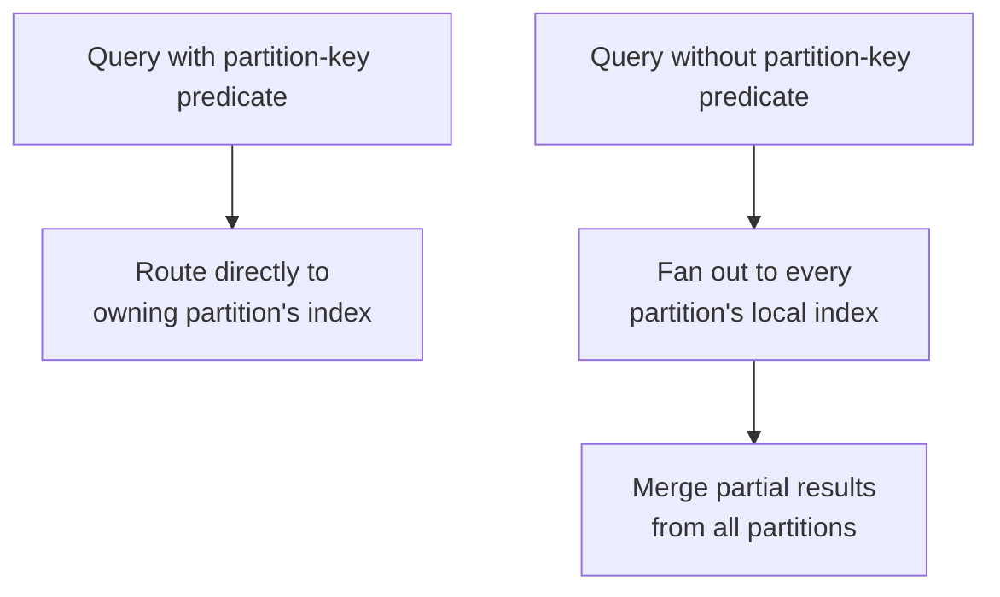

## 13. Security

- **Index-visible data is a disclosure surface.** An index (especially a
  covering index) stores a copy of the underlying column values; encryption
  or masking applied only at the table-storage layer must also cover any
  index built on the same column, or an attacker with lower-level storage
  access can read sensitive values straight out of the index structure.
- **Query-timing side channels.** Because index lookups on existing keys and
  index lookups on non-existent keys can have measurably different timing
  characteristics (a miss may terminate the tree traversal earlier or later
  depending on structure), extremely latency-sensitive authentication/lookup
  paths (e.g. "does this API key exist") should be reviewed for timing-based
  enumeration risk, using constant-time comparison patterns at the
  application layer rather than relying on index-lookup timing alone as a
  security boundary.
- **Statistics/metadata leakage.** Query-planner statistics (approximate
  cardinality, most-common-values lists) are sometimes exposed through
  database introspection views; in strict multi-tenant environments, ensure
  tenants without direct table access also cannot infer row-count or
  value-distribution information about other tenants' data through
  shared-catalog statistics views.
- **Least-privilege index maintenance.** Index creation/rebuild operations
  typically require elevated (DDL-level) privileges distinct from ordinary
  read/write access — restrict them to migration/ops tooling rather than
  application runtime credentials, consistent with standard least-privilege
  practice.

## 14. Observability

- **Track per-index usage statistics** (scan count, rows returned, last-used
  timestamp where available) continuously, not just during incident
  response — this is the primary signal for the unused-index audit in
  Section 8.
- **Track heap-fetch counts on nominally "index-only" scans.** A rising
  heap-fetch count on a query expected to be a pure index-only scan
  indicates visibility-map staleness (PostgreSQL) or similar bookkeeping
  drift, and is an early signal that vacuum/maintenance jobs are falling
  behind.
- **Alert on sequential scans against large tables in the hot query path.**
  A sudden appearance of a sequential-scan plan for a previously
  index-scanned query usually means either a statistics change, a planner
  cost-parameter change, or an index that was dropped/renamed unexpectedly.
- **Track index bloat/size growth over time**, especially for tables with
  heavy update/delete churn — bloated indexes (pages that are mostly
  tombstoned/empty space) both waste storage and slow down scans that must
  still traverse those pages.
- **Correlate index-build operations with write-latency/lock-wait
  dashboards** during rollout, to catch a non-concurrent build accidentally
  blocking production writes before it causes a customer-facing incident.

## 15. Failure Scenarios

- **Blocking index build on a live table.** Running a default (non-
  concurrent) `CREATE INDEX` on a large, actively-written table can hold a
  lock that blocks writes for the entire build duration — on a
  multi-hundred-million-row table this can be minutes to hours, appearing to
  on-call engineers as a full write-path outage with no obvious cause until
  the blocking DDL statement is found in `pg_stat_activity`/`SHOW
  PROCESSLIST`-equivalent tooling.
- **Index bloat after mass delete.** Deleting a large fraction of a table's
  rows (e.g. a data-retention purge) without a subsequent index-level
  maintenance pass can leave indexes full of tombstoned entries, so scans
  continue paying for pages that hold mostly-deleted data until compaction
  or a rebuild reclaims the space.
- **Statistics drift after bulk load.** Bulk-loading a large batch of new
  data without triggering a statistics refresh can leave the planner working
  from stale cardinality estimates, causing it to choose a previously-good
  plan that is now wrong for the new data distribution (e.g. continuing to
  sequential-scan a column that just became far more selective, or vice
  versa).
- **Deadlocks from concurrent index maintenance and application writes.**
  Some non-concurrent DDL or maintenance operations can interact with
  in-flight application transactions in ways that produce lock-wait chains
  or deadlocks, particularly on engines/versions with coarser DDL locking
  granularity.

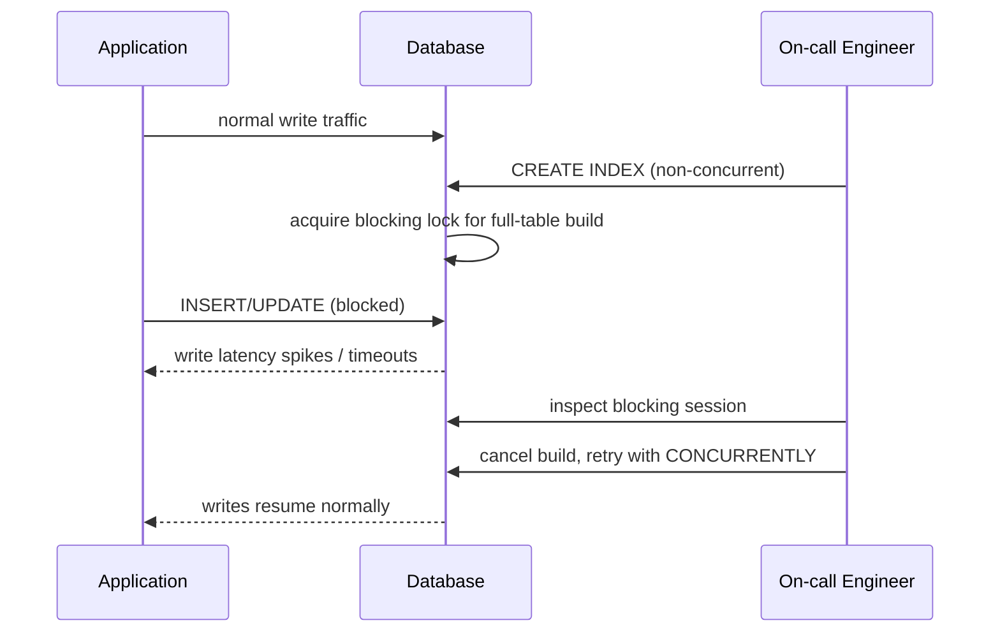

## 16. Testing

- **Assert on execution plans, not just correctness.** A regression test
  suite for a performance-critical query should include an `EXPLAIN`-based
  assertion (e.g. "this query must produce an Index Scan/Index Only Scan on
  index X," not merely "this query returns the right rows") so a future
  schema or query change that silently defeats an index is caught in CI.
- **Test at representative data volume and distribution.** Small test
  fixtures (a few hundred rows) rarely trigger the planner's index-vs-scan
  decision the way production volume does — seed test/staging databases
  with production-scale row counts and realistic value distributions
  (skewed, not uniformly random, where that matters) before trusting a
  performance test result.
- **Test index-build operations for lock behavior**, not just for
  successful completion — verify a concurrent/online build option is used
  and that it does not block writes during a load test running
  concurrently with the build.
- **Test the leftmost-prefix boundary explicitly.** For any composite index
  central to a hot path, write a test (or at minimum a documented
  `EXPLAIN` check) for both a query that should use the full prefix and one
  that should not, so future column reordering is caught before it silently
  breaks a query shape's performance.

## 17. Common Mistakes

- Indexing every column defensively "just in case," without measuring actual
  query patterns, inflating write cost for little or no read benefit.
- Assuming an index will be used simply because it exists, without checking
  `EXPLAIN` output or the selectivity of the indexed column.
- Choosing composite index column order arbitrarily (e.g. alphabetically, or
  in table-definition order) instead of by query-predicate role
  (equality-first, range-last).
- Building a "just in case" wide composite index across many columns,
  believing it subsumes every narrower index, without checking the
  leftmost-prefix rule actually covers each narrower query shape.
- Running a blocking, non-concurrent index build against a large production
  table during business hours.
- Never revisiting or auditing existing indexes after query patterns change,
  leaving stale, unused indexes to pay write cost indefinitely.
- Conflating "this index makes my query fast in a test with 500 rows" with
  "this index will make my query fast in production with 500 million rows,"
  skipping representative-scale validation entirely.

## 18. Best Practices

- Derive index candidates from real, measured query patterns (slow-query
  logs, `EXPLAIN` output, planned high-frequency access paths) rather than
  from intuition about the schema.
- Order composite index columns equality-predicates-first,
  range-predicate-or-sort-column-last, and validate the ordering against
  every query shape it's meant to serve.
- Reserve covering indexes/`INCLUDE` columns for specific, measured hot-path
  queries rather than applying them by default.
- Always build indexes on large, live tables using the engine's
  concurrent/online build mode, and rehearse the rollback path before
  running it in production.
- Periodically audit and drop unused indexes using the engine's native
  index-usage statistics.
- Keep statistics fresh (scheduled `ANALYZE`/equivalent) especially after
  bulk loads, and validate planner behavior after any large data-shape
  change.
- Choose a clustering/primary key with insertion-order locality in mind for
  engines where the primary key is clustered by default.

## 19. Anti-Patterns

- **Index-everything anti-pattern.** Adding an index to every column of
  every table by default, treating index creation as free.
- **Redundant/overlapping indexes.** Maintaining multiple single-column
  indexes that a single well-ordered composite index could replace,
  multiplying write cost for the same read coverage.
- **Wrong-order composite index.** Building a composite index in column
  order that matches the table's `CREATE TABLE` definition rather than the
  actual predicate roles of the queries it's meant to serve.
- **"Index and forget."** Never revisiting index usage statistics after
  initial creation, letting the schema accumulate indexes that serve
  queries which no longer exist.
- **Blocking DDL on hot tables.** Treating index builds on large production
  tables the same as builds on small development tables, without using
  concurrent/online build modes.
- **Hash-index-for-everything.** Choosing a hash index reflexively for
  perceived speed without confirming the access pattern is genuinely
  equality-only and will remain so.

## 20. Trade-off Analysis

| Decision | Favors reads | Costs on writes/storage |
|---|---|---|
| Add a B-tree index | Faster equality + range lookups, supports ordering | Extra storage; per-write index-entry maintenance; possible page splits |
| Add a hash index | Fastest average-case equality lookup | No range/order support at all; narrower applicability |
| Widen a composite index (more columns) | Serves more query shapes from one structure | Larger index size; higher write cost per included column change |
| Add `INCLUDE`/covering columns | Eliminates second (heap) lookup for covered queries | Duplicates column data in the index; write cost on included-column change |
| Choose a monotonic clustering key | Sequential-friendly writes and clustered range scans | May not match the "natural" business key; requires a synthetic key in some designs |
| More indexes on a write-heavy table | More query shapes served fast | Write throughput/replication-lag/log-volume degrade roughly linearly with index count |

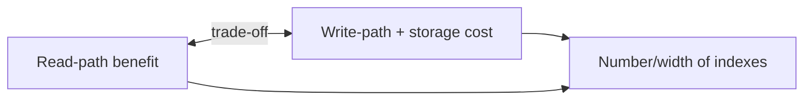

## 21. Comparison Table

| Index type | Lookup pattern supported | Ordering support | Typical use case |
|---|---|---|---|
| B-tree / B+tree | Equality and range (`=`, `>`, `<`, `BETWEEN`, prefix `LIKE`) | Yes (sorted leaves) | Default general-purpose index; primary/foreign keys, most `WHERE`/`ORDER BY` columns |
| Hash | Equality only (`=`) | No | Pure key-value equality lookups; internal hash-partitioned key spaces |
| Composite (multi-column) B-tree | Equality/range on a leftmost-prefix combination of columns | Yes, within prefix constraints | Multi-predicate queries sharing a common leading column set |
| Covering (`INCLUDE`) index | Same as base index type, plus payload columns returned without a second lookup | Same as base index type | High-frequency narrow read queries (dashboards, hot-path lookups) |
| Bitmap index (recap only, not owned here) | Very low-cardinality equality/combination predicates | Not row-ordering, but efficient boolean combination | Data-warehouse/analytical workloads with few distinct values per column |

## 22. Real-World Case Study

A mid-size e-commerce platform's `orders` table grew from roughly 2 million
to 80 million rows over three years without any change to its original
index set: a clustered primary key on `order_id`, and a single secondary
index on `customer_id`. As the "recent orders by status" dashboard
(`WHERE status = 'PROCESSING' ORDER BY created_at`) grew from an occasional
internal report to a customer-facing, constantly-polled widget, its latency
grew from tens of milliseconds to several seconds, eventually timing out
under peak load. Root-cause analysis via `EXPLAIN ANALYZE` showed the query
was performing a full sequential scan, because no index existed on
`status`/`created_at` at all — the team had assumed the existing
`customer_id` index would somehow help, since "the table has an index," but
that index was irrelevant to this predicate entirely (Section 4.5's
leftmost-prefix rule made it structurally impossible for it to help).

The team's first fix attempt — a single-column index on `status` — measured
only a modest improvement, because `status` has just five distinct values
(selectivity around 0.0000006 given the row count), so the planner
frequently still preferred a sequential scan for the most common status
values, exactly matching the low-selectivity failure mode from Section 4.7.
The effective fix was a composite covering index on `(status, created_at)
INCLUDE (customer_id, total_cents)`: `status` first because it's the
equality predicate the dashboard always filters on, `created_at` second to
serve the `ORDER BY` as a sorted range within each status value, and the two
`INCLUDE` columns to make the query fully index-only for the dashboard's
actual `SELECT` list. Post-rollout, the same query dropped to
single-digit-millisecond latency at 80 million rows, and the fix was rolled
out using a concurrent index build to avoid an outage on the live table
(Section 8/15). The team subsequently added an index-usage-statistics review
to their quarterly schema audit specifically because this incident revealed
they had no process for checking whether an index existing anywhere near a
query implied it was actually being used for that query.

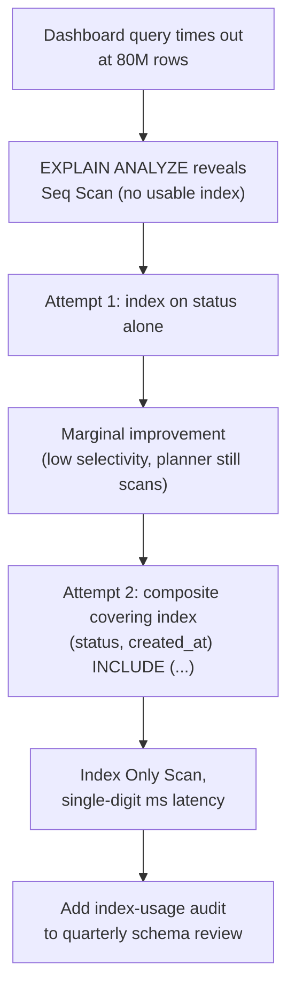

## 23. Interview Questions

1. Why do relational databases overwhelmingly use B+trees rather than plain
   B-trees or binary search trees for indexes?
2. Explain the leftmost-prefix rule for composite indexes with an example of
   a query that can and cannot use a given composite index.
3. What is a covering index, and how does it change an execution plan?
4. Why might a query planner choose a sequential scan over an existing
   index? Give a concrete selectivity-based example.
5. What is the difference between a clustered and a non-clustered index, and
   how does that difference affect range-scan performance?
6. Why is a hash index unsuitable for a column that needs `ORDER BY` or range
   predicates?
7. Describe what happens internally when an `INSERT` triggers a B+tree leaf
   page split.
8. Why does adding more indexes to a table degrade write throughput, and how
   would you decide whether a given index's read benefit justifies that
   cost?
9. What operational risk does a naive `CREATE INDEX` pose on a large,
   actively-written production table, and how do modern engines mitigate it?
10. How would you detect and remove an unused index in a production
    database safely?

## 24. Hands-on Exercises

1. Run [01_index_scan_vs_table_scan.sql](../code/sql/indexes-chapter/01_index_scan_vs_table_scan.sql)
   against a scratch PostgreSQL instance. Record the `EXPLAIN ANALYZE` plan
   and timing before and after the `customer_id` index, and explain in your
   own words why the `status` index does not change its query's plan.
2. Run [02_composite_index_column_order.sql](../code/sql/indexes-chapter/02_composite_index_column_order.sql).
   For each query in the script, state which columns of the composite index
   it uses as a seek prefix and which (if any) it cannot use.
3. Run [03_covering_index_only_scan.sql](../code/sql/indexes-chapter/03_covering_index_only_scan.sql)
   and capture the `Heap Fetches` value from each plan. Modify the final
   query to select an additional non-included column and confirm the plan
   reverts to a non-index-only scan.
4. Run [04_selectivity_estimation.py](../code/python/indexes-chapter/04_selectivity_estimation.py).
   Add a fourth column with selectivity between `event_type` and `is_error`
   and predict its recommendation before running the script to confirm.
5. Using your own team's schema (or a public sample dataset), pick one
   production-representative query, capture its current `EXPLAIN` plan, and
   propose (without yet applying) an index change with a written
   justification referencing selectivity and column order.

## 25. Design Exercises

1. **Composite index design.** Given a `support_tickets` table queried both
   as `WHERE tenant_id = ? AND priority = ?` and `WHERE tenant_id = ? ORDER
   BY created_at DESC LIMIT 20`, design one or more composite indexes to
   serve both query shapes efficiently, and justify your column ordering
   choices.
2. **Write-heavy table trade-off.** A telemetry-ingestion table receives
   50,000 inserts per second and needs to support exactly two read patterns:
   "look up by device ID" and "range-scan by ingestion timestamp for a given
   device." Propose an index set that serves both without over-indexing, and
   explain what you deliberately chose *not* to index and why.
3. **Clustering key choice.** You are designing a new orders table on an
   engine where the primary key is always the clustered index. The business
   wants `order_reference` (a customer-facing, randomly generated string) as
   the primary key. Propose a clustering-key strategy that avoids
   fragmentation while still exposing `order_reference` as a unique,
   customer-facing identifier.
4. **Covering index cost/benefit.** A dashboard query currently causes
   50,000 heap fetches per minute at peak. Propose a covering index change,
   estimate (qualitatively) its read-latency benefit, and identify what
   additional write-side cost it introduces on the columns you choose to
   include.
5. **Index audit and cleanup plan.** Given a hypothetical set of 12 indexes
   on one table, five of which show zero scans in the last 90 days of
   usage statistics, design a safe rollout plan to remove the unused ones,
   including how you would validate they are truly safe to drop before
   doing so.

## 26. Architecture Review Questions

- For each proposed index, what specific query or queries does it serve, and
  what is the measured or estimated selectivity of its leading column?
- Does an existing index already cover this access pattern via a different
  column ordering, making a new index redundant?
- What is this table's current write volume, and how many additional
  indexes (and total index count) will this change bring it to?
- Will this index be built using a concurrent/online build mode, and has the
  rollback path been tested?
- Is this index a covering index for a specific, named hot-path query, or a
  general-purpose index being widened speculatively?
- What is the plan for periodically auditing and removing unused indexes on
  this table going forward?
- For a clustered-index engine, does the chosen clustering key risk
  fragmentation under this table's expected insert pattern?

## 27. Summary

An index converts an O(n) full-table search into an O(log n) tree traversal
or O(1) average-case hash lookup, at the cost of extra storage and a
per-write maintenance tax on every index touching a changed column. B+trees
dominate general-purpose indexing because their high fanout keeps tree
height — and therefore disk seeks — nearly flat as data grows into the
billions of rows, and their linked leaves make range scans cheap; hash
indexes trade away that range-scan and ordering capability for marginally
faster equality-only lookups. Composite indexes are sensitive to column
order because leaf entries are sorted lexicographically by the leading
column first — only a leftmost-prefix subset of an index's columns can be
used as a seek. Covering indexes eliminate a second (heap) lookup entirely
for queries whose full column needs are satisfied by the index leaf itself.
Clustered indexes physically order the table by the index key, making the
clustering-key choice a decision that affects every range-scan query on that
table, not just one. Selectivity — the fraction of a table a predicate is
expected to match — is what a query planner actually uses to decide whether
an index is worth using at all, independent of whether the index exists;
low-selectivity columns are frequently ignored by the planner even when
indexed. Every index added is a standing, ongoing cost on write throughput
and storage, not a one-time decision, which is why disciplined index design
— derived from real query patterns, validated with `EXPLAIN`, and
periodically audited for continued relevance — is a core, recurring
responsibility for anyone designing or operating a database-backed system,
not a task performed once at schema design time.
