# Chapter: Query Optimizers

Part: [06 — Databases and Storage](PART_OVERVIEW.md) · Status: Drafted

## 1. Introduction

A Query Optimizer is the component of a relational database engine that
takes a declarative SQL statement — a description of *what* result the
caller wants — and turns it into an executable plan describing *how* the
engine will actually compute that result: which tables to scan, in what
order to join them, which join algorithm to use for each join, and whether
to use an index or a full scan at each step. This translation is the single
biggest reason SQL scales from a toy query against ten rows to a multi-way
join across billions of rows without the application developer ever writing
a loop themselves: the same SQL text can be executed as a nested loop over a
handful of index probes for a small, selective query, or as a set of
parallel hash joins streaming gigabytes through memory for an analytical
query, and the optimizer — not the developer — decides which. This chapter
is the *owning* chapter for cost-based query optimization, table/column
statistics and histograms, join order search, the nested loop/hash/sort-merge
join algorithms, and the mental model for reading an EXPLAIN or execution
plan, per the Concept Ownership Rule in [STYLE_GUIDE.md](../STYLE_GUIDE.md).
It builds directly on [Indexes](CH03_Indexes.md), which owns the B-tree/hash/
composite index *data structures* themselves — this chapter recaps those
structures only as far as needed to explain *when* the optimizer decides to
use one, not how a B-tree is built or traversed internally. It is also
downstream of [Normalization](CH01_Normalization.md) and
[Denormalization](CH02_Denormalization.md): the schema shape those chapters
produce is one of the biggest levers on how expensive a given join order can
get, and this chapter treats that schema as a given input to be optimized
around, not a decision it makes itself.

Query optimization matters to a Solution Architect for a reason that goes
beyond "make queries fast": it explains one of the most disorienting
production phenomena a team will encounter — the exact same SQL query,
against the exact same schema, with no code deployed, suddenly taking 100x
longer to run. Understanding *why* that happens (stale statistics, a schema
change that invalidated an index, a parameter value that triggers a
different cached plan) is what separates "restart the database and hope"
incident response from a genuine diagnosis and fix.

## 2. Historical Evolution

- **Pre-relational databases (1960s-1970s)** — navigational databases
  (hierarchical, network/CODASYL models) required the application developer
  to specify the exact access path (which pointer to follow, in which order)
  by hand; there was no optimizer because there was no declarative language
  to optimize.
- **Codd's relational model (1970)** — E. F. Codd's landmark paper proposed
  a data model based on set theory and predicate logic, with the explicit
  goal of letting users specify *what* data they want without specifying
  *how* to retrieve it — creating, for the first time, a gap between query
  intent and execution strategy that something would need to fill.
- **System R (IBM Research, mid-1970s)** — the first working relational
  database prototype, and the birthplace of cost-based query optimization:
  Patricia Selinger's 1979 paper "Access Path Selection in a Relational
  Database Management System" introduced the dynamic-programming join-order
  search algorithm (Section 4.5) and the cost-model approach that essentially
  every relational optimizer since has been a variation of.
- **Commercial RDBMS era (1980s-1990s)** — Oracle, DB2, Sybase, and
  Informix all shipped cost-based optimizers, initially alongside simpler
  rule-based optimizers as a lower-risk fallback (Section 4.2); statistics
  collection (`ANALYZE`/`UPDATE STATISTICS`) became a first-class DBA
  (Database Administrator) responsibility during this era.
- **Histograms and skewed-data handling (1990s)** — early cost models
  assumed uniform data distribution within a column, which produced badly
  wrong cardinality estimates on real-world skewed data (a `status` column
  where 95% of rows are `'active'`); histograms (Section 4.3) were
  introduced specifically to correct for this.
- **PostgreSQL's open-source cost-based optimizer (1990s-present)** and
  **MySQL's optimizer evolution (5.x-8.x)** — MySQL notably shipped for
  years with a comparatively weak optimizer (no real histograms until 8.0,
  limited join-order search), which drove a generation of MySQL-specific
  manual query-hinting folklore that a more capable optimizer makes largely
  unnecessary.
- **Adaptive and self-tuning optimizers (2010s-present)** — Oracle's
  Adaptive Query Optimization and SQL Server's Adaptive Query Processing
  introduced *runtime* plan feedback: reoptimizing a plan mid-execution or
  across executions based on how badly the original cardinality estimate
  missed, directly attacking the stale-statistics-class failure mode this
  chapter focuses on.
- **Cloud-scale distributed query optimizers (2010s-present)** — engines
  like Google F1/Spanner, Snowflake, and BigQuery extended the same
  cost-based principles across horizontally-partitioned, disaggregated
  storage, adding data-shuffle cost as a first-class term in the cost model
  alongside disk I/O and CPU.

```mermaid
flowchart LR
    Nav["Navigational DBs (1960s-70s)<br/>developer picks access path by hand"] --> Codd["Codd's Relational Model (1970)<br/>declarative: what, not how"]
    Codd --> SysR["System R (mid-1970s)<br/>Selinger's cost-based optimizer + DP join order"]
    SysR --> Commercial["Oracle/DB2/Sybase (1980s-90s)<br/>rule-based fallback alongside cost-based"]
    Commercial --> Histograms["Histograms (1990s)<br/>correct for skewed, non-uniform data"]
    Histograms --> OSS["PostgreSQL/MySQL maturation (1990s-2020s)"]
    OSS --> Adaptive["Adaptive/self-tuning optimizers (2010s+)<br/>runtime plan feedback"]
    Adaptive --> Distributed["Cloud-scale distributed optimizers (2010s+)<br/>shuffle cost as a first-class term"]
```

## 3. Why It Exists

SQL is declarative by design: `SELECT c.region, SUM(o.total) FROM orders o
JOIN customers c ON ... WHERE ...` states a result, not a procedure. But a
relational database engine cannot execute a *description* — it needs an
actual sequence of steps: which table to read first, whether to use an
index, which algorithm to use to combine two tables' rows. For any
non-trivial query there are usually dozens, sometimes millions, of *legal*
ways to compute the identical result set (join `orders` to `customers` first
or `customers` to `orders` first; scan `orders` via an index or a full
table scan; combine two tables with a nested loop, a hash join, or a
sort-merge join) — and these legal alternatives can differ in actual cost by
several orders of magnitude. If SQL forced the developer to pick the join
order and join algorithm by hand (as navigational databases effectively
did), every query would need re-tuning by hand every time the data volume,
data distribution, or available indexes changed — which happens constantly
in a live system. The Query Optimizer exists to make that translation from
declarative intent to concrete execution strategy automatically, using a
cost model grounded in the actual size and shape of the current data, so
that the same SQL text keeps producing a reasonably efficient plan as the
underlying data evolves — and, critically, so an architect designing a
schema and its indexes is designing for the optimizer's decision-making
process, not writing an explicit procedure themselves.

## 4. Core Concepts

### 4.1 The query processing pipeline: parse, bind, rewrite, optimize, execute

**Definition.** A SQL statement passes through several distinct stages
before any data is touched: **parsing** (turning SQL text into a syntax
tree), **binding/semantic analysis** (resolving table/column names against
the schema catalog and checking types), **logical plan construction and
rewrite** (turning the bound query into an internal, algebra-like
representation and applying provably-equivalent transformations), **physical
optimization** (choosing concrete access paths and join algorithms for the
logical plan, the cost-based step this chapter focuses on), and **execution**
(actually running the resulting physical plan against the data).

**Mechanism.** The parser and binder are largely mechanical and rule-driven
— there's one correct syntax tree and one correct binding for a
well-formed, schema-valid query. The interesting transformation work happens
in logical rewrite: the optimizer applies transformation rules that are
*provably* equivalent (they can never change the query's result, only how
it's computed) — for example, pushing a `WHERE` predicate down through a
join so it filters rows before the join runs rather than after, unnesting a
correlated subquery into an equivalent join, or eliminating a redundant
`DISTINCT` when uniqueness is already guaranteed by a primary key. Only
after the logical plan has been rewritten into its most amenable shape does
the optimizer attach costs and physical strategies (Section 4.2 onward).

**Decision implications.** A Solution Architect reviewing "why is this query
slow" should check whether the *logical* rewrite even happened as expected
before blaming the cost model — a predicate wrapped in a function
(`WHERE UPPER(status) = 'ACTIVE'`) or a column mismatched in type
(comparing a text column to a numeric literal) can silently block predicate
pushdown or index usage at the rewrite stage, long before cost-based join
selection ever gets a chance to matter.

**Common failure mode.** Wrapping an indexed column in a function or an
implicit type cast in a `WHERE` clause (`WHERE CAST(customer_id AS TEXT) =
'12345'`) defeats the rewrite stage's ability to recognize the predicate as
usable against a plain index on that column — the optimizer then has no
choice but to fall back to scanning every row and evaluating the function
per row, no matter how good its cost model otherwise is. This is a rewrite
problem, not a cost-model problem, and no amount of `ANALYZE` fixes it.

**Scenario.** A reporting query filters `WHERE order_date + INTERVAL '30
days' < NOW()`. Rewritten as `WHERE order_date < NOW() - INTERVAL '30
days'`, the same logical condition becomes usable against a plain index on
`order_date`; left as originally written, the indexed column is trapped
inside an expression and the optimizer cannot push the predicate down to the
index at all.

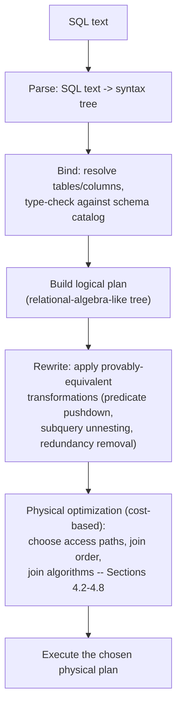

### 4.2 Rule-based vs. cost-based optimization

**Definition.** A Rule-Based Optimizer (RBO) chooses among alternative
execution strategies using a fixed priority ranking of access-path *types*
(e.g. "always prefer a unique-index lookup over a full table scan") without
regard to the actual data volume. A Cost-Based Optimizer (CBO) instead
assigns each candidate plan an estimated numeric cost — derived from table
and column statistics — and picks the plan with the lowest estimated cost,
which can, and often should, mean *not* using an available index.

**Mechanism.** Rule-based ranking is static: it encodes an engineer's
general intuition about what's usually fast, hard-coded once. Cost-based
ranking is dynamic: it recomputes an estimate every time a query is planned,
using the *current* row counts, column value distributions (Section 4.3),
and index definitions, and it evaluates the cost of a specific alternative
*for this specific query and this specific data*, not as a general rule of
thumb. This is a categorical improvement precisely because "use an index"
is not always cheaper — for a query that will touch 60% of a table's rows,
random-I/O index lookups row-by-row are usually far more expensive than one
sequential scan of the whole table, and only a cost-based approach can
recognize that.

**Decision implications.** Every mainstream relational database (PostgreSQL,
MySQL/InnoDB, Oracle, SQL Server) is fundamentally cost-based today; the
practical decision an architect makes isn't "which paradigm" but "how much
do I trust the cost model's inputs" — and the honest answer is: only as much
as the statistics feeding it are current and representative (Section 4.3).
A cost-based optimizer given wrong inputs makes confidently wrong decisions,
which is why statistics maintenance is an operational responsibility, not a
one-time setup step.

**Common failure mode.** Assuming "the database has an index, so it will
use it" — a cost-based optimizer will deliberately ignore an available
index whenever its cost estimate says a full scan is cheaper, which is
correct behavior, not a bug, even though it surprises developers who expect
index presence alone to guarantee index usage.

**Scenario.** A `status` column has an index, and a query filters `WHERE
status = 'pending'`. If 'pending' represents 0.1% of rows, the optimizer
uses the index. If a backlog builds up and 'pending' now represents 60% of
rows, the *same* index, on the *same* column, for the *same* query text,
gets ignored in favor of a sequential scan — and that's the cost-based
optimizer working correctly, reacting to a real change in data
distribution.

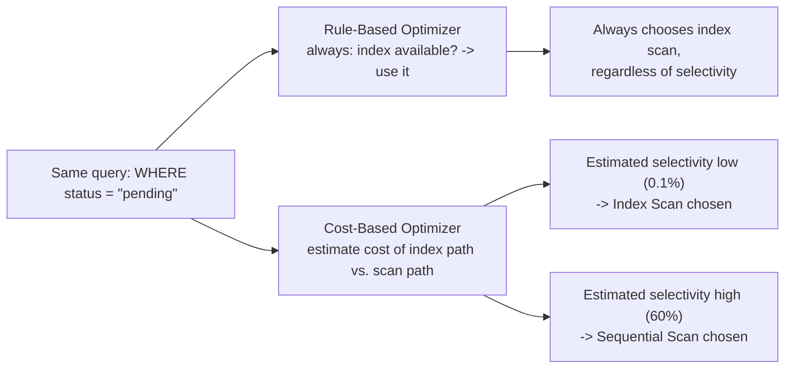

### 4.3 Statistics and histograms: the cardinality-estimation engine

**Definition.** Table and column statistics are metadata the database
maintains about the *shape* of the data — total row count, number of
distinct values per column, most-common values and their frequencies, null
fraction, and a **histogram**: a piecewise approximation of a column's value
distribution, usually stored as a set of equi-depth "buckets" each covering
a range of values and recording roughly how many rows fall in that range.
Statistics are what the cost-based optimizer (Section 4.2) uses to estimate
**cardinality** — how many rows will actually satisfy a given predicate or
survive a given join — which in turn drives every downstream cost estimate.

**Mechanism.** Statistics are not computed on every query; they're
periodically refreshed by an explicit `ANALYZE`/`UPDATE STATISTICS`
command, either run manually, on a schedule, or (in most modern engines)
automatically by a background process (PostgreSQL's autovacuum-driven
auto-analyze, SQL Server's auto-update-statistics) once a threshold fraction
of a table's rows have changed since the last refresh. A histogram works by
sampling (or, for smaller tables, fully scanning) the column's values,
sorting them, and dividing them into N buckets with roughly equal row counts
each; a query predicate like `WHERE price BETWEEN 50 AND 100` is then
estimated by summing the (partial) row counts of the buckets that range
overlaps, rather than assuming a uniform distribution across the column's
entire min/max range.

**Decision implications.** Table and column statistics are the single most
operationally important input to the entire optimization process — a
first-principles understanding of join algorithms and join-order search
(Sections 4.5-4.8) is close to useless in production if the cardinality
estimates feeding those algorithms are simply wrong. An architect should
treat "when did this table last have fresh statistics" as an operational
health metric with the same seriousness as replication lag or disk usage,
especially for tables that undergo large bulk loads, batch deletes, or
sudden distribution shifts (e.g. a status value that used to be rare
becoming common during an incident).

**Common failure mode — stale statistics.** A large bulk insert, bulk
delete, or bulk update changes a table's actual size or value distribution
dramatically, but the automatic statistics-refresh threshold hasn't
triggered yet (common right after a big batch job, since most engines
gate auto-refresh on a *percentage* of rows changed, and a huge one-time
load can itself dwarf the trigger threshold calculation window). The
optimizer then plans against statistics describing a table that no longer
exists in that shape — usually producing either a severe cardinality
under-estimate (leading it to choose an index-heavy nested loop plan that
turns out to touch far more rows than expected, Section 4.6) or a severe
over-estimate (leading it to abandon a perfectly good index in favor of an
unnecessary full scan). This is precisely the "same query, wildly different
performance, with zero code changes" scenario that motivates this whole
chapter, worked through concretely in [`02_stale_statistics_fix.sql`](../../code/sql/query-optimizers-chapter/02_stale_statistics_fix.sql).

**Scenario.** A nightly batch job inserts two million rows into a
one-hundred-thousand-row `events` table inside one transaction. Autovacuum's
analyze threshold hasn't fired yet by the time a dashboard query runs
immediately afterward. The planner, still trusting pre-load statistics that
describe `event_type = 'checkout_failed'` as rare, chooses an index scan
expecting a few hundred matching rows; in reality two million rows now match,
and an index scan that has to perform two million individual random-I/O heap
fetches is dramatically slower than a sequential scan would have been. An
explicit `ANALYZE events` after the load — or lowering the table's
autovacuum analyze-scale-factor so it triggers proactively — fixes the
estimate and restores the correct plan choice.

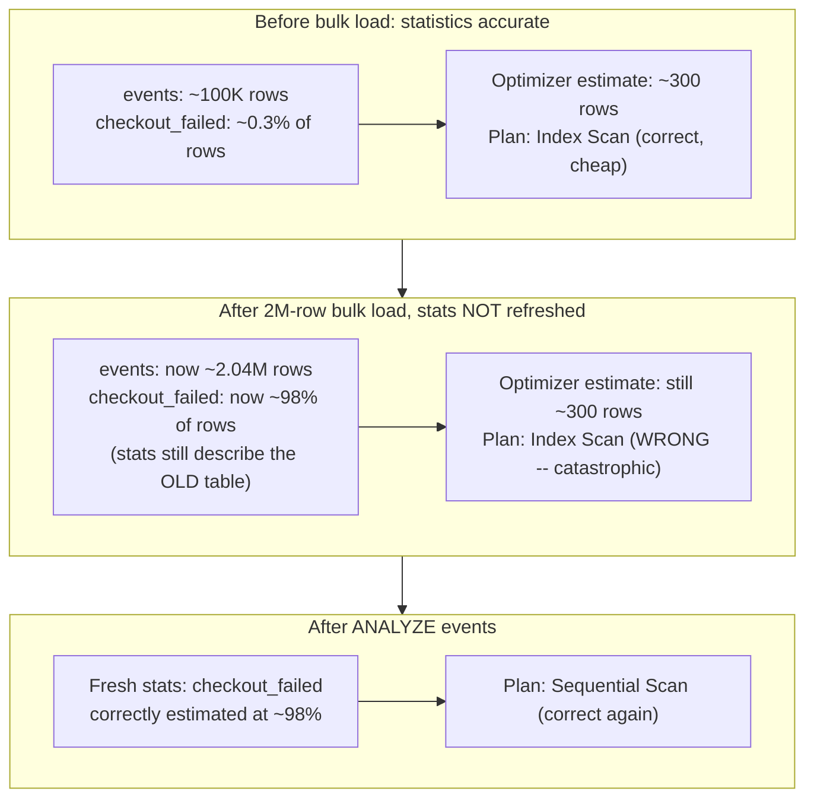

### 4.4 Access path selection: recap of index mechanics, focus on the decision

**Recap (owned by [Indexes](CH03_Indexes.md)).** A B-tree index maintains
sorted keys in a balanced tree structure enabling logarithmic-time point
lookups and efficient ordered range scans; a hash index maps a key to a
bucket for O(1)-average point lookups but cannot serve range queries;
composite indexes cover multiple columns and are usable only via a
leftmost-prefix match against their column order. This chapter does not
re-derive any of that structural mechanics — see
[Indexes](CH03_Indexes.md) for the full first-principles treatment.

**What this chapter owns instead: how the optimizer decides.** Given a
predicate and a set of available indexes, the optimizer estimates the cost
of every applicable access path — a full sequential scan, each usable
single-column index, each usable composite index (only via its leftmost
prefix), and (where supported) a bitmap-index scan that combines several
partial indexes — and picks whichever has the lowest estimated total cost
for *this specific query and this specific data distribution*. The decisive
input is estimated **selectivity**: the fraction of rows a predicate is
expected to match, drawn from the statistics/histograms in Section 4.3.
There is no single "index vs. scan" answer — it is a per-query,
per-data-state decision, and the same schema with the same indexes can
legitimately produce different access-path choices for two queries that
look almost identical but differ in predicate selectivity.

**Common failure mode.** Adding an index and assuming it will be used,
without checking the predicate's actual selectivity against current data —
a common source of "I added an index and the query didn't get faster"
tickets, where `EXPLAIN` (Section 4.9) shows the optimizer correctly
declining to use the new, low-selectivity index.

**Scenario.** A composite index exists on `(customer_id, status)`. A query
filtering only on `status` cannot use this index at all (it isn't the
leftmost column); a query filtering on `customer_id` alone can use it (a
prefix match, though it won't benefit from the `status` column); a query
filtering on both, in that column order, gets the fullest benefit. The
optimizer reasons about all of this automatically per query — an architect
designing the index needs to reason about it in reverse, anticipating which
query shapes the index will and will not serve.

### 4.5 Join order search: why it's combinatorially hard, and how optimizers bound it

**Definition.** For a query joining N tables, the number of distinct ways to
order those joins (which table joins to which, and in what sequence) grows
combinatorially with N — for a simple left-deep join tree the number of
orderings is N factorial, and considering all valid "bushy" tree shapes
(not just left-deep chains) grows even faster. **Join order search** is the
optimizer's process of finding the lowest-estimated-cost ordering (and
tree shape) among this exploding space of legal alternatives.

**Mechanism.** For a small number of tables (roughly up to 8-12,
engine-dependent), most cost-based optimizers use an exhaustive **dynamic
programming** algorithm — the approach Selinger's System R paper
introduced — that exploits **optimal substructure**: the cheapest way to
join any given *subset* of tables, once found, never needs to be
reconsidered when that subset is joined to additional tables, because
whichever plan is cheapest for a subset stays cheapest regardless of what
joins onto it afterward. The algorithm builds up cost estimates for
progressively larger subsets (single tables, then all pairs, then all
triples...), reusing the already-computed best plan for every smaller
subset rather than re-deriving it — turning what would be a factorial
search into one that's still expensive, but tractable, at roughly `3^N`
subset-pair combinations instead of `N!` full orderings.
[`04_JoinOrderDynamicProgramming.java`](../../code/java/query-optimizers-chapter/04_JoinOrderDynamicProgramming.java)
implements exactly this algorithm end to end. Beyond that table-count
threshold, exhaustive search itself becomes too expensive to run *as part of
planning a single query* (the optimizer would spend more time planning than
the query would take to execute), so optimizers switch to **greedy
heuristics** (repeatedly picking the locally cheapest next join, without
guaranteeing a globally optimal order) or, in some engines, randomized/
genetic search that samples a bounded number of candidate orderings rather
than enumerating all of them.

**Decision implications.** An architect writing a query that joins ten or
more tables should expect the optimizer to be working with a heuristic, not
an exhaustive search, and should therefore pay closer attention to join
*hints* or explicit join reordering (where the engine supports it) for very
wide joins, and should be more suspicious of an unexpectedly bad plan on
such queries specifically, rather than assuming the optimizer considered
every alternative.

**Common failure mode.** Writing an extremely wide, denormalized reporting
query (15+ joined tables) and assuming the optimizer exhaustively evaluated
every possible join order — past the exhaustive-search threshold it almost
certainly did not, and a small, targeted rewrite (splitting the query,
materializing an intermediate result, or explicitly hinting a join order)
can outperform trusting the heuristic blindly.

**Scenario.** A 4-table join (`orders`, `customers`, `order_items`,
`products`) has `4! = 24` possible left-deep join orderings; dynamic
programming evaluates all of them efficiently by reusing sub-plans, and
reliably finds the true optimum — the worked example in
`04_JoinOrderDynamicProgramming.java` walks through exactly this case. A
20-table join has `20! ≈ 2.4 × 10^18` possible orderings — no
optimizer, however capable, exhaustively evaluates that; a greedy heuristic
is the only practical option.

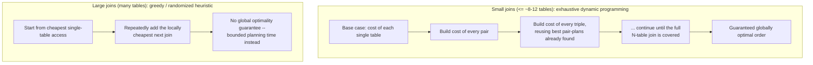

### 4.6 Join algorithm: nested loop join

**Definition.** Nested loop join iterates over every row of one relation
(the **outer** relation) and, for each outer row, searches the other
relation (the **inner** relation) for matching rows — either by scanning
the inner relation's rows entirely each time, or (far more commonly in
practice) by probing an index on the inner relation's join key.

**Mechanism.** In its index-assisted form, nested loop join's cost is
roughly `(rows in outer relation) × (cost of one index probe on the inner
relation)` — cheap when the outer relation is small and the inner relation
has a selective index on the join key, because each index probe touches
only a handful of pages. In its naive form (no usable index), the cost
becomes `(rows in outer) × (pages in inner)` — quadratic in the worst case,
and prohibitively expensive for anything beyond small relations.

**Decision implications.** Nested loop join wins specifically when one side
is small (few outer rows to iterate) and the other side is efficiently
indexable on the join key — the canonical shape of an Online Transaction
Processing (OLTP) point lookup, e.g. "find this one customer's five most
recent orders." It is the *wrong* choice, and a serious performance risk,
when both sides are large, because the number of inner-side probes scales
linearly with outer-side cardinality — exactly the failure mode illustrated
in [`01_explain_plan_walkthrough.sql`](../../code/sql/query-optimizers-chapter/01_explain_plan_walkthrough.sql)'s
"loops=800000" example.

**Common failure mode.** A cardinality misestimation (Section 4.3) on the
outer relation — the optimizer believes the outer side will produce a small
number of rows and picks index-assisted nested loop expecting cheap,
bounded index probing, but the outer side actually produces orders of
magnitude more rows, turning a plan that looked cheap into one performing
hundreds of thousands of individual index probes.

**Scenario.** `SELECT * FROM orders o JOIN order_items oi ON oi.order_id =
o.order_id WHERE o.customer_id = 42` — with a selective index on
`orders.customer_id` and an index on `order_items.order_id`, this is a
textbook nested loop win: a handful of outer rows (this one customer's
orders), each cheaply probed against `order_items`'s index. The same join
shape with the `WHERE customer_id = 42` filter removed turns the outer side
into the entire `orders` table — the *same join*, the *same available
indexes*, but nested loop is now the wrong algorithm entirely; hash join
(Section 4.7) or sort-merge join (Section 4.8) would dominate instead.

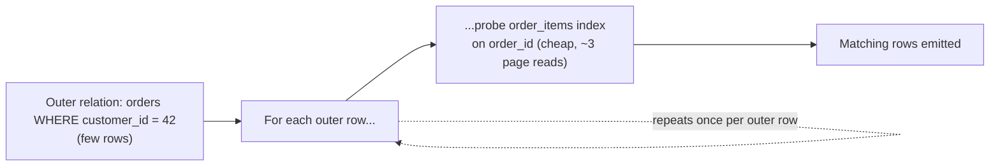

### 4.7 Join algorithm: hash join

**Definition.** Hash join builds an in-memory hash table over the smaller
of the two relations (the **build side**), keyed on the join column, then
streams the larger relation (the **probe side**) through it exactly once,
looking up each probe row's join key in the hash table to find matches.

**Mechanism.** Building the hash table costs roughly one pass over the
build side; probing costs roughly one pass over the probe side, with each
individual hash lookup being close to constant-time — so the total cost is
close to linear in the combined size of both relations, with no dependency
on whether either side is sorted or indexed. If the build side is too large
to fit in the memory budget allotted to the join (`work_mem` in PostgreSQL,
similarly named budgets elsewhere), the optimizer falls back to **grace hash
join**: partitioning both relations to disk by a hash of the join key into
smaller pieces that *do* fit in memory, then joining partition-pair by
partition-pair — correct, but roughly triples the I/O cost (write both
sides' partitions, then re-read them for the build and probe phases), which
[`03_join_algorithm_cost_simulator.py`](../../code/python/query-optimizers-chapter/03_join_algorithm_cost_simulator.py)
models directly.

**Decision implications.** Hash join is usually the right default choice
when neither input is already sorted on the join key, no efficient index
exists on the join key of either side, and at least one side is small
enough to fit its hash table in the available memory budget — this covers
the large majority of analytical joins between two unsorted, non-indexed
(or non-selectively-indexed) fact/dimension tables. Provisioning enough
query working memory for the build side to stay in-memory is a concrete,
actionable performance lever, distinct from anything about indexes.

**Common failure mode.** Under-provisioning per-query working memory
(`work_mem`, or the equivalent) such that a hash join's build side
routinely spills to disk in production, silently tripling I/O cost on every
execution — visible in `EXPLAIN ANALYZE` output as multiple hash "Batches"
rather than one.

**Scenario.** Joining a 1,000,000-row `orders` table against a 50,000-row
`customers` table with no useful index and generous memory: the optimizer
builds an in-memory hash table over the 50,000-row `customers` side (small,
fits easily) and streams all 1,000,000 `orders` rows through it once —
close to linear-time overall, and the plan shape produced in Section 10's
first `EXPLAIN` example.

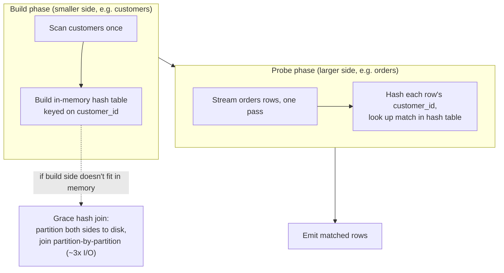

### 4.8 Join algorithm: sort-merge join

**Definition.** Sort-merge join sorts both relations on the join key (if
not already sorted or delivered sorted by an index), then merges the two
sorted streams in a single linear pass, advancing whichever side has the
smaller current key at each step, emitting matches as equal keys are found
on both sides.

**Mechanism.** If both inputs arrive already sorted on the join key — most
commonly because an index scan naturally produces rows in index-key order,
or because a prior operation in the plan already sorted them for another
reason (e.g. an `ORDER BY` or a preceding `GROUP BY`) — the merge phase
alone costs a single linear pass over both relations, with no per-row random
lookups at all. If either side is *not* already sorted, the optimizer must
pay an explicit sort cost first, and sorting costs roughly `O(P log P)` for
P pages using an external merge sort — cheaper than a naive quadratic
approach, but not free, and this upfront cost is exactly what determines
whether sort-merge join beats hash join for a given query.

**Decision implications.** Sort-merge join tends to win specifically when
one or both inputs are *already* sorted for free (via an index that's being
scanned anyway, or via an upstream operation that already produced sorted
output) — in that case it can beat hash join outright, since it avoids
building any hash table at all. It also becomes competitive with hash join
when relations are too large for either side's hash table to fit in memory
(triggering hash join's expensive grace-partitioning fallback, Section 4.7)
but disk space for an external sort is available.

**Common failure mode.** Assuming sort-merge join is "the sorted-data join"
and therefore always preferable when an `ORDER BY` is present elsewhere in
the query — the sort that matters for this decision is specifically a sort
*on the join key*, which is unrelated to whatever column the final result
happens to be ordered by.

**Scenario.** Joining two very large fact tables (`orders` and
`shipments`), neither pre-sorted, with a memory budget too small to hold
either side's hash table without spilling: hash join would pay the ~3x
grace-partitioning I/O penalty, while sort-merge join's `O(P log P)` sort
cost on each side, followed by one linear merge pass, can come out cheaper —
exactly the comparison
[`03_join_algorithm_cost_simulator.py`](../../code/python/query-optimizers-chapter/03_join_algorithm_cost_simulator.py)'s
"Scenario C" computes.

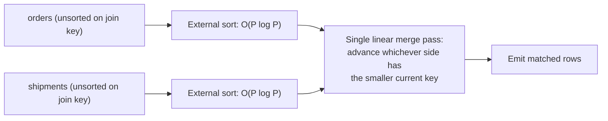

### 4.9 Reading an EXPLAIN / execution plan: the mental model

**Definition.** `EXPLAIN` (and its execution-time variant, `EXPLAIN
ANALYZE`) renders the physical plan the optimizer chose (or, with
`ANALYZE`, actually executed) as a tree of operator **nodes** — scans,
joins, sorts, aggregates — each annotated with the optimizer's estimated
cost and row count, and, with `ANALYZE`, the *actual* measured time and row
count from really running it.

**Mechanism.** A plan tree is read **bottom-up, inside-out**: the leaf
nodes (typically table scans or index scans) execute first and stream their
rows upward as input to their parent node, which combines or transforms
them and streams *its* output further up, until the root node produces the
final result set. The single most diagnostically useful habit is comparing
each node's *estimated* row count against its *actual* row count (visible
only under `EXPLAIN ANALYZE`) — a large gap between the two is the most
direct, most common signal that a statistics problem (Section 4.3) is
distorting the plan, since every cost estimate and every algorithm choice
downstream of a bad cardinality estimate inherits that error.

**Decision implications.** An architect should treat reading a plan as
answering three questions in order: (1) what access path was chosen at each
leaf (index scan vs. sequential scan, and does that match the predicate's
actual selectivity), (2) what join algorithm was chosen at each join node,
and does its shape match the relative sizes of its two inputs (Sections
4.6-4.8), and (3) where do estimated and actual row counts diverge
significantly, since that's where to look first for a statistics or
rewrite-stage problem rather than assuming the cost model itself is
"wrong."

**Common failure mode.** Reading only the top-level `cost=` number and
treating it as milliseconds — cost is an abstract, engine-internal unit
used purely to *compare* candidate plans against each other; it has no
fixed real-world time meaning, and comparing cost numbers *across* two
different queries (rather than across two candidate plans for the *same*
query) is meaningless.

**Scenario.** [`01_explain_plan_walkthrough.sql`](../../code/sql/query-optimizers-chapter/01_explain_plan_walkthrough.sql)
walks a real plan node by node: a `Sort` node at the root (for the query's
`ORDER BY`), feeding from a `HashAggregate` (for `GROUP BY`), feeding from a
`Hash Join` (Section 4.7), whose two children are a filtered `Seq Scan` on
`orders` and a `Seq Scan`-then-`Hash`-built `customers` — and, further down
in the same file, a deliberately pathological nested-loop plan
(`loops=800000`) that demonstrates exactly how a cardinality
misestimation, not a flaw in the join algorithm itself, produces a
catastrophically slow plan.

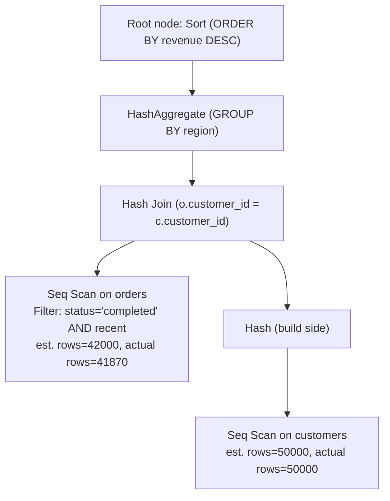

## 5. Internal Working

Putting Section 4's pieces together, a query passes through the optimizer's
internal pipeline as a sequence of distinct passes, each consuming the
previous pass's output:

1. The **parser** produces a syntax tree directly from SQL text, catching
   only syntax errors at this stage.
2. The **binder** resolves every table and column reference against the
   schema catalog, resolves `SELECT *` and view definitions, and performs
   type checking — producing a fully-resolved, but not yet optimized,
   logical query representation.
3. The **logical rewrite** pass applies the transformation rules described
   in Section 4.1: predicate pushdown, subquery unnesting, constant folding,
   join elimination for provably-redundant joins, and outer-join-to-inner-
   join simplification where a `WHERE` clause proves it's safe.
4. The **statistics lookup** pass annotates every base table and column
   reference in the rewritten logical plan with the current row counts,
   distinct-value counts, and histogram data from Section 4.3 — this is the
   pass that becomes wrong when statistics are stale.
5. The **physical optimization** pass — the dynamic-programming or greedy
   join-order search from Section 4.5, combined with per-join algorithm
   selection (Sections 4.6-4.8) and per-table access-path selection
   (Section 4.4) — enumerates candidate physical plans and picks the
   lowest-estimated-cost one.
6. The **executor** runs the chosen physical plan, typically using a
   pull-based "iterator model" (also called the Volcano model) where each
   node exposes a `next()` operation that its parent calls to pull one row
   at a time, letting rows flow through the whole tree without materializing
   every intermediate result in full.

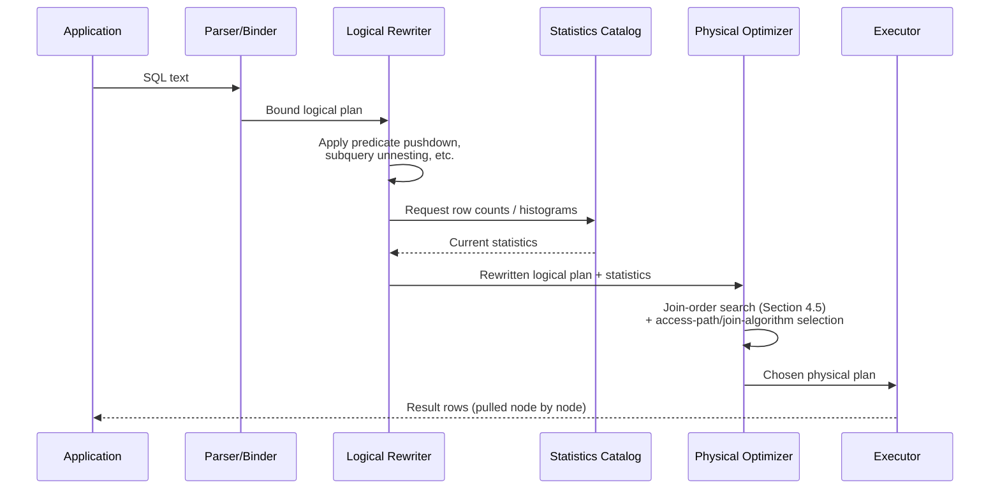

Most production engines also maintain a **plan cache**: once a parameterized
query has been planned, the resulting physical plan can be reused for
subsequent executions with different parameter *values* but the same query
*shape*, skipping the optimization pass entirely to save planning latency.
This introduces **parameter sniffing**: the cached plan was optimized for
whichever parameter value happened to be bound on the *first* execution that
triggered planning, and if that value's selectivity was unusually low or
high compared to typical values, every subsequent execution reuses a plan
that's a poor fit for its own parameter — another concrete instance of "same
query text, different performance," this time with no statistics change
involved at all, purely a caching artifact.

## 6. Design Principles

- **The optimizer reasons about data, not intent.** Cardinality and cost
  estimates come entirely from statistics about the *current* data; the
  optimizer has no notion of "this query is important" or "this is supposed
  to be fast" — every performance lever available to an architect works by
  changing what the optimizer can *see* (statistics, indexes, schema shape),
  not by asking it to try harder.
- **Provable equivalence gates every rewrite.** A logical rewrite rule is
  only ever applied if it's mathematically guaranteed to produce an
  identical result for every possible input — this is why certain
  seemingly-obvious rewrites (e.g. some predicate pushdowns through outer
  joins) are deliberately *not* applied when they would change NULL-handling
  semantics.
- **Cost estimates are comparative, not absolute.** A cost number only has
  meaning when compared against another candidate plan for the *same*
  query; treating it as a real-world time unit, or comparing costs across
  different queries, is a category error.
- **Optimal substructure bounds tractable search.** Dynamic programming's
  correctness (Section 4.5) depends on the guarantee that the cheapest plan
  for any subset of tables remains cheapest regardless of what's joined onto
  it afterward — this is a mathematical property of the cost model, not an
  implementation shortcut, and it's what makes exhaustive search tractable
  at all up to a bounded table count.
- **Statistics freshness is a first-class operational concern**, not a
  one-time DBA task — treat it with the same operational rigor as
  monitoring replication lag or disk usage, especially around bulk
  loads/deletes.

## 7. Architecture Patterns

- **Statistics-refresh-as-code**: explicitly running `ANALYZE` (or the
  engine's equivalent) as the final step of every bulk-load or bulk-mutation
  pipeline, rather than depending solely on an automatic background
  trigger, so a large one-time change never leaves the optimizer working
  from stale inputs even briefly.
- **Query shape stabilization**: deliberately keeping frequently-run query
  text structurally stable (consistent predicate shapes, parameterized
  rather than string-concatenated literals) so the plan cache (Section 5)
  reuses plans predictably instead of re-planning — or, conversely,
  deliberately disabling plan caching for a specific query known to have
  wildly parameter-dependent selectivity, to avoid the parameter-sniffing
  failure mode.
- **Read-path denormalization feeding the optimizer simpler joins**:
  materialized views and star-schema-style denormalization (owned by
  [Denormalization](CH02_Denormalization.md)) reduce the number of tables
  a hot analytical query needs to join, directly shrinking the join-order
  search space (Section 4.5) the optimizer has to reason about for that
  query.
- **Plan-stability guardrails**: some engines (SQL Server's Query Store,
  Oracle's SQL Plan Baselines) let an architect pin a known-good plan for a
  critical query, trading the optimizer's adaptability for protection
  against a sudden regression triggered by a statistics update choosing a
  worse plan for an edge-case parameter value.

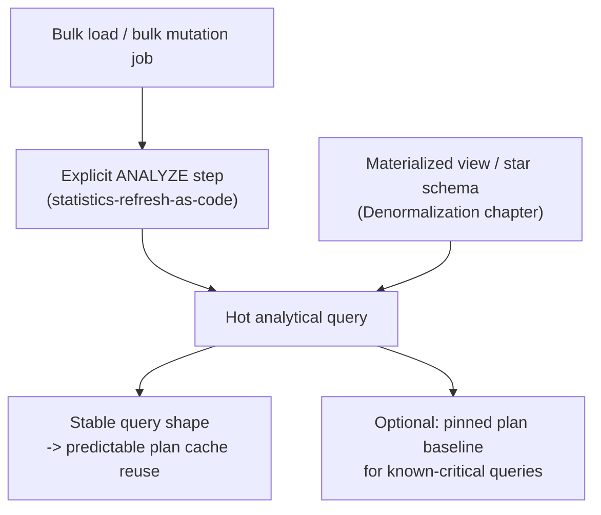

## 8. Production Architecture

In a production relational database serving a mixed OLTP/analytical
workload, the query optimizer sits behind the connection/query layer and
ahead of the storage engine, consulted on every parsed statement (unless a
cached plan is reused, Section 5). Statistics collection typically runs as a
background maintenance process (autovacuum's auto-analyze in PostgreSQL, the
auto-update-statistics thread in SQL Server) competing for I/O and CPU
alongside the foreground workload, which is why aggressive statistics
refresh has its own resource cost that must be balanced against staleness
risk — refreshing constantly isn't free either. Larger deployments often
separate a read-replica or analytical-replica tier specifically so
analytical queries' very different join shapes (wide, multi-table,
scan-heavy) and their correspondingly different optimizer behavior don't
compete for the same statistics-refresh and buffer-pool resources as latency
-sensitive OLTP traffic on the primary. Query plan caches are typically
per-connection-pool or per-instance, which matters for how quickly a
statistics update or schema change actually takes effect across a fleet —
a stale cached plan on one replica can coexist with a freshly re-planned
query on another until each instance's cache independently invalidates and
re-plans.

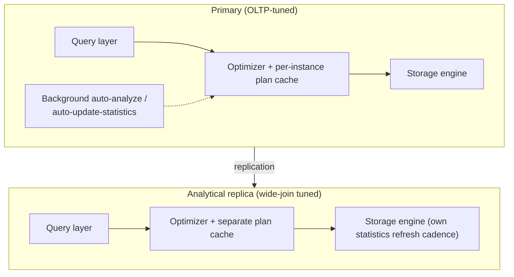

## 9. Implementation

Making statistics-refresh-as-code (Section 7) concrete: a post-load hook
that any batch ETL (Extract, Transform, Load) pipeline can call after a
large mutation, rather than trusting the background auto-analyze threshold
to fire promptly:

```sql
-- Called as the final step of a batch load job, immediately after a large
-- INSERT/UPDATE/DELETE, so the optimizer never plans against stale
-- statistics for this table even briefly.
ANALYZE events;

-- For a table known to churn heavily and unpredictably, lower the
-- threshold so autovacuum's background auto-analyze triggers proactively
-- rather than waiting for its default 10%-of-rows-changed threshold.
ALTER TABLE events SET (autovacuum_analyze_scale_factor = 0.02);
```

## 10. Complete Code Examples

**Example 1 — annotated `EXPLAIN (ANALYZE, BUFFERS)` walkthrough**, reading
a real hash-join plan node by node and diagnosing a deliberately
pathological nested-loop plan caused by cardinality misestimation:
[`code/sql/query-optimizers-chapter/01_explain_plan_walkthrough.sql`](../../code/sql/query-optimizers-chapter/01_explain_plan_walkthrough.sql).

**Example 2 — stale-statistics before/after fix**, showing the exact same
query degrade by roughly 43,000x after a bulk load with no `ANALYZE`, and
recover after running `ANALYZE`:
[`code/sql/query-optimizers-chapter/02_stale_statistics_fix.sql`](../../code/sql/query-optimizers-chapter/02_stale_statistics_fix.sql).

**Example 3 — join algorithm cost simulator (Python)**, computing and
comparing nested loop, hash join, and sort-merge join cost estimates across
three scenarios (small dimension table, selective index-assisted join, and
two large unsorted fact tables) to make Sections 4.6-4.8's trade-offs
concrete and runnable:
[`code/python/query-optimizers-chapter/03_join_algorithm_cost_simulator.py`](../../code/python/query-optimizers-chapter/03_join_algorithm_cost_simulator.py).

**Example 4 — System R-style dynamic-programming join-order search
(Java)**, enumerating every subset of a 4-table join exactly once and
finding the provably optimal order, directly implementing Section 4.5's
algorithm:
[`code/java/query-optimizers-chapter/04_JoinOrderDynamicProgramming.java`](../../code/java/query-optimizers-chapter/04_JoinOrderDynamicProgramming.java).

Run the Python simulator directly to see the three scenarios' cost
comparisons:

```bash
python code/python/query-optimizers-chapter/03_join_algorithm_cost_simulator.py
```

Compile and run the Java dynamic-programming example:

```bash
javac code/java/query-optimizers-chapter/04_JoinOrderDynamicProgramming.java -d /tmp/out
java -cp /tmp/out JoinOrderDynamicProgramming
```

## 11. Performance

- **Cardinality estimation accuracy dominates everything else.** A correct
  join algorithm choice (Sections 4.6-4.8) applied to a wrong cardinality
  estimate is still a bad plan — statistics freshness (Section 4.3) is the
  highest-leverage performance lever available, ahead of join-algorithm or
  index tuning.
- **Working-memory sizing directly determines hash join's cost tier** — a
  build side that fits in the query's memory budget costs roughly one pass
  over each input; a build side that spills to disk (grace partitioning)
  costs roughly three times as much I/O for the identical logical join.
- **Plan cache hit rate trades planning latency against plan
  specificity** — reusing a cached plan avoids re-running the optimizer
  (Section 5) but risks the parameter-sniffing failure mode if the query's
  optimal plan genuinely varies by parameter value.
- **Predicate pushdown and rewrite-stage correctness (Section 4.1)** often
  matter more than any cost-model tuning — a predicate trapped inside a
  function call defeats index usage regardless of how good the join
  algorithm choice downstream is.

## 12. Scalability

- **Join-order search cost itself scales with table count** (Section 4.5)
  — very wide joins (10+ tables) push optimizers past their exhaustive-
  search threshold into heuristic territory, so query *design* (how many
  tables one query joins) is itself a scalability lever, independent of data
  volume.
- **Statistics maintenance cost scales with data volume and churn rate** —
  a very large, rapidly-changing table needs either more frequent
  incremental statistics refreshes or a lower auto-analyze threshold,
  trading background maintenance load against staleness risk (Section 8).
- **Distributed/sharded engines add data-shuffle cost as a first-choice
  optimizer input**: joining two tables that live on different physical
  nodes (in a horizontally-partitioned system) requires moving data across
  the network before any of the local join algorithms in Sections 4.6-4.8
  can even run — a cost term that doesn't exist in a single-node optimizer's
  model at all, and one the future
  [Sharding](CH04_Query_Optimizers.md) and Partitioning chapters recap and
  build on.

## 13. Security

- **Statistics themselves can leak information**: histogram buckets and
  most-common-value lists describe the *shape* of data (e.g. the relative
  frequency of a `status = 'fraud_flagged'` value), which in sufficiently
  sensitive schemas is itself a disclosure surface worth considering when
  granting broad `SELECT` access to system catalogs.
- **Query plans can be an information-disclosure side channel**: differing
  query *timing* between two parameter values can sometimes reveal whether
  a value exists in a table even without direct read access to it (a
  timing-based inference risk), which is a reason to prefer parameterized,
  constant-time-shaped queries for security-sensitive lookups rather than
  branching application logic on observed query latency.
- **Function-wrapped predicates as an unintentional security-relevant
  performance risk**: a predicate trapped inside a function (Section 4.1's
  common failure mode) on a security-critical lookup (e.g. an
  authentication or authorization check) can silently degrade from an
  index-assisted lookup to a full scan under load, turning a performance
  issue into a potential denial-of-service amplification point.

## 14. Observability

- **`EXPLAIN ANALYZE` estimated-vs-actual divergence**, tracked over time
  for a fleet's slowest or most frequently-run queries, is the most direct
  observability signal for a developing statistics problem before it turns
  into an incident.
- **Statistics staleness metrics**: PostgreSQL's
  `pg_stat_user_tables.n_mod_since_analyze` (rows modified since the last
  analyze) and similar counters in other engines should be monitored
  directly, with alerting on tables that combine high churn with a large
  gap since last refresh.
- **Plan-cache invalidation and re-planning events**, tracked per query
  shape, help distinguish "this got slower because of a genuine statistics
  or schema change" from "this got slower because a parameter-sniffing-prone
  cached plan happened to get evicted and replaced by a worse one for the
  current traffic mix."
- **Query Store / plan-history features** (where available) retain a
  history of which physical plan a given query text has used over time,
  which is the fastest way to confirm "the plan changed" as the root cause
  of a regression rather than guessing from a single point-in-time
  `EXPLAIN`.

## 15. Failure Scenarios

- **Stale statistics after a bulk load** (Section 4.3): the canonical
  scenario this chapter centers on, worked through end to end in
  [`02_stale_statistics_fix.sql`](../../code/sql/query-optimizers-chapter/02_stale_statistics_fix.sql).
- **Schema change silently invalidating an index-dependent plan**: dropping
  or renaming a column referenced by an index, or dropping an index
  entirely as part of an unrelated migration, can force the optimizer onto
  a much more expensive access path for queries that previously relied on
  it — with no error at all, just a slower plan from that point forward.
- **Parameter sniffing** (Section 5): a cached plan optimized for an
  atypical first-observed parameter value gets reused for every subsequent,
  more typical execution, producing a plan that's a poor fit for the
  common case.
- **Join-order heuristic failure on very wide joins** (Section 4.5): past
  the exhaustive-search threshold, the greedy heuristic can commit early to
  a locally-cheap join that forecloses a much better globally-optimal
  ordering.
- **Type mismatch defeating an index silently** (Section 4.1): a predicate
  comparing an indexed integer column against a string literal forces an
  implicit cast that blocks index usage, with no explicit error, only a
  degraded plan.

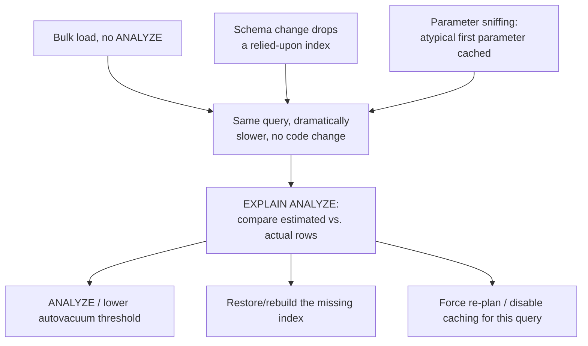

## 16. Testing

- **Plan-shape regression tests**: capturing a known-good `EXPLAIN` plan for
  a critical query in a test suite or CI (Continuous Integration) pipeline,
  and failing the build if a schema migration or a statistics refresh in a
  staging environment produces an unexpectedly different plan shape (e.g.
  an index scan silently becoming a sequential scan).
- **Statistics-freshness assertions** in a staging/pre-production
  environment that mirrors production data volume, specifically to catch
  the stale-statistics failure mode before it reaches production, rather
  than discovering it live.
- **Cost-model unit tests for hand-written cost estimators** (as in the
  Python simulator in Section 10): asserting that the simulator's chosen
  algorithm changes correctly as relative relation sizes and index
  availability change, mirroring the real optimizer's decision boundaries.
- **Load testing with production-representative cardinalities**, not just
  small development-sized datasets — a query that looks fine against a
  thousand-row development table can hide a catastrophic join-order or
  join-algorithm choice that only appears at production scale.

## 17. Common Mistakes

- Assuming an index will always be used once it exists, without checking
  its actual selectivity against real data (Section 4.4).
- Skipping an explicit `ANALYZE` after a large bulk load, trusting the
  background auto-analyze threshold to fire promptly enough (Section 4.3).
- Wrapping an indexed column in a function or comparing it against a
  mismatched type, silently defeating predicate pushdown (Section 4.1).
- Reading `EXPLAIN` cost numbers as if they were milliseconds, or comparing
  costs across two unrelated queries (Section 4.9).
- Writing extremely wide joins (15+ tables) and assuming the optimizer
  exhaustively searched every ordering, rather than falling back to a
  heuristic (Section 4.5).
- Treating a single point-in-time `EXPLAIN` as a permanent characterization
  of a query's performance, rather than recognizing that the same query can
  legitimately get a different plan after a statistics refresh or schema
  change.

## 18. Best Practices

- Refresh statistics explicitly as the final step of any bulk load/mutation
  pipeline, rather than relying solely on background auto-analyze timing
  (Section 7).
- Write predicates in a form the rewrite stage can push down — compare
  columns directly against literals of the matching type, and avoid
  wrapping indexed columns in functions where an equivalent unwrapped form
  exists (Section 4.1).
- Use `EXPLAIN ANALYZE` (not just `EXPLAIN`) when diagnosing a real
  performance problem, and specifically compare estimated vs. actual row
  counts at every node before assuming the join algorithm choice itself is
  wrong (Section 4.9).
- Keep hot, frequently-run queries structurally consistent to get
  predictable plan-cache behavior, and be aware of parameter sniffing risk
  for queries with wildly parameter-dependent selectivity (Section 5).
- Prefer denormalization/materialized views (owned by
  [Denormalization](CH02_Denormalization.md)) to reduce join-order search
  complexity for very wide, frequently-run analytical queries (Section 12).

## 19. Anti-Patterns

- **"Just add an index"** as a reflexive fix for any slow query, without
  first checking `EXPLAIN` to confirm the bottleneck is actually access-path
  selection rather than join algorithm choice, join order, or a rewrite-
  stage problem.
- **Disabling statistics collection or auto-analyze** to "reduce background
  load," without recognizing this trades a small, predictable maintenance
  cost for the much larger, unpredictable risk of the stale-statistics
  failure mode (Section 4.3).
- **Hard-coding join hints everywhere** as a permanent substitute for
  healthy statistics, rather than as a targeted, documented, periodically
  revisited exception — hints pinned against today's data distribution can
  become actively harmful once that distribution changes.
- **Treating query optimization as a one-time tuning pass** rather than an
  ongoing operational discipline that has to track data growth, schema
  evolution, and workload shifts over the system's lifetime.

## 20. Trade-off Analysis

| Decision | Option A | Option B | Trade-off |
|---|---|---|---|
| Statistics refresh cadence | Aggressive (low auto-analyze threshold) | Conservative (default threshold) | Fresher cardinality estimates vs. more background I/O/CPU contention |
| Join algorithm (given the choice exists) | Nested loop (index-assisted) | Hash join | Best for small outer + selective inner index vs. best for large, unsorted, unindexed both-sides joins |
| Join algorithm (given the choice exists) | Hash join | Sort-merge join | No upfront sort cost, needs enough memory for build side vs. wins when inputs are already sorted or memory is scarce |
| Plan caching | Reuse cached plan across parameter values | Force re-plan per execution | Lower planning latency vs. avoiding parameter-sniffing risk for highly skewed predicates |
| Query width | Wide, denormalized single query (many joins) | Narrower query + application-side composition | Fewer round trips vs. staying inside the optimizer's exhaustive join-order search threshold |

## 21. Comparison Table

| Join algorithm | Best when | Memory sensitivity | Requires sorted/indexed input? |
|---|---|---|---|
| Nested loop (index-assisted) | Small outer side, selective index on inner join key | Low | Needs an index on the inner side |
| Nested loop (naive) | Very small relations on both sides only | Low | No, but quadratic without one |
| Hash join | Neither side sorted/indexed usefully; one side fits in memory | High (spills to disk if build side too large) | No |
| Sort-merge join | One or both sides already sorted; memory scarce for hash join | Moderate (external sort if unsorted) | Benefits greatly if already sorted |

| Optimizer strategy | Table count | Search completeness | Typical use |
|---|---|---|---|
| Exhaustive dynamic programming | Small (roughly <= 8-12) | Guaranteed optimal | Typical OLTP/moderate analytical queries |
| Greedy / randomized heuristic | Large (beyond DP threshold) | No optimality guarantee | Very wide reporting/denormalized queries |

## 22. Real-World Case Study

An analytics team at a mid-size e-commerce company ran a nightly revenue
dashboard query that had performed consistently for over a year, joining
`orders`, `customers`, and a recently-added `promotions` table to compute
per-region, per-campaign revenue. One night, the dashboard query took over
40 minutes instead of its usual 45 seconds, with no code deployed and no
schema migration that day. The on-call engineer's first instinct was to
suspect a database resource problem (CPU, disk contention), but a fleet-wide
resource check showed nothing unusual. Pulling `EXPLAIN ANALYZE` for the
exact failing query (Section 4.9) revealed the actual cause immediately: the
`promotions` table's estimated row count was still small (a few thousand),
but its actual row count had grown to several million rows following a
marketing campaign's bulk-insert of time-limited promo codes earlier that
day — the same stale-statistics scenario worked through in
[`02_stale_statistics_fix.sql`](../../code/sql/query-optimizers-chapter/02_stale_statistics_fix.sql). The
optimizer, still trusting week-old statistics, had chosen an index-assisted
nested loop join (Section 4.6) expecting to probe the small `promotions`
index only a few thousand times; with the table's true size, that same plan
performed millions of index probes. Running an explicit `ANALYZE` on
`promotions` immediately restored the query's normal hash-join plan and its
usual runtime. The team's follow-up action was exactly Section 7's pattern:
adding an explicit `ANALYZE` step to the marketing campaign's bulk-insert
job itself, rather than depending on the next scheduled auto-analyze window
to eventually catch up.

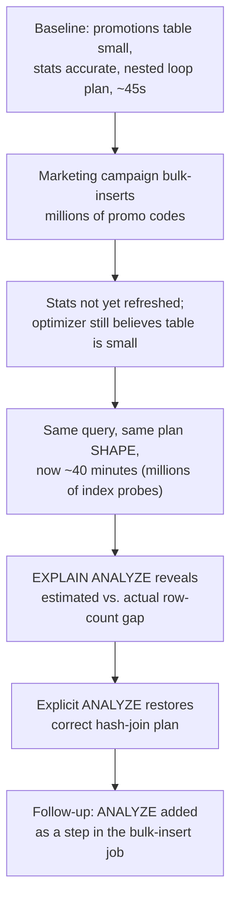

## 23. Interview Questions

1. Walk through what happens to a SQL statement between the moment it's
   submitted and the moment a physical execution plan is chosen.
2. Why is join order search combinatorially hard, and how do real
   optimizers keep it tractable?
3. Compare nested loop, hash join, and sort-merge join. Under what
   conditions does each one win?
4. What is a histogram, and why does it matter more than a simple row count
   for cardinality estimation?
5. Explain a real scenario where the exact same query, with no code
   changes, becomes dramatically slower, and how you would diagnose it.
6. What is parameter sniffing, and how would you detect and mitigate it?
7. Why does a cost-based optimizer sometimes deliberately ignore an
   available index? Is that a bug?
8. What's the difference between reading `EXPLAIN` output and
   `EXPLAIN ANALYZE` output, and why does that difference matter for
   diagnosing a slow query?
9. Explain why dynamic programming is a valid approach to join-order
   search — what property of the cost model makes it correct?
10. How would you design an operational process to prevent stale
    statistics from causing a production incident after a large bulk load?

## 24. Hands-on Exercises

1. Run [`01_explain_plan_walkthrough.sql`](../../code/sql/query-optimizers-chapter/01_explain_plan_walkthrough.sql)
   against a populated PostgreSQL instance, and annotate each plan node with
   which Section 4 concept explains why the optimizer chose it.
2. Reproduce [`02_stale_statistics_fix.sql`](../../code/sql/query-optimizers-chapter/02_stale_statistics_fix.sql)'s
   scenario end to end: create the table, populate a small baseline, capture
   a plan, bulk-load without `ANALYZE`, capture the degraded plan, then fix
   it and capture the recovered plan.
3. Run [`03_join_algorithm_cost_simulator.py`](../../code/python/query-optimizers-chapter/03_join_algorithm_cost_simulator.py)
   and modify the memory budget in Scenario A until the simulator's chosen
   algorithm flips from hash join to sort-merge join; explain why the
   crossover happens where it does.
4. Compile and run
   [`04_JoinOrderDynamicProgramming.java`](../../code/java/query-optimizers-chapter/04_JoinOrderDynamicProgramming.java),
   then add a fifth relation and selectivity entries, and confirm the
   optimal order it finds matches your own manual reasoning about the
   cheapest join sequence.
5. On a real database, deliberately wrap an indexed column in a function in
   a `WHERE` clause, capture `EXPLAIN` before and after removing the
   wrapper, and confirm the access-path change predicted by Section 4.1.

## 25. Design Exercises

1. Design an operational runbook for diagnosing "this query got slower with
   no code change," referencing the specific `EXPLAIN ANALYZE` signals from
   Section 4.9 that distinguish a stale-statistics cause from a schema-
   change cause from a parameter-sniffing cause.
2. A reporting system runs several queries that each join 12-18 tables.
   Design an approach (schema, materialized views, or query restructuring)
   to keep these queries inside the exhaustive join-order search threshold
   (Section 4.5) rather than depending on the optimizer's heuristic.
3. Design a statistics-refresh policy for a mixed workload: a set of tables
   that receive small, steady trickle writes, and a separate set of tables
   that receive rare but massive bulk loads. Justify different
   auto-analyze thresholds for each category.
4. Propose a plan-stability strategy (e.g. plan baselines/Query Store, or an
   application-level circuit breaker) for a critical, latency-sensitive
   query that has previously regressed due to a statistics-driven plan
   change, balancing protection against the risk of "freezing" a
   genuinely-outdated plan forever.

## 26. Architecture Review Questions

1. For this system's slowest or most business-critical queries, is there a
   process that captures `EXPLAIN ANALYZE` output regularly enough to
   detect a plan regression before it becomes a production incident?
2. Do bulk-load and bulk-mutation pipelines explicitly refresh statistics as
   their final step, or do they depend entirely on background auto-analyze
   timing?
3. Are there any queries joining more than roughly 10-12 tables, and if so,
   has anyone confirmed whether the optimizer is using exhaustive search or
   a heuristic for them?
4. Is there a known instance of parameter sniffing affecting a critical
   query, and if so, what mitigation (if any) is in place?
5. Are indexed columns consistently compared without wrapping functions or
   mismatched types in hot-path queries?
6. Is there a plan-stability safety net (plan baselines, Query Store,
   documented rollback procedure) for the handful of queries where a
   sudden plan regression would be most damaging?

## 27. Summary

A Query Optimizer's job is to close the gap between what SQL declares and
what a database engine must actually do — parsing and rewriting a query into
a canonical logical form, then using cost-based reasoning grounded in
current table and column statistics (Section 4.3) to choose an access path,
a join order (Section 4.5), and a join algorithm (Sections 4.6-4.8) for
every join. Every one of those decisions depends on cardinality estimates
that are only as good as the statistics feeding them, which is why the same
SQL text can perform dramatically differently after a bulk load, a schema
change, or simply the natural drift of data distribution over time — not
because the optimizer is broken, but because it is faithfully reasoning from
inputs that have quietly gone stale. Reading an `EXPLAIN ANALYZE` plan
bottom-up, and specifically comparing estimated against actual row counts at
each node (Section 4.9), is the single most reliable diagnostic habit for
telling a genuine cost-model limitation apart from a data-freshness problem
that a well-placed `ANALYZE` fixes outright. This chapter builds directly on
[Indexes](CH03_Indexes.md)'s data structures and feeds directly into how
[Normalization](CH01_Normalization.md) and
[Denormalization](CH02_Denormalization.md)'s schema-shape decisions play out
in practice — the optimizer is the mechanism that turns a well-designed
schema and a well-chosen set of indexes into an actually fast query, and
turns a poorly-maintained statistics pipeline into a recurring, confusing
production incident.

## Further Reading

- [Indexes](CH03_Indexes.md) — the B-tree/hash/composite index data
  structures this chapter's access-path selection (Section 4.4) reasons
  about, but does not re-derive.
- [Normalization](CH01_Normalization.md) and
  [Denormalization](CH02_Denormalization.md) — the schema-shape decisions
  that determine how many joins, and of what selectivity, this chapter's
  optimizer has to reason about in the first place.
- [What is Software Architecture?](../01_Architecture_Mindset/CH01_What_is_Software_Architecture.md)
  — the general quality-attribute framing (performance as a non-functional
  requirement) that this chapter's cost-based decisions ultimately serve.
