# Chapter: Partitioning

Part: [06 — Databases and Storage](PART_OVERVIEW.md) · Status: Drafted

## 1. Introduction

Partitioning is the technique of splitting one logical table into multiple
smaller physical pieces — **partitions** — that are still stored, managed,
and queried through a single database instance, on a single server. The
database engine keeps a routing layer on top: applications and queries keep
addressing one logical table name, and the engine decides, transparently,
which partition (or partitions) actually holds the rows a given statement
needs. This chapter is the *owning* chapter for partitioning strategy and
mechanics **within a single database node**: horizontal partitioning by
range, list, and hash key; vertical partitioning (splitting columns, not
rows); partition pruning (how the query planner eliminates irrelevant
partitions before execution); and partition maintenance, especially the
rolling-window add/drop pattern used to retain time-series data cheaply.

**A scope boundary that matters from the first paragraph.** Partitioning, as
taught in this chapter, is the *general mechanism*: take one dataset, split
it into smaller physical pieces by some key, and let the engine route reads
and writes to the right piece. That mechanism does not, by itself, say
anything about *where* those pieces live. When every partition still lives
on the same database server, sharing the same CPU, memory, and disk, you get
everything this chapter teaches — faster maintenance, better cache
locality, cheaper bulk retention deletes — but you get **zero additional
write throughput or storage capacity**, because it is still one machine
underneath. [Sharding](CH06_Sharding.md) takes the identical partitioning
strategies this chapter teaches — range, list, and hash key selection — and
applies them **across multiple independent database nodes**, so that each
shard is a separate server with its own CPU, memory, and disk, turning a
capacity/throughput ceiling into something horizontally scalable. This
chapter stops at the single-node boundary deliberately: it does not teach
shard-routing logic, cross-shard query fan-out, rebalancing, or distributed
transactions — those are Sharding's material, and Sharding recaps this
chapter's key-selection reasoning rather than re-deriving it. Section 4.10
returns to this boundary in depth once the vocabulary (range/list/hash,
pruning, partition key) is fully established.

Partitioning sits downstream of three sibling chapters and recaps, rather
than re-teaches, what they already own: the relational schema shape produced
by [Normalization](CH01_Normalization.md) and
[Denormalization](CH02_Denormalization.md) is the table this chapter
subdivides, not a decision this chapter makes; the B-tree/hash index
*data structures* are owned by [Indexes](CH03_Indexes.md), and this chapter
only adds the wrinkle of what "local" versus "global" means once an index
sits on top of a partitioned table; and the plan-reading mental model —
parse/bind/rewrite/optimize, EXPLAIN, cost-based access-path selection — is
owned by [Query Optimizers](CH04_Query_Optimizers.md), which this chapter
leans on directly when explaining partition pruning in Section 4.7, since
pruning is best understood as a pre-filter that runs *before* the optimizer
you already know about starts its cost-based search.

Partitioning matters to a Solution Architect because it is usually the
*first* lever pulled — long before sharding, and often instead of it — when
a single table grows past the point where whole-table operations (a full
`VACUUM`, an index rebuild, a bulk retention `DELETE`, a full backup) start
to dominate an operations calendar. A well-chosen partition key can turn a
multi-hour, lock-heavy retention job into a sub-second metadata operation,
and can turn a query that used to scan a billion rows into one that scans a
few million — all without adding a single additional server. Knowing when
that lever is enough, and when it is not (the moment a single node's CPU,
memory, or disk becomes the actual bottleneck, not table *size* alone), is
exactly the judgment this chapter and Sharding split between them.

## 2. Historical Evolution

- **Manual "sharding by hand" via naming conventions (1980s-1990s)** —
  before any database engine had a `PARTITION BY` clause, large systems
  achieved the same effect manually: separate tables per year
  (`orders_1998`, `orders_1999`), unioned together at query time by
  hand-written `UNION ALL` views. All routing logic — which table to insert
  into, which tables a given query needed to touch — lived in application
  code or stored procedures, with no engine-level pruning or constraint
  enforcement.
- **Oracle8 Partitioning Option (1997)** — one of the first mainstream
  relational engines to make partitioning a first-class, declarative schema
  feature rather than an application convention: `PARTITION BY RANGE` on a
  single table, with the optimizer aware of partition boundaries at plan
  time. This was explicitly marketed toward Very Large Database (VLDB)
  workloads — data warehouses and archives already too large for
  whole-table maintenance operations to be practical.
- **PostgreSQL inheritance-based partitioning (2005-2017)** — for over a
  decade, PostgreSQL users simulated partitioning using table inheritance:
  child tables with `CHECK` constraints defining their range, glued together
  by a routing trigger on the parent that ran on every insert. This worked,
  but the routing trigger was hand-written PL/pgSQL, pruning relied on the
  planner's general `CHECK`-constraint-based **constraint exclusion**
  (fragile, and disabled by default for anything but simple constant
  comparisons), and there was no built-in enforcement that a row could only
  land in one child table.
- **PostgreSQL declarative partitioning (PostgreSQL 10, 2017)** — introduced
  `PARTITION BY RANGE/LIST/HASH` as native DDL (Data Definition Language):
  the engine itself performs tuple routing on insert, enforces mutually
  exclusive partition boundaries, and gives the planner first-class,
  reliable pruning without depending on constraint exclusion's heuristics.
  Subsequent releases (11-16) closed major gaps: partition-wise joins and
  aggregates, default partitions, `ATTACH`/`DETACH PARTITION` as
  near-instant metadata operations, and (from PostgreSQL 11 onward) support
  for a `UNIQUE`/`PRIMARY KEY` index that spans all partitions logically
  (still implemented as one local index per partition, not a single global
  structure — Section 4.9).
- **MySQL/InnoDB partitioning (5.1+, native since 5.6)** — shipped
  `PARTITION BY RANGE/LIST/HASH/KEY`, with a long-standing and
  architecturally significant limitation relative to Postgres: for most of
  its history, secondary indexes on a partitioned InnoDB table could only be
  **local** (built per-partition), and a query without a partition-key
  predicate had to probe every partition's copy of that index — a
  constraint architects had to actively design around.
- **SQL Server partitioned tables and partition schemes (2005+)**
  introduced a two-level abstraction — a **partition function** describing
  the boundaries, mapped separately onto a **partition scheme** describing
  physical filegroup placement — explicitly decoupling "how the data is
  split" from "where each piece physically lives," which is the same
  separation this chapter's storage-tiering pattern (Section 7) depends on.
- **Cloud-scale columnar warehouses and automatic micro-partitioning
  (2010s-present)** — Snowflake and BigQuery pushed partitioning toward
  being largely automatic and much finer-grained (Snowflake's roughly
  16 MB "micro-partitions," clustered by ingestion order or an explicit
  clustering key) rather than a small number of manually declared
  partitions, trading manual control for near-zero operational overhead —
  a design point this chapter contrasts with the manual, DBA-managed
  approach that dominates transactional (Online Transaction Processing,
  OLTP) relational databases.

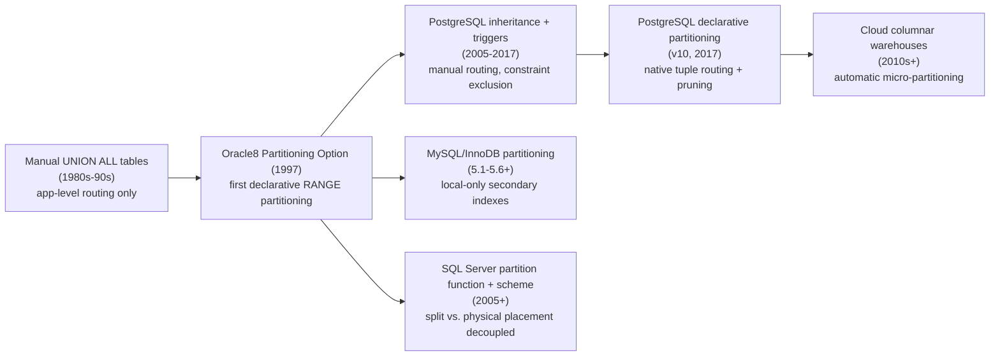

## 3. Why It Exists

A relational table has no upper size limit in principle, but every
whole-table operation an engine performs — a sequential scan, a `VACUUM`
or garbage-collection pass, an index rebuild, a full backup, a bulk
`DELETE` — has a cost that scales with the table's total size, or in the
case of a `DELETE`, with the total size *and* the number of index entries
that must individually be marked removed. Below a few million rows this cost
is invisible; at hundreds of millions or billions of rows, it becomes the
dominant operational problem, independent of whether any single query is
slow. Three recurring, structurally different problems all point to the
same solution:

1. **Retention/lifecycle deletion is disproportionately expensive.** A
   time-series or event-log table typically only needs to *keep* the most
   recent N months of data, but deleting the oldest month with
   `DELETE FROM events WHERE occurred_at < cutoff` against a billion-row
   table means visiting every one of those rows, updating every index that
   references them, and generating a correspondingly enormous volume of
   transaction-log/Write-Ahead-Log (WAL) traffic and dead-tuple cleanup
   work — often taking hours and competing for I/O (Input/Output) with live
   traffic the entire time.
2. **A single query rarely needs the whole table, but a monolithic table
   forces the engine to at least consider all of it.** Most real query
   workloads have a strong temporal or categorical locality — "orders from
   this month," "sessions for this customer," "events from this region" —
   yet without partitioning, every index or scan the optimizer considers
   is built against the *entire* table's data and statistics.
3. **Maintenance operations don't parallelize or isolate well against one
   giant object.** A `VACUUM`/analyze pass, an index rebuild, or a backup
   against one enormous table is one long-running operation contending for
   locks and I/O bandwidth as a single unit; split into partitions, the same
   work becomes many independent, schedulable, individually-interruptible
   units that can run in parallel and be prioritized (the newest, most
   actively-written partition first) rather than as an indivisible whole.

Partitioning exists to convert all three problems from "operate on
everything" into "operate only on the relevant physical piece(s)," without
requiring a second database server, a distributed query layer, or any
change to how the application addresses the table. It buys architects real
headroom on a single node before the harder, more expensive, and more
operationally complex step of sharding across multiple nodes (Section 4.10)
becomes necessary.

## 4. Core Concepts

### 4.1 Horizontal partitioning: splitting rows by a partition key

**Definition.** Horizontal partitioning splits a table's *rows* — not its
columns — across multiple physical partitions, using a designated
**partition key**: one or more columns whose value the engine evaluates for
every row to decide which partition it belongs in. Every partition has the
identical column structure as the logical parent table; what differs
between partitions is which *subset of rows*, by key value, each one holds.

**Mechanism.** At `CREATE TABLE` time (or via a later migration), the table
is declared `PARTITION BY RANGE|LIST|HASH (partition_key)`, and each
partition is created with a rule describing exactly which key values it
accepts — a range boundary, an explicit list of values, or a hash-modulus
bucket (Sections 4.2-4.4 give each its own full treatment). On every insert
or update, the engine's **tuple routing** logic evaluates the partition key
against every partition's rule and places the row in exactly one matching
partition (or raises an error / falls into a default partition if none
matches — Section 4.8 and Section 15). On every query, the same rule set
lets the planner decide, before scanning anything, which partitions could
possibly contain a matching row — this elimination step is **partition
pruning**, taught fully in Section 4.7.

**Decision implications.** The single highest-leverage decision in
partitioning a table is the choice of partition key, and it must be made by
looking at two things simultaneously, not one: (1) what the *dominant query
predicate* filters on (because pruning only helps queries that filter on the
partition key), and (2) what the *write pattern* looks like (because a
partition key that clusters all recent writes into one partition, such as an
ever-increasing timestamp with RANGE, creates a write hotspot — the exact
same physical partition absorbs 100% of insert traffic at any given moment,
even though that is frequently still an acceptable and even desirable
trade-off for time-series data, discussed in Section 4.5).

**Common failure mode.** Choosing a partition key based on what feels like
the table's "natural" identity column (e.g. partitioning a multi-tenant
`orders` table by `order_id`) instead of the column that queries actually
filter on and that maintenance operations actually need to isolate (e.g.
`tenant_id` or `created_at`). A partition key that no query predicate ever
references provides zero pruning benefit — every query still touches every
partition — while still paying the operational overhead of managing many
physical objects.

**Scenario.** An analytics events table receives 50 million rows per day and
must retain exactly 90 days. Partitioning horizontally by `event_date`
(RANGE, one partition per day) means the daily retention job is a single
`DROP TABLE events_2026_01_01` — a metadata operation — instead of a
90-million-row-scanning `DELETE`, and any dashboard query scoped to "last 7
days" prunes to exactly 7 partitions regardless of how many years of
history the table eventually accumulates.

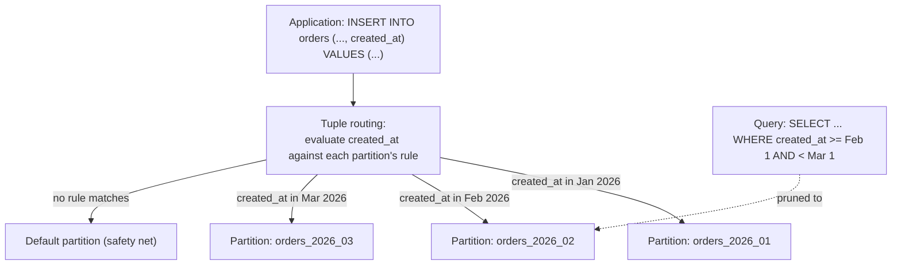

### 4.2 Range partitioning

**Definition.** Range partitioning assigns each partition a contiguous,
non-overlapping span of partition-key values — `FOR VALUES FROM (x) TO (y)`
— most naturally suited to columns with a total order and a
monotonically-advancing dominant value, the canonical example being a
timestamp.

**Mechanism.** The engine stores each partition's `[start, end)` boundary as
metadata. Tuple routing performs a boundary comparison (conceptually a
binary search over sorted boundaries once partition counts grow large) to
find the single partition whose range contains the row's key value. For
queries, any predicate expressible as a comparison against the partition
key (`>=`, `<`, `BETWEEN`, equality) lets the planner compute exactly which
boundary ranges overlap the predicate's range and discard every partition
that provably cannot overlap.

**Decision implications.** Range partitioning is the natural default for
time-series and any append-mostly, time-ordered dataset, precisely because
it aligns three things at once: the dominant query predicate ("recent
data"), the natural write pattern (new rows have the newest timestamp), and
the natural retention/maintenance unit (drop the oldest range). Range
partitioning also composes cleanly with rolling-window maintenance
(Section 4.8) because adding a new future partition and dropping an old one
are both simple, cheap, boundary-only metadata operations.

**Common failure mode.** Under-provisioning future partitions. Because
range partitioning requires an *explicit* partition to exist for every value
that will ever be inserted, a rolling-window job that fails to run (or a
launch date that changes) can leave a gap with no matching partition,
causing either insert failures or — if a `DEFAULT` partition exists —
silent accumulation of unbounded data into a single unpartitioned catch-all,
quietly reintroducing the exact whole-table-scan problem partitioning was
meant to solve for that data (Section 15 covers this scenario in detail).

**Scenario.** [`01_range_partitioned_table.sql`](../code/sql/partitioning-chapter/01_range_partitioned_table.sql)
defines a monthly range-partitioned `orders` table with a `DEFAULT` safety-net
partition, and includes the exact query shape (`created_at >= ... AND
created_at < ...`) that lets the planner prune to a single partition.

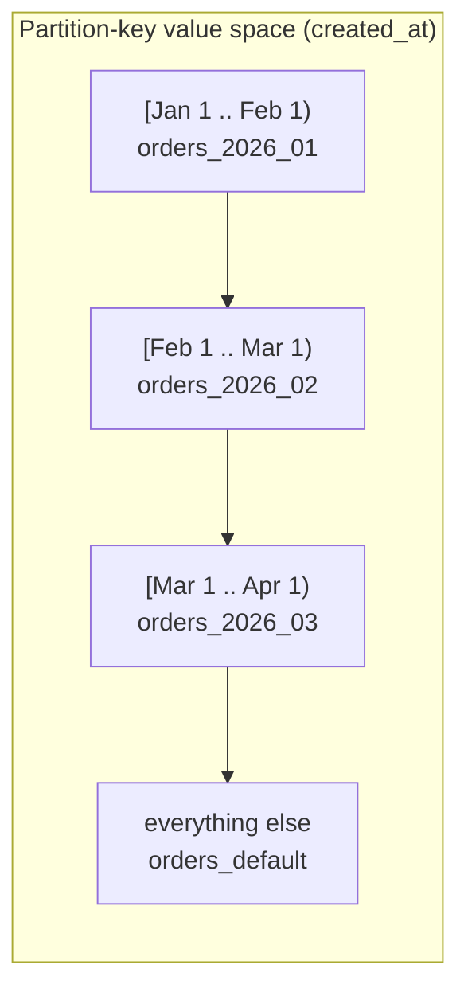

### 4.3 List partitioning

**Definition.** List partitioning assigns each partition an explicit,
enumerated set of discrete key values — `FOR VALUES IN (v1, v2, ...)` —
suited to columns with a small, known, unordered (or not usefully ordered)
domain, such as a region code, a status enum, or a country.

**Mechanism.** Each partition's rule is a membership set rather than a
range. Tuple routing performs a set-membership check against the incoming
row's key value; pruning works the same way in reverse — an equality or
`IN (...)` predicate against the partition key lets the planner compute
which partitions' value sets intersect the predicate at all, discarding the
rest.

**Decision implications.** List partitioning is the right choice precisely
when range partitioning's ordering assumption doesn't apply, but the value
domain is still small and well-known in advance — most commonly when the
partition boundary also needs to align with an *operational* boundary that
has nothing to do with query performance, such as data-residency
requirements (keeping EU customer rows on EU-located storage) or workload
isolation (separating a noisy, high-volume tenant into its own partition).
Unlike range partitioning, there is no natural "oldest partition to drop"
concept — list partitions are typically long-lived, not rotated.

**Common failure mode.** Using list partitioning for a column whose value
domain grows unbounded over time (e.g. partitioning by `customer_id`
directly via `LIST`) — every new distinct value needs its own explicit
partition and DDL change, which does not scale operationally the way hash
partitioning (Section 4.4) does for the same "many discrete values" shape.

**Scenario.** [`02_hash_list_partitioned_tables.sql`](../code/sql/partitioning-chapter/02_hash_list_partitioned_tables.sql)'s
`billing_accounts` table partitions by `region` into `eu`, `us`, and `apac`
buckets specifically so each region's partition's underlying tablespace can
be pinned to storage physically located in that region — a residency
requirement no range or hash key could satisfy as directly.

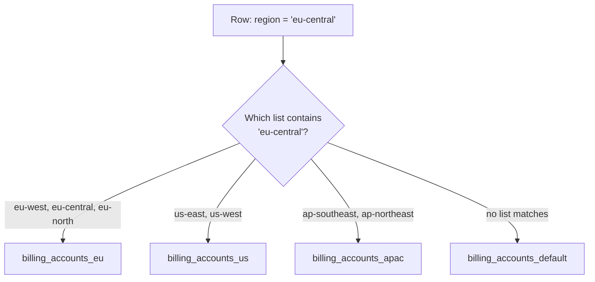

### 4.4 Hash partitioning

**Definition.** Hash partitioning assigns each row to a partition by
applying a hash function to the partition key and mapping the hash's
remainder (modulo the total partition count) to a fixed partition — a
mechanism with no notion of ordering or explicit value enumeration at all.

**Mechanism.** A fixed number of partitions, N, is chosen up front; each
partition claims one `REMAINDER` bucket out of `MODULUS N`. On insert, the
engine computes `hash(partition_key) % N` and routes the row to the
partition owning that remainder. Because a good hash function distributes
essentially any input key uniformly across its output range regardless of
the *actual* distribution of key values, hash partitioning achieves even
storage and write distribution across partitions even when the underlying
key values themselves are skewed (a few very "popular" `customer_id` values
still land in effectively random, evenly-spread buckets).

**Decision implications.** Hash partitioning is the right choice exactly
when (a) there is no natural range or small discrete list to key on, and
(b) the write pattern needs to be spread evenly rather than concentrated
into one hot partition — the mirror image of range partitioning's
timestamp-driven hotspot in Section 4.1. The direct cost of that even
spread is that a query filtering on anything *other* than the exact
partition key (a range on it, or no predicate on it at all) gets **no**
pruning benefit whatsoever, because the hash function deliberately destroys
any notion of value ordering or locality — every partition is equally
likely to contain a match.

**Common failure mode.** Choosing hash partitioning for a table whose
dominant queries are range-based (e.g. "sessions started in the last hour")
rather than point-lookup-based (e.g. "sessions for this exact customer_id"),
which throws away pruning for the queries that matter most while only
gaining an even write/storage distribution the workload may not have
actually needed range partitioning's timestamp-hotspot trade-off to avoid in
the first place.

**Scenario.** [`02_hash_list_partitioned_tables.sql`](../code/sql/partitioning-chapter/02_hash_list_partitioned_tables.sql)'s
`user_sessions` table hash-partitions on `customer_id` into 4 buckets: reads
and writes scoped to one customer (`WHERE customer_id = 12345`) prune to
exactly one partition, while any time-range-only query must scan all four.

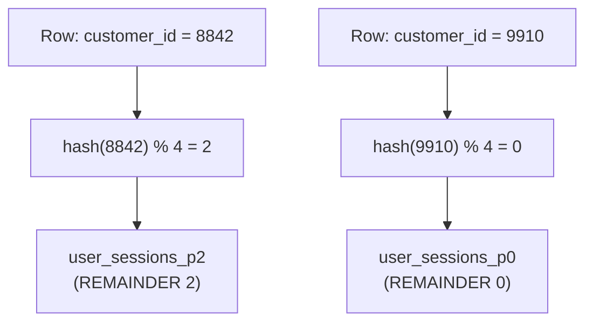

### 4.5 Partition-key selection: the range/list/hash decision and its trade-offs

**Definition.** Partition-key selection is the upfront architectural
decision of which column(s) to partition by and which of the three
strategies (Sections 4.2-4.4) to apply — a decision made once, expensive to
change later, and the single factor that determines whether pruning
actually helps the workload that exists in production.

**Mechanism.** The decision reduces to answering three questions, in order:
(1) *Does the dominant query predicate filter on a column with a natural
order and a rolling/expiring lifecycle?* — if yes, RANGE, almost always on a
timestamp. (2) *Does it filter on a column with a small, known, discrete,
long-lived set of values, especially one tied to an operational or
compliance boundary?* — if yes, LIST. (3) *Does it filter on a
high-cardinality, unordered key by equality, with a write pattern that would
otherwise hotspot?* — if yes, HASH. These are not mutually exclusive:
**composite (sub-)partitioning** applies a second strategy inside each
top-level partition (e.g. RANGE by month, then HASH by `customer_id` within
each month) when a single key alone does not capture both the retention
need and the distribution need — covered further in Section 7's patterns.

**Decision implications.** The cost of getting this decision wrong is not
symmetrical with the cost of *not* partitioning at all: an unpartitioned
table degrades gracefully (it is simply slow at scale), while a table
partitioned on the wrong key actively costs the operational overhead of
managing many physical objects (per-partition statistics, indexes, autovacuum
cycles) **while delivering none of the pruning benefit** that overhead was
supposed to pay for — the worst of both worlds. This is why the key must be
chosen from the query workload and retention policy first, and only
afterward checked against write-distribution concerns, not the reverse.

**Common failure mode.** Treating this as a purely technical decision made
by whoever is closest to the schema, rather than a decision that requires
looking at real query logs and the actual retention/compliance policy
first — leading to a partition key that matches nobody's actual `WHERE`
clause.

**Scenario.** A logging platform initially partitions its `logs` table by
`service_name` (LIST) because that felt like the natural grouping, but 90%
of real queries filter by a time range across *all* services
("show errors across the fleet in the last hour"); after examining query
logs, the team re-keys to RANGE on `logged_at` with `service_name` as a
non-partition-key indexed column instead, which both restores pruning for
the actual dominant query and aligns with the retention policy (drop
old days).

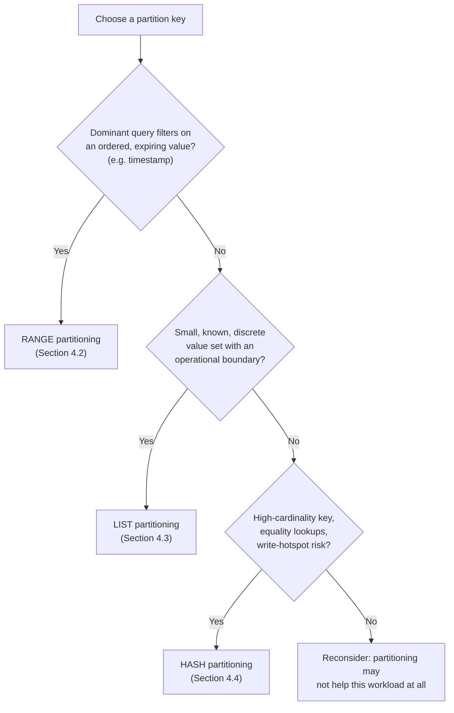

### 4.6 Vertical partitioning: splitting columns, not rows

**Definition.** Vertical partitioning splits a single logical entity's
*columns* across multiple physical tables (or, in some engines, separate
storage regions of the same table), rather than splitting its rows. Every
resulting table typically shares the same primary key so rows can be
rejoined when needed, but each holds a different subset of the original
columns.

**Mechanism.** A wide table is split by access pattern: columns that are
read on nearly every query (a "hot" set — e.g. `user_id`, `username`,
`status`) stay in a narrow, frequently-scanned table, while columns that are
large, rarely accessed, or accessed by a different set of queries (a "cold"
set — e.g. a `biography` text blob, a JSON `preferences` document, or
infrequently-read audit columns) move to a separate table joined in only
when actually needed. Because relational storage engines typically read
data a full row (or full page of rows) at a time, keeping cold, wide columns
out of the hot table directly increases how many *hot* rows fit per page,
improving cache hit rates and reducing I/O for the queries that run
constantly.

**Decision implications.** Vertical partitioning is a *row-width* lever, not
a *row-count* lever — it complements horizontal partitioning rather than
competing with it (a table can be both horizontally partitioned by
`created_at` and, within each partition, vertically split into hot/cold
column tables). It is best applied to columns that are genuinely rarely
read together with the hot set, not applied reflexively to every large
column, since every vertical split adds a join cost for the (still
sometimes needed) case of reading both halves together.

**Common failure mode.** Confusing vertical partitioning with normalization
([Normalization](CH01_Normalization.md)) or with a star schema's
fact/dimension split ([Denormalization](CH02_Denormalization.md) Section
4.5) — those decisions are driven by data redundancy and analytical-query
shape respectively, while vertical partitioning is driven purely by
*physical row width and access frequency* for what is still, conceptually,
one entity's attributes.

**Scenario.** A `users` table with 40 columns, including a 20 KB
`profile_photo_metadata` JSON blob read only when rendering a full profile
page, is split into `users_core` (10 hot columns, read on every
authentication check) and `users_profile_extended` (30 cold columns,
including the blob, read only on the profile page) — the authentication
hot-path query now scans a table roughly 1/8th the average row width,
fitting far more rows into each cached page.

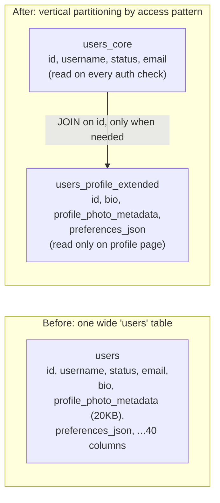

### 4.7 Partition pruning: eliminating partitions before the optimizer's search runs

**Definition.** Partition pruning is the planner-time (and, for
parameterized queries, sometimes execution-time) elimination of partitions
that provably cannot contain any row matching a query's predicates, so that
neither the optimizer's cost-based search nor the executor ever considers
them at all.

**Mechanism.** Recall from [Query Optimizers](CH04_Query_Optimizers.md#4-core-concepts)
that a query passes through parsing, binding, logical rewrite, and then a
cost-based physical optimization pass that searches join orders and access
paths. Pruning is a **rewrite-time** step that runs *before* that cost-based
search: for each partitioned table referenced in the query, the planner
compares the query's constant (or, for parameterized statements, sometimes
still-unbound) predicates on the partition key against every partition's
stored boundary/list/hash rule, and removes any partition whose rule cannot
possibly overlap the predicate from the candidate set entirely — as if the
query had been written against a smaller table with fewer partitions to
begin with. Everything downstream (access-path selection, join-order
search, cost estimation) then only ever sees the surviving partitions,
which is exactly why pruning is best understood as *shrinking the input to
Query Optimizers' cost-based process*, not as a separate cost-based decision
of its own — it is closer to constant folding and predicate pushdown
(the logical rewrite pass) than it is to join-order search.

**Decision implications.** Pruning only works when the predicate is
**sargable** against the partition key: a direct comparison (`=`, `<`, `>`,
`BETWEEN`, `IN`) between the partition-key column and a constant (or a
bound parameter, for RANGE/LIST — HASH pruning generally requires an exact
equality). Wrapping the partition-key column in a function or expression
(`WHERE date_trunc('month', created_at) = ...`, `WHERE created_at::date =
...`) defeats pruning, because the planner cannot generally prove which
partitions the *output* of an arbitrary function call over the column could
have come from without evaluating it per row — which is exactly the work
pruning exists to avoid. This means schema design and query-writing
discipline are just as important as picking the right key in the first
place: an architect must design the query patterns applications are allowed
to write, not just the partition boundaries.

**Common failure mode.** Verifying pruning once, at design time, and never
again — a later refactor that introduces a function wrapper around the
partition-key column in a hot query path (often introduced innocently, e.g.
switching a comparison to a timezone-converting expression) silently
regresses every affected query back to full-partition-set scanning, with no
error, only a latency and I/O regression that surfaces later as a
production incident.

**Scenario.** [`03_partition_pruning_explain.sql`](../code/sql/partitioning-chapter/03_partition_pruning_explain.sql)
shows both cases against the `orders` table from Section 4.2: a sargable
`created_at >= ... AND created_at < ...` predicate prunes the `Append` plan
node down to a single partition's `Seq Scan`, while an equivalent-result but
function-wrapped `date_trunc('month', created_at) = ...` predicate produces
an `Append` over every partition — the exact same rows returned, at a
fraction of the cost difference the query author likely never noticed until
the table grew.

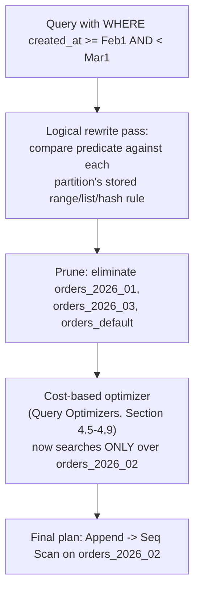

### 4.8 Partition maintenance: rolling windows for time-series retention

**Definition.** Partition maintenance is the ongoing operational task of
adding new partitions ahead of need and removing (dropping, or
detaching-then-archiving) partitions that have aged out of a retention
policy — most commonly implemented as a **rolling window**: at any moment,
partitions exist for the current period plus a lead-time buffer of future
periods, and any partition older than the retention limit is removed.

**Mechanism.** A scheduled job runs periodically (daily or monthly, matched
to the partition granularity) and performs two idempotent steps: (1) check
whether partitions exist for the current period through N periods in the
future, creating any that are missing (`CREATE TABLE ... PARTITION OF ...
FOR VALUES FROM (...) TO (...)`); (2) enumerate existing partitions,
compute each one's upper boundary, and for any partition entirely below the
retention cutoff, remove it — either an outright `DROP TABLE` (data is
genuinely disposable) or a `DETACH PARTITION` followed by an export to cold
storage (data must be archived, not destroyed). Both `DROP` and `DETACH` are
metadata-only operations against the partitioned parent: the engine simply
stops routing to and unions in that physical relation, without visiting a
single row.

**Decision implications.** This is the mechanism that converts the
"disproportionately expensive retention delete" problem from Section 3 into
a near-free operation, but only if the lead-time buffer is generous enough
that the job's own downtime, delay, or failure cannot cause a missing
partition at insert time (Section 4.2's common failure mode) — the buffer
should be sized against the job's own Service Level Agreement (SLA), not
just its typical run time. Whether to `DROP` or `DETACH`-and-archive is a
compliance and cost question, not a technical one: object storage is
typically far cheaper than live database storage, making detach-and-archive
the default for anything with a legal retention requirement beyond the
"hot" partitioned table's window.

**Common failure mode.** Running the maintenance job manually or via a
one-off script that isn't monitored — the job fails silently (a permissions
change, a schema drift, a missed deploy), partitions stop being created, and
the failure is only discovered when inserts start erroring or falling into
a `DEFAULT` partition weeks later, by which point the default partition may
itself have grown large enough to reintroduce the original whole-table
problem.

**Scenario.** [`01_rolling_window_partition_maintenance.py`](../code/python/partitioning-chapter/01_rolling_window_partition_maintenance.py)
implements exactly this pattern against the `orders` table: it idempotently
creates the current month's partition plus a 3-month lead buffer, and drops
any monthly partition whose entire range has aged past a 12-month retention
window — intended to run nightly, with its `created`/`dropped` output lines
feeding an observability pipeline (Section 14) so a silent failure to create
a future partition is caught long before the buffer is exhausted.

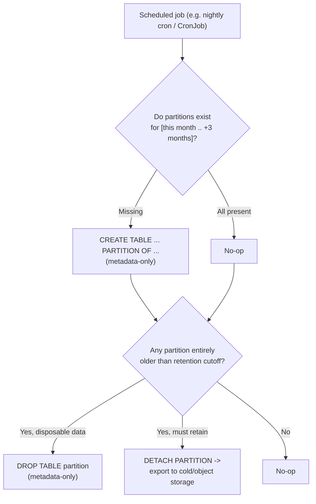

### 4.9 Local vs. global indexes on partitioned tables

**Definition.** Once a table is partitioned, an index built "on it" can mean
one of two structurally different things: a **local index**, which is a
separate, independent index structure built per partition (so N partitions
mean N physically distinct B+tree/hash index structures — recap
[Indexes](CH03_Indexes.md#42-b-treebtree-internals--why-btree-specifically-for-disk-backed-indexes)
for the underlying data structure), or a **global index**, a single index
structure spanning rows from every partition as if the table were not
partitioned at all for indexing purposes.

**Mechanism.** With a local index, a query whose predicate matches the
partition key prunes first (Section 4.7) and then only ever consults *that*
partition's local index — an index lookup that stays exactly as cheap as an
unpartitioned table's index lookup would be, since it's operating over a
much smaller row set. But a query that does *not* filter on the partition
key, and instead filters only on a different column that has a local
index, must probe every single partition's copy of that local index
separately and merge the results (an "Append" over N index scans, mirroring
the pruning failure case in Section 4.7's diagram) — there is no single
structure it can consult once. A global index, where supported, avoids that
per-partition fan-out entirely at the cost of the index maintenance itself
no longer benefiting from partition-scoped operations (dropping a partition
that a global index still references requires updating the global index,
not just discarding it wholesale the way dropping a partition discards its
local indexes for free).

**Decision implications.** This is a genuine engine-dependent trade-off an
architect must check explicitly rather than assume: PostgreSQL's declarative
partitioning supports only local indexes (each partition has its own,
though a "partitioned index" defined on the parent is automatically created
and kept in sync on every child, which is convenient DDL but still N
physically separate structures underneath); MySQL/InnoDB historically
supported only local secondary indexes as well; other engines (e.g. Oracle's
"global partitioned index" option) offer true global index structures at
the cost of that maintenance coupling. The practical consequence: a
partitioned table's non-partition-key indexes are only as fast as "prune,
then probe one local index" for queries aligned with the partition key, and
degrade toward "probe every partition's local index" for queries that
aren't — reinforcing, from a different angle, why partition-key selection
(Section 4.5) has to be driven by the *actual* dominant query shape.

**Common failure mode.** Assuming a secondary (non-partition-key) index
behaves identically on a partitioned table as it did before partitioning was
introduced, and being surprised when a previously-fast lookup by, say,
`email` on the `users_core` table from Section 4.6 (now partitioned by
`signup_month`) becomes proportionally slower as partition count grows,
because every partition's local `email` index now has to be probed.

**Scenario.** The `orders` table from Section 4.2 has a local index on
`customer_id` (declared once on the parent, materialized as one index per
monthly partition). A query for "this customer's most recent 10 orders"
without a date filter must fan out across every month's local `customer_id`
index; adding a `created_at >= now() - interval '3 months'` predicate to the
same query lets pruning (Section 4.7) restrict that fan-out to only the
last 3 partitions' local indexes.

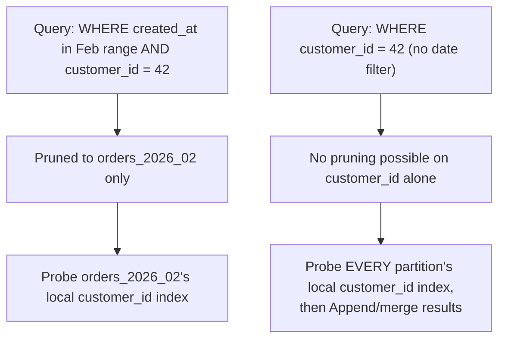

### 4.10 The partitioning-vs-sharding boundary

**Definition.** Partitioning (this chapter) splits one dataset into smaller
physical pieces **that all still live inside a single database instance**,
sharing that instance's CPU, memory, and disk. Sharding
([Sharding](CH06_Sharding.md)) is the same underlying idea of key-based
splitting — the same range/list/hash strategies from Sections 4.2-4.4 —
applied **across multiple independent database nodes/servers**, each with
its own CPU, memory, and disk, so that total capacity and throughput scale
by adding machines rather than being fixed by whatever one machine can do.

**Mechanism.** Structurally, the two are the same key-based-routing idea at
different layers: partitioning's routing happens *inside* the storage
engine of one process, using in-process metadata; sharding's routing happens
*in front of* several entirely separate database processes (each with its
own copy of the engine, its own disks, potentially its own replicas), via a
routing layer that is either a smart client, a proxy, or a coordinator
service, and that routing layer must additionally solve problems that never
arise inside a single instance: which network node to send each query to,
how to combine results across nodes for a query that spans shards, how to
rebalance data when a node is added or removed, and how (or whether) to
support a transaction spanning more than one node.

**Decision implications.** An architect should reach for partitioning first
whenever a single node's *storage size or maintenance-operation cost* is the
pain point but the node's CPU/memory/disk *throughput* still has headroom —
partitioning solves that with far less operational complexity, no new
network hop, and no distributed-systems failure modes. Sharding becomes
necessary only when the single node itself is the throughput ceiling: write
volume, working-set memory pressure, or total storage genuinely exceeds what
one machine (or one primary/replica set) can serve, no matter how the data
is organized on it. Because both use the same key-selection reasoning,
Sharding is written to recap Sections 4.2, 4.3, 4.4, and 4.5 of this
chapter rather than re-deriving range/list/hash trade-offs from scratch —
it adds the distributed routing, rebalancing, and cross-shard query
concerns on top of a partition-key decision this chapter already teaches
how to make.

**Common failure mode.** Reaching for sharding as a default "scale it up"
move before confirming that partitioning (plus normal vertical scaling of
the single node) has actually been exhausted — sharding trades a
well-understood single-node operational model for a meaningfully harder
distributed one, and that trade should be made deliberately, backed by an
actual throughput or capacity ceiling, not preemptively.

**Scenario.** A single PostgreSQL instance hosting a range-partitioned
`orders` table (Section 4.2) handles retention and query-latency
comfortably for years as data volume grows, because partitioning kept
per-operation costs bounded — but write throughput eventually saturates the
instance's disk I/O ceiling during peak sales events regardless of how the
table is partitioned internally, at which point the team evaluates sharding
`orders` by `tenant_id` across multiple database nodes, reusing this
chapter's hash-partitioning reasoning (Section 4.4) as the starting point
for choosing the shard key.

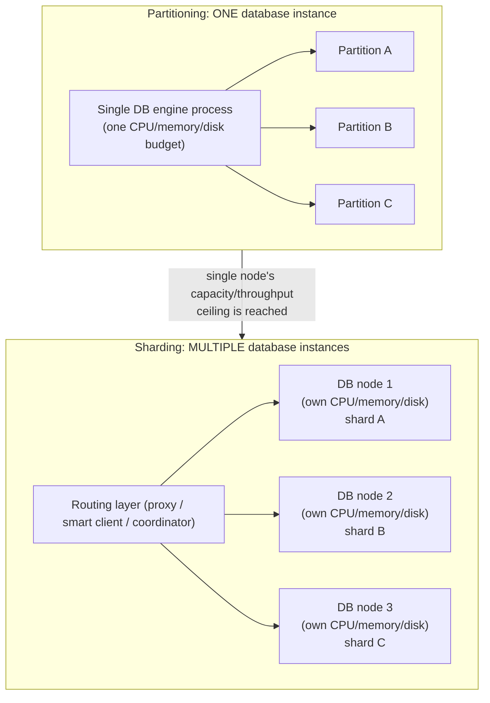

## 5. Internal Working

Sections 4.1-4.10 established what each partitioning strategy does and why
it's chosen; this section traces the actual internal mechanics a single
database instance executes to make that behavior real, from the catalog
metadata up through a query's full execution.

**Catalog representation.** A partitioned table is represented internally
as a parent relation carrying no storage of its own (in PostgreSQL, its
`relkind` is distinct from an ordinary table specifically to mark it as
partition-only routing metadata) plus a set of child relations, each a
genuinely ordinary physical table underneath, linked to the parent via
catalog entries recording its partition bound (a range, a list, or a hash
modulus/remainder). Table inheritance-style engines (MySQL, and PostgreSQL's
pre-declarative approach) instead represent this via actual inheritance
metadata plus `CHECK` constraints the planner must independently reason
about; declarative partitioning stores the bound as structured, engine-native
metadata the planner can consult directly and cheaply, which is the core
reason declarative pruning (Section 4.7) is more reliable than
constraint-exclusion-based pruning ever was.

**Tuple routing on write.** When a row is inserted (or, for an `UPDATE` that
changes the partition-key value, effectively re-routed), the engine
evaluates the row's partition-key value against the ordered/hashed set of
partition bounds and identifies the single owning partition — for RANGE,
conceptually a binary search over sorted boundaries; for LIST, a
set-membership check; for HASH, a direct `hash(value) % modulus`
computation. The insert then proceeds exactly as an ordinary insert into
that one physical child table, including firing that partition's own
triggers, constraints, and index-maintenance work — the parent itself never
stores a row.

**Query-time expansion, pruning, and partition-wise operations.** When a
query references the parent table, the planner's rewrite stage expands it
into an `Append` (or `MergeAppend`, when a global order such as an `ORDER
BY` on the partition key can be satisfied by reading each partition's
already-sorted local index and merging, rather than reading everything and
sorting afterward) over its current set of partitions, then immediately
applies pruning (Section 4.7) to shrink that set before the cost-based
search (owned by [Query Optimizers](CH04_Query_Optimizers.md)) ever runs
over what remains. A further internal optimization, **partition-wise
join**, becomes available when two partitioned tables share compatible
partitioning (same strategy, same bounds, same key) — the engine can join
matching partition-pairs independently (partition 1 of `orders` joined only
against partition 1 of a similarly-partitioned `order_items`, and so on)
instead of joining the full, unpartitioned cross-product logically implied
by an ordinary join, which both reduces the working set per join operation
and enables trivial per-partition parallelism.

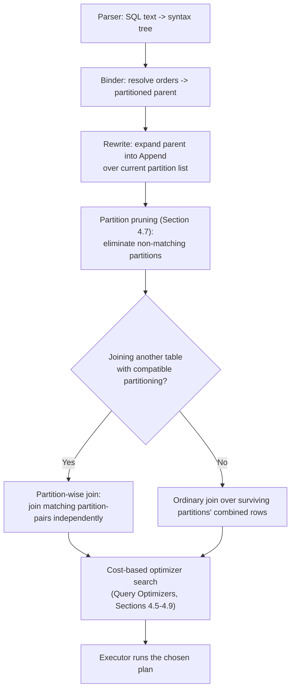

**Index maintenance implication.** Because each local index (Section 4.9)
is a fully independent structure per partition, index maintenance during a
write only ever updates the *one* local index belonging to the row's owning
partition — an insert into `orders_2026_02` never touches
`orders_2026_01`'s index pages at all. This is the same locality principle
that makes partition-scoped `VACUUM`/analyze and index-rebuild operations
cheaper and more parallelizable than their whole-table equivalents (Section
11), and it is a direct structural consequence of tuple routing being
computed once, at write time, rather than re-derived per operation.

## 6. Design Principles

- **Let the dominant query shape and the retention policy choose the key,
  in that order** — not the schema's "natural" identity column (Section
  4.5). If those two disagree meaningfully, composite/sub-partitioning
  (RANGE then HASH, for example) is usually a better answer than
  compromising on either.
- **Design for pruning, not just for partitioning.** A partitioned table
  whose queries don't filter sargably on the partition key (Section 4.7)
  gets none of partitioning's query-performance benefit — treat "does this
  predicate prune?" as a mandatory code-review question for any new query
  against a partitioned table, verified with `EXPLAIN`.
- **Provision partition maintenance with headroom, not just correctness.**
  A rolling-window job (Section 4.8) should create partitions far enough in
  advance that its own downtime cannot cause a missing-partition failure,
  and its execution should be observable (Section 14), not a silent cron
  entry.
- **Keep partition count in a sane operational range.** Too few partitions
  under-delivers pruning and maintenance benefits; too many (tens of
  thousands) imposes real planner and catalog overhead per query, since
  every partition's metadata must at minimum be consulted during pruning —
  Section 11 quantifies this trade-off.
- **Treat vertical and horizontal partitioning as independent, composable
  levers**, not alternatives — a table can (and, at genuine scale, often
  should) be both horizontally partitioned for row-count/retention reasons
  and vertically split for row-width/access-pattern reasons (Section 4.6).
- **Design the schema so a future move to sharding is additive, not a
  rewrite.** Choosing a partition key today that would also make sense as a
  shard key tomorrow (Section 4.10) — most commonly `tenant_id` for
  multi-tenant systems — means the eventual jump to Sharding reuses this
  chapter's key-selection work rather than discarding it.

## 7. Architecture Patterns

**Time-based rolling partitions.** The pattern behind Sections 4.2 and 4.8
combined: RANGE-partition by a timestamp at a granularity matched to the
retention policy (daily for high-volume event streams with short retention,
monthly for lower-volume data retained for years), automate partition
creation/removal, and let the retention policy itself define the
maintenance schedule.

**Multi-tenant partitioning by tenant.** LIST-partition (a known, bounded
tenant set) or HASH-partition (a large, growing tenant set) by `tenant_id`,
so that per-tenant maintenance, per-tenant data-residency placement, and
"noisy neighbor" isolation (an oversized tenant's data and query load
mostly contained to its own partition(s)) are all available without
requiring a separate database per tenant. This pattern is also the most
common on-ramp to Sharding (Section 4.10), since a `tenant_id` partition key
generalizes directly into a `tenant_id` shard key.

**Composite (sub-)partitioning.** Apply a second partitioning strategy
*inside* each top-level partition — most commonly RANGE at the top level (for
retention) with HASH beneath it (for even distribution within each time
window), addressing both the retention need and the write-hotspot concern
from Section 4.5 simultaneously, at the cost of managing a two-dimensional
grid of physical partitions rather than a single list.

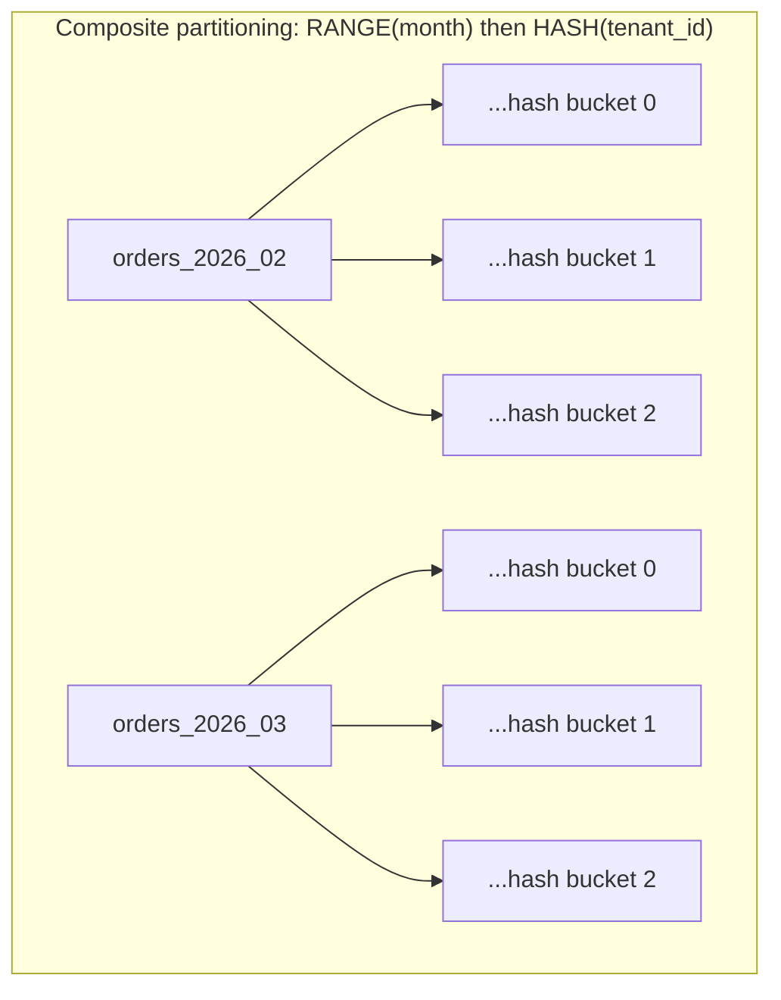

**Storage tiering behind partitioning.** Map partitions to different
physical storage tiers by age or access temperature — the newest, most
actively-queried partitions on fast local SSD (Solid-State Drive) storage,
older partitions on cheaper, slower storage (or moved out of the live
database entirely into object storage via detach-and-archive, Section 4.8).
This directly reuses SQL Server's historical partition-function/
partition-scheme separation (Section 2): the logical split (which rows go
where) is a wholly independent decision from the physical placement
decision (which storage tier a given partition's files live on).

**Vertical partitioning for hot/cold column separation.** As taught in
Section 4.6, applied architecturally: identify a genuinely hot column
subset via real access-frequency data (not guesswork), and split it into
its own narrow table joined in only on demand — commonly paired with the
storage-tiering pattern above, placing the cold-column table on cheaper
storage as well.

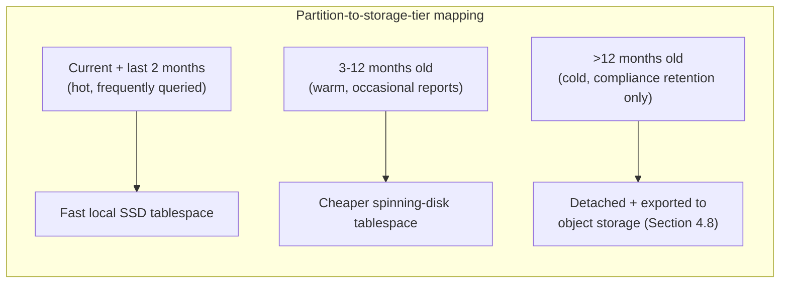

## 8. Production Architecture

A production partitioning deployment is more than the `PARTITION BY` clause
itself — it is a small system of its own, sitting alongside the database:
the partitioned table and its per-partition local indexes (Section 4.9);
storage-tier placement per partition (Section 7); a scheduled, monitored
maintenance job (Section 4.8) that owns partition creation/removal as its
sole responsibility, ideally decoupled from application deploys so a schema
rollback never accidentally deletes a maintenance cron entry; and an
observability layer (Section 14) watching partition count, per-partition
size, pruning effectiveness, and the maintenance job's own success/failure —
because a partitioning strategy that silently stops working (Section 15)
degrades performance gradually enough that it is easy to miss without
dedicated monitoring.

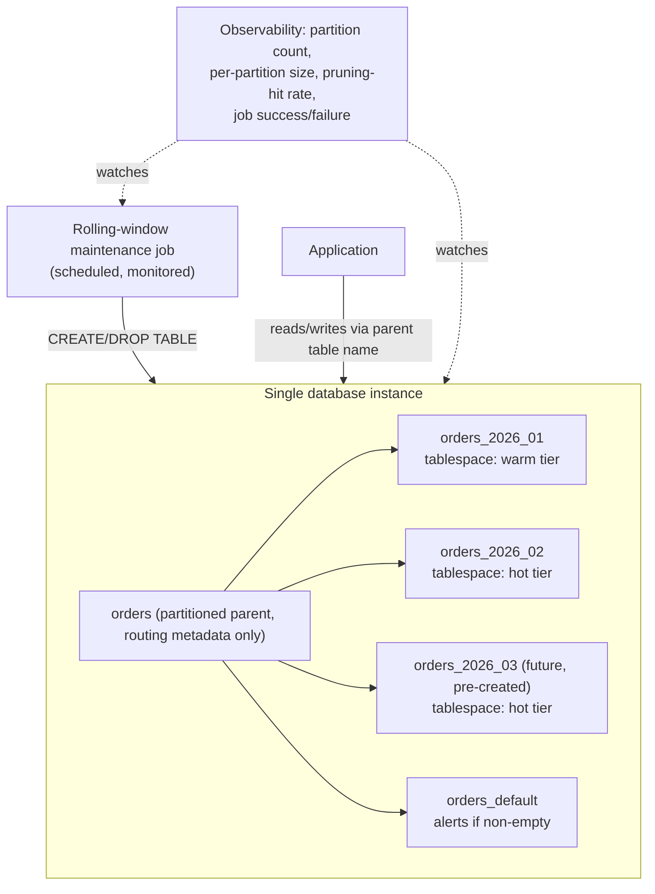

## 9. Implementation

Introducing partitioning to an existing, already-populated table requires a
migration path, since most engines do not support altering an ordinary
table into a partitioned one in place:

1. **Design and validate the partition key against real query logs and the
   retention policy first** (Sections 4.5, 6) — this is the one decision
   expensive to reverse later.
2. **Create the new partitioned parent table under a temporary name**,
   with the same columns, constraints, and (for PostgreSQL) the partition
   key included in any `PRIMARY KEY`/`UNIQUE` constraint (a requirement of
   declarative partitioning, since those constraints are enforced per
   partition, not globally).
3. **Create the initial set of partitions**, including a generous lead-time
   buffer of future partitions and a `DEFAULT` safety-net partition
   (Sections 4.2, 4.8).
4. **Backfill historical data.** For a table small enough to tolerate a
   maintenance window, a straightforward `INSERT INTO new_table SELECT *
   FROM old_table` suffices; for a large, continuously-written table, the
   standard technique is to create each historical partition as an
   *ordinary* table first, bulk-load it, validate its data matches the
   intended partition bound, and then use `ATTACH PARTITION` — which
   validates the bound (optionally skippable with a pre-verified `CHECK`
   constraint to avoid a full-table scan at attach time) and is otherwise a
   fast metadata operation — rather than a row-by-row copy into an
   already-partitioned target.
5. **Cut writes over** inside a brief transaction or via a blue/green
   rename (rename `old_table` to `orders_legacy`, rename the new partitioned
   table to `orders`), verifying the application's `PRIMARY KEY`/`UNIQUE`
   assumptions still hold under the partition-inclusive constraint from step
   2.
6. **Verify pruning end-to-end** against the application's actual query
   patterns with `EXPLAIN` (Section 4.7) before declaring the migration
   complete — a partitioning migration that doesn't verify pruning has only
   proven the data moved, not that it's faster.
7. **Turn on the maintenance job** (Section 4.8) from day one, monitored
   from day one (Section 14), not as a follow-up task.

## 10. Complete Code Examples

Runnable examples live under
[code/sql/partitioning-chapter/](../code/sql/partitioning-chapter/) and
[code/python/partitioning-chapter/](../code/python/partitioning-chapter/).

1. **[01_range_partitioned_table.sql](../code/sql/partitioning-chapter/01_range_partitioned_table.sql)**
   — a monthly RANGE-partitioned `orders` table (PostgreSQL declarative
   partitioning): parent table, three monthly child partitions, a `DEFAULT`
   safety-net partition, and parent-level index declarations that
   automatically materialize as local per-partition indexes (Section 4.9).
2. **[02_hash_list_partitioned_tables.sql](../code/sql/partitioning-chapter/02_hash_list_partitioned_tables.sql)**
   — a HASH-partitioned `user_sessions` table (4 even buckets by
   `customer_id`) alongside a LIST-partitioned `billing_accounts` table
   (region-based, aligned to a data-residency boundary), directly
   contrasting Sections 4.3 and 4.4 against each other and against Example
   1's RANGE strategy.
3. **[03_partition_pruning_explain.sql](../code/sql/partitioning-chapter/03_partition_pruning_explain.sql)**
   — annotated `EXPLAIN` output for three cases against Example 1's table: a
   sargable predicate that prunes to one partition, a function-wrapped
   predicate that defeats pruning entirely (Section 4.7's common failure
   mode reproduced concretely), and an unfiltered aggregate query that must
   legitimately scan every partition.
4. **[01_rolling_window_partition_maintenance.py](../code/python/partitioning-chapter/01_rolling_window_partition_maintenance.py)**
   — an idempotent Python maintenance script implementing Section 4.8's
   rolling-window pattern against Example 1's table: creates missing future
   partitions with a configurable lead-time buffer, and drops (or, in a
   compliance-driven variant, would detach-and-archive) partitions that have
   aged past a configurable retention window.

## 11. Performance

Partitioning's performance story has two distinct halves that are easy to
conflate. **Read performance** improves when, and only when, pruning
(Section 4.7) actually engages: a query that used to scan (or index-probe
into) a billion-row table now scans only the millions of rows in the
surviving partition(s), which also means its working set is far more likely
to fit in the buffer cache, indirectly improving *every* query touching that
partition, not just the one being measured. **Write performance** depends on
the strategy: RANGE partitioning on an ever-increasing timestamp
concentrates all current writes into the single newest partition (a
deliberate, usually acceptable, trade-off — that partition's indexes and
pages are the ones staying hot in cache anyway), while HASH partitioning
spreads writes evenly but forfeits pruning for anything but exact-key
lookups (Section 4.4). **Maintenance-operation performance** is where the
gain is least ambiguous: a `VACUUM`/analyze pass, a backup, or an index
rebuild scoped to one partition is proportionally cheaper and can run in
parallel with the equivalent operation on a different partition, converting
one long serialized maintenance window into many short, independently
schedulable ones. The offsetting cost, real but usually far smaller in
practice, is **planning overhead**: every query against a partitioned table
pays a pruning evaluation cost proportional to partition count before
execution even starts, which is why partition count belongs in the "sane
range" design principle (Section 6) rather than being maximized — a table
split into 50,000 tiny partitions can make planning itself measurably
slower even though execution against the pruned result is fast.

## 12. Scalability

Partitioning, by itself, adds **zero** additional CPU, memory, or disk
capacity to a system — it is a single-node organizational technique, a fact
worth restating plainly given how often "we partitioned it" is informally
described as "we scaled it." What partitioning actually buys is *headroom*:
by keeping whole-table operations bounded and keeping each query's working
set small relative to the growing total, it delays the point at which a
single node's resources become the binding constraint, often by a
substantial margin — years, in many production systems — compared to an
equivalent unpartitioned table. When that single-node ceiling genuinely is
reached (write throughput, working-set memory, or total storage exceeds
what one machine can serve, per Section 4.10's decision criteria), true
horizontal scalability requires moving to [Sharding](CH06_Sharding.md),
which adds nodes rather than reorganizing data within one. Vertical
partitioning (Section 4.6) contributes to scalability indirectly, by
shrinking the hot working set's row width, which extends how much of the
frequently-accessed data fits in memory before storage I/O becomes the
bottleneck — a second, independent way to buy headroom on a single node
before sharding is needed.

## 13. Security

Partitioning intersects security in three concrete ways. First, **access
control granularity**: some engines allow row-level security policies or
even distinct grants scoped per partition (rather than only per logical
table), which can be combined with the multi-tenant LIST-partitioning
pattern (Section 7) to add a defense-in-depth layer beneath application-level
tenant isolation — though partitioning must never be treated as *itself* a
security boundary, since a misconfigured query without a `WHERE tenant_id =
...` predicate can still legitimately read across all partitions through
the parent table. Second, **storage-level encryption and residency
granularity**: mapping partitions to specific tablespaces (Section 7) allows
per-partition-tier encryption-at-rest configuration and, for LIST
partitioning by region, genuine physical data-residency compliance (EU
customer data's partition living on storage physically located and
encrypted per EU requirements) that a single undivided table cannot express.
Third, **the `DEFAULT` partition as a data-classification blind spot**: rows
that fall into a `DEFAULT` partition (Section 4.2's failure mode) bypass
whatever per-partition placement or access policy the explicit partitions
were designed to enforce, so a non-empty `DEFAULT` partition should be
treated as a security and compliance signal, not merely an operational one.

## 14. Observability

Instrument partitioning at three levels. **Partition inventory**: current
partition count, per-partition row count and physical size, and — critically
— whether the `DEFAULT` partition (if one exists) is empty, since any row
count there signals both an operational gap (Section 4.2) and a potential
compliance gap (Section 13). **Query-level pruning effectiveness**: sample
`EXPLAIN` output (or an engine's plan-cache statistics view, where available)
for the workload's hot queries periodically, watching for a query that used
to prune to one or two partitions silently regressing to scanning all of
them — the exact regression Section 4.7's common failure mode describes,
made visible before it becomes a latency incident rather than after.
**Maintenance-job health**: the rolling-window job's own success/failure,
last-run timestamp, and the list of partitions it created or dropped each
run (exactly the `created`/`dropped` output the code example in Section 10
already logs) — feeding an alert if the job hasn't successfully run within,
say, twice its expected interval, which is the single highest-leverage
observability signal for preventing Section 15's most common failure
scenario.

## 15. Failure Scenarios

- **Rolling-window drift.** The maintenance job silently stops running
  (permission change, deploy that removed the cron entry, an unhandled
  exception); the lead-time buffer (Section 4.8) is consumed over days or
  weeks, and once exhausted, inserts either error outright or silently
  accumulate in a `DEFAULT` partition, reintroducing the exact whole-table
  problem partitioning existed to solve, undetected until that partition is
  already large.
- **Pruning silently defeated by a query regression.** A refactor
  introduces a function wrapper or an implicit type cast around the
  partition-key column in a hot query (Section 4.7); the query still
  returns correct results, so no test fails, but every partition is now
  scanned instead of one — a pure performance regression with no
  correctness signal to catch it, surfacing only as a latency or load
  incident.
- **Partition-count blowup.** An overly fine-grained partition key (e.g.
  partitioning by `order_id` directly, or by day for a genuinely low-volume
  table) accumulates tens of thousands of partitions over time; planning
  overhead (Section 11) grows noticeably even though execution against any
  individual pruned partition stays fast, and catalog-level operations
  (schema introspection, `pg_dump`, replication of DDL) slow down across the
  board.
- **Hash-key skew despite hashing.** A HASH-partitioned table (Section 4.4)
  assumed even distribution, but one key value (e.g. a shared "system"
  `customer_id` used by internal tooling) accounts for a disproportionate
  fraction of all rows — hashing evenly distributes *distinct* key values
  across buckets, but cannot fix an underlying access pattern where one key
  value's *volume* dwarfs every other's, so that one partition still ends up
  hot regardless of the hash function's fairness.
- **Constraint violation at partition boundary edges.** An off-by-one error
  in a RANGE partition's boundary (an inclusive/exclusive mismatch between
  the maintenance script's computed boundaries and the engine's actual `FROM
  ... TO ...` semantics, which are always `[inclusive, exclusive)`) causes a
  narrow band of rows — typically exactly midnight on a month boundary — to
  be rejected or misrouted, usually discovered only when a customer reports
  a "missing" row that in fact landed in an unexpected partition or was
  rejected at insert time.

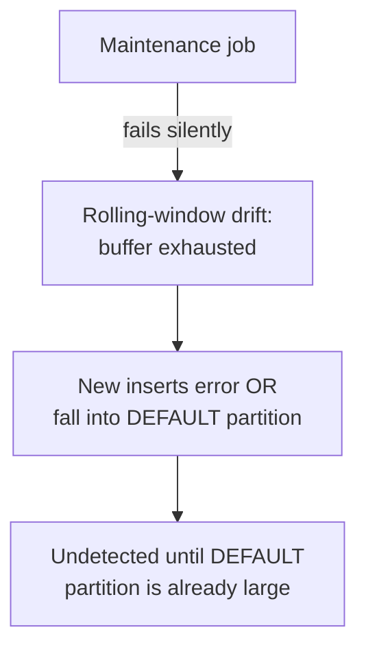

## 16. Testing

- **Pruning regression tests in CI**: run `EXPLAIN` against the workload's
  known-hot query shapes and assert the resulting plan references only the
  expected partition(s) — this catches Section 15's "pruning silently
  defeated" failure mode at merge time rather than in production, and is
  the single most valuable automated test this chapter's material enables.
- **Maintenance-job idempotency and dry-run tests**: run the rolling-window
  script (Section 10's Example 4) twice in a row against a test database and
  assert the second run is a true no-op (no duplicate partitions, no error);
  separately test its boundary-date arithmetic directly against known
  month/day edge cases (year rollover, leap years) without touching a live
  database at all.
- **Correctness-without-partition-key tests**: verify that a query filtered
  only on a non-partition-key column still returns the fully correct result
  set spanning every partition (Section 4.9) — partitioning must never
  silently change *what* a query returns, only how expensively it computes
  that answer.
- **Load/volume tests at realistic partition counts**: measure planning-time
  overhead (Section 11) at the partition count the design is actually
  expected to reach in production (not just a handful of test partitions),
  since planner overhead from partition count is one of the few effects
  that doesn't show up meaningfully until scale is realistic.
- **Retention-boundary tests**: verify data exactly at a retention cutoff
  (Section 4.8) is retained or dropped as intended, exercising the same
  boundary-arithmetic edge cases as the maintenance-job tests above but from
  the retention-policy-compliance angle rather than the idempotency angle.

## 17. Common Mistakes

- Choosing a partition key based on the schema's "natural" identity column
  instead of the dominant query predicate and retention policy (Section
  4.5).
- Writing queries that wrap the partition-key column in a function or
  implicit cast, silently defeating pruning (Section 4.7) with no
  correctness signal to catch it.
- Under-provisioning the rolling-window maintenance job's lead-time buffer,
  or failing to monitor the job at all (Section 4.8, Section 15).
- Over-partitioning far beyond what the query and maintenance workload
  actually benefits from, incurring planner and catalog overhead for no
  corresponding gain (Section 11).
- Assuming a secondary index behaves identically once a table is
  partitioned, without checking whether the engine supports local-only or
  true global indexes (Section 4.9).
- Treating partitioning as a security or multi-tenant isolation boundary by
  itself, rather than a performance/maintenance technique that still
  requires application-level access control (Section 13).
- Reaching for sharding before confirming partitioning (plus normal
  single-node scaling) has actually been exhausted (Section 4.10).

## 18. Best Practices

- Derive the partition key from real query logs and the actual retention
  policy, in that order, before considering write-distribution concerns
  (Sections 4.5, 6).
- Automate rolling-window maintenance from day one, with monitoring and
  alerting on job failure and on `DEFAULT`-partition non-emptiness (Sections
  4.8, 14).
- Verify pruning explicitly with `EXPLAIN` for every new hot query against a
  partitioned table, and add it to CI as a regression test (Section 16).
- Keep partition count within an operationally sane range for the engine in
  use — low tens to low hundreds is typical for most workloads; treat
  higher counts as a deliberate, tested decision, not a default.
- Combine horizontal and vertical partitioning deliberately when both a
  row-count problem and a row-width problem exist on the same table
  (Section 4.6), rather than treating them as competing techniques.
- Choose a partition key today that would also serve as a sensible future
  shard key (most commonly `tenant_id`), so a later move to Sharding
  (Section 4.10) is additive rather than a redesign.

## 19. Anti-Patterns

- **Partitioning by whatever column is already indexed**, without checking
  whether that column matches the dominant query predicate — delivers
  operational overhead with no pruning benefit (Section 4.5).
- **Partition-per-entity at unbounded cardinality** (e.g. one partition per
  customer, one per order) — the partition-count blowup failure mode
  (Section 15) taken to its logical extreme.
- **Using partitioning as a substitute for access control**, relying on
  physical data separation instead of enforcing tenant isolation in query
  predicates and application authorization (Section 13).
- **Premature partitioning**: applying the full rolling-window/multi-key
  machinery to a table that is, and will remain, small enough that
  whole-table operations were never actually a problem — adding operational
  surface area (a maintenance job to monitor, per-partition index
  management) for a problem that doesn't yet exist.
- **Ignoring the engine's local-vs-global index behavior** (Section 4.9)
  and being surprised, post-migration, that a previously fast secondary-index
  lookup now fans out across every partition.

## 20. Trade-off Analysis

| Dimension | Favor partitioning further | Favor staying unpartitioned / coarser |
|---|---|---|
| Table size / retention cost | Table is large and/or has a hard retention policy needing cheap bulk deletes | Table is small enough that whole-table maintenance is already fast |
| Query predicate alignment | Dominant queries sargably filter on a clear candidate key | Queries are ad hoc / rarely filter on any single column |
| Write pattern | Write hotspotting on the newest partition is acceptable (time-series) or avoidable via hash | Even, unpredictable write pattern with no natural key to split on |
| Operational maturity | Team can own and monitor an automated maintenance job (Section 4.8) | No capacity to build/monitor rolling-window automation yet |
| Index behavior | Engine offers true global indexes, or queries mostly align with the partition key | Engine is local-index-only and many queries don't filter on the partition key (Section 4.9) |

Range vs. list vs. hash, and horizontal vs. vertical, are separate
trade-offs layered on top of the table above and are fully covered in
Sections 4.2-4.6 and summarized in Section 21's comparison table.

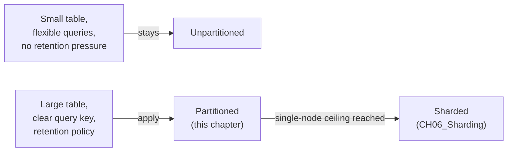

## 21. Comparison Table

| Strategy | Pruning quality | Write/storage distribution | Adding capacity later | Best fit |
|---|---|---|---|---|
| Range | Excellent for range/comparison predicates on the key | Poor — newest range absorbs most writes (often acceptable) | Trivial — attach a new boundary partition | Time-series, append-mostly, retention-driven data |
| List | Excellent for equality/`IN` predicates on the key | Depends entirely on how values are actually distributed | Requires DDL to add a new listed value | Small, known, discrete value domains; residency/compliance splits |
| Hash | None beyond exact-equality lookups on the key | Excellent — near-uniform regardless of value skew | Expensive — changing modulus requires rehashing/reloading most data | High-cardinality keys with equality-lookup-dominated access, hotspot avoidance |
| Vertical | N/A (row-width lever, not row-count) | N/A | Additive — split further as new cold columns are identified | Wide tables with a clear hot/cold column access split |

## 22. Real-World Case Study

An e-commerce platform's `orders` table grew to roughly 2 billion rows
over six years on a single PostgreSQL primary, with a 90-day operational SLA
(Service Level Agreement) requirement to keep 3 years of order history live
for customer support and returns processing, but only the trailing 90 days
genuinely hot for day-to-day dashboard queries. Nightly `VACUUM` had grown
to over 4 hours and increasingly overlapped peak evening traffic; a legally
mandated annual purge of records older than 3 years had become a
multi-day, lock-contentious `DELETE` operation the team dreaded scheduling.
The team applied this chapter's rolling-window pattern (Section 4.8)
directly: RANGE-partitioned by `created_at` at monthly granularity, with a
6-month lead-time buffer of pre-created future partitions and an automated
job (structurally identical to Section 10's Example 4) handling both
creation and the annual purge as a `DETACH PARTITION` plus export to object
storage rather than a destructive `DROP`, satisfying the legal retention
requirement without keeping stale data in the live, hot database. They
additionally applied the storage-tiering pattern (Section 7): the trailing
3 months' partitions stayed on fast SSD-backed tablespaces, the remaining
33 months on cheaper storage. Post-migration, the annual purge dropped from
a multi-day operation to a background job completing in minutes, nightly
maintenance windows returned to well under an hour by operating per-partition
and largely in parallel, and dashboard queries scoped to "last 30 days"
(the dominant query shape, confirmed from query logs before the migration,
per Section 4.5's guidance) pruned to a single partition, cutting their
median latency by roughly 40x. Notably, the team did **not** need to shard:
peak write throughput stayed comfortably within the single primary's
capacity throughout, confirming — per Section 4.10's decision criteria —
that this was genuinely a partitioning problem, not a sharding one.

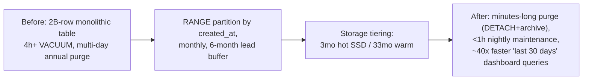

## 23. Interview Questions

1. **What is the difference between horizontal and vertical partitioning?**
   Horizontal splits rows across partitions by a key; vertical splits
   columns of the same logical entity across separate tables by access
   pattern (Sections 4.1, 4.6).
2. **How does partition pruning relate to the query optimizer's cost-based
   search?** Pruning is a rewrite-time elimination step that runs *before*
   cost-based optimization, shrinking the candidate partition set the
   optimizer's join-order and access-path search then operates over
   (Section 4.7).
3. **Why does `WHERE date_trunc('month', created_at) = '2026-02-01'` fail to
   prune while `WHERE created_at >= '2026-02-01' AND created_at <
   '2026-03-01'` prunes to one partition?** The planner cannot generally
   determine which partitions a function's *output* could have come from
   without evaluating it per row; only direct, sargable comparisons against
   the raw partition-key column allow boundary-based elimination (Section
   4.7).
4. **When would you choose hash partitioning over range partitioning for a
   high-write table?** When there is no natural ordered/expiring key and
   queries are dominated by exact-key lookups, and the write pattern would
   otherwise hotspot on a single range partition (Sections 4.2, 4.4).
5. **What is the practical difference between partitioning and sharding?**
   Partitioning splits data within one database instance sharing one
   machine's resources; sharding applies the same key-based splitting across
   multiple independent nodes, adding real capacity but also distributed
   routing/rebalancing complexity (Section 4.10).
6. **Why is `DROP TABLE` on a partition so much cheaper than an equivalent
   `DELETE`?** `DROP`/`DETACH PARTITION` are metadata-only operations against
   the partitioned parent; they never visit or individually remove rows or
   index entries the way a row-scanning `DELETE` must (Section 4.8).
7. **What's the risk of a `DEFAULT` partition growing large?** It signals
   that the maintenance job has fallen behind (a missing explicit partition
   for those rows) and, left unaddressed, silently reintroduces the
   whole-table-scan/maintenance problem partitioning existed to solve
   (Sections 4.2, 15).
8. **How do local and global indexes differ on a partitioned table, and why
   does it matter?** A local index is a separate structure per partition; a
   global index spans all partitions as one structure. Local-only engines
   (e.g. PostgreSQL, historically MySQL/InnoDB) require probing every
   partition's local index for a query that doesn't filter on the partition
   key (Section 4.9).
9. **What signal in a real production incident would tell you partitioning
   alone won't solve the problem, and sharding is actually needed?** A
   single node's CPU, memory working set, or disk throughput is saturated
   even after data is well-partitioned and well-pruned — the ceiling is the
   machine itself, not how the data is organized on it (Section 4.10).
10. **What's the first thing to check before designing a partitioning
    scheme for an existing table?** The actual dominant query predicates
    (from real query logs, not assumption) and the actual retention/
    compliance policy — both must agree with, or at least not contradict,
    the chosen partition key (Sections 4.5, 6).

## 24. Hands-on Exercises

1. Run [`01_range_partitioned_table.sql`](../code/sql/partitioning-chapter/01_range_partitioned_table.sql)
   against a local PostgreSQL instance, insert rows spanning all three
   months plus one row dated outside all of them (confirming it lands in
   `orders_default`), then run
   [`03_partition_pruning_explain.sql`](../code/sql/partitioning-chapter/03_partition_pruning_explain.sql)
   and confirm which partitions appear in each `EXPLAIN` output.
2. Modify Example 3's function-wrapped query into an equivalent sargable
   form and re-run `EXPLAIN`, confirming the plan shrinks from an `Append`
   over all partitions to a single `Seq Scan`.
3. Load [`02_hash_list_partitioned_tables.sql`](../code/sql/partitioning-chapter/02_hash_list_partitioned_tables.sql),
   insert 1,000 rows with sequential `customer_id` values into
   `user_sessions`, and query `pg_partition_tree`/row counts per partition
   to confirm the hash distribution is roughly even.
4. Run [`01_rolling_window_partition_maintenance.py`](../code/python/partitioning-chapter/01_rolling_window_partition_maintenance.py)
   twice in a row against a test database and confirm the second run
   creates and drops nothing (idempotency), then advance the script's
   simulated "today" by 13 months and confirm the oldest partition is
   correctly identified for removal.

## 25. Design Exercises

1. **Multi-tenant SaaS orders table.** Design a partitioning scheme for a
   multi-tenant order-management system with 500 tenants of wildly varying
   size (the largest tenant is 1,000x the median), a 2-year retention
   policy, and a dominant query pattern of "this tenant's orders in a given
   date range." Justify whether you'd use RANGE, LIST, HASH, or a composite
   scheme, and explain how you'd handle the largest tenant's disproportionate
   volume.
2. **IoT telemetry with mixed retention tiers.** A fleet of sensors writes
   10 million rows per hour; raw readings are only needed at full
   resolution for 7 days, hourly rollups for 1 year, and daily rollups
   indefinitely. Design a partitioning and maintenance strategy — including
   whether rollups belong in the same partitioned table or a separate one —
   and specify your rolling-window job's exact creation/removal cadence.
3. **Deciding partitioning vs. sharding.** A team reports their single
   primary database is "at capacity" and wants to shard by `customer_id`
   immediately. Using Section 4.10's decision criteria, list the specific
   metrics you'd want to see before agreeing sharding (rather than
   partitioning plus vertical scaling) is the correct next step, and explain
   what each metric would need to show to justify each path.

## 26. Architecture Review Questions

- Is the partition key derived from real, observed dominant query
  predicates and the actual retention policy, rather than assumption
  (Section 4.5)?
- Has pruning been verified with `EXPLAIN` against the workload's actual hot
  query shapes, including after any recent query refactors (Section 4.7,
  16)?
- Is partition maintenance automated, idempotent, and monitored — including
  an alert on `DEFAULT`-partition non-emptiness and on missed job runs
  (Sections 4.8, 14, 15)?
- Is the expected partition count, at steady state and at the retention
  policy's full window, within an operationally sane range for the engine in
  use (Sections 6, 11)?
- Has the team confirmed whether the database engine in use supports local
  or global secondary indexes on partitioned tables, and does the query
  workload account for that (Section 4.9)?
- If this table is a sharding candidate later, does the chosen partition
  key also make sense as a future shard key (Section 4.10)?
- Is partitioning being relied upon anywhere as a security or tenant-isolation
  boundary by itself, rather than purely a performance/maintenance technique
  (Section 13)?

## 27. Summary

Partitioning splits one logical table into smaller physical pieces — by row
(horizontal: range, list, or hash) or by column (vertical) — while keeping
everything inside a single database instance. Horizontal partitioning keyed
correctly against the dominant query predicate and retention policy enables
partition pruning, letting the query planner eliminate irrelevant partitions
before the cost-based optimizer even runs, and enables cheap,
metadata-only partition maintenance that turns expensive bulk retention
deletes into near-instant operations. Vertical partitioning solves an
orthogonal row-width problem by separating hot and cold columns of the same
entity. None of this adds a single unit of additional compute, memory, or
storage capacity to the system — that is what distinguishes partitioning
from [Sharding](CH06_Sharding.md), which applies these exact same
range/list/hash key-selection principles across multiple independent
database nodes to achieve genuine horizontal scale-out once a single
node's own capacity, not merely its organization, becomes the limiting
factor. Choosing the right partition key, verifying pruning holds under
real query patterns, and automating partition maintenance with real
observability are the three practices that determine whether a partitioning
strategy keeps delivering its benefit for years, or quietly decays back into
the whole-table problem it was built to solve.
