# Chapter: Sharding

Part: [06 — Databases and Storage](PART_OVERVIEW.md) · Status: Drafted

## 1. Introduction

Sharding is the practice of distributing a dataset **across multiple
independent database nodes/servers** so that no single machine has to hold
the entire dataset or absorb the entire read/write workload — it is the
primary technique for taking a database past the ceiling of a single
machine's central processing unit (CPU), memory, disk input/output (I/O), and
network bandwidth. Every shard is a full, independently running database
instance (its own storage engine, its own transaction log, often its own
replica set for high availability) holding one slice of the total data; a
routing layer decides, for any given piece of data, which shard owns it.

This chapter draws an explicit and load-bearing boundary with its sibling,
[Partitioning](CH05_Partitioning.md). **Partitioning** is the general,
single-node mechanism of splitting one logical table into smaller physical
segments — by range, by list, or by hash of a key — so a single database
engine can prune scans and manage storage more efficiently; that chapter
owns range/list/hash partitioning strategies, and this chapter recaps them
in two to three sentences rather than re-deriving them (see Section 4.1 for
the precise recap and the sharding-specific boundary this chapter draws
around it). **Sharding is what happens when you take that partitioning idea
and scatter the resulting partitions across separate, independently
addressable database nodes instead of keeping them all inside one instance.**
Put differently: *sharding = partitioning + distribution across nodes*. This
chapter's job is everything that only exists once partitions cross a network
boundary between machines: how a query router finds the right node for a
given key (shard-key selection and routing mechanisms), what happens when
you need to add or remove nodes without downtime (rebalancing and live data
migration), how a query that needs data from more than one node is executed
(scatter-gather cross-shard queries), what a transaction spanning two shards
actually costs (cross-shard transactions and two-phase commit), and why some
shards become disproportionately loaded relative to others and what to do
about it (hot-shard/hotspot mitigation). This chapter also recaps rather
than re-teaches: normalization/denormalization trade-offs
([Normalization](CH01_Normalization.md), [Denormalization](CH02_Denormalization.md)),
B-tree/hash index internals ([Indexes](CH03_Indexes.md)), and cost-based
query planning ([Query Optimizers](CH04_Query_Optimizers.md)) — each of those
mechanisms still operates *inside* a single shard exactly as taught in its
owning chapter; sharding changes *which* shard a query lands on, not how
that shard executes the query once it arrives.

## 2. Historical Evolution

- **1980s-1990s — vertical scaling as the default answer.** Relational
  database management systems (RDBMSs) of this era assumed a single powerful
  server; when a database outgrew its hardware, the standard remedy was to
  buy a bigger machine (more CPU cores, more random-access memory (RAM),
  faster disks) — an approach with a hard physical and financial ceiling.
- **Late 1990s-early 2000s — application-level "manual sharding."**
  High-growth web companies (large auction sites, early social networks,
  webmail providers) began manually splitting user data across multiple
  MySQL/Oracle instances by user ID ranges or hash buckets, with the
  application code itself computing which database connection to use. There
  was no framework for this; every company built brittle, bespoke routing
  logic, and rebalancing meant painful, often downtime-incurring manual data
  moves.
- **Mid-2000s — Google's Bigtable and the tablet-splitting model (2006
  paper).** Bigtable introduced automatic range-based splitting of a table
  into "tablets" that could be reassigned across servers by a master process,
  establishing the pattern of a metadata layer that tracks which node owns
  which key range — a foundational idea this chapter's shard-map routing
  (Section 4.3) descends from.
- **2007-2009 — Amazon's Dynamo paper and consistent hashing goes
  mainstream.** Dynamo (2007) popularized consistent hashing (first
  described academically by Karger et al. in 1997 for web-cache load
  balancing) as a way to add/remove nodes in a distributed hash table without
  remapping the entire key space — directly answering the "naive hash-mod
  resharding is catastrophic" problem this chapter covers in Section 4.6.
- **2009-2012 — the NoSQL wave ships sharding as a built-in feature.**
  MongoDB (auto-sharding via `mongos` routers and config servers), Cassandra
  (consistent hashing plus virtual nodes as a first-class architecture), and
  HBase (Bigtable's open-source descendant) all shipped native, automatic
  sharding/rebalancing instead of leaving it to application code — sharding
  stopped being a bespoke hack and became a documented database feature.
- **2012-2015 — managed sharded relational services emerge.** Cloud
  providers began offering managed sharded relational options (for example,
  early sharded MySQL/PostgreSQL-compatible services and Google's globally
  distributed Spanner, 2012 paper), narrowing the historical gap between
  "sharding = give up SQL/joins/transactions" and traditional relational
  guarantees, at the cost of new complexity (globally synchronized clocks,
  in Spanner's case).
- **2015-present — sharding-as-a-platform-concern.** Modern managed services
  (DynamoDB, Cosmos DB, CockroachDB, Vitess for MySQL, Citus for PostgreSQL)
  increasingly hide the routing and rebalancing machinery behind the
  database's own control plane, but the underlying first-principles concepts
  in this chapter — shard-key selection, routing, rebalancing cost,
  scatter-gather, cross-shard transaction cost, and hotspots — remain exactly
  what a Solution Architect must reason about when choosing and operating
  any of them, because the *platform* automates the mechanics, not the
  *decisions*.

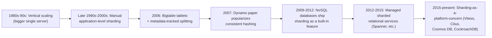

## 3. Why It Exists

A single database node has a hard ceiling on every resource that matters:
CPU cores for query execution, RAM for buffer-pool/page-cache hit rates,
disk I/O throughput for writes and random reads, and network bandwidth for
serving connections. Vertical scaling (bigger hardware) can push that
ceiling higher, but it cannot remove it — at some point there is no bigger
machine to buy, and even where there is, the cost curve for the largest
instances is steeply superlinear (doubling capacity often costs far more
than double). Read replicas (recapped only — full replication mechanics are
owned by the not-yet-drafted Replication chapter) solve *read* scaling by
copying the same data to additional machines, but every replica still holds
100% of the data and none of them can absorb additional *write* throughput,
because writes must still funnel through a single primary. Sharding exists
to break both ceilings simultaneously: by splitting the dataset itself
across N independent nodes, each shard holds roughly 1/N of the data and
absorbs roughly 1/N of the write load (assuming an even distribution — see
Section 4.9 on why that assumption breaks down and what to do about it).
This is the only technique that scales *write* throughput and *total data
volume* horizontally rather than just read throughput, which is why every
large-scale multi-tenant SaaS (software-as-a-service) platform, every global
social network, and every high-write-volume system (ad-tech bidding,
IoT — Internet of Things — telemetry ingestion, financial ledgers at
national scale) eventually adopts sharding once vertical scaling and read
replicas are exhausted.

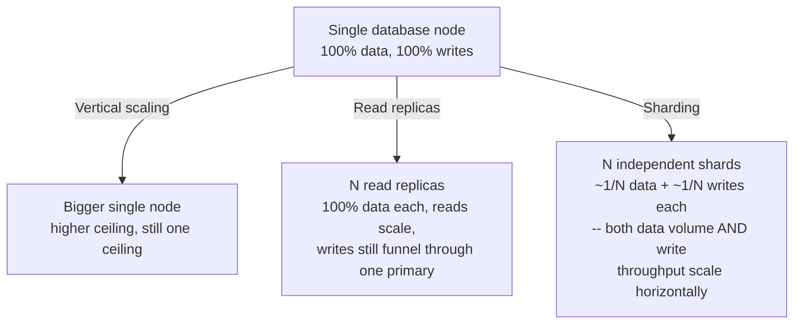

## 4. Core Concepts

### 4.1 Sharding = partitioning + distribution across nodes

**Definition.** [Partitioning](CH05_Partitioning.md) is the single-node
mechanism of dividing one logical table into smaller physical segments using
a range, list, or hash strategy so a single database engine can prune scans,
manage storage in smaller units, and parallelize maintenance operations —
recap only, that chapter owns the full mechanics of how each strategy
computes which partition a row belongs to. Sharding takes that same
partitioning *function* (the thing that decides "this row belongs to
partition/shard K") and applies its output to route data to **physically
separate database nodes** rather than physically separate segments inside
one node's storage engine.

**Mechanism.** The partitioning function itself does not change between the
two contexts — a hash-based shard key still hashes a column value to a
bucket number, exactly as [Partitioning](CH05_Partitioning.md) Section 4
describes for single-node hash partitioning. What changes is everything
downstream of that function's output: instead of the storage engine silently
choosing which on-disk file/segment to write a row into, a **routing layer**
(the query router, shard map, or client-side driver) must translate the
partition-function's output into a *network address* — which shard's
connection string, cluster endpoint, or replica set to talk to — and every
cross-partition operation that was a cheap in-process merge on one node
(e.g. `UNION ALL` across local partitions) becomes a distributed operation
that must cross a network boundary, tolerate partial node failure, and
reconcile results from independently-transacting systems.

**Decision implications.** Because sharding inherits everything hard about
distributed systems (network partitions, partial failure, no shared
transaction log across nodes, no free cross-node joins) on top of everything
already true about partitioning, it should be adopted strictly *after*
single-node partitioning, denormalization, indexing, and read replicas have
been exhausted or are structurally insufficient (specifically: write
throughput or total data volume exceeds what one node can hold even with
those techniques applied) — not as a default scaling strategy reached for
early. A Solution Architect who reaches for sharding to solve a read-scaling
problem that read replicas would solve more simply, or a storage-pruning
problem that single-node partitioning would solve more simply, has taken on
enormous operational complexity (Sections 5, 8, 15) for no corresponding
benefit.

**Common failure mode.** Treating "we partitioned the table" and "we sharded
the table" as the same maturity level of solution. A team that has range-
partitioned a single PostgreSQL instance by month has *not* solved a
write-throughput ceiling problem, because every partition still funnels
through the same one node's CPU/disk/network — partitioning alone never
distributes load across machines. Conversely, a team standing up multiple
independent shards without first partitioning/indexing correctly within each
shard just multiplies a badly-tuned single-node design by N.

**Scenario.** A logistics company partitions its `shipments` table by month
(range partitioning, owned by [Partitioning](CH05_Partitioning.md)) purely to
keep query planning fast and to let old months be archived cheaply — this
is single-node partitioning and needs no router, no cross-node coordination,
and no shard-key selection reasoning at all. The same company later realizes
its *write* volume (a new shipment event every few milliseconds across
thousands of warehouses) has outgrown any single node's disk write
throughput regardless of how the table is partitioned internally — that is
the moment sharding (this chapter) becomes the relevant tool, and the shard
key chosen (Section 4.2) will very likely be `warehouse_id` or `tenant_id`,
not the same `shipment_date` column used for the single-node partitioning,
because the two techniques are solving different problems and are frequently
combined (each shard internally range-partitions its own local slice of
data by date, while the shard key routes at the network level by warehouse).

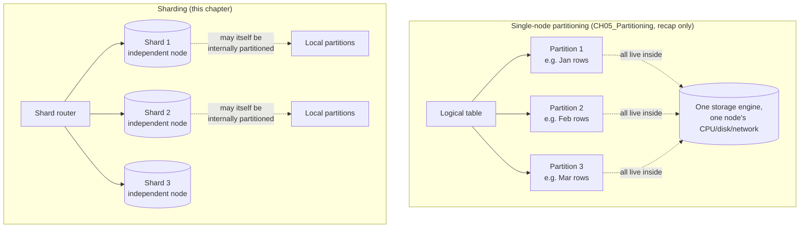

### 4.2 Shard-key selection criteria

**Definition.** The shard key (also called the partition key in some
sharded-NoSQL documentation, a term overlap this chapter flags explicitly to
avoid confusing it with [Partitioning](CH05_Partitioning.md)'s partition
key) is the column, or combination of columns, whose value the routing layer
feeds into the routing mechanism (Sections 4.3-4.5) to decide which shard
owns a given row. It is the single most consequential decision in a sharded
system's design, because unlike an index or a query plan, **the shard key
is extremely expensive to change after data has already been written and
distributed** — changing it means re-routing and re-migrating the entire
dataset.

**Mechanism.** A good shard key is evaluated against three criteria
simultaneously:

1. **Cardinality** — the number of distinct values the key can take must be
   large relative to the number of shards, or the routing function runs out
   of distinct buckets to spread load across. A boolean `is_active` column
   can never be a usable shard key no matter how it is hashed, because it
   only has two possible values.
2. **Write-distribution** — the *frequency* with which each distinct value
   is written must also be roughly even. High cardinality alone is not
   enough: an auto-incrementing `order_id` has excellent cardinality, but if
   used directly (without hashing) as a range-based shard key, every new
   order lands on whichever shard currently owns the highest range, making
   that one shard a permanent write hotspot (Section 4.9) while every other
   shard sits idle for new writes.
3. **Query-alignment** — the shard key should match the column(s) most
   application queries already filter or join on, because any query that
   does *not* include the shard key in its filter cannot be routed to a
   single shard and must be executed as a scatter-gather query across every
   shard (Section 4.7), which is dramatically more expensive and does not
   scale the way a single-shard query does.

These three criteria frequently pull in different directions, and the
resolution is almost always a **compound or hashed key** rather than a
single raw column: hashing a naturally low-cardinality or monotonically
increasing column (e.g. `hash(order_id)` instead of raw `order_id`) restores
even write-distribution while keeping cardinality high, at the cost of
destroying the ability to do efficient range scans by that column — a
trade-off that must be weighed against query-alignment for the dominant
access pattern.

**Decision implications.** Shard-key selection is not a purely technical
exercise; it requires enumerating the system's actual dominant query
patterns (not hypothetical future ones) and picking the key that keeps the
*most business-critical, highest-volume* queries single-shard, accepting
that some lower-priority queries will pay the scatter-gather cost. In a
multi-tenant SaaS system, `tenant_id` is very often the correct shard key
even though it superficially "fails" the cardinality/write-distribution
tests for any single enormous tenant, because almost every query in a
multi-tenant system is already scoped to one tenant — Section 4.9 covers the
targeted mitigation for the large-tenant hotspot this choice creates,
which is usually cheaper than abandoning tenant-aligned routing altogether.

**Common failure mode.** Choosing a shard key purely for even distribution
(e.g. a random UUID (Universally Unique Identifier) hash) without checking
query-alignment. This produces a beautifully load-balanced cluster where
*every single query* the application actually runs becomes a scatter-gather
query across all shards, because no query naturally filters by a random
UUID — the system "scales" its storage and write path while its read path
gets *slower* than an unsharded single node for every query that used to be
a simple indexed lookup.

**Scenario.** A ride-sharing platform initially shards by `driver_id` hash
for even write distribution across trip-update events. Product later adds a
"trip history for a rider" feature, and every one of those queries must now
scatter-gather across all shards because rides are keyed by driver, not
rider — the team ships a secondary, denormalized `rider_id -> shard(s)`
lookup index (a pattern this chapter revisits in Section 4.7) rather than
re-sharding the entire dataset, illustrating that shard-key mismatches for a
*minority* query pattern are usually solved with a targeted secondary
index/lookup structure, not a system-wide re-shard.

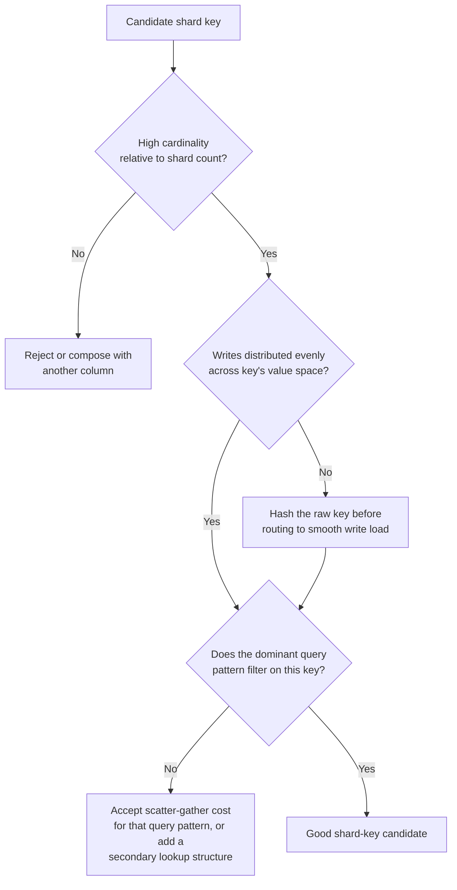

### 4.3 Routing mechanism: lookup-table / shard-map router

**Definition.** A shard-map (also called a directory-based or lookup-table)
router maintains explicit, persisted metadata recording which key range (or
which discrete key values) each shard currently owns, typically stored in a
small, highly-available metadata service or config store separate from the
shards themselves (MongoDB's config servers and Vitess's topology service
are production examples of this pattern).

**Mechanism.** Every request first consults the shard map (usually cached
in-memory in the application/router process with a change-notification or
short time-to-live (TTL) refresh) to translate a shard-key value into a
concrete shard identifier, then opens (or reuses a pooled) connection to
that shard. Because the mapping is explicit, persisted state rather than a
pure function of the key, **rebalancing becomes a metadata update**: moving
a range from shard A to shard B is a matter of copying the underlying data
and then flipping the shard-map entry — no other range's mapping needs to
change at all (contrast this directly with Section 4.4's hash-mod problem).

**Decision implications.** The shard map itself becomes a single point of
failure and a potential bottleneck if implemented naively (every query
requiring a synchronous lookup against a shared metadata store) — production
systems mitigate this with aggressive client-side caching of the map plus a
lightweight versioning/invalidation protocol, and by making the metadata
store itself highly available (often a small replicated cluster, not a
single node). This approach is the right choice when a system needs
fine-grained, flexible rebalancing (splitting one hot range without
touching any other shard) or non-uniform shard sizing (e.g. deliberately
giving one large tenant a dedicated shard), at the cost of operating an
additional piece of critical infrastructure (the metadata/config service).

**Common failure mode.** Under-provisioning or under-caching the shard-map
lookup path so that it becomes a request-path bottleneck or, worse, a
correctness hazard — if two router instances hold stale, disagreeing
versions of the map during a rebalance, they can send conflicting reads/
writes to two different shards for what should be one logical range,
producing silent data splits. This is why production shard-map
implementations use a monotonically increasing version number and a
compare-and-swap-style cutover (see Section 4.6 and the accompanying
migration script under Section 10).

**Scenario.** A payments platform uses a small, replicated etcd/ZooKeeper-
style metadata cluster to hold the shard map for 64 logical ranges spread
across 12 physical shard clusters, letting operators move a single
overloaded range to a freshly provisioned shard during business hours
without any other range's routing being touched or any client code being
redeployed — the router simply picks up the new map version on its next
cache refresh.

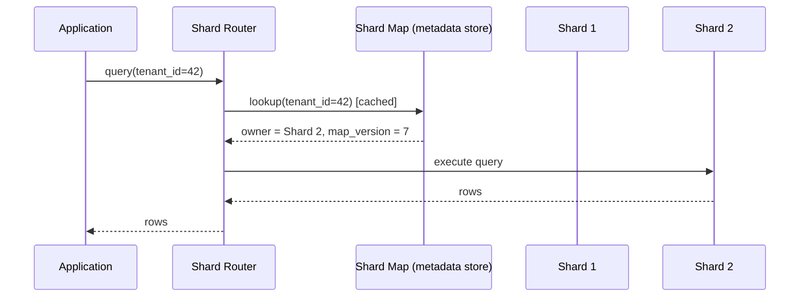

### 4.4 Routing mechanism: algorithmic hash-mod

**Definition.** Algorithmic hash-mod routing computes the target shard
purely as a function of the key with no persisted metadata at all:
`shard_index = hash(shard_key) % N`, where N is the current number of
shards. Every router instance (or client library) can compute this
independently, with no lookup, no cache, and no shared state to keep
consistent.

**Mechanism.** Because the function is pure and stateless, hash-mod routing
is trivially simple to implement and requires zero additional
infrastructure — any client that knows N and the hash function can route
correctly with a single arithmetic operation. Its entire cost surfaces the
moment N changes: because the modulus term appears directly in the formula,
changing N from, say, 4 to 5 changes the output of `hash(key) % N` for the
overwhelming majority of keys, not just the ones that logically belong on
the new shard.

**Decision implications.** Hash-mod routing is appropriate only for
systems with a **fixed, rarely-changing shard count** decided up front with
generous headroom (some fixed-shard-count NoSQL deployments deliberately
over-provision virtual shards for this reason — see the related "logical
vs. physical shard" pattern in Section 7). It should not be chosen for any
system expected to scale its shard count incrementally over its lifetime,
because Section 4.6 shows precisely how catastrophic that incremental
scaling becomes under this scheme.

**Common failure mode.** Adopting hash-mod because it is the simplest thing
to implement, without projecting forward to the first time the cluster needs
to grow. Teams that do this typically discover the cost only when they
actually attempt their first scale-out event, at which point the "simple"
routing scheme forces an enormous, all-at-once data migration that a
shard-map or consistent-hashing scheme would have avoided (quantified in
Section 4.6).

**Scenario.** A metrics-ingestion pipeline hard-codes `shard = hash(host_id)
% 8` across 8 fixed Cassandra-adjacent nodes provisioned for the system's
expected lifetime capacity; because the shard count is deliberately fixed
and generously over-provisioned relative to near-term growth, the simplicity
of hash-mod routing is an acceptable, even favorable, trade against the
alternative schemes' added operational machinery.

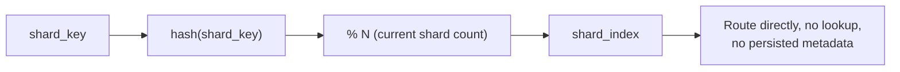

### 4.5 Routing mechanism: consistent hashing

**Definition.** Consistent hashing places both shards and keys onto the same
conceptual ring of hash values (typically 0 to 2^32-1 or 2^64-1); a key is
owned by the first shard encountered walking clockwise from the key's own
hash position. Production implementations place each physical shard at
**many** positions on the ring (virtual nodes, typically 100-200 per shard)
rather than one, which is what actually delivers even load distribution in
practice — a single position per shard produces uneven ring gaps and
therefore uneven load, exactly the failure this technique exists to avoid.

**Mechanism.** When a shard is added, it claims a set of new virtual-node
positions on the ring; only the keys that fall between those new positions
and their immediate clockwise predecessor need to move — every other key's
nearest-clockwise-shard is completely unaffected, because the ring's
ordering (not a modulus) determines ownership. Removing a shard is the
mirror image: its virtual-node positions are deleted, and the small slice of
keys that had been routed to them now falls through to the next clockwise
shard, again without touching any other key's ownership.

**Decision implications.** Consistent hashing is the standard answer to
Section 4.4's hash-mod scaling catastrophe when a system genuinely needs
**algorithmic** (stateless, no shard-map lookup) routing *and* an
incrementally growing/shrinking shard count — it keeps hash-mod's
attractive "no metadata service" property while fixing its catastrophic
remap cost. The trade-off against a shard-map router (Section 4.3) is
flexibility: consistent hashing distributes load evenly and predictably by
construction, but it cannot express arbitrary, hand-tuned range assignments
(e.g. "give this one huge tenant its own dedicated shard while everyone else
shares smaller shards") nearly as naturally as an explicit shard map can.
Many production systems (Cassandra, DynamoDB's internal partitioning, Riak)
combine the two ideas: consistent hashing for the default, evenly-distributed
case, with explicit overrides layered on top for known hot keys.

**Common failure mode.** Using too few virtual nodes per shard (or none at
all), which reintroduces the very load-imbalance problem consistent hashing
is meant to solve — with only one ring position per physical shard, the
*size* of the ring segment each shard owns is essentially random, and some
shards can end up owning a much larger arc (and therefore a much larger
share of keys) than others purely by chance of hash placement.

**Scenario.** A distributed cache layer scales from 6 to 9 nodes during a
traffic spike; with consistent hashing and 150 virtual nodes per physical
node, only the keys whose ring position falls within the newly claimed
virtual-node segments (roughly the fraction added: 3 new nodes into 9 total)
need to be fetched/rehashed onto the new nodes, while the remaining ~67% of
cached keys stay exactly where they were, avoiding a full cache-cold restart
across the whole fleet. See the working ring implementation with a
measured-remap demo under Section 10.

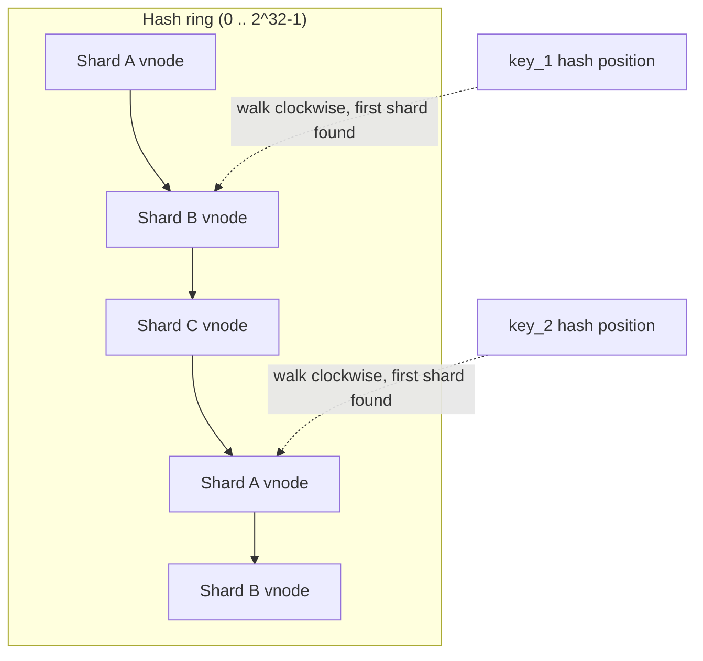

### 4.6 Rebalancing and live data migration

**Definition.** Rebalancing is the process of changing which shard owns
which subset of the key space — most commonly triggered by adding shards to
absorb growth, removing shards during cost optimization, or splitting a
single hot shard's range (Section 4.9) — while the cluster continues serving
live production traffic. Live data migration is the mechanical process of
physically copying the affected rows from their source shard to their
destination shard without an unacceptable window of downtime, unavailable
data, or lost writes.

**Mechanism — why naive hash-mod resharding is catastrophic.** Recall
Section 4.4's formula: `shard_index = hash(key) % N`. Adding one shard
changes N, and because the modulus operator's output depends on N as a
whole (not a localized subrange), the overwhelming majority of keys change
their computed shard index even though only a small fraction of them
*need* to move to achieve a rebalanced cluster. Concretely, growing from 4
shards to 5 remaps roughly (N-1)/N = 80% of all keys under naive hash-mod,
when a truly minimal rebalance would only need to move the roughly 20% of
keys that should end up on the new 5th shard. This is not a minor
inefficiency — it means every scale-out event under naive hash-mod requires
re-migrating the *entire dataset*, at a cost and downtime risk roughly
equivalent to rebuilding the cluster from scratch, which is precisely why
consistent hashing (Section 4.5) or a shard-map router (Section 4.3) is
strongly preferred over raw hash-mod for any system that will ever add or
remove shards after its initial launch.

**Mechanism — the live-migration cutover sequence.** Regardless of which
routing mechanism is used, moving a range of data between shards without
downtime follows the same general sequence: (1) **backfill** — copy the
affected range from source to destination in throttled batches while the
source remains the system of record; (2) **dual-write** — the application
or proxy layer begins writing every new/updated row in the migrating range
to *both* shards, so the destination stays caught up with the backfill's
tail; (3) **verify** — compare row counts and content checksums between
source and destination (not just counts — two datasets can have matching
counts while differing in content); (4) **atomic cutover** — flip the
routing metadata (shard map version bump, or ring ownership) so reads and
writes for that range now target the destination exclusively; (5) **drain
and delete** — after a safety window confirms no traffic still depends on
the old location, delete the now-redundant copy on the source shard to
reclaim space. A concrete worked version of this sequence, including the
checksum-verification query, is provided in Section 10's migration script.

**Decision implications.** Rebalancing is inherently an operation that
trades *migration cost* (network/disk I/O to copy data, dual-write
complexity, extra application logic) for *load-distribution correctness*
after the topology changes — a Solution Architect choosing a routing
mechanism up front (Sections 4.3-4.5) is really choosing how expensive every
*future* rebalance will be, which is why that choice deserves as much
up-front analysis as the shard key itself.

**Common failure mode.** Attempting a "big bang" cutover — flipping every
range's ownership simultaneously rather than incrementally, one range at a
time, with verification between each — which maximizes blast radius if
anything goes wrong mid-migration and makes rollback far harder, since many
ranges are in an inconsistent dual-write state at once.

**Scenario.** An e-commerce platform scaling from 8 to 12 shards ahead of a
seasonal peak uses consistent hashing, so only the ~33% of keys landing in
the newly claimed ring segments need to migrate; the migration is executed
range-by-range over several days during off-peak windows, each range going
through backfill/dual-write/verify/cutover/drain independently, so a
checksum mismatch on one range only pauses that range's migration rather
than the entire scale-out effort.

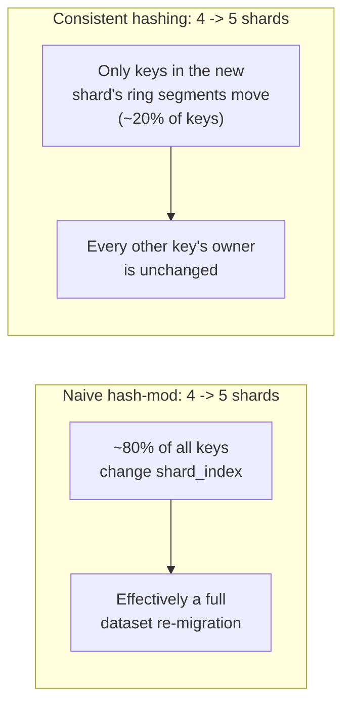

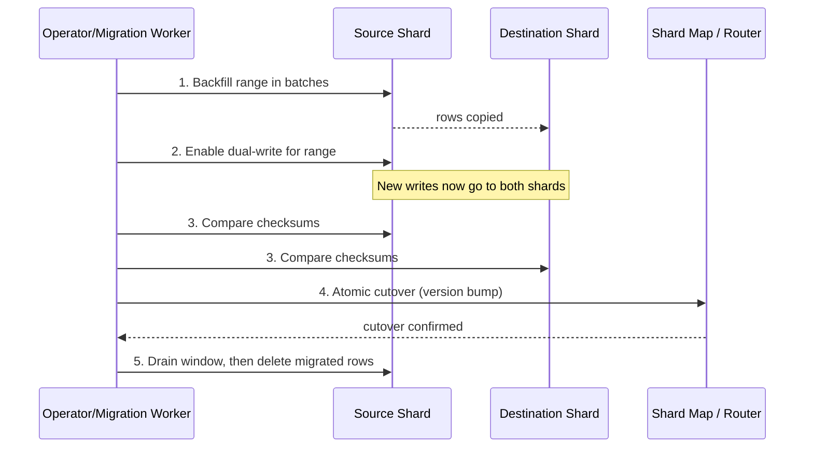

### 4.7 Cross-shard queries and scatter-gather

**Definition.** A cross-shard query is any query whose predicate does not
fully constrain the shard key to a single value (or a single shard's
range), meaning the router cannot determine one target shard and must
instead execute the query against every shard that could hold matching
rows — a pattern called **scatter-gather**: the query is *scattered* out to
all candidate shards in parallel, and their individual result sets are
*gathered* and merged (concatenated, re-sorted, re-aggregated, or
deduplicated, depending on the query) into a single logical result.

**Mechanism.** Scatter-gather trades single-shard queries' simplicity for
three new costs that do not exist on one node: (1) **fan-out latency** — the
overall query cannot complete faster than its slowest responding shard, so
p99 (99th-percentile) latency across N shards is generally worse than any
single shard's own p99, not better, unless per-shard timeouts and partial
results are used deliberately; (2) **partial failure** — any subset of
shards can be slow, unreachable, or erroring while the rest succeed, and the
caller must decide up front whether a partial result is acceptable for that
use case or whether the whole query must fail closed; (3) **merge
semantics** — operations that are trivial on one node become genuinely
harder distributed: a `LIMIT 10 ORDER BY created_at` query cannot simply ask
each shard for its own top 10 and concatenate them, because the true global
top 10 could be skewed entirely toward one shard — each shard must be asked
for its own top 10 candidates and the router must re-sort and re-truncate
the merged candidate set at the router layer, and a global `COUNT(DISTINCT
...)` or exact `AVG()` requires shipping enough intermediate state (not just
each shard's local answer) to combine correctly.

**Decision implications.** The right response to a genuinely necessary
cross-shard query pattern is not to abandon sharding, but to bound its cost:
apply strict per-shard timeouts with graceful degradation to a partial
result (exactly as the Java scatter-gather aggregator in Section 10 does),
cap how many shards a single query can realistically fan out to, and — where
a cross-shard query pattern is *frequent* rather than exceptional — maintain
a purpose-built denormalized index or read-optimized secondary store keyed
by the alternate access pattern (recap: this is the same write-time-cost-
for-read-time-benefit trade-off [Denormalization](CH02_Denormalization.md)
teaches in full; here it is applied specifically to avoid a repeated
scatter-gather rather than a repeated join).

**Common failure mode.** Silently swallowing partial failures — merging
whatever subset of shards responded and returning it to the caller
indistinguishably from a complete result. A dashboard showing "total active
users: 4,200" that quietly omitted two unreachable shards' counts is worse
than an explicit error, because it looks correct while being wrong; every
scatter-gather implementation must surface which shards (if any) failed to
respond, as the Java aggregator's `AggregatedResponse.isPartial` field does.

**Scenario.** A support-ticketing system sharded by `customer_id` needs an
internal "tickets mentioning SKU-4471 across all customers" report — this
query cannot be routed to one shard because it does not filter by the shard
key, so it must scatter to every shard, each of which searches its own local
ticket table (using its own local index, per [Indexes](CH03_Indexes.md),
recapped only), and the router concatenates the per-shard result pages
before returning a single merged page to the requester.

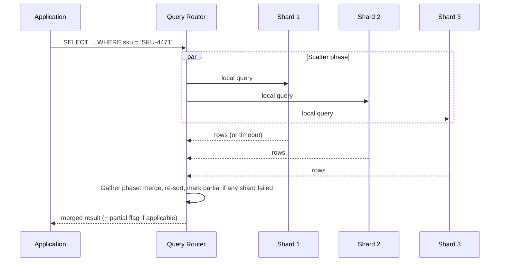

### 4.8 Cross-shard transactions and their cost

**Definition.** A cross-shard transaction is one that must atomically
modify rows living on two or more independent shards — for example,
transferring funds between two accounts that happen to be routed to
different shards. Unlike a single-node transaction, there is no single
transaction log or lock manager spanning both shards, so atomicity must be
achieved through explicit distributed-transaction coordination.

**Mechanism — two-phase commit (2PC).** The classic mechanism is two-phase
commit: a coordinator asks every participating shard to **prepare** the
transaction (acquire all necessary locks, write the change to its local log,
but not yet make it visible/committed) and report readiness; only after
*every* participant confirms it is prepared does the coordinator issue a
**commit** to all of them, and only then is the change made visible on any
shard. If any participant fails to prepare, the coordinator issues an
**abort** to all participants instead. This guarantees atomicity across
shards, but at real, measurable costs: every participating shard must hold
its prepare-phase locks for the *entire* round trip to every other
participant, not just its own local work, meaning one slow or unreachable
shard blocks lock-holding (and therefore blocks other transactions
contending for those same rows) on every other participant until it
times out or recovers; the coordinator itself is a new single point of
failure whose crash between phases can leave participants "in doubt" —
holding prepared-but-uncommitted locks indefinitely until the coordinator
recovers and tells them how the transaction actually resolved.

**Mechanism — avoidance strategies.** Because 2PC's cost scales with the
slowest/least-available participant and adds meaningful latency to every
cross-shard transaction, production systems overwhelmingly prefer to *avoid*
needing 2PC in the first place, using one of: (a) **co-locating
transactionally-related data on the same shard** by choosing a shard key
that keeps entities which transact together (e.g. both sides of a transfer,
if the domain allows) on one shard — the single most effective mitigation,
directly connecting back to Section 4.2's query-alignment criterion; (b) the
**Saga pattern** — decomposing a cross-shard business transaction into a
sequence of local transactions, each with a corresponding compensating
action, trading strict atomicity for eventual consistency plus explicit
rollback logic (full Saga mechanics are a distributed-systems topic owned by
the not-yet-drafted System Design/Distributed Transactions material; recapped
here only as the standard alternative to 2PC); (c) **outbox-pattern
eventual consistency**, where a local transaction on shard A writes both its
own change and an event record in the same local commit, and an asynchronous
process later applies the corresponding change to shard B, again trading
strict cross-shard atomicity for a bounded, monitored eventual-consistency
window.

**Decision implications.** A Solution Architect encountering a proposed
cross-shard transaction should treat it as a signal to first re-examine the
shard-key choice (can the two entities be co-located?) before reaching for
2PC or a Saga; cross-shard transactions that cannot be designed away should
be rare, monitored operations, not a routine hot path, given their locking
and availability cost.

**Common failure mode.** Implementing 2PC without a durable recovery
protocol for the coordinator, so a coordinator crash between the prepare and
commit phases leaves participants holding locks indefinitely with no way to
resolve the "in-doubt" transaction automatically — this is precisely the
failure mode Section 15 revisits with an explicit incident scenario.

**Scenario.** A banking core sharded by `account_id` hash necessarily
supports transfers between two arbitrary accounts that may land on different
shards; rather than running 2PC on every transfer, the system routes the
transfer through a ledger-style design where each shard-local step (debit on
shard A, credit on shard B) is its own local ACID (Atomicity, Consistency,
Isolation, Durability) transaction plus an outbox event, with a reconciliation
job asserting global balance invariants asynchronously — accepting a small,
monitored window where the two legs of a transfer are momentarily
inconsistent in exchange for never holding cross-shard locks on the hot path.

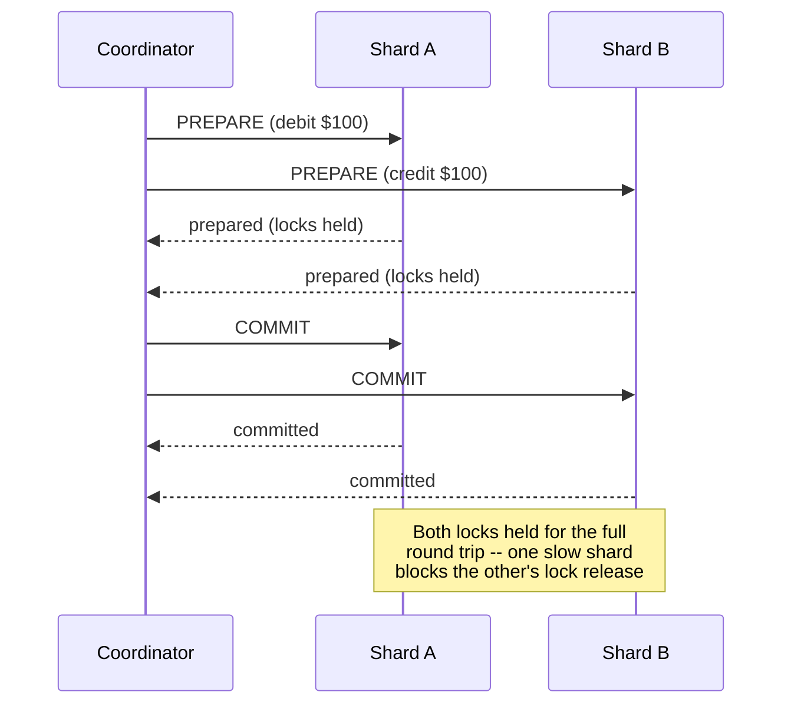

### 4.9 Hot-shard / hotspot mitigation

**Definition.** A hot shard (or hotspot) is a shard that receives a
disproportionate share of read/write traffic or storage relative to its
peers, undermining the entire premise of sharding — instead of load being
divided by N, one shard effectively still bears a much larger share, and
that shard's own single-node ceiling (Section 3) reappears as the system's
overall ceiling.

**Mechanism.** Hotspots arise from several distinct root causes that call
for different mitigations: **key skew**, where the shard-key value
distribution itself is uneven (one enormous tenant, one viral piece of
content, one extremely active user) so even a perfectly-implemented routing
mechanism sends a disproportionate volume of requests to whichever shard
that key hashes to; **temporal skew**, where an otherwise evenly-distributed
key space produces uneven load at any given moment because of time-correlated
access patterns (e.g. a shard key based on event timestamp naturally
concentrates all "right now" writes on whichever shard owns the current time
range); and **access-pattern skew**, where the shard key is well-distributed
for writes but a small number of keys are read far more often than others
(a celebrity account, a trending product), overloading that shard's read
path specifically.

**Mitigation techniques.** (1) **Key salting/splitting** — append a
low-cardinality random or round-robin suffix to a hot key so its writes
spread across multiple shards, at the cost of needing a scatter-gather read
to reassemble that one logical key's full data (a direct trade against
Section 4.7); (2) **Dedicated shard carve-out** — give one exceptionally
large tenant/key its own dedicated shard (or shards) rather than forcing it
to share a shard sized for the median tenant, which the shard-map router
(Section 4.3) supports naturally and consistent hashing alone does not;
(3) **Read replicas per shard** — for read-heavy hotspots specifically
(rather than write hotspots), attach additional read replicas to just the
hot shard rather than rebalancing data at all, since the data volume itself
may not be the problem, only the read concurrency; (4) **Caching in front of
the hot shard** — an application-level or dedicated cache layer absorbing
the read hotspot before it ever reaches the database tier, appropriate when
the hot data is read far more often than it changes.

**Decision implications.** Hotspot mitigation should be treated as an
ongoing *operational* concern, not a one-time design decision — key
distributions shift over a system's lifetime (a tenant grows, content goes
viral), so production sharded systems need continuous per-shard load
monitoring (Section 14) with a playbook for which mitigation applies to
which detected skew pattern, rather than assuming the shard key chosen at
launch will remain evenly loaded forever.

**Common failure mode.** Diagnosing a hot shard as a "need more shards"
problem and blindly rebalancing, when the actual root cause is a single
oversized key that will simply recreate the same hotspot on whichever new
shard it lands on — splitting or salting that specific key is the correct
fix, and a general rebalance without addressing the skewed key changes
nothing for that key's load.

**Scenario.** A social platform shards posts by `author_id`; when one
account's post goes viral, read traffic for that single shard spikes far
beyond every other shard's baseline while the shard's *storage* volume is
completely unremarkable — the correct response is a temporary read-replica
fan-out and a cache layer in front of that specific hot shard's viral post,
not a cluster-wide rebalance, because rebalancing the data would not change
which shard the viral author's posts still hash to.

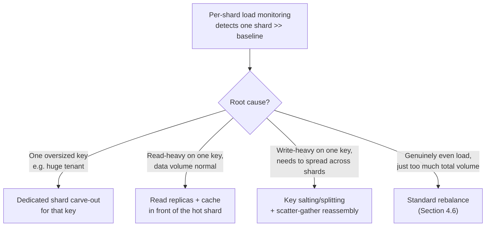

## 5. Internal Working

Tying Section 4's individual mechanisms together, a single request's journey
through a sharded system follows a consistent lifecycle regardless of which
routing mechanism (shard-map, hash-mod, or consistent hashing) is in use:

1. **Key extraction** — the router/driver extracts the shard-key value from
   the incoming query or write request (from a `WHERE` clause, a request
   path parameter, or an application-supplied routing hint).
2. **Routing resolution** — the extracted key is fed into whichever routing
   mechanism the system uses (Sections 4.3-4.5) to determine one target
   shard, or — if the key cannot fully constrain the query — the router
   instead determines the *full set* of candidate shards for a scatter-gather
   execution (Section 4.7).
3. **Connection acquisition** — the router obtains a pooled connection to
   the target shard(s); connection pools are per-shard, not shared, because
   each shard is an independent database instance with its own connection
   limits.
4. **Local execution** — the target shard executes the query exactly as an
   unsharded database would: parsing, binding, cost-based optimization,
   index selection, and execution are entirely owned by
   [Query Optimizers](CH04_Query_Optimizers.md) and
   [Indexes](CH03_Indexes.md) (recapped only) — sharding has no influence on
   how a single shard executes its own local portion of the query.
5. **Result handling** — for a single-shard query, the result is returned
   directly; for a scatter-gather query, results from every responding shard
   are merged, re-sorted, or re-aggregated at the router layer (Section 4.7)
   before being returned to the caller, with any non-responding shards
   surfaced explicitly rather than silently dropped.
6. **Write-path specifics** — for a write, an additional consideration
   applies: whether the write touches one shard (routed and executed exactly
   like a read) or must be coordinated across shards (Section 4.8's
   cross-shard transaction path), which changes step 3 into acquiring
   connections/locks on multiple shards rather than one.

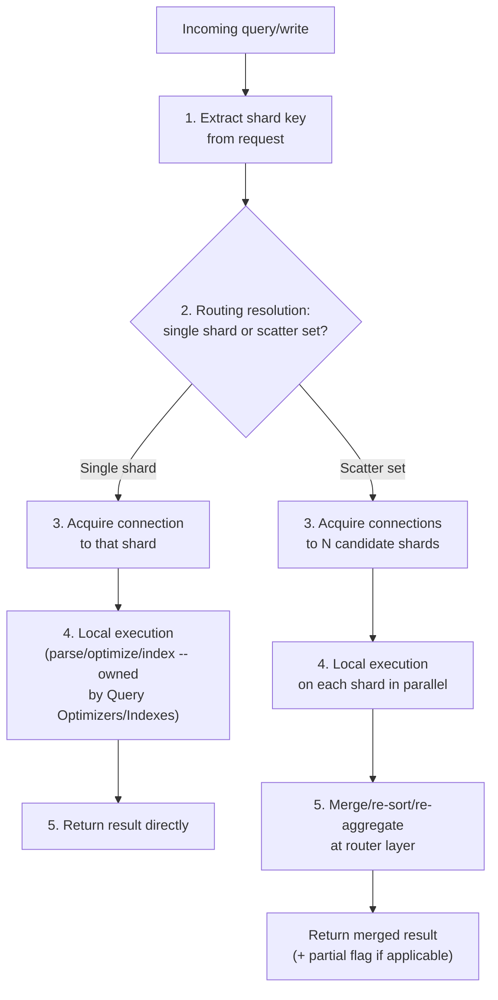

## 6. Design Principles

- **Co-location before coordination.** Whenever two entities are frequently
  read or written together, prefer a shard key that keeps them on the same
  shard over building distributed-transaction or scatter-gather machinery to
  bridge them after the fact — this single principle eliminates more
  cross-shard complexity than any mechanism covered in Section 4.
- **The shard key is a one-way door.** Treat shard-key selection with the
  same rigor as an irreversible architecture decision (recap:
  [Architecture Thinking](../01_Architecture_Mindset/CH03_Architecture_Thinking.md)'s
  reversible-vs-irreversible framing applies directly here) — validate it
  against real production query patterns, not hypothetical ones, before any
  data is written.
- **Prefer routing schemes that make rebalancing cheap.** Choose consistent
  hashing or a shard-map router over raw hash-mod for any system expected to
  grow its shard count over its lifetime; the cost difference is not
  marginal (Section 4.6 quantifies it as ~80% vs. ~20% of keys remapped for
  a typical scale-out event).
- **Bound every cross-shard operation.** Scatter-gather queries and
  cross-shard transactions must have explicit timeouts, explicit partial-
  failure semantics, and an explicit cap on fan-out breadth — an unbounded
  cross-shard operation is a latent availability risk that scales with
  cluster size.
- **Monitor shard balance continuously, not just at launch.** Key
  distributions shift; a shard key that was well-balanced on day one can
  develop hotspots as usage patterns change, so per-shard load/size
  monitoring (Section 14) is a permanent operational requirement, not a
  one-time validation step.
- **Sharding is additive complexity, not a default.** Exhaust single-node
  partitioning, indexing, denormalization, and read replicas first; add
  sharding only when write throughput or data volume genuinely exceeds what
  those techniques can address on one node.

## 7. Architecture Patterns

- **Range-sharded cluster.** Shards own contiguous ranges of a sortable
  shard key (e.g. customer ID ranges); pairs naturally with a shard-map
  router (Section 4.3) and supports efficient range scans across a shard's
  own data, at the cost of the write-hotspot risk described in Section 4.2
  for monotonically increasing keys unless combined with hashing.
- **Hash-sharded cluster (fixed shard count).** Shards are assigned via
  algorithmic hash-mod (Section 4.4); appropriate only when the shard count
  is fixed for the system's operational lifetime with deliberate headroom.
- **Consistent-hash-ring cluster.** Shards (and their virtual nodes) sit on
  a hash ring (Section 4.5); the standard choice for systems needing both
  algorithmic routing and an incrementally growing/shrinking shard count.
- **Logical-shard over-provisioning.** Many production systems (Vitess,
  Citus, and most Cassandra deployments) create far more *logical* shards
  than there are *physical* nodes at launch (e.g. 4,096 logical shards spread
  across 8 physical nodes, 512 logical shards per node), so that future
  scale-out is a matter of *moving* existing logical shards onto new physical
  nodes rather than re-splitting the key space at all — this decouples the
  routing-function decision (made once, rarely revisited) from physical
  capacity planning (revisited constantly).
- **Geo-sharding.** Shard key includes (or is) a geography/region identifier,
  so each shard's data physically resides in or near the region it serves —
  primarily a latency and data-residency/regulatory-compliance pattern rather
  than a pure load-distribution one; cross-region queries become cross-shard
  scatter-gather queries by construction, so this pattern is chosen
  deliberately when regional data locality outweighs the cross-region query
  cost.
- **Shard-per-tenant (or shard-pool-per-tenant-tier).** Multi-tenant SaaS
  systems commonly dedicate one or more entire shards to a single large
  tenant while pooling many smaller tenants together on shared shards — a
  direct application of Section 4.9's dedicated-shard-carve-out mitigation,
  applied proactively at design time rather than reactively after a hotspot
  appears.

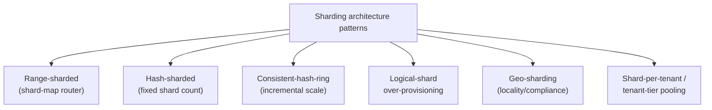

## 8. Production Architecture

A production sharded deployment typically layers the following components:

- **Client driver or application-level router library** — embeds the
  routing logic (Sections 4.3-4.5) directly in the application process or in
  a thin sidecar/proxy, avoiding an extra network hop for the routing
  decision itself.
- **Metadata/config service** (for shard-map or logical-over-provisioning
  designs) — a small, independently highly-available cluster (often
  etcd/ZooKeeper-based, or a dedicated lightweight relational store) holding
  the current shard-to-node assignment, versioned for safe concurrent
  cutover.
- **Per-shard database clusters** — each shard is itself typically a
  primary-plus-replica set for local high availability (recap only:
  replication mechanics are owned by the not-yet-drafted Replication
  chapter), meaning a "shard" in production is usually several machines, not
  one.
- **Connection pool management per shard** — because each shard is an
  independent database instance with its own connection ceiling, the routing
  layer must manage N separate connection pools rather than one, and must
  handle one shard's pool exhaustion or unavailability without starving
  requests destined for healthy shards.
- **Migration/rebalancing worker(s)** — a dedicated, throttle-aware
  background process (distinct from the request-serving path) that executes
  the backfill/dual-write/verify/cutover/drain sequence from Section 4.6,
  usually with rate limiting to protect source-shard I/O headroom during
  business hours.
- **Cross-shard query coordinator** — the component implementing Section
  4.7's scatter-gather fan-out and merge logic, often the same process as
  the router but logically distinct in its responsibilities (timeout
  policy, partial-result semantics, result-merging strategy per query
  shape).
- **Observability aggregation layer** — because per-shard metrics
  (Section 14) must be compared against each other to detect hotspots, a
  production deployment needs a monitoring layer that aggregates per-shard
  dashboards into cluster-wide views, not N independent dashboards an
  operator must manually compare.

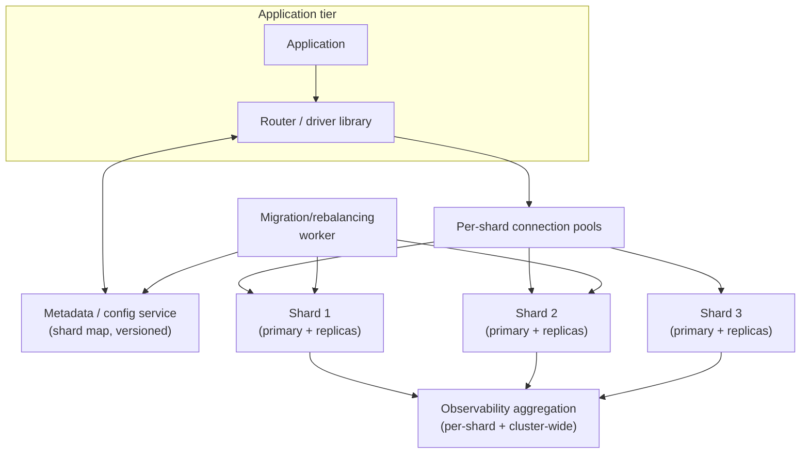

## 9. Implementation

Implementing a sharded architecture generally proceeds through these
practical steps, most of which apply whether the routing is built in-house
or delegated to a platform like Vitess/Citus/DynamoDB:

1. **Model the dominant query patterns first.** Enumerate the highest-
   volume, most latency-sensitive queries and writes before choosing a shard
   key — Section 4.2's query-alignment criterion cannot be evaluated without
   this list.
2. **Choose the shard key and routing mechanism together.** These two
   decisions constrain each other (e.g. a shard-map router supports
   arbitrary key assignment far more flexibly than consistent hashing, which
   matters if the shard key needs manual per-tenant overrides).
3. **Provision with rebalance headroom.** Start with more logical shards
   than physical capacity strictly requires (the logical-over-provisioning
   pattern from Section 7), so future growth is a data-movement exercise
   between existing logical units rather than a key-space re-split.
4. **Build (or adopt) the routing layer as a shared library or sidecar**,
   not duplicated per-service logic — every service that talks to the
   sharded database must agree on the exact same routing function and
   metadata source, or two services can disagree about which shard owns a
   given key.
5. **Implement scatter-gather with mandatory timeouts and partial-result
   signaling from day one** (Section 4.7) — retrofitting timeout/partial-
   failure handling onto an already-deployed scatter-gather path is far
   riskier than building it in from the start.
6. **Design the migration tooling before the first rebalance is needed**,
   not reactively during an incident — the backfill/dual-write/verify/
   cutover/drain sequence (Section 4.6) has enough steps that improvising it
   under production pressure is a common source of the failure scenarios in
   Section 15.
7. **Instrument per-shard metrics from launch** (Section 14) so hotspot
   detection (Section 4.9) has a baseline to compare against, rather than
   only being noticed once a shard is already visibly overloaded.

## 10. Complete Code Examples

The following four runnable examples implement the mechanisms this chapter
teaches. Full source lives under `code/<language>/sharding-chapter/`; each
file is heavily commented against the section it demonstrates.

- **[consistent_hash_ring.py](../code/python/sharding-chapter/consistent_hash_ring.py)**
  — a consistent-hashing ring with virtual nodes (Section 4.5), including a
  runnable demo (`demo_minimal_remap_on_scale_out`) that measures the actual
  fraction of keys remapped when a 4th shard is added, quantifying Section
  4.6's "~20% vs. ~80%" claim against real computed hash positions rather
  than asserting it.
- **[shard-router.js](../code/node/sharding-chapter/shard-router.js)** — a
  directory-based/shard-map router (Section 4.3) that tracks explicit
  key-range-to-shard assignments and implements `splitRangeForRebalance`,
  the metadata-only half of Section 4.6's rebalance sequence (the data-copy
  half is the SQL example below).
- **[ScatterGatherAggregator.java](../code/java/sharding-chapter/ScatterGatherAggregator.java)**
  — a scatter-gather query aggregator (Section 4.7) using a fixed thread
  pool with a strict per-shard timeout; deliberately simulates one slow
  shard to demonstrate that the aggregator degrades to a partial result
  (surfaced via `AggregatedResponse.isPartial`) instead of blocking on the
  slowest participant indefinitely.
- **[rebalance_migration.sql](../code/sql/sharding-chapter/rebalance_migration.sql)**
  — the concrete backfill/dual-write/verify/cutover/drain sequence from
  Section 4.6, written as a commented, step-numbered script against a
  two-shard `orders` table split, including the checksum-comparison query
  used for the verify step.

Each example is self-contained and runnable independently (Python 3.10+,
Node.js 18+, Java 21, and any standard relational engine supporting `MD5`/
`SUBSTRING`, respectively) — none require the others to be present.

## 11. Performance

Sharding's performance story is asymmetric between the write path and the
cross-shard read path. **Single-shard operations** (the common case when the
shard key is well-aligned, Section 4.2) perform essentially identically to
an unsharded database, because the target shard executes the query with its
own local optimizer/indexes exactly as [Query Optimizers](CH04_Query_Optimizers.md)
describes — sharding adds only the router's key-extraction and connection-
acquisition overhead, typically single-digit milliseconds. **Cross-shard
scatter-gather operations** (Section 4.7), by contrast, are bounded by the
slowest responding shard rather than improved by parallelism the way CPU-bound
work is — fanning a query out to more shards does not make it faster, it
only makes tail-latency risk worse, because the probability that *at least
one* of N shards is experiencing a transient slowdown increases with N. This
is why production systems apply aggressive per-shard timeouts (as the Java
aggregator in Section 10 does) and treat scatter-gather queries as
inherently higher-latency-budget operations than single-shard ones,
regardless of how well each individual shard is tuned. **Rebalancing
operations** (Section 4.6) impose a measurable but bounded and schedulable
load: the backfill phase consumes source-shard read I/O and destination-shard
write I/O, throttled deliberately to avoid starving live traffic, and this
throttle is the main lever operators have to trade migration completion time
against production performance impact.

## 12. Scalability

Sharding is, definitionally, the technique for scaling *write throughput*
and *total data volume* past a single node's ceiling (Section 3) — this is
its entire reason for existing, and its scalability payoff is close to
linear for the workload's single-shard-routable majority: doubling the shard
count roughly doubles both storage capacity and aggregate write throughput,
assuming even key distribution (Section 4.9). The scalability story degrades
for the *minority* of operations that are inherently cross-shard: adding
shards does not make scatter-gather queries or cross-shard transactions
faster (Section 11), and in fact widens their potential tail latency and
partial-failure surface as N grows, so a system's overall scalability ceiling
under sharding is really set by whatever fraction of its workload remains
cross-shard, not by the sharded majority — reinforcing Section 4.2's
emphasis on query-alignment as the decisive shard-key criterion, and Section
4.8's emphasis on co-location over cross-shard transaction coordination.

## 13. Security

- **Per-shard credential isolation.** Each shard should have distinct
  database credentials (not one shared credential across the fleet), so a
  single leaked credential's blast radius is limited to one shard's data
  rather than the entire dataset.
- **Metadata-service access control.** The shard map/config service
  (Section 4.3, Section 8) is a high-value target — write access to it can
  redirect an application's traffic to an attacker-controlled endpoint or
  corrupt routing for legitimate ranges, so it warrants its own tightly
  scoped access controls, separate from general database credentials.
- **Tenant-isolation implications of shard-per-tenant designs.** A
  shard-per-tenant pattern (Section 7, Section 4.9) can double as a security
  boundary — a compromised query cannot accidentally (or maliciously) read
  another tenant's data purely by omitting a `WHERE tenant_id = ...` clause,
  because that data physically does not exist on the queried shard; this is
  a meaningfully stronger isolation guarantee than row-level tenant
  filtering within a single shared database, and is a legitimate factor
  favoring shard-per-tenant for regulated or highly sensitive multi-tenant
  workloads.
- **Cross-shard query authorization consistency.** A scatter-gather query
  coordinator (Section 4.7, Section 8) must apply the same row-level/
  tenant-level authorization checks uniformly across every shard it fans out
  to — an authorization bug on the merge/aggregation layer that forgets to
  re-apply a filter after gathering results from multiple shards can leak
  data across tenants/shards that individual per-shard queries would have
  correctly excluded.
- **Encryption in transit between router and shards.** Because a sharded
  system inherently has more inter-node network hops than an unsharded
  database (router-to-shard, migration-worker-to-shard), every one of those
  connections should use TLS (recap only, full mechanics owned by
  [TLS](../05_Networking_and_OS/CH06_TLS.md)) rather than assuming an
  internal network segment is implicitly trusted.

## 14. Observability

Effective sharded-system observability requires metrics at both the
per-shard and cluster-aggregate levels, specifically to support hotspot
detection (Section 4.9):

- **Per-shard load metrics** — CPU, memory, disk I/O, connection-pool
  utilization, and query latency percentiles *per shard*, not just averaged
  across the cluster, because an averaged metric can look perfectly healthy
  while masking one severely overloaded shard.
- **Key/row-count distribution** — periodic sampling of row counts (or
  storage bytes) per shard, to detect storage-volume skew independent of
  request-rate skew.
- **Scatter-gather fan-out metrics** — the fraction of queries that require
  scatter-gather vs. single-shard routing (validating the shard key's
  query-alignment assumption over time), plus per-scatter-gather-query
  partial-failure rate (how often at least one shard times out or errors).
- **Cross-shard transaction metrics** — rate, latency, and abort rate of any
  2PC or Saga-based cross-shard transactions (Section 4.8), since a rising
  abort rate or rising 2PC prepare-phase latency is an early signal of lock
  contention or a struggling participant shard.
- **Migration progress metrics** — for any in-flight rebalance (Section
  4.6): backfill completion percentage, dual-write error rate, and checksum-
  verification pass/fail status per migrating range, so an operator can
  observe migration health without manually querying both shards.
- **Router/metadata-service health** — since the shard map or ring
  configuration is a shared dependency for every request, its own
  availability and cache-hit rate (Section 4.3) must be monitored as
  carefully as any individual shard.

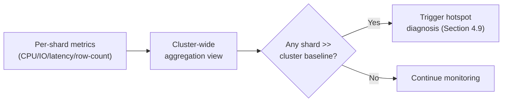

## 15. Failure Scenarios

- **In-doubt 2PC coordinator crash.** The coordinator crashes after sending
  `PREPARE` to both shards but before either receives `COMMIT`/`ABORT`
  (Section 4.8) — both shards are left holding locks on the affected rows
  indefinitely, blocking any other transaction touching those rows, until an
  operator (or an automated recovery protocol reading the coordinator's
  durable prepare-log) manually resolves the in-doubt transaction. Mitigation:
  a durable, replicated coordinator log plus an automated timeout-and-query
  recovery protocol, or — preferably — avoiding 2PC on the hot path entirely
  (Section 4.8's avoidance strategies).
- **Split-brain shard-map update.** Two router instances hold different
  cached versions of the shard map during a rebalance cutover (Section 4.6)
  and simultaneously accept writes for the same range against two different
  physical shards, silently forking that range's data. Mitigation: a
  monotonically increasing map version with compare-and-swap-style cutover,
  and routers that refuse to serve requests against a stale map version
  rather than serving with best-effort staleness.
- **Runaway scatter-gather fan-out.** A newly introduced query
  accidentally omits the shard-key filter and fans out to all shards under
  sustained high traffic, saturating every shard's connection pool
  simultaneously and turning what should have been an isolated single-shard
  incident into a cluster-wide outage. Mitigation: enforce a hard cap on
  scatter-gather fan-out breadth and per-shard timeout at the router layer
  (Section 4.7), independent of any individual query's author remembering
  to add one.
- **Migration backfill starving production I/O.** An unthrottled backfill
  job (Section 4.6) saturates the source shard's disk I/O during business
  hours, degrading latency for all live traffic on that shard. Mitigation:
  rate-limited backfill batches with an explicit I/O budget, scheduled
  during lower-traffic windows where possible, and an automatic pause
  trigger tied to live-traffic latency thresholds.
- **Silent partial-result masking.** A scatter-gather aggregator (Section
  4.7) merges results from responding shards but does not propagate which
  shards failed, and a downstream caching layer caches the incomplete
  result as if it were complete, serving a wrong answer for the cache's
  entire TTL. Mitigation: propagate and honor a partial/degraded-result
  flag all the way through any caching layer, refusing to cache (or
  marking as stale) partial results.
- **Hot-shard cascading failure.** A single hot shard (Section 4.9)
   degrades under load, and its increasing latency causes the router's
   connection pool for that shard to saturate; if the router's connection
   pools are not fully isolated per shard, pool exhaustion for the hot shard
   can starve connection availability for unrelated, healthy shards sharing
   the same pool infrastructure. Mitigation: strictly isolated per-shard
   connection pools and circuit breakers, so one shard's degradation cannot
   propagate to requests destined for healthy shards.

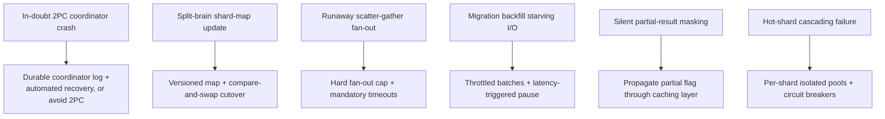

## 16. Testing

- **Routing-function unit tests.** Verify the routing mechanism (hash-mod,
  consistent-hash ring, or shard-map lookup) returns the expected shard for a
  fixed set of known keys, and — critically — verify the *remap fraction*
  when a shard is added/removed matches expectations (the consistent-hashing
  ring example in Section 10 includes exactly this kind of test as a
  runnable demo, not just an assertion).
- **Scatter-gather partial-failure tests.** Deliberately inject a slow or
  failing shard in a test harness (as the Java example simulates for
  `shard-3`) and assert the aggregator times out correctly, returns a
  partial result flagged as such, and does not block past the configured
  per-shard timeout.
- **Cross-shard transaction rollback tests.** For any 2PC or Saga
  implementation, test that a participant's prepare-phase failure correctly
  triggers abort/compensation on every other participant, not just a
  local-only rollback.
- **Migration dry-run and checksum tests.** Run the backfill/verify sequence
  (Section 10's SQL script) against a synthetic dataset with deliberately
  introduced discrepancies (a missing row, a mismatched column value) and
  confirm the checksum-comparison step actually catches them — a
  verification step that has never been tested against a known-bad dataset
  provides false confidence.
- **Rebalance-under-load tests.** Execute a full rebalance (backfill/
  dual-write/verify/cutover/drain) against a shard receiving simulated
  concurrent production-like traffic, and confirm no writes are lost or
  duplicated during the dual-write window — this is the single most
  important integration test class for any sharded system, since a
  rebalance is exactly the operation most likely to be under-tested before
  it is needed for real.
- **Hotspot-detection alerting tests.** Synthetically skew traffic toward
  one shard in a staging environment and confirm the observability
  layer (Section 14) actually fires the expected hotspot alert, rather than
  only validating the metric-collection pipeline in isolation.

## 17. Common Mistakes

- **Choosing a shard key for even distribution alone, ignoring query
  alignment** (Section 4.2) — produces a perfectly balanced cluster where
  every real query is a scatter-gather query.
- **Using raw hash-mod routing for a system expected to scale its shard
  count** (Section 4.4) — the first scale-out event forces an
  all-at-once, near-total dataset remigration.
- **Treating the shard key as easy to change later.** Unlike an index or a
  query plan, changing the shard key after data is written and distributed
  requires re-migrating the entire dataset under a new key — the cost of a
  wrong shard key compounds the longer it goes uncorrected.
- **Implementing 2PC without a durable, recoverable coordinator log**
  (Section 15) — an in-doubt transaction after a coordinator crash becomes
  an unrecoverable stuck lock rather than a bounded, resolvable incident.
- **Not bounding scatter-gather fan-out or timeout** (Section 4.7, Section
  15) — a single mistakenly unscoped query can degrade the entire cluster
  instead of one shard.
- **Rebalancing without checksum verification, relying on row counts
  alone** (Section 4.6) — two datasets can have matching row counts while
  differing in content, silently corrupting the migrated range.
- **Diagnosing every hot shard as "needs more shards"** (Section 4.9)
  rather than checking for a single oversized key first, wasting a
  cluster-wide rebalance that does not fix a single-key hotspot.
- **Sharding before exhausting single-node options** (Section 4.1, Section
  6) — adopting sharding's full operational complexity to solve a
  read-scaling or storage-pruning problem that read replicas or
  single-node partitioning/indexing would have solved far more simply.

## 18. Best Practices

- Select the shard key from real, measured dominant query patterns, and
  validate it against both write-distribution and query-alignment before
  any production data is written (Section 4.2).
- Default to consistent hashing or a shard-map router over raw hash-mod for
  any system expected to change its shard count over its lifetime (Sections
  4.4-4.6).
- Over-provision logical shards relative to initial physical capacity
  (Section 7) so future scale-out is a data-movement exercise, not a
  key-space re-derivation.
- Build mandatory per-shard timeouts and explicit partial-result signaling
  into the scatter-gather path from day one, not as a retrofit (Section
  4.7, Section 16).
- Design cross-shard transactions out of the hot path via co-location
  first; reserve 2PC/Saga for genuinely unavoidable cross-shard invariants,
  and give any 2PC implementation a durable, recoverable coordinator log
  (Section 4.8, Section 15).
- Instrument per-shard load/size metrics from launch and rehearse the
  hotspot-diagnosis decision flow (Section 4.9) before it is needed under
  real production pressure.
- Rehearse the full backfill/dual-write/verify/cutover/drain sequence
  (Section 4.6) against a staging environment under simulated load before
  the first production rebalance.

## 19. Anti-Patterns

- **"Shard everything from day one."** Sharding a system that has not
  exhausted single-node partitioning/indexing/denormalization/read replicas
  first, paying its full operational complexity cost for no corresponding
  scale need (Section 4.1, Section 6).
- **Random/UUID shard keys chosen purely for load balance.** Satisfies
  cardinality and write-distribution while failing query-alignment so badly
  that nearly every query becomes scatter-gather (Section 4.2, Section 17).
- **Hash-mod routing "because it's simplest," for a system that will grow.**
  Defers a catastrophic migration cost to the first scale-out event rather
  than avoiding it up front (Section 4.4, Section 4.6).
- **Big-bang, all-ranges-at-once rebalancing.** Maximizes blast radius
  versus incremental, verified, range-by-range migration (Section 4.6).
- **2PC as the default cross-shard transaction mechanism.** Reaching for
  distributed two-phase commit before checking whether the shard key could
  simply co-locate the transacting entities (Section 4.8, Section 6).
- **Silent partial-result caching.** Caching a scatter-gather result without
  propagating whether it was complete or partial, serving a wrong answer
  confidently for an entire cache TTL (Section 15, Section 17).
- **Treating a hot shard's symptom (overall cluster rebalance) instead of
  its cause (one oversized/hot key).** Wastes a cluster-wide operation that
  does not address the actual skewed key (Section 4.9).

## 20. Trade-off Analysis

| Decision | Benefit | Cost |
|---|---|---|
| Shard key aligned to dominant query pattern | Most queries stay single-shard, fast and simple | May create write/storage skew for that same key, requiring targeted mitigation (Section 4.9) |
| Consistent hashing over hash-mod | Cheap, incremental rebalancing (Section 4.6) | Less flexible than a shard map for arbitrary per-key overrides (e.g. dedicated tenant shards) |
| Shard-map router over consistent hashing | Flexible, arbitrary range assignment; supports dedicated shards | Extra metadata-service infrastructure and cache-consistency discipline (Section 4.3) |
| Co-locating related entities to avoid cross-shard transactions | Eliminates 2PC's locking/availability cost entirely | Constrains shard-key choice, potentially reintroducing key skew for the co-located group |
| Saga/outbox eventual consistency over 2PC | Avoids cross-shard locking; better availability | Requires compensating-action logic and tolerates a bounded inconsistency window |
| Key salting for a hot write key | Spreads one hot key's writes across shards | Reads for that logical key now require scatter-gather reassembly |
| Logical-shard over-provisioning | Future scale-out is data movement, not key-space re-derivation | Slightly higher per-node overhead managing more logical units up front |

## 21. Comparison Table

| Routing Mechanism | Metadata Required | Rebalance Cost | Flexibility (arbitrary assignment) | Typical Use Case |
|---|---|---|---|---|
| Algorithmic hash-mod | None | Catastrophic (~(N-1)/N keys remapped) | None | Fixed, rarely-changing shard count with headroom |
| Consistent hashing | None (function of ring + vnodes) | Cheap (~1/N keys remapped) | Low-moderate (salting can force overrides) | Incrementally growing/shrinking clusters, even load |
| Shard-map / directory | Persisted, versioned metadata store | Cheap (explicit range move) | High (arbitrary range/tenant assignment) | Systems needing dedicated shards, fine-grained control |

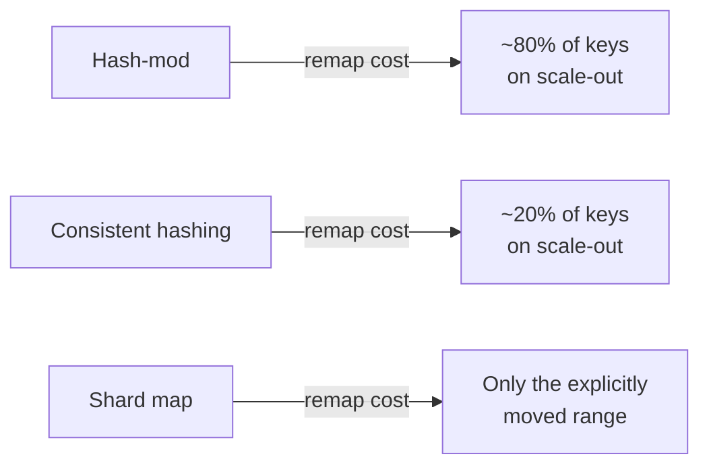

## 22. Real-World Case Study

A mid-size multi-tenant SaaS analytics platform launched on a single
PostgreSQL instance, using single-node hash partitioning
([Partitioning](CH05_Partitioning.md), recap only) by `tenant_id` purely for
storage/vacuum manageability. As the customer base grew past roughly 2,000
active tenants and ingest volume climbed into the tens of millions of events
per day, the single node's write I/O became the binding constraint —
exactly the ceiling Section 3 describes, and one no amount of internal
partitioning could remove, since every partition still funneled through the
same node's disks.

The team's first sharding attempt used naive hash-mod routing across 4
initial shards, chosen for its implementation simplicity. Within a year,
customer growth required scaling to 6 shards, and the team discovered
Section 4.6's remap catastrophe firsthand: roughly two-thirds of all
existing keys needed to move, forcing a multi-week, all-hands migration
effort that the team had not budgeted for and that risked a customer-visible
incident had it gone wrong mid-flight.

Following that incident, the team re-architected onto a shard-map router
(Section 4.3) backed by a small replicated metadata cluster, with logical-
shard over-provisioning (Section 7): 256 logical shards mapped across the 6
physical clusters, so each physical cluster owned roughly 43 logical shards.
Large tenants (the top ~20 accounts by ingest volume) were carved out onto
dedicated logical shards (Section 4.9's dedicated-shard-carve-out
mitigation), while the remaining ~1,980 smaller tenants shared pooled
logical shards. Subsequent scale-out events became a matter of moving
existing logical shards onto newly added physical clusters — a data-movement
exercise using the exact backfill/dual-write/verify/cutover/drain sequence
from Section 4.6, executed a few logical shards at a time during low-traffic
windows, with zero customer-visible incidents across the next three scale-out
events. The one recurring cross-shard need — a "usage across all tenants"
internal billing report — was deliberately left as a scheduled, off-peak
scatter-gather batch job with generous timeouts rather than optimized as a
live user-facing query path, since Section 4.7's fan-out latency cost was
judged acceptable for an internal, non-interactive report but not for any
customer-facing feature.

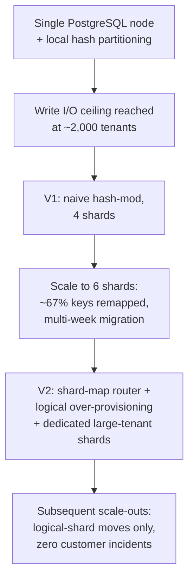

## 23. Interview Questions

1. What is the difference between partitioning and sharding, precisely?
2. Walk through the three criteria for evaluating a candidate shard key.
   Give an example where they conflict, and how you would resolve it.
3. Why does naive hash-mod routing make adding a shard so expensive? Derive
   the approximate fraction of keys remapped for a scale-out from N to N+1
   shards.
4. Explain how consistent hashing solves the problem in question 3. What
   role do virtual nodes play, and what goes wrong without them?
5. Compare a shard-map router against consistent hashing. When would you
   choose one over the other?
6. Describe the full lifecycle of a live, zero-downtime shard-rebalance
   migration, step by step.
7. What is scatter-gather, and what three new costs does it introduce
   versus a single-shard query?
8. Why is a global `ORDER BY ... LIMIT N` across shards harder to implement
   correctly than concatenating each shard's own top-N results?
9. Walk through two-phase commit's mechanism and explain precisely why one
   slow participant blocks lock release on every other participant.
10. What are the primary strategies for avoiding a cross-shard transaction
    altogether, and why is co-location usually preferred over Saga/2PC?
11. What are the three distinct root causes of a hot shard, and how does
    the correct mitigation differ for each?
12. Why might a system deliberately over-provision logical shards relative
    to its current physical node count?
13. A scatter-gather query returns results from 7 out of 8 shards within
    its timeout. What should the system do, and why is silently returning
    the 7-shard result as if complete dangerous?
14. Design the shard key and routing scheme for a multi-tenant SaaS platform
    where 1% of tenants generate 90% of the traffic.

## 24. Hands-on Exercises

1. Run the Python consistent-hash-ring example under
   `code/python/sharding-chapter/consistent_hash_ring.py`. Record the
   measured remap fraction when scaling from 3 to 4 shards, then modify the
   demo to scale from 3 to 4 shards using raw `hash(key) % N` instead, and
   compare the two measured remap fractions directly.
2. Extend the Node.js shard-map router
   (`code/node/sharding-chapter/shard-router.js`) to support merging two
   adjacent ranges back into one shard (the inverse of
   `splitRangeForRebalance`), and write a small test asserting the topology
   is correctly restored.
3. Modify the Java scatter-gather aggregator
   (`code/java/sharding-chapter/ScatterGatherAggregator.java`) so that a
   shard which times out is automatically retried once with a shorter
   timeout before being marked failed, and measure how this changes overall
   p99 latency in the simulated scenario.
4. Using the SQL migration script
   (`code/sql/sharding-chapter/rebalance_migration.sql`) as a template,
   design and write the equivalent script for *removing* a shard (merging
   its data back into two neighboring shards) rather than adding one.
5. Set up two local database instances representing two shards; implement
   a minimal two-phase-commit coordinator (in any language) that transfers
   a value between a row on each instance, then deliberately kill the
   coordinator process between the prepare and commit phases and observe
   the "in-doubt" locked state on both shards.

## 25. Design Exercises

1. You are designing the data layer for a global ride-sharing platform.
   Trips are created by riders and fulfilled by drivers; the platform needs
   fast "my trip history" queries for both riders and drivers, plus an
   internal fraud-detection job that scans all trips in a city within a time
   window. Propose a shard key, justify it against all three criteria from
   Section 4.2, and explain how you would serve whichever query pattern does
   not align with your chosen key.
2. Design the rebalancing strategy for a 12-shard consistent-hash-ring
   cluster that must scale to 18 shards ahead of a known traffic event in 30
   days, with a hard requirement of zero customer-visible downtime and no
   more than 5% additional load on any existing shard at any point during
   the migration. Describe your batching/scheduling plan.
3. A finance system shards accounts by `account_id` hash and needs to
   support transfers between arbitrary accounts, which may land on
   different shards. Design the transaction strategy: would you use 2PC,
   Saga, outbox-based eventual consistency, or a co-location change? Justify
   your choice against the specific consistency and availability
   requirements of a financial ledger.
4. Design a hotspot-detection and auto-mitigation system for a
   shard-per-large-tenant multi-tenant platform: what metrics would you
   collect, what thresholds would trigger which of Section 4.9's four
   mitigation techniques, and how would you avoid false-positive-triggered
   unnecessary shard carve-outs for a merely temporary traffic spike?

## 26. Architecture Review Questions

- What is the shard key, and has it been validated against real (not
  hypothetical) dominant query patterns for both cardinality and
  write-distribution?
- What routing mechanism is used, and does its rebalance cost match the
  system's expected shard-count growth trajectory over its lifetime?
- What is the system's plan and tooling for a live rebalance — has the
  full backfill/dual-write/verify/cutover/drain sequence been rehearsed
  under simulated production load, not just designed on paper?
- Which queries are known to require scatter-gather, what fraction of total
  query volume do they represent, and what are their configured timeout and
  partial-result-handling policies?
- Are there any cross-shard transactions in the design? If so, why couldn't
  co-location eliminate them, and what is the coordinator's failure-recovery
  story?
- What per-shard observability exists today, and has a synthetic hotspot
  test actually been run against it to confirm alerting fires as expected?
- Has sharding been justified against exhausting single-node partitioning,
  indexing, denormalization, and read replicas first, or was it adopted
  preemptively?

## 27. Summary

Sharding distributes a dataset across multiple independent database nodes to
scale past a single node's write-throughput and storage ceiling — it takes
the partitioning mechanism owned by [Partitioning](CH05_Partitioning.md) and
adds everything specific to spreading the result across a network of
machines: shard-key selection (Section 4.2), routing (Sections 4.3-4.5),
rebalancing and live migration (Section 4.6), cross-shard queries via
scatter-gather (Section 4.7), cross-shard transactions and their real cost
(Section 4.8), and hot-shard mitigation (Section 4.9). The shard key is the
system's single most consequential and least reversible decision, evaluated
against cardinality, write-distribution, and — most decisively — alignment
with the dominant real query pattern. Routing mechanism choice trades
simplicity (hash-mod) against rebalance cost (catastrophic for hash-mod,
cheap for consistent hashing) and flexibility (highest for an explicit
shard map). Cross-shard operations — scatter-gather queries and multi-shard
transactions — are the recurring source of sharding's genuine complexity and
should be bounded, monitored, and minimized through shard-key co-location
rather than treated as routine. A Solution Architect's job in this space is
not to memorize any one product's sharding implementation, but to reason
correctly about these first-principles trade-offs before a shard key is ever
chosen, because unlike almost every other decision in this book, this one is
extraordinarily expensive to revisit once data has already been written and
distributed.
