# Chapter: Replication

Part: [06 — Databases and Storage](PART_OVERVIEW.md) · Status: Drafted

## 1. Introduction

Replication is the practice of maintaining multiple copies of the same data
on different nodes — usually on different machines, in different racks, or
in different geographic regions — so that a single disk failure, machine
crash, or data-center outage does not destroy or make unavailable the only
copy of a piece of data. Every serious production database, from a single
PostgreSQL instance backing a startup's billing system to a globally
distributed key-value store backing a social network's news feed, relies on
replication as its primary defense against data loss and its primary lever
for scaling read traffic beyond what one machine can serve. This chapter is
the *owning* chapter for leader/follower (primary/replica) replication
mechanics, the synchronous/asynchronous/semi-synchronous replication
spectrum, replication lag and its consistency consequences (including
read-your-writes violations and their mitigations), multi-leader replication
and conflict resolution, leaderless/quorum-based replication (the
Dynamo-style model), and failover mechanics including split-brain risk — per
the Concept Ownership Rule in [STYLE_GUIDE.md](../STYLE_GUIDE.md).

Replication is deceptively simple to describe — "keep a copy of the data
somewhere else" — and deceptively hard to get right in practice, because
every replication design forces an explicit trade-off between three things
that cannot all be maximized simultaneously: how quickly a write is
acknowledged to the client, how durable that acknowledgment actually is if a
node fails a moment later, and how consistent the data looks to a reader who
queries a different replica than the one that accepted the write. A Solution
Architect who treats replication as a checkbox ("yes, we have a replica") — s
without understanding *which* replication mode is configured and what that
mode promises — will eventually be blindsided by a production incident where
a customer's own write appears to have vanished, a promoted replica turns
out to be missing the last few seconds of transactions, or two nodes that
both believed themselves to be the leader accepted conflicting writes at the
same time. This chapter builds the mental model needed to reason about those
failure modes *before* they happen, not just to diagnose them after.

Data distribution across nodes for the purpose of dividing a dataset that is
too large for one machine — partitioning and sharding — is a *related but
distinct* concern from replication and is owned by
[Partitioning](CH05_Partitioning.md) and [Sharding](CH06_Sharding.md)
respectively; this chapter assumes a dataset (or a shard of one) that already
fits on a single node and asks only "how do we keep redundant, available
copies of it." In practice, production systems combine both: a large dataset
is first partitioned/sharded into manageable pieces, and *each* partition is
then independently replicated using the techniques this chapter teaches.

## 2. Historical Evolution

Replication techniques evolved in response to the changing bottleneck of
each era — first tape backups solved cold storage, then log shipping solved
warm standby, then streaming replication closed the recovery-time gap, and
finally leaderless quorum systems abandoned the leader concept entirely to
solve availability at global scale.

- **1970s-1980s — offline backups and manual failover.** Early databases had
  no live replica at all; durability meant periodic full backups to tape,
  and "failover" meant a database administrator manually restoring the most
  recent backup onto a spare machine, losing everything written since the
  last backup. Recovery Point Objective (RPO) was measured in hours or days.
- **1980s-1990s — log shipping (warm standby).** Databases began writing a
  sequential Write-Ahead Log (WAL) of every change for crash recovery
  purposes (see [Transactions](CH08_Transactions.md), not yet drafted, for
  full WAL/durability mechanics — this chapter recaps only what is needed to
  explain replication). Vendors realized that same log could be *shipped* to
  a second machine and replayed there, producing a warm standby that could
  be promoted to primary in minutes rather than hours. Shipping was batched
  (e.g. hourly log-file transfer), so RPO improved to minutes but was still
  non-zero.
- **Early 2000s — streaming/continuous replication.** Instead of shipping
  discrete log *files* on a schedule, databases (MySQL's binary-log
  replication, PostgreSQL's streaming replication introduced in version 9.0
  in 2010) began streaming individual WAL records over a persistent network
  connection as soon as they were generated, cutting replication lag from
  minutes to sub-second in healthy conditions and enabling near-real-time
  read replicas.
- **2007 — Amazon's Dynamo paper and the leaderless model.** Amazon's
  internal Dynamo system (described in the 2007 SOSP paper "Dynamo: Amazon's
  Highly Available Key-value Store") popularized an entirely different
  design: no single leader at all, writes accepted by any of several
  replicas, and consistency reasoned about via tunable read/write quorums
  rather than a single source of truth. This directly inspired Cassandra,
  Riak, and (eventually) DynamoDB itself, and is the intellectual ancestor of
  this chapter's Section 4.7.
- **2010s — multi-leader and geo-replication for multi-region write
  availability.** As applications grew multi-region, architects wanted
  writes accepted locally in each region rather than round-tripping every
  write to a single global leader. Multi-leader replication (each region
  runs its own leader, leaders replicate to each other) traded a harder
  conflict-resolution problem for lower write latency and continued
  availability during inter-region network partitions.
- **2020s — managed, automated failover as the default.** Cloud-managed
  database services (Amazon RDS Multi-AZ and Aurora, Azure SQL Database
  auto-failover groups, Google Cloud SQL high availability) made automated
  leader election and failover the default expectation rather than a
  bespoke operational script, though the underlying trade-offs this chapter
  teaches did not go away — they were only pushed behind a managed API.

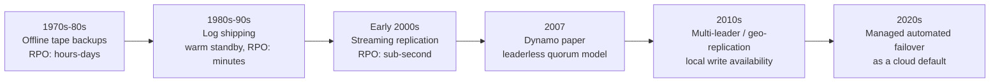

## 3. Why It Exists

Replication exists to solve three separate problems that all happen to be
solved by the same mechanism — keeping more than one copy of the data:

1. **Durability against node loss.** A single disk, machine, or availability
   zone *will* eventually fail — disks have a nonzero Annualized Failure
   Rate (AFR), machines lose power, data centers lose network connectivity
   or catch fire. If only one copy of the data exists, that failure is a
   permanent data-loss event. A second (or third) copy, kept reasonably
   up to date, turns a catastrophic loss into a recoverable incident.
2. **Availability during planned and unplanned downtime.** Even if data is
   never *lost*, a single-node database is unavailable for the entire
   duration of any crash, OS patch, or hardware replacement. Replication
   lets a standby take over — automatically or manually — so the
   application keeps serving traffic while the original node is repaired.
3. **Read throughput beyond one machine's capacity.** A single database
   node has a ceiling on how many concurrent reads it can serve, bounded by
   CPU, memory (for the buffer/page cache), and disk I/O. Read-heavy
   workloads (the common case — most systems read far more than they write)
   can direct read queries to replicas, multiplying effective read capacity
   roughly linearly with the number of replicas, without touching the
   write path at all.

These three motivations pull in different directions once a system is under
real load: maximizing durability pushes toward waiting for every replica to
confirm a write before acknowledging it (which increases write latency),
while maximizing write throughput pushes toward acknowledging as soon as
the leader itself has the write (which risks losing the most recent writes
if the leader crashes before replicating them). Every replication
configuration this chapter describes is really a named point along that
durability-vs-latency spectrum, and a Solution Architect's job is to pick the
point that matches the actual business requirement — a financial ledger and
a "likes" counter do not belong at the same point on that spectrum.

## 4. Core Concepts

### 4.1 The replication topology and the leader/follower vocabulary

**Definition.** A *leader* (also called a primary or master) is the single
node in a replication topology that accepts writes for a given piece of
data. A *follower* (also called a replica, secondary, or slave in older
terminology) is a node that receives a continuous stream of the leader's
changes and applies them locally, but — in the pure leader/follower model —
never accepts writes directly from clients.

**Mechanism.** Every write a client sends goes to the leader. The leader
applies the write to its own storage, records the change in its
Write-Ahead Log (WAL) — an append-only, ordered log of every modification,
written *before* the corresponding data-file change is made, so the log can
reconstruct any change even if the server crashes mid-write — and then
transmits that log entry to each follower. Each follower replays the log
entry against its own local copy of the data in the same order the leader
applied it, guaranteeing (assuming no failures) that every follower
eventually reaches the exact same state as the leader, one log entry behind.

**Decision implications.** The leader/follower model is chosen when an
application can tolerate a single write bottleneck (all writes for a given
piece of data go through one node) in exchange for a simple, well-understood
consistency model: there is always exactly one authoritative answer to "what
is the current value," because there is only one node that ever accepts
writes. This is the default choice for the overwhelming majority of
relational and many NoSQL deployments (PostgreSQL streaming replication,
MySQL replication, MongoDB replica sets, Kafka's per-partition leader model)
precisely because "one writer, many readers" is easy to reason about and
matches most applications' actual read:write ratio.

**Common failure mode.** Teams add followers purely for read scaling and
forget that followers lag the leader by a nonzero amount of time (Section
4.4) — a read sent to a follower immediately after a related write can
observe stale data, and naively load-balancing *all* reads (including a
user's read of their own just-written data) across leader and followers
uniformly reintroduces this staleness as a customer-facing bug.

**Concrete scenario.** An e-commerce checkout service writes a new order to
the leader, then immediately queries "my orders" from a load-balanced pool
that includes followers. If that particular read lands on a follower that
has not yet replayed the order's WAL entry, the confirmation page renders
without the order the customer just placed, even though the write itself
succeeded and is durably on the leader.

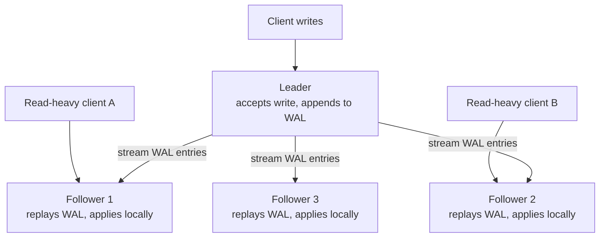

### 4.2 WAL shipping and streaming — the mechanics of "how" a follower stays current

**Definition.** WAL shipping (or streaming replication) is the specific
technique by which a follower stays current: rather than the leader
re-executing the same SQL statement on every follower (statement-based
replication, largely abandoned because non-deterministic functions like
`NOW()` or `RAND()` would produce different results on each node), or the
leader sending only the logical rows that changed (logical/row-based
replication, used when you need cross-version or selective-table
replication), the most common and lowest-overhead approach ships the raw,
already-computed physical WAL records themselves and has the follower
replay them at the storage-engine level.

**Mechanism.** The leader maintains the WAL as a sequential, monotonically
increasing byte stream — PostgreSQL calls the current position in this
stream the Log Sequence Number (LSN); MySQL's equivalent is the binary log
position/GTID (Global Transaction Identifier). A follower opens a
long-lived streaming connection to the leader, tells it the last LSN it has
already applied, and the leader begins pushing every WAL record generated
after that point. Because WAL records are physical, low-level, already-
deterministic byte diffs (or logical row-change events, depending on mode),
the follower does not need to re-run any query planner or re-evaluate any
non-deterministic expression — it simply applies the same bytes/row-changes
the leader already computed, in the same order, which is what guarantees
follower state converges to leader state.

**Decision implications.** Physical WAL shipping is fast and low-CPU-
overhead on the follower (no query re-planning), but it ties the follower to
the *exact* storage format and (usually) major version of the leader —
you generally cannot stream physical WAL from PostgreSQL 15 to PostgreSQL 16.
Logical replication decodes the WAL into row-level change events instead,
which is more CPU-expensive to produce but allows cross-version replication,
replicating only a subset of tables, and replicating into a different schema
or even a different database product entirely (a common technique for
zero-downtime migrations and for feeding data into a separate analytics
store).

**Common failure mode.** WAL/binary-log retention on the leader is finite —
once a follower falls far enough behind that the leader has already
recycled (deleted) the WAL segment containing the follower's next needed
record, that follower cannot resume streaming and must be rebuilt from a
fresh full base backup, which can take hours on a large dataset and is a
common cause of extended replica downtime after a network partition.

**Concrete scenario.** A follower in a secondary region loses network
connectivity to the leader for six hours during a fiber cut. If the leader's
WAL retention window is only two hours (`wal_keep_size`/replication slot
misconfiguration in PostgreSQL terms), the follower cannot simply resume
streaming when connectivity returns — the operator must re-seed it from a
full backup, during which time that region has zero local read capacity.

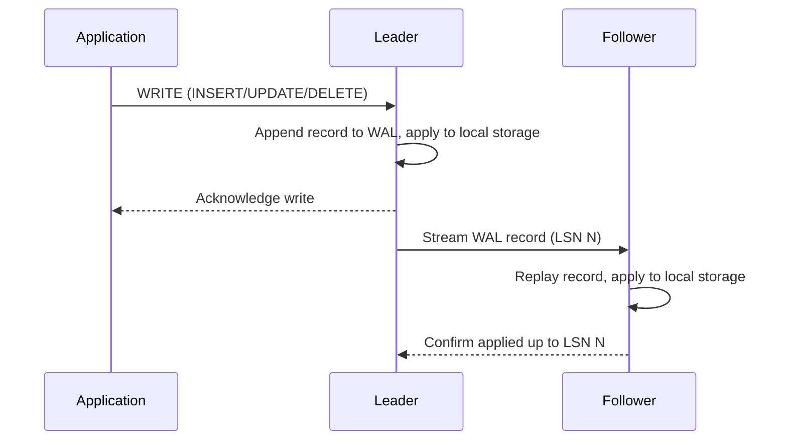

### 4.3 Synchronous, asynchronous, and semi-synchronous replication

**Definition.** These three modes answer one question: *when* does the
leader acknowledge a write back to the client, relative to how many
followers have confirmed receiving (or applying) that write?
**Asynchronous** replication acknowledges the write as soon as the leader
itself has durably written it, without waiting for any follower.
**Synchronous** replication waits until at least one (often configurable)
follower has confirmed it received and durably wrote the WAL record before
acknowledging the client. **Semi-synchronous** replication is the middle
ground: the leader waits for at least one follower to confirm *receipt* of
the WAL record (but not necessarily that the follower has fully applied it
to queryable state) before acknowledging.

**Mechanism.** In asynchronous mode the leader's acknowledgment path and
the follower-streaming path are fully decoupled — the leader pushes WAL
records to followers on a best-effort background stream while immediately
telling the client "committed." In synchronous mode, the leader's commit
path blocks: after appending to its own WAL, it waits for an explicit
acknowledgment message back from the designated synchronous follower(s)
before returning control to the client's commit call, turning what was a
purely local disk write into a network round trip. Semi-synchronous mode
inserts a smaller wait — just long enough to know the data has left the
leader and landed *somewhere* else, without waiting for that somewhere-else
node to finish making it locally queryable, which is a cheaper guarantee
than full synchronous but stronger than none at all.

**Decision implications.** This is the single most consequential
replication configuration a Solution Architect will set, because it
directly trades write latency against durability:
- **Asynchronous** gives the lowest, most consistent write latency (no
  network round trip in the commit path) at the cost of a nonzero window
  where an acknowledged write exists only on the leader — if the leader
  dies in that window, the write is lost forever from the client's
  perspective, even though the client was already told it succeeded.
- **Synchronous** guarantees zero data loss on leader failure (the write is
  provably on at least one other node before the client is told it
  succeeded), at the cost of every single write's latency now including a
  network round trip to the synchronous follower, and — critically — write
  *availability* now depends on that follower being reachable: if it goes
  down, writes can stall or fail entirely unless the system is configured
  to gracefully degrade.
- **Semi-synchronous** is the pragmatic default for systems that want "my
  committed write definitely exists on more than one machine" without
  paying for full apply-confirmation round trips, and is the built-in
  default trade-off in MySQL's semi-sync replication plugin.

**Common failure mode.** Teams configure synchronous replication for
durability but do not configure a sane fallback behavior for when the
synchronous follower is unreachable, so a routine follower restart or a
transient network blip turns into a full write outage for the entire
system, because the leader is correctly refusing to acknowledge writes it
cannot yet prove are durable elsewhere.

**Concrete scenario.** A payments system configures fully synchronous
replication to a follower in the same availability zone for durability, but
that follower's disk fills up and it stops accepting new WAL records. Every
write to the payments leader now blocks indefinitely (or until a timeout),
and the entire payments path goes down — a durability safeguard became an
availability outage because the failure mode of the *safeguard itself* was
never planned for.

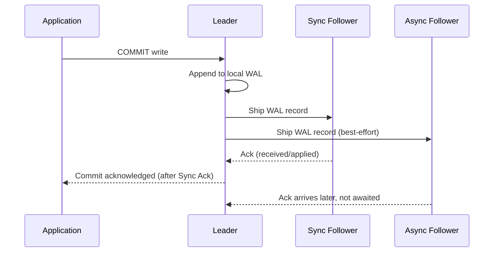

### 4.4 Replication lag and its consequences

**Definition.** Replication lag is the time delta between when a write is
committed on the leader and when that same write becomes visible on a
given follower. It is usually measured in two components: the time for the
WAL record to be *transmitted* to the follower (network/transfer lag) and
the time for the follower to *apply/replay* that record against its local
copy (apply lag) — a follower can be fully caught up on receiving bytes but
still behind on applying them if its apply thread is CPU- or I/O-bound.

**Mechanism.** Lag is not constant — it grows under any of: a burst of
write volume that outpaces a follower's single-threaded (in older engines)
apply capacity, network congestion or increased round-trip latency between
leader and follower (especially across regions), a follower running a
long, resource-intensive analytical query that starves its own apply
process of CPU/I/O, or a follower undergoing routine maintenance (index
rebuild, vacuum/compaction) that competes for the same disk I/O the apply
thread needs.

**Decision implications.** Any system that routes reads to followers must
decide, explicitly, what staleness it can tolerate for each *kind* of read.
A public-facing product catalog page can tolerate seconds of staleness
without anyone noticing; a "confirm my payment went through" read
generally cannot. This is why production systems rarely have one universal
answer to "can I read from a replica" — the answer is a per-query-pattern
decision informed by measured lag and business tolerance, not a blanket
policy.

**Common failure mode.** Lag is treated as a fixed, small constant observed
in calm conditions and never re-validated under load; the first time a
marketing campaign drives a traffic spike, replication lag balloons from
milliseconds to tens of seconds exactly when the most customers are reading
their own just-written data (order confirmations, profile updates), which
is the worst possible time for that assumption to break.

**Concrete scenario.** A social media "post a comment, see it appear
instantly" feature routes writes to the leader and the immediate re-render
read to a randomly chosen follower from a load-balanced pool. Under normal
load, lag is 5-10 milliseconds and no one notices; during a viral traffic
spike, apply lag on the busiest follower grows to 8 seconds, and a visible
fraction of users briefly do not see the comment they just posted — a
direct instance of the read-your-writes problem in Section 4.5.

```mermaid
flowchart TD
    A["Write committed on leader"] --> B{"What causes lag?"}
    B --> C["Network/transfer delay<br/>(cross-region RTT, congestion)"]
    B --> D["Follower apply-thread<br/>CPU/I&#47;O contention"]
    B --> E["Follower running long<br/>analytical queries"]
    B --> F["Follower maintenance<br/>(vacuum, index rebuild)"]
    C --> G["Follower visibly stale<br/>vs. leader's committed state"]
    D --> G
    E --> G
    F --> G
```

### 4.5 Read-your-writes consistency and mitigation strategies

**Definition.** Read-your-writes consistency (a specific, named session
consistency guarantee) means that once a client has performed a write, that
same client's subsequent reads are guaranteed to reflect that write (and
any earlier ones it made), even though a different client reading the same
data at the same moment might still see a stale value from a lagging
replica. It is a *per-session* guarantee, not a global one — it says
nothing about what other clients see.

**Mechanism.** Read-your-writes is violated exactly when a client's write
goes to the leader and a subsequent read from the same client is routed to
a follower that has not yet applied that write. Three practical mitigation
mechanisms exist, each with a different cost profile: (1) **read-your-own-
writes routing** — track, per session, whether the user has written
recently, and route that session's reads to the leader (or to a follower
known to be caught up) for a short window afterward; (2) **version/LSN-
aware routing** — have the client (or a proxy) remember the LSN/offset of
its last write, and only route reads to a follower whose applied-LSN is at
or beyond that value, waiting (with a bounded timeout) if none currently
qualifies; (3) **session stickiness** — pin an entire user session to a
single node (often the leader, or a single fixed follower) for its
duration, trading some read-scaling benefit for a simpler consistency
story within that session.

**Decision implications.** Version/LSN-aware routing is the most precise
mechanism (it does not needlessly pin unrelated reads to the leader) but
requires the client or an intermediary proxy to track and pass along a
position token, adding implementation complexity. Read-your-own-writes
routing by time window is simpler to implement but is a heuristic — it
either over-routes (unnecessarily hitting the leader for reads that would
have been fine on a slightly-stale follower) or under-routes (the window
expires just before the actual replication catch-up completes). Session
stickiness is the simplest but sacrifices the most read-scaling benefit and
still needs a fallback plan for when the sticky node fails.

**Common failure mode.** A team migrates from a single-node database to
leader/follower replication purely for read scaling, load-balances all
reads uniformly across leader and followers with no session-awareness at
all, and only discovers the read-your-writes gap in production when users
start reporting that their profile edits or shopping-cart updates
intermittently "don't save" — when in fact they did save, just not where
the very next read looked.

**Concrete scenario.** A user updates their shipping address at checkout,
then the confirmation page re-fetches the full order (including the
address) from a randomly selected follower. If that follower has not yet
replayed the address-update WAL entry, the confirmation page shows the
*old* address even though the database already has the new one — visually
indistinguishable, to the user, from data loss.

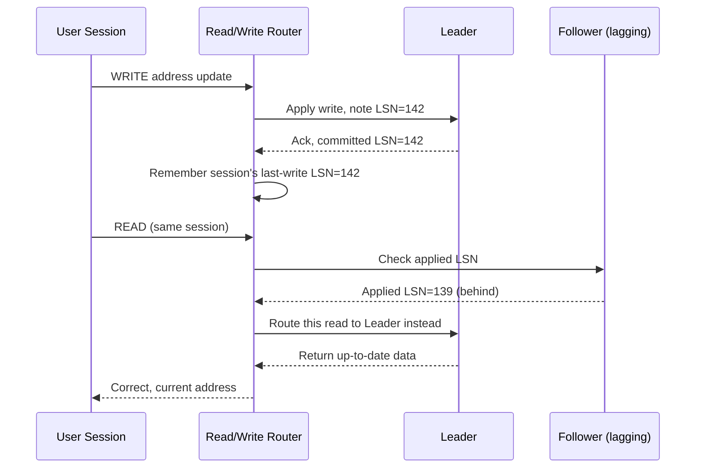

### 4.6 Multi-leader replication and conflict resolution

**Definition.** Multi-leader replication (also called master-master or
active-active replication) allows more than one node to independently
accept writes for the same logical dataset — typically one leader per
data center or geographic region — with each leader asynchronously
replicating its writes to every other leader.

**Mechanism.** Each leader applies writes it receives locally and
immediately, without waiting for confirmation from other leaders (waiting
would defeat the entire point of accepting writes locally), then streams
those writes to its peer leaders in the background, the same way a
leader/follower system streams WAL — except now the stream flows in every
direction. Because two leaders can each accept a *conflicting* write to the
same record before either has heard about the other's write, the system
must detect and resolve these write-write conflicts after the fact, using
one of several strategies: **last-write-wins (LWW)** using a timestamp
(simple, but silently discards one of the two writes and is vulnerable to
clock-skew-driven wrong outcomes); **application-defined merge functions**
(e.g. treating a shopping cart as a set-union of both leaders' additions
rather than picking one write as "the" winner); or **Conflict-Free
Replicated Data Types (CRDTs)**, purpose-built data structures whose merge
operation is mathematically guaranteed to converge to the same result
regardless of the order updates are applied in.

**Decision implications.** Multi-leader replication is chosen specifically
when write *availability during a network partition between regions*, or
low write *latency for geographically distributed users*, matters more
than avoiding conflicts entirely — a single-leader system forces every
write across the globe through one region's leader, adding hundreds of
milliseconds of cross-region latency and making the *entire system*
unable to accept writes if that one leader's region is unreachable.
Multi-leader trades that away for a harder, ongoing conflict-resolution
engineering burden, and is generally not worth adopting unless the
single-leader write-latency or single-region-outage cost is already a
proven, measured business problem.

**Common failure mode.** Teams adopt multi-leader replication for its
availability properties but pick last-write-wins conflict resolution by
default without auditing which fields actually tolerate silently losing a
write — a customer's two concurrent "update my email" writes from two
regions resolve cleanly under LWW, but two concurrent "add $50 to my
account balance" writes do *not* commute, and LWW silently drops one of
the two credits, which is a correctness bug, not merely a UX edge case.

**Concrete scenario.** Two support agents in different regions
simultaneously update the same customer ticket's status field — one
closes it, one reassigns it. Under LWW, whichever write has the later
timestamp wins outright and the other is silently discarded, even though
both were legitimate, non-conflicting-in-intent actions that a
human-reviewable merge (or a CRDT-modeled "last known status per field
with per-field timestamps") would have preserved more faithfully.

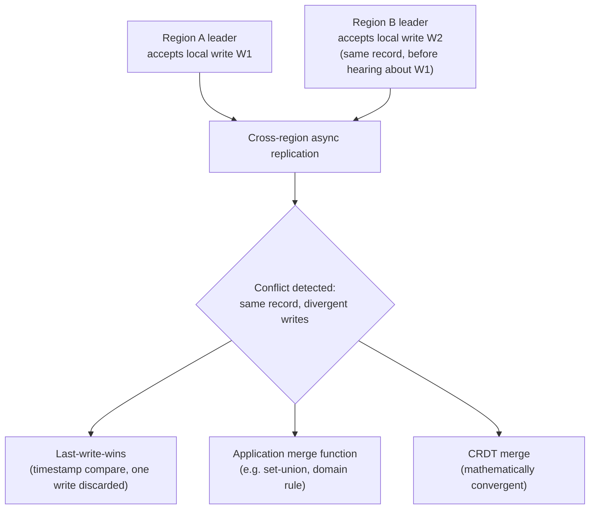

### 4.7 Leaderless (quorum-based) replication — the Dynamo-style model

**Definition.** Leaderless replication removes the single-leader concept
entirely: any of N replicas holding a piece of data can accept a write or
serve a read directly from a client (or a coordinator node acting on the
client's behalf), and consistency is reasoned about not through a single
authoritative node but through **quorum arithmetic** — requiring a write to
be acknowledged by W out of N replicas and a read to be answered by R out of
N replicas, where the specific relationship between W, R, and N determines
what consistency guarantee the system provides.

**Mechanism.** For a value replicated across N nodes, a **write quorum** W
means the coordinator sends the write to all N reachable replicas but only
waits for W of them to acknowledge before telling the client the write
succeeded; a **read quorum** R means a read is sent to (at least) R
replicas and the coordinator reconciles their answers (usually by taking
the value with the highest version/timestamp) before returning a result to
the client. The critical correctness rule is: **if W + R > N, every read
quorum and every write quorum are guaranteed to overlap on at least one
node**, which means at least one node in any read quorum has necessarily
seen the most recent successful write — giving the system a strong
consistency guarantee *without* ever appointing a single leader. Systems
following this model additionally use **sloppy quorum** (accepting writes
on nodes outside the "home" N replicas during a network partition, to
preserve write availability, then reconciling later) combined with **hinted
handoff** (the temporarily-substituting node holds the write as a "hint"
and forwards it to the correct home replica once reachable again), and
**read repair** (when a read quorum's replicas disagree, the coordinator
detects the stale replica(s) and pushes the newer value to them as a
background repair, converging the system even without a dedicated
replication stream).

**Decision implications.** The N/W/R parameters are a per-table (or even
per-request, in systems like DynamoDB and Cassandra) tuning knob, not a
fixed architectural constant: W=1 gives the fastest possible writes but the
weakest durability guarantee (a single node crash before the sloppy-quorum
hint propagates can lose the write); W=N gives the strongest durability but
means *any* single replica being down blocks all writes to that key,
re-creating the same all-nodes-must-be-up fragility a leaderless system was
meant to avoid; the common middle ground — for example N=3, W=2, R=2 —
satisfies W+R > N (2+2 > 3) and tolerates any single node being unavailable
for either reads or writes while still guaranteeing overlap.

**Common failure mode.** Teams configure W + R ≤ N (for example N=3, W=1,
R=1) purely to minimize latency, not realizing they have opted out of the
overlap guarantee entirely — under that configuration, a read can be
answered entirely by nodes that never received the latest write, and the
system silently degrades to eventual consistency with no read-your-writes
guarantee at all, even though "quorum" is in the configuration's name and
sounds reassuring.

**Concrete scenario.** A Cassandra table configured with a replication
factor of 3, using `LOCAL_ONE` for both reads and writes for latency
reasons (effectively W=1, R=1), can return a stale value on a read
immediately following a write to a *different* replica, because 1 + 1 is
not greater than 3 — there is no guaranteed node overlap between that
particular write and that particular read.

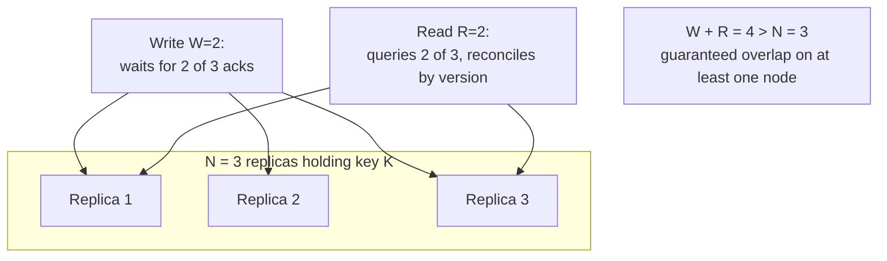

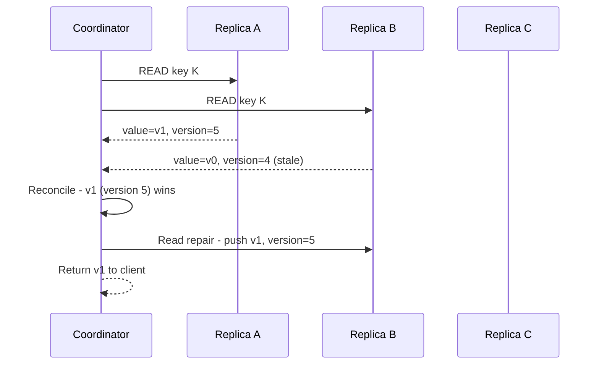

### 4.8 Failover mechanics and split-brain risk

**Definition.** Failover is the process of promoting a follower (or, in a
leaderless system, electing a new coordinator role) to become the new
leader after the previous leader becomes unreachable or is confirmed to
have failed. Split-brain is the specific failure mode where a network
partition causes *two* nodes to simultaneously believe themselves to be the
legitimate leader, both accepting writes independently — producing two
divergent, conflicting histories of the same dataset that must later be
manually or algorithmically reconciled, often with data loss.

**Mechanism.** Automated failover systems (Patroni for PostgreSQL,
MHA/Orchestrator for MySQL, MongoDB's replica-set election protocol, cloud-
managed services' internal control planes) continuously monitor leader
health via heartbeats, and — once a configurable number of consecutive
heartbeats are missed — trigger a leader election among the remaining
followers, typically promoting the follower with the most up-to-date
applied WAL position to minimize data loss. The dangerous case is not "the
leader actually died" but "the leader is still alive and still accepting
writes, but cannot reach the monitoring/consensus system" (a network
partition, not a node crash): from the monitoring system's point of view
this looks identical to a dead leader, so it proceeds to promote a
follower — while the original leader, unaware anything is wrong, keeps
accepting writes from any clients still able to reach it directly.
Fencing (forcibly cutting the old leader off — revoking its database
credentials, shutting off its network port, or powering it down via STONITH
— "Shoot The Other Node In The Head") is the standard defense: the failover
system must not merely promote a new leader, it must guarantee the old one
can no longer accept writes, using a mechanism like a **fencing token** — a
monotonically increasing number issued to whichever node holds the leader
role, which every downstream write-accepting system (e.g. shared storage or
a proxy in front of the database) is required to check and reject any
write carrying an older token than the highest one it has already seen.

**Decision implications.** A failover system that promotes a new leader
without also fencing the old one has not actually solved split-brain — it
has only made split-brain more likely to occur unnoticed, because now there
are two nodes each fully convinced they are correct. Architects should
treat "do we have automated failover" and "do we have fencing" as two
separate yes/no questions, and should specifically distrust any failover
tooling that cannot describe its fencing mechanism when asked.

**Common failure mode.** A quorum-based consensus system (e.g. one relying
on etcd, ZooKeeper, or Raft-based leader election) is deployed with an even
number of monitoring/voting nodes, or with all voting nodes inside a single
availability zone — either configuration can produce a scenario where a
partition splits the voters into two groups that each believe they hold a
majority (with an even split) or where an entire zone-level outage takes
out the majority of voters at once, either of which defeats the very
purpose of using a quorum-based consensus protocol to prevent split-brain.

**Concrete scenario.** A three-data-center deployment loses its inter-data-
center network link between DC1 (holding the leader) and DC2+DC3 (holding
the monitoring majority). DC2+DC3 correctly conclude they cannot reach the
leader and elect a new one in DC2. If DC1's leader is not fenced off from
its own local clients (some of whom may still be able to write to it, e.g.
via a stale connection-pool entry that bypasses the router), both DC1's old
leader and DC2's new leader now independently accept writes — a textbook
split-brain, resolved only by manual data reconciliation after the network
partition heals.

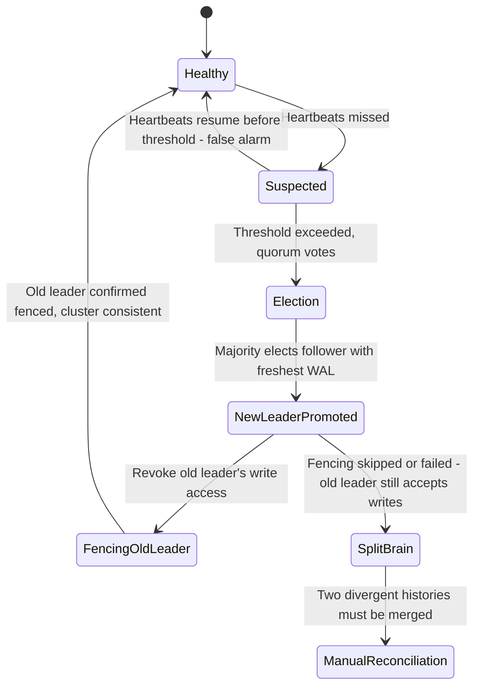

### 4.9 The consistency spectrum this chapter's mechanisms sit on

**Definition.** Every mechanism above — synchronous vs. asynchronous
replication, quorum tuning, multi-leader conflict resolution — is a
concrete implementation of an underlying, more abstract trade-off: as
replica count and geographic distribution grow, a system cannot
simultaneously guarantee that every read sees the most recent write
(strong consistency) *and* that the system keeps accepting reads/writes
during any network partition (availability) *and* tolerate that partition
occurring at all — a framing generally known as the CAP theorem (Consistency,
Availability, Partition tolerance: pick at most two, though in practice
partition tolerance is not really optional for any distributed system, so
the real-world choice is between consistency and availability *during* a
partition).

**Mechanism.** Synchronous replication and W+R>N quorum configurations bias
toward consistency (a client is guaranteed to see the latest write, at the
cost of possibly being unable to complete an operation if enough replicas
are unreachable); asynchronous replication and low-quorum (W=1, R=1)
configurations bias toward availability (an operation almost always
succeeds quickly, at the cost of a reader possibly seeing stale data).
Multi-leader replication is an explicit, deliberate choice to keep accepting
writes *everywhere* during a partition, pushing the entire consistency cost
into post-hoc conflict resolution instead of into the request path.

**Decision implications.** This is why the "right" replication
configuration cannot be chosen from a generic best-practices checklist —
it must be chosen per dataset, based on which failure the business can
tolerate less: a customer briefly unable to place an order (an availability
sacrifice) versus a customer's order silently double-charged or lost (a
consistency sacrifice). A related, more nuanced framing worth knowing by
name is **PACELC** (if Partitioned, choose Availability or Consistency;
Else, even with no partition, choose Latency or Consistency) — it correctly
observes that the durability-vs-latency trade-off from Section 4.3 exists
even in the *normal*, non-partitioned case, not only during an outage.

**Common failure mode.** Teams quote "CAP theorem" as though it forces a
single global choice for an entire system, when in practice different
tables, different fields, and different read paths within the *same*
application legitimately warrant different points on the spectrum — a
product-catalog read and a payment-ledger write are not the same decision.

**Concrete scenario.** An architecture review debates "should we use
strong or eventual consistency" as a single yes/no question for an entire
e-commerce platform, when the correct framing splits it into several
independent decisions: inventory-decrement writes need strong consistency
(to avoid overselling), product-description reads are fine eventually
consistent (a few seconds of staleness on a description is invisible to
users), and session/cart state benefits from the read-your-writes routing
described in Section 4.5 rather than either extreme.

## 5. Internal Working

Zooming in from individual concepts to the full internal pipeline of a
production leader/follower deployment: a write arrives at the leader's
connection handler and is parsed and planned exactly as it would be on a
non-replicated system (see [Query Optimizers](CH04_Query_Optimizers.md) for
how the leader decides an execution plan — replication does not change plan
selection on the write path). Once the storage engine is ready to make the
change durable, it first appends a WAL record describing the change to the
end of the leader's local WAL segment file and forces that segment to disk
(an `fsync`-equivalent durability barrier), *before* modifying the in-memory
or on-disk data pages themselves — this ordering is what allows crash
recovery to replay the WAL and reconstruct any change that was logged but
not yet reflected in the data files. A background WAL-sender process (or
thread) on the leader tails this same WAL file and pushes newly appended
records to every connected follower over a persistent streaming connection,
typically using a lightweight length-prefixed framing so a follower can
distinguish record boundaries in the byte stream. On the follower side, a
WAL-receiver process appends incoming records to its own local WAL copy
(so the follower itself has crash-recovery durability for what it has
received) and hands them off to a WAL-replay process that applies each
record's change to the follower's local data pages in the exact order
received, which is what guarantees the follower's data converges to
byte-for-byte (or logically, in row-based replication) the same state the
leader had at that LSN.

Cascading topologies extend this same pipeline one hop further: a follower
can itself act as a WAL-sender to *its own* followers (called cascading
replication), which reduces the leader's outbound network/CPU load when
there are many followers, at the cost of adding one more hop's worth of lag
to the followers furthest from the leader. Most production deployments with
more than a handful of read replicas use a small tree (leader to two or
three first-tier followers, each fanning out to further followers) rather
than a flat star topology fanning directly out of the leader, precisely to
keep the leader's own replication overhead bounded regardless of total
replica count.

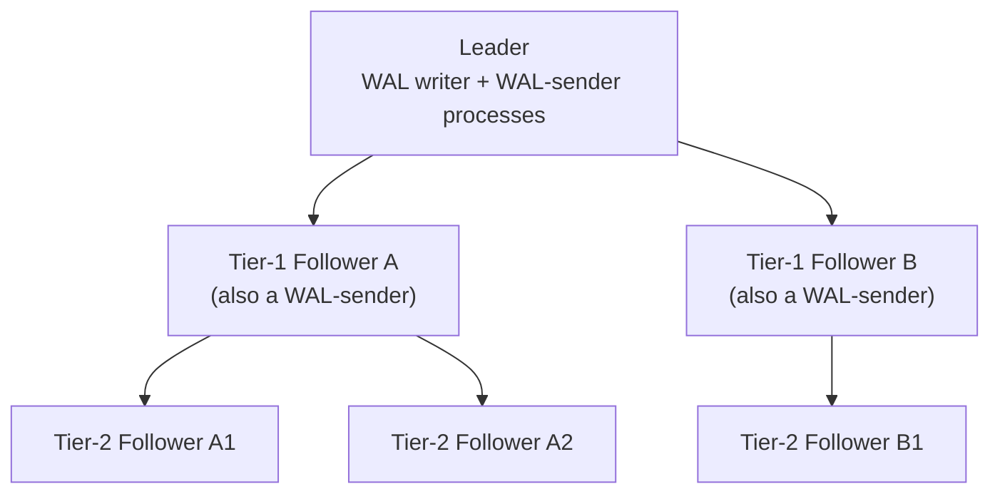

Leaderless systems have a structurally different internal pipeline: there
is no single WAL-sender/receiver pair to reason about, because every node is
simultaneously a potential coordinator and a potential replica for any given
key. A coordinator node (usually just whichever replica the client's
request first hit, using consistent hashing to know which N nodes actually
own a given key — a mechanism this chapter recaps only briefly, since the
data-distribution mechanics of consistent hashing belong to
[Partitioning](CH05_Partitioning.md)) fans a write out to all reachable
home replicas in parallel, tracks acknowledgments as they arrive, and
returns success to the client the instant W of them have confirmed — the
remaining acknowledgments (up to N) are still awaited in the background and
simply logged/ignored once the response has already been sent, since they
no longer affect the client-visible outcome.

## 6. Design Principles

- **Make the acknowledgment contract explicit and testable.** "We have
  replication" is not a specification; "writes are acknowledged only after
  being durably written on 2 of 3 nodes" is. Every replication design
  should be expressible as a concrete N/W/R (or sync/async) statement that
  can be verified in a test environment by killing nodes and observing
  actual behavior, not just read off a configuration file and trusted.
- **Separate the durability decision from the read-scaling decision.**
  Choosing synchronous replication for durability and choosing to route
  reads to followers for scaling are independent decisions with independent
  failure modes; conflating them (e.g. assuming "sync replica" also means
  "safe to read stale-free from it") produces exactly the read-your-writes
  bugs in Section 4.5.
- **Prefer the weakest consistency guarantee that the specific data
  actually needs, not the strongest available.** Defaulting every table to
  fully synchronous, quorum-heavy replication "to be safe" pays a
  system-wide latency tax for guarantees most of the data never needed;
  reserve the strongest guarantees for the specific fields where a
  violation is a real, costly bug (money, inventory, authorization state).
- **Design failover for the partition case, not just the crash case.** A
  failover mechanism validated only by killing a leader process (`kill -9`)
  has not been validated against the harder, more common real-world case —
  a leader that is alive but unreachable from the monitoring plane — which
  is exactly the scenario that produces split-brain if fencing is missing.
- **Treat replication lag as a first-class, continuously monitored metric,
  not a one-time capacity-planning assumption.** Lag under normal load says
  nothing about lag during a traffic spike, a long-running analytical query
  on a follower, or a partial network degradation; Section 14 covers the
  concrete metrics and alerting thresholds this principle implies.
- **Automate what must happen quickly; keep a human in the loop for what
  must happen correctly.** Automated failover reduces Mean Time To Recovery
  (MTTR) for the common case, but split-brain-adjacent or data-
  reconciliation decisions after a partition heals often warrant a human
  decision rather than a fully automatic one, because the "correct"
  resolution frequently depends on business context an algorithm cannot see
  (which of two conflicting writes actually reflects the customer's intent).

## 7. Architecture Patterns

- **Single leader, star topology of followers.** The default pattern for
  small-to-medium replica counts: one leader, all followers streaming
  directly from it. Simple to reason about and operate; the leader's
  outbound bandwidth/CPU for WAL-sending scales linearly with follower
  count, which becomes the limiting factor past roughly a dozen followers
  on typical hardware.
- **Single leader, cascading (tree) topology.** Used once follower count
  or geographic spread makes a flat star impractical (Section 5); trades a
  small additional lag hop for a bounded, tiered leader load, and
  additionally lets each region maintain a local "regional leader-of-
  followers" that intra-region readers stream from, reducing cross-region
  bandwidth to a single stream per region rather than one per follower.
- **Read replica pool behind a proxy/router.** A connection proxy (e.g.
  PgBouncer/PgPool for PostgreSQL, ProxySQL for MySQL, or a custom
  application-layer router) sits between the application and the
  leader/follower set, routing writes to the leader and reads to whichever
  follower is least loaded or least lagging, and implementing the
  read-your-writes mitigations from Section 4.5 in one centralized place
  rather than in every calling service.
- **Multi-leader, per-region active-active.** Each region has its own
  full leader/follower sub-cluster; the region's leader replicates
  asynchronously to every other region's leader. Chosen specifically for
  low local write latency and continued regional write availability during
  an inter-region network partition, at the cost of the conflict-resolution
  burden in Section 4.6.
- **Leaderless, consistent-hashed ring.** Data is assigned to N nodes via
  consistent hashing over a hash ring (data-placement mechanics owned by
  [Partitioning](CH05_Partitioning.md)); any node can coordinate a read or
  write for keys it is responsible for (or simply forward the request to a
  node that is), and quorum arithmetic (Section 4.7) is the sole mechanism
  providing consistency, with no leader-election machinery at all.
- **Delayed/lagged replica for operational safety.** A deliberately-delayed
  follower (e.g. one hour behind, achieved by pausing WAL replay) is
  maintained purely as a recovery mechanism against *logical* corruption —
  an accidental mass `DELETE` or a bad migration replicates instantly and
  correctly to every synchronous or near-real-time follower (replication
  faithfully propagates mistakes too), but a deliberately delayed replica
  gives operators a window to intervene before the bad change reaches it.

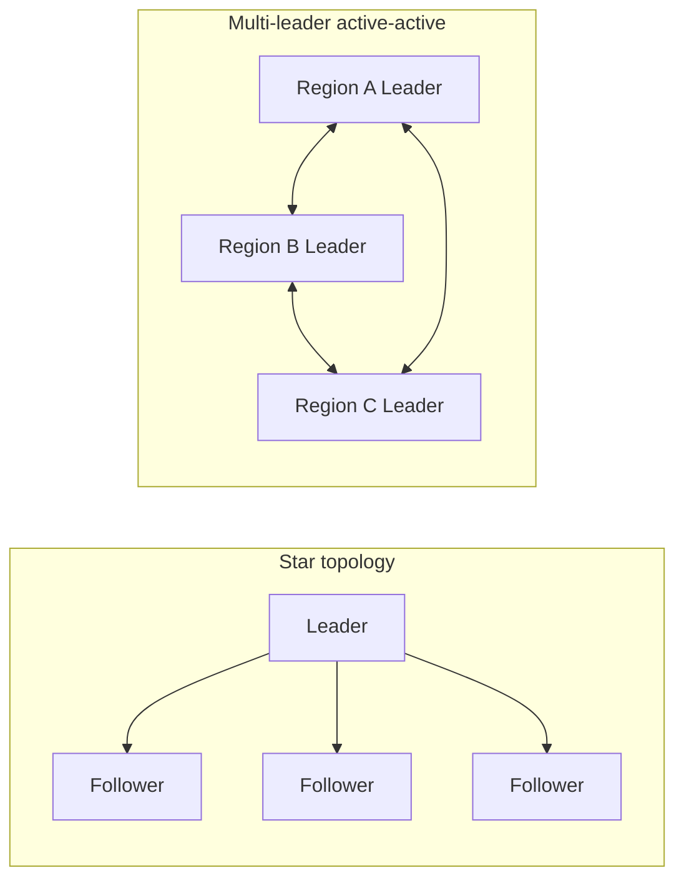

## 8. Production Architecture

A representative production topology for a globally available e-commerce
platform combines several of the patterns above rather than picking just
one: the transactional core (orders, payments, inventory) runs on a
single-leader relational database (e.g. PostgreSQL on Amazon RDS/Aurora,
Azure SQL Database, or Google Cloud SQL) with semi-synchronous replication
to an in-region standby for fast automated failover, plus one or more
asynchronous cross-region read replicas for disaster recovery and
regional read-latency reduction on read-only reporting queries. The
session/cart layer runs on a leaderless key-value store (e.g. DynamoDB, or
self-managed Cassandra) configured with a quorum satisfying W+R>N, because
cart state benefits far more from write availability during a regional
blip than from single-leader consistency, and conflicts (two devices
updating the same cart) are naturally mergeable as a set-union rather than
needing last-write-wins.

Managed cloud offerings largely automate the mechanics this chapter
teaches but do not remove the underlying trade-off — they only move where
the decision is made. Amazon Aurora, for example, replicates at the
storage layer (six copies across three Availability Zones, quorum-based
writes requiring 4 of 6, reads requiring 3 of 6) rather than shipping a
traditional WAL stream to independent full-copy replicas, giving very fast
failover (typically under 30 seconds) because Aurora read replicas share
the same underlying distributed storage volume and do not need to catch up
on a separate WAL stream at all — architecturally this changes *how* the
guarantee is achieved, but the same quorum arithmetic from Section 4.7 is
what makes it correct.

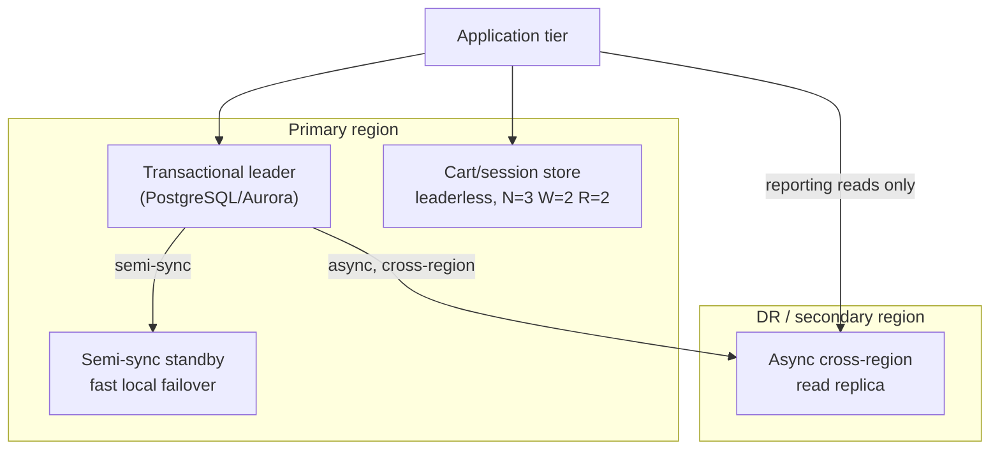

## 9. Implementation

Implementing a leader/follower deployment in practice means making four
concrete configuration decisions, each traceable back to a Section 4
concept: (1) choose the replication mode (async/sync/semi-sync) per the
Section 4.3 trade-off and set it explicitly rather than accepting a
default that may not match the intended durability guarantee; (2)
configure WAL retention (or an equivalent replication slot) generously
enough that a follower can survive a realistic outage window without
needing a full re-seed, per the Section 4.2 failure mode; (3) implement an
explicit read-routing policy — at minimum, distinguish "may read from any
follower" queries from "must read fresh" queries, and wire the latter to
the Section 4.5 mitigation the team has chosen; and (4) deploy (or adopt a
managed) failover controller with an explicit, tested fencing mechanism per
Section 4.8, and confirm — by actually triggering a network partition in a
staging environment, not just a process kill — that the old leader cannot
continue accepting writes after a new one is promoted.

For leaderless systems, implementation additionally means choosing
concrete N/W/R values per table/keyspace based on the Section 4.7
overlap rule, and deciding whether the client library or the coordinator
node is responsible for version reconciliation on divergent reads (most
managed leaderless databases, like DynamoDB, handle this internally and
expose only a consistency-level knob such as "eventually consistent read"
vs. "strongly consistent read," which corresponds directly to a low-R vs.
high-R choice under the hood).

## 10. Complete Code Examples

The following runnable/illustrative examples live under
`code/<language>/replication-chapter/` and correspond directly to the
mechanisms taught in Section 4:

1. [`code/sql/replication-chapter/01_postgres_streaming_replication_config.sql`](../code/sql/replication-chapter/01_postgres_streaming_replication_config.sql)
   — annotated PostgreSQL primary/replica configuration showing streaming
   replication, a replication slot (to solve the WAL-retention failure mode
   from Section 4.2), and the `synchronous_commit`/`synchronous_standby_names`
   settings that implement the Section 4.3 sync/semi-sync/async spectrum.
2. [`code/python/replication-chapter/02_leader_follower_log_shipping_simulator.py`](../code/python/replication-chapter/02_leader_follower_log_shipping_simulator.py)
   — a self-contained simulator modeling a leader shipping a WAL to
   multiple followers under configurable network delay and mode
   (async/sync/semi-sync), used to reproduce the Section 4.3 and 4.4
   trade-offs (measured commit latency vs. measured data-loss window) with
   actual numbers instead of just prose.
3. [`code/node/replication-chapter/03_quorum_read_write_calculator.js`](../code/node/replication-chapter/03_quorum_read_write_calculator.js)
   — a quorum calculator implementing the Section 4.7 N/W/R overlap rule,
   a sloppy-quorum/hinted-handoff simulation, and a read-repair pass that
   reconciles divergent replica versions.
4. [`code/java/replication-chapter/04_failover_fencing_token.java`](../code/java/replication-chapter/04_failover_fencing_token.java)
   — a minimal fencing-token implementation demonstrating exactly how a
   downstream storage layer rejects a write from a leader holding a
   stale token, preventing the split-brain scenario from Section 4.8.

## 11. Performance

Replication mode is the dominant performance lever this chapter controls:
asynchronous replication adds effectively zero latency to the write path
(the leader's commit latency is identical to a non-replicated system's),
while synchronous replication adds at minimum one network round trip to
the synchronous follower — in the same availability zone this might be
sub-millisecond, but across regions it can add tens to hundreds of
milliseconds *to every single write*, which compounds badly for
transaction chains that issue many sequential writes. Read-replica
scaling's benefit is close to linear for read-only, replica-tolerant
traffic (each additional follower adds roughly its own serving capacity),
but this benefit has a ceiling: the leader's own WAL-sending overhead grows
with follower count (mitigated by cascading topologies, Section 5), and
every follower still has to keep up with the *same* total write volume the
leader processes, so read replicas do not help at all with write-throughput
scaling — that is what [Partitioning](CH05_Partitioning.md) and
[Sharding](CH06_Sharding.md) are for. In leaderless systems, W and R
directly trade off against both latency and durability/consistency: raising
W or R adds tail latency (the coordinator must wait for the slowest of W or
R responses, not the fastest), which is why many systems expose per-request
consistency-level overrides rather than a single fixed cluster-wide value.

## 12. Scalability

Leader/follower replication scales *read* throughput horizontally (add
followers) but never scales *write* throughput past what a single leader
node can process — this is a hard ceiling that replication alone cannot
remove, and is the primary motivator for combining replication with
partitioning/sharding once write volume for a single logical dataset
exceeds one node's capacity. Multi-leader replication does scale write
throughput horizontally *across regions* (each region's leader absorbs its
own local write volume independently), but does not help scale write
throughput *within* a single region beyond what that region's one leader
can handle — a common point of confusion, since "multi-leader" sounds like
it should remove all single-node write bottlenecks. Leaderless systems
scale both reads and writes horizontally by adding nodes to the ring and
letting consistent hashing (Partitioning/Sharding) redistribute
responsibility, making them the natural choice when write throughput
itself, not just read throughput, needs to scale past a single machine.

## 13. Security

Replication traffic is a live, continuous copy of every write your database
processes, which makes it an attractive interception target and a common
blind spot in security reviews that focus only on client-facing traffic.
Concrete controls: encrypt WAL streaming traffic in transit (TLS between
leader and follower — full handshake mechanics owned by
[TLS](../05_Networking_and_OS/CH06_TLS.md), recapped here only as "turn it
on for replication connections, not only for client connections"); use
dedicated, least-privilege replication credentials distinct from
application database credentials, so a compromised application connection
string cannot also be used to attach a rogue follower and exfiltrate a full
copy of the dataset; and, for cross-region or cross-cloud replication,
verify the network path itself (private peering/VPN rather than public
internet) since replication streams carry the same sensitive data as the
primary database, including any Personally Identifiable Information (PII)
that plaintext WAL records expose in full even if the primary database's
access-control layer is otherwise well configured. Fencing mechanisms
(Section 4.8) are themselves a security-adjacent control: a stale leader
that continues accepting writes after being fenced is not just a
consistency bug, it is effectively an unauthorized write path that bypassed
the cluster's intended access-control decision (which node the humans/
control-plane decided should be authoritative).

## 14. Observability

The non-negotiable replication metrics to alert on: **replication lag**
(both transfer lag and apply lag, tracked per follower, since one lagging
follower can hide behind an averaged fleet-wide number), **replication
connection status** (is each follower actually connected and streaming, not
just "was connected an hour ago"), **WAL/log retention headroom** (how much
retained WAL remains before the oldest connected-or-recently-disconnected
follower's required segment would be recycled — the leading indicator for
the Section 4.2 forced-re-seed failure mode), and — for leaderless systems
— **per-node quorum health** (how many of the N replicas for a given
partition are currently reachable, since falling below W or R silently
degrades write/read availability for just that partition, not the whole
cluster, and is easy to miss in an aggregate dashboard). Failover events
themselves should be logged with full context (which node was promoted,
what its applied LSN/offset was at promotion time, whether fencing of the
old leader was confirmed) specifically because post-incident reconciliation
after a suspected split-brain depends on reconstructing exactly this
timeline.

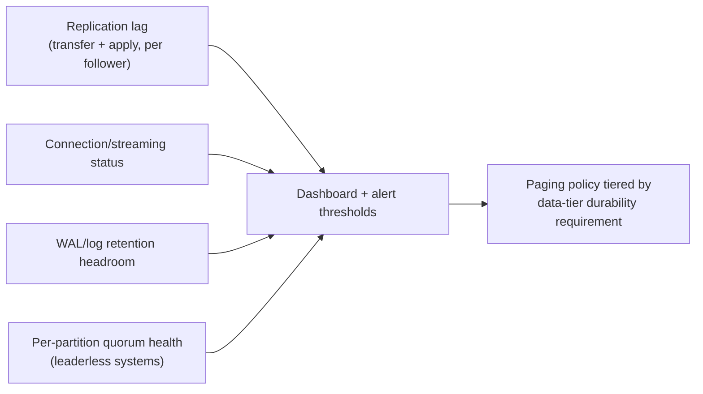

## 15. Failure Scenarios

- **Leader crash, clean failover.** The common, well-handled case: leader
  process dies, monitoring detects missed heartbeats, a follower with the
  freshest applied WAL is promoted, clients reconnect via a virtual
  IP/DNS/proxy update. Data loss is bounded by the replication mode chosen
  (zero for synchronous, up to the last unshipped WAL segment for
  asynchronous).
- **Network partition, leader still alive (split-brain risk).** The
  dangerous case covered in Section 4.8: the leader is unreachable from the
  monitoring plane but still reachable by some clients. Without fencing,
  this produces two independently-writing leaders and a divergent history
  that must be manually reconciled once the partition heals.
- **Cascading follower failure under load.** A burst of write volume
  overwhelms a follower's apply capacity (Section 4.4), its lag grows
  unboundedly, and if that follower is also acting as a WAL-sender to
  further downstream followers (cascading topology, Section 5), those
  downstream followers now lag even further behind, potentially triggering
  the WAL-retention exhaustion failure mode from Section 4.2 at multiple
  tiers simultaneously.
- **Silent data corruption replicated faithfully.** Replication has no
  concept of "this change was a mistake" — a bad migration, an
  application bug that writes malformed data, or a mass accidental delete
  replicates just as reliably and just as quickly as any legitimate write,
  which is why Section 7's delayed-replica pattern exists as a distinct
  safety net from replication itself.
- **Quorum loss in a leaderless system.** If enough nodes for a given
  partition become unreachable that neither a write quorum (W) nor a read
  quorum (R) can be satisfied, that partition's data becomes fully
  unavailable even though the rest of the cluster (other partitions) is
  healthy — a partial, key-range-scoped outage that is easy to miss if
  monitoring only reports cluster-wide aggregate health.

## 16. Testing

Replication configurations must be tested against *induced failures*, not
only validated by reading the configuration file: (1) kill the leader
process and time how long automated failover takes and how much data (if
any) is lost, comparing the measured result against the expected guarantee
for the configured replication mode; (2) simulate a network partition
(e.g. with `iptables`/`tc netem` packet loss, or a chaos-engineering tool)
between the leader and the monitoring/consensus plane while leaving the
leader reachable by a simulated client, to specifically validate the
fencing mechanism from Section 4.8 rather than only the happy-path
failover; (3) inject artificial replication lag (pause WAL apply on a
follower) and run the application's actual read paths against it to verify
the Section 4.5 read-your-writes routing behaves correctly under real lag,
not just in a zero-lag test environment where the bug would never surface;
and (4) for quorum-based systems, deliberately take down `N - W + 1` and
`N - R + 1` nodes in separate test runs to confirm the system correctly
refuses writes/reads once quorum truly cannot be met, rather than silently
degrading to a weaker guarantee than configured.

## 17. Common Mistakes

- Assuming "we have a replica" implies "we have zero data loss on
  failover" without checking whether replication is actually configured
  synchronously.
- Load-balancing reads uniformly across leader and followers with no
  read-your-writes handling at all, then treating the resulting bug
  reports as mysterious data-loss incidents instead of a routing problem.
- Configuring synchronous replication without a tested fallback for when
  the synchronous follower is unreachable, converting a durability
  safeguard into a full write-availability outage.
- Deploying automated failover tooling without confirming it fences the
  old leader, leaving the system exposed to split-brain during any
  network-partition-shaped failure rather than only a clean process crash.
- Choosing last-write-wins conflict resolution for multi-leader
  replication without auditing whether the specific fields involved
  (counters, balances) actually commute safely under that strategy.
- Configuring leaderless quorum parameters (W, R) purely for latency
  without checking whether W + R > N, silently forfeiting the overlap
  guarantee the word "quorum" implies.
- Never testing WAL/log retention headroom against a realistic outage
  duration, discovering the forced-re-seed failure mode only during an
  actual multi-hour incident.

## 18. Best Practices

- State the replication mode and its guarantee explicitly in design docs
  ("asynchronous, expected data-loss window under X seconds") rather than
  the vague "replicated for HA."
- Build read-routing as a shared, centralized concern (a proxy or a
  well-tested client library) rather than re-implemented ad hoc in every
  service that queries the database.
- Size WAL/log retention (or replication slots) against your *measured*
  worst-case outage duration, not an optimistic average.
- Require every automated failover mechanism to document and demonstrate
  its fencing strategy before it is trusted in production.
- Choose N/W/R (or sync/async) per dataset based on the actual cost of a
  consistency violation vs. an availability violation for that specific
  data, not as one global default.
- Monitor replication lag and quorum health as first-class, alerting
  metrics, not as something checked only during an incident.
- Periodically run failover and partition drills in a staging environment
  that mirrors production topology, not only unit tests of the failover
  code path.

## 19. Anti-Patterns

- **The "replica as a backup" fallacy** — treating a live, continuously
  replicated follower as equivalent to a point-in-time backup; it is not,
  because it faithfully replicates corruption/mistakes just as fast as
  legitimate writes (Section 15).
- **Synchronous-everything by default** — applying full synchronous
  replication uniformly to every table "to be safe," paying a system-wide
  latency tax for a guarantee most data never needed.
- **Failover without fencing** — automated leader promotion with no
  mechanism to guarantee the old leader stops accepting writes, an
  invitation to split-brain during the very partition scenario failover
  was built to survive.
- **Uniform read load-balancing with no staleness awareness** — routing
  every read identically across leader and followers regardless of whether
  that specific read requires freshness, reliably producing read-your-
  writes bugs at scale.
- **Quorum theater** — configuring W and R values that do not satisfy
  W + R > N while still calling the system "quorum-based" in design
  documentation, giving false confidence in a guarantee that was never
  actually established.
- **Ignoring conflict semantics in multi-leader systems** — adopting
  last-write-wins everywhere without checking which fields it is unsafe
  for, discovering the bug only when a customer-visible balance or
  inventory count is silently wrong.

## 20. Trade-off Analysis

The central trade-off this chapter teaches is durability vs. write latency
vs. write availability, and every mechanism in Section 4 is a specific,
named point on that three-way spectrum rather than a free improvement:
asynchronous replication maximizes latency and availability at the cost of
a nonzero data-loss window; synchronous replication maximizes durability at
the cost of both latency and availability (the system cannot commit if the
synchronous follower is unreachable); semi-synchronous and quorum-tuned
leaderless systems (W+R>N) occupy defensible middle grounds, at the cost of
being more operationally complex to reason about than either extreme.
Multi-leader replication additionally trades write-availability-during-
partition and low local latency against an ongoing conflict-resolution
engineering burden that never fully goes away, unlike a one-time
configuration choice. There is no dominant strategy — a Solution Architect
must make this trade-off explicitly, per dataset, informed by the actual
cost of each failure mode to the specific business, not by a generic
"replication best practice."

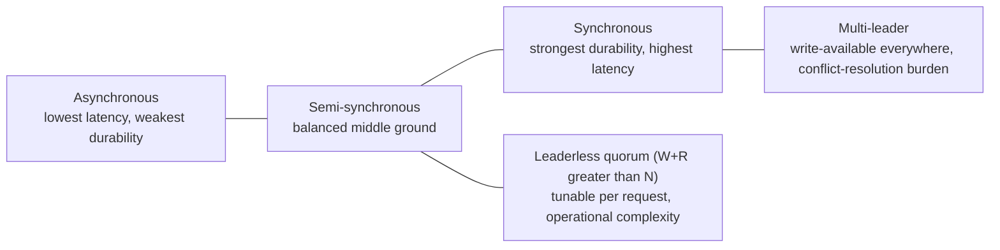

## 21. Comparison Table

| Mode | Write latency | Data-loss window on leader failure | Read scaling | Write scaling | Conflict handling needed | Typical systems |
|---|---|---|---|---|---|---|
| Asynchronous leader/follower | Lowest (no wait) | Up to last unshipped WAL segment | Yes (followers) | No (single leader) | None (single writer) | PostgreSQL/MySQL default async replicas |
| Synchronous leader/follower | Highest (network round trip every write) | None (write proven durable elsewhere) | Yes (followers) | No (single leader) | None (single writer) | Financial-grade single-region clusters |
| Semi-synchronous leader/follower | Moderate (wait for receipt only) | Very small (receipt confirmed, apply may lag) | Yes (followers) | No (single leader) | None (single writer) | MySQL semi-sync, many managed HA offerings |
| Multi-leader (active-active) | Low (local leader) | Low locally, conflicts possible cross-region | Yes | Yes, per-region | Yes — merge/LWW/CRDT required | Geo-distributed active-active deployments |
| Leaderless / quorum (Dynamo-style) | Tunable via W/R | Tunable via W (low W = higher risk) | Yes | Yes | Yes — read repair / version reconciliation | DynamoDB, Cassandra, Riak |

## 22. Real-World Case Study

In October 2018, GitHub experienced a significant multi-hour outage rooted
directly in the failover/split-brain mechanics this chapter teaches. A
brief loss of network connectivity between GitHub's East Coast and West
Coast data centers caused their MySQL cluster's automated topology manager
(Orchestrator) to conclude the existing primary was unreachable and to
initiate a failover, promoting a database in the West Coast facility to be
the new primary. When network connectivity was restored moments later,
GitHub was left with two clusters of data that had each continued accepting
writes independently during the partition window — the East Coast cluster
(the original primary, briefly still reachable to some in-region traffic)
and the newly promoted West Coast primary — producing divergent, mutually
inconsistent histories of the same dataset. Because the two histories had
genuinely diverged (not merely lagged), GitHub could not simply resume
replication in one direction; engineers had to take the site into a
degraded, read-only-for-some-data mode while manually and programmatically
reconciling the divergent writes, a process that took roughly a full day
before the site returned to full read/write availability with data
integrity fully restored. GitHub's own public post-incident analysis
specifically called out that the topology-management tooling's failover
decision was correct given the information it had (it could not distinguish
"primary is dead" from "primary is unreachable from here"), and that the
deeper fix was architectural: reducing the blast radius of any single
network partition on a globally distributed, single-primary-per-shard
topology, and strengthening the fencing/consistency guarantees around
failover decisions — precisely the Section 4.8 lesson that failover
without airtight fencing during a *partition* (not just a crash) is where
split-brain risk actually lives. This incident is frequently cited in
distributed-systems literature as a clear, publicly documented example of
why "the leader is unreachable" and "the leader is dead" must be treated as
distinct cases by any production failover design, not interchangeable
inputs to the same promotion decision.

## 23. Interview Questions

1. Explain the difference between synchronous, asynchronous, and
   semi-synchronous replication, and describe a scenario where each is the
   correct choice.
2. What is replication lag, and what two components does it decompose
   into? How would you measure each separately in production?
3. Describe the read-your-writes consistency guarantee. Give two different
   mechanisms an architecture could use to preserve it, and compare their
   trade-offs.
4. In a leaderless, quorum-based system with N=5 replicas, what write and
   read quorum values would you choose to guarantee overlap, and why does
   W + R > N matter?
5. What is split-brain, and why is fencing necessary even when automated
   failover already exists? Describe a fencing mechanism you could
   implement yourself.
6. Compare multi-leader replication to single-leader replication in terms
   of write availability during a network partition, and explain what new
   problem multi-leader replication introduces in exchange.
7. A team reports that "sometimes users don't see their own recent
   changes" after adopting read replicas. Walk through how you would
   diagnose and fix this.
8. What is a fencing token, and how does a downstream system use it to
   reject writes from a stale leader?
9. Explain sloppy quorum and hinted handoff, and describe the failure
   scenario each is designed to mitigate.
10. How does CAP theorem (and, more precisely, PACELC) apply to the choice
    between synchronous and asynchronous replication, even absent any
    actual network partition?

## 24. Hands-on Exercises

1. Stand up a two-node PostgreSQL streaming-replication pair locally
   (leader + one follower). Configure `synchronous_commit` in each of
   `off` (async), `remote_write` (semi-sync-like), and `on`/`remote_apply`
   (sync) modes in turn, and measure the observed commit latency
   difference for a simple write-heavy benchmark under each setting.
2. Using the Section 10 log-shipping simulator, reproduce a scenario where
   an asynchronous leader crashes with unshipped WAL records still
   pending, and quantify the resulting data-loss window under several
   configured network-delay values.
3. Using the Section 10 quorum calculator, find at least two distinct
   (N, W, R) configurations that satisfy W + R > N, and one that does not;
   explain in your own words what consistency guarantee is lost in the
   third case.
4. Implement a minimal read-your-writes router (in any language) that
   tracks a per-session "last write LSN" and only routes that session's
   reads to a follower whose applied LSN is at least that value, falling
   back to the leader otherwise.
5. Using the Section 10 fencing-token example, simulate a stale leader
   attempting a write after a new leader has been promoted, and confirm
   the fencing check correctly rejects it.

## 25. Design Exercises

1. Design the replication topology for a multi-region SaaS product where
   the audit-log table must never lose an acknowledged write, the
   user-profile table can tolerate a few seconds of read staleness, and
   the shopping-cart/session store must remain writable even during an
   inter-region network partition. Specify the replication mode (or N/W/R)
   for each, and justify each choice against the Section 20 trade-off
   framing.
2. Design a failover procedure — including the specific fencing mechanism
   — for a self-managed MySQL leader/follower cluster spanning two
   availability zones, and identify precisely which network-partition
   scenario your design would still fail to handle safely.
3. Given a leaderless key-value store currently configured with N=3, W=1,
   R=1 for latency reasons, propose an alternative configuration (or a
   per-operation override strategy) that preserves low-latency reads for
   non-critical data while guaranteeing strong consistency for a specific
   "account balance" key range, and explain the mechanism you would use to
   apply different guarantees to different keys in the same cluster.
4. A stakeholder proposes multi-leader replication purely to "reduce
   latency for our European users" without any stated availability
   requirement. Design an alternative that achieves the same latency goal
   without taking on multi-leader's conflict-resolution burden, and
   explain under what additional requirement multi-leader would actually
   become the correct choice.

## 26. Architecture Review Questions

- What is the configured replication mode (sync/async/semi-sync, or
  N/W/R) for each data tier, and does that configuration match the
  documented durability requirement for that tier's data?
- Has the failover mechanism's fencing behavior been demonstrated under an
  actual simulated network partition, not only a process-crash test?
- What is the current measured replication lag under peak load (not
  average load), and what is the alerting threshold?
- Which read paths are routed to followers, and which of those paths have
  an explicit read-your-writes mitigation versus none at all?
- For any multi-leader or leaderless component, what is the documented
  conflict-resolution strategy, and has it been validated against the
  specific fields (counters, balances) where last-write-wins would be
  unsafe?
- What is the WAL/log retention (or replication slot) headroom relative to
  the longest realistic outage duration the team has actually measured or
  modeled?
- Is there a distinct, tested procedure for reconciling divergent data
  after a suspected split-brain event, or does the team only have a
  procedure for the clean-failover case?

## 27. Summary

Replication keeps redundant copies of data to survive node failure,
sustain availability during outages, and scale read throughput — but every
mechanism that achieves this forces an explicit, unavoidable trade-off
between write latency, durability, and (in multi-leader and leaderless
designs) write availability during a network partition. Leader/follower
replication, streaming WAL records from a single authoritative leader to
one or more followers, is the default model and is fully described by its
synchronous/asynchronous/semi-synchronous setting; replication lag is an
inherent, load-dependent property of that stream, and left unmanaged it
produces read-your-writes violations that are best fixed with explicit,
LSN-aware read routing rather than blind uniform load-balancing.
Multi-leader replication and leaderless quorum-based systems remove the
single-leader bottleneck at the cost of, respectively, an ongoing
conflict-resolution burden and a tunable-but-easy-to-misconfigure N/W/R
consistency contract. Failover — promoting a new leader after the old one
is lost — is only half of a safe design; without a proven fencing
mechanism guaranteeing the old leader cannot keep accepting writes,
failover during a network partition (as opposed to a clean crash) produces
split-brain, a real and publicly documented failure mode, not a
theoretical edge case. A Solution Architect's job is not to pick one
"correct" replication mode for an entire system, but to make this
trade-off consciously and explicitly, per dataset, based on which specific
failure — data loss, stale reads, or write unavailability — the business
can least afford for that data.
