# Chapter: Transactions

Part: [06 — Databases and Storage](PART_OVERVIEW.md) · Status: Drafted

## 1. Introduction

A database transaction is a unit of work — one or more reads and writes —
that a database engine executes as an indivisible whole: either every
operation in it takes effect, or none do, and the data the transaction reads
and writes behaves as if no other transaction were interleaved with it,
depending on the isolation level in force. Transactions are the mechanism
that lets an application programmer write `debit(A); credit(B);` and reason
about it as a single atomic "move money from A to B" operation, without
personally handling every possible partial-failure interleaving — a crash
between the debit and the credit, a concurrent transaction reading A's
balance mid-transfer, two concurrent transfers racing on the same account.
Every relational database (PostgreSQL, MySQL/InnoDB, Oracle, SQL Server) and
a growing share of NoSQL and NewSQL stores (MongoDB since 4.0, DynamoDB
transactions, CockroachDB, Google Spanner) implement some form of this
contract, and the ACID acronym — Atomicity, Consistency, Isolation,
Durability — is the standard vocabulary for describing exactly which
guarantees a given engine and isolation-level combination actually provides.

This chapter is the *owning* chapter for the ACID properties and their
internal mechanisms, the SQL standard's four isolation levels and the
concurrency anomalies each does and does not prevent (dirty read,
non-repeatable read, phantom read, and write skew), Multi-Version
Concurrency Control (MVCC) as the dominant modern alternative to
lock-only concurrency control, Two-Phase Commit (2PC) as the classical
protocol for atomically committing a transaction across multiple
independent nodes, and the Saga pattern as the eventually-consistent
alternative to distributed ACID transactions — per the Concept Ownership
Rule in [STYLE_GUIDE.md](../STYLE_GUIDE.md). This chapter deliberately does
**not** teach lock *mechanics* in depth — lock types (shared/exclusive/
intent), lock granularity, deadlock detection algorithms, and the four
Coffman conditions are owned by a dedicated future
`CH10_Locking.md` chapter in this part (with the Coffman conditions
themselves originally introduced from an operating-system angle in
[Processes and Threads](../05_Networking_and_OS/CH24_Processes_and_Threads.md#deadlock-and-the-four-coffman-conditions-priority-inversion)).
Where this chapter needs locking to explain an isolation level's mechanism —
for example, that Repeatable Read historically held read locks until commit
under a pessimistic engine — it recaps that fact in a sentence or two and
defers the full mechanics to `CH10_Locking.md`. This chapter also recaps,
rather than re-teaches, the distributed-systems context that motivates 2PC
and Sagas: horizontal partitioning of data across nodes is owned by
[Partitioning](CH05_Partitioning.md) and [Sharding](CH06_Sharding.md), and
keeping copies of data consistent across nodes is owned by
[Replication](CH07_Replication.md) — none of the three exist yet in this
workspace at the time of writing, so they are treated as forward references
per the established convention in this part.

## 2. Historical Evolution

- **Pre-transactional batch processing (1950s-1960s)** — early data
  processing ran as sequential batch jobs against tape or flat files with no
  concurrent access at all; "consistency" was whatever the single running
  program's logic guaranteed, because there was no possibility of
  interleaving with another writer.
- **IBM IMS and the birth of the transaction concept (late 1960s)** — as
  online, multi-user access to shared data became viable, IBM's Information
  Management System introduced the idea of a logical unit of work that
  needed to survive a crash and not corrupt shared data — the conceptual
  ancestor of the modern transaction.
- **Jim Gray formalizes the transaction concept (1975-1981)** — Gray's work
  at IBM (culminating in the widely cited 1981 paper "The Transaction
  Concept: Virtues and Limitations") gave the field a rigorous definition of
  a transaction and first articulated the properties that would later be
  packaged as the ACID acronym.
- **Härder and Reuter coin "ACID" (1983)** — Theo Härder and Andreas Reuter's
  paper "Principles of Transaction-Oriented Database Recovery" assembled
  Atomicity, Consistency, Isolation, and Durability into the now-standard
  acronym, giving the industry a shared vocabulary for transactional
  guarantees.
- **System R and the birth of SQL transactions (1970s, IBM Research)** —
  IBM's System R project, the first relational database prototype, built in
  concurrency control (two-phase locking) and logging/recovery (write-ahead
  logging) as first-class engine responsibilities, patterns still visible
  in every mainstream relational database today.
- **The SQL-92 standard formalizes isolation levels (1992)** — the ANSI
  SQL-92 standard defined the four isolation levels this chapter teaches in
  Section 4 (Read Uncommitted, Read Committed, Repeatable Read,
  Serializable) purely in terms of which anomalies each one permits,
  intentionally leaving the *mechanism* (locking vs. something else)
  unspecified — a decision that later enabled MVCC-based engines to satisfy
  the same anomaly-based definitions through a completely different
  mechanism.
- **MVCC emerges as a lock-avoidance strategy (1980s-1990s)** — Multi-Version
  Concurrency Control research (with early production use in InterBase in
  the mid-1980s, and later PostgreSQL and Oracle) let readers see a
  consistent snapshot of the database without blocking concurrent writers
  and vice versa, by keeping multiple versions of each row rather than
  locking rows for reads.
- **Two-Phase Commit standardized for distributed transactions (1978-1980s,
  formalized in X/Open XA, 1991)** — as databases and message queues needed
  to coordinate a single atomic outcome across multiple independent
  resources, the X/Open Distributed Transaction Processing model and its XA
  (eXtended Architecture) interface standardized the Two-Phase Commit
  protocol this chapter teaches in Section 4.15, still the basis for Java's
  JTA (Java Transaction API) and most commercial distributed-transaction
  coordinators.
- **Berenson et al. re-examine the ANSI isolation levels ("A Critique of
  ANSI SQL Isolation Levels," 1995)** — Microsoft Research's landmark paper
  showed the ANSI SQL-92 definitions were ambiguous and under-specified
  several real anomalies (including write skew, Section 4.10), and proposed
  the now-standard **Snapshot Isolation** model that most MVCC engines'
  "Repeatable Read" actually implements.
- **NoSQL's eventual-consistency era and the retreat from ACID (2000s)** —
  Google's Bigtable, Amazon's Dynamo, and the first generation of NoSQL
  stores deliberately dropped cross-row/cross-partition ACID transactions to
  achieve horizontal scalability and partition tolerance, popularizing
  eventual consistency and, soon after, the Saga pattern (Section 4.16) as
  an application-level substitute for the atomicity ACID transactions used
  to provide for free.
- **NewSQL and Spanner bring distributed ACID back (2012 onward)** —
  Google's Spanner paper (2012) showed that globally distributed,
  strongly-consistent ACID transactions were achievable at scale using
  synchronized clocks (TrueTime) and Two-Phase Commit variants, inspiring
  CockroachDB, YugabyteDB, and TiDB to offer distributed ACID transactions
  without abandoning horizontal scale — a middle path between the classical
  single-node ACID database and pure eventual-consistency NoSQL.

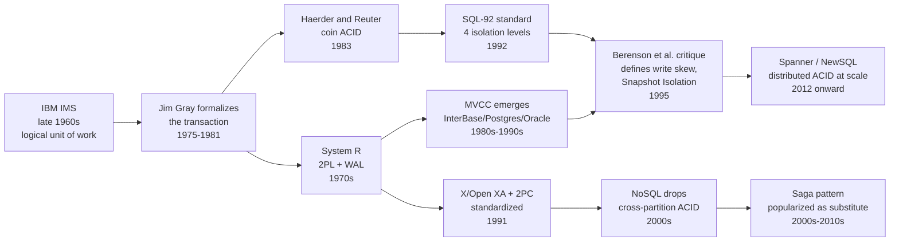

## 3. Why It Exists

Without transactions, every application would have to hand-roll its own
answer to three hard problems every time it touched shared, persistent data:
what happens if the process crashes halfway through a multi-step update, what
happens if two requests touch the same data at the same time, and how do you
guarantee that data which was reported as "saved" is actually still there
after a power loss. Multiplying this effort across every feature that writes
to the database is both extraordinarily error-prone (subtle partial-failure
and race-condition bugs are among the hardest classes of bugs to reproduce
and fix) and a poor use of engineering time, since the *same* three problems
recur in every application that shares a database. ACID transactions exist
to solve all three problems once, inside the database engine, behind a small
and simple interface (`BEGIN` / `COMMIT` / `ROLLBACK`) — letting application
code assume that a committed transaction's effects are permanent, that a
transaction either fully happened or didn't happen at all, and that
concurrent transactions cannot corrupt each other's view of the data beyond
whatever anomalies the chosen isolation level explicitly documents as
permitted. As systems moved from a single database server to horizontally
distributed and sharded architectures, the same underlying problem
reappeared one layer up — how do you get an atomic, all-or-nothing outcome
for a transaction whose steps must happen on *different* nodes that can each
independently fail — which is precisely the problem Two-Phase Commit and the
Saga pattern exist to solve, at different points on the consistency/
availability trade-off curve.

## 4. Core Concepts

### 4.1 The transaction boundary: what counts as "one unit of work"

**Definition.** A transaction is a sequence of one or more database
operations (reads and writes) that begins with an explicit or implicit
`BEGIN` and ends with either a `COMMIT` (make all its effects permanent and
visible to others) or a `ROLLBACK` (undo everything it did, as if it never
ran). Everything inside that boundary is treated by the engine as one
logical operation for the purposes of atomicity, isolation, and durability.

**Mechanism.** Most engines default to "autocommit" mode, where every
individual SQL statement is implicitly wrapped in its own single-statement
transaction unless the client explicitly issues `BEGIN`/`START TRANSACTION`.
An explicit transaction groups multiple statements — for example, "insert an
order row, decrement inventory, insert a payment row" — under one boundary,
so that if the third statement fails, the engine can undo the first two as
well, leaving the database exactly as it was before the transaction started.
The engine tracks every row version created or modified inside the boundary
(via the write-ahead log described in Section 4.5) so it can either apply or
discard the whole set atomically at the boundary's end.

**Decision implications.** The size of a transaction is a direct design
lever: a transaction that spans too many unrelated operations (for example,
"update this order AND recompute a company-wide sales-report row") holds
locks or generates version-visibility work for longer than necessary, which
increases contention with other transactions (Section 11); a transaction
that is too narrow (committing after every single row in a multi-row logical
update) can leave the database in a state that is per-statement consistent
but does not represent any valid *business* state if the process crashes
between statements. The correct boundary is exactly the set of writes that
must succeed or fail together for the business invariant to hold — not more,
not less.

**Common failure mode.** "Chatty" transactions that hold a transaction open
across a network round trip to another service, a slow external API call,
or user think-time (for example, opening a transaction, then waiting on an
HTTP call to a payment gateway before committing) hold locks or hold back
old-row cleanup (Section 4.11's vacuum/garbage-collection concern) for the
entire external call's duration, frequently the single largest cause of
lock-contention and MVCC-bloat incidents in production systems that mix
transactional database work with slow external calls.

**Scenario.** An e-commerce checkout needs to insert an `orders` row,
decrement `inventory.quantity`, and insert a `payments` row. All three must
succeed together (a paid order with no inventory decrement oversells; an
inventory decrement with no payment row loses revenue tracking) — this is
exactly the set of operations that belongs inside one transaction boundary,
while looking up the product catalog to render the checkout page beforehand
does not need to be inside that same transaction at all.

### 4.2 Atomicity — "all or nothing"

**Definition.** Atomicity guarantees that a transaction's effects are
applied to the database in their entirety, or not at all — there is no
observable state in which only some of a transaction's writes have taken
effect and the rest have not, whether the transaction ends in a `ROLLBACK`,
a client-initiated abort, or a mid-transaction crash of the database process
itself.

**Mechanism.** Atomicity is implemented primarily through the **write-ahead
log (WAL)**, also called the redo/undo log: before the engine modifies a
data page in memory or on disk, it first writes a durable log record
describing the change (the WAL-before-data-pages rule, "write-ahead"). If
the transaction commits, the log records are the durable proof the changes
happened, even if the corresponding data pages haven't been flushed to disk
yet (`redo` on crash recovery replays committed-but-not-yet-flushed changes
forward). If the transaction rolls back or the process crashes mid-
transaction, the engine uses the same log (or a companion undo log, in
engines like Oracle and MySQL/InnoDB that separate the two) to reconstruct
the pre-transaction state and discard the partial changes (`undo`). Crash
recovery on restart replays the WAL from the last checkpoint: redo every
committed transaction's changes that might not have reached disk, then undo
every transaction that was still in flight (uncommitted) when the crash
happened.

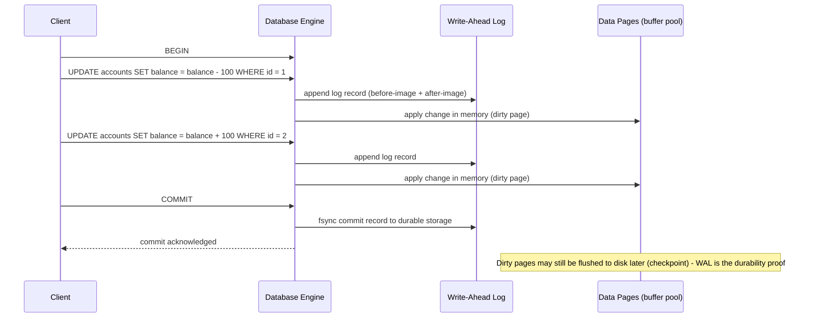

**Decision implications.** Because atomicity is log-based, the cost of a
rollback is roughly proportional to how much work the transaction already
did, not to how "big" the change conceptually is — a transaction that
inserted a million rows before failing on the last one must undo all
million. This is why bulk-load jobs are usually chunked into batches with
periodic commits rather than one giant transaction: a failure late in an
unbatched load pays the full undo cost, while a batched load only loses the
current batch.

**Common failure mode.** Assuming atomicity extends beyond the database
itself: a transaction that writes to the database *and* calls an external
non-transactional side effect (send an email, call a third-party API) inside
the same code path has no atomicity guarantee across that boundary — if the
database commit succeeds but the process crashes before the email send, or
vice versa, the two are now inconsistent with each other. This exact problem
— keeping a database write and a message/side-effect in sync — is what
motivates patterns like the transactional outbox (recapped in Section 7) and
is a core reason distributed transactions and Sagas exist at all (Sections
4.15-4.16).

**Scenario.** A batch job inserts 50,000 rows inside one transaction and
fails on row 49,999 due to a constraint violation. Atomicity guarantees that
after the failure, all 49,999 already-inserted rows are rolled back along
with the failed one — the table is exactly as it was before the job started,
not "49,999 rows in plus one rejected."

### 4.3 Consistency — the invariant-preservation property

**Definition.** Consistency, in the ACID sense, means a transaction takes
the database from one valid state to another valid state, where "valid"
means every declared constraint (primary keys, foreign keys, `CHECK`
constraints, uniqueness constraints) and every application-level invariant
the transaction is responsible for holds both before and after the
transaction. Consistency is the odd one out among the four ACID letters: it
is largely a *consequence* of the other three plus correctly written
application logic and schema constraints, rather than a mechanism the engine
implements on its own.

**Mechanism.** The database engine enforces the *declarative* half of
consistency automatically: it will refuse to commit a transaction that would
violate a primary key, foreign key, unique, `NOT NULL`, or `CHECK`
constraint, rolling back the violating statement (or the whole transaction,
depending on the engine and constraint-deferral settings). The *application*
half of consistency — invariants the schema cannot express, such as "the sum
of debits must equal the sum of credits across an entire ledger" or "at
least one doctor must remain on call" (Section 4.10's write-skew example) —
is the application's responsibility to enforce by structuring its
transactions and isolation level correctly; the engine has no way to know
about a business rule it was never told about in a constraint.

**Decision implications.** Recognizing which invariants are *declarable* (and
should be pushed into schema constraints, since the engine will then enforce
them for free on every code path, including ones a developer forgets to
check) versus which are *procedural* (require correct transaction boundaries
and isolation-level choices to enforce, because they involve reading state
before deciding whether a write is valid) is one of the highest-leverage
modeling decisions in a schema design. Under-declaring constraints pushes
correctness entirely onto application code discipline; over-relying on
application-level checks without matching constraints leaves a data-
corruption path open to any other code path (a migration script, a direct
SQL console session) that bypasses the application layer.

**Common failure mode.** Treating "the transaction committed without an
error" as proof that a business invariant held, when the invariant was
actually a procedural one that depended on the isolation level catching a
concurrent conflict. Section 4.10 (write skew) is the canonical example: an
application invariant ("at least one doctor on call") can be silently
violated by two transactions that each individually pass their own
consistency check, with no constraint violation and no error from the
engine at all, because the invariant spans rows in a way `CHECK` constraints
cannot express and the isolation level in use did not require it to.

**Scenario.** A `CHECK (balance >= 0)` constraint declaratively guarantees no
single account can go negative — the engine enforces this on every write
path automatically. A ledger-wide "total debits equal total credits" rule
has no equivalent single-row constraint syntax in standard SQL; enforcing it
correctly requires either recomputing and checking the whole ledger inside
the same transaction (expensive) or relying on the transaction's isolation
level plus careful write patterns (for example, always writing a matching
debit and credit row inside the same transaction) to prevent it from ever
being violated in the first place.

### 4.4 Isolation — the "no visible interference" property (overview)

**Definition.** Isolation determines to what extent concurrently executing
transactions can observe each other's uncommitted or in-flight changes — a
perfectly isolated system behaves, from every transaction's point of view,
as if it were the only transaction running against the database, even
though many are actually executing concurrently for performance reasons.
Unlike atomicity and durability, which are essentially binary (either
guaranteed or not), isolation is a *spectrum*: the SQL standard defines four
discrete isolation levels (Section 4.6 onward), each permitting a
progressively smaller set of concurrency anomalies, trading stronger
guarantees for reduced concurrency and throughput.

**Mechanism.** Isolation can be implemented by two broad families of
mechanism. The first is **pessimistic locking**: a transaction acquires a
lock before reading or writing a row, and other transactions wanting a
conflicting lock must wait — full lock-type/granularity/deadlock mechanics
are owned by the future `CH10_Locking.md` chapter, so this chapter only
notes that locking is *one* way an engine can implement a given isolation
level's guarantees. The second, dominant in modern engines, is **Multi-
Version Concurrency Control (MVCC, Section 4.11)**: instead of blocking
readers, the engine keeps multiple historical versions of each row and gives
each transaction a consistent snapshot to read from, so readers never block
writers and writers never block readers (though writers can still conflict
with other writers).

**Decision implications.** The isolation level is a per-transaction (in most
engines, session- or transaction-scoped) choice, not a fixed property of the
database — an architect or engineer chooses the *weakest* isolation level
that still prevents the anomalies a given transaction's business logic
cannot tolerate, because weaker isolation levels generally allow more
concurrent throughput. Defaulting every transaction to the strongest
available level ("just use Serializable everywhere") is a common
overcorrection that needlessly sacrifices throughput for transactions that
never actually touch data in a way that would produce an anomaly.

**Common failure mode.** Assuming isolation levels are portable in meaning
across engines: the SQL standard defines isolation levels in terms of which
anomalies they must prevent, but different engines implement the *same
named level* with different actual guarantees — most infamously, MySQL's
InnoDB `REPEATABLE READ` prevents phantom reads for plain (non-locking)
reads via its next-key locking scheme, while PostgreSQL's `REPEATABLE READ`
(actually Snapshot Isolation) also happens to prevent most phantom reads but
through an entirely different mechanism and with different edge cases —
verifying your specific engine's documented behavior, not just the label,
is mandatory before relying on a named isolation level for correctness.

**Scenario.** A read-only analytics query that generates a report by
scanning millions of rows benefits enormously from a low isolation level
(or, better, MVCC's inherent non-blocking reads) since it doesn't need to
observe a perfectly consistent-with-latest-writes snapshot; a funds-transfer
transaction that reads an account balance before deciding how much to debit
needs a strong enough isolation level to guarantee that balance can't change
underneath it before the debit is written.

### 4.5 Durability — surviving a crash

**Definition.** Durability guarantees that once a transaction has been
acknowledged as committed to the client, its effects survive any subsequent
crash — a power loss, an OS crash, a database process crash — that occurs
immediately after that acknowledgment. A committed transaction must never
silently disappear on restart.

**Mechanism.** Durability is implemented by ensuring the transaction's
write-ahead log records are `fsync`'d (flushed past the operating system's
page cache to physical, non-volatile storage) *before* the engine
acknowledges the commit to the client — this is the same WAL mechanism
Section 4.2 described for atomicity, reused here for a different guarantee.
On restart after a crash, the engine's recovery process replays the WAL from
the last checkpoint: any transaction whose commit record made it to durable
storage is redone (its data-page changes are reapplied, even though the
in-memory buffer pool was lost), and any transaction still in flight
(no durable commit record) is undone. Replicated systems extend durability
further by requiring the WAL record (or the write itself) to be
acknowledged by one or more replicas before commit, so durability survives
not just a process crash but the loss of the entire primary node — the full
mechanics of that replication acknowledgment model belong to
[Replication](CH07_Replication.md).

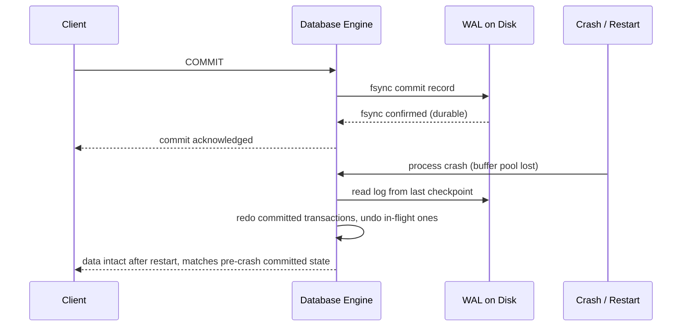

**Decision implications.** `fsync` on every commit is expensive relative to
an in-memory write — this is why databases expose durability trade-off
knobs (PostgreSQL's `synchronous_commit`, MySQL's
`innodb_flush_log_at_trx_commit`) that let an architect choose to
acknowledge a commit before the fsync completes, in exchange for a small
window of possible data loss (typically bounded to "the last few
milliseconds' worth of commits") in exchange for significantly higher commit
throughput — an explicit trade-off between durability strength and latency/
throughput that should be a deliberate, documented decision per workload,
not an accidental default.

**Common failure mode.** Trusting an operating system's write-back disk
cache or a cloud block-storage volume's default write-caching behavior
without verifying it honors `fsync` as a true barrier to durable media —
several well-known production data-loss incidents have traced back to a
storage layer that acknowledged an `fsync` call before the data was actually
on durable media, silently breaking the entire durability guarantee the
database was relying on.

**Scenario.** A payment is recorded, the client receives an HTTP 200
response confirming the payment succeeded, and one second later the
database host loses power. Durability guarantees that on restart, the
payment record is still there — losing it after having told the client "success"
would be a correctness incident (a payment the customer believes succeeded
having no trace in the system), not merely a performance one.

### 4.6 Isolation levels and the anomaly taxonomy — the conceptual map

Before walking through each of the four SQL standard isolation levels
individually (Sections 4.7-4.10), it helps to fix the vocabulary for the
anomalies they are defined against. Each anomaly describes a specific way
one transaction's view of the data can be affected by a concurrent
transaction's in-flight or committed work.

- **Dirty read** — a transaction reads a row value that another transaction
  has written but not yet committed. If the writer later rolls back, the
  reader has observed a value that never actually existed in the committed
  history of the database at all.
- **Non-repeatable read** (also called a "fuzzy read") — a transaction reads
  the same row twice and gets two different values, because another
  transaction committed a change to that row in between the two reads.
- **Phantom read** — a transaction re-runs the same *predicate-based* query
  (for example, "count rows where `status = 'pending'`") twice and gets a
  different *set of rows* the second time, because another transaction
  inserted or deleted a row matching that predicate in between.
- **Write skew** — two transactions each read an overlapping set of rows,
  each independently makes a decision based on what they read, and each
  writes to a *different* row consistent with what they individually
  observed — but the combination of both writes together violates an
  invariant that spans both rows, and neither transaction's individual
  write ever conflicted with the other's at the single-row level, so no
  ordinary conflict-detection mechanism catches it. Section 4.10 works
  through this in full depth with a concrete scenario.

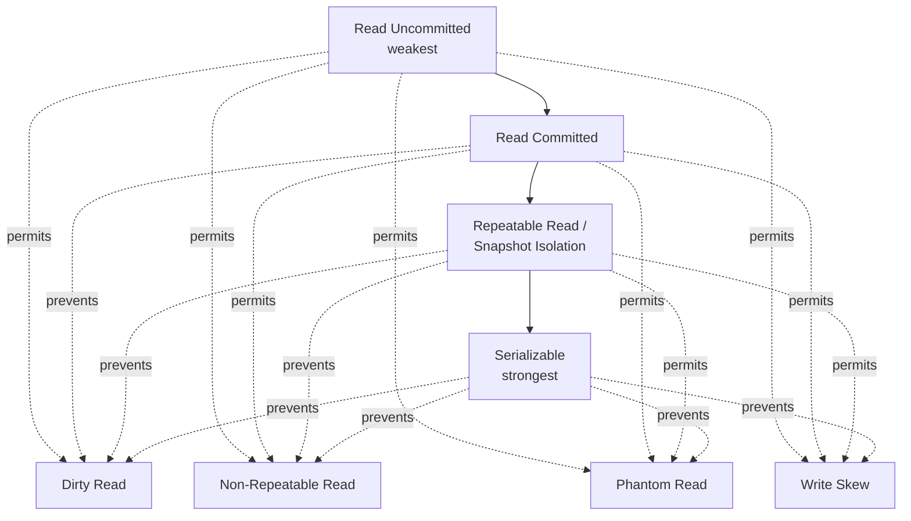

| Isolation Level | Dirty Read | Non-Repeatable Read | Phantom Read | Write Skew |
|---|---|---|---|---|
| Read Uncommitted | Permitted | Permitted | Permitted | Permitted |
| Read Committed | Prevented | Permitted | Permitted | Permitted |
| Repeatable Read (SQL standard) / Snapshot Isolation (most MVCC engines) | Prevented | Prevented | Permitted by the standard's minimum guarantee* | Permitted |
| Serializable | Prevented | Prevented | Prevented | Prevented |

*Many MVCC engines' `REPEATABLE READ` (implemented as Snapshot Isolation)
happen to prevent most phantom reads too, because the whole transaction
reads from one fixed snapshot — but this is an implementation detail beyond
what the SQL standard requires at this level, and write skew, which
Snapshot Isolation is defined to permit, is the anomaly that most sharply
distinguishes Repeatable Read/Snapshot Isolation from true Serializable.
Always verify the specific engine's documented behavior rather than relying
on the standard's minimum guarantee alone.

### 4.7 Read Uncommitted — the weakest level

**Definition.** Read Uncommitted allows a transaction to read data that
another transaction has written but not yet committed — the weakest
isolation level defined by the SQL standard, permitting all four anomalies
in Section 4.6.

**Mechanism.** Under a purely lock-based implementation, Read Uncommitted is
achieved simply by *not* acquiring read locks at all — a reader is never
blocked by another transaction's write lock, and consequently can see
whatever value is currently in the data page regardless of whether the
writer has committed. Very few production engines actually implement true
Read Uncommitted for ordinary queries: PostgreSQL silently upgrades a
requested Read Uncommitted to Read Committed (its true floor), and MySQL/
InnoDB implements it literally but it is rarely used outside of legacy
compatibility settings or explicit `WITH (NOLOCK)` query hints in SQL
Server, most often reached for by an application trying to avoid lock waits
on a busy table.

**Decision implications.** Read Uncommitted trades correctness for the
absolute minimum locking overhead and the elimination of reader/writer
blocking — a decision that only makes sense for use cases that are
explicitly tolerant of reading data that might later be rolled back, such as
a rough real-time progress indicator ("approximately how many rows have been
processed so far") where an occasional dirty read has no lasting
consequence.

**Common failure mode.** Reaching for `NOLOCK`/Read Uncommitted purely to
"fix" a lock-wait timeout without understanding that it can return rows that
were never committed, rows twice (if a page split relocates a row mid-scan),
or skip rows entirely — a well-known SQL Server anti-pattern where teams
adopt `NOLOCK` widely as a performance fix and only later discover incorrect
report totals traced back to reads of transactions that were later rolled
back.

**Scenario.** A live operational dashboard showing "orders processed in the
last minute" as a rough, self-correcting count can reasonably tolerate an
occasional dirty read of a count that gets rolled back a moment later —
whereas a financial reconciliation report must never use this isolation
level, because an uncommitted, later-rolled-back value could be reported and
acted on as real.

### 4.8 Read Committed — the common default

**Definition.** Read Committed guarantees that a transaction never reads a
value another transaction has written but not yet committed — every value
read has been committed by *some* transaction at the moment it was read —
but does not guarantee the same row will return the same value if read
again later in the same transaction, nor that a repeated predicate-based
query will return the same set of rows.

**Mechanism.** Under MVCC (Section 4.11), Read Committed is implemented by
taking a *fresh* snapshot for every individual statement within the
transaction (not once for the whole transaction) — each `SELECT` sees the
latest committed data as of the moment that specific statement started,
which is exactly why two `SELECT`s of the same row in the same transaction
can return different values if another transaction committed a change in
between them. Under a lock-based implementation, Read Committed acquires
short-lived read (shared) locks that are released as soon as the individual
statement finishes, rather than being held until the whole transaction
commits — this is what allows another transaction's write to slip in
between two reads in the same transaction.

**Decision implications.** Read Committed is the default isolation level in
PostgreSQL, Oracle, and SQL Server (it sits at MySQL/InnoDB's second level,
below the InnoDB default of Repeatable Read) precisely because it offers the
best "safe enough for most application code, without noticeably restricting
concurrency" balance: dirty reads are eliminated (a strict correctness floor
most applications need), while the remaining anomalies (non-repeatable
read, phantom read, write skew) are ones many single-statement or simple
multi-statement transactions never actually trigger in practice, because
they don't re-read the same data or the same predicate twice within one
transaction.

**Common failure mode.** Writing a "read the current value, compute a new
value based on it, then write the new value" pattern (a classic
check-then-act, such as `SELECT quantity FROM inventory WHERE id = ?`
followed by an application-computed decrement and a separate `UPDATE`) under
Read Committed, and assuming the read value is still accurate at write time
— another transaction can commit a change to that same row between the read
and the write, silently making the computed new value wrong (a lost
update). The fix is either to push the read-modify-write into a single
atomic statement (`UPDATE inventory SET quantity = quantity - 1 WHERE id = ?`)
or to escalate to a stronger isolation level or explicit row locking
(`SELECT ... FOR UPDATE`, whose full locking mechanics are owned by
`CH10_Locking.md`).

**Scenario.** An order-processing transaction reads a product's price to
display an order confirmation, then a separate step in the same transaction
re-reads the price to calculate final tax; under Read Committed, if a price
change committed in between, the two reads legitimately differ — acceptable
for many workflows, but a case where a transaction that specifically needs
one consistent view of the whole order for its full duration should use
Repeatable Read instead.

### 4.9 Repeatable Read — the snapshot-holding level

**Definition.** Repeatable Read guarantees that once a transaction has read
a row, subsequent reads of that same row within the same transaction will
return the same value, even if another transaction commits a change to it
in the meantime — eliminating the non-repeatable read anomaly in addition to
dirty reads. The SQL standard's minimum guarantee at this level does not
require phantom-read prevention, though (as noted in Section 4.6) many
MVCC-based implementations happen to prevent it as a side effect of taking
one snapshot for the whole transaction.

**Mechanism.** Under MVCC, Repeatable Read (in PostgreSQL, literally
implemented as **Snapshot Isolation**) takes a single, fixed snapshot of the
database at the moment the transaction begins its first statement, and every
subsequent read in that transaction is served from that same frozen
snapshot, regardless of what other transactions commit afterward — this is
mechanically the same MVCC machinery Section 4.11 explains in full, just
applied once per transaction instead of once per statement (as Read
Committed does). Snapshot Isolation additionally requires **first-committer-
wins** conflict detection on writes: if two concurrent transactions both try
to write the *same row*, the second one to attempt a commit is aborted with
a serialization/conflict error rather than silently overwriting the first.
Under a purely lock-based implementation (as in MySQL/InnoDB's default),
Repeatable Read is instead implemented with next-key locking — a combination
of row locks and gap locks across index ranges — which is InnoDB's mechanism
for also preventing most phantom reads at this level, at the cost of more
locking overhead than a pure MVCC snapshot approach; the specific lock
mechanics belong to `CH10_Locking.md`.

**Decision implications.** Repeatable Read/Snapshot Isolation is the right
default for any transaction that reads the same data more than once and
needs those reads to agree with each other — reporting transactions,
multi-step calculations that reference the same rows repeatedly, and any
transaction implementing a read-then-conditionally-write pattern where the
condition depends on data that must not silently change underfoot. Critically,
it does **not** protect against write skew (Section 4.10) — a transaction
relying on Repeatable Read/Snapshot Isolation to enforce a cross-row
invariant is not actually protected, and this is the single most common
isolation-level misunderstanding this chapter exists to correct.

**Common failure mode.** Assuming "Repeatable Read" is a synonym for "fully
serializable/safe for any concurrent logic," because the name sounds
stronger than Read Committed and the engine's default happens to be this
level (as in MySQL/InnoDB). Any invariant that spans more than one row, or
involves "check that some aggregate condition holds, then write based on
that check," needs either Serializable isolation or an explicit locking
strategy (`CH10_Locking.md`) layered on top of Repeatable Read — the level
alone does not provide it.

**Scenario.** An end-of-day reconciliation transaction reads a batch of
transaction rows twice — once to compute a preliminary total and once, after
some additional processing, to verify the total hasn't drifted — and needs
both reads to be based on the same underlying data even if other
transactions are actively committing new rows during the reconciliation
window; Repeatable Read guarantees this without needing to hold row locks
for the whole duration.

### 4.10 Serializable — the strongest level, and the write-skew anomaly it alone prevents

**Definition.** Serializable is the strongest isolation level: it guarantees
that the outcome of any set of concurrently executing transactions is
identical to *some* serial (one-at-a-time, in some order) execution of
those same transactions — no anomaly, including write skew, phantom reads,
non-repeatable reads, or dirty reads, is permitted.

**Mechanism.** There are two common implementation strategies. **Two-phase
locking (2PL) Serializable** (used by SQL Server, and available as an option
in most lock-based engines) acquires and holds locks — including
predicate/range locks that lock a *query condition*, not just the rows that
currently exist, so a concurrent insert matching that predicate is blocked —
for the entire transaction duration, only releasing them at commit; the full
2PL mechanics belong to `CH10_Locking.md`. **Serializable Snapshot Isolation
(SSI)** (used by PostgreSQL and several other modern MVCC engines) instead
runs transactions optimistically under ordinary Snapshot Isolation, but
additionally tracks *read-write dependencies* between concurrent
transactions (which rows one transaction read that another concurrently
wrote) and aborts one transaction with a serialization-failure error if it
detects a dependency cycle that could not have occurred in any valid serial
ordering — this is precisely the mechanism that catches write skew, where
Snapshot Isolation's row-level first-committer-wins check alone does not,
because the two transactions never wrote the *same* row.

**Decision implications.** Serializable is the correct (and, practically,
the *only* fully correct) choice whenever a transaction's logic depends on
an invariant spanning multiple rows that could otherwise be independently,
validly-looking modified by two concurrent transactions — the write-skew
class of bug. The cost is a materially higher abort/retry rate under
contention (since SSI works by aborting the loser of a detected conflict
rather than blocking it up front) and, for 2PL-based engines, coarser
locking that reduces concurrent throughput; application code using
Serializable **must** be written to catch the resulting serialization-
failure error and retry the transaction, because these aborts are an
expected, routine part of correct operation under this level, not an
exceptional failure.

**Common failure mode.** Choosing Serializable everywhere "to be safe"
without writing the necessary retry loop around every transaction, meaning
the first genuine contention spike in production surfaces as user-visible
transaction failures instead of transparent, automatic retries — a subtler
version of the opposite failure mode (Section 4.9's) of assuming a weaker
level is safe enough.

**Scenario — the concrete write-skew anomaly.** An on-call rotation system
requires "at least one of {Dr. Alvarez, Dr. Brennan} must remain on call at
all times." Both start on call. Doctor Alvarez's session reads "is anyone
else on call?" (sees Brennan: yes), and decides it's safe to go off call.
Concurrently, Dr. Brennan's session reads the same predicate (sees Alvarez:
yes, still on call from its own snapshot) and also decides it's safe to go
off call. Each transaction only writes to its *own* row (`accounts.id = 1`
and `accounts.id = 2` respectively) — the two writes never touch the same
row, so Snapshot Isolation's row-level conflict detection never fires, and
both commits succeed. The invariant "at least one doctor on call" is now
silently violated, with zero errors raised by the database.

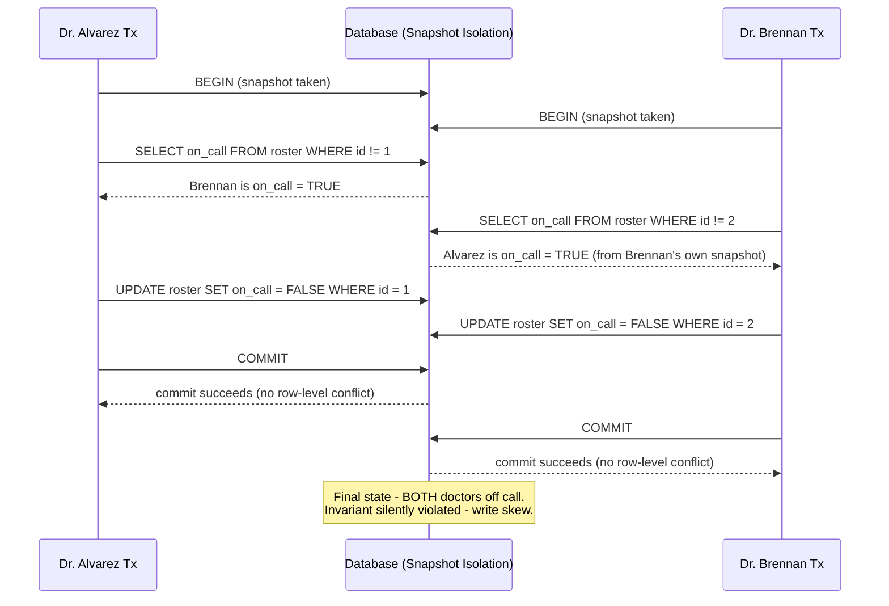

Under true Serializable isolation (SSI), the database detects the read-write
dependency cycle between the two transactions (each read a row the other
concurrently wrote) and aborts one of the two commits with a serialization-
failure error, forcing that transaction to retry — on retry, it re-reads the
roster, correctly observes the other doctor is now off call, and refuses to
also go off call, preserving the invariant.

### 4.11 Multi-Version Concurrency Control (MVCC) — reads without blocking writers

**Definition.** MVCC is a concurrency-control mechanism in which the
database keeps multiple versions of each row simultaneously, and each
transaction is given a consistent snapshot — a fixed logical point in time —
from which to read, rather than reading the single current mutable copy of
each row through a lock. This is the mechanism most mainstream relational
databases (PostgreSQL, Oracle, MySQL/InnoDB, SQL Server's optional
`READ_COMMITTED_SNAPSHOT`) actually use to implement the isolation levels
described in Sections 4.7-4.10, in place of pure lock-based concurrency
control.

**Mechanism.** Every row carries hidden metadata identifying the transaction
that created it and, if superseded, the transaction that deleted/replaced
it (PostgreSQL calls these `xmin`/`xmax`; other engines use analogous
version-chain pointers into an undo log, as in Oracle and MySQL/InnoDB). When
a transaction updates a row, the engine does not overwrite the old version
in place — it writes a *new* version of the row and marks the old version as
superseded by this transaction, but leaves the old version physically intact
so that any other transaction whose snapshot predates this update can keep
reading it. Each transaction's snapshot is effectively a rule for deciding,
for any row version it encounters, "was this version already committed and
visible as of my snapshot, or was it created/deleted by a transaction that
is invisible to me" — a visibility check performed on read, not a lock
acquired on read. Because a reader never needs to wait for a writer's lock
(it simply reads an older, still-intact version if a newer one isn't yet
visible to its snapshot) and a writer never needs to wait for a reader's
lock (readers never hold locks that block writes under MVCC), MVCC's central
payoff is that **readers and writers never block each other** — only
writer-vs-writer conflicts on the same row require any blocking or conflict
detection at all.

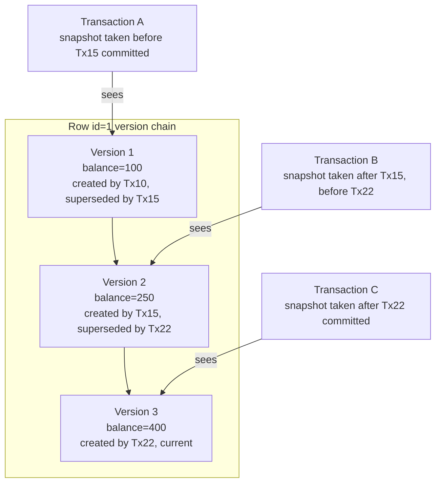

**Decision implications.** MVCC's non-blocking reads are what make it
possible to run a long-running analytical query concurrently with a busy
OLTP (Online Transaction Processing) write workload on the same table
without the analytical query stalling every writer (or vice versa) — a
concurrency profile a pure lock-based Serializable implementation cannot
offer as cheaply. The trade-off is storage and cleanup overhead: old row
versions must eventually be reclaimed once no active transaction's snapshot
can still see them (PostgreSQL's `VACUUM` process, Oracle's undo-segment
management), and a long-running transaction that never commits (Section
4.1's "chatty transaction" failure mode) prevents that cleanup from
happening, causing table and index bloat that can significantly degrade
performance across the whole database, not just the offending transaction.

**Common failure mode.** Leaving a transaction open indefinitely — a common
cause is an application connection-pool bug that checks out a connection,
begins a transaction, and never commits or rolls it back before returning
the connection to the pool — which pins the oldest visible snapshot in
place and prevents `VACUUM`/undo-purge from reclaiming any row version newer
than that snapshot across the *entire* database, not just the tables the
idle transaction touched; this is one of the most common causes of sudden,
mysterious index and table bloat in production PostgreSQL deployments.

**Scenario.** A reporting dashboard runs a five-minute aggregate query over
an orders table while the checkout flow continues inserting and updating
thousands of new orders per second; under MVCC, the report reads a
consistent snapshot as of when it started (seeing exactly the orders that
existed at that moment, per Section 4.9's Repeatable Read guarantee) while
every concurrent insert and update proceeds without ever waiting on the
report's read locks, because there are no read locks to wait on.

### 4.12 Locking as the alternative/complementary mechanism (brief recap)

Locking is the other broad mechanism (alongside MVCC) an engine can use to
implement the isolation levels in Sections 4.7-4.10: a transaction acquires
a lock before touching a row (or, for range/predicate protection, a gap or
index-range lock) and other transactions requiring a conflicting lock must
wait until it is released. Full lock-type taxonomy (shared vs. exclusive vs.
intent locks), lock granularity trade-offs (row vs. page vs. table),
deadlock detection, and the Coffman conditions are owned by the future
[`CH10_Locking.md`](CH10_Locking.md) chapter in this part — this chapter
only needs the reader to know that "isolation level" and "locking" are not
synonyms: locking is one implementation strategy for achieving a given
isolation level's guarantees (used by SQL Server by default and by MySQL/
InnoDB for its phantom-prevention behavior at Repeatable Read), while MVCC
(Section 4.11) is the other, and modern engines frequently combine both —
using MVCC for read/write non-blocking behavior and a narrower set of
row-level locks purely for write/write conflict resolution.

### 4.13 Distributed transactions: why a single node's ACID guarantee isn't enough

**Definition.** A distributed transaction is a transaction whose operations
span more than one independently-failing node — separate database shards, a
database and a message queue, or separate microservices each owning their
own database — where the all-or-nothing atomicity guarantee (Section 4.2)
must hold *across* those nodes, not just within any single one of them.

**Mechanism.** A single node's WAL-based atomicity mechanism (Section 4.2)
has no way to coordinate with another node's WAL — each node can only
durably commit or abort its own local work. Achieving atomicity across
nodes requires an explicit coordination protocol layered on top of each
node's local transaction mechanism; Sections 4.15 (Two-Phase Commit) and
4.16 (Saga) are the two dominant such protocols, sitting at different points
on the consistency/availability trade-off.

**Decision implications.** This problem appears any time data is
horizontally partitioned across nodes — the mechanics of *how* data gets
split across those nodes is owned by [Partitioning](CH05_Partitioning.md)
and [Sharding](CH06_Sharding.md) — or any time a transaction's logical scope
crosses a microservice/database-ownership boundary (each service owning its
own database is itself a common and often desirable architectural
constraint, not a limitation to work around by reaching for a shared
database). Recognizing "this transaction needs to touch two independently-
owned pieces of state that can independently fail" as a distinct
architectural problem — rather than assuming the local, single-node ACID
mental model just scales up automatically — is the key decision point this
chapter's remaining sections build toward.

**Common failure mode.** Assuming that keeping copies of the *same* data
consistent across replica nodes (full mechanics owned by
[Replication](CH07_Replication.md)) solves the same problem as coordinating
a transaction across *different* pieces of data on different nodes — these
are related but distinct problems: replication keeps one logical piece of
data consistent across copies, while distributed transactions (this
section) coordinate an atomic outcome across genuinely different pieces of
data that each live authoritatively on one node.

**Scenario.** An order-placement workflow needs to insert a row into an
`orders` shard and decrement a row in an `inventory` shard, where the two
shards are different physical database nodes as a consequence of the
horizontal sharding strategy — neither shard's local WAL can, by itself,
guarantee that both operations happen together or not at all.

### 4.14 Two-Phase Commit (2PC) — coordinating an atomic outcome across nodes

**Definition.** Two-Phase Commit is a protocol in which a single
**coordinator** drives every **participant** node through two sequential
phases — a **prepare (voting) phase** in which every participant durably
readies its local change and votes whether it can commit, and a **commit/
abort (decision) phase** in which the coordinator, having collected every
vote, tells every participant the single global outcome to apply — such that
either every participant commits or every participant aborts, never a mix.

**Mechanism.** In Phase 1 (prepare), the coordinator sends a `PREPARE`
message to every participant. Each participant does everything necessary to
guarantee it *can* commit if told to — writing an undo/redo log record and
acquiring the necessary locks (recapped from Section 4.12) — then durably
logs a "prepared" state and replies with a vote of `YES` or `NO`. Critically,
once a participant votes `YES`, it must hold its locks and remain able to
commit *no matter what happens next*, even across its own crash and restart
— it cannot unilaterally decide to abort after voting `YES`, because the
coordinator might independently decide to commit based on that vote. In
Phase 2 (commit/abort), the coordinator collects every vote: if all
participants voted `YES`, it durably logs a global `COMMIT` decision (this
log write is the true "commit point" of the entire distributed transaction)
and broadcasts `COMMIT` to every participant; if any participant voted `NO`
(or timed out), it logs and broadcasts a global `ABORT` instead. Each
participant, on receiving the decision, applies it (commits or rolls back
its prepared local transaction) and releases its locks.

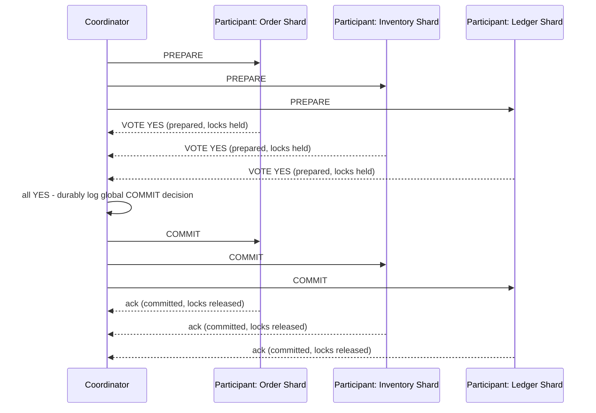

**Decision implications.** 2PC gives genuine cross-node atomicity, at the
cost of the coordinator becoming a hard synchronization point: every
participant must hold its prepared locks for the entire round trip of
collecting all votes and broadcasting the decision, meaning the whole
distributed transaction's latency is bounded by the *slowest* participant
and *every* node's throughput is coupled to every other node's
availability — a stark contrast to the loose coupling most distributed/
microservice architectures are otherwise designed to preserve. 2PC is the
right tool when strict cross-node atomicity is non-negotiable (classic
examples: bank-to-bank funds transfers via XA-compliant resource managers,
or cross-shard transactions in a NewSQL system like CockroachDB or Spanner
that has engineered around 2PC's weaknesses at the infrastructure layer)
and the participant count and blast radius are small and well-controlled.

**Common failure mode — the blocking problem.** If the coordinator crashes
*after* every participant has voted `YES` (prepared) but *before* it
broadcasts the final decision, every participant is stuck: it has already
promised it can commit and must hold its locks, but it has no way to know
whether the coordinator's (now-lost) decision was `COMMIT` or `ABORT`, and it
cannot safely guess (guessing `COMMIT` when the true decision was `ABORT`,
or vice versa, would violate atomicity for the other participants that
followed the correct decision). This is why 2PC is formally classified as a
**blocking protocol**: a single coordinator failure at exactly this window
can stall unrelated transactions on every participant indefinitely, until
the coordinator recovers its durable log and re-sends the decision, or an
operator manually intervenes with a heuristic resolution (accepting the risk
of an inconsistent outcome to unblock the system). Section 15 revisits this
failure mode with its full production implications.

**Scenario.** A distributed transaction spans an `orders` shard, an
`inventory` shard, and a `ledger` shard. All three vote `YES` and are holding
row locks. The coordinator process is then killed (host failure, OOM kill)
immediately after writing its `COMMIT` decision to its own local log but
before it manages to send the `COMMIT` message to any participant. Every
participant is now blocked holding its locks — the rows they touched are
unavailable to any other transaction — until the coordinator restarts, reads
its own durable log, discovers the already-decided `COMMIT` outcome, and
re-sends it to every participant.

### 4.15 The Saga pattern — eventual consistency instead of distributed ACID

**Definition.** A Saga is a sequence of local transactions, each on a single
node/service, where each step publishes an event or is invoked by an
orchestrator to trigger the next step, and every step that has a
side effect defines a **compensating transaction** — a semantically inverse
action — that a saga can invoke to undo that step's effect if a later step
in the sequence fails. Unlike 2PC, a Saga never holds cross-node locks for
the sequence's whole duration and never guarantees the system passes through
only "before" or "fully after" states — intermediate, partially-applied
states are visible to the rest of the system while the saga is in progress,
making Sagas an eventually-consistent alternative to distributed ACID rather
than a drop-in equivalent.

**Mechanism.** There are two structural variants. In **choreography**, there
is no central coordinator: each service reacts to events published by the
previous service and, in turn, publishes its own event (or a failure event)
for the next service to react to — the workflow's shape emerges from the
sum of each service's independent event-handling rules rather than being
explicitly written down anywhere. In **orchestration**, a central
orchestrator component explicitly calls each step in order, tracks which
steps have completed, and is solely responsible for invoking compensating
actions in reverse order if any step fails — the workflow logic is
explicit and centralized, at the cost of the orchestrator becoming a
component every step now depends on (though notably not a *locking*
dependency the way a 2PC coordinator is — the orchestrator's crash mid-saga
leaves already-committed local transactions committed; recovery means
resuming or compensating from wherever the orchestrator's saga-state
tracking left off, not blocking every participant indefinitely).

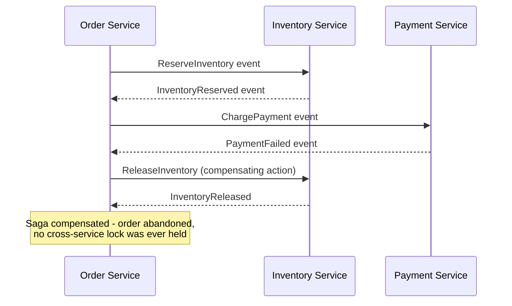

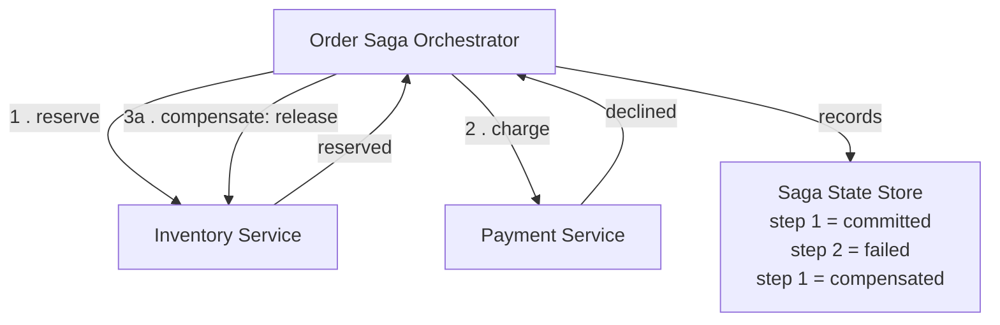

**Decision implications.** Sagas trade 2PC's strict atomicity for
availability and loose coupling: no participant ever blocks holding locks
waiting on another participant's or a coordinator's response, so a slow or
temporarily unavailable downstream service degrades that one saga instance's
latency rather than stalling unrelated transactions across the whole system
— a far better fit for microservice architectures explicitly designed for
independent deployability and failure isolation. The cost is that
compensating actions must be designed for **every** step with a side
effect, must be idempotent (a compensation might be retried after a partial
failure), and cannot always perfectly undo a step that had external,
real-world side effects (an email already sent, a shipment already picked up
by a courier) — some saga steps require a *semantic* compensation (e.g. "send
an apology and a refund") rather than a literal undo. Choreography scales
better with very few steps and services that genuinely don't need a central
view of the workflow, but becomes difficult to reason about and debug as the
number of participating services grows, since there is no single place that
shows the whole workflow; orchestration keeps the workflow explicit and
centrally testable at the cost of the orchestrator itself becoming a
critical, and often stateful, service that needs its own durability story
(a saga-state store recording exactly which steps have committed).

**Common failure mode.** Writing a compensating action that assumes the
forward action either fully succeeded or fully failed, with no in-between —
in reality, a forward action can time out from the caller's perspective
while actually having committed on the remote side (a classic network
partition ambiguity), so compensations must be written defensively (for
example, "release this reservation if it exists" rather than assuming it
definitely exists) and idempotently, exactly like Section 4.14's 2PC
participants must handle redelivered messages.

**Scenario.** An order-placement saga reserves inventory, then attempts to
charge payment, and the payment step fails (card declined). The orchestrator
invokes the compensating "release inventory" action for the already-
completed reservation step and marks the order as failed — the system was
briefly in a state where inventory was reserved for an order that ultimately
never completed, a visible intermediate state a strict 2PC-based distributed
transaction would never have exposed, but one this architecture accepts in
exchange for never blocking the inventory shard's locks on the payment
service's response time.

## 5. Internal Working

This section walks through how a single relational engine's transaction
subsystem is actually built, connecting the individual mechanisms from
Section 4 into one coherent internal picture.

**The write-ahead log as the system of record for durability and atomicity.**
Every change a transaction makes is first appended to the WAL as a
sequential, append-only stream of log records, each tagged with the
transaction ID that produced it and enough information (before-image,
after-image, or a description of the operation) to redo or undo it. Only
after the log record is durably written does the engine modify the
corresponding in-memory data page (in the buffer pool/page cache); the
modified page is written back to its data file lazily, at a checkpoint or
when evicted from the buffer pool under memory pressure, not necessarily
before the client sees a commit acknowledgment. This ordering — log first,
data pages later — is the entire reason recovery after a crash is possible:
the log is a complete, ordered history of every intended change, sufticient
to reconstruct the exact pre-crash state regardless of which data pages had
made it to disk.

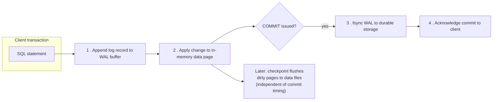

**MVCC's version-chain bookkeeping in practice.** Building on Section 4.11's
conceptual picture, most MVCC engines physically implement version chains
one of two ways. PostgreSQL keeps every row version directly in the table's
heap, tagging each with the creating and (if superseded) deleting
transaction's ID, and relies on a background `VACUUM` process to physically
reclaim old, no-longer-visible-to-anyone versions and update indexes
accordingly — a design that keeps reads simple (walk the chain, apply
visibility rules) at the cost of needing active, tuned background
maintenance. Oracle and MySQL/InnoDB instead keep only the *current* row
version in the main table structure and push older versions into a separate
**undo log/rollback segment**, reconstructing an older visible version on
demand by applying undo records backward from the current version — a
design that keeps the primary table compact at the cost of making very
long-running read transactions (which must walk further back through undo
records) progressively more expensive the longer they run, and risking an
`ORA-01555 snapshot too old`-style error in Oracle if the needed undo data
has already been recycled.

**Isolation-level enforcement at the transaction-manager layer.** The
transaction manager (the component sitting above the storage engine's raw
page/version operations) is what actually decides, per Sections 4.7-4.10,
when a transaction's snapshot is taken (once at `BEGIN` for Repeatable
Read/Serializable, freshly per-statement for Read Committed), and, for
Serializable Snapshot Isolation specifically, tracks the read-write
dependency graph across all currently active transactions so it can detect
and abort a cycle (Section 4.10's write-skew catch). This is also the layer
that enforces `CHECK`/foreign-key/unique constraints (Section 4.3) at
statement or commit time, and the layer a distributed-transaction
coordinator (Section 4.14) talks to via the participant's local `PREPARE`/
`COMMIT`/`ROLLBACK` interface.

## 6. Design Principles

- **Keep transaction boundaries as small as the invariant requires, and no
  smaller.** Every operation whose success or failure the business
  invariant genuinely depends on belongs inside the same transaction;
  everything else (rendering, unrelated reads, calls to other services)
  should be pushed outside it, per Section 4.1.
- **Choose the weakest isolation level that still prevents the anomalies
  your specific transaction's logic is vulnerable to**, rather than
  defaulting to the engine's default or to Serializable everywhere — this
  requires actually reasoning about whether a given transaction re-reads
  data, relies on a multi-row invariant, or performs a check-then-act
  pattern (Section 4.8's decision implications).
- **Never assume a check-then-act pattern is safe under Read Committed or
  Repeatable Read alone** — push the check into the same atomic statement
  as the write where possible, or explicitly reach for Serializable or
  row-level locking (`CH10_Locking.md`) when it can't be.
- **Design compensating actions and idempotent retries as first-class
  requirements, not afterthoughts**, for any workflow spanning more than one
  transactionally-independent node — this applies equally to a Saga's
  compensating transactions and to a 2PC participant's handling of a
  redelivered `PREPARE`/`COMMIT` message after a network retry.
- **Treat serialization-failure/retry handling as mandatory application
  code, not exceptional-path cleanup**, whenever Serializable isolation (or
  optimistic concurrency generally) is chosen — an unhandled abort under
  Serializable is a design defect in the calling code, not a database bug.
- **Prefer keeping a distributed transaction's participant count and
  duration as small as possible** when 2PC genuinely is the right tool,
  since both the blocking-failure blast radius (Section 4.14) and the
  latency cost scale with how many nodes and how long each one must hold
  its prepared locks.

## 7. Architecture Patterns

- **Transactional outbox pattern.** Rather than trying to atomically write
  to a database *and* publish a message to a broker (two independently-
  failing systems, exactly the problem Section 4.13 describes), write the
  outgoing message as a row in an `outbox` table inside the *same* local
  transaction as the business data change (a single-node ACID transaction,
  no cross-node coordination needed), then have a separate asynchronous
  process (a polling publisher or a change-data-capture pipeline) read
  committed outbox rows and publish them to the broker, marking them
  published once acknowledged. This sidesteps 2PC/Saga complexity entirely
  for the specific "commit a DB change and reliably publish an event"
  problem, at the cost of at-least-once delivery (the publisher must be
  idempotent-safe on the consumer side).

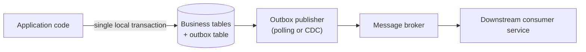

- **Saga orchestration pattern.** As detailed in Section 4.16, a dedicated
  orchestrator component explicitly sequences each participating service's
  local transaction and owns the compensation logic — the pattern of choice
  when a workflow's steps and failure-handling need to be centrally visible,
  testable, and modifiable without touching every participating service.
- **Saga choreography pattern.** Also detailed in Section 4.16, favored for
  short workflows where each service's reaction to an event is simple and
  genuinely local, avoiding the operational overhead of a dedicated
  orchestrator component and its state store.
- **Distributed transaction coordinator (XA/JTA) pattern.** For workloads
  that genuinely require 2PC's strict atomicity, a standard XA-compliant
  transaction manager (Java's JTA, or a database-native distributed
  transaction feature in CockroachDB/Spanner-style NewSQL engines) is
  preferred over hand-rolling the coordinator protocol, since correctly
  handling coordinator-crash recovery (Section 4.14) is subtle enough that
  a mature, widely-tested implementation is materially safer than a bespoke
  one.
- **Sharded/partitioned single-database transactions.** Some engines
  (CockroachDB, Spanner, YugabyteDB) hide 2PC-style coordination behind an
  ordinary-looking single SQL transaction that internally spans multiple
  storage nodes/shards — the architecture pattern here is choosing such an
  engine specifically *because* it needs distributed ACID transactions
  without hand-building a coordinator, trading some throughput ceiling for
  a dramatically simpler application programming model than manual 2PC or
  Sagas.

## 8. Production Architecture

A production relational database's transaction subsystem sits at the
intersection of several components working together: the connection/session
layer that tracks each client's current transaction and isolation-level
setting; the transaction manager that assigns transaction IDs, tracks active
transactions, and (for Serializable Snapshot Isolation engines) maintains
the read-write dependency graph; the storage engine that maintains MVCC
version chains or lock tables; the write-ahead log subsystem, typically
backed by dedicated, low-latency storage separate from the main data
volume to minimize commit latency; and, in a distributed deployment, a
replication stream shipping the WAL (or logical change events derived from
it) to standby replicas or a distributed-consensus layer.

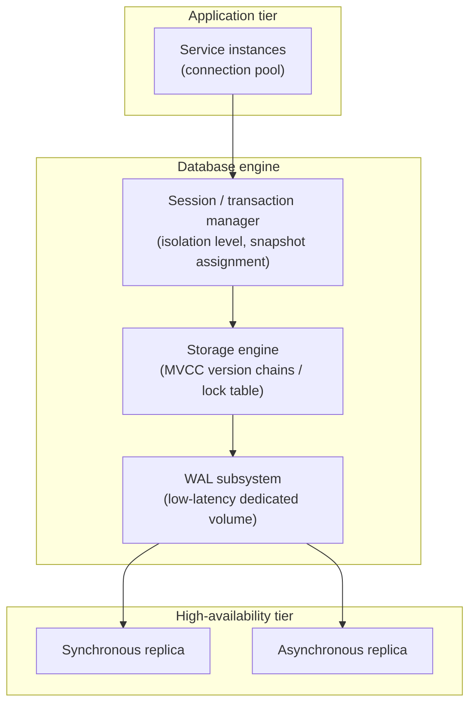

For distributed transactions specifically, a production architecture adds
either an XA-compliant transaction-coordinator service (for 2PC) or a saga
orchestrator service plus a durable saga-state store (for the Saga pattern),
sitting logically above the individual participant databases/services —
this coordinator or orchestrator is itself a critical-path component that
needs its own high-availability design, since (per Sections 4.14-4.15) its
own failure characteristics directly determine whether the distributed
transaction protocol blocks (2PC) or degrades gracefully (Saga).

## 9. Implementation

Implementing correct transaction usage in application code means making
three explicit decisions for every unit of work that touches the database:
the transaction boundary (Section 4.1), the isolation level (Sections
4.7-4.10), and — for anything spanning more than one transactionally-
independent resource — the cross-node coordination strategy (Sections
4.14-4.15).

```sql
-- Explicit transaction boundary + isolation level choice (PostgreSQL syntax)
BEGIN TRANSACTION ISOLATION LEVEL REPEATABLE READ;

SELECT balance FROM accounts WHERE id = 1 FOR UPDATE;
-- (row locking mechanics behind FOR UPDATE are owned by CH10_Locking.md;
--  used here only to make the read-then-write atomic against other writers)

UPDATE accounts SET balance = balance - 100 WHERE id = 1;
UPDATE accounts SET balance = balance + 100 WHERE id = 2;

COMMIT;
```

```python
# Application-level retry loop for Serializable isolation (Section 4.10) —
# mandatory, not optional, whenever Serializable/SSI is chosen.
import psycopg2
from psycopg2 import errorcodes

def transfer_funds(conn, from_id, to_id, amount, max_retries=3):
    for attempt in range(max_retries):
        try:
            with conn.cursor() as cur:
                cur.execute("SET TRANSACTION ISOLATION LEVEL SERIALIZABLE")
                cur.execute(
                    "UPDATE accounts SET balance = balance - %s WHERE id = %s",
                    (amount, from_id),
                )
                cur.execute(
                    "UPDATE accounts SET balance = balance + %s WHERE id = %s",
                    (amount, to_id),
                )
            conn.commit()
            return
        except psycopg2.Error as exc:
            conn.rollback()
            if exc.pgcode == errorcodes.T_R_SERIALIZATION_FAILURE and attempt < max_retries - 1:
                continue  # expected under Serializable contention - retry
            raise
```

For distributed workflows, implementation means choosing (per Section 7)
between an XA/JTA-compliant coordinator for genuine 2PC, or an explicit
saga orchestrator with a durable state store and idempotent compensating
actions for each step — Section 10's code examples implement a concrete
version of both the isolation-level/anomaly side (Sections 4.6-4.10) and
the Saga/2PC side (Sections 4.14-4.15) end to end.

## 10. Complete Code Examples

**Example 1 — isolation-level anomaly demonstration script (SQL)**, working
through dirty read (annotated), non-repeatable read, phantom read, and
write skew as two-session interleavings against PostgreSQL, directly
implementing Sections 4.7-4.10's scenarios:
[`code/sql/transactions-chapter/01_isolation_level_anomalies.sql`](../../code/sql/transactions-chapter/01_isolation_level_anomalies.sql).

**Example 2 — write-skew reproduction and fix (Python)**, running the
on-call-rotation write-skew scenario from Section 4.10 concurrently against
a real PostgreSQL database at Repeatable Read (anomaly reproduced) and then
at Serializable (anomaly caught and one transaction aborted), including the
retry-driven correct outcome:
[`code/python/transactions-chapter/02_write_skew_demo.py`](../../code/python/transactions-chapter/02_write_skew_demo.py).

**Example 3 — Saga orchestrator with compensating actions (Node.js)**,
implementing Section 4.15's orchestration variant end to end for an
order-placement workflow across simulated Inventory, Payment, and Shipping
services, including a failure scenario that triggers LIFO compensation:
[`code/node/transactions-chapter/03_saga_orchestrator.js`](../../code/node/transactions-chapter/03_saga_orchestrator.js).

**Example 4 — Two-Phase Commit simulation (Java)**, modeling a coordinator
and three participants through the happy path, a participant `NO` vote, and
the classic coordinator-crash-after-prepare blocking failure from Section
4.14:
[`code/java/transactions-chapter/04_TwoPhaseCommitSimulation.java`](../../code/java/transactions-chapter/04_TwoPhaseCommitSimulation.java).

Run the Python write-skew demo directly against a local PostgreSQL instance:

```bash
pip install psycopg2-binary
python code/python/transactions-chapter/02_write_skew_demo.py
```

Run the Node.js Saga orchestrator demo:

```bash
node code/node/transactions-chapter/03_saga_orchestrator.js
```

Compile and run the Java 2PC simulation:

```bash
javac code/java/transactions-chapter/04_TwoPhaseCommitSimulation.java -d out
java -cp out TwoPhaseCommitSimulation
```

## 11. Performance

- **Weaker isolation levels generally allow more concurrent throughput**,
  since fewer transactions wait on locks or get aborted for conflict
  detection — but Section 4's whole point is that this must be a deliberate
  trade against the specific anomalies a workload can tolerate, not a
  default reached for blindly.
- **`fsync`-per-commit is usually the single largest fixed per-transaction
  latency cost** (Section 4.5); batching multiple logical operations into
  fewer, larger commits (within the bounds of correct transaction
  boundaries, Section 4.1) amortizes this cost across more work.
- **MVCC bloat from long-running or abandoned transactions degrades
  performance system-wide**, not just for the offending transaction
  (Section 4.11) — monitoring the oldest active transaction/snapshot age is
  a standard production health metric for exactly this reason.
- **Serializable's abort-and-retry cost under contention** (Section 4.10)
  means its effective throughput on a hot, highly-contended table can be
  materially lower than its raw per-transaction cost suggests — measuring
  retry rate under realistic concurrent load, not just single-transaction
  latency, is necessary to size Serializable correctly.
- **2PC's per-transaction latency is bounded by its slowest participant plus
  two full network round trips** (prepare, then commit/abort) — a cost that
  compounds badly with participant count and geographic distribution, one
  of the strongest practical arguments for the Saga pattern (Section 4.15)
  in geographically distributed systems.

## 12. Scalability

- **MVCC's non-blocking reads are a direct scalability lever**: read-heavy
  workloads (reporting, analytics) scale far better alongside a write-heavy
  OLTP workload under MVCC than under a purely lock-based isolation
  implementation, because reads never contend with writes for locks
  (Section 4.11).
- **2PC's coordinator is a scalability bottleneck by construction**: every
  additional participant node increases the coordinator's fan-out and the
  duration every participant must hold its prepared locks, which is why
  systems that need to scale to many shards (Spanner, CockroachDB) invest
  heavily in reducing 2PC's blocking window (for example, using
  synchronized clocks to avoid needing to contact every participant for
  read-only transactions) rather than avoiding 2PC's underlying mechanism
  entirely.
- **Sagas scale horizontally far better than 2PC** because no participant
  ever holds a cross-node lock waiting on another node's response (Section
  4.15) — the trade-off, restated from Section 4.15, is that Sagas only
  provide eventual consistency and require compensating-action design work
  the developer must do explicitly, work that 2PC's atomicity guarantee
  would otherwise have made unnecessary.
- **Sharding and partitioning strategy directly determines how often a
  transaction needs distributed coordination at all** — a schema and
  sharding key chosen so that the vast majority of transactions touch only
  a single shard (owned by [Sharding](CH06_Sharding.md) and
  [Partitioning](CH05_Partitioning.md)) sidesteps Sections 4.14-4.15
  entirely for the common case, reserving 2PC/Sagas for the genuinely
  cross-shard minority of transactions.

## 13. Security

- **Transaction isolation is not an access-control mechanism** — isolation
  levels govern *concurrency correctness* between transactions that are
  each already authorized to read the rows they touch; row-level security
  policies, column-level encryption, and authorization checks are a
  completely separate concern layered on top, not a side effect of choosing
  a stronger isolation level.
- **Long-running or idle-in-transaction connections are an availability/
  security risk, not just a performance one** (Section 4.11's bloat
  failure mode) — an idle transaction left open by a compromised or buggy
  client can be used as an unintentional (or, in an insider-threat
  scenario, intentional) denial-of-service vector against the whole
  database's vacuum/cleanup process.
- **2PC/XA coordinators are a high-value target**: a coordinator with
  network access to every participant database is effectively a
  privileged, cross-system component, and should be secured (network
  segmentation, mutual TLS between coordinator and participants — full
  mechanics owned by [TLS](../05_Networking_and_OS/CH06_TLS.md)) with the
  same rigor as the participant databases themselves, not treated as
  "just infrastructure glue."
- **Saga orchestrators and their state stores hold a full record of every
  in-flight cross-service business transaction**, often including
  sensitive fields (payment amounts, customer identifiers) passed between
  steps — this state store needs the same data-protection controls
  (encryption at rest, access auditing) as the primary business databases
  it coordinates, since it is frequently overlooked as "just workflow
  metadata."

## 14. Observability

- **Track the oldest active transaction/snapshot's age** as a first-class
  metric — a growing value is the earliest reliable signal of the MVCC
  bloat failure mode (Section 4.11) before it manifests as broader query
  slowdowns.
- **Track transaction abort/serialization-failure rate, segmented by
  isolation level**, to distinguish "Serializable is working as intended,
  catching real conflicts" from "contention has grown to a level that needs
  a design change" (Section 11).
- **Track 2PC participants' time spent in the prepared-but-undecided
  state** (Section 4.14) — any nonzero, growing value here is a direct
  signal of a stuck or slow coordinator and the concrete precursor to the
  blocking failure mode covered in Section 15.
- **Track saga-instance state distribution** (how many instances are
  currently in each step, how many are in a compensating state, how many
  have been stuck in an intermediate state longer than an expected SLA
  (Service Level Agreement)) via the saga-state store — this is the Saga
  pattern's equivalent of 2PC's "prepared but undecided" metric, and the
  primary signal for alerting on stuck or failed compensations (Section
  4.15's failure mode).
- **Correlate WAL write latency/fsync latency directly with commit
  latency** — since Section 4.5 established `fsync` as the dominant fixed
  per-commit cost, a storage-layer latency regression will show up first
  and most clearly here, before it's visible in higher-level request
  latency dashboards.

## 15. Failure Scenarios

- **Coordinator crash after all participants vote YES but before the
  decision is broadcast (2PC's classic blocking failure, Section 4.14).**
  Every prepared participant holds its locks indefinitely until the
  coordinator recovers its durable log and re-sends the decision, or an
  operator applies a heuristic resolution accepting a documented risk of
  inconsistency to unblock the system — this is the single most cited
  operational weakness of 2PC and the primary motivation for the Saga
  pattern in systems that cannot tolerate this blast radius.
- **A saga orchestrator crashes mid-workflow.** Unlike 2PC, no participant
  is left holding locks — each already-committed local transaction stays
  committed — but the orchestrator's own saga-state store must durably
  record exactly which steps had completed, so that on restart (or via a
  standby orchestrator instance) the saga can resume from the correct step
  or correctly determine which compensating actions still need to run; a
  saga orchestrator without a durable state store cannot safely recover
  from its own crash at all.
- **A compensating action itself fails** (Section 4.15's common failure
  mode) — the saga is now stuck in a partially-compensated state that
  cannot be resolved automatically and needs a dead-letter queue and
  manual-intervention alerting; silently retrying forever or silently
  giving up are both incorrect responses.
- **A long-running transaction is abandoned by a crashed client without a
  `ROLLBACK`.** Depending on the engine, the connection eventually times
  out and the engine rolls the transaction back itself, but until that
  timeout fires, the transaction continues holding locks and/or pinning
  the MVCC snapshot horizon (Section 4.11), degrading the whole database —
  this is why production deployments set an explicit idle-in-transaction
  timeout rather than relying on client discipline alone.
- **A Serializable transaction retry loop is missing or capped too low**
  (Section 4.10's common failure mode) — under a genuine contention spike,
  transactions exhaust their retry budget and surface as user-visible
  errors instead of transparently succeeding on a later attempt, turning an
  expected, routine isolation-level behavior into an incident.

## 16. Testing

- **Reproduce each anomaly deliberately** using two concurrent sessions
  with explicit, ordered interleaving (as Section 10's SQL example does) —
  do not rely on incidental timing under load to prove an isolation level's
  behavior; force the interleaving explicitly with synchronization points
  (as the Python write-skew demo's `threading.Barrier` does).
- **Write an automated test that asserts a write-skew-vulnerable invariant
  actually holds under concurrent load** at the isolation level the
  production code uses — a test that only exercises the happy, non-
  concurrent path will never catch this class of bug, which is precisely
  why it is under-caught in practice.
- **Test the Serializable retry loop by forcing a real serialization
  failure** (two concurrent conflicting transactions in a test), not just
  by mocking the exception — confirming the retry actually re-reads fresh
  data and reaches a correct outcome, not merely that it doesn't crash.
- **Test every saga compensating action independently, including against a
  partially-applied forward action** (simulate the forward action having
  timed out from the caller's perspective while actually having committed
  remotely) to confirm compensations are safe to call even when the
  forward action's true outcome is ambiguous.
- **Chaos-test 2PC coordinator crash windows** in a staging environment
  (kill the coordinator process at the exact point between logging the
  decision and broadcasting it) to confirm the recovery path actually
  un-blocks every participant correctly, rather than assuming the
  documented recovery behavior works without having exercised it.

## 17. Common Mistakes

- Assuming "Repeatable Read" or "Snapshot Isolation" is fully serializable-
  safe, missing the write-skew anomaly entirely (Section 4.10) — the single
  most common isolation-level misunderstanding this chapter addresses.
- Using a check-then-act pattern under Read Committed without either an
  atomic single statement or an explicit lock/Serializable escalation
  (Section 4.8), producing silent lost updates under concurrency.
- Choosing Serializable everywhere without implementing the mandatory
  retry loop (Sections 4.10, 9), turning routine contention into
  user-visible failures.
- Reaching for `NOLOCK`/Read Uncommitted as a generic performance fix
  without understanding it can return uncommitted, later-rolled-back, or
  duplicated/missing rows (Section 4.7).
- Leaving transactions open across slow external calls or idle client
  connections (Section 4.1, 4.11), causing lock contention and MVCC bloat
  that degrades the whole database, not just the offending transaction.
- Assuming a saga's compensating action can always perfectly undo a step
  with a real-world side effect, rather than designing an explicit
  semantic compensation for steps that can't be literally reversed
  (Section 4.15).
- Hand-rolling a distributed-transaction coordinator without accounting for
  the coordinator-crash-after-prepare blocking window (Section 4.14),
  rather than using a mature XA/JTA implementation or an engine that has
  already engineered around this weakness.
- Treating isolation-level choice as a database-administrator setting
  rather than a per-transaction application design decision that has to be
  reasoned about alongside the transaction's actual read/write pattern
  (Section 4.4).

## 18. Best Practices

- Default to Read Committed (or your engine's equivalent MVCC-based
  default) for straightforward, single-read-per-row transactions, and
  deliberately escalate to Repeatable Read or Serializable only when
  Section 4's anomaly analysis shows the transaction is actually vulnerable
  (Sections 4.8-4.10).
- Push check-then-act logic into atomic single statements
  (`UPDATE ... SET x = x - 1 WHERE ...`) wherever the business logic
  permits, avoiding the need for a stronger isolation level or explicit
  locking at all (Section 4.8).
- Always implement and test the Serializable retry loop as a mandatory part
  of choosing that isolation level, with a bounded number of attempts and a
  clear terminal error path (Sections 9, 10, 16).
- Monitor oldest-active-transaction age and idle-in-transaction duration as
  standard production dashboards, with an enforced idle-in-transaction
  timeout (Sections 11, 14, 15).
- Reach for the transactional outbox pattern (Section 7) instead of
  hand-rolling 2PC whenever the actual requirement is "commit a database
  change and reliably publish an event" — a narrower, simpler problem than
  general distributed transactions.
- Prefer designing schemas/sharding keys so the overwhelming majority of
  transactions are single-shard (Section 12), reserving 2PC or Sagas for
  the genuinely cross-shard/cross-service minority.
- Design every saga step's compensating action to be idempotent and safe
  to call even if the forward action's true remote outcome is ambiguous
  (Sections 15, 16).

## 19. Anti-Patterns

- **The distributed monolith transaction** — reaching for 2PC (or a shared
  database) to paper over what should really be independently-deployable
  services with their own local transactions and an explicit saga/outbox
  boundary between them, recreating tight coupling the service boundaries
  were meant to eliminate.
- **The silent lost update** — a check-then-act pattern under an isolation
  level too weak to protect it, with no test ever exercising the
  concurrent case, so the bug ships and surfaces only under real
  production concurrency (Section 4.8, 17).
- **Serializable without a retry loop** — treating an expected,
  documented, routine abort as an unhandled exception, converting normal
  contention into user-facing outages (Sections 10, 17).
- **The forever-open transaction** — a connection-pool bug, a debugging
  session left attached, or a slow external call inside a transaction
  boundary, silently degrading the whole database via lock contention or
  MVCC bloat (Sections 4.1, 4.11, 15).
- **Saga steps with no compensating action defined** — treating the happy
  path as the only path, leaving no recovery story for a mid-workflow
  failure and forcing manual, ad hoc cleanup in production incidents.
- **Heuristic 2PC resolution as a routine operational procedure** rather
  than a rare, explicitly risk-accepted last resort — normalizing manual
  intervention for a blocking failure that should instead be addressed by
  reducing coordinator downtime risk or moving the workload to Sagas.

## 20. Trade-off Analysis

| Dimension | Stronger isolation (Serializable) | Weaker isolation (Read Committed) | 2PC (distributed ACID) | Saga (eventual consistency) |
|---|---|---|---|---|
| Correctness guarantee | Strongest — no anomalies | Prevents only dirty reads | Strict cross-node atomicity | Eventual consistency only |
| Concurrent throughput | Lower (abort/retry cost) | Higher | Lowest (blocking, cross-node) | Highest (no cross-node locks) |
| Failure blast radius | Local to the transaction | Local to the transaction | Can block unrelated transactions on every participant (coordinator crash) | Isolated to one saga instance |
| Developer burden | Must implement retry loop | Low, but must reason about anomalies | Coordinator infra + XA integration | Must design compensations per step |
| Best fit | Cross-row invariants (write skew risk) | Simple single-read transactions | Small, well-controlled participant sets needing strict atomicity | Cross-service workflows favoring availability/loose coupling |

## 21. Comparison Table

| Isolation Level | Dirty Read | Non-Repeatable Read | Phantom Read | Write Skew | Typical mechanism |
|---|---|---|---|---|---|
| Read Uncommitted | Permitted | Permitted | Permitted | Permitted | No read locking / no snapshot |
| Read Committed | Prevented | Permitted | Permitted | Permitted | Fresh MVCC snapshot per statement |
| Repeatable Read / Snapshot Isolation | Prevented | Prevented | Permitted (standard minimum) | Permitted | One MVCC snapshot per transaction + first-committer-wins |
| Serializable | Prevented | Prevented | Prevented | Prevented | 2PL with predicate locks, or Serializable Snapshot Isolation (SSI) |

| Protocol | Coordination style | Consistency model | Blocking on coordinator/participant failure | Typical use case |
|---|---|---|---|---|
| Two-Phase Commit (2PC) | Central coordinator, synchronous | Strict, cross-node atomicity | Yes — classic blocking weakness (Section 4.14) | Small participant count, strict atomicity required |
| Saga (orchestration) | Central orchestrator, asynchronous steps | Eventually consistent | No — local transactions commit independently | Cross-service workflows, larger participant count |
| Saga (choreography) | No central coordinator, event-driven | Eventually consistent | No | Short workflows, simple per-service reactions |

## 22. Real-World Case Study

A mid-sized digital bank's core ledger service originally ran every account
transfer at the engine's default Read Committed isolation level, relying on
application code to read a balance, check for sufficient funds, and write a
debit and credit in the same transaction. An audit uncovered a rare but real
class of double-spend: two concurrent transfer requests from the same
account, each individually reading a sufficient balance before the other's
debit had committed, both proceeding — a textbook lost-update bug enabled by
Read Committed's per-statement snapshot behavior (Section 4.8). The
immediate fix was pushing the balance check into the same atomic `UPDATE ...
WHERE balance >= amount` statement (returning zero affected rows if
insufficient), removing the race entirely for the single-account case. A
separate, harder problem then surfaced during a subsequent redesign: a new
"linked accounts" feature required an invariant that at least one account in
a linked pair always retain a minimum balance floor for overdraft-protection
purposes — structurally identical to this chapter's on-call write-skew
scenario (Section 4.10). The team initially assumed their existing
Repeatable Read isolation setting (used for reporting consistency elsewhere
in the codebase) also protected this new invariant, and shipped it without
further review; a subsequent internal load test, specifically designed
around this chapter's anomaly-taxonomy framework, reproduced the exact
write-skew violation under concurrent load before it reached production.
The fix was to isolate the affected transaction specifically to Serializable
(not the whole system, respecting Section 6's "weakest isolation level that
prevents the vulnerability" principle) with a bounded retry loop, leaving
every other transaction at its existing, cheaper isolation level. Separately,
as the bank grew and split its ledger and its new "instant transfer to
partner banks" feature into an independently deployed service backed by its
own database, the team explicitly rejected extending 2PC across the
organizational boundary to the partner-bank integration (Section 4.14's
blocking risk was judged unacceptable for a dependency the bank did not
operationally control) and instead implemented that specific workflow as an
orchestrated Saga (Section 4.15) with an explicit, audited compensating
"reversal transfer" step for the rare case a partner-bank leg failed after
the local leg had already committed.

## 23. Interview Questions

1. Explain each ACID property and, specifically, the mechanism (not just
   the definition) that implements it — what makes atomicity possible on a
   crash, and what makes durability possible on a crash?
2. Define dirty read, non-repeatable read, phantom read, and write skew,
   and state which of the four standard isolation levels prevents each.
3. Why does Repeatable Read/Snapshot Isolation not prevent write skew, and
   what mechanism does true Serializable add that catches it?
4. Explain how MVCC allows readers and writers to avoid blocking each
   other, and describe the version-chain visibility rule a reader applies.
5. Walk through the two phases of Two-Phase Commit and explain precisely
   why a coordinator crash between phases can block participants
   indefinitely.
6. Compare Saga choreography and orchestration — what does each trade off,
   and when would you choose one over the other?
7. What is a compensating transaction, and why must it be idempotent and
   defensively written against an ambiguous forward-action outcome?
8. Given a specific application scenario (present a check-then-act example),
   identify which anomaly it is vulnerable to under which isolation level,
   and propose a fix.
9. Why is "Repeatable Read" not a portable guarantee across different
   database engines despite being the same standard name?
10. When would you choose 2PC over a Saga for a cross-service workflow, and
    what operational safeguards would you require before adopting it?

## 24. Hands-on Exercises

1. Using two `psql` sessions against a local PostgreSQL instance, reproduce
   the non-repeatable read anomaly at Read Committed, then show it does not
   occur at Repeatable Read, following Section 10's SQL script as a guide.
2. Run the provided Python write-skew demo
   (`code/python/transactions-chapter/02_write_skew_demo.py`) at Repeatable
   Read and observe both transactions succeed, violating the invariant;
   then rerun at Serializable and observe one transaction abort.
3. Modify the phantom-read scenario in
   `code/sql/transactions-chapter/01_isolation_level_anomalies.sql` to run
   under `SERIALIZABLE` instead of `READ COMMITTED` and confirm the phantom
   row no longer appears in the second count.
4. Run the Node.js Saga orchestrator
   (`code/node/transactions-chapter/03_saga_orchestrator.js`) for both the
   happy-path and failing-payment scenarios, and add a fourth step (e.g. a
   "send confirmation email" step) with its own compensating action.
5. Run the Java Two-Phase Commit simulation
   (`code/java/transactions-chapter/04_TwoPhaseCommitSimulation.java`) for
   all three scenarios and, in your own words, describe exactly which
   participant state each scenario leaves the system in.

## 25. Design Exercises

1. Design the transaction boundaries and isolation-level choices for a
   ticket-booking system where two users must never be able to book the
   same seat — identify the specific anomaly this invariant is vulnerable
   to and justify your chosen isolation level or locking strategy.
2. Design a Saga (choosing choreography or orchestration, and justifying
   the choice) for a travel-booking workflow spanning flight, hotel, and
   car-rental reservations across three independently owned services,
   including every compensating action.
3. Design the transactional-outbox architecture for a service that must
   commit an order to its own database and reliably publish an
   `OrderPlaced` event to a message broker, including how the publisher
   guarantees at-least-once delivery and how downstream consumers must
   handle duplicate delivery.
4. A finance team wants "every transaction in the system to run at
   Serializable for safety." Write a short design memo either approving or
   pushing back on this request, referencing the specific trade-offs from
   Sections 11-12 and 20.
5. Design a monitoring and alerting strategy for a production 2PC
   coordinator, specifically addressing how you would detect and respond to
   the coordinator-crash-after-prepare blocking scenario before it causes a
   customer-visible incident.

## 26. Architecture Review Questions

1. For each transaction in this design, what isolation level is used, and
   has it been explicitly justified against the specific anomalies that
   transaction's read/write pattern could be vulnerable to?
2. Does any transaction in this design use a check-then-act pattern? If so,
   is it protected by an atomic statement, explicit locking, or
   Serializable isolation with a retry loop?
3. Does any workflow in this design span more than one independently-owned
   database or service? If so, has the team explicitly chosen between 2PC
   and Saga, with the trade-offs from Section 20 documented?
4. If this design uses 2PC, what is the maximum blocking-window blast
   radius if the coordinator crashes immediately after every participant
   votes YES, and what is the recovery procedure?
5. If this design uses a Saga, does every step with a side effect have a
   defined, idempotent, defensively-written compensating action, and is
   saga state durably tracked so a crashed orchestrator can resume safely?
6. Is there monitoring in place for oldest-active-transaction age,
   serialization-failure rate, and (if applicable) 2PC prepared-but-
   undecided duration or saga stuck-instance count?

## 27. Summary

A transaction is the unit the database uses to make multi-step work behave
as one indivisible, durable, and appropriately isolated operation, and the
ACID acronym names the four guarantees — atomicity via the write-ahead log's
redo/undo mechanism, consistency as the joint product of engine-enforced
constraints and correctly designed application logic, isolation as a
spectrum of anomaly-prevention levels, and durability via the same
write-ahead log fsync'd before acknowledging commit — that together let
application code trust the database rather than re-deriving crash-safety and
concurrency-safety from scratch. The four standard isolation levels form a
strict hierarchy of anomaly prevention: Read Uncommitted permits everything,
Read Committed eliminates dirty reads, Repeatable Read/Snapshot Isolation
additionally eliminates non-repeatable reads (and often phantom reads, as
an implementation detail), and only true Serializable eliminates write
skew — the anomaly that silently breaks cross-row invariants without
tripping any ordinary row-level conflict check, and the single most
important distinction this chapter teaches. MVCC is the mechanism most
modern engines actually use to implement these levels, keeping multiple
row versions so readers and writers never block each other, at the cost of
needing active cleanup of old versions. Once a transaction's scope crosses
node boundaries — because of sharding, partitioning, or independent service
ownership — a single node's local ACID guarantee is no longer sufficient,
and an architect must explicitly choose between Two-Phase Commit's strict
but blocking cross-node atomicity and the Saga pattern's available,
loosely-coupled, but only eventually-consistent alternative, designing
compensating actions and idempotent retries as first-class requirements
rather than afterthoughts either way.

## Further Reading

- [Indexes](CH03_Indexes.md) — B-tree/B+tree structures this chapter's WAL
  and MVCC mechanisms sit alongside inside the storage engine.
- [Query Optimizers](CH04_Query_Optimizers.md) — how the optimizer's plan
  choices interact with locking/MVCC read costs.
- [Partitioning](CH05_Partitioning.md) and [Sharding](CH06_Sharding.md) —
  the horizontal data-distribution strategies that make Section 4.13's
  distributed-transaction problem arise in the first place (forward
  references at the time this chapter was authored).
- [Replication](CH07_Replication.md) — keeping copies of the same data
  consistent across nodes, the related-but-distinct problem from
  distributed transactions (forward reference at the time this chapter was
  authored).
- `CH10_Locking.md` — full lock-type, granularity, and deadlock-detection
  mechanics this chapter deliberately recapped only briefly (not yet
  drafted at the time this chapter was authored).
- [Processes and Threads](../05_Networking_and_OS/CH24_Processes_and_Threads.md#deadlock-and-the-four-coffman-conditions-priority-inversion) —
  the general Coffman-conditions deadlock model `CH10_Locking.md` will apply
  specifically to database lock waits.

