# Chapter: Caching

Part: [06 — Databases and Storage](PART_OVERVIEW.md) · Status: Drafted

## 1. Introduction

Caching is the practice of keeping a copy of data in a faster, cheaper-to-
access location than its source of truth, so that repeated reads of the same
data do not have to pay the full cost of the source every time. In the
context of this chapter, the "source of truth" is a database (relational or
NoSQL), and the cache is an in-memory or otherwise low-latency layer — a
dedicated cache server such as Redis or Memcached, an in-process map inside
the application, or a distributed cache tier shared across a fleet of
application instances — sitting between the application code and the
database. This is a distinct layer from two other caches this book already
covers: HTTP caching (browser and intermediary caches obeying `Cache-Control`
and `ETag` semantics) and Content Delivery Network (CDN) edge caching (full
HTTP responses replicated to points of presence near end users). Both of
those operate above the application, caching entire HTTP responses on the
way *out* to a client. This chapter is about the layer below the
application's business logic: caching query results, computed values, and
session state on the way *in* from a database, where the cache and the
database can independently change and therefore independently disagree
about the current value of a piece of data.

That disagreement is the entire reason this chapter exists as a serious
architectural topic rather than a one-line "just add Redis" footnote. Phil
Karlton's famous line — "there are only two hard things in Computer Science:
cache invalidation and naming things" — is not a joke about caches being
hard to configure; it is a precise statement about a genuinely difficult
distributed-systems problem: once a value exists in two places, someone has
to decide, for every possible interleaving of reads, writes, crashes, and
network delays, which of the two values a given reader will observe, and for
how long they might observe a wrong one. This chapter teaches the four
canonical patterns applications use to keep the cache and the database
population loosely synchronized (cache-aside, read-through, write-through,
write-behind), the three canonical answers to "how does an entry ever leave
the cache before it becomes wrong" (time-based expiry, explicit
invalidation, event-driven invalidation), the failure mode where a popular
key's expiry triggers a herd of simultaneous database queries (cache
stampede / thundering herd) and the mitigations for it, and the four
classical algorithms a cache uses to decide what to evict when it is full
(Least Recently Used (LRU), Least Frequently Used (LFU), First-In-First-Out
(FIFO), and Adaptive Replacement Cache (ARC)).

This chapter deliberately does not re-teach two adjacent topics owned
elsewhere. HTTP caching headers (`Cache-Control`, `ETag`, conditional
requests) are owned by [HTTP](../05_Networking_and_OS/CH01_HTTP.md#caching)
and CDN edge caching, cache-key design, and purge mechanics are owned by
[CDN](../05_Networking_and_OS/CH09_CDN.md) — both are recapped in two or
three sentences at the relevant point below, never re-derived. Materialized
views — precomputed, *persisted* query results maintained by the database
engine itself via eager, lazy, or incremental refresh — are a different
mechanism entirely, owned by
[Denormalization](CH02_Denormalization.md#materialized-views), and this
chapter draws that distinction explicitly in Section 4.1: a cache is a
request-time, ephemeral, application-visible copy that can be dropped and
rebuilt at any moment with no data loss, while a materialized view is a
durable, engine-managed object that is itself a source of truth for the
queries that read it. Finally, this chapter teaches caching *patterns* in
general — it does not teach the internal architecture of any specific cache
product. A future dedicated Redis chapter (not yet drafted in this
workspace) will own Redis's own data structures, persistence model, and
cluster topology; wherever this chapter needs a concrete example, it treats
Redis and Memcached as illustrative "Redis-like key-value cache" clients
with `get`/`set`/`delete` semantics, not as a deep dive into either product.

## 2. Historical Evolution

- **Mainframe buffer pools (1960s-1970s)** — the earliest form of database
  caching was internal to the database engine itself: a fixed-size in-memory
  buffer pool held recently accessed disk pages so repeated reads of the
  same page did not re-hit spinning disk. This is the ancestor of every
  cache discussed in this chapter, but it lived entirely inside the database
  process, invisible to the application.
- **Application-level in-process caches (1980s-1990s)** — as applications
  grew beyond what a single database's buffer pool could absorb, developers
  began keeping their own copies of frequently read data inside the
  application process itself (a static hash map, an object cache), the
  first appearance of the cache-aside pattern this chapter teaches, though
  usually without a formal name or an eviction policy — memory would simply
  be exhausted eventually, or the cache would be cleared on redeploy.
- **Memcached (2003)** — built at LiveJournal to solve a specific scaling
  problem (database read load from rendering blog pages) by externalizing
  the cache from any single application process into a dedicated,
  horizontally scalable, distributed key-value store reachable over the
  network by every application instance. Memcached codified the
  cache-aside pattern as the dominant idiom: pure key-value `get`/`set`,
  client-side hashing to pick which cache node owns a key, and a strict
  LRU-with-slab-allocation eviction model, with no built-in persistence or
  data structures beyond a byte-string value.
- **Redis (2009)** — introduced by Salvatore Sanfilippo, initially to speed
  up a real-time analytics product, but it generalized the "dedicated
  external cache" idea by adding rich data structures (lists, sets, sorted
  sets, hashes), optional durability (RDB snapshots and an append-only file
  write-ahead log), and later replication and cluster sharding. Redis's
  richer feature set enabled the write-through and write-behind patterns to
  be implemented more naturally (a cache that can itself hold enough
  structure and durability to be trusted with more of the write path), and
  its pub/sub primitive became a common building block for the
  event-driven-invalidation pattern this chapter teaches in Section 4.7.
- **Web-scale caching layers at Facebook, Twitter, and Netflix (2010s)** —
  as social-graph and feed-generation workloads pushed read amplification
  far beyond what a single-tier cache could handle, these companies
  published influential engineering accounts (Facebook's "Scaling
  Memcache at Facebook", 2013) of multi-tier caching architectures (leaves,
  regional pools, and cross-region invalidation via a modified pub/sub
  protocol called McSqueal/Mcrouter), explicit cache-stampede mitigations
  (leases, staleness windows), and the operational reality that cache
  invalidation at fleet scale is a distributed-consensus-adjacent problem,
  not a single `DEL` command.
- **Managed cache services (2010s-present)** — Amazon ElastiCache (2011),
  Azure Cache for Redis, and Google Cloud Memorystore turned Redis and
  Memcached from something a team ran and patched themselves into a managed
  service with automated failover, backups, and cluster resizing, lowering
  the operational bar for adopting a dedicated cache tier and cementing
  cache-aside-against-a-managed-Redis-cluster as the default architecture
  for a huge fraction of production systems today.
- **CDN and edge compute blurring the line (2015-present)** — as covered by
  [CDN](../05_Networking_and_OS/CH09_CDN.md), edge platforms began offering
  key-value storage and even compute at the edge, which superficially looks
  like the same caching problem discussed here but operates at a different
  tier (edge, in front of the entire origin) with different consistency and
  latency trade-offs than an application-tier cache sitting next to a single
  database; this chapter's patterns are the ones that apply once a request
  has already reached an application server that needs data from a database.

## 3. Why It Exists

A database, however well indexed and tuned (see
[Indexes](CH03_Indexes.md) and [Query Optimizers](CH04_Query_Optimizers.md)),
has a hard physical floor on how fast it can answer a query and a hard
ceiling on how many queries per second it can sustain before response times
degrade or the machine runs out of capacity. Three forces push real systems
past that floor and ceiling constantly:

1. **Read amplification from popularity skew.** Most real-world access
   patterns are Zipfian, not uniform — a small number of "hot" keys (a
   trending product, a celebrity's profile, a viral post) receive a wildly
   disproportionate share of traffic. Re-running the same expensive query
   for the same unchanged row thousands of times a second is pure waste:
   the answer was already computed a millisecond ago and has not changed.
2. **Expensive computation, not just expensive I/O.** Some cached values are
   not raw rows at all but the *result* of an expensive computation — a
   multi-table join with aggregation, a machine-learning model's inference
   output, a rendered HTML fragment — where the cost is CPU time and I/O
   fan-out, not just disk seeks, and re-deriving it on every request is
   strictly more expensive than remembering the answer.
3. **Latency budgets that a database round trip alone cannot meet.** An
   in-memory cache lookup typically costs sub-millisecond to low-single-digit
   milliseconds; a database query, even a fast indexed one, typically costs
   several milliseconds to tens of milliseconds once network hops, query
   planning, and disk I/O are accounted for. A service with a p99 latency
   budget of 10 ms simply cannot afford a database round trip on every
   request if that budget is to be met consistently.

Caching exists to convert repeated, expensive reads into cheap, repeated
reads of a *copy*, buying back both latency and database capacity. The
price of that trade is the cache-consistency problem introduced in Section
1 and taught in depth in Section 4: the copy can silently drift from the
source of truth, and every pattern in this chapter is a different answer to
"how much drift is tolerable, and how do we bound it."

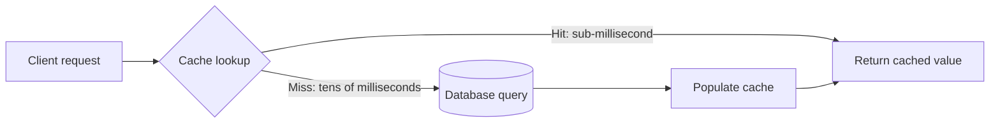

## 4. Core Concepts

This section is the conceptual backbone of the chapter and is organized as
nine first-principles subsections: the cache-consistency problem itself,
the four population/write patterns (cache-aside, read-through,
write-through, write-behind), the three invalidation strategies (TTL,
explicit, event-driven), the cache-stampede failure mode and its
mitigations, and the four classical eviction policies.

### 4.1 The Cache-Consistency Problem

**Definition.** Cache consistency is the guarantee — or, more often, the
*bounded lack of guarantee* — that a value read from the cache reflects the
current state of the underlying database. A cache is, by construction, a
second copy of data that can be written to or invalidated independently of
the database, which means there is always a window, however small, during
which the two can disagree.

**Mechanism.** Every pattern in this chapter is really just a different
protocol for keeping that disagreement window small and predictable rather
than eliminating it (eliminating it entirely would mean the cache adds no
latency benefit at all, since the only way to guarantee zero drift is to
synchronously check the database on every single read, which defeats the
purpose of caching). The protocol has two independent knobs: *who updates
the cache* (the application, the cache library itself, or an asynchronous
process) and *when the update happens relative to the database write*
(before, after, or on a delay). Different combinations of those two knobs
produce the four patterns in Sections 4.2-4.5.

**Decision implications.** Before choosing a pattern, an architect must
answer: how stale can a read be before it causes a real problem (a wrong
price shown for a few seconds vs. a wrong account balance), and is losing a
write acceptable if the process crashes at the wrong moment? Those two
questions alone eliminate most of the pattern space for any given field in
a schema — a product's marketing description tolerates seconds of
staleness and never needs write durability guarantees from the cache; an
account balance does not tolerate either.

**Common failure mode.** Treating "add a cache" as a purely operational,
non-architectural decision — bolting Redis onto an existing read path
without deciding an invalidation strategy up front — reliably produces bugs
where users see stale data with no clear owner-of-the-bug once it is
reported, because nobody wrote down which of the patterns below the system
was supposed to be following.

**Concrete scenario.** An e-commerce catalog service caches product prices
for one minute. A pricing team updates a price at 12:00:00. A customer who
loaded the product page at 11:59:50 and refreshes at 12:00:20 still sees
the old price, because the cache entry does not expire until 12:00:50. If
that one-minute staleness window was a conscious trade-off documented
against a business tolerance (marketing content is fine to be a minute
stale; flash-sale pricing is not), this is a working system. If it was
never decided consciously, it is a latent incident waiting for someone to
run a flash sale.

**Distinguishing a cache from a materialized view.** A cache and a
[materialized view](CH02_Denormalization.md#materialized-views) both store
a precomputed answer to avoid recomputing it on every read, but they differ
in three load-bearing ways that change how an architect should reason about
each: (1) *durability* — a materialized view is a persisted database
object; a cache entry can vanish at any moment (eviction, process restart,
node failure) with no data-loss implication, because the database remains
the sole source of truth; (2) *ownership of refresh* — a materialized
view's refresh (eager, lazy, or incremental) is a database-engine-managed
schedule, while a cache's refresh is driven by application-level reads,
writes, and TTLs; (3) *scope* — a materialized view is typically a whole
derived table queryable with SQL like any other relation, while a cache
entry is typically a single key-value pair keyed to one specific access
pattern. In practice, the two solve overlapping problems (both trade write
cost or staleness for read speed) but at different layers of the stack and
with different operational blast radii when they go wrong.

### 4.2 Cache-Aside (Lazy Loading)

**Definition.** Cache-aside — also called lazy loading — is the pattern in
which the *application code*, not the cache or the database, is responsible
for checking the cache first, falling back to the database on a miss, and
explicitly populating the cache with the result before returning it. The
cache is a passive key-value store with no knowledge of the database at
all; it never talks to the database itself.

**Mechanism.** The read path is: check cache; on hit, return the cached
value; on miss, query the database, write the result into the cache
(usually with a Time To Live (TTL)), then return the value. The write path
in the most common variant is: write to the database, then delete (not
update) the corresponding cache key, so the *next* read will lazily
repopulate it with a fresh value. Deleting rather than updating the cache
on write avoids a subtle race: if two concurrent writes race to update the
cache directly, the slower write's now-stale value can land in the cache
*after* the faster write's fresh value, silently corrupting the cache with
older data even though the database itself ended up correct.

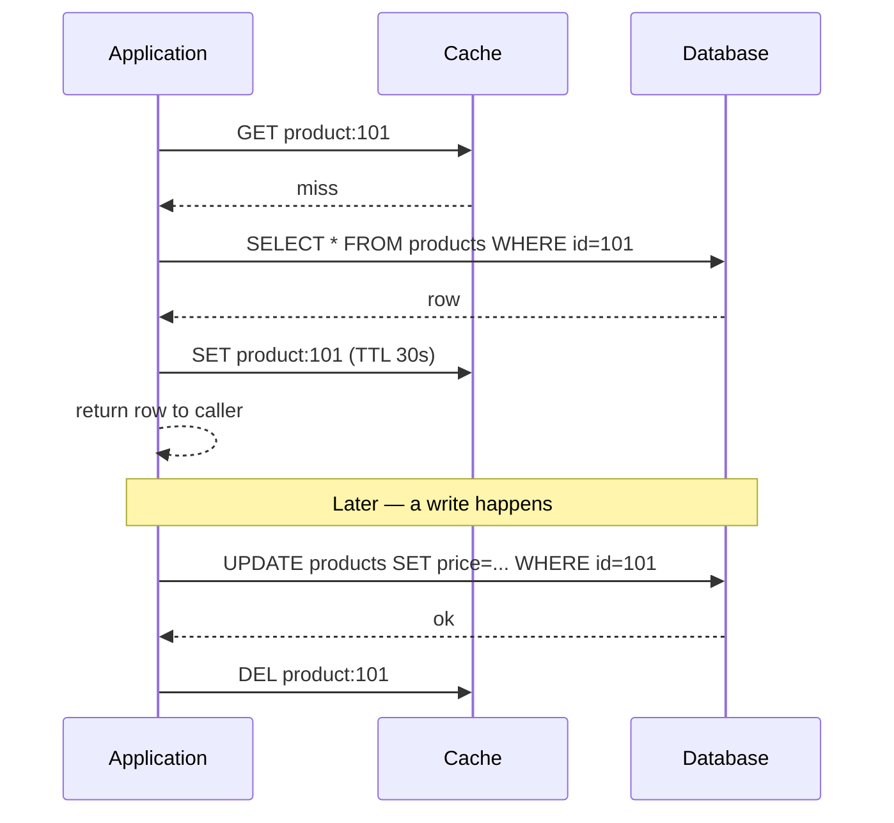

**Decision implications.** Cache-aside is the default choice for most
systems because it requires no special cache-library support (any
key-value store with get/set/delete works), degrades gracefully (a fully
down cache just means every read falls back to the database, which still
works, only slower), and lets different data types use different TTLs and
keys without any centralized cache-population logic. Its cost is that every
cache miss pays the *full* database latency plus the cache write, so a cold
cache (after a restart or a mass eviction) produces a burst of
database load — the cache stampede scenario in Section 4.8.

**Common failure mode.** Forgetting the invalidation half of the pattern —
teams frequently implement the read-populate half correctly and then treat
the corresponding write path as an afterthought, leaving stale cached
values indefinitely after an update because nothing ever deletes the old
key. The [Complete Code Example](#10-complete-code-examples) in this
chapter intentionally pairs the read and write functions together for
exactly this reason.

**Concrete scenario.** A user-profile service caches
`user:{id}:display_name` on first read with a 5-minute TTL. When a user
changes their display name, if the write path only updates the database and
never calls `cache.delete(f"user:{id}:display_name")`, every other service
reading that cached name will keep serving the old one for up to five
minutes purely by luck of the TTL, not by design.

### 4.3 Read-Through

**Definition.** Read-through moves the cache-miss-then-load logic out of
application code and into the cache layer itself (or a thin caching
library wrapping it): the application always asks the cache for a value,
and the cache — not the application — is responsible for querying the
database on a miss, populating itself, and returning the result.

**Mechanism.** From the application's point of view, there is only one
call: `cache.get_or_load(key, loader_function)`. Internally, the cache
checks its store; on a hit it returns immediately; on a miss it invokes the
supplied loader (which knows how to query the database for that key),
stores the result, and returns it. This is functionally the same
miss-then-populate sequence as cache-aside, but the responsibility for
*where the loading logic lives* is different — with a caching library or a
proxy such as Amazon DynamoDB Accelerator (DAX) sitting in front of the
database, application code never sees a raw cache miss at all.

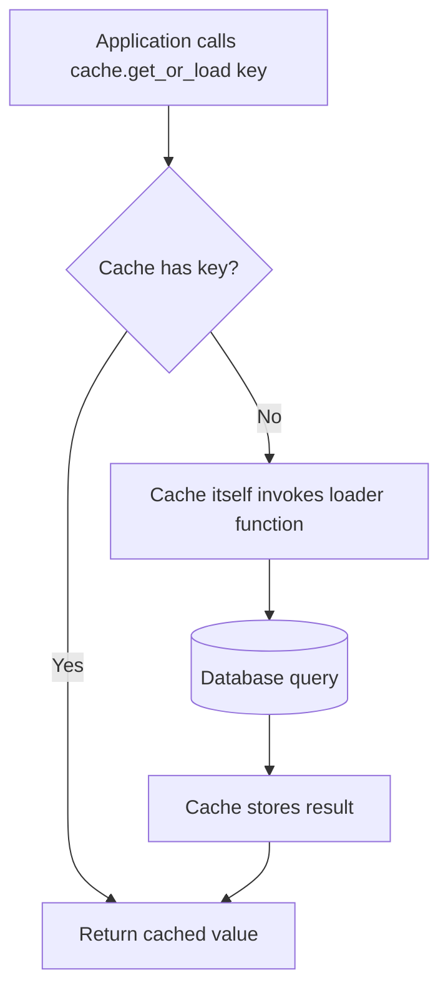

**Decision implications.** Read-through centralizes the population logic
in one place, which reduces the "forgot to populate the cache in this one
code path" bugs common with hand-rolled cache-aside, and it is the natural
fit when the cache technology itself offers this as a first-class feature
(DAX in front of DynamoDB, Hibernate's second-level cache in front of a
relational database via a `CacheLoader`-style interface). The cost is
coupling: the cache now needs to know how to load *this specific* type of
data, which means either the cache library must be configured per data
type or the application still writes a loader function per key pattern,
so the conceptual savings over cache-aside are more about consistency of
implementation than a fundamentally different failure mode.

**Common failure mode.** Assuming read-through automatically also handles
write invalidation — it does not. Read-through describes the read path
only; the write path still needs one of write-through, write-behind, or an
explicit delete on write, exactly as in cache-aside.

**Concrete scenario.** A service using DAX in front of DynamoDB issues a
normal `GetItem` call through the DAX client SDK; DAX transparently serves
the item from its in-memory cache if present, or forwards the request to
DynamoDB, caches the result, and returns it — the calling code has no
branch for "was this a hit or a miss," unlike the explicit `if cached is
None` branch cache-aside requires.

### 4.4 Write-Through

**Definition.** Write-through is a write-path pattern in which every write
goes to the cache *and* the database synchronously, as a single logical
operation from the caller's point of view, before the write is considered
complete. The cache is always kept up to date with every write; there is no
window where the cache holds a stale value after a write it participated
in.

**Mechanism.** The write sequence is: application issues a write; the cache
(or caching layer) writes the new value into itself, then synchronously
writes the same value to the database, and only returns success to the
caller once both writes have completed (or, in some implementations, the
cache write happens first, then the database write, with the operation
failing if the database write fails, requiring the cache write to be rolled
back or treated as merely provisional until the database confirms).

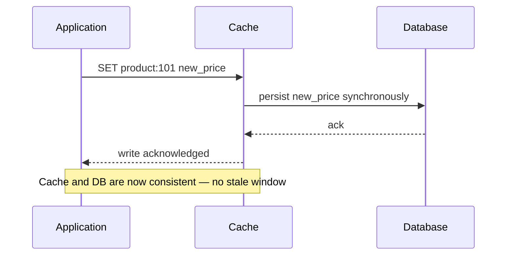

**Decision implications.** Write-through guarantees the cache never serves
a stale value for a key it just wrote (assuming no concurrent writer raced
it), at the cost of every write paying the full database write latency —
there is no write-latency benefit at all, only a read-latency benefit on
subsequent reads. It is the right choice when read-after-write consistency
for the *same* cached key matters a lot (a user who just updated their
profile should see the update immediately) but write throughput is not the
bottleneck.

**Common failure mode.** Assuming write-through protects against *all*
staleness — it only guarantees consistency for the specific key just
written by the specific writer that just wrote it. A second cache node in a
distributed cache tier, or a read replica of the cache holding an older
copy, can still lag; write-through is not a substitute for explicit
event-driven invalidation across a multi-node cache fleet, covered in
Section 4.7.

**Concrete scenario.** A shopping-cart service uses write-through so that
adding an item to a cart is immediately visible on the very next page load,
including on a page rendered by a *different* request that hits the same
cache node microseconds later — the classic case where cache-aside's
brief window between "delete the stale key" and "next reader repopulates
it" would be user-visible and confusing (a cart that briefly appears
empty), while write-through avoids that window entirely for this key.

### 4.5 Write-Behind (Write-Back)

**Definition.** Write-behind — also called write-back — is a write-path
pattern in which a write is acknowledged to the caller as soon as it lands
in the cache, and the corresponding database write is deferred and batched
asynchronously by a background process, rather than performed
synchronously as part of the caller's request.

**Mechanism.** The application writes a key to the cache; the cache marks
that key "dirty" (not yet flushed) in an internal buffer and immediately
returns success to the caller. A background flush process — running on a
timer, when the dirty buffer reaches a size threshold, or both — batches
the accumulated dirty writes and applies them to the database in one or a
small number of round trips, then clears the dirty markers for the flushed
keys.

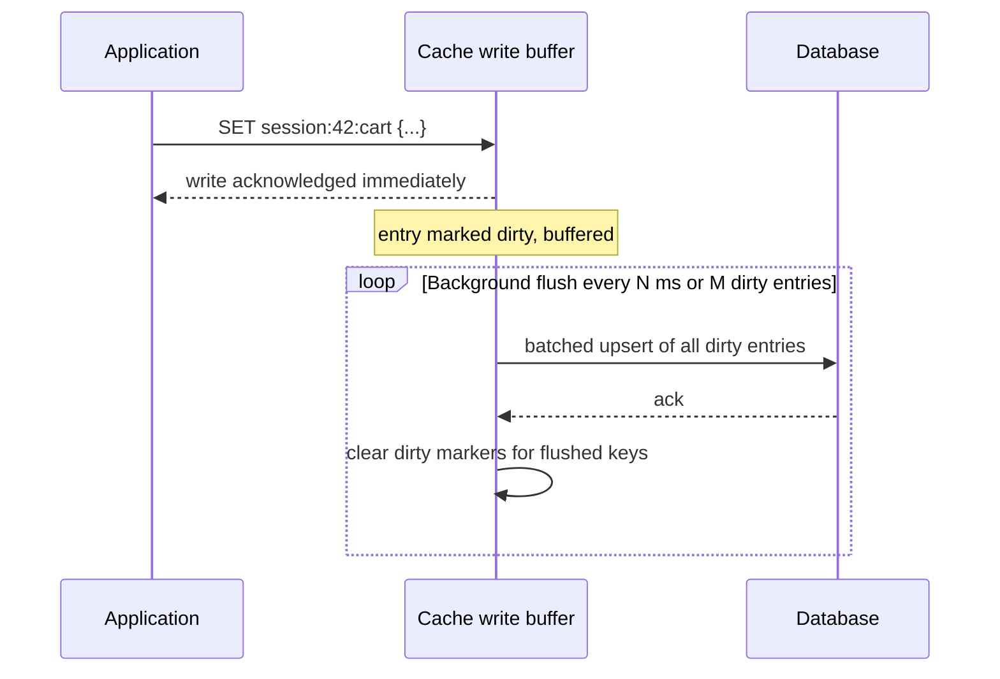

**Decision implications.** Write-behind delivers the lowest possible write
latency (the caller never waits on the database at all) and can
dramatically reduce database write load by coalescing many rapid updates to
the same key into a single flushed value (a shopping cart updated five
times in one second only needs to be persisted once, with its final
state). This throughput win is bought with a real durability-window risk:
any dirty entry not yet flushed is lost if the cache process crashes, the
host loses power, or the cache node fails before the next flush cycle runs
— the caller has already been told the write succeeded, but the database
never received it. This makes write-behind a poor fit for data where losing
the most recent update is unacceptable (financial ledgers, anything with a
regulatory durability requirement) and a good fit for data where losing the
last few seconds of updates is a tolerable, boundable cost (session state,
view counters, a shopping cart where the user can simply re-add an item).

**Common failure mode.** Treating write-behind's acknowledged-write as
equivalent to a durability guarantee. A caller receiving "write successful"
from a write-behind cache has only been told the write is durable *in the
cache*, not in the database, and any downstream system reading directly
from the database (a reporting pipeline, a different service that bypasses
the cache) can observe an inconsistent, lagging view of state that the
caller believes has already been committed everywhere.

**Concrete scenario.** A view-count feature increments a counter in a
write-behind cache on every page view, flushing accumulated deltas to the
database every 5 seconds. If the cache node crashes mid-window, up to 5
seconds of view increments are lost permanently — an acceptable trade-off
for a vanity metric, but the same 5-second batching window applied to an
"available inventory" decrement during a flash sale could let the site
oversell stock that a crashed flush never persisted, which is why the
decision to use write-behind must be made per data type, not as a
blanket policy for "the cache."

### 4.6 TTL-Based Invalidation

**Definition.** Time To Live (TTL)-based invalidation assigns every cache
entry an expiration time at write time; once that time passes, the entry is
treated as absent (either lazily, checked on next access, or actively,
swept out by a background reaper), forcing the next read to repopulate it
from the database.

**Mechanism.** Most cache implementations store the expiration time
alongside the value and check it on every `get`: if the current time is
past the stored expiration, the entry is treated as a miss (and typically
physically removed at that point too, "lazy expiration"). Some
implementations additionally run a periodic background sweep to reclaim
memory from expired-but-not-yet-accessed keys ("active expiration") so that
cold, expired entries do not sit around consuming memory indefinitely.

**Decision implications.** TTL is the simplest invalidation strategy to
implement (a single parameter at write time) and it *bounds* staleness by
construction — an entry can never be more stale than its TTL — which makes
it the right default whenever "eventually consistent within N seconds" is
an acceptable contract. Choosing the TTL value is itself the core design
decision: too short and the cache barely helps (most reads become misses
again quickly, largely defeating the point of caching); too long and users
can observe stale data for uncomfortably long windows after a write. There
is no universal "correct" TTL — it must be set per data type based on how
often the underlying value actually changes and how bad it is to see a
stale one.

**Common failure mode.** Setting one global TTL for an entire cache tier
regardless of data volatility. A catalog of rarely changing reference data
(country codes, category names) and a catalog of frequently changing
data (live sports scores) sharing the same 60-second TTL means the
reference data is repopulated needlessly often (wasted database load) while
the live scores might still be too stale for their use case even at 60
seconds.

**Concrete scenario.** A weather API caches forecast responses with a
10-minute TTL, matching how often the upstream forecast provider actually
refreshes its own data — this is a case where the TTL was deliberately
chosen to match the true update cadence of the source, not picked
arbitrarily, which is the discipline this subsection is arguing for.

### 4.7 Explicit and Event-Driven Invalidation

**Definition.** Explicit invalidation is the application (or database)
directly telling the cache "this specific key is now invalid, remove it"
at the moment a write happens, rather than waiting for a TTL to elapse.
Event-driven invalidation is a variant where that "remove this key"
signal is broadcast as an event (through a message queue or a pub/sub
channel) so that every cache node or every service instance holding a copy
of that key can react to it, rather than only the single process that
performed the write.

**Mechanism.** In the simplest single-cache-node case, explicit
invalidation is just the `cache.delete(key)` call already shown in
Section 4.2's cache-aside write path. The harder, genuinely distributed
version arises the moment there is more than one cache node or more than
one service holding its own local copy of the same logical data (a common
pattern: each application instance keeps a small in-process Least Recently
Used (LRU) cache *in front of* the shared Redis tier for the very hottest
keys, to avoid even a network hop to Redis). A single `DEL` sent to the
shared Redis tier does nothing to invalidate the dozens of in-process
copies scattered across every application instance's memory. Event-driven
invalidation solves this by having the writer publish an "invalidate key X"
event to a pub/sub channel (Redis's own `PUBLISH`/`SUBSCRIBE`, or a message
broker) that every instance subscribes to, so each instance independently
evicts its own local copy of key X on receiving the event.

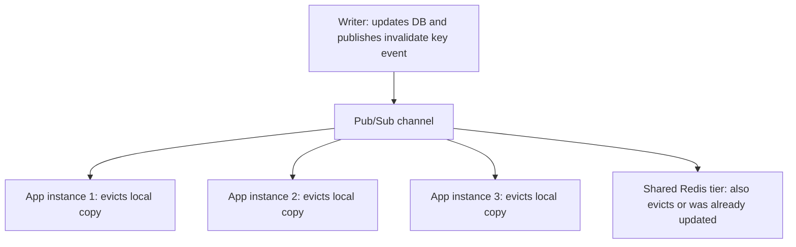

**Decision implications.** Explicit and event-driven invalidation give the
tightest possible staleness bound — near-immediate — at the cost of real
implementation and operational complexity: every writer must remember to
publish the invalidation, every subscriber must reliably receive and
process it (a dropped pub/sub message due to a subscriber being briefly
disconnected means that instance never learns the key changed and quietly
serves stale data until its own TTL, if any, eventually expires it
anyway — which is why event-driven invalidation is best used *as well as*
a TTL safety net, not instead of one), and a system with many independent
cache tiers/instances turns "invalidate one key" into a distributed
broadcast problem with its own delivery-guarantee questions. This is the
concrete shape of "distributed invalidation is hard": there is no way to
atomically guarantee that a database write and a fan-out invalidation to
every copy of that data anywhere in the fleet happen as a single atomic
step — there will always be a window, however small, where some copy has
not yet received the invalidation.

**Common failure mode.** Relying on event-driven invalidation as the sole
mechanism with no TTL fallback. If the pub/sub infrastructure itself has an
outage or a subscriber crashes and misses events while down, entries never
naturally expire and can go stale indefinitely with no safety net.

**Concrete scenario.** A feature-flag service caches flag values in-process
on every application instance for near-zero-latency flag checks on the hot
path, and publishes an invalidation event over Redis pub/sub whenever an
operator flips a flag in the admin console. Under normal operation every
instance updates within milliseconds; as a safety net, each in-process
cache entry also carries a 60-second TTL so that even an instance that
missed the pub/sub event (e.g., it was mid-restart when the event fired)
self-heals to the correct value within a bounded worst case.

### 4.8 Cache Stampede (Thundering Herd) and Mitigations

**Definition.** A cache stampede — also called a thundering herd — occurs
when a single popular cache key expires or is evicted and a large number of
concurrent requests for that same key all miss the cache at once, each
independently falling through to the database at (effectively) the same
instant, multiplying what should have been one database query into
hundreds or thousands.

**Mechanism.** This is a direct consequence of the plain cache-aside
pattern described in Section 4.2 having no concept of "someone is already
fetching this." Every one of N concurrent requests for the same expired key
runs the exact same miss-then-load-then-populate sequence independently and
in parallel, because nothing tells request #2 through #N that request #1
already started the identical database query a microsecond earlier.

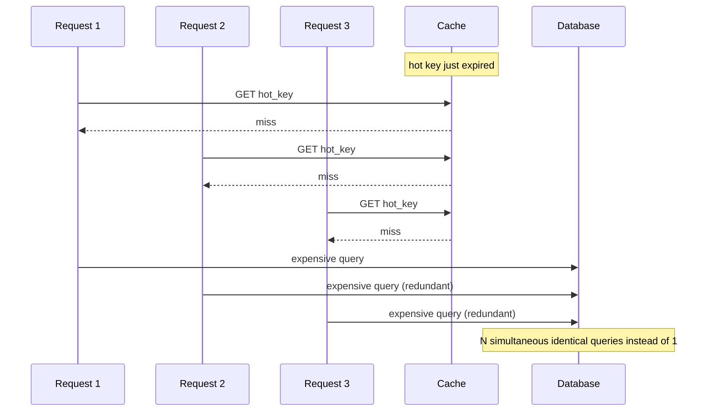

**Decision implications and mitigations.** Four mitigations, usable
independently or in combination, address this:

- **Mutex/locking (single-flight per key).** The first request to miss
  acquires a short-lived per-key lock before querying the database; every
  other concurrent request for the same key either blocks until the lock
  holder populates the cache and then reads the now-fresh value, or
  immediately returns a slightly stale cached value if one is still
  available under an "allow serving stale while refreshing" policy. The
  [Complete Code Example](#10-complete-code-examples) in this chapter
  implements exactly this with a per-key `threading.Lock` in Python; Redis
  itself supports the same idea distributedly via `SET key value NX`
  (set-if-not-exists) used as a distributed lock.
- **Request coalescing.** A closely related technique, often implemented at
  the same time as the mutex above: instead of merely blocking concurrent
  callers, the cache/service layer detects that an identical request is
  already in flight and has every waiter subscribe to the *same* in-flight
  future/promise, so the database is queried exactly once no matter how
  many callers asked, and all of them receive the one result when it
  resolves (this is the exact pattern implemented by Go's
  `golang.org/x/sync/singleflight` package and by this chapter's
  `CoalescingReader` code example).
- **Probabilistic early expiration.** Rather than every reader treating a
  key as valid until its exact expiration instant and then all missing
  simultaneously, each reader computes a small random chance of treating
  the key as "already expired" slightly *before* its real TTL, proportional
  to how close it is to expiring and how expensive the recompute is (the
  XFetch algorithm, described in a 2015 paper from Facebook/Google
  engineers, is the commonly cited formalization). This spreads the
  recompute load probabilistically across the window leading up to real
  expiration instead of concentrating it all at one instant, so only a
  small number of "unlucky" early requests pay the recompute cost, well
  before the herd would otherwise arrive.
- **Stale-while-revalidate.** The cache serves the existing (now technically
  expired) value immediately to the caller while triggering exactly one
  background refresh of that key; every request during the refresh window
  gets the slightly-stale-but-fast answer instead of blocking or missing at
  all. Readers should note that Next.js's Incremental Static Regeneration
  (see [Next.js](../04_Frontend_Architecture/CH07_Nextjs.md)) applies this
  exact idea one layer higher in the stack, to rendered pages rather than
  database query results — the underlying "serve stale, refresh in the
  background" trade-off is the same mechanism at a different layer.

**Common failure mode.** Adding a mitigation only after a stampede has
already caused a production incident — cache stampede is a scaling failure
mode that only manifests once a key becomes hot enough and the database's
headroom is thin enough that N simultaneous redundant queries actually
matter, so it is easy for a system to run for a long time without anyone
noticing the latent risk until a traffic spike or a marketing push turns a
previously safe key into a hot one.

**Concrete scenario.** A flash-sale landing page caches the "current deal"
object with a 30-second TTL. At the instant that entry expires during peak
traffic (thousands of requests per second), every one of those requests
misses simultaneously and independently queries the database for the same
row, spiking database load by orders of magnitude for the fraction of a
second it takes the first successful query to repopulate the cache — this
is precisely the scenario a per-key mutex or request-coalescing layer
prevents by ensuring only one of those thousands of requests actually
reaches the database.

### 4.9 Eviction Policies

**Definition.** An eviction policy is the algorithm a cache uses to decide
which entry to remove when it is full and a new entry needs room — every
cache with a fixed memory budget eventually needs one, because it cannot
simply keep growing forever.

**Mechanism — Least Recently Used (LRU).** LRU evicts the entry that has
gone the longest without being accessed, on the theory that recent access
is the best available predictor of near-future access (temporal locality).
It is classically implemented as a doubly linked list ordered by recency
plus a hash map from key to list node: every `get` or `put` moves the
touched entry to the "most recently used" end of the list in O(1); eviction
simply removes the entry at the "least recently used" end, also O(1). This
chapter's [LRU code example](#10-complete-code-examples) implements this
using Python's `OrderedDict`, whose `move_to_end` operation is backed by
exactly this doubly-linked-list-plus-hash-map structure internally.

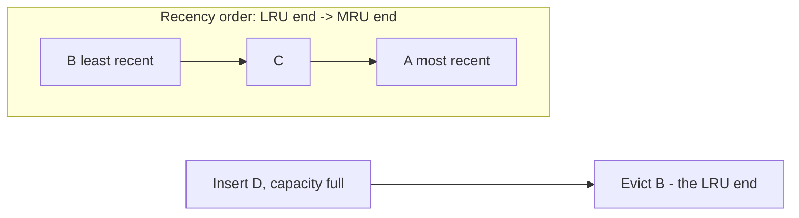

**Mechanism — Least Frequently Used (LFU).** LFU evicts the entry with the
lowest total access count, on the theory that overall popularity is a
better predictor than pure recency — a key accessed 10,000 times over the
last hour but not in the last minute is arguably "hotter" than a key
accessed once thirty seconds ago, a case where LRU would evict the wrong
one. LFU is implemented by maintaining a frequency counter per key
(commonly bucketed into frequency-linked lists for O(1) increment and
eviction, an approach popularized as the "LFU with O(1) implementation"
data structure). Its well-known weakness is that a key that was extremely
popular in the past but has since gone cold can retain a high enough
counter to resist eviction long after it stopped being useful ("cache
pollution by history"), which some implementations mitigate with periodic
counter decay (aging).

**Mechanism — First-In-First-Out (FIFO).** FIFO evicts whichever entry was
inserted earliest, completely ignoring access patterns after insertion — it
is implemented as a plain queue, making it the simplest and cheapest policy
to run, but also the least effective at protecting genuinely hot data,
since a key inserted early and accessed constantly ever since is evicted at
exactly the same rate as a key inserted early and never touched again. FIFO
is rarely chosen for its hit-rate quality; it is chosen when implementation
simplicity or predictable, access-pattern-independent behavior matters more
than maximizing hit rate (for example, some CPU cache levels favor
simplicity of hardware implementation over LRU's superior but costlier
tracking).

**Mechanism — Adaptive Replacement Cache (ARC).** ARC, developed at IBM
and used internally by ZFS's caching layer, addresses LRU's core weakness —
that it reacts only to recency and can be "fooled" by a burst of one-time
scan traffic evicting genuinely hot, frequently reused entries — by
maintaining two separate LRU lists: one for entries seen only once
recently, and one for entries seen more than once recently, plus two
"ghost" lists that remember recently evicted keys from each list without
storing their values. When a ghost-listed key is requested again, ARC
treats that as a signal that its target list's real size should grow
(stealing capacity from the other list), continuously and automatically
tuning the balance between "favor recency" and "favor frequency" based on
observed hit patterns, rather than requiring an operator to hand-pick LRU
or LFU up front.

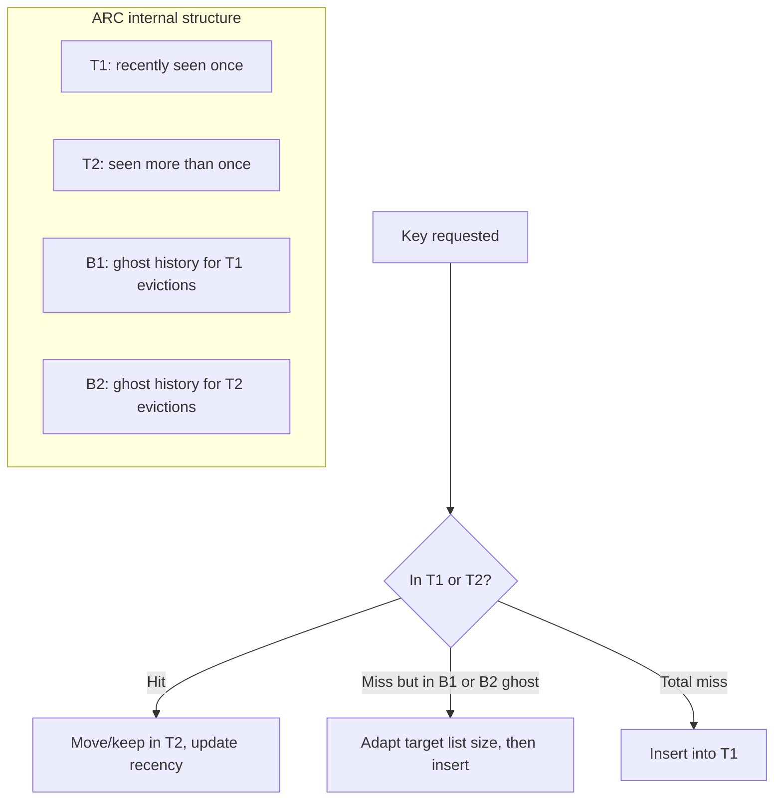

**Decision implications.** LRU is the default choice for most general-
purpose caches because it is simple, cheap, and correct for the common case
of temporal-locality-dominated workloads (most web application traffic).
LFU is worth the extra bookkeeping when access frequency genuinely
outlasts short-term recency in your workload (a small set of reference
values queried constantly for months, interspersed with large volumes of
one-off queries that must not evict them). FIFO is chosen only when
simplicity or hardware constraints dominate. ARC is worth adopting when
workloads mix scan-heavy and repeat-heavy access patterns unpredictably and
the operational cost of running (and tuning) a more sophisticated algorithm
is justified by the resulting hit-rate improvement — Redis, notably,
defaults to an approximated LRU (sampling a small random set of keys and
evicting the oldest among the sample, rather than tracking exact global
recency) as a deliberate memory/CPU trade-off, and separately offers an LFU
mode, but does not implement ARC.

**Common failure mode.** Choosing an eviction policy once at cache setup
time and never revisiting it as the workload's actual access pattern
changes — a policy tuned for one traffic shape (steady popularity skew) can
silently perform far worse once the workload shifts (a new feature
introduces heavy scan-like access), and because eviction-policy mismatches
manifest only as a gradual, hard-to-attribute drop in cache hit rate rather
than an outright failure, they are easy to overlook.

**Concrete scenario.** A recommendation service originally saw steady,
popularity-skewed traffic and chose plain LRU. After a batch analytics job
was added that periodically scans millions of distinct user IDs
sequentially, that scan's one-off reads evicted the small set of genuinely
hot, frequently re-requested recommendation entries out of the LRU cache
purely because the scan touched them "more recently," even though each scan
key was never touched again — a textbook case for either isolating the scan
workload into a separate cache pool or switching the shared cache to an
ARC-style or frequency-aware policy that resists this exact failure mode.

## 5. Internal Working

This section traces what actually happens, end to end, inside a
production-shaped cache-aside deployment against a managed Redis cluster,
tying together the patterns from Section 4 into one coherent request
lifecycle.

**Step 1 — Client library and connection.** The application holds a
persistent connection pool to the Redis cluster (typically over TCP with a
lightweight text protocol, RESP — Redis Serialization Protocol). A cache
`get` is a single round trip: send a `GET key` command, receive either the
value or a nil response.

**Step 2 — Key hashing and node routing (in a clustered deployment).** A
Redis Cluster deployment shards keys across multiple nodes using a 16,384-
slot hash space; the client library computes `CRC16(key) mod 16384` to
determine which node owns a given key and routes the request there directly
(or receives a `MOVED` redirect if its routing table is stale after a
resharding event). This is conceptually the same client-side hashing
technique introduced generally in [Sharding](CH06_Sharding.md) — Redis
Cluster is simply one concrete, cache-specific application of it.

**Step 3 — Serialization.** Values are stored as byte strings or Redis's
native data structures (hashes, sorted sets); application objects (a Python
dict, a Java POJO) must be serialized to and from that representation
(commonly JSON for interoperability, or a binary format like MessagePack or
Protocol Buffers when serialization/deserialization CPU cost or payload
size matters at scale).

**Step 4 — TTL bookkeeping.** Redis stores an expiration timestamp
alongside a key when `SET ... EX seconds` (or `PEXPIRE`) is used. Redis
expires keys through a hybrid of lazy expiration (checked on access) and
active expiration (a background cycle that samples a random subset of keys
with a TTL set, several times a second, and proactively removes any that
have expired, bounding how long already-dead memory sits unreclaimed even
if nothing ever reads that key again).

**Step 5 — Eviction under memory pressure.** Independent of TTL expiration,
if Redis's `maxmemory` limit is reached, its configured `maxmemory-policy`
(for example `allkeys-lru`, `volatile-lru`, `allkeys-lfu`) determines which
keys are evicted to make room for new writes, using the approximated-LRU or
LFU sampling approach described in Section 4.9.

**Step 6 — Failure and failover.** A managed Redis deployment typically
runs a primary node with one or more replicas (see
[Replication](CH07_Replication.md) for the general leader-follower
mechanics this reuses); if the primary fails, a sentinel/cluster-manager
process promotes a replica, and clients reconnect to the new primary,
during which brief window cache operations fail and the application's
fallback behavior (does a cache-unavailable error degrade to hitting the
database directly, or does it surface as a user-facing error?) becomes the
deciding factor in whether a cache outage is invisible or catastrophic —
covered further in Section 15.

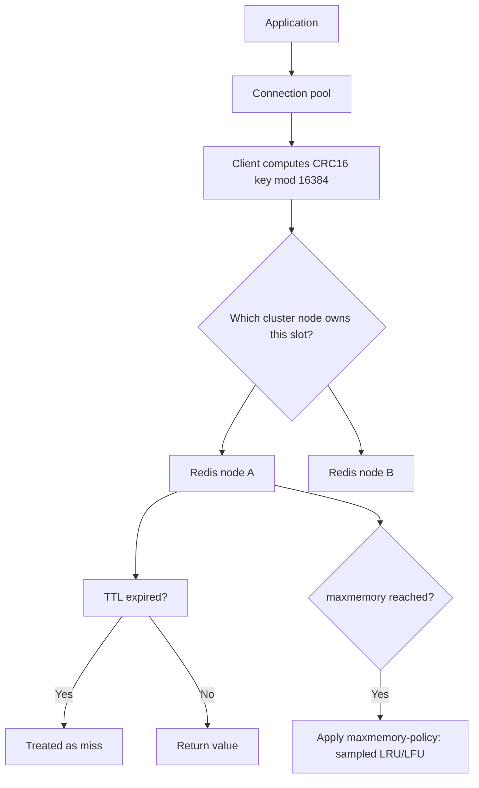

## 6. Design Principles

- **Decide the pattern and TTL per data type, not once for "the cache."**
  Section 4 showed that cache-aside, read-through, write-through, and
  write-behind trade off differently against write latency, database load,
  and durability risk — the right choice for session data is often the
  wrong choice for financial data within the same system.
- **Bound staleness explicitly and write it down.** Every cached field
  should have a documented, deliberate answer to "how stale can this be
  before it's a real problem," not an implicit one inherited from whatever
  TTL a previous engineer happened to type.
- **Prefer invalidate-on-write over update-on-write for cache-aside.**
  Section 4.2 explained the race that deleting (rather than overwriting) a
  cache entry on write avoids; this is a small implementation detail with
  an outsized correctness payoff.
- **Assume the cache can and will disappear.** Design every read path to
  function correctly (if more slowly) when the cache is empty, unreachable,
  or has just been flushed — a system that requires the cache to be warm
  to avoid falling over is a system with an undocumented hard dependency on
  an intentionally disposable component.
- **Protect hot keys from stampedes proactively, not reactively.** Apply a
  mutex/coalescing layer or probabilistic early expiration to any key whose
  traffic volume and database-query cost make a simultaneous-miss burst
  genuinely expensive, before it happens in production, not after.
- **Match the eviction policy to the actual access pattern, and revisit it.**
  Section 4.9's scan-vs-hot-key scenario shows that a policy chosen once at
  launch can become wrong as traffic shape evolves; monitor hit rate as a
  signal, not just latency.

## 7. Architecture Patterns

**Single shared cache tier (cache-aside against one Redis cluster).** The
most common production shape: every application instance shares one logical
cache cluster (physically sharded across nodes as in Section 5), giving a
consistent view across the whole fleet at the cost of a network hop per
cache access.

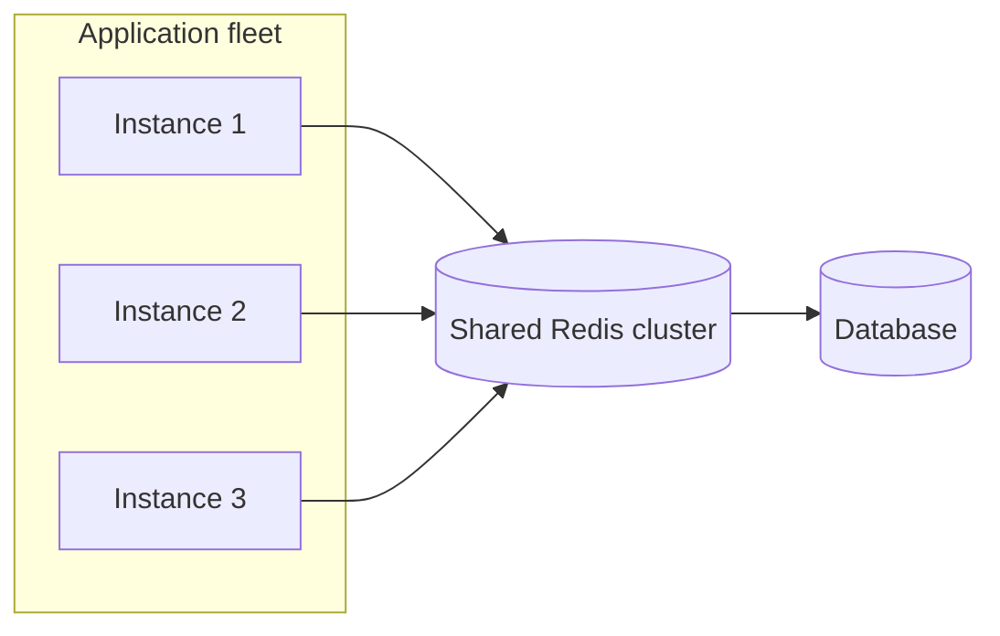

**Multi-tier caching (local + shared).** An in-process cache (an in-memory
LRU map) sits in front of the shared cache tier on each application
instance, avoiding even the network hop to Redis for the very hottest keys,
at the cost of the event-driven-invalidation complexity discussed in
Section 4.7 — every local tier must independently learn about
invalidations.

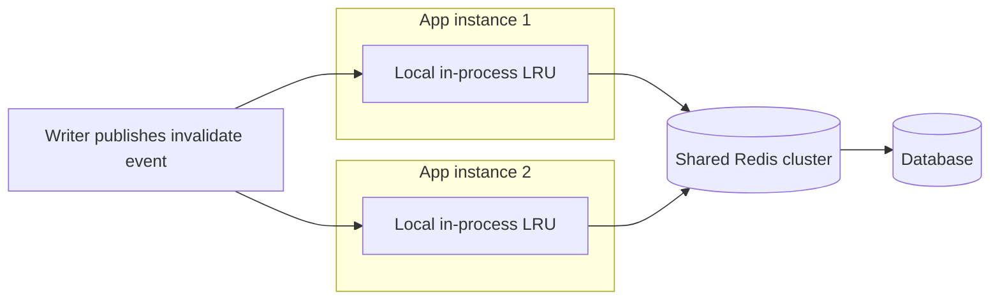

**Side-cache vs. inline-cache placement.** A side-cache (the cache-aside
and read-through shapes above) sits alongside the database, consulted
explicitly by application code before or instead of a database call. An
inline cache sits directly in the query path as a proxy the application
cannot bypass even if it wanted to (Amazon DAX in front of DynamoDB is the
canonical example) — every request necessarily passes through it, which
guarantees the cache is never accidentally skipped but also means an
inline-cache outage can take down reads entirely rather than merely
degrading them to hit the database directly.

**Read replicas as a cache-adjacent pattern.** Database read replicas (see
[Replication](CH07_Replication.md)) solve a related but distinct problem —
spreading read *load* across more database capacity — and are frequently
used *alongside* a cache tier rather than instead of one: the cache absorbs
the hottest, most repeated queries; replicas absorb the long tail of
distinct, less-repeated read queries that a cache would not help with
because each one is only ever asked once.

## 8. Production Architecture

A production caching tier for a mid-to-large web application typically
looks like the diagram below: application instances behind a load balancer,
each holding a connection pool to a managed, clustered, replicated cache
service, itself sitting in front of a primary database with its own read
replicas, with an asynchronous event bus carrying invalidation events for
any per-instance local caches.

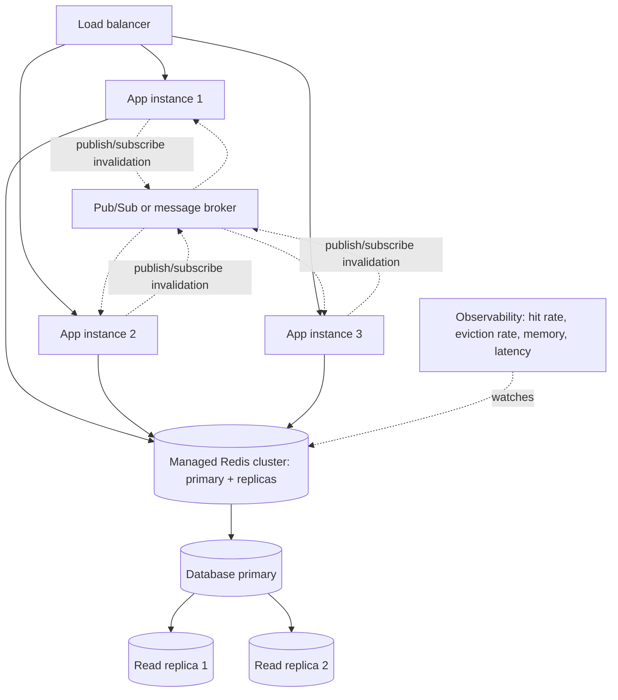

Operationally, this shape needs: a capacity plan for the cache cluster's
memory (sized to the working set the business decided is worth caching,
not "as much as the budget allows"), a `maxmemory-policy` chosen
deliberately per Section 4.9, TTLs set per data type per Section 4.6, a
stampede mitigation on the small set of genuinely hot keys per Section 4.8,
and dashboards tracking hit rate, eviction rate, and cache-node latency as
first-class production signals — covered further in Section 14.

## 9. Implementation

Implementing cache-aside correctly, end to end, involves five concrete
steps that map directly onto Section 4's mechanisms:

1. **Choose the key schema.** Cache keys should encode exactly the
   dimensions that make a cached value unique — `product:{id}:price` not a
   bare `{id}`, and critically, include any dimension the value varies by
   (a per-currency price needs `product:{id}:price:{currency}`, or a stale
   value from one currency will be served for another).
2. **Choose the client library and connection strategy.** Use a connection
   pool sized to the application's concurrency, with a short timeout and
   an explicit fallback (typically: on any cache error, log it, increment a
   metric, and fall through to querying the database directly) rather than
   letting a cache outage propagate as a user-facing error.
3. **Implement the read path with a populate step.** Check cache; on miss,
   query the database, then write the result back to the cache with an
   appropriate TTL *before* returning it to the caller — see Section 4.2's
   sequence diagram.
4. **Implement the write path with invalidation.** Every write path that
   changes a value with a corresponding cache entry must delete that entry
   (cache-aside) or update it synchronously (write-through) as part of the
   same logical operation, never as an optional afterthought.
5. **Add stampede protection to hot keys.** Wrap the read path for any key
   identified (by traffic analysis, not guesswork) as disproportionately
   hot with the mutex/coalescing pattern from Section 4.8, so that a single
   expiration does not become a multiplied database load spike.

## 10. Complete Code Examples

Four runnable examples accompany this chapter, each demonstrating one
mechanism taught in Section 4 end to end rather than a toy snippet:

1. [`code/python/caching-chapter/01_cache_aside.py`](../code/python/caching-chapter/01_cache_aside.py)
   — a full cache-aside read path (miss, populate, hit) and write path
   (write database, then invalidate) against a simulated Redis-like client
   and a simulated database with realistic artificial latency, matching
   Section 4.2's sequence diagram exactly.
2. [`code/python/caching-chapter/02_request_coalescing.py`](../code/python/caching-chapter/02_request_coalescing.py)
   — reproduces a cache stampede with 20 concurrent threads missing the
   same key simultaneously against a query-counting database (20 redundant
   queries fired), then fixes it with a per-key `threading.Lock`
   "singleflight" coalescing reader (exactly 1 query fired for the same 20
   concurrent callers), directly demonstrating Section 4.8's mitigation.
3. [`code/python/caching-chapter/03_lru_cache.py`](../code/python/caching-chapter/03_lru_cache.py)
   — implements Least Recently Used (LRU) eviction from first principles
   using `OrderedDict.move_to_end` (backed by the same doubly-linked-list-
   plus-hash-map structure described in Section 4.9), with instrumented
   hit/miss/eviction counters and printed before/after ordering at each
   step.
4. [`code/node/caching-chapter/04_write_behind_buffer.js`](../code/node/caching-chapter/04_write_behind_buffer.js)
   — a write-behind (write-back) buffer that acknowledges writes
   immediately, batches dirty entries to a simulated database on a
   background timer, and includes an explicit
   `simulateCrashLosingUnflushedWrites` method that demonstrates Section
   4.5's durability-window risk concretely: writes acknowledged to the
   caller but not yet flushed are provably lost if the process "crashes"
   before the next flush.

All four were executed during authoring and confirmed to run cleanly to
completion with the expected output (a cache-miss-then-hit latency
difference, a 20-to-1 query reduction from coalescing, an LRU eviction of
the correct key, and a demonstrated write loss under a simulated crash).

## 11. Performance

The entire performance case for caching rests on the latency and capacity
gap between an in-memory lookup and a database round trip: a well-tuned
in-memory cache lookup typically completes in well under a millisecond
end-to-end (including network round trip to a co-located cache node), while
even a fast, well-indexed database query typically costs several
milliseconds once connection handling, query planning (see
[Query Optimizers](CH04_Query_Optimizers.md)), and any disk I/O are
accounted for — often one to two orders of magnitude slower. The practical
performance metric that matters is **hit rate**: a cache with a 95% hit
rate serving a workload where a hit costs 1 ms and a miss costs 20 ms has an
effective average read latency of `0.95 × 1 + 0.05 × 20 = 1.95 ms`, an
order of magnitude better than always hitting the database, while the same
cache at a 50% hit rate yields `0.5 × 1 + 0.5 × 20 = 10.5 ms` — hit rate,
not raw cache speed, dominates the outcome, which is why TTL tuning
(Section 4.6) and eviction-policy fit (Section 4.9) are performance
decisions, not just correctness decisions. Serialization cost (Section 5,
step 3) also matters at scale: a naive, verbose JSON representation of a
large object can make the *cache* the CPU bottleneck under high request
volume, motivating a switch to a more compact binary serialization format
for very hot, high-throughput keys.

## 12. Scalability

Caching scales along two axes independently of the database: **horizontal
cache-cluster sharding** (Section 5's CRC16-based slot routing) lets a
cache tier's aggregate memory and throughput grow by adding nodes, the same
technique generalized in [Sharding](CH06_Sharding.md); and **read-side
fan-out**, where the same cached value can be read by an effectively
unbounded number of application instances without any additional database
load at all, unlike a database read replica whose read capacity still
scales linearly with the number of replicas added. The multi-tier pattern
in Section 7 pushes this further: an in-process local cache layer scales
"for free" with every additional application instance added (each instance
brings its own local cache capacity along with its own compute), at the
cost of the harder event-driven-invalidation coordination problem across
however many instances now each hold their own copy.

## 13. Security

- **Treat cached data with the same sensitivity as its source.** A cache
  entry containing personally identifiable information or financial data
  must be encrypted in transit (TLS to the cache — see
  [TLS](../05_Networking_and_OS/CH06_TLS.md)) and access-controlled exactly
  as strictly as the database it was copied from; caches are frequently
  under-secured in practice because they are perceived as "just a
  performance detail" rather than a second copy of sensitive data.
- **Never build cache keys from unsanitized user input.** A cache key
  constructed by naively concatenating user-supplied strings can allow key
  injection or key collision attacks (one user's request accidentally or
  maliciously reading another user's cached data because their inputs
  produced the same key) — always include a properly scoped, authenticated
  identifier (a validated user ID, never a raw header value) as part of the
  key.
- **Avoid caching authorization decisions past their validity window.**
  Caching "is this user allowed to see this resource" for longer than a
  permission change can realistically take effect creates a window where a
  revoked user retains access purely because the cached "yes" has not
  expired yet — authorization checks generally need much shorter TTLs (or
  event-driven invalidation on permission change) than ordinary content
  caching.
- **Isolate multi-tenant cache keys.** In a multi-tenant system, cache keys
  must include the tenant identifier as a hard-enforced prefix or
  namespace, so a bug in key construction cannot leak one tenant's cached
  data to another tenant's request.

## 14. Observability

The minimum viable dashboard for any production cache tier tracks:

- **Hit rate and miss rate** (per key pattern where possible, not just
  globally) — the single most important signal for whether the cache is
  earning its operational cost, per Section 11's math.
- **Eviction rate** — a rising eviction rate at constant traffic usually
  means the cache is undersized for its working set, or the TTLs/eviction
  policy are pushing out data that is still being requested.
- **Latency percentiles for cache operations** (p50/p95/p99) — a cache
  that is itself slow (an overloaded or undersized cluster) can silently
  erode the entire performance case for having a cache at all.
- **Memory utilization against `maxmemory`** — approaching the ceiling
  triggers the eviction behavior from Section 4.9/Section 5 and needs
  capacity planning, not just alerting after the fact.
- **Stampede indicators** — a spike in database query volume correlated
  with a specific hot key's TTL expiration is the clearest sign a
  mitigation from Section 4.8 is missing where it is needed.
- **Invalidation-event delivery lag/failures** — for event-driven
  invalidation deployments (Section 4.7), tracking whether subscribers are
  connected and processing events promptly is essential, since a silently
  disconnected subscriber degrades to serving stale data with no visible
  error.

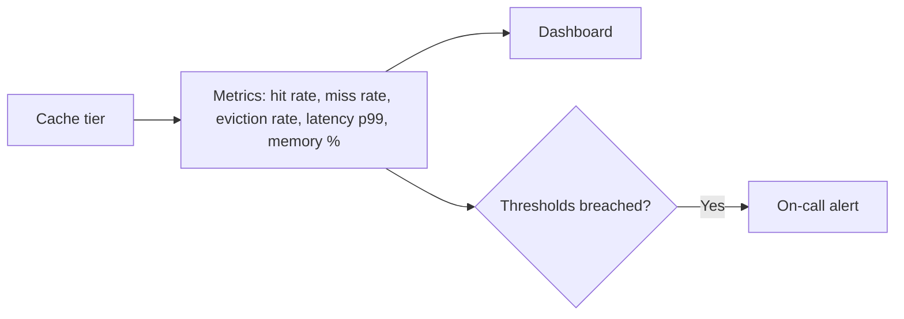

## 15. Failure Scenarios

- **Cache cluster total outage.** Every cache operation fails or times out.
  If the application's fallback path is correct (Section 6's "assume the
  cache can disappear" principle), reads degrade to hitting the database
  directly, with higher latency and higher database load, but the system
  stays up. If the fallback path was never implemented or tested, this can
  become a full outage instead of a degradation — the single most important
  failure scenario to rehearse.
- **Cold cache after a restart, redeploy, or a full flush.** Every key
  misses simultaneously across the entire keyspace, not just one hot key —
  a stampede at the scale of the whole workload rather than one key.
  Mitigations include warming the cache proactively before cutting traffic
  over to it, and rate-limiting or gradually ramping traffic to a freshly
  restarted service so the database is not hit with the full unmitigated
  load at once.
- **Split-brain or stale-replica reads in a clustered cache.** A client
  briefly routing reads to a replica node that has not yet received a
  recent write (see [Replication](CH07_Replication.md) for the general
  replication-lag mechanism) can observe a stale value even though the
  primary already has the fresh one.
- **Missed invalidation event.** As discussed in Section 4.7, a subscriber
  that is disconnected, crashed, or simply slow to process its subscription
  queue at the moment an invalidation event is published never learns a key
  changed, and serves stale data until its TTL (if any) eventually expires
  it — this is why event-driven invalidation should always have a TTL
  safety net, not be relied upon alone.
- **Write-behind data loss on crash.** As discussed in Section 4.5, any
  dirty, unflushed entry is lost if the cache process fails before its next
  flush cycle — a risk that must be explicitly accepted per data type, not
  discovered during an incident review.
- **Thundering herd after a mass eviction (memory pressure).** If
  `maxmemory` is reached and a large batch of keys is evicted at once
  (rather than gradually), the next wave of requests for all of those keys
  can reproduce the exact same stampede dynamic as Section 4.8, just
  triggered by memory pressure instead of TTL expiry.

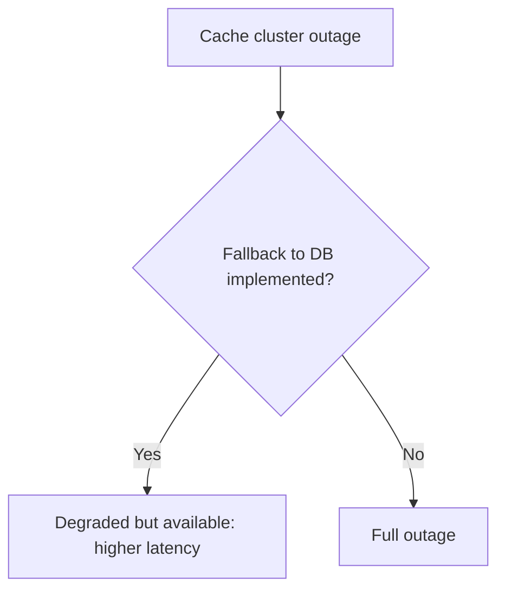

## 16. Testing

- **Unit-test the invalidate-on-write path explicitly.** As noted in
  Section 4.2's common failure mode, it is easy to unit-test the read-
  populate path and forget the write-invalidate path; write a test that
  writes a value, asserts the cache no longer returns the old one, and
  reads again to assert the new value is correctly repopulated.
- **Test cache-outage fallback behavior deliberately.** Point the
  application at an intentionally unreachable cache endpoint (or use a
  fault-injection proxy) and assert the read path still succeeds via the
  database fallback, with acceptable latency and without surfacing an
  error to the caller.
- **Load-test hot-key stampede scenarios.** Simulate N concurrent requests
  missing the same key simultaneously (exactly as this chapter's
  `02_request_coalescing.py` example does) and assert the database query
  count stays bounded (ideally 1) rather than scaling with N.
- **Test TTL boundaries with a controllable clock.** Inject a fake/mockable
  clock rather than sleeping in real time during tests, so TTL-expiry
  behavior can be tested deterministically and quickly instead of relying
  on `time.sleep` calls that make the test suite slow and flaky.
- **Test eviction under a capacity limit.** Fill a cache instance to
  capacity plus one and assert the correct entry (the least-recently-used
  one, for an LRU cache) is the one evicted — exactly the assertion made in
  this chapter's `03_lru_cache.py` example's demo output.

## 17. Common Mistakes

- **Caching without an invalidation strategy decided up front.** Adding a
  cache purely for the read-latency win and only later realizing nobody
  designed how stale entries get removed.
- **Using update-on-write instead of delete-on-write for cache-aside.**
  Reintroducing the stale-overwrite race described in Section 4.2 by
  writing the new value directly into the cache instead of deleting the
  key and letting the next read repopulate it.
- **One global TTL for all data types.** As discussed in Section 4.6,
  applying the same TTL to rapidly changing and rarely changing data alike
  wastes database capacity on one side and risks unacceptable staleness on
  the other.
- **No stampede protection on demonstrably hot keys.** Leaving a plain
  cache-aside implementation in place on a key whose traffic has grown
  enough that a simultaneous-miss burst would meaningfully hurt the
  database.
- **Treating a write-behind acknowledgment as a durability guarantee.**
  Building downstream logic (billing, inventory decrement, anything with a
  correctness requirement) on top of a write-behind cache without
  accounting for the durability-window risk from Section 4.5.
- **Building cache keys from unsanitized or under-scoped input.** The
  security failure mode from Section 13 — key collisions or cross-tenant
  leakage from carelessly constructed keys.
- **No fallback path when the cache is unavailable.** Letting a cache
  outage become a full application outage instead of a graceful, if slower,
  degradation to the database.

## 18. Best Practices

- **Document, per data type, which pattern (Section 4.2-4.5) and TTL
  (Section 4.6) apply, and why**, so the invalidation strategy is a
  conscious design artifact, not an emergent accident discovered during an
  incident.
- **Always pair a write path with its corresponding invalidation**, treating
  the two as one atomic unit of work in code review, not two independently
  reviewable changes.
- **Apply stampede protection proactively to any key identified as hot**
  via real traffic data, using the mutex/coalescing pattern from Section
  4.8 as the default, with probabilistic early expiration or
  stale-while-revalidate as complements for very high-traffic keys.
- **Choose the eviction policy based on measured access patterns**, not by
  default, and monitor hit rate over time to catch drift as the workload
  changes (Section 4.9's scan-pollutes-LRU scenario).
- **Design every read path to degrade gracefully without the cache**,
  and actually test that degradation path (Section 16), rather than
  assuming it works because it looks correct in code.
- **Namespace and scope every cache key explicitly** (tenant, locale,
  currency, any dimension the value varies by) to avoid both correctness
  bugs (serving the wrong variant) and the security failure modes in
  Section 13.

## 19. Anti-Patterns

- **Cache-as-source-of-truth.** Treating the cache as if it were
  authoritative — for example, writing a value only to the cache and never
  to the database at all — defeats the entire premise that the database is
  the durable source of truth and the cache is a disposable copy; any
  eviction or restart then causes real, permanent data loss rather than a
  recoverable staleness window.
- **Caching everything uniformly regardless of access pattern.** Applying
  the same caching strategy to rarely read, rarely repeated data provides
  no benefit (it will almost always miss anyway) while still consuming
  cache memory that could hold genuinely hot data — caching should be
  applied selectively, based on evidence of repeated access.
- **Silent swallowing of cache errors that mask real bugs.** A fallback
  path that catches every cache exception and falls through to the
  database is correct for availability, but if it also swallows the error
  without logging or metrics, a persistently broken cache connection can go
  unnoticed for a long time while quietly costing the full database-latency
  penalty on every single request.
- **Manually re-implementing invalidation broadcast instead of using an
  existing pub/sub or event bus.** Hand-rolled polling loops to propagate
  invalidation across a fleet reinvent, poorly, what a proper pub/sub
  mechanism (Section 4.7) already solves with lower latency and less
  custom code to maintain.
- **Confusing a cache with a materialized view and using one where the
  other is needed.** As distinguished in Section 4.1, reaching for an
  application-tier cache when what is actually needed is a durable,
  queryable, engine-managed derived table (or vice versa) produces a
  system that either loses acceptable data on eviction or pays needless
  persistence and refresh-scheduling overhead for data that never needed
  to survive a restart.

## 20. Trade-off Analysis

Every pattern in this chapter trades one of {write latency, read
consistency, implementation complexity, durability risk} against another:

- **Cache-aside** trades a small amount of read-path complexity
  (application must check-then-populate) for simplicity everywhere else and
  graceful cache-outage degradation, but pays full database latency on
  every miss and needs explicit stampede protection.
- **Read-through** trades a small amount of extra coupling (the cache or
  library must know how to load each data type) for centralized, less
  error-prone population logic versus hand-rolled cache-aside.
- **Write-through** trades write latency (every write pays the database
  round trip synchronously) for the strongest same-key read-after-write
  consistency of the four write patterns.
- **Write-behind** trades durability risk (Section 4.5's crash-loses-
  unflushed-writes window) for the lowest possible write latency and
  reduced database write volume via batching/coalescing.
- **TTL invalidation** trades a bounded staleness window for near-zero
  implementation complexity; **explicit/event-driven invalidation** trades
  implementation and operational complexity for a much tighter staleness
  bound.
- **LRU** trades some hit-rate quality on scan-heavy workloads for
  simplicity and low overhead; **LFU** trades extra bookkeeping and the risk
  of stale popularity for better performance under frequency-skewed
  workloads; **ARC** trades the most implementation complexity of the four
  for automatic, workload-adaptive tuning that needs no manual policy
  choice up front.

## 21. Comparison Table

| Pattern/Policy | Write latency | Read-after-write consistency | Data-loss risk on crash | Implementation complexity |
|---|---|---|---|---|
| Cache-aside | Database-only (cache write is out of the critical write path) | Weak until next read repopulates after invalidation | None (cache is disposable) | Low |
| Read-through | Database-only | Weak, same as cache-aside | None | Low-Medium (centralized loader) |
| Write-through | Database + cache, synchronous | Strong for the key just written | None | Medium |
| Write-behind | Cache-only (fast) | Strong for reads from the same cache | Real — unflushed writes lost on crash | Medium-High |
| TTL invalidation | N/A (invalidation strategy) | Bounded staleness = TTL value | N/A | Low |
| Explicit/event-driven invalidation | N/A (invalidation strategy) | Near-immediate, but not atomic across all copies | N/A | Medium-High |
| LRU eviction | N/A (eviction policy) | N/A | N/A | Low |
| LFU eviction | N/A | N/A | N/A | Medium |
| FIFO eviction | N/A | N/A | N/A | Very low |
| ARC eviction | N/A | N/A | N/A | High |

## 22. Real-World Case Study

Facebook's 2013 engineering paper "Scaling Memcache at Facebook" documents
several of this chapter's concepts operating at a scale that surfaced
failure modes invisible at smaller scale. Facebook ran memcache as a
demand-filled look-aside cache (this chapter's cache-aside pattern, in
their terminology) in front of MySQL, serving a social graph read workload
with extreme fan-out (a single page render could touch hundreds of cache
keys). Two of their documented mitigations map directly onto Section 4.7
and Section 4.8 of this chapter: first, they built "leases" — a mechanism
functionally similar to this chapter's per-key mutex/single-flight
mitigation, where memcache hands out a lease token to the first client that
misses a key, and rejects a `SET` from any other client holding a stale
lease token, specifically to prevent a stampede of redundant database
queries and to prevent a slow, stale write from clobbering a fresher one
already written by a faster concurrent request — exactly the race
condition this chapter's Section 4.2 describes as the reason to prefer
delete-on-write over update-on-write. Second, to solve the distributed-
invalidation problem across multiple geographic regions each running their
own memcache pools (a much larger-scale version of Section 4.7's
multi-instance invalidation problem), they built a custom invalidation
pipeline (McSqueal, later Mcrouter) that piggybacked cache-invalidation
instructions on the MySQL replication stream itself, so that invalidations
propagated to every region's cache pool through the same replication
mechanism (see [Replication](CH07_Replication.md)) that was already
carrying the underlying data changes, rather than requiring a separate,
independently reliable invalidation broadcast system. The paper is a
concrete demonstration that at sufficient scale, cache invalidation stops
being a `DEL` call and becomes its own piece of distributed-systems
infrastructure — precisely the "cache invalidation is one of the two hard
things" framing this chapter opened with.

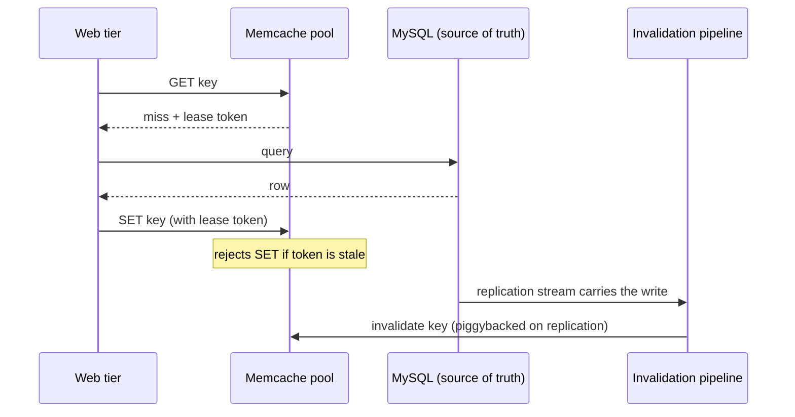

## 23. Interview Questions

1. Explain the difference between cache-aside, read-through, write-through,
   and write-behind. For each, describe what happens on a database write
   and what the corresponding read path looks like.
2. What is a cache stampede, and name three distinct mitigations for it.
   Why does probabilistic early expiration reduce, rather than eliminate,
   the odds of a stampede?
3. Why is deleting a cache entry on write generally preferred over
   updating it directly, in the cache-aside pattern?
4. Describe the durability-window risk of write-behind caching, and give an
   example of a data type where that risk is acceptable and one where it is
   not.
5. Compare LRU, LFU, FIFO, and ARC eviction policies. Describe a workload
   where LRU performs poorly and LFU or ARC would perform better, and
   explain why.
6. What makes cross-instance cache invalidation a genuinely hard
   distributed-systems problem rather than a simple `DEL` call? What
   safety net should always accompany event-driven invalidation, and why?
7. Distinguish an application-tier cache from a database materialized view.
   Give a scenario where you would choose one over the other.
8. Design a caching strategy for a product-pricing service that must
   reflect price changes within 5 seconds while surviving a traffic spike
   of 50x on the most popular product. Walk through pattern, TTL, and
   stampede-protection choices.

## 24. Hands-on Exercises

1. Run [`01_cache_aside.py`](../code/python/caching-chapter/01_cache_aside.py)
   and observe the latency difference between the cache-miss read and the
   cache-hit read; then modify it to add a second product and verify the
   invalidation path correctly forces a fresh database read only for the
   product that was actually updated.
2. Run [`02_request_coalescing.py`](../code/python/caching-chapter/02_request_coalescing.py)
   with the thread count raised from 20 to 200 and confirm the naive path's
   database query count scales roughly linearly with thread count while the
   coalescing reader's stays at 1; then intentionally introduce a bug (skip
   the re-check-after-acquiring-the-lock step) and observe how the query
   count regresses.
3. Run [`03_lru_cache.py`](../code/python/caching-chapter/03_lru_cache.py)
   with a smaller capacity (2) and a longer access sequence; predict which
   key will be evicted at each step before running it, then verify your
   prediction against the printed output.
4. Run [`04_write_behind_buffer.js`](../code/node/caching-chapter/04_write_behind_buffer.js)
   and modify the flush interval to be longer than the time between two
   writes to the same key; verify only the final value is persisted to the
   simulated database (write coalescing), then trigger
   `simulateCrashLosingUnflushedWrites` immediately after a write and
   confirm the write is lost.
5. Extend any of the above examples to add a metrics counter for hit rate,
   and compute the effective average latency formula from Section 11 using
   your measured hit rate.

## 25. Design Exercises

1. Design the caching architecture for a news homepage that serves millions
   of reads per minute for a small set of top headline articles, where a
   new article being published must appear within 2 seconds and an editor's
   correction to a live article must appear within 10 seconds. Specify the
   pattern, TTL(s), and stampede-protection strategy, and justify each
   choice against Section 4's decision-implications guidance.
2. Design a multi-tier caching architecture (local in-process cache plus a
   shared Redis tier) for a fleet of 200 application instances, including
   how invalidation propagates to every local tier, what happens to a local
   tier during a brief network partition from the event bus, and what TTL
   safety net you would set as a floor under the event-driven invalidation.
3. A team wants to use write-behind caching for an inventory-decrement
   counter during a flash sale. Analyze whether this is an appropriate use
   of write-behind given Section 4.5's durability-window risk, and propose
   either a mitigation that makes write-behind acceptable here or an
   alternative pattern, with justification.
4. Design an eviction-policy choice and a monitoring plan for a
   recommendation-serving cache that experiences both steady popularity-
   skewed traffic and periodic full-keyspace batch-analytics scans (as
   described in Section 4.9's concrete scenario), including how you would
   detect the eviction-policy mismatch before it degrades hit rate in
   production.

## 26. Architecture Review Questions

- For each cached data type in this system, is the chosen pattern
  (cache-aside/read-through/write-through/write-behind) and TTL documented
  and justified, or was it inherited by convention without review?
- Is there a stampede-protection mechanism on every key identified as hot
  by actual traffic data, not just an assumption that traffic is evenly
  distributed?
- Does every read path degrade correctly (and has it been tested) when the
  cache is completely unavailable?
- For any write-behind usage, has the durability-window risk been
  explicitly accepted for that specific data type, with a documented
  rationale for why data loss on crash is tolerable there?
- For any event-driven invalidation, is there a TTL safety net underneath
  it, and is invalidation-event delivery lag/failure monitored?
- Is the eviction policy's fit to the actual access pattern verified with
  hit-rate data, and is hit rate tracked over time to catch drift as the
  workload evolves?
- Are cache keys scoped and namespaced correctly to prevent cross-tenant or
  cross-context leakage (Section 13)?

## 27. Summary

Caching converts repeated, expensive database reads into cheap reads of a
disposable copy, buying back latency and database capacity at the cost of
a genuinely hard problem: the copy can drift from the source of truth, and
every pattern in this chapter is a deliberate, bounded answer to how much
drift is tolerable and for how long. Cache-aside, read-through,
write-through, and write-behind differ in who populates the cache and when
a write reaches the database, trading write latency against durability risk
and read-after-write consistency. TTL-based, explicit, and event-driven
invalidation differ in how tightly staleness is bounded versus how much
implementation and operational complexity that bound costs, and a cache
stampede is the specific, mitigable failure mode where a hot key's
expiration turns one database query into a multiplied burst. Eviction
policies — LRU, LFU, FIFO, and ARC — decide what to discard under memory
pressure, and the right choice depends on whether recency, frequency, or an
adaptively tuned mix of both best predicts the real access pattern. None of
this replaces or duplicates HTTP caching headers
([HTTP](../05_Networking_and_OS/CH01_HTTP.md)), CDN edge caching
([CDN](../05_Networking_and_OS/CH09_CDN.md)), or database materialized
views ([Denormalization](CH02_Denormalization.md)) — it is the distinct
layer of request-time, ephemeral, application-visible copies sitting
between application code and the database, and getting it right is one of
the highest-leverage, most failure-prone decisions a solution architect
makes in any read-heavy system.
