# Chapter: Locking

Part: [06 — Databases and Storage](PART_OVERVIEW.md) · Status: Drafted

## 1. Introduction

A **lock** is the mechanism a database engine uses to make an in-progress
transaction's partial work invisible or unavailable to other transactions
until it is safe to reveal — the actual machinery that turns the abstract
promise of "isolation" from [Transactions](CH08_Transactions.md#4-core-concepts)
into a concrete, enforceable guarantee at the level of individual rows,
pages, and tables. Where Transactions owns the *what* — the four ACID
(Atomicity, Consistency, Isolation, Durability) properties, the SQL-standard
isolation levels and the anomalies each one permits or prevents, and
Multi-Version Concurrency Control (MVCC) as the dominant modern alternative
to lock-based isolation — this chapter owns the *how*: the concrete data
structures and algorithms a database's **lock manager** uses to grant,
queue, escalate, detect conflict in, and eventually release locks on shared
data, whether or not the engine also uses MVCC for its default read path.
Every production relational database (PostgreSQL, MySQL/InnoDB, Oracle, SQL
Server) and most NewSQL stores (CockroachDB, Google Spanner, YugabyteDB)
still run a full lock manager underneath their MVCC read path, because
MVCC alone does not resolve write-write conflicts, schema-change
concurrency, or the explicit application-level coordination that a working
system frequently needs — which is exactly why a reader who understands
isolation levels in the abstract still needs to understand locks in the
concrete to reason about real contention, blocking queries, and deadlocks in
production.

This chapter is the *owning* chapter, per the Concept Ownership Rule in
[STYLE_GUIDE.md](../STYLE_GUIDE.md), for: lock types and lock-compatibility
matrices (shared/read locks, exclusive/write locks, and intent locks); lock
granularity (row-level, page-level, and table-level locking and the
concurrency/overhead trade-off between them, including lock escalation);
pessimistic concurrency control as an acquire-before-access discipline;
optimistic concurrency control via version columns and compare-and-swap,
validated at commit time; database-specific deadlock detection built from
wait-for graphs constructed out of row/table lock waits, together with a
database engine's victim-selection heuristics; lock timeouts and lock-wait
queuing; and advisory/application-level locks that the database tracks but
does not enforce against ordinary data access. This chapter recaps, rather
than re-teaches, two concepts owned elsewhere. First, isolation levels and
MVCC (see [Transactions, Section 4](CH08_Transactions.md#4-core-concepts)):
Read Committed, Repeatable Read, and Serializable are defined purely by
which anomalies they permit, and an engine can satisfy those definitions
either through locking or through MVCC snapshots — this chapter picks up
exactly where Transactions left off, teaching the lock-based half of that
mechanism in full depth. Second, the general concept of deadlock and the
four Coffman conditions (mutual exclusion, hold-and-wait, no preemption,
circular wait) is owned by [Processes and Threads, Section
4.9](../05_Networking_and_OS/CH24_Processes_and_Threads.md#49-deadlock-and-the-four-coffman-conditions)
at the operating-system/thread-scheduling level; this chapter recaps that
general model in two sentences in Section 4.5 and then teaches the
distinct, more specific problem of how a *database* lock manager detects and
resolves deadlocks among transactions waiting on row and table locks — a
different data structure (a wait-for graph built from the lock manager's own
lock table, not from OS mutex state) and a different resolution strategy
(aborting and rolling back a whole transaction as the "victim," not simply
killing a thread).

## 2. Historical Evolution

- **System R and the birth of Two-Phase Locking (1970s, IBM Research)** —
  IBM's System R prototype, the first relational database, introduced
  **Two-Phase Locking (2PL)** as the concurrency-control protocol underlying
  serializable execution: every transaction acquires all the locks it will
  ever need before releasing any of them, split into a growing phase
  (acquiring locks) followed by a shrinking phase (releasing locks, usually
  all at once at commit/rollback) — a protocol still running, largely
  unchanged in its essential shape, inside every mainstream relational
  database's default lock-based isolation path.
- **Gray formalizes lock modes and the lock-compatibility matrix
  (1975-1976)** — Jim Gray's foundational work on granularity of locks
  ("Granularity of Locks and Degrees of Consistency in a Shared Data Base,"
  1976, with Lorie, Putzolu, and Traiger) introduced the multi-granularity
  locking protocol this chapter teaches in Section 4.3: shared, exclusive,
  and — critically — **intent locks**, which let a transaction efficiently
  signal at a coarse level (a table) that it intends to lock something more
  fine-grained underneath (a row), without either scanning every row or
  giving up table-level conflict detection.
- **Deadlock detection via wait-for graphs (late 1970s-1980s)** — as
  multi-user relational databases matured, vendors converged on
  representing each transaction's lock waits as a directed graph (a
  transaction waiting on a lock held by another transaction is an edge) and
  running cycle detection over it periodically or on every new wait — the
  direct ancestor of the wait-for-graph mechanism taught in Section 4.6,
  distinct from (but inspired by) the general deadlock theory the OS
  community had already formalized via the Coffman conditions in 1971.
- **Row-level locking becomes standard (1980s-1990s)** — early relational
  databases frequently locked at the page or table level for simplicity and
  lower bookkeeping overhead; as concurrent OLTP (Online Transaction
  Processing) workloads grew, vendors progressively moved to row-level
  locking as the default granularity (Oracle from its earliest versions,
  DB2 and SQL Server evolving toward row-level locking through the 1990s,
  and MySQL's InnoDB storage engine replacing the table-locking MyISAM
  engine as MySQL's default in 2010) to reduce false contention between
  transactions touching unrelated rows in the same table.
- **Optimistic concurrency control proposed as a lock-avoidance strategy
  (Kung and Robinson, 1981)** — the landmark paper "On Optimistic Methods
  for Concurrency Control" argued that in workloads where conflicts are
  rare, it is cheaper to let transactions proceed without locking and
  validate for conflicts only at commit time, rolling back the rare
  conflicting transaction, than to pay the constant overhead of acquiring
  and releasing locks for every read — the theoretical basis for the
  version-column/compare-and-swap pattern this chapter teaches in Section
  4.4, now ubiquitous in Object-Relational Mapping (ORM) frameworks
  (Hibernate's `@Version`, Entity Framework's concurrency tokens) and
  distributed key-value stores alike.
- **Lock escalation and adaptive granularity (1990s-2000s)** — as row-level
  locking became standard, database engines needed a safety valve for
  transactions that ended up needing so many individual row locks that the
  per-lock bookkeeping overhead itself became a bottleneck; SQL Server and
  DB2 introduced automatic **lock escalation** — promoting many row locks to
  one table lock once a threshold is crossed — formalizing the
  granularity/overhead trade-off this chapter teaches in Section 4.2.
- **Advisory locks formalized as an explicit escape hatch (2000s)** —
  PostgreSQL's `pg_advisory_lock` (introduced in PostgreSQL 8.2, 2006) and
  MySQL's `GET_LOCK()` function gave application developers a
  database-managed mutex that is entirely decoupled from row/table data
  locking, formalizing what many applications had previously hand-rolled
  with a "lock row" sentinel pattern into a first-class, purpose-built
  primitive — Section 4.7 teaches this pattern in depth.
- **Lock-free and MVCC-first engines reduce, but do not eliminate, reliance
  on locks (2000s-present)** — as covered in Transactions, PostgreSQL,
  Oracle, MySQL/InnoDB, and NewSQL engines (CockroachDB, Spanner) use MVCC
  as their primary mechanism for read/write non-blocking concurrency, but
  every one of them retains a full lock manager for write-write conflicts,
  Data Definition Language (DDL) operations, and explicit locking clauses
  like `SELECT ... FOR UPDATE` — the two mechanisms are complementary, not
  substitutes, a distinction this chapter returns to throughout Section 4.

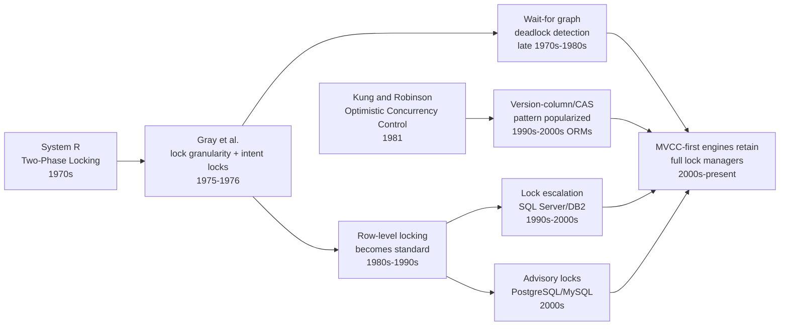

## 3. Why It Exists

Without a lock manager, a database engine has no way to make a transaction's
read-then-write sequence atomic against a concurrent transaction doing the
same thing to the same row: two transactions could each read a bank
balance, each compute a new balance based on that stale read, and each write
back their own version, silently discarding one of the two updates — the
classic **lost update** anomaly. Locks solve this by giving a transaction
the ability to say, in effect, "no one else may write this row until I
decide whether I'm committing or rolling back," turning an implicit,
timing-dependent race into an explicit, serialized sequence the engine
enforces. This need does not disappear when an engine adopts MVCC for its
read path: MVCC elegantly solves reader/writer contention (a reader never
blocks a writer and vice versa, because the reader sees an old, immutable
version), but it does not solve **writer/writer** contention — two
concurrent transactions both trying to update the *same* row must still be
serialized somehow, and every production MVCC engine does this with a lock
under the hood, not with more versioning. Locks also exist to solve a second
problem MVCC does not address at all: coordinating access to resources that
have no natural "version" to snapshot, such as a schema-altering DDL
statement that must not run concurrently with an in-flight query against the
same table, or an application-level critical section (like "only one
scheduled job of this type may run at a time across a fleet of application
servers") that has nothing to do with row data at all — the motivation
behind Section 4.7's advisory locks. Finally, granularity and deadlock
detection exist because locking, once introduced, creates its own problems
that need engineering solutions: locking every row individually gives
maximum concurrency but at a real per-lock memory/CPU cost that does not
scale to sweeping updates touching millions of rows, and any system where
transactions can each hold one resource while waiting for another can
deadlock — a structural risk the engine must detect and break rather than
leave for an operator to notice as a database that never returns.

## 4. Core Concepts

### 4.1 Lock types: shared, exclusive, and intent locks

**Definition.** A **shared (S) lock** — also called a read lock — is held
by a transaction that is reading a row (or other lockable unit) and
permits any number of other transactions to simultaneously hold their own
shared locks on the same unit, but forbids anyone from acquiring an
exclusive lock on it. An **exclusive (X) lock** — a write lock — is held by
a transaction that is modifying a unit and forbids every other transaction
from acquiring *any* lock (shared or exclusive) on that same unit until it
is released. An **intent lock** — Intent Shared (IS), Intent Exclusive
(IX), or the combined Shared with Intent Exclusive (SIX) — is not a lock on
data at all; it is a lock a transaction places on a *coarser-granularity*
unit (a table, or a page) purely to announce "I hold, or intend to acquire,
a finer-grained lock somewhere underneath this."

**Mechanism.** A lock manager tracks, for every lockable unit, a list of
currently granted locks and their modes, plus a queue of waiting lock
requests. When a new request arrives, the lock manager checks the request's
mode against every currently granted mode on that unit using a
**lock-compatibility matrix** — a lookup table, not a computed rule, because
compatibility is a fixed property of the two modes involved, not of the
data:

| Requested \ Held | IS | IX | S | SIX | X |
|---|---|---|---|---|---|
| **IS**  | ✅ | ✅ | ✅ | ✅ | ❌ |
| **IX**  | ✅ | ✅ | ❌ | ❌ | ❌ |
| **S**   | ✅ | ❌ | ✅ | ❌ | ❌ |
| **SIX** | ✅ | ❌ | ❌ | ❌ | ❌ |
| **X**   | ❌ | ❌ | ❌ | ❌ | ❌ |

If the requested mode is compatible with every currently granted mode, the
lock manager grants it immediately; if not, the requesting transaction is
queued (Section 4.6) until the conflicting lock(s) are released. Intent
locks exist so a transaction that wants an exclusive lock on an *entire
table* does not have to individually check every row for a conflicting
row-level lock: it can instead check whether any other transaction holds an
IS/IX/SIX/X lock at the table level, which — by the multi-granularity
locking protocol — every transaction holding a row-level lock underneath
that table is required to have first acquired on the way down. This is
precisely why intent locks are taken top-down before finer-grained locks:
a transaction that wants to update one row acquires IX on the table, then X
on the row, so a *different* transaction wanting a table-level X lock (for
example, to run `ALTER TABLE`) can detect the conflict by checking one
intent lock at the table level rather than scanning every row.

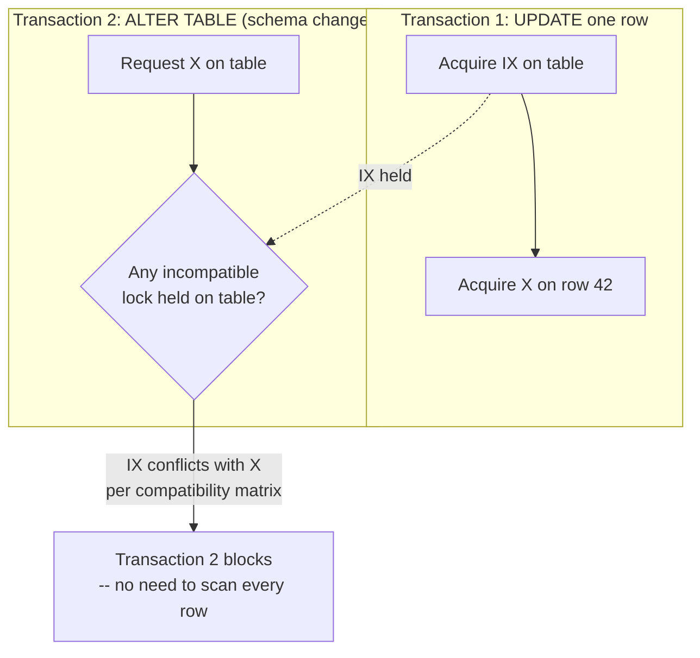

**Decision implications.** Choosing whether to request a shared or
exclusive lock is not a free choice made by the application per se — it
follows from the statement type (`SELECT` typically takes shared locks,
`UPDATE`/`DELETE` take exclusive locks) and, per Section 4.2, the isolation
level in force — but understanding the compatibility matrix is what lets an
engineer correctly predict which of two concurrent queries will block the
other, and design schema-change/maintenance windows around exclusive
table-level operations that must wait for (or forcibly wait out) every
outstanding row-level lock underneath.

**Common failure mode.** Treating shared locks as "free" and forgetting
that a long-running read transaction under a pessimistic, lock-holding
isolation level (rather than MVCC) can itself block writers — a read that
holds a shared lock for the duration of a slow reporting query can stall
every writer touching the same rows, a class of production incident often
misdiagnosed as "the writes are slow" when the actual blocker is an
unrelated read.

**Concrete scenario.** An inventory system runs `SELECT quantity FROM
products WHERE id = 501 FOR SHARE` (an explicit shared-lock read) inside a
long batch-reconciliation job, while a checkout transaction concurrently
tries `UPDATE products SET quantity = quantity - 1 WHERE id = 501`. Per the
compatibility matrix, the checkout's exclusive-lock request conflicts with
the batch job's shared lock and queues behind it — every checkout for that
product effectively stalls until the reconciliation job's transaction
commits or rolls back, even though the reconciliation job never modifies
anything.

### 4.2 Lock granularity: row, page, and table-level locking

**Definition.** Lock granularity is the size of the unit a lock manager
protects with a single lock — a table (the coarsest common granularity), a
page (a fixed-size block of storage holding many rows, an intermediate
granularity used internally by some engines), or a row (the finest common
granularity). The same logical operation (updating 500 rows) can be
implemented by acquiring one table lock, several page locks, or 500
individual row locks, and the choice materially changes both how much
concurrency other transactions retain and how much bookkeeping the lock
manager itself must do.

**Mechanism.** Every lock, at any granularity, occupies memory in the lock
manager's lock table (an in-memory hash table keyed by the locked
resource's identifier) and requires CPU cycles to acquire, check for
conflicts, and release. Row-level locking maximizes concurrency — two
transactions updating different rows in the same table never conflict —
but an operation touching a million rows means a million lock-table entries
to manage, acquire, and eventually release, which is measurably slower
per-row than acquiring one table lock for the same logical operation and
consumes lock-manager memory proportional to concurrently-locked rows, not
to table size. Table-level locking is the reverse trade: near-zero
per-operation bookkeeping overhead (one entry, one acquire, one release)
but every transaction touching that table — even ones touching completely
unrelated rows — serializes behind it. Page-level locking (used internally
by some engines, notably older SQL Server versions and some page-based
storage engines) sits between the two: fewer locks than row-level (one lock
covers every row co-located on that page) at the cost of **false
contention** — two transactions updating different rows that happen to be
stored on the same physical page conflict even though their actual data
does not overlap.

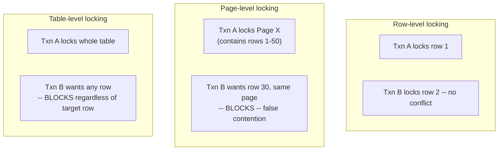

**Lock escalation.** Because row-level locking's fine-grained safety comes
at a real per-lock memory/CPU cost, engines that default to row-level
locking (SQL Server, DB2) implement **lock escalation**: once a single
transaction's row-lock count against one table crosses an internal
threshold (SQL Server's default is approximately 5,000 row/page locks in
one statement against one object), the engine automatically converts every
individual row lock it holds into a single table-level lock, releasing the
per-row bookkeeping at the cost of blocking every other transaction against
that table for the remainder of the escalating transaction. This is a
deliberate trade the engine makes on the transaction's behalf, not a bug —
but it is also a well-known production failure mode: a large batch update
that was expected to only briefly contend with a handful of concurrent
transactions can silently escalate to a full table lock partway through,
stalling unrelated traffic that the original row-level design intended to
protect.

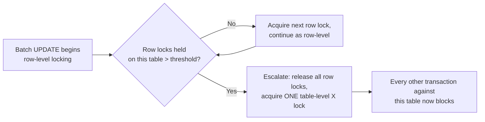

**Decision implications.** Granularity is mostly an engine default, not a
per-query choice, but it drives concrete schema and query-shape decisions:
batch jobs that must touch large numbers of rows should be chunked into
smaller transactions specifically to stay under the escalation threshold
and to bound how long any single transaction holds any lock; hot tables
with high write concurrency benefit the most from row-level locking's
finer granularity and are the tables most sensitive to accidental
escalation.

**Common failure mode.** An unindexed `WHERE` clause on an `UPDATE` or
`DELETE` forces the engine to scan (and, under many pessimistic isolation
configurations, lock) every row it examines while searching for matches —
not just the rows it ultimately modifies — so a missing index can turn what
looks like a "single-row update" in application code into a full-table
lock-acquisition sweep and, potentially, an escalation event.

**Concrete scenario.** A nightly job runs `UPDATE orders SET status =
'archived' WHERE created_at < '2020-01-01'` against a table with no index
on `created_at`, causing SQL Server to scan and lock every row in the
table while evaluating the predicate; the transaction crosses the
escalation threshold and converts to a table-level lock, and every
concurrent order-placement transaction against that table blocks for the
remainder of the batch job — a production incident traced back to a
missing index, not to the lock manager misbehaving.

### 4.3 Pessimistic concurrency control: acquire-before-access

**Definition.** **Pessimistic concurrency control (PCC)** is a discipline
in which a transaction acquires a lock on a row *before* reading or writing
it and holds that lock until it decides its final outcome, on the
assumption that conflicts are common enough that preventing them upfront is
cheaper than detecting and unwinding them after the fact. `SELECT ... FOR
UPDATE` is the canonical pessimistic pattern: it reads a row's current
value and, in the same statement, acquires an exclusive lock on it, so
that no other transaction can modify (or, depending on the exact clause and
engine, even read) that row until the locking transaction commits or rolls
back.

**Mechanism.** When a transaction issues `SELECT balance FROM accounts
WHERE id = 1 FOR UPDATE`, the engine locates the matching row, acquires an
exclusive lock on it as part of executing the statement (not deferred to
commit time), and returns the row's value to the application — which can
now safely compute a new value and issue a subsequent `UPDATE`, guaranteed
that no other transaction could have modified the row in between, because
any other transaction's own attempt to read-for-update or write that same
row blocks on the exclusive lock until this transaction finishes.

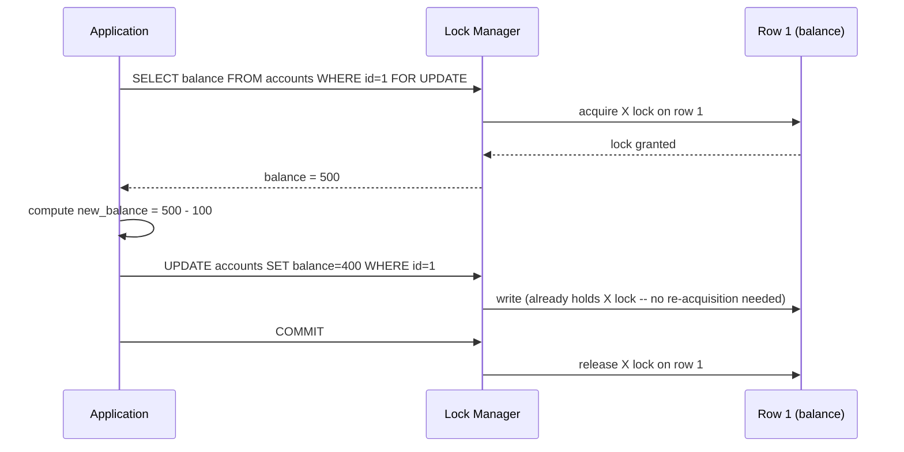

**Decision implications.** Pessimistic locking is the right default when
conflicts are frequent and correctness matters more than raw throughput
under contention — a funds-transfer system where the same handful of
"hub" accounts are touched by many concurrent transactions is a textbook
case, because the alternative (optimistic concurrency control, Section 4.4)
would mean most of those transactions retry repeatedly under contention
rather than simply waiting their turn. The cost is that every locked row
becomes a serialization point: a slow client that holds a `FOR UPDATE`
lock open (for example, one that acquires the lock, then makes a network
call to an external payment processor before committing) blocks every
other transaction wanting that row for the entire duration of that
external call, which is why the standard operational rule is to keep the
time between acquiring a pessimistic lock and committing as short as
mechanically possible.

**Common failure mode.** Acquiring a pessimistic lock and then performing a
slow, un-bounded operation before releasing it (a network call, a
user-facing wait, an unrelated slow query) — this converts a
should-be-brief serialization point into an effectively unbounded one, and
is one of the most common root causes of "the database is randomly slow"
incidents that are actually one specific held lock blocking everything
behind it.

**Concrete scenario.** A seat-reservation system uses `SELECT * FROM seats
WHERE id = 12A FOR UPDATE` to lock a seat before confirming a booking; if
the confirmation step incorrectly calls a third-party notification API
*before* committing the transaction, every other customer trying to book
(or even check availability for update on) seat 12A queues behind that one
slow API call — the fix is to commit the reservation first and send the
notification as a separate, post-commit step.

### 4.4 Optimistic concurrency control: version columns and compare-and-swap

**Definition.** **Optimistic concurrency control (OCC)** is a discipline in
which a transaction reads a row *without* acquiring any lock on it, does
its work assuming no one else will modify that row concurrently, and only
checks — at the moment it writes back — whether that assumption held,
rejecting and forcing a retry if it did not. The standard implementation
pattern is a **version column**: every row carries an integer (or
timestamp) column that is incremented on every update, and every write is
expressed as a **compare-and-swap (CAS)**: `UPDATE ... SET data = ?, version
= version + 1 WHERE id = ? AND version = <the version read earlier>` — if
zero rows are affected, another transaction changed the row (and therefore
its version) since it was read, and the application must retry.

**Mechanism.** OCC never places a lock on the row for the duration of the
"think time" between reading and writing — the only lock involved is the
row-level exclusive lock the database briefly and automatically takes to
execute the `UPDATE` statement itself, held for microseconds, not for
however long the application takes to decide what to write. The conflict
check is not a separate step; it is folded directly into the `WHERE`
clause's version predicate, so the database's normal row-matching logic
does the conflict detection for free, and the affected-row-count the
database driver already returns is the correctness signal — no additional
round trip or explicit comparison is needed.

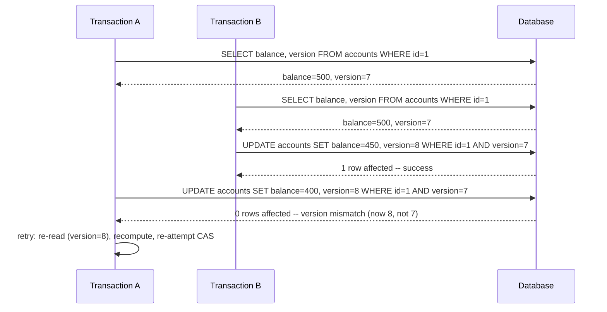

**Decision implications.** OCC is the right default when conflicts are
rare and most transactions will succeed on the first attempt — a user
editing their own profile, an inventory count that is read far more often
than it is written, a distributed system where acquiring a real lock would
mean a round trip to a remote coordinator. Its cost model is the mirror
image of pessimistic locking's: instead of paying a small, constant
per-transaction locking overhead, it pays an occasional, larger retry cost
exactly when contention does happen — which means OCC scales poorly, not
gracefully, if the actual conflict rate turns out to be higher than
assumed, since a high conflict rate means most transactions retry
repeatedly rather than a small minority queuing briefly. OCC also composes
better with MVCC-based isolation levels and with any architecture where
holding a lock open across a network hop (a remote cache, a
microservice call, a browser round trip for a "click Save" button) would
be unacceptable, since OCC never requires holding anything open across
that gap.

**Common failure mode.** Forgetting to bound the retry loop, or retrying
without re-reading the current state first — a bug that either spins
forever under sustained contention or, worse, resubmits the *original*
stale write on retry instead of recomputing against the row's current
value, silently reproducing the exact lost-update bug OCC exists to
prevent.

**Concrete scenario.** Two support agents open the same customer ticket at
the same time, each seeing `status = 'open', version = 3`; Agent A adds a
note and saves (`... WHERE id=42 AND version=3`, succeeds, version becomes
4); Agent B, who has been drafting a longer reply, saves a few seconds
later against the version they originally read (`... WHERE id=42 AND
version=3`), the CAS affects zero rows, and the UI must inform Agent B that
the ticket changed underneath them and offer to reload the current state
before retrying — silently overwriting Agent A's note instead would be the
lost-update anomaly OCC's version check exists to catch.

### 4.5 Database deadlocks: recap of the general model, then the database-specific problem

**Recap.** A deadlock is a cycle of two or more transactions each waiting
on a resource the next transaction in the cycle holds, and the four Coffman
conditions (mutual exclusion, hold-and-wait, no preemption, circular wait)
that make deadlock possible are already taught in full, at the
operating-system/thread level, in [Processes and Threads, Section
4.9](../05_Networking_and_OS/CH24_Processes_and_Threads.md#49-deadlock-and-the-four-coffman-conditions)
— this chapter does not re-derive them.

**Why the database problem is distinct.** An OS-level deadlock involves
threads blocked on mutexes, and the kernel or runtime typically has no
built-in facility to detect or break the cycle automatically (Processes and
Threads teaches consistent lock ordering as the standard *prevention*
technique precisely because OS-level detection is not generally available).
A database deadlock involves whole *transactions* — potentially composed
of many statements, spanning arbitrary application logic between them —
blocked on row or table locks tracked centrally in the lock manager's own
lock table, and every production database engine *does* build automatic
detection on top of that central lock table, because unlike OS threads,
transactions cannot always be re-ordered by the application to avoid
conflicting lock-acquisition sequences (the acquisition order is often
implied by unpredictable, data-dependent `WHERE` clauses, not by code the
developer directly controls line-by-line). Section 4.6 teaches exactly how
that detection and resolution machinery works.

### 4.6 Database-specific deadlock detection: wait-for graphs and victim selection

**Definition.** A **wait-for graph** is a directed graph the lock manager
constructs (either continuously or on demand) where each node is a
transaction and a directed edge from Transaction A to Transaction B means
"A is waiting for a lock currently held by B." A **cycle** in this graph —
A waits for B, B waits for C, C waits for A — is a deadlock: none of the
three transactions can ever proceed, because each is waiting on a lock that
will only be released once a transaction later in the cycle finishes, and
none of them can finish.

**Mechanism.** Every time a lock request cannot be granted immediately
(Section 4.1), the lock manager already knows exactly which transaction(s)
currently hold the conflicting lock — that information is what it just used
to decide the request must wait — so building a wait-for edge is a
constant-time byproduct of the normal lock-conflict check, not extra work.
Database engines differ in *when* they run cycle detection over this graph:
some (PostgreSQL) run a full deadlock check only after a lock wait exceeds
a short internal timeout (on the theory that most waits resolve normally
and running cycle detection on every single wait would be wasted work);
others (SQL Server) run a dedicated background "lock monitor" thread that
periodically scans the entire wait-for graph for cycles independent of any
individual wait's duration. Either way, cycle detection itself is a
standard graph traversal (depth-first search looking for a back-edge to an
already-visited node on the current path) over what is typically a small
graph, since only transactions actually blocked on a lock appear in it at
all.

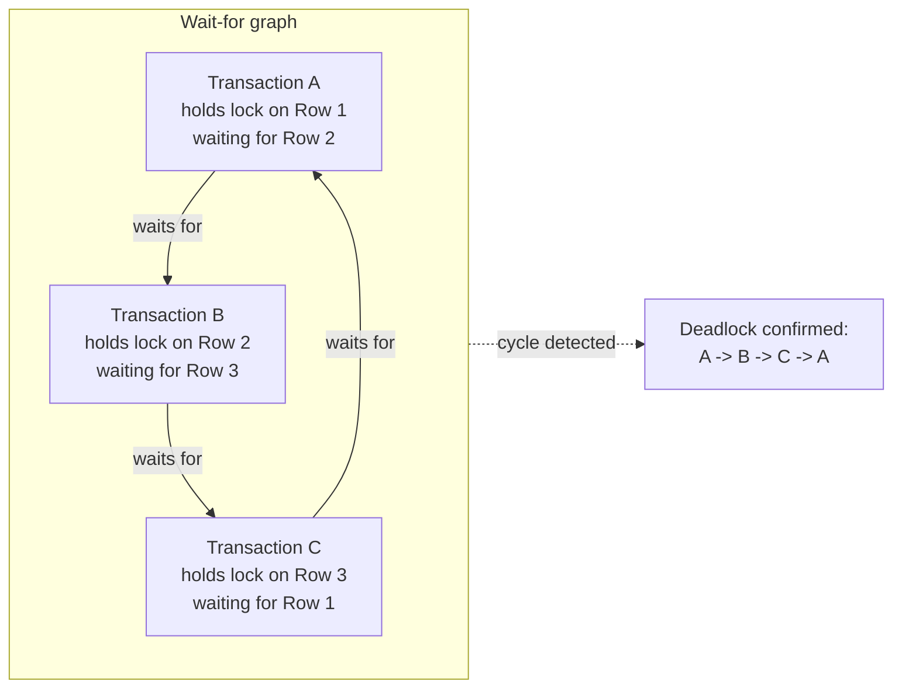

**Victim selection.** Detecting a cycle only identifies *that* a deadlock
exists; the lock manager must then choose one transaction in the cycle to
abort (the **victim**) — rolling back its work and releasing its locks,
which breaks the cycle and lets the remaining transactions in it proceed.
Victim-selection heuristics differ by engine but converge on a small set of
signals, generally combined rather than used in isolation:

- **Least work performed** — a transaction with fewer modified rows/less
  written-ahead-log volume is cheaper to roll back than one deep into a
  large batch operation; SQL Server explicitly favors this by default (the
  transaction "less costly to undo" is chosen as victim unless a
  transaction has been marked a higher-priority non-victim via `SET
  DEADLOCK_PRIORITY`).
- **Youngest transaction** — a transaction that started more recently has
  invested less cumulative work and, all else equal, is a cheaper victim
  than one that has been running (and holding locks) for a long time;
  PostgreSQL's deadlock resolution generally aborts the transaction that
  detected the deadlock (the one whose lock request triggered the
  cycle-detection check), which in practice frequently correlates with
  being the most recently blocked participant.
- **Explicit priority overrides** — SQL Server's `SET DEADLOCK_PRIORITY`
  lets an application mark specific transaction classes as strongly
  preferred to survive (or to be sacrificed) regardless of the default
  heuristic, useful when one workload (a critical checkout transaction) must
  never be the automatic victim against a lower-priority batch job.

Once a victim is chosen, the engine rolls back that transaction entirely
(not just the one statement that triggered detection), releases every lock
it held, and returns a distinguishable, retryable error to the victim's
client (PostgreSQL's `40P01` deadlock_detected SQLSTATE; SQL Server's error
1205) — the application is expected to catch this specific error and
retry the whole transaction from the beginning, exactly as it must for a
serialization failure under Serializable isolation (see [Transactions,
Section 9](CH08_Transactions.md#9-implementation)).

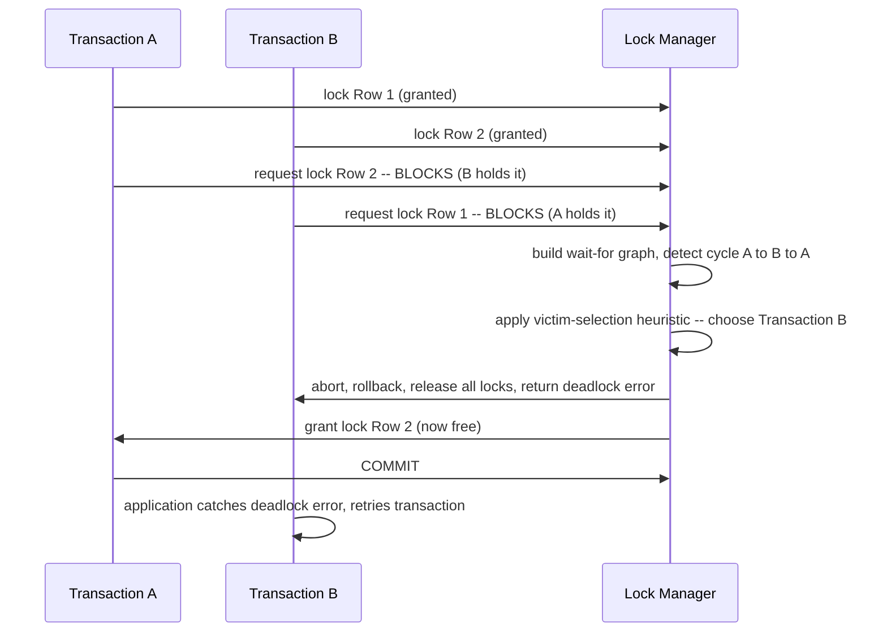

**Decision implications.** Because victim selection is heuristic and, from
the application's point of view, effectively unpredictable, every
transaction that can plausibly participate in a deadlock must be written
with automatic retry on the specific deadlock error code — treating a
deadlock as an application-fatal error rather than an expected, retryable
condition is a design defect, not merely a missing edge case. The
standard *prevention* discipline recapped from Section 4.5 — consistent
lock ordering (always acquire lower account ID before higher account ID,
for example) — remains the most effective way to reduce how often the
detector needs to fire at all, since detection-and-rollback is strictly
more expensive than a deadlock that never occurs.

**Common failure mode.** Two code paths that update the same two tables (or
rows) in opposite orders — one path does `UPDATE accounts ... WHERE
id=1` then `UPDATE accounts ... WHERE id=2`, another does `id=2` then
`id=1` — reintroducing exactly the circular-wait pattern Section 4.5's
recapped lock-ordering discipline is meant to prevent, usually because the
two code paths were written by different people at different times without
either one being aware of the other's acquisition order.

**Concrete scenario.** A funds-transfer service processes "A pays B" and "B
pays A" transfers submitted by two different customers within the same
few milliseconds; if the transfer code locks the *source* account before
the *destination* account (a natural but unordered choice), the two
transfers acquire their locks in opposite order relative to each other,
deadlock, and one is aborted and retried automatically by the lock
manager's detector — the durable fix is to always lock the lower
account-ID first regardless of which account is the source or destination,
eliminating the circular-wait condition entirely rather than relying on
the detector to keep cleaning up after it.

### 4.7 Lock timeouts and lock-wait queuing

**Definition.** A **lock timeout** is a configured maximum duration a
transaction will wait, queued, for a conflicting lock to be released before
the engine gives up and returns an error, rather than waiting indefinitely.
**Lock-wait queuing** is the data structure and ordering discipline the
lock manager uses to decide, once a lock is finally released, which of
potentially several waiting transactions gets it next.

**Mechanism.** Every lockable unit's queue of waiting requests is typically
served **first-in-first-out (FIFO)** by default — the first transaction to
start waiting is the first one granted the lock once it becomes available
— which prevents starvation (a later-arriving request repeatedly jumping
the queue ahead of an earlier one) but is not itself deadlock-safe on its
own, which is exactly why Section 4.6's separate detection mechanism exists
alongside plain queuing. A lock timeout is a per-session or per-statement
configurable ceiling (`SET lock_timeout` in PostgreSQL; `SET LOCK_TIMEOUT`
in SQL Server) distinct from deadlock detection: a transaction can time out
waiting for a lock even when no cycle exists at all — it might simply be
waiting behind one long-running transaction that is legitimately still
working, with no deadlock to detect, just an unacceptably long wait from
the caller's point of view.

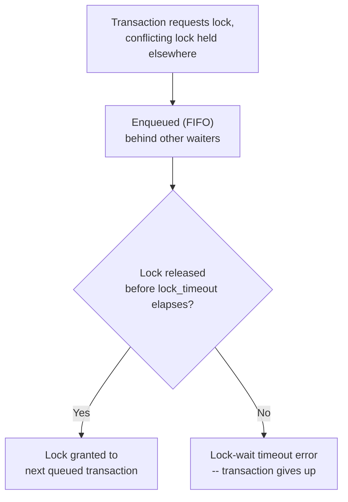

**Decision implications.** Setting an aggressive (short) lock timeout
trades correctness-preserving patience for fast, predictable failure —
appropriate for latency-sensitive, user-facing transactions where a
multi-second wait is worse than an immediate, retryable error; setting a
long or unbounded timeout is appropriate for background/batch jobs where
eventual completion matters more than responsiveness, but risks a slow
job silently piling up a long queue of blocked interactive transactions
behind it. Distinguishing a lock-wait timeout error from a deadlock error
in application retry logic matters, because a timed-out transaction may
succeed on an immediate retry (the blocking transaction may have just
committed) whereas indiscriminate rapid retries against a genuinely
long-running blocker can add load without ever succeeding.

**Common failure mode.** Leaving lock timeouts unset (effectively
unbounded) as the default across an entire application, so that a single
stuck or abnormally slow transaction causes every other transaction
touching the same rows to queue indefinitely rather than failing fast and
visibly — turning one localized problem into a fleet-wide outage that
looks, from a monitoring dashboard, like the whole database has stopped
responding.

**Concrete scenario.** An interactive checkout flow sets `lock_timeout =
'2s'` on its database session, so a checkout blocked behind an
unexpectedly long-running inventory-reconciliation transaction fails fast
with a clear, retryable "system busy" error after two seconds, rather than
leaving the customer's browser spinning for however long the
reconciliation job happens to take — while the reconciliation job itself
runs with no timeout, since it is expected to hold locks briefly but
legitimately as part of its normal operation.

### 4.8 Advisory (application-level) locks

**Definition.** An **advisory lock** is a lock the database engine tracks
and enforces mutual exclusion for, but which is entirely decoupled from any
row, page, or table's actual data — it exists purely as a named
(numeric-keyed, in PostgreSQL) mutex the application asks the database to
arbitrate, using the database's existing connection/session infrastructure
as a convenient, already-available coordination point instead of standing
up a separate distributed-locking system.

**Mechanism.** `pg_advisory_lock(key)` in PostgreSQL (or `GET_LOCK(name,
timeout)` in MySQL) asks the lock manager to grant a lock keyed by an
arbitrary integer (or string) the application chooses — the database does
not check this key against any table or row; it simply maintains a lock
table entry for that key exactly as it would for a real row lock,
supporting the same blocking/non-blocking (`pg_try_advisory_lock`) and
session-scoped/transaction-scoped variants. Critically, the database
enforces mutual exclusion *between callers of the advisory-lock function
using the same key*, but does **not** enforce anything against ordinary
`SELECT`/`UPDATE` statements touching whatever data the application
associates with that key in its own head — a second transaction that
ignores the advisory-lock convention entirely and issues a plain `UPDATE`
against the "protected" rows will succeed immediately, uncontested, because
the database has no way to know the two are related.

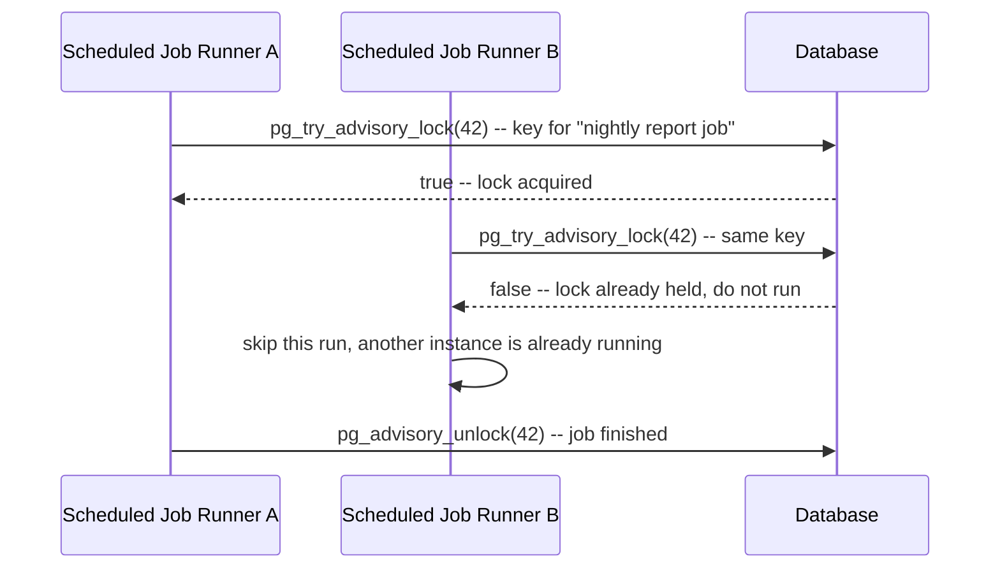

**Decision implications.** Advisory locks are the right tool when the thing
that needs mutual exclusion is not really row data at all — "only one
instance of this scheduled job should run across a fleet of application
servers at a time," "serialize access to an external rate-limited API
across all processes," "coordinate a multi-step migration script across
concurrently-deploying instances" — situations where standing up a
dedicated distributed-lock service (Redis-based, ZooKeeper-based) would be
overkill given that a database connection the application already
maintains can serve the same purpose. They are the wrong tool for actually
protecting data consistency, since — unlike a row lock acquired via
`SELECT ... FOR UPDATE` — nothing stops a different code path from bypassing
the advisory lock's convention entirely; every caller that needs the
mutual exclusion must be disciplined about actually acquiring the same
advisory lock, because the database will not retroactively enforce it.

**Common failure mode.** Relying on an advisory lock to protect data
integrity (rather than pure coordination) while some other code path — an
ad hoc script, a different service, a manual `psql` session during an
incident — updates the same underlying rows directly without acquiring the
advisory lock first, silently defeating the intended mutual exclusion
because the database was never actually told the two things were related.

**Concrete scenario.** A distributed cron-like scheduler running on three
application instances all wake up at the same minute to run a "generate
daily report" job; each instance calls `pg_try_advisory_lock(hashtext('daily-report'))`
before starting, exactly one succeeds and proceeds, and the other two see
`false` and skip their run entirely — achieving fleet-wide "run exactly
once" semantics without any of the three instances needing to know about
the other two, using only a database connection every instance already
holds.

## 5. Internal Working

Underneath every lock type and granularity taught in Section 4, a database
engine's lock manager is built around three concrete data structures working
together, and understanding how they interact explains most of the
observable behavior (blocking, escalation timing, deadlock-detection
latency) engineers see in production.

**The lock table.** A single, engine-wide (or per-database-instance) hash
table keyed by lockable-resource identifier (a row's physical location, a
table's object ID), where each entry holds the list of currently granted
lock modes and holder transaction IDs, plus a FIFO queue of pending
requests. Every lock acquisition, conflict check, and release touches this
structure, which is why lock-table size and contention (not disk I/O) is
frequently the actual bottleneck in highly concurrent OLTP workloads —
acquiring/releasing a lock is a fast in-memory operation, but it still
requires synchronizing access to the lock table itself across many
concurrent threads, which is why lock-table internals are typically
partitioned (sharded by hash of the resource key) across multiple internal
mutexes to avoid the lock table becoming its own single point of
contention.

**Per-transaction lock lists.** Each active transaction maintains its own
list of every lock it currently holds, populated as it acquires locks and
consulted in exactly two situations: at commit/rollback time (release every
held lock, in one pass, back to the lock table) and during Two-Phase
Locking enforcement (Section 4.9) to confirm the transaction is still in
its growing phase before granting it a new lock.

**The wait-for graph (materialized or implicit).** As taught in Section
4.6, the wait-for graph is either derived on demand from the lock table's
pending-request queues (walking "who is Transaction X waiting on, and who
are *they* waiting on" recursively) or maintained incrementally as an
explicit adjacency structure updated on every new wait — the engineering
choice here is a straightforward space/time trade-off: an on-demand graph
costs nothing when no one is waiting, but costs a full traversal per check;
an incrementally-maintained graph costs a small update on every wait/grant
but makes each individual cycle check cheap.

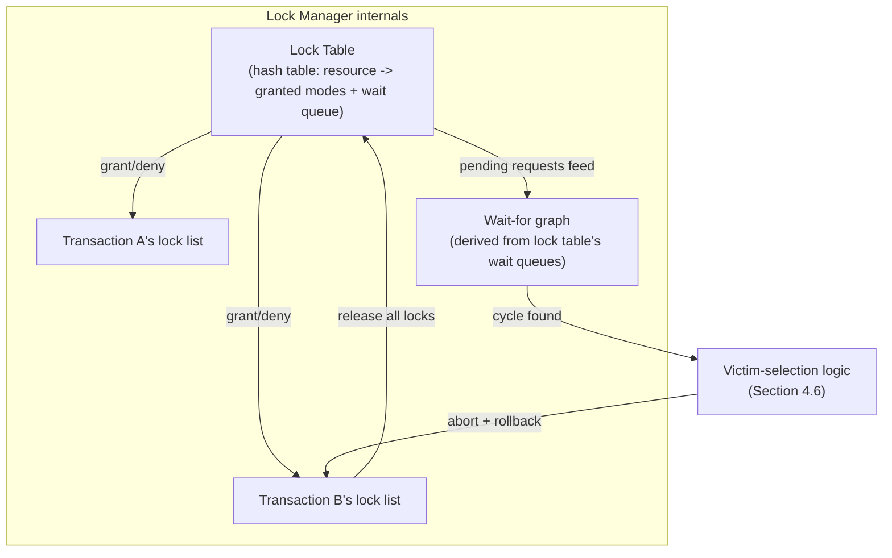

### 5.1 Two-Phase Locking as the protocol tying it together

**Definition.** Two-Phase Locking (2PL) is the rule, introduced historically
by System R (Section 2), that within a single transaction, no lock may be
acquired after any lock has been released — every transaction has a
strictly growing phase (acquire only) followed by a strictly shrinking
phase (release only), with no interleaving between the two.

**Mechanism.** In practice, nearly every production database implements
the strictest common variant, **Strict Two-Phase Locking**, where a
transaction's shrinking phase is compressed into a single instant: every
lock is released together, all at once, at commit or rollback, rather than
incrementally as the transaction finishes with each row. This is what makes
Strict 2PL equivalent to serializability from a locking point of view — no
other transaction can ever see a partially-released set of locks that would
let it interleave with only part of another transaction's writes.

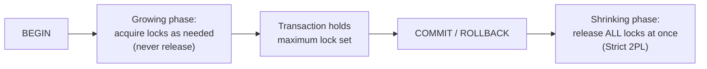

**Decision implications.** Strict 2PL is why "how long a transaction stays
open" is the single most important lever an engineer has over lock
contention: because every lock a transaction acquires is held until that
transaction's very last instant, a transaction that does unrelated slow
work (an external API call, user think-time) between acquiring a lock and
committing holds that lock for the entire duration of the slow work, not
just for the moment the row was actually touched — the mechanical
explanation for Section 4.3's "keep pessimistic locks open as briefly as
possible" guidance.

## 6. Design Principles

- **Match granularity to workload, not to a default** — a high-concurrency
  OLTP table with independent, unrelated rows almost always wants
  row-level locking's finer granularity; a rarely-updated reference/lookup
  table where a coarser lock costs nothing in practice can accept
  table-level locking's simplicity without a measurable downside.
- **Prefer the narrowest correct isolation/locking choice, not the
  strongest available** — recapping [Transactions, Section
  11](CH08_Transactions.md#11-performance): choose `SELECT ... FOR UPDATE`
  only for the specific rows that genuinely need serialized read-then-write
  protection, not defensively across an entire query, since every extra
  locked row is extra contention surface for every other transaction.
- **Keep the distance between "acquire lock" and "commit" as short as
  mechanically possible** — under Strict 2PL (Section 5.1), that distance
  *is* the blocking window every other transaction waiting on those locks
  must sit through.
- **Choose pessimistic vs. optimistic concurrency control based on measured
  or reasonably estimated conflict rate**, not by default habit — a
  workload with frequent legitimate conflicts should lock upfront; a
  workload with rare conflicts should validate at commit time and retry,
  per Sections 4.3-4.4.
- **Design lock-acquisition order once, globally, and enforce it** — the
  single most effective deadlock-prevention technique (Section 4.6) is a
  consistent, code-reviewed acquisition order across every code path that
  can touch the same two resources, not relying on the detector as a
  primary defense.
- **Treat deadlock and lock-timeout errors as expected, retryable
  conditions in every code path that can trigger them** — not as
  exceptional failures that indicate a bug, since a correctly functioning
  lock manager is expected to occasionally produce them under real
  contention.
- **Reserve advisory locks for coordination, never for data integrity** —
  if the thing being protected is actual row data, use a real lock (Section
  4.1-4.3) that the database enforces against every access path, not an
  advisory lock that only cooperating callers respect.

## 7. Architecture Patterns

- **Lock-scoped critical section pattern** — wrap the minimum possible
  sequence of statements between acquiring a pessimistic lock and
  committing, pushing every non-database operation (external calls,
  computation not dependent on the locked row) either before the lock is
  acquired or after the transaction commits.
- **Optimistic-retry-with-backoff pattern** — pair every OCC version-column
  write with a bounded retry loop (Section 4.4) that re-reads current state
  on each attempt and applies exponential backoff with jitter between
  attempts under sustained contention, rather than retrying immediately in
  a tight loop.
- **Chunked-batch pattern for large mutations** — break a large `UPDATE`/
  `DELETE` that would otherwise touch (and potentially escalate locks over)
  a huge number of rows into a loop of smaller, separately-committed
  batches (for example, 1,000 rows per transaction), trading total wall-clock
  time for dramatically reduced lock-hold duration per batch and
  eliminating the escalation risk from Section 4.2 entirely.
- **Consistent global lock-ordering pattern** — establish and enforce
  (via code review, a shared utility function, or a static-analysis rule) a
  single canonical order — for example, always by ascending primary key —
  for acquiring locks on any two-or-more-resource operation across the
  entire codebase, directly implementing the deadlock-prevention principle
  from Section 4.6.
- **Advisory-lock-based singleton-job pattern** — use a well-known advisory
  lock key per scheduled-job type (Section 4.8) so any number of redundant
  job-runner instances can safely attempt to start the job, with the
  database itself arbitrating which single instance actually proceeds.
- **Lock-timeout-and-fail-fast pattern for interactive paths** — set an
  aggressive `lock_timeout` on any user-facing transaction (Section 4.7) so
  contention surfaces as an immediate, retryable error rather than an
  invisible, growing queue behind a scoreboard-invisible blocking
  transaction.

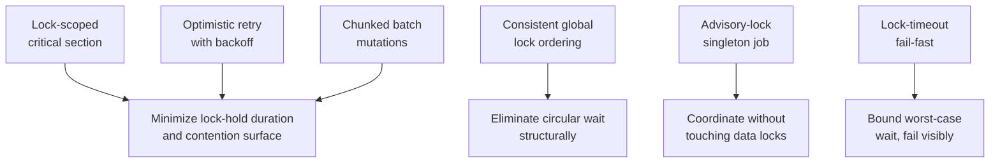

## 8. Production Architecture

A production OLTP system's lock-related architecture typically layers four
concerns on top of the raw lock-manager mechanics from Section 5: (1) the
application's transaction boundaries and statement shapes, which determine
what locks get requested and in what order; (2) session-level defaults
(`lock_timeout`, isolation level) set per connection pool or per workload
class, so interactive and batch connections get different waiting
behavior; (3) a monitoring layer that continuously samples the engine's
own lock-table/wait-for-graph views (`pg_locks`/`pg_stat_activity` in
PostgreSQL, `sys.dm_tran_locks` in SQL Server) to detect blocking chains
before they escalate into full incidents; and (4) an operational runbook
for the specific, rare situation where the automatic deadlock detector and
lock timeouts are not enough — a genuinely stuck long-running transaction
holding locks that must be manually identified and terminated.

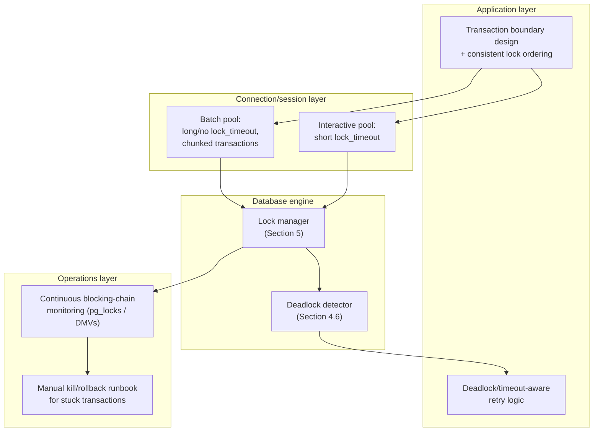

## 9. Implementation

Implementing correct lock usage in application code means making three
explicit choices for every statement or transaction that touches
contended data: whether to lock pessimistically or optimistically (Sections
4.3-4.4), what granularity/scope the lock should cover (as narrow as
correctness allows, per Section 6), and how the calling code will detect
and retry a deadlock, lock-timeout, or OCC version-conflict error, since all
three are expected, not exceptional, outcomes.

```sql
-- Pessimistic: lock exactly the row needed, keep the transaction short
BEGIN;
SET LOCAL lock_timeout = '2s';
SELECT quantity FROM inventory WHERE sku = 'WIDGET-1' FOR UPDATE;
-- application computes new_quantity in-process, no external calls here
UPDATE inventory SET quantity = quantity - 1 WHERE sku = 'WIDGET-1';
COMMIT;
```

```python
# Optimistic: version-column compare-and-swap with bounded retry
def update_with_optimistic_lock(conn, row_id, mutate_fn, max_retries=5):
    for attempt in range(max_retries):
        cur = conn.cursor()
        cur.execute("SELECT data, version FROM documents WHERE id = %s", (row_id,))
        data, version = cur.fetchone()
        new_data = mutate_fn(data)  # pure computation, no I/O
        cur.execute(
            "UPDATE documents SET data = %s, version = version + 1 "
            "WHERE id = %s AND version = %s",
            (new_data, row_id, version),
        )
        if cur.rowcount == 1:
            conn.commit()
            return
        conn.rollback()  # version mismatch -- someone else won, retry
    raise RuntimeError("exceeded max_retries under sustained contention")
```

Section 10's code examples implement a concrete version of both the
pessimistic (Section 4.3) and optimistic (Section 4.4) paths end to end
against a real database, plus a deliberately reproduced deadlock with a
hand-rolled wait-for-graph detector implementing Section 4.6's algorithm.

## 10. Complete Code Examples

**Example 1 — pessimistic locking with `SELECT ... FOR UPDATE` (SQL)**,
demonstrating row-level exclusive locking for a funds-transfer scenario
with a consistent lock-ordering fix for Section 4.6's deadlock-prevention
principle, directly implementing Sections 4.1 and 4.3:
[`code/sql/locking-chapter/01_pessimistic_select_for_update.sql`](../../code/sql/locking-chapter/01_pessimistic_select_for_update.sql).

**Example 2 — optimistic concurrency control retry loop (Python)**,
implementing Section 4.4's version-column compare-and-swap pattern end to
end against a real PostgreSQL database, including a concurrent-conflict
demonstration and bounded exponential-backoff retry:
[`code/python/locking-chapter/02_optimistic_version_cas.py`](../../code/python/locking-chapter/02_optimistic_version_cas.py).

**Example 3 — deadlock reproduction and wait-for-graph detector
(Node.js)**, deliberately reproducing a two-transaction circular-wait
deadlock against PostgreSQL and implementing a standalone wait-for-graph
cycle detector over `pg_locks`, directly implementing Section 4.6's
detection algorithm outside the engine for teaching purposes:
[`code/node/locking-chapter/03_deadlock_waitfor_graph.js`](../../code/node/locking-chapter/03_deadlock_waitfor_graph.js).

**Example 4 — advisory-lock-based singleton scheduled job (Java)**,
implementing Section 4.8's "only one instance runs" pattern using
PostgreSQL session-level advisory locks across simulated concurrent
job-runner instances:
[`code/java/locking-chapter/04_AdvisoryLockSingletonJob.java`](../../code/java/locking-chapter/04_AdvisoryLockSingletonJob.java).

Run the SQL example directly against a local PostgreSQL instance (open two
`psql` sessions and follow the inline comments to interleave them):

```bash
psql -f code/sql/locking-chapter/01_pessimistic_select_for_update.sql
```

Run the Python optimistic-concurrency demo:

```bash
pip install psycopg2-binary
python code/python/locking-chapter/02_optimistic_version_cas.py
```

Run the Node.js deadlock-reproduction demo:

```bash
npm install pg
node code/node/locking-chapter/03_deadlock_waitfor_graph.js
```

Compile and run the Java advisory-lock demo:

```bash
javac code/java/locking-chapter/04_AdvisoryLockSingletonJob.java -d out
java -cp out:$(find ~/.m2 -name 'postgresql-*.jar' | head -1) AdvisoryLockSingletonJob
```

## 11. Performance

- **Row-level locking's per-lock overhead is real but small; the
  aggregate cost at scale is what matters** — a single row lock is cheap,
  but a batch operation acquiring hundreds of thousands of them
  cumulatively pays that cost many times over, which is exactly what lock
  escalation (Section 4.2) exists to cap.
- **Pessimistic lock-hold duration is the dominant lever over blocking-
  chain length** — recapping Section 5.1's Strict 2PL mechanism: since
  every lock is held until commit, the single biggest performance
  intervention available to an engineer is shortening the time between
  acquiring a lock and committing, not tuning any lock-manager setting.
- **Optimistic concurrency control's cost is proportional to conflict rate,
  not to transaction count** — a correctly-chosen OCC workload pays almost
  nothing extra versus no concurrency control at all; a *mis*-chosen one
  (high actual conflict rate) pays repeated wasted work on every retried
  attempt, which is why Section 4.4 frames the choice as conditional on
  measured contention.
- **Deadlock detection itself has a cost, separate from the deadlock's
  own cost** — an engine that runs cycle detection eagerly on every wait
  trades faster detection for constant background overhead; one that waits
  for a threshold before checking (Section 4.6) trades slower detection for
  near-zero overhead in the common, non-deadlocked case.
- **Lock-table contention, not disk I/O, is frequently the actual ceiling
  on write throughput** in high-concurrency OLTP systems, since every lock
  acquisition and release synchronizes against the same shared structure
  (Section 5) regardless of how fast the underlying storage is.

## 12. Scalability

- **Row-level locking scales horizontally with row count far better than
  page- or table-level locking**, because unrelated transactions touching
  unrelated rows never contend at all — the entire justification for
  row-level locking becoming the default (Section 2) as OLTP concurrency
  grew.
- **Optimistic concurrency control scales better than pessimistic locking
  specifically for distributed/geo-replicated systems**, since it never
  requires holding a lock open across a network round trip to a remote
  coordinator — a property Section 4.4 already identified as a decision
  factor, restated here as a scalability property rather than a latency
  one.
- **Chunked-batch mutation (Section 7) is a horizontal-scalability
  technique for write-heavy maintenance jobs**, trading a longer overall
  job duration for a bounded, small blocking radius at any given moment,
  rather than one enormous transaction that serializes the entire table
  for its full duration.
- **Sharding (recapping [Sharding](CH06_Sharding.md)) is the ultimate lock-
  contention-reduction technique at scale**: a well-chosen shard key that
  routes the vast majority of transactions to a single shard means most
  locks never contend with a lock on a different shard at all, sidestepping
  cross-node lock coordination entirely for the common case.

## 13. Security

- **Locks are a concurrency-correctness mechanism, not an access-control
  mechanism** — recapping [Transactions, Section
  13](CH08_Transactions.md#13-security)'s equivalent point about isolation
  levels: a transaction that successfully acquires a lock on a row it was
  never authorized to read or write has still committed a security
  violation, because row/column-level authorization is a separate layer
  entirely.
- **Advisory locks (Section 4.8) share a database connection's privilege
  scope**, so any code path with a connection to the database can acquire
  or release *any* advisory-lock key — there is no per-key access control —
  which means advisory locks should never be used as a security boundary
  between mutually distrusting callers, only as a coordination convenience
  among cooperating, trusted application components.
- **Long-held locks are an availability risk with security implications**:
  a malicious or compromised client that opens a transaction, acquires a
  broad exclusive lock, and then stalls indefinitely (rather than
  committing or rolling back) can deny service to every other transaction
  needing that data — exactly the kind of resource-exhaustion vector that
  lock timeouts (Section 4.7) are a direct, concrete mitigation for.
- **Deadlock-triggered rollbacks can be abused for targeted denial-of-
  service** in a poorly-isolated multi-tenant database if one tenant's
  queries can be crafted to reliably win victim-selection contests against
  another tenant's transactions — a reason multi-tenant database
  architectures frequently isolate tenants at the schema, database, or
  cluster level rather than relying solely on row-level security within a
  single shared lock manager.

## 14. Observability

- **Track current blocking-chain length and depth**, not just aggregate
  lock-wait time — a single long chain (Transaction A blocks B blocks C
  blocks D) is a qualitatively different production risk than the same
  total wait time spread across many independent, short blocks, and most
  engines expose this directly (`pg_locks` joined against itself in
  PostgreSQL; `sys.dm_tran_locks` plus `sys.dm_os_waiting_tasks` in SQL
  Server).
- **Track deadlock rate as a first-class metric, segmented by the specific
  code path/query shape involved** — recapping Section 4.6's point that
  deadlocks are expected but should be rare: a rising deadlock rate from
  one specific transaction shape is a direct, actionable signal that its
  lock-acquisition order needs fixing, not just something for the retry
  logic to quietly absorb.
- **Track lock-escalation events explicitly** (SQL Server exposes a
  dedicated `lock_escalation` Extended Event) — an escalation event
  happening on a table an engineer assumed was safely row-locked is a
  direct, high-value signal that a batch job needs chunking (Section 7)
  before it causes a wider incident.
- **Track OCC retry rate and retry-count distribution per operation type**
  — a climbing retry rate on a specific optimistic-concurrency code path is
  the direct signal that its actual conflict rate has grown past what OCC
  was originally chosen for (Section 4.4), and it may need to move to
  pessimistic locking instead.
- **Track lock-wait-timeout rate separately from deadlock rate** — the two
  have different root causes and different fixes (Section 4.7 vs. Section
  4.6), and conflating them in a single "lock error" dashboard metric masks
  which specific fix is actually needed.

## 15. Failure Scenarios

- **Cascading blocking chain from one slow transaction.** A single
  transaction holds a row lock open unusually long (Section 4.3's failure
  mode); every transaction that needs that row queues behind it, and every
  transaction that needs *those* transactions' locks queues behind them in
  turn, producing an apparent full-database stall traceable to one root
  blocker. Detection: blocking-chain monitoring (Section 14) identifying
  the head-of-chain transaction. Recovery: manually terminate the root
  blocking transaction (via the operational runbook from Section 8) once
  identified, then fix the code path that let it hold the lock too long.
- **Deadlock storm under sustained inconsistent lock ordering.** A code
  deployment introduces a new code path that acquires the same two
  resources in the opposite order from an existing path (Section 4.6's
  failure mode), and under production load the deadlock detector starts
  firing continuously, each firing adding rollback/retry overhead on top of
  already-high load. Detection: a sudden rise in the deadlock-rate metric
  correlated with a recent deployment. Recovery: identify and fix the
  inconsistent acquisition order (the durable fix); in the interim,
  reducing concurrent load on the affected code paths reduces the
  collision rate.
- **Escalation-triggered stall during an unattended batch job.** A
  scheduled batch job's `UPDATE` crosses the row-lock escalation threshold
  (Section 4.2) partway through, converting to a table-level lock and
  stalling every concurrent interactive transaction against that table for
  the remainder of the job's runtime. Detection: an escalation event
  (Section 14) time-correlated with an unrelated latency spike on the same
  table. Recovery: kill and reschedule the batch job in smaller, chunked
  transactions (Section 7) that stay under the escalation threshold.
- **Optimistic-concurrency livelock under underestimated contention.** A
  code path chosen for OCC because conflicts were assumed rare
  experiences much higher real-world contention (a viral post's like
  counter, a flash-sale inventory row), and a large fraction of requests
  spend their entire retry budget failing the version check repeatedly.
  Detection: a sustained high OCC retry rate on one specific operation
  (Section 14). Recovery: migrate that specific hot row/operation to
  pessimistic locking or a dedicated atomic-increment primitive, while
  leaving genuinely low-contention operations on OCC.
- **Advisory-lock convention silently bypassed.** An on-call engineer,
  during an incident, connects directly to the database and issues a
  manual `UPDATE` against rows that are supposed to be protected by an
  advisory lock (Section 4.8), because the advisory lock provides no actual
  enforcement against ordinary statements — producing a lost-update-style
  anomaly the advisory lock was never actually capable of preventing.
  Detection: usually only in hindsight, via data-integrity audit. Recovery:
  document and, wherever the stakes justify it, replace the advisory-lock
  convention with a real row lock the database enforces against every
  access path, not just cooperating ones.

## 16. Testing

- **Reproduce deadlocks deliberately in a test harness**, using two
  concurrent connections executing statements in a controlled interleaving
  (as Section 10's Node.js example does) rather than only discovering
  lock-ordering bugs in production under real concurrent load.
- **Load-test optimistic-concurrency code paths under artificially inflated
  contention**, not just under expected production conflict rates, to
  validate the retry loop actually terminates correctly and the retry
  count/backoff behavior is acceptable under the worst case, not only the
  common case.
- **Assert on the specific error code/SQLSTATE for deadlocks and lock-wait
  timeouts** in unit/integration tests, not just "an exception was thrown,"
  since retry logic that catches too broad an exception class can silently
  swallow unrelated bugs as if they were expected contention.
- **Test lock-escalation thresholds explicitly for batch jobs** against a
  realistic row-count fixture, verifying a chunked implementation
  (Section 7) never crosses the escalation threshold rather than assuming
  chunk size is safe without measuring it against the specific engine's
  default.
- **Include a blocking-chain integration test** for any newly introduced
  multi-resource transaction, verifying it does not introduce a new
  lock-acquisition order inconsistent with the codebase's established
  global ordering (Section 6).

## 17. Common Mistakes

- **Holding a pessimistic lock open across a network call or user
  think-time** — restated from Section 4.3's common failure mode as the
  single most frequent root cause of blocking-chain incidents.
- **Choosing optimistic concurrency control without ever measuring actual
  conflict rate**, then discovering under real load that contention is far
  higher than assumed and the retry loop is effectively livelocking
  (Section 15).
- **Retrying an OCC compare-and-swap without re-reading current state
  first** — reapplying a stale computed value instead of recomputing
  against the row's current version, silently reproducing the lost-update
  anomaly OCC exists to prevent.
- **Inconsistent lock-acquisition order across independently-written code
  paths** touching the same two-or-more resources — the direct cause of
  most avoidable production deadlocks (Section 4.6).
- **Leaving lock timeouts unset by default** across an entire application,
  turning any one abnormally slow transaction into an indefinitely growing
  queue instead of a fast, visible, retryable failure (Section 4.7).
- **Treating advisory locks as if they enforced anything against ordinary
  data access** — using them to "protect" rows that any other code path
  can still freely read or write without acquiring the same advisory-lock
  key (Section 4.8).
- **Running large unchunked batch mutations against hot tables during peak
  traffic**, triggering lock escalation (Section 4.2) and stalling
  unrelated interactive transactions with no warning until the escalation
  event is already underway.
- **Conflating deadlock errors with lock-timeout errors in monitoring and
  retry logic**, obscuring which specific fix (lock ordering vs. timeout
  tuning) an elevated error rate actually calls for.

## 18. Best Practices

- Keep every pessimistic lock's hold duration as close as mechanically
  possible to the minimum required by Strict 2PL (Section 5.1) — no
  network calls, no user-facing waits, between acquiring a lock and
  committing.
- Choose pessimistic vs. optimistic concurrency control based on measured
  conflict rate for the specific row/table in question, and revisit that
  choice if the OCC retry-rate metric (Section 14) later shows the
  assumption was wrong.
- Establish and enforce one global, consistent lock-acquisition order
  (typically ascending primary key) across the entire codebase for any
  operation touching more than one resource, as the primary deadlock-
  prevention mechanism, not the detector.
- Set an explicit, workload-appropriate `lock_timeout` on every connection
  pool — short for interactive/user-facing pools, long or unset only for
  clearly-scoped background/batch pools.
- Chunk large mutations into smaller, separately-committed batches sized to
  stay comfortably under the engine's lock-escalation threshold.
- Treat deadlock errors, lock-timeout errors, and OCC version-mismatch
  errors as expected, retryable outcomes in every code path that can
  produce them, with bounded retry counts and exponential backoff with
  jitter.
- Reserve advisory locks strictly for application-level coordination
  (singleton jobs, rate-limit gates) and never as a substitute for real
  row/table locking when actual data integrity is at stake.
- Continuously monitor blocking-chain depth, deadlock rate, escalation
  events, and OCC retry rate as first-class production metrics, not only
  as ad hoc queries run after an incident is already underway.

## 19. Anti-Patterns

- **The "lock everything defensively" anti-pattern** — wrapping every read
  in `FOR UPDATE` regardless of whether the row will actually be modified,
  turning read-only queries into unnecessary serialization points and
  discarding most of the concurrency row-level locking was chosen to
  provide.
- **The "infinite lock wait" anti-pattern** — never setting a lock timeout,
  so that any single slow or stuck transaction propagates into an
  invisible, unbounded queue rather than a fast, visible failure.
- **The "unbounded optimistic retry" anti-pattern** — retrying a
  compare-and-swap in a tight loop with no maximum attempt count and no
  backoff, which under real contention either spins the CPU indefinitely
  or amplifies load on an already-contended row.
- **The "opposite-order acquisition" anti-pattern** — different code paths
  acquiring the same set of resources in different orders, structurally
  reintroducing circular wait (Section 4.6) that a global ordering
  convention would have eliminated entirely.
- **The "advisory lock as data protection" anti-pattern** — relying on an
  advisory lock to prevent a lost-update or race condition on actual row
  data, when only cooperating, disciplined callers actually respect it.
- **The "giant unchunked batch update" anti-pattern** — running a single
  transaction against millions of rows during peak traffic, courting both
  lock escalation (Section 4.2) and an unacceptably long lock-hold duration
  in one avoidable design choice.
- **The "swallow and ignore" anti-pattern** — catching a deadlock or
  lock-timeout error and simply logging it without retrying, silently
  dropping the transaction's work instead of treating the error as the
  expected, retryable signal it is.

## 20. Trade-off Analysis

| Decision | Favors | Costs |
|---|---|---|
| Row-level vs. table-level locking | Row: maximum concurrency for unrelated writers | Row: higher per-lock bookkeeping cost and lock-table memory at scale |
| Pessimistic vs. optimistic concurrency control | Pessimistic: correctness under frequent conflict, no wasted retry work | Pessimistic: every locked row is a serialization point for its full hold duration |
| Optimistic concurrency control | Cheap under rare conflict, no lock held across think-time/network hops | Expensive and potentially livelock-prone if actual conflict rate is higher than assumed |
| Short lock timeout | Fast, visible, retryable failure for interactive workloads | Can abort a transaction that would have succeeded moments later under a longer wait |
| Long/unset lock timeout | Batch jobs complete without spurious failures | A single slow transaction can stall a large blocking chain indefinitely |
| Lock escalation (row to table) | Bounds lock-manager memory/CPU for very large operations | Stalls every other transaction against the table for the remainder of the operation |
| Advisory locks for coordination | Lightweight, no extra infrastructure beyond the existing database connection | Zero enforcement against ordinary data-access statements; purely convention-based |
| Eager vs. threshold-based deadlock detection | Eager: faster detection, less time wasted deadlocked | Eager: constant background overhead even when deadlocks are rare |

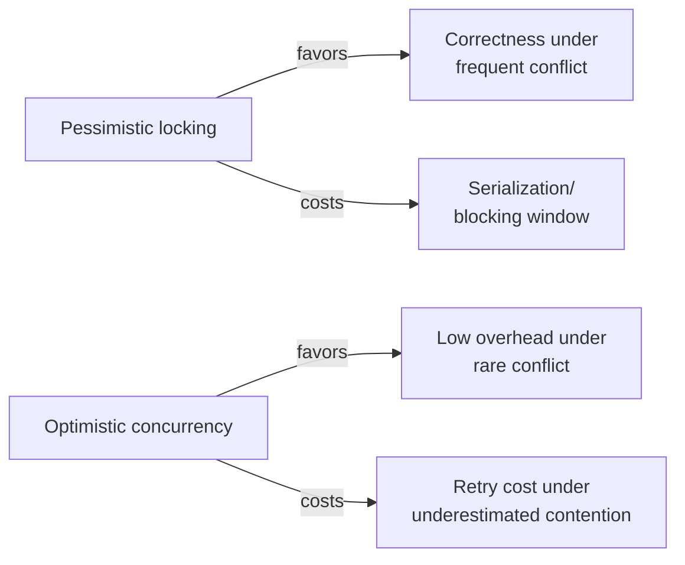

## 21. Comparison Table

| Mechanism | Locks held during "think time"? | Detects conflict at | Best fit | Primary failure mode |
|---|---|---|---|---|
| Pessimistic (`SELECT ... FOR UPDATE`) | Yes, until commit | Acquisition time | Frequent-conflict workloads (hub accounts, hot inventory rows) | Lock held open too long blocks everything behind it |
| Optimistic (version column + CAS) | No | Commit/write time | Rare-conflict workloads (user profile edits, low-contention rows) | Livelock/wasted retries if contention is higher than assumed |
| Advisory lock | Yes, but only against other advisory-lock callers | Acquisition time, scoped to the key only | Cross-instance job coordination, rate-limit gates | No enforcement against ordinary data access |
| Table-level lock | Yes, for the whole table | Acquisition time | Rare-write reference/lookup tables, DDL | Blocks every transaction against the table, related or not |
| Row-level lock | Yes, for the specific row | Acquisition time | Default for high-concurrency OLTP tables | Per-lock bookkeeping overhead at very large scale; escalation risk |

## 22. Real-World Case Study

A mid-size e-commerce platform's checkout service began experiencing
intermittent multi-second stalls under normal traffic, visible to customers
as a spinning "processing payment" screen. Initial investigation focused on
the payment gateway (the most recently changed external dependency) and
found nothing wrong there. Blocking-chain monitoring (Section 14) against
the database eventually surfaced the actual pattern: a nightly inventory
reconciliation job — scheduled to run at low-traffic hours but occasionally
delayed by an upstream data-feed dependency into overlapping with morning
traffic — issued `SELECT quantity FROM inventory WHERE sku = ? FOR SHARE`
inside a transaction that also made a slow, synchronous call to a
third-party analytics API before committing (an unrelated feature added
months earlier by a different team, unaware of the reconciliation job's
FOR SHARE clause). Under the lock-compatibility matrix from Section 4.1, the
held shared lock blocked every checkout transaction's exclusive lock
request against the same popular SKUs, and the analytics call's latency
(occasionally several seconds under its own load) directly set the
duration of every stalled checkout behind it — a textbook instance of
Section 4.3's "held lock across a slow external call" failure mode,
compounded by Section 15's cascading-blocking-chain scenario. The fix had
three parts: moving the analytics call to strictly after the reconciliation
transaction's commit (eliminating the root cause); adding an explicit
`lock_timeout` to the checkout connection pool so any future recurrence
would fail fast and visibly instead of silently stalling (Section 4.7's
fail-fast pattern); and adding blocking-chain-depth as a standing alert
threshold rather than a metric only consulted reactively during an
incident (Section 14). The reconciliation job's read did not need a
`FOR SHARE` lock at all once the team traced through the logic — a plain
MVCC snapshot read (recapping [Transactions, Section
4.11](CH08_Transactions.md#411-multi-version-concurrency-control-mvcc-reads-without-blocking-writers))
was sufficient for its actual purpose, and removing the unnecessary
explicit lock entirely was the durable structural fix underneath the two
operational mitigations.

```mermaid
sequenceDiagram
    participant Recon as Reconciliation Job
    participant Analytics as Analytics API
    participant DB as Database
    participant Checkout as Checkout Transaction

    Recon->>DB: BEGIN; SELECT ... FOR SHARE (SKU-9)
    DB-->>Recon: shared lock granted
    Recon->>Analytics: slow synchronous call (unrelated feature)
    Note over Recon,Analytics: several seconds, lock still held
    Checkout->>DB: UPDATE inventory SET quantity=... WHERE sku='SKU-9'
    DB-->>Checkout: BLOCKED -- conflicts with held shared lock
    Analytics-->>Recon: response received
    Recon->>DB: COMMIT
    DB-->>Checkout: exclusive lock granted, UPDATE proceeds
```

## 23. Interview Questions

1. What is the difference between a shared lock and an exclusive lock, and
   why do intent locks exist on top of them?
2. Walk through the lock-compatibility matrix: can two transactions each
   hold a shared lock on the same row at the same time? Can one hold IX
   while another holds S?
3. Explain lock escalation: what triggers it, what does it cost, and how
   would you prevent an unattended batch job from triggering it
   unexpectedly?
4. Compare pessimistic and optimistic concurrency control. Under what
   conflict-rate conditions does each one win, and why?
5. Walk through exactly how you would implement an optimistic
   compare-and-swap using a version column, including what has to happen
   on a failed CAS.
6. What is a wait-for graph, and how does a database engine use it to
   detect a deadlock? How is this distinct from a general operating-
   system-level deadlock?
7. How does a database choose which transaction to abort once it detects a
   deadlock? Name at least two concrete victim-selection heuristics.
8. What is the difference between a lock-wait timeout and a deadlock, and
   why does an application's retry logic need to handle them differently?
9. What is an advisory lock, and what specifically does the database
   *not* enforce when you use one?
10. Explain Strict Two-Phase Locking and why nearly every production
    database implements the strict variant rather than plain 2PL.
11. A batch job is causing production stalls. Walk through your diagnostic
    process using the observability signals from Section 14 to determine
    whether the root cause is lock escalation, a long-held lock, or
    something unrelated.
12. Why might a system that already uses MVCC for its default read path
    still need a full lock manager underneath it?

## 24. Hands-on Exercises

1. Using two concurrent `psql` sessions, reproduce a lost-update anomaly
   with no locking at all, then fix it using `SELECT ... FOR UPDATE`, and
   observe the second session block until the first commits.
2. Implement the optimistic version-column pattern (Section 4.4) against a
   `documents` table, then deliberately race two concurrent processes
   updating the same row and confirm exactly one CAS succeeds while the
   other detects the version mismatch and retries.
3. Deliberately construct a two-transaction deadlock (Section 10's Node.js
   example) by having two sessions lock the same two rows in opposite
   order, and capture the resulting deadlock error and its SQLSTATE/error
   code.
4. Query your database's live lock views (`pg_locks`/`pg_stat_activity` or
   `sys.dm_tran_locks`) while a deliberately long-held lock is active, and
   identify the blocking transaction and everything queued behind it.
5. Set a short `lock_timeout` on a session, then deliberately hold a
   conflicting lock open in another session and observe the timeout error
   fire before the deadlock detector would ever have triggered.
6. Implement the advisory-lock singleton-job pattern (Section 10's Java
   example) and run three concurrent instances, confirming only one
   actually proceeds.

## 25. Design Exercises

1. Design the locking strategy for a high-traffic flash-sale checkout flow
   for a single limited-inventory item, justifying your choice between
   pessimistic locking, optimistic concurrency control, and an
   atomic-decrement primitive, and specify the exact lock-hold-duration
   budget your design targets.
2. Design a global lock-acquisition-ordering convention for a service that
   processes multi-account fund transfers, including how you would enforce
   it in code review or via static analysis, and how you would test that
   the convention is never violated.
3. Design the lock-timeout policy for a system with both interactive
   (user-facing) and batch (nightly reconciliation) database workloads
   sharing the same tables, specifying different timeout values per
   workload class and how you would prevent the batch workload from
   silently escalating locks.
4. Design a monitoring and alerting scheme for lock contention across a
   fleet of database instances, specifying which of Section 14's metrics
   you would alert on, at what thresholds, and how you would distinguish a
   genuine incident from expected background contention.
5. Design a migration plan to move a specific hot, contended row's
   concurrency-control strategy from optimistic to pessimistic locking in
   a live production system, without introducing a lost-update window
   during the transition.

## 26. Architecture Review Questions

1. For every transaction that acquires a pessimistic lock, is there any
   network call, external API call, or user-facing wait between
   acquisition and commit?
2. Is there a single, documented, enforced lock-acquisition order for every
   operation that touches more than one resource?
3. Does every code path that can trigger a deadlock, lock-timeout, or OCC
   version-conflict error actually catch and retry it, with a bounded
   retry count and backoff?
4. Are lock timeouts explicitly configured per workload class (interactive
   vs. batch), rather than left at an unbounded default across the board?
5. Are large batch mutations chunked to stay under the engine's
   lock-escalation threshold, and has that threshold actually been
   verified against the target engine rather than assumed?
6. Is optimistic concurrency control used only where conflict rate has
   been measured or reasonably estimated to be low, with a monitored retry-
   rate metric to catch a wrong assumption?
7. Are advisory locks used only for coordination, with no code path relying
   on them to protect actual data integrity?
8. Does the observability stack distinguish deadlock rate, lock-timeout
   rate, and lock-escalation events as separate, individually-alertable
   metrics?

## 27. Summary

Locks are the concrete mechanism underneath the abstract isolation
guarantees taught in [Transactions](CH08_Transactions.md): shared and
exclusive locks, arbitrated through a compatibility matrix and made
efficient at scale by intent locks, let a database engine serialize
conflicting access to rows, pages, or tables. Granularity is a direct
trade between concurrency and per-lock overhead, with lock escalation
acting as the engine's automatic safety valve — and a common, surprising
source of production stalls — when that overhead grows too large. Choosing
between pessimistic locking (acquire before access, hold until commit) and
optimistic concurrency control (validate a version at commit time, retry on
conflict) is a decision that should follow measured conflict rate, not
habit, with each mechanism failing in a distinct, recognizable way when
misapplied. Database-specific deadlock detection builds a wait-for graph
directly from the lock manager's own lock table and applies engine-specific
victim-selection heuristics to break any cycle it finds — a more specific,
data-driven descendant of the general Coffman-conditions model owned by
[Processes and Threads](../05_Networking_and_OS/CH24_Processes_and_Threads.md#49-deadlock-and-the-four-coffman-conditions),
and one every application must treat as an expected, retryable outcome
rather than a bug. Lock timeouts bound the worst case for lock-wait queuing
independent of whether a deadlock exists at all, and advisory locks give
applications a database-arbitrated coordination primitive explicitly
decoupled from — and never a substitute for — real data-protecting locks.
Together, these mechanisms are what let a database honor the correctness
promises Transactions describes at the level of policy, down to the level
of exactly which bytes on disk a concurrent transaction is, and is not,
permitted to touch at any given instant.

## Further Reading

- [Transactions](CH08_Transactions.md) — ACID properties, isolation levels
  and their anomaly taxonomy, MVCC, Two-Phase Commit, and the Saga pattern;
  this chapter's direct prerequisite and complement.
- [Processes and Threads](../05_Networking_and_OS/CH24_Processes_and_Threads.md#49-deadlock-and-the-four-coffman-conditions) —
  the general deadlock model and the four Coffman conditions this chapter's
  Section 4.5 recaps before specializing to database lock managers.
- [Indexes](CH03_Indexes.md) — how missing or poorly-chosen indexes force
  the wider row scans (and wider lock acquisition) behind several of this
  chapter's common failure modes.
- [Sharding](CH06_Sharding.md) — reducing cross-node lock coordination by
  routing most transactions to a single shard, recapped in Section 12.
- [Query Optimizers](CH04_Query_Optimizers.md) — how the optimizer's chosen
  execution plan (a full scan vs. an index seek) determines how many rows a
  statement examines, and therefore how many locks it may need to acquire.
