# Chapter: PostgreSQL

Part: [06 — Databases and Storage](PART_OVERVIEW.md) · Status: Drafted

## 1. Introduction

PostgreSQL is an open-source Object-Relational Database Management System
(ORDBMS) whose architecture diverges from most other mainstream relational
engines in ways that materially change how a Solution Architect should
design schemas, size infrastructure, and reason about failure modes on top
of it. Every generic relational concept this book has already taught —
normalization ([Normalization](CH01_Normalization.md)), index data structures
([Indexes](CH03_Indexes.md)), the cost-based optimizer
([Query Optimizers](CH04_Query_Optimizers.md)), partitioning
([Partitioning](CH05_Partitioning.md)), replication
([Replication](CH07_Replication.md)), transactions and Multi-Version
Concurrency Control (MVCC) as a concept
([Transactions](CH08_Transactions.md)), caching
([Caching](CH09_Caching.md)), and locking
([Locking](CH10_Locking.md)) — applies to PostgreSQL, but PostgreSQL
implements each one with specific engineering choices that produce concrete,
sometimes surprising, operational consequences: an `UPDATE` does not modify a
row in place but writes an entirely new row version, deleted and superseded
row versions do not vanish until an explicit background process reclaims
them, every client connection is a full operating-system process rather than
a lightweight thread, and the query planner's row-count estimates come from
sampled statistics that can silently go stale and misdirect a plan by orders
of magnitude. This chapter is about PostgreSQL *specifically* — not
relational databases in general — and assumes the reader already understands
the generic concepts listed above at the depth their owning chapters teach.

This chapter is the *owning* chapter for PostgreSQL's Multi-Version
Concurrency Control implementation (heap tuples, `xmin`/`xmax`, and the
`VACUUM` process that reclaims dead tuples and controls table bloat), the
Write-Ahead Log (WAL) and PostgreSQL's specific streaming and logical
replication mechanics, its extension architecture (the mechanism that lets
`CREATE EXTENSION` add capabilities like PostGIS spatial types and `pg_trgm`
trigram search directly into the engine), its non-B-tree index access
methods (Generalized Inverted Index (GIN), Generalized Search Tree (GiST),
and Block Range Index (BRIN)) and partial/expression indexes, native JSONB
(Binary JSON) support, declarative table partitioning as PostgreSQL
implements it, and the process-per-connection connection model together with
the operational reality of connection pooling via PgBouncer. It recaps,
rather than re-teaches, the generic forms of normalization, indexing,
partitioning, sharding, replication, transactions, caching, and locking per
the Concept Ownership Rule in [STYLE_GUIDE.md](../STYLE_GUIDE.md) — each
recap is flagged inline with a link back to the owning chapter.

## 2. Historical Evolution

- **Ingres and the academic lineage (1970s-1980s, UC Berkeley)** — PostgreSQL
  traces its lineage to the Ingres project led by Michael Stonebraker, one
  of the first relational database implementations to follow Codd's 1970
  relational model paper.
- **POSTGRES, "Post-Ingres" (1986-1994)** — Stonebraker's follow-up project
  explicitly aimed to add object-relational features Ingres lacked: user-
  defined types, user-defined functions, and rules, laying the architectural
  groundwork for the extension mechanism this chapter teaches in Section 4.5.
- **Adoption of SQL and the Postgres95 rename (1994-1995)** — Andrew Yu and
  Jolly Chen added a SQL query interpreter (POSTGRES had used a different
  query language, PostQUEL) and released the result as Postgres95.
- **PostgreSQL 6.0 (1997)** — the project renamed itself PostgreSQL to
  reflect both its ancestry and its now-standard SQL support, and adopted
  the open, community-driven governance model it retains today.
- **Multi-Version Concurrency Control from the start** — unlike engines that
  bolted MVCC onto an originally lock-only design, PostgreSQL's storage
  model (Section 4.1) was MVCC-oriented from POSTGRES onward, which is why
  `VACUUM` (Section 4.2) has always been a first-class, unavoidable part of
  operating the engine rather than an optional tuning knob.
- **Write-Ahead Logging matures (PostgreSQL 7.x, late 1990s-early 2000s)** —
  WAL-based crash recovery replaced the earlier, slower approach of forcing
  every dirty page to disk on commit, and became the foundation both for
  crash recovery and, later, for replication.
- **Point-in-Time Recovery and warm standby (8.0, 2005)** — PostgreSQL 8.0
  added the ability to continuously archive WAL segments and replay them on
  a standby server, the direct ancestor of streaming replication.
- **Streaming replication and hot standby (9.0, 2010)** — this release
  (Section 4.4) let a standby server apply WAL in near-real-time over a
  network connection and simultaneously serve read-only queries, turning
  PostgreSQL replication from an archive-and-recover mechanism into a
  live, horizontally-read-scalable topology.
- **JSON support (9.2, 2012) and JSONB (9.4, 2014)** — PostgreSQL first added
  a `json` type that stored an exact text copy of the input, then followed
  with `jsonb` (Section 4.10), a decomposed binary storage format that
  trades slightly slower input parsing for materially faster querying and
  native indexability — the format this chapter and most production systems
  actually use.
- **Logical replication (10, 2017)** — publish/subscribe replication of
  individual tables (rather than the entire cluster byte-for-byte) enabled
  selective replication, cross-version upgrades, and multi-master-adjacent
  patterns without the constraints of physical streaming replication.
- **Declarative partitioning (10, 2017; sub-partitioning and more in
  11-12)** — native `PARTITION BY` syntax (Section 4.11) replaced the older
  inheritance-plus-trigger partitioning pattern, giving the planner
  first-class partition-pruning support.
- **Extension ecosystem maturity (ongoing)** — PostGIS (spatial/GIS data,
  first released 2001, now the de facto spatial-database standard built
  entirely as a PostgreSQL extension), `pg_trgm` (trigram fuzzy text
  search), TimescaleDB (time-series, built as an extension), and Citus
  (distributed PostgreSQL, later acquired by Microsoft and folded into
  Azure) all demonstrate the extension architecture's practical payoff:
  entire specialized database categories built on top of, not instead of,
  PostgreSQL's core engine.
- **Continued core investment (13-17, 2020-2024)** — incremental sorting,
  B-tree deduplication reducing index bloat, pipeline mode, `MERGE`
  statement support, and steadily improving parallel query execution show
  the project's shift from adding entirely new subsystems toward optimizing
  the existing ones this chapter describes.

## 3. Why It Exists

PostgreSQL exists to answer a question the earliest relational systems could
not: could a single open, extensible engine serve both classic transactional
workloads and specialized data domains (spatial, full-text, time-series,
graph-adjacent) without forcing an organization to run a different, bespoke
database for each one? Stonebraker's original POSTGRES thesis was that a
relational engine's *type system* and *query processing* should be
pluggable — new data types, new operators, and new index access methods
should be addable without modifying the database's own source code — and
that architectural bet is precisely what let PostGIS turn PostgreSQL into a
best-in-class spatial database and what lets `pg_trgm` turn it into a
credible fuzzy-text-search engine, all without PostgreSQL's core team having
to build or maintain either capability. The alternative most competing
engines chose — a closed, monolithic type system with occasional built-in
special cases (a `GEOGRAPHY` type here, a full-text index there) — solves
the immediate problem more narrowly but leaves architects dependent on
whatever the vendor decides to add next.

A second reason PostgreSQL exists, and persists, is standards-adherent SQL
correctness plus genuinely open governance: no single company controls
PostgreSQL's roadmap or can relicense it, which matters materially to
architects who must justify a database choice that will outlive several
budget cycles and vendor relationships. A third reason, more mechanical, is
that MVCC-from-the-ground-up (Section 4.1) gives PostgreSQL strong
transactional isolation semantics ([Transactions](CH08_Transactions.md))
without the reader-blocks-writer / writer-blocks-reader behavior of
lock-only concurrency control — a property that made PostgreSQL viable for
mixed OLTP (Online Transaction Processing) workloads with concurrent
analytical queries well before that combination was common elsewhere.

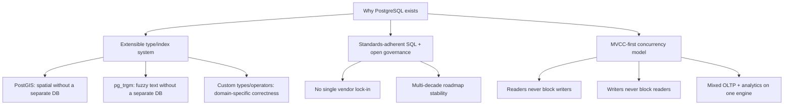

## 4. Core Concepts

This section teaches PostgreSQL's distinguishing internals from first
principles: how it stores and versions rows, how it recovers from crashes
and replicates data, how it lets new capabilities be added without
modifying its source, how it indexes data shapes a plain B-tree cannot, how
it stores and queries semi-structured JSON, how it partitions tables, how
client connections actually consume server resources, and how its query
planner turns SQL into an execution plan.

### 4.1 MVCC in PostgreSQL: Heap Tuples, `xmin`/`xmax`

**Definition.** PostgreSQL implements Multi-Version Concurrency Control
([recapped generically in Transactions](CH08_Transactions.md#multi-version-concurrency-control-mvcc))
by never updating a row in place. Every row version — called a *heap
tuple* — carries two hidden system columns, `xmin` (the ID of the
transaction that created this tuple version) and `xmax` (the ID of the
transaction that deleted or superseded it, or zero if the tuple is still
current), and PostgreSQL decides which tuple version a given transaction may
see purely by comparing these values against the transaction's *snapshot*
(the set of transaction IDs considered committed-and-visible at the moment
the snapshot was taken).

**Mechanism.** An `UPDATE` in PostgreSQL never overwrites the existing heap
tuple's bytes. It writes a brand-new tuple with a new `xmin` equal to the
updating transaction's ID, sets the old tuple's `xmax` to that same
transaction ID (marking it superseded, not gone), and links the old tuple to
the new one via a hidden `ctid` (physical row-version pointer) chain so
index entries pointing at the old row location can still find the current
version. A `DELETE` simply sets `xmax` on the existing tuple without writing
a replacement — the row remains physically present until cleanup runs. Every
table also has a set of indexes that must be updated to reference the new
tuple's physical location, which is the direct cause of *index bloat*
alongside heap bloat (Section 4.2) — every `UPDATE` is, from an I/O
perspective, closer to an `INSERT` plus a `DELETE` than to a true in-place
`UPDATE`. When a transaction runs a query, PostgreSQL computes a snapshot
(for Read Committed, once per statement; for Repeatable Read/Serializable,
once for the whole transaction) and applies a visibility rule to every
candidate tuple: a tuple is visible if its `xmin` committed before the
snapshot was taken and either `xmax` is unset or `xmax`'s transaction has
not committed (or committed after the snapshot).

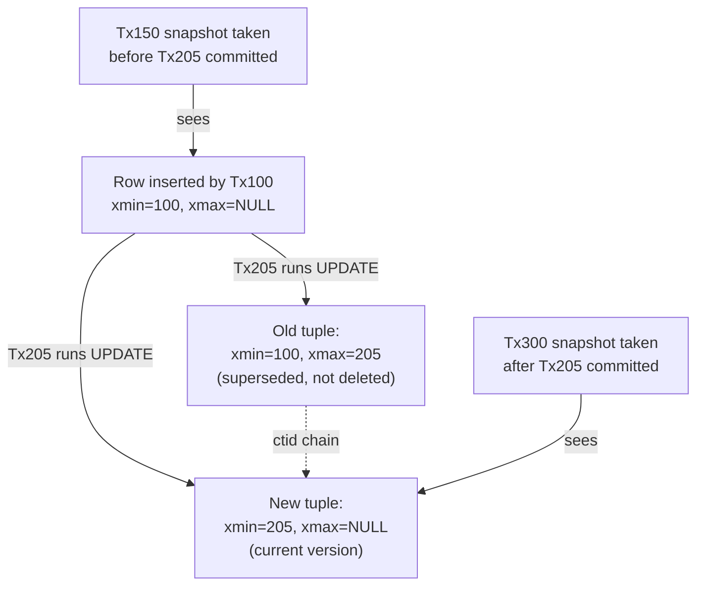

**Decision implications.** Because every row carries version history rather
than a single mutable copy, high-`UPDATE`-frequency tables (counters,
session state, queue-like tables) generate heap bloat proportionally to
update rate, not row count — an architect sizing storage or choosing between
PostgreSQL and a purely in-place-update engine for an update-heavy workload
must account for this, typically by aggressive autovacuum tuning (Section
4.2), `HOT` (Heap-Only Tuple) updates when the updated columns are not
indexed, or by redesigning hot counters to use a separate, smaller table.
The snapshot-based visibility model is also *why* PostgreSQL readers never
block writers and writers never block readers ([recapping Locking's
shared/exclusive lock model](CH10_Locking.md#lock-typescompatibility-matrix-sharedexclusiveintent-lock-granularity-and-escalation) —
row locks in PostgreSQL exist to prevent concurrent *writers* from
conflicting with each other, not to prevent readers from seeing a
consistent snapshot).

**Failure mode.** A long-running transaction (even an idle one left open by
a forgotten `BEGIN`, or an Object-Relational Mapping (ORM) tool holding a
transaction open across an HTTP request) pins the oldest snapshot the
database must still support, which prevents `VACUUM` (Section 4.2) from
reclaiming any tuple version newer than that snapshot anywhere in the
database — not just in tables the idle transaction touched. This is the
single most common cause of sudden, severe production bloat: monitoring
"idle in transaction" session duration and oldest-active-transaction age is
a standard PostgreSQL operational check for exactly this reason.

**Scenario.** An e-commerce inventory table's `quantity_available` column is
updated on every order (thousands of times per minute per popular product
row). Without HOT updates or partitioning the counter into a separate table,
the same handful of physical rows accumulate enormous version history
between `VACUUM` runs, heap size grows far beyond the logical row count, and
sequential scans (and even index scans that must still visit dead heap
pages to check visibility) slow down measurably — the fix is typically a
combination of `fillfactor` tuning (leaving free space per page for HOT
updates), more aggressive per-table autovacuum thresholds, or moving hot
counters into a small, separately-vacuumed table.

### 4.2 VACUUM and Table/Index Bloat

**Definition.** `VACUUM` is PostgreSQL's background process that scans
tables for dead tuples (heap tuples whose `xmax` transaction has committed
and whose version is no longer visible to any current or future snapshot),
marks the space they occupy as reusable, and updates the *visibility map*
and statistics the query planner depends on. *Bloat* is the accumulated disk
space consumed by dead tuples and index entries that `VACUUM` has not yet
reclaimed (or, in the case of *unreclaimable* bloat, dead space that
ordinary `VACUUM` marked reusable but could not return to the operating
system, because it sits in the middle of a table file rather than at the
end).

**Mechanism.** `autovacuum` (the automatic, background-scheduled form of
`VACUUM` that runs by default in every modern PostgreSQL installation) wakes
up periodically, checks each table's dead-tuple count against a threshold
(`autovacuum_vacuum_scale_factor` times the table's row count, plus a fixed
base threshold), and if exceeded, scans the table's pages, reclaims dead
tuple slots for reuse by future inserts/updates on the *same* table (a
regular `VACUUM` does not shrink the file on disk — it only makes internal
space reusable), removes now-orphaned index entries, and updates the
visibility map so future sequential scans can skip pages known to contain
only live, all-visible tuples (an important optimization for
index-only-scans, which otherwise must consult the heap to check
visibility). A separate, heavier operation — `VACUUM FULL` — rewrites the
entire table into a new, compact file and swaps it in, actually shrinking
disk usage, but takes an `ACCESS EXCLUSIVE` lock for the duration (blocking
all reads and writes) and is therefore rarely usable on a live production
table without a maintenance window; `pg_repack`, a widely used extension
(Section 4.5), performs the equivalent rewrite online by building the new
table concurrently and swapping it in briefly at the end.

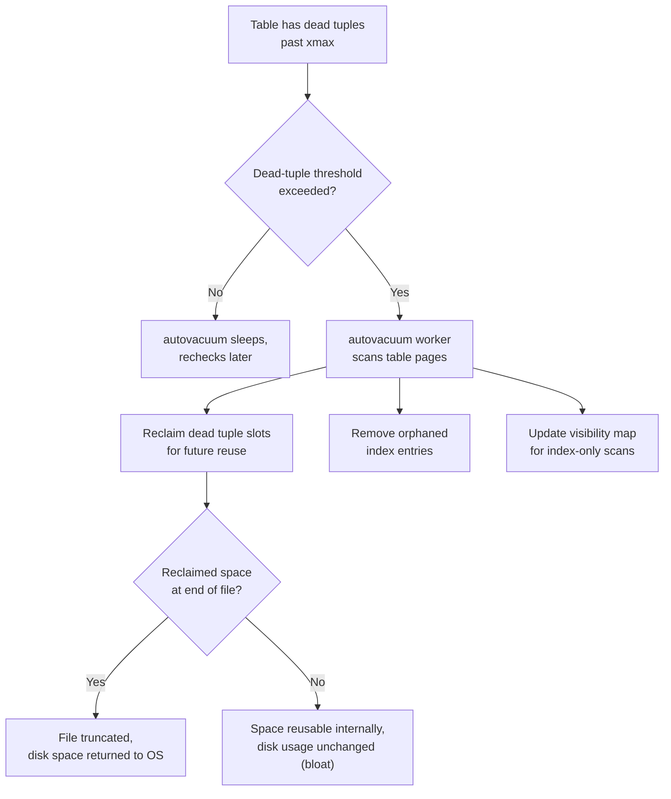

**Decision implications.** VACUUM is not optional maintenance an architect
can defer indefinitely — PostgreSQL also uses it to prevent *transaction ID
wraparound*: transaction IDs are a 32-bit counter, and if the oldest
unvacuumed transaction ID falls too far behind the current counter, older
rows would become ambiguously "in the future" from a wraparound comparison
and effectively invisible, so PostgreSQL forces increasingly aggressive
(and eventually blocking) vacuum behavior as a table approaches this limit,
up to refusing new writes entirely past a hard threshold. Architecturally,
this means autovacuum tuning (per-table
`autovacuum_vacuum_scale_factor`/`autovacuum_vacuum_cost_delay` overrides
for very large or very hot tables) is a first-class capacity-planning
concern, not an afterthought, and that any workload holding long-running or
idle-in-transaction connections (Section 4.1's failure mode) directly
threatens vacuum's ability to keep up.

**Failure mode.** The classic PostgreSQL production incident is "autovacuum
can't keep up": a table's write rate outpaces the default autovacuum
settings (tuned conservatively for small, generic workloads), dead tuples
accumulate faster than they're reclaimed, the table and its indexes bloat
to many times their logical size, sequential and even index scans slow down
because they must skip over ever more dead space, and the fix under
pressure (tightening `autovacuum_vacuum_cost_delay`/`cost_limit`, adding
per-table overrides, or in extreme cases running `pg_repack`) is far more
disruptive than the proactive tuning that would have prevented it.

**Scenario.** A high-write `orders_audit_log` table receiving purely
`INSERT`s (no updates or deletes at all) does *not* need vacuuming for
bloat — inserts don't create dead tuples — but it still needs periodic
vacuuming for the transaction-ID-wraparound protection above and for
statistics freshness (Section 4.14); an architect who assumes
"insert-only means no vacuum needed" will eventually be surprised by a
forced, disruptive wraparound-prevention vacuum on a very large table.

### 4.3 Write-Ahead Log (WAL) Fundamentals

**Definition.** The Write-Ahead Log is a durable, sequential, append-only
record of every change PostgreSQL makes to its data files, written and
flushed to disk *before* the corresponding change to the actual table/index
pages is guaranteed to be on disk — the same durability mechanism generically
described for ACID's Durability property in
[Transactions](CH08_Transactions.md#acid-properties-atomicity-consistency-isolation-durability-and-their-mechanisms),
but this section covers PostgreSQL's specific implementation: WAL records
are grouped into fixed-size (typically 16 MB) *WAL segment* files, a
background *checkpoint* process periodically flushes the actual modified
data pages (not just the log) to disk and records the checkpoint's WAL
position, and crash recovery replays WAL starting from the last completed
checkpoint rather than from the beginning of time.

**Mechanism.** When a transaction commits, PostgreSQL guarantees the WAL
records describing its changes are `fsync`'d to durable storage before
returning success to the client — the modified data pages themselves may
still be sitting only in memory (the shared buffer pool) at that moment,
because writing WAL sequentially is far cheaper than writing scattered data
pages, and the WAL alone is sufficient to reconstruct those pages if the
server crashes before they're flushed. A checkpoint periodically walks the
buffer pool, flushes every dirty (modified-but-not-yet-written) page to its
data file, and records the WAL position at that moment; on crash recovery,
PostgreSQL only needs to replay WAL records from the last checkpoint
forward, because everything before it is guaranteed already on disk.

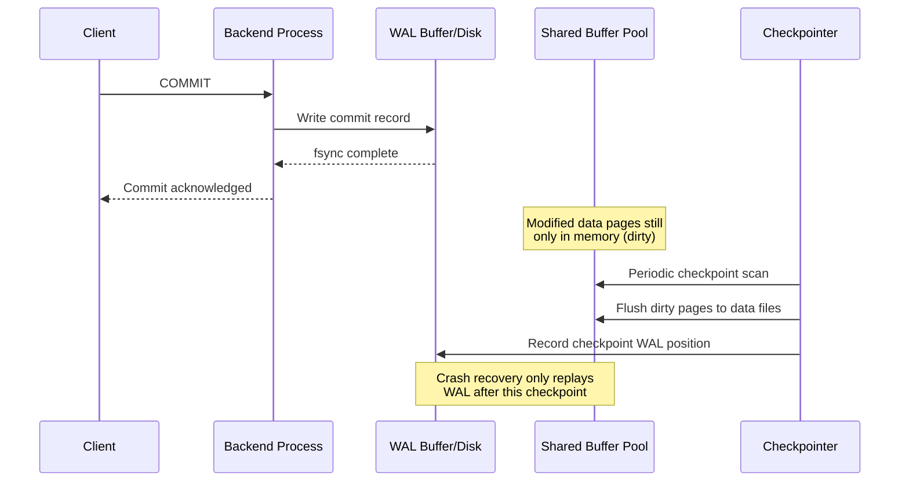

**Decision implications.** `checkpoint_timeout` and `max_wal_size` govern how
often checkpoints run — more frequent checkpoints shorten crash-recovery
time (less WAL to replay) but increase steady-state I/O (more page writes
per unit time, plus *full-page writes*: the first modification to a page
after a checkpoint writes the entire page to WAL, not just the changed
bytes, to protect against torn pages on crash); this is a direct
throughput-vs-recovery-time trade-off an architect tunes based on
Recovery Time Objective (RTO) requirements. WAL is also the mechanism
underlying both physical streaming replication (Section 4.4) and
Point-in-Time Recovery backups, so WAL archiving/retention policy is a
shared dependency across replication topology, disaster recovery, and
storage-capacity planning simultaneously.

**Failure mode.** If WAL segments accumulate faster than they can be
archived or streamed to a replica (Section 4.4) — for example, a replica
falls behind or an archive command starts failing silently — WAL disk usage
grows without bound on the primary until it exhausts disk space and the
database halts entirely; `max_slot_wal_keep_size` and replication-slot
monitoring exist specifically to bound this failure mode (Section 4.4's
failure mode covers the mechanism in more depth).

**Scenario.** A financial services team sets `synchronous_commit = off` on a
reporting-replica-fed workload to reduce commit latency, accepting that a
crash could lose the last few milliseconds of WAL not yet flushed — an
acceptable trade for that workload's durability requirements but one that
must be an explicit, documented decision, not a default left unexamined on
the primary transactional database.

### 4.4 Streaming Replication and Replication Mechanics

**Definition.** PostgreSQL's primary replication mechanism ships WAL records
from a primary server to one or more standby servers, which continuously
replay them to keep their own data files synchronized —
[recapping the generic leader/follower replication model](CH07_Replication.md#leaderfollower-replication-mechanics-wal-shippingstreaming-syncasyncsemi-sync-trade-off),
this section covers PostgreSQL's specific mechanics: the WAL sender/WAL
receiver process pair, replication slots, and the synchronous/asynchronous
knobs PostgreSQL exposes.

**Mechanism.** A standby's `walreceiver` process opens a persistent
connection to the primary's `walsender` process and requests WAL starting
from a given Log Sequence Number (LSN, the byte-offset-based position
identifier for a point in the WAL stream); the primary streams new WAL
records to the standby as they're generated, and the standby's *startup
process* continuously replays them against its own copy of the data files,
which is why a streaming standby is also called a *hot standby* — it can
serve read-only queries against data that lags the primary by typically
milliseconds to a few seconds. A *replication slot* is a primary-side
bookkeeping record that guarantees the primary will retain WAL (and, for
logical slots, an additional snapshot) until the corresponding standby (or
logical subscriber) has confirmed it no longer needs it — solving the
problem of a temporarily disconnected standby needing WAL the primary would
otherwise have already recycled, at the cost (Section 4.3's failure mode)
of unbounded WAL growth if a slot's consumer never reconnects.
`synchronous_commit` and `synchronous_standby_names` control whether a
commit on the primary waits for at least one standby to acknowledge
receiving (or applying) the WAL before returning success to the client —
PostgreSQL's specific implementation of the generic sync/async/semi-sync
spectrum.

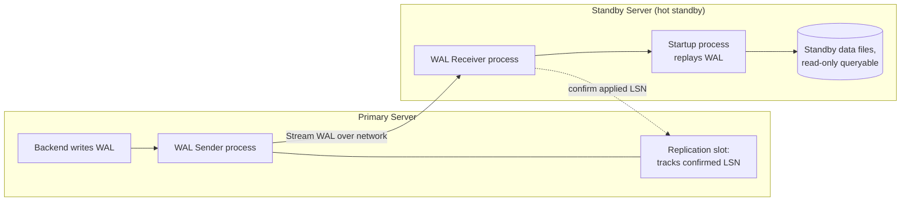

Logical replication (PostgreSQL 10+) works differently: rather than shipping
raw WAL bytes, a *logical decoding* process translates WAL into a stream of
row-level `INSERT`/`UPDATE`/`DELETE` changes for specific published tables,
allowing selective, cross-version, and even cross-database replication —
recapped only briefly here because the generic publish/subscribe model this
enables is the same one
[Replication's leaderless/quorum section](CH07_Replication.md#leaderlessquorum-based-replication-dynamo-style-nwr-sloppy-quorum-hinted-handoff-read-repair)
discusses at the distributed-systems level; PostgreSQL's contribution is
specifically the logical-decoding mechanism that makes selective, per-table
replication possible from a single-writer WAL stream.

**Decision implications.** Choosing streaming (physical) vs. logical
replication is an architectural decision with real constraints: physical
streaming replicates the *entire* cluster byte-for-byte (simpler, lower
overhead, but standby must match the primary's major version and cannot
diverge in schema), while logical replication replicates specific tables at
the row level (enables selective replication, zero-downtime major-version
upgrades, and different indexes/schema on the subscriber, at the cost of
higher CPU overhead for decoding and the need to separately handle
sequences and DDL, which logical replication does not automatically
propagate).

**Failure mode.** A replication slot left behind after a standby is
decommissioned (a common operational mistake — dropping the standby server
without also dropping its slot on the primary) causes the primary to retain
WAL indefinitely for a subscriber that will never reconnect, silently
filling disk until the primary itself becomes unable to accept writes;
alerting on "replication slot retained WAL size" is a standard PostgreSQL
production safeguard.

**Scenario.** A team runs one synchronous standby (for zero-data-loss
failover) and two asynchronous standbys in different Availability Zones
(AZs) purely for read-scaling — `synchronous_standby_names` names only the
first, so a commit waits for that one acknowledgment while the two
read-replicas apply WAL best-effort, giving the team a deliberate
durability/latency trade-off calibrated per-standby rather than uniformly.

### 4.5 Extension Architecture

**Definition.** A PostgreSQL extension is a packaged unit of SQL objects
(functions, operators, types, index access methods, and/or C-language
shared libraries) that `CREATE EXTENSION` installs into a specific database,
versioned and upgradeable as a unit, without requiring any change to
PostgreSQL's own core source code.

**Mechanism.** Extensions register through a well-defined set of extension
points PostgreSQL's core exposes: new scalar and composite *data types*
(PostGIS's `geometry`/`geography` types), new *operators* and *operator
classes* that teach an index access method how to compare a new type
(PostGIS teaches GiST, Section 4.7, how to compare bounding boxes; `pg_trgm`
teaches GIN, Section 4.6, how to compare trigram sets), entirely new
*index access methods* (an extension can, in principle, add a new kind of
index PostgreSQL didn't previously have), and C-language functions loaded
as shared libraries (`.so`/`.dll` files) that run inside the PostgreSQL
backend process itself for near-native performance. `CREATE EXTENSION
postgis;` reads a control file describing the extension's version and an
SQL script that creates all of its objects inside the target database;
extension versions can be upgraded independently of the PostgreSQL server
version via `ALTER EXTENSION ... UPDATE`.

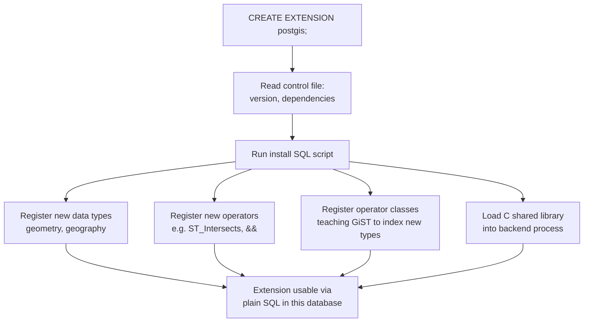

**Decision implications.** The extension architecture is the direct
mechanical reason PostGIS (spatial queries: distance, containment,
intersection over geometric/geographic types), `pg_trgm` (trigram-based
fuzzy text matching and similarity search), `pg_stat_statements`
(query-level performance statistics), `uuid-ossp`/`pgcrypto` (Universally
Unique Identifier (UUID) generation and cryptographic functions), and
Citus (transparent distributed-table sharding, recapping
[Sharding](CH06_Sharding.md) but implemented as an extension rather than a
forked engine) can all exist as *add-ons* to a single, shared core rather
than as forked, divergent database products — an architect choosing
PostgreSQL for a spatial or search-heavy workload should evaluate whether an
existing, mature extension already solves the problem before reaching for a
separate specialized database, because doing so keeps a single transactional
and consistency boundary rather than introducing a second system with its
own replication and consistency story.

**Failure mode.** Extensions that include C shared libraries run inside the
same backend process as core PostgreSQL — a buggy or malicious extension
can crash the entire backend, corrupt shared memory, or (in a
security-sensitive multi-tenant context) escape the SQL-level permission
model entirely, which is why most managed PostgreSQL cloud offerings (AWS
RDS/Aurora, Azure Database for PostgreSQL, GCP Cloud SQL) only allow a
curated allow-list of vetted extensions rather than arbitrary
`CREATE EXTENSION` from any shared library on disk.

**Scenario.** A logistics platform needs "find all warehouses within 10
kilometers of this delivery address" — rather than building geographic
distance calculations in application code or standing up a separate spatial
database, the team runs `CREATE EXTENSION postgis;` on their existing
PostgreSQL cluster, adds a `geography` column, builds a GiST index on it
(Section 4.7), and expresses the query as
`WHERE ST_DWithin(warehouse_location, delivery_point, 10000)` — a single
transactional database now serves both the order-processing OLTP workload
and the spatial query, with one consistency boundary instead of two systems
to keep in sync.

### 4.6 GIN Indexes

**Definition.** A Generalized Inverted Index (GIN) is an index structure
optimized for values that contain *multiple component keys per row* — an
array, the set of lexemes in a full-text `tsvector`, the set of trigrams in
a string (via `pg_trgm`), or the set of keys/values in a JSONB document
(Section 4.10) — where a query asks "which rows contain this specific
component" rather than "which rows fall in this range."

**Mechanism.** GIN builds an inverted index: for every distinct component
key across the whole column (every distinct array element, every distinct
lexeme, every distinct trigram), it stores a sorted *posting list* of the
row locations (`ctid`s) containing that key, structured internally as a
B-tree over the component keys for fast lookup of any specific key's
posting list. A query like `WHERE tags @> ARRAY['postgresql']` (array
contains) or `WHERE document_vector @@ to_tsquery('database & index')`
(full-text search) is answered by looking up the posting lists for the
relevant component keys directly, then intersecting or unioning them,
rather than scanning every row's full array/document. GIN also supports a
*pending list* (a small, unsorted staging area for recent inserts) so
individual `INSERT`s don't have to immediately update the (potentially
large) sorted posting-list structure — a background or `VACUUM`-triggered
process periodically merges the pending list into the main structure.

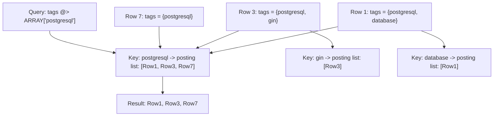

**Decision implications.** GIN is the correct choice whenever a column's
query pattern is "contains this element/key" rather than "sorts/ranges
around this scalar value" — arrays, full-text search, JSONB containment
(`@>`), and trigram similarity all fit this shape, and none of them are
efficiently servable by a plain B-tree ([recapped generically as the
default index structure in Indexes](CH03_Indexes.md#b-tree--btree-index-structure-fanout-leaf-linking-node-splitmerge)).
GIN indexes are read-optimized and write-heavier than B-tree: every insert
potentially touches many posting lists (one per component key), which is
exactly why the pending-list buffering mechanism exists to amortize that
cost.

**Failure mode.** A team building a full-text search feature builds a GIN
index but leaves `gin_pending_list_limit` at a very large default on a
high-insert-rate table, so the pending list itself grows large enough to
slow down queries that must also scan it — the standard mitigation is
either tuning that limit lower (more frequent small merges) or scheduling
proactive `VACUUM` on the table rather than relying purely on the
size-triggered merge.

**Scenario.** A support-ticketing system needs "find all tickets whose
description contains any of these customer-reported keywords" —
`to_tsvector('english', description)` combined with a GIN index and
`@@ to_tsquery(...)` turns what would otherwise be a `LIKE '%keyword%'` full
table scan into a posting-list lookup, the standard PostgreSQL pattern for
in-database full-text search without a separate search engine for
moderate-scale needs.

### 4.7 GiST Indexes

**Definition.** A Generalized Search Tree (GiST) is a balanced tree index
access method, like a B-tree, but generalized to support arbitrary
user-defined comparison and "consistency" predicates instead of only strict
ordering — making it the access method PostGIS uses for spatial containment
and nearest-neighbor queries, and also usable for range types, full-text
similarity ranking, and exclusion constraints.

**Mechanism.** Each internal GiST node stores a *predicate* summarizing
everything beneath it — for spatial data, this is a *bounding box*
(the smallest rectangle containing every geometry in that subtree); a
query descends the tree by checking, at each node, whether the query's
predicate (for example, "does this bounding box overlap my search area?")
could possibly be satisfied by anything in that subtree, pruning entire
subtrees whose bounding box cannot overlap, and only descending into
subtrees whose bounding box might contain a match. Unlike a B-tree, where a
node's key range is exact, a GiST node's bounding predicate is a lossy
*over-approximation* — it may cause the search to descend into a subtree
that ultimately contains no exact match (a false positive at the tree-node
level, corrected by the final exact check on the actual row), but it must
never cause the search to skip a subtree that does contain a match (no
false negatives) — this "lossy but sound" property is what lets a single
generic tree structure serve wildly different data types by supplying
different bounding-predicate and consistency functions.

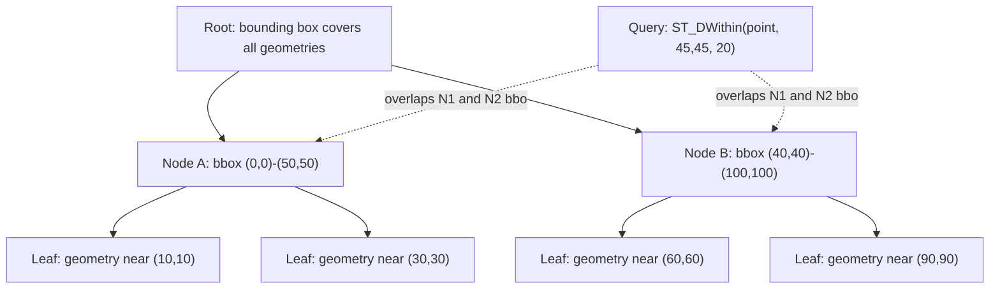

**Decision implications.** GiST is the right structure whenever "range" or
"overlap" has no single natural sort order — two-dimensional geometry has
no total order that makes a B-tree meaningful, but GiST's bounding-box
approach handles it naturally; this is also why PostgreSQL's `EXCLUDE`
constraints (preventing overlapping date ranges for the same resource, for
example) are implemented on top of GiST rather than a unique B-tree index,
since "no two rows may have overlapping ranges" is fundamentally a
spatial-style predicate over one-dimensional intervals.

**Failure mode.** GiST index build and lookup performance depends heavily
on how tight (non-overlapping) the bounding boxes at each level actually
are — highly overlapping or degenerate geometry (many huge, overlapping
polygons, or clustered near-duplicate points) produces bounding boxes that
overlap each other extensively, forcing the search to descend into many
subtrees per query and degrading toward a near-full scan; PostGIS-specific
tuning (geometry simplification, choosing appropriate SRID/projection) and
periodic `REINDEX` after heavy churn are the standard responses.

**Scenario.** A ride-sharing platform indexes driver locations with a GiST
index on a `geography` column and answers "find the 5 nearest available
drivers to this pickup point" via `ORDER BY location <-> pickup_point LIMIT
5` — GiST's k-nearest-neighbor (KNN) support lets the index itself return
candidates in distance order rather than requiring a post-hoc sort over a
full scan.

### 4.8 BRIN Indexes

**Definition.** A Block Range Index (BRIN) stores, for each contiguous
range of physical table pages (a "block range," typically 128 pages by
default), only a small summary — for a numeric or date column, the minimum
and maximum value observed anywhere in that block range — rather than an
entry per row.

**Mechanism.** Because BRIN stores one tiny summary per block range instead
of one entry per row, a BRIN index is often orders of magnitude smaller
than an equivalent B-tree — frequently small enough to fit entirely in
memory even over a multi-terabyte table. A query with a range predicate
(`WHERE created_at BETWEEN ... AND ...`) checks each block range's
min/max summary: if the predicate's range cannot possibly overlap that
block range's min/max, the scan skips the *entire* block range without
reading a single page; if it might overlap, the scan must still read every
page in that block range and check rows individually (BRIN is a *lossy*
index — it prunes at block-range granularity, not row granularity, unlike
a B-tree's exact per-row pointers).

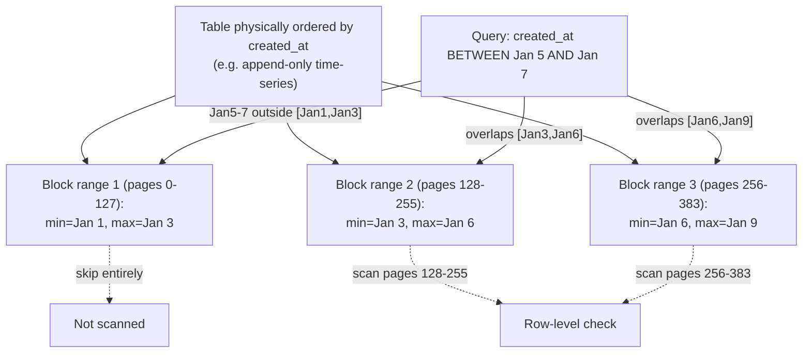

**Decision implications.** BRIN's effectiveness depends entirely on
*physical correlation* between the indexed column and the table's actual
on-disk row order — it is the ideal, near-free-storage-cost index for
naturally append-ordered data (time-series tables where `created_at`
increases monotonically with physical insertion order, monotonically
increasing surrogate keys), where a B-tree's exact per-row precision would
cost far more storage for the same range-query benefit. It is a poor choice
for a column with no physical correlation to insertion order (a
`customer_id` in a table not clustered by customer), because every block
range's min/max would span nearly the entire value domain, defeating the
pruning benefit entirely.

**Failure mode.** A table that is later re-ordered by an out-of-order bulk
load, a `VACUUM FULL`, or simply years of interleaved `UPDATE`-driven
tuple relocation (Section 4.1) can lose the physical correlation a BRIN
index depends on, silently degrading BRIN from "skip most block ranges" to
"scan almost every block range" without any error or obvious signal — a
periodic `pg_stats.correlation` check on BRIN-indexed columns is the
standard way to catch this before query latency regresses.

**Scenario.** A metrics-ingestion table appending millions of
`(sensor_id, recorded_at, value)` rows per day, always inserted in
`recorded_at` order, uses a BRIN index on `recorded_at` instead of a
B-tree: the index costs a few hundred kilobytes instead of gigabytes even
over billions of rows, and a "show me last hour's readings" query prunes
nearly the entire table via block-range min/max checks before touching a
single data page.

### 4.9 Partial and Expression Indexes

**Definition.** A partial index includes only the subset of a table's rows
matching a `WHERE` predicate specified at index-creation time, rather than
every row; an expression index indexes the result of a function or
expression applied to one or more columns, rather than a column's raw
value, letting an index directly serve queries that filter or sort by that
computed expression.

**Mechanism.** `CREATE INDEX ON orders (customer_id) WHERE status =
'pending';` builds a B-tree containing entries only for rows currently
satisfying `status = 'pending'` — every insert, update, or delete on the
table checks the predicate and only maintains the index entry if the
predicate currently holds, so the index stays small and cheap to maintain
even if the table itself is enormous and "pending" rows are a tiny,
constantly-churning fraction of it. `CREATE INDEX ON users
(lower(email));` builds a B-tree over the *result* of `lower(email)` for
every row, letting a query written as `WHERE lower(email) = 'user@x.com'`
use the index directly — the planner recognizes the query's expression
matches the indexed expression and substitutes an index scan instead of
computing `lower(email)` for every row in a sequential scan.

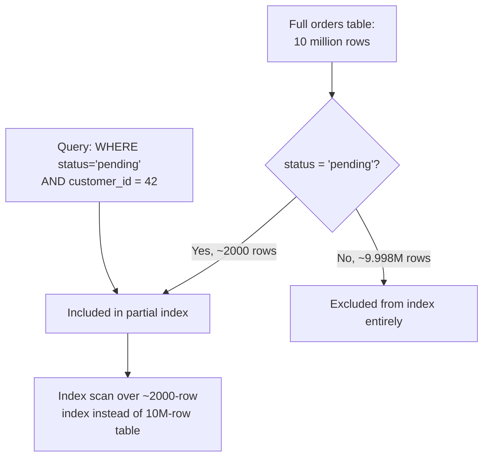

**Decision implications.** Partial indexes are the standard fix for
"index-everything" bloat when a query pattern only ever cares about a small,
well-defined subset of rows (pending orders, active sessions, un-soft-
deleted records, non-null values in an otherwise sparse column) — they cost
far less write overhead and disk space than a full index on the same
column while serving the actual query pattern just as fast, and they
directly address one half of the generic
[index write-amplification concern](CH03_Indexes.md#index-selectivity-and-cardinality-estimation-index-maintenance-costwrite-amplification)
by shrinking the maintained index size rather than accepting the full
column's write cost. Expression indexes are the standard fix for
"the query always wraps the column in a function" — without one, that
wrapping defeats even a plain B-tree on the raw column, because the index
is sorted by raw values, not by the function's output.

**Failure mode.** A partial index's predicate must match the query's
`WHERE` clause closely enough for the planner to prove the index covers
it — a query written as `WHERE status = 'pending' OR status = 'processing'`
will *not* use a partial index defined only for `status = 'pending'`,
because the planner cannot prove every row the broader predicate could
match is present in the narrower index; mismatched or overly specific
partial-index predicates are a common cause of "I built an index but the
planner won't use it."

**Scenario.** A multi-tenant SaaS (Software as a Service) platform soft-
deletes rows via a `deleted_at` timestamp instead of physically deleting
them; a partial index `CREATE INDEX ON records (tenant_id, created_at)
WHERE deleted_at IS NULL;` keeps the vast majority of day-to-day queries
(which only ever look at non-deleted rows) fast and the index small, while
the rarely-queried soft-deleted history remains fully present in the table
without bloating the primary operational index.

### 4.10 JSONB (Binary JSON) Support

**Definition.** JSONB is PostgreSQL's binary, decomposed storage format for
JSON documents — distinct from the plain `json` type, which stores an
exact text copy of the input including whitespace and key order — that
parses JSON once at write time into a structure optimized for later
querying, at the cost of not preserving the exact original text
representation.

**Mechanism.** On `INSERT`, PostgreSQL parses the JSON text into an
in-memory tree and re-serializes it into JSONB's binary layout: object keys
are stored sorted and de-duplicated (later duplicate keys silently win, and
key order is not preserved), scalar values are stored in native binary
form (not re-parsed as text on every read), and the whole structure is
stored in a way that supports direct containment (`@>`) and key-existence
(`?`) operators without re-parsing the entire document for each check.
Because parsing happens once at write time rather than on every read,
JSONB read/query performance is materially better than plain `json` for
any workload that queries the document more often than it writes it — true
for the overwhelming majority of real applications. A GIN index (Section
4.6) can be built directly over a JSONB column, using either the default
operator class (indexing every key and value, supporting `@>`, `?`, `?|`,
`?&`) or `jsonb_path_ops` (a narrower operator class indexing only
value-hash paths, supporting only `@>` but producing a smaller, faster
index for that specific operator).

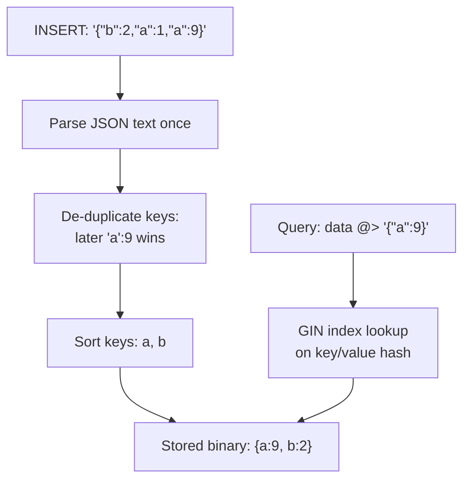

**Decision implications.** JSONB lets a schema carry genuinely
semi-structured or sparse, evolving attributes (a product's variant
attributes that differ per category, a webhook payload's variable-shaped
metadata) inside an otherwise fully relational, ACID-transactional table,
without either forcing every possible attribute into its own nullable
column or standing up a separate document database — an architect should
still apply the same judgment
[Denormalization's cost model](CH02_Denormalization.md#write-amplification--staleness-trade-off-general-denormalization-cost-model)
teaches generically: JSONB fields that are queried and filtered on
frequently deserve their own indexed, typed columns (or at minimum a GIN
index plus expression indexes on hot paths), while JSONB fields that are
only ever fetched whole and rendered by the application are a legitimate,
low-overhead use of the format.

**Failure mode.** Treating JSONB as a schema-less escape hatch for
*everything* — storing what should be well-defined, individually
queryable, foreign-key-constrained relational columns as nested JSONB
instead — sacrifices the query planner's ability to use targeted indexes
and statistics (Section 4.14) on those individual attributes, sacrifices
foreign-key and check-constraint enforcement at the database level, and
typically produces slower, harder-to-optimize queries than the equivalent
normalized schema
([Normalization's anomaly-prevention rationale](CH01_Normalization.md#normal-form-violation-detection-audit-methodology-updateinsertdelete-anomaly-taxonomy)
still applies even inside a JSONB column's contents).

**Scenario.** An analytics-events table stores a `properties` JSONB column
whose shape varies per event type (`page_view` events have a `url`
property, `purchase` events have `amount`/`currency`); a GIN index with
`jsonb_path_ops` on `properties` supports fast `properties @> '{"event_type":
"purchase"}'`-style filtering across billions of heterogeneous event rows
without needing a rigid, ever-growing column schema for every possible
event-type's fields.

### 4.11 Table Partitioning Implementation

**Definition.** PostgreSQL's declarative partitioning (`PARTITION BY
RANGE`/`LIST`/`HASH`) implements the generic horizontal-partitioning
concept
([recapped from Partitioning](CH05_Partitioning.md#horizontal-partitioning-rangelisthash-strategies-and-partition-key-selection-framework))
as native engine functionality: a *partitioned table* is a schema-level
parent with no storage of its own, and each *partition* is a real, physical
table bound to the parent by a partition-bound expression the planner
understands and can reason about directly.

**Mechanism.** Declarative partitioning replaced the older inheritance-plus-
trigger pattern (a parent table plus child tables linked by `INHERITS`,
with an `INSERT` trigger routing rows manually) by making partition routing
and pruning first-class planner behavior: on `INSERT`, PostgreSQL evaluates
the new row's partition-key value against each partition's declared bounds
and routes it directly to the matching partition's physical storage,
without a trigger; on `SELECT`, the planner performs *partition pruning* at
plan time (or, for parameterized queries where the bound isn't known until
execution, at execution time) by comparing the query's `WHERE` predicate
against each partition's declared bounds and eliminating any partition the
predicate cannot possibly match, before ever touching that partition's
data — the same partition-pruning behavior generically described in
[Partitioning](CH05_Partitioning.md#vertical-partitioning-partition-pruning),
implemented here specifically via bound-comparison at the planner level
rather than a post-hoc filter.

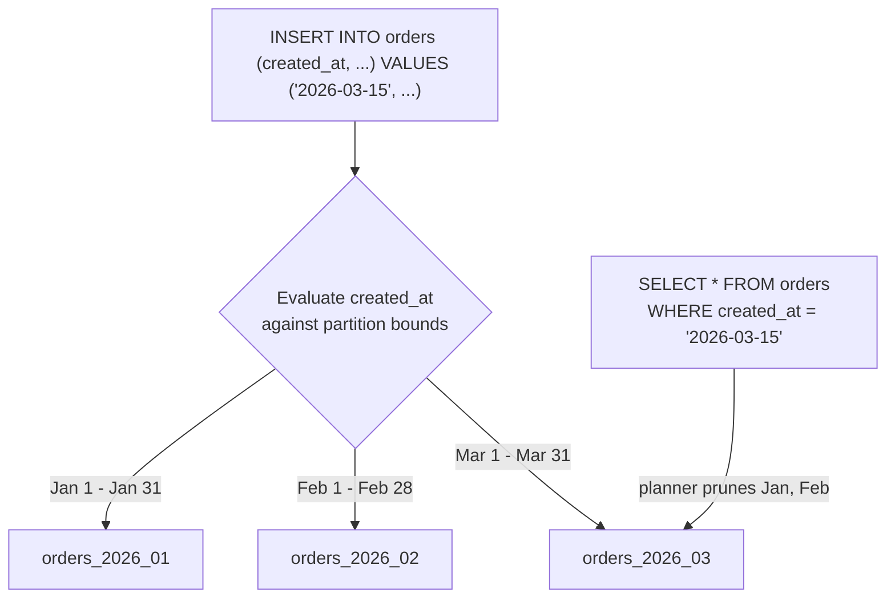

Each partition can have its own indexes, its own `fillfactor`, and even its
own tablespace ([recapping storage tiering from
Partitioning](CH05_Partitioning.md#partition-maintenancerolling-window-pattern-local-vs-global-indexes-composite-sub-partitioning-storage-tiering)),
and `ATTACH PARTITION`/`DETACH PARTITION` let an architect add a new
month's partition or retire an old one as a fast metadata operation instead
of a slow row-by-row delete — the same rolling-window retention pattern
Partitioning teaches generically, using PostgreSQL's specific
attach/detach mechanism.

**Decision implications.** Partitioning interacts directly with Section
4.1's MVCC/bloat model and Section 4.2's VACUUM: because each partition is
a genuinely separate physical table, `VACUUM` and autovacuum operate on
individual partitions independently, which means a rolling time-partitioned
table's oldest, cold partitions naturally stop needing vacuum attention
once their data stops changing, while the newest, hot partition gets
proportionally more autovacuum attention — a partitioning strategy chosen
around access pattern (as Partitioning's chapter teaches generically) also
happens to align vacuum cost with actual write activity in PostgreSQL
specifically.

**Failure mode.** A query whose `WHERE` clause does not directly reference
the partition key in a form the planner can statically evaluate — for
example, filtering on a function of the partition key the planner cannot
prove is monotonic, or joining against a value only known at execution
time without `enable_partitionwise_join` — silently defeats partition
pruning, and the query ends up scanning every partition, which negates the
entire performance rationale for partitioning; `EXPLAIN` (Section 4.14)
showing every partition listed under the scan node, instead of only the
expected ones, is the standard way to catch this.

**Scenario.** A telemetry platform partitions its `events` table by
`RANGE (recorded_at)` in monthly partitions, `ATTACH`es a new partition
automatically each month via a scheduled job, and `DETACH`es (then archives
to cold object storage) partitions older than the retention window — a
direct application of Partitioning's rolling-window pattern using
PostgreSQL's specific attach/detach primitives instead of a row-by-row
delete job.

### 4.12 Process-Per-Connection Model

**Definition.** PostgreSQL forks a dedicated operating-system process for
every client connection — not a thread within a shared server process, as
several competing engines use — meaning each connected client is backed by
its own memory space, its own `PID` (process ID), and its own share of
per-connection memory overhead for the lifetime of that connection.

**Mechanism.** When a client connects, the PostgreSQL `postmaster` (the
supervisor process) forks a new *backend process* dedicated to that
connection; that backend process handles every query the client sends for
as long as the connection stays open, then exits when the client
disconnects. This design, inherited from PostgreSQL's original 1990s
architecture, gives strong process-level isolation (one backend crashing
from a bug or a segfaulting extension does not corrupt another connection's
memory) at a real cost: forking a full OS process is materially more
expensive than spawning a thread, each backend consumes several megabytes
of baseline memory (its portion of shared buffers plus per-backend
work_mem/temp buffers) even when idle, and the OS scheduler must
context-switch across however many backend processes are active, which
degrades noticeably once concurrent connection counts reach the low
thousands on typical hardware — a defined, empirically observed ceiling far
lower than the connection counts a thread-per-connection or
event-loop-based server could sustain.

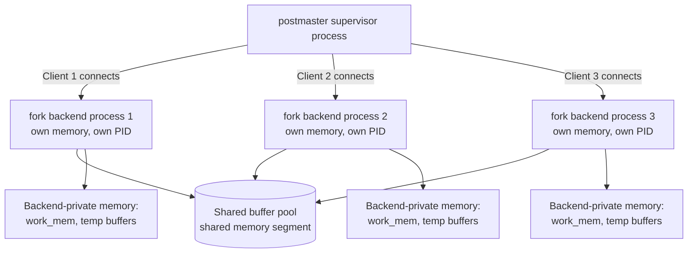

**Decision implications.** This is the direct architectural reason
`max_connections` cannot simply be set to an arbitrarily large number "to be
safe" — every additional permitted connection is additional worst-case
memory and scheduling overhead whether or not it is actually used
concurrently, so an architect must size `max_connections` around genuinely
expected peak concurrent query load, not around the total number of
application instances that might each want a connection, and must instead
solve "many application instances, few genuinely concurrent queries" with
connection pooling (Section 4.13) rather than raising `max_connections`
further.

**Failure mode.** An application layer that opens one PostgreSQL connection
per incoming HTTP request (rather than reusing a pool) under moderate
traffic can exhaust `max_connections` well before the database's actual
query-processing capacity is saturated, causing new connection attempts to
be rejected outright — a "connection limit reached" outage caused by
connection *churn*, not by genuine query load, is one of the most common
PostgreSQL production incidents traced directly back to this process model.

**Scenario.** A team migrating from a thread-per-connection engine to
PostgreSQL initially configures their application's connection pool size
equal to what worked fine on the old engine (several hundred per
application instance, multiplied across dozens of instances) and discovers
the aggregate exceeds a reasonably-sized `max_connections` by an order of
magnitude — the fix is not raising `max_connections` to match, but
introducing PgBouncer (Section 4.13) between the application fleet and the
database.

### 4.13 Connection Pooling Reality: PgBouncer

**Definition.** PgBouncer is a lightweight, single-purpose connection
pooler that sits between client applications and PostgreSQL, maintaining a
small, bounded pool of actual backend-process connections to PostgreSQL
while accepting a much larger number of client-facing connections, reusing
the small pool across many more logical client sessions than PostgreSQL
itself would ever host directly.

**Mechanism.** PgBouncer supports three pooling modes with materially
different guarantees. *Session pooling* assigns a client a dedicated
PostgreSQL backend connection for the client's entire session (closest to
connecting directly to PostgreSQL, safest for session-level features like
prepared statements and `SET` variables, but provides the least connection
multiplexing benefit). *Transaction pooling* assigns a PostgreSQL backend
connection to a client only for the duration of a single transaction,
returning it to the pool the instant that transaction commits or rolls
back — this is the mode that delivers PgBouncer's real value, letting a
small pool of, say, 50 backend connections serve thousands of client-facing
connections whose transactions are individually short, but it breaks any
feature that depends on backend-connection state persisting across
transactions (session-level advisory locks, `SET` outside a transaction,
and any use of `PREPARE`/named prepared statements unless the pooler and
driver are specifically configured to handle them). *Statement pooling* is
the most aggressive mode, returning the backend connection after every
individual statement even within a transaction, and is rarely usable for
general application workloads because it breaks multi-statement
transactions entirely.

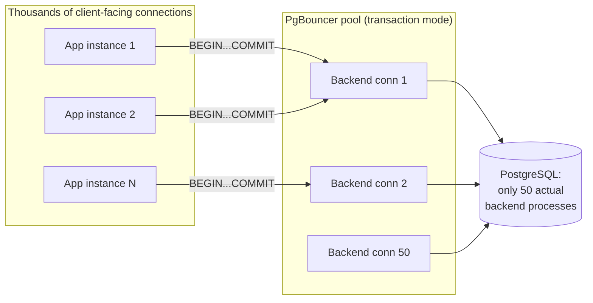

**Decision implications.** Transaction-mode pooling is the standard
production choice specifically because it directly compensates for Section
4.12's process-per-connection cost model: it decouples "number of
application-side logical connections" from "number of expensive PostgreSQL
backend processes," letting a fleet of many application instances share a
small, fixed backend-process footprint sized around actual concurrent query
load rather than around total client count. An architect adopting
transaction-mode pooling must explicitly audit application code (and ORM
configuration) for session-state assumptions that mode breaks — most
commonly, disabling client-side prepared-statement caching or configuring
the driver to use unnamed/protocol-level prepared statements instead.

**Failure mode.** A team enables transaction-mode pooling without auditing
their ORM's prepared-statement behavior, and intermittent, hard-to-reproduce
errors appear in production ("prepared statement already exists" or
queries silently returning stale plans) because the ORM assumed its
prepared statements would persist on a stable backend connection across
requests — a well-known PgBouncer adoption pitfall that surfaces only
under concurrent load, not in initial testing with a single connection.

**Scenario.** An API service handling 5,000 requests per second across 200
application instances, each historically configured for a 20-connection
pool (4,000 total direct connections, far beyond a sane `max_connections`),
is fronted by a PgBouncer tier configured for transaction-mode pooling with
100 actual backend connections to PostgreSQL — because each request's
database work is a single short transaction, the 100 backend connections
comfortably serve the full request rate, and PostgreSQL itself never sees
more than 100 processes regardless of how many application instances scale
out.

### 4.14 Query Planner Specifics: Cost-Based Optimization and `EXPLAIN ANALYZE`

**Definition.** PostgreSQL's planner is a cost-based optimizer — the same
generic cost-based-optimization concept
[owned by Query Optimizers](CH04_Query_Optimizers.md#cost-based-query-optimization-vs-rule-based-query-processing-pipeline-parsebindrewriteoptimizeexecute) —
that estimates the resource cost (an abstract unit combining estimated disk
page fetches and CPU cycles, calibrated by tunable *planner cost
constants*) of each candidate execution plan for a query and chooses the
lowest-estimated-cost plan, using `EXPLAIN` and `EXPLAIN ANALYZE` as the
primary tools for inspecting exactly which plan it chose and why.

**Mechanism.** The planner's cost estimates depend on table and column
statistics (row count, most-common values, histogram of value distribution,
correlation with physical storage order) collected by `ANALYZE` (run
automatically as part of autovacuum, Section 4.2, or manually) — these
statistics, not the live data itself, are what the planner consults when
estimating how many rows a given predicate will match, so stale statistics
after a large data change (a bulk load, a mass update) are a direct,
mechanical cause of bad plan choices, independent of any bug in the planner
itself. Planner cost constants (`seq_page_cost`, `random_page_cost`,
`cpu_tuple_cost`, `cpu_index_tuple_cost`, and others) let an architect tune
the cost model toward the actual storage hardware — `random_page_cost`'s
classic default of 4.0 (reflecting spinning-disk seek cost relative to
sequential reads) is frequently lowered toward 1.1-2.0 on all-flash storage,
where random and sequential I/O costs are much closer, directly changing
whether the planner favors an index scan or a sequential scan for
borderline-selectivity queries. `EXPLAIN` shows the *estimated* plan and
cost without running the query; `EXPLAIN ANALYZE` actually executes the
query and shows *actual* row counts and timing alongside the estimates,
and the single most important skill in reading its output is comparing
estimated vs. actual row counts at each node — a large divergence is the
clearest, most direct signal of stale or insufficient statistics, and is
the same estimated-vs-actual reading discipline
[Query Optimizers teaches generically](CH04_Query_Optimizers.md#explainexecution-plan-reading-model-plan-caching-and-parameter-sniffing),
applied here to PostgreSQL's specific `EXPLAIN ANALYZE` output format
(`Seq Scan`, `Index Scan`, `Index Only Scan`, `Bitmap Heap Scan`/`Bitmap
Index Scan`, `Nested Loop`, `Hash Join`, `Merge Join`, each annotated with
`(cost=... rows=... width=...)` estimates and, under `ANALYZE`,
`(actual time=... rows=... loops=...)` measurements).

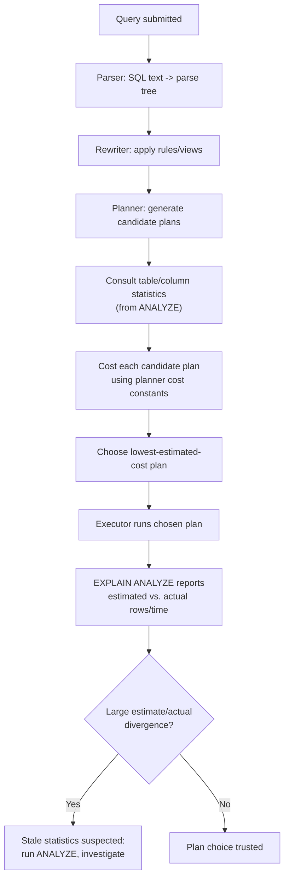

PostgreSQL also has a *genetic query optimizer* (GEQO) that automatically
takes over from exhaustive join-order search
([recapping Query Optimizers' join-order-search
section](CH04_Query_Optimizers.md#join-order-search-dynamic-programming--greedy-heuristics))
once a query joins more tables than `geqo_threshold` (12 by default) —
below that threshold, the planner exhaustively evaluates join orders via
dynamic programming exactly as Query Optimizers describes generically;
above it, GEQO uses a randomized genetic-algorithm search to find a good
(not necessarily optimal) join order in reasonable planning time, trading
plan optimality for planning-time bounded behavior on very wide joins.

**Decision implications.** Because plan quality is only as good as the
statistics behind it, an architect operating PostgreSQL at scale must treat
statistics freshness as an explicit operational concern — tuning
`default_statistics_target` (the sample size/histogram bucket count
`ANALYZE` uses per column, raisable per-column for skewed, high-cardinality
columns the planner routinely misjudges) and ensuring autovacuum's
`ANALYZE` triggers keep pace with write-heavy tables, exactly as Section
4.2 already establishes for `VACUUM` itself. Understanding `random_page_cost`
and `seq_page_cost`'s relationship to real storage hardware is a concrete,
actionable performance lever most teams never touch, defaulting instead to
values calibrated for 1990s spinning disks.

**Failure mode.** *Parameter sniffing* — a plan cached for a prepared
statement's first execution, based on that first call's particular
parameter values, being reused for subsequent calls whose parameter values
have a very different selectivity — is the same generic failure mode
[Query Optimizers already teaches](CH04_Query_Optimizers.md#explainexecution-plan-reading-model-plan-caching-and-parameter-sniffing);
PostgreSQL's specific manifestation is through `PREPARE`d statements and
the planner's `plan_cache_mode` setting, which by default switches from
re-planning every execution to reusing a single generic plan after five
identical executions — a query performing well for its first several
calls and then suddenly regressing is a recognizable PostgreSQL-specific
symptom of this switch.

**Scenario.** A bulk data-migration job inserts ten million rows into a
previously near-empty table in a single transaction; because autovacuum's
`ANALYZE` had not yet run against the new data, the very next query against
that table uses statistics reflecting the old near-empty state, badly
underestimates the row count, chooses a nested-loop join expecting a
handful of rows, and the query takes minutes instead of milliseconds — the
fix is running `ANALYZE` explicitly as the final step of any bulk-load
job, not waiting for autovacuum's next scheduled pass.

## 5. Internal Working

Section 4 introduced each mechanism individually; this section traces how
they interact end-to-end for a single, representative write followed by a
read, showing PostgreSQL's storage engine as one coherent system rather
than a list of independent features.

```mermaid
sequenceDiagram
    participant App as Application
    participant PgB as PgBouncer
    participant BE as Backend Process
    participant WAL as WAL
    participant Heap as Heap Pages
    participant Idx as Indexes (B-tree/GIN/GiST/BRIN)
    participant AV as Autovacuum

    App->>PgB: BEGIN; UPDATE orders SET status=...
    PgB->>BE: Route to pooled backend connection
    BE->>Heap: Read current tuple version (MVCC snapshot check)
    BE->>WAL: Write new-tuple + old-tuple-xmax WAL record
    BE->>Heap: Write new tuple (old tuple's xmax set, not removed)
    BE->>Idx: Update index entries for new tuple location
    App->>PgB: COMMIT
    BE->>WAL: fsync commit record
    BE-->>App: Commit acknowledged
    Note over Heap: Old tuple now "dead"<br/>but still occupies space
    AV->>Heap: Later: scan, reclaim dead tuple, update visibility map
    AV->>Idx: Remove orphaned index entries
```

Reading this trace end-to-end: the application's logical connection is
mediated by PgBouncer (Section 4.13), which maps it onto one of a small,
bounded pool of real PostgreSQL backend processes (Section 4.12); the
backend applies MVCC's copy-on-write update semantics (Section 4.1),
recording the change durably in WAL before acknowledging commit (Section
4.3) — the same WAL stream that a standby server would be consuming for
replication (Section 4.4) if one existed; the old tuple version becomes
dead space that autovacuum (Section 4.2) will later reclaim, and every
index type covered in Sections 4.6-4.9 must independently track that the
row's physical location changed. A subsequent `SELECT` against this table
goes through the planner (Section 4.14), which chooses among a sequential
scan, a B-tree/BRIN range scan, or a GIN/GiST lookup based on cost
estimates derived from statistics that must themselves stay fresh via the
same autovacuum/`ANALYZE` cycle.

## 6. Design Principles

- **MVCC first, locking second.** PostgreSQL's default posture is to avoid
  blocking wherever a consistent snapshot can substitute for a lock;
  architects should default to this posture too, reaching for explicit
  locking ([recapped from Locking](CH10_Locking.md#pessimistic-vs-optimistic-concurrency-control))
  only when an invariant genuinely cannot be expressed as a single atomic
  statement or `SERIALIZABLE` retry loop.
- **Durability is layered, not monolithic.** WAL provides crash durability;
  streaming replication provides node-loss durability; backups provide
  region/catastrophic-loss durability — design each layer's Recovery Point
  Objective (RPO)/RTO explicitly rather than assuming one mechanism covers
  every failure class.
- **Extend, don't fork.** Prefer a well-maintained extension (PostGIS,
  `pg_trgm`, Citus) over introducing a second, specialized database when the
  workload's core data still needs the same transactional and consistency
  guarantees as the rest of the system.
- **Match index structure to query shape, not habit.** Reach for GIN for
  containment queries, GiST for spatial/range-overlap queries, BRIN for
  naturally-ordered append-only ranges, and partial/expression indexes for
  narrow, predictable query subsets — defaulting to a plain B-tree
  everywhere wastes both the planner's options and disk space.
- **Pool connections deliberately, not accidentally.** Treat the
  process-per-connection cost model as a sizing input from day one, not a
  production surprise discovered under load.
- **Statistics freshness is a first-class operational concern.** A
  correctly-designed schema and index set still produces bad plans on stale
  statistics; treat `ANALYZE` timing with the same operational seriousness
  as `VACUUM` timing.

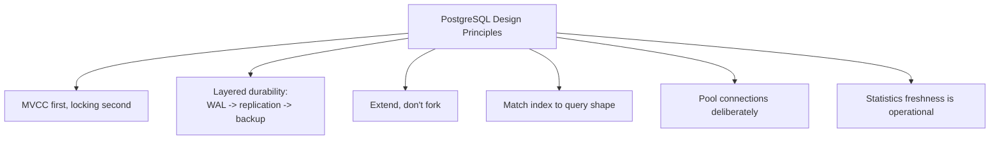

## 7. Architecture Patterns

- **Primary + hot standby + PgBouncer tier.** The most common production
  topology: one primary accepting writes, one or more streaming hot
  standbys serving read-only queries, and a PgBouncer layer in front of
  both, decoupling application connection counts from backend process
  counts on every node.
- **Extension-based specialization instead of polyglot persistence.**
  Using PostGIS or `pg_trgm` on the primary transactional database instead
  of introducing a dedicated spatial or search engine, when the extra
  workload doesn't yet justify the operational cost of a second system.
- **Partitioned rolling-window ingestion.** Time-partitioned tables
  (Section 4.11) with automated `ATTACH`/`DETACH` scripts, paired with BRIN
  indexes (Section 4.8) on the partition key for cheap range scans within
  each still-large partition.
- **Logical replication for zero-downtime major-version upgrades.** Standing
  up a new-major-version cluster as a logical subscriber, letting it catch
  up while the old primary keeps serving traffic, then cutting application
  traffic over — avoiding the extended downtime of an in-place major-version
  upgrade.
- **Citus-style distributed PostgreSQL for horizontal write scale.** When a
  single primary's write throughput genuinely becomes the bottleneck, an
  extension-based distributed layer keeps the same SQL surface and
  transactional model while sharding data across multiple PostgreSQL nodes
  ([recapping Sharding's routing and rebalancing
  concerns](CH06_Sharding.md#shard-key-selection-criteria-shard-mapdirectory-routing-consistent-hashing-ring--virtual-nodes-vs-hash-mod-routing)
  rather than re-deriving them).

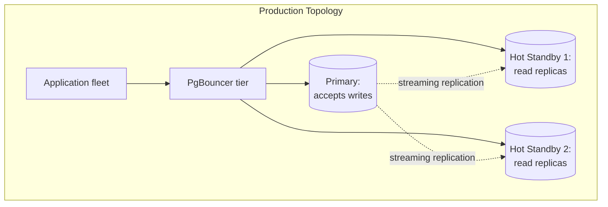

## 8. Production Architecture

A production PostgreSQL deployment layers several of Section 4's mechanisms
into a single operational picture: `max_connections` sized around genuine
peak concurrent query load rather than application instance count, with
PgBouncer absorbing the gap (Sections 4.12-4.13); `shared_buffers` typically
set to 25% of available RAM as PostgreSQL's own page cache, complementing
rather than replacing the operating system's page cache
([recapping virtual memory/page-cache mechanics from Memory
Management](../05_Networking_and_OS/CH25_Memory_Management.md#mmap-shared-page-cache-pages));
`work_mem` sized carefully because it is allocated *per sort/hash operation
per backend*, not once globally, so an under-estimated `work_mem` under
high concurrency can multiply into far more memory than expected; WAL
archiving and streaming replication configured with explicit RPO/RTO
targets (Section 4.4); autovacuum tuned per-table for the largest and
hottest tables rather than left at global defaults (Section 4.2); and
`pg_stat_statements` (an extension, Section 4.5) enabled for ongoing
visibility into which queries actually consume the most cumulative
execution time in production, rather than relying purely on ad hoc
`EXPLAIN ANALYZE` investigation after a complaint arrives.

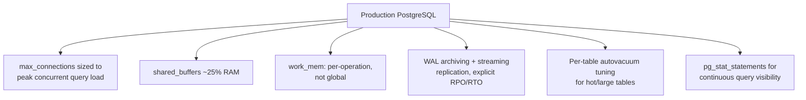

## 9. Implementation

Implementing the mechanisms above follows a consistent order: establish
schema and index strategy first (choosing B-tree vs. GIN vs. GiST vs. BRIN
per Sections 4.6-4.9, and partial/expression indexes per Section 4.9),
then partitioning strategy if the table's expected size or retention policy
warrants it (Section 4.11), then the connection-pooling tier (Section
4.13) sized against expected concurrency, then replication topology
(Section 4.4) sized against RPO/RTO, and finally autovacuum and statistics
tuning (Sections 4.2 and 4.14) revisited continuously as production traffic
patterns emerge — because statistics-driven plan quality and vacuum
health are workload-dependent, not something a one-time initial
configuration can fully anticipate.

## 10. Complete Code Examples

The following runnable examples live under
[code/sql/postgresql-chapter/](../code/sql/postgresql-chapter/) and
[code/python/postgresql-chapter/](../code/python/postgresql-chapter/):

1. [01_mvcc_vacuum_bloat_demo.sql](../code/sql/postgresql-chapter/01_mvcc_vacuum_bloat_demo.sql) —
   inspects `xmin`/`xmax`/`ctid` directly via the `pageinspect` extension,
   demonstrates heap bloat accumulating under repeated `UPDATE`s, and shows
   `VACUUM`/`VACUUM (VERBOSE)` output reclaiming dead tuples (Sections 4.1-4.2).
2. [02_indexing_gin_gist_brin_partial.sql](../code/sql/postgresql-chapter/02_indexing_gin_gist_brin_partial.sql) —
   builds a GIN trigram index (`pg_trgm`), a GiST spatial index (PostGIS),
   a BRIN index on a time-ordered column, and a partial index, then compares
   `EXPLAIN ANALYZE` output before and after each index exists (Sections
   4.6-4.9 and 4.14).
3. [03_jsonb_and_partitioning.sql](../code/sql/postgresql-chapter/03_jsonb_and_partitioning.sql) —
   models a JSONB column with a `jsonb_path_ops` GIN index and a range-
   partitioned time-series table with automated `ATTACH PARTITION`,
   demonstrating partition pruning in `EXPLAIN` output (Sections 4.10-4.11).
4. [04_connection_model_and_pgbouncer_demo.py](../code/python/postgresql-chapter/04_connection_model_and_pgbouncer_demo.py) —
   measures per-connection backend memory overhead directly against
   `pg_stat_activity`/`pg_backend_pid`, and contrasts unpooled versus
   PgBouncer transaction-mode-pooled connection behavior under concurrent
   load (Sections 4.12-4.13).

## 11. Performance

Beyond the per-mechanism performance notes in Section 4, three levers
dominate PostgreSQL performance tuning in practice: index strategy matched
to actual query shape (a mismatched index type, per Sections 4.6-4.9, is
frequently worse than no index at all once its maintenance cost is
counted), statistics freshness (Section 4.14's `ANALYZE` discipline,
without which even a perfectly chosen index can go unused), and vacuum
health (Section 4.2 — a table sliding into severe bloat degrades every
query against it regardless of indexing). `pg_stat_statements` should be
the first tool consulted when investigating a general performance
complaint, ranking queries by total cumulative time rather than
guessing which query is the culprit from anecdote.

## 12. Scalability

Vertical scaling (larger `shared_buffers`, more CPU cores for parallel
query execution, faster storage lowering effective `random_page_cost`) is
PostgreSQL's first and simplest scaling lever. Read scaling follows next,
via streaming hot standbys (Section 4.4) fronted by a read/write-splitting
connection layer. Write scaling beyond a single primary requires either
accepting eventual consistency for specific read paths, or moving to a
sharded topology — either via application-level sharding
([recapped from Sharding](CH06_Sharding.md#rebalancinglive-data-migration-cross-shard-queries-scatter-gather-cross-shard-transactions2pc-cost-hot-shard-mitigation))
or an extension-based distributed layer like Citus — at which point the
architecture is no longer "a single PostgreSQL instance" but "a
PostgreSQL-compatible distributed system," with all of Sharding's
rebalancing and cross-shard-transaction cost concerns applying directly.

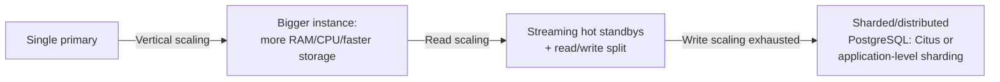

## 13. Security

PostgreSQL's role-based access control grants privileges (`SELECT`,
`INSERT`, `UPDATE`, `DELETE`, and finer-grained column/row-level variants)
per role, with Row-Level Security (RLS) policies letting a table restrict
which rows a given role may see or modify based on arbitrary predicates —
the standard mechanism for enforcing multi-tenant row isolation directly in
the database rather than trusting every application code path to add a
`WHERE tenant_id = ...` filter correctly. `SECURITY DEFINER` functions run
with the privileges of the function's owner rather than its caller, a
powerful but sensitive extensibility point (Section 4.5) that requires
careful auditing since a poorly written one can become a privilege-
escalation vector. As Section 4.5 already flagged, C-language extensions
run inside the backend process itself, so managed cloud providers
allow-list vetted extensions rather than permitting arbitrary shared
libraries; `pg_hba.conf` governs which hosts/users/databases may even
attempt authentication, and should default to the narrowest rule set that
still serves legitimate traffic. Encryption in transit uses standard TLS
([recapped from TLS](../05_Networking_and_OS/CH06_TLS.md#tls-13-handshake-0-rtt)),
and encryption at rest is typically handled at the storage/volume layer
(cloud-managed disk encryption) rather than inside PostgreSQL itself, since
PostgreSQL has no fully-featured native transparent-data-encryption feature
built into open-source core as of this writing.

## 14. Observability

Key PostgreSQL-specific signals to monitor, building directly on Section
4's mechanisms: oldest-active-transaction age and "idle in transaction"
duration (Section 4.1's bloat-driving failure mode), per-table dead-tuple
count and last-autovacuum timestamp from `pg_stat_user_tables` (Section
4.2), replication lag in bytes and seconds from `pg_stat_replication` and
retained WAL size per slot from `pg_replication_slots` (Section 4.4's
failure mode), `pg_stat_statements`-derived total/mean query time per
normalized query (Section 4.14), and current backend count against
`max_connections` alongside PgBouncer's own pool-utilization stats
(Sections 4.12-4.13). `pg_stat_activity` gives a live snapshot of every
current backend, its state, and its current query — the first place to
look during an active incident.

```mermaid
flowchart TD
    A[PostgreSQL Observability] --> B["pg_stat_activity:<br/>live backend/query snapshot"]
    A --> C["pg_stat_user_tables:<br/>dead tuples, last autovacuum"]
    A --> D["pg_stat_replication:<br/>lag bytes/seconds"]
    A --> E["pg_replication_slots:<br/>retained WAL per slot"]
    A --> F["pg_stat_statements:<br/>total/mean time per query"]
    A --> G["Connection count vs.<br/>max_connections + PgBouncer pool stats"]
```

## 15. Failure Scenarios

- **Autovacuum falls behind on a hot table (Section 4.2).** Symptoms: rising
  table/index size disproportionate to row count, growing query latency,
  `pg_stat_user_tables.n_dead_tup` climbing continuously. Response: per-table
  autovacuum tuning, and `pg_repack` for an already-bloated table that can't
  wait for a maintenance window.
- **Idle-in-transaction connection pins the oldest snapshot (Section 4.1).**
  Symptoms: bloat across unrelated tables despite reasonable autovacuum
  settings. Response: `idle_in_transaction_session_timeout`, and
  application/ORM audit for leaked transactions.
- **Orphaned replication slot fills disk (Section 4.4).** Symptoms: primary
  disk usage grows without a corresponding data-size increase, eventually
  halting writes entirely. Response: alert on retained WAL per slot; drop
  slots for decommissioned standbys as a mandatory decommissioning step.
- **Stale statistics after bulk load misdirect the planner (Section
  4.14).** Symptoms: a query that performed well suddenly takes orders of
  magnitude longer after a large data change. Response: explicit `ANALYZE`
  as the final step of any bulk load; monitor estimated-vs-actual row-count
  divergence in slow-query `EXPLAIN ANALYZE` output.
- **Connection-count exhaustion from unpooled application connections
  (Section 4.12).** Symptoms: "FATAL: too many connections" errors under
  moderate, not extreme, traffic. Response: introduce PgBouncer
  transaction-mode pooling (Section 4.13) rather than raising
  `max_connections` further.
- **Transaction ID wraparound emergency (Section 4.2).** Symptoms:
  increasingly aggressive forced autovacuum activity, eventually a hard
  write-refusal if ignored. Response: this should never reach production if
  routine autovacuum monitoring is in place; recovery requires an emergency,
  often single-threaded, `VACUUM` pass.

```mermaid
flowchart TD
    A[Failure Scenario] --> B{Which symptom?}
    B -->|"Bloat, slow scans"| C[Check idle-in-transaction<br/>+ autovacuum lag]
    B -->|"Disk filling, no data growth"| D[Check replication<br/>slot retained WAL]
    B -->|"Sudden plan regression"| E[Check statistics freshness<br/>+ ANALYZE timing]
    B -->|"Too many connections error"| F[Check PgBouncer pooling<br/>vs. max_connections]
    B -->|"Forced aggressive vacuum"| G[Transaction ID wraparound<br/>emergency response]
```

## 16. Testing

Test index-choice decisions with `EXPLAIN (ANALYZE, BUFFERS)` against
representative (not toy) data volumes, since GIN/GiST/BRIN's relative
benefits (Sections 4.6-4.9) only become visible at realistic scale and data
distribution. Test partition-pruning behavior explicitly by confirming
`EXPLAIN` lists only the expected partitions for representative queries
(Section 4.11's failure mode). Test connection-pooling-mode assumptions
(Section 4.13) under genuinely concurrent load, not single-connection
manual testing, since prepared-statement and session-state issues under
transaction-mode pooling only surface under concurrency. Test autovacuum
tuning changes (Section 4.2) against a bloat-inducing synthetic write
workload before relying on them in production. Include `ANALYZE` as an
explicit step in any test that measures query performance after a bulk
data load, to avoid conflating "planner needs fresh statistics" with "query
is inherently slow."

## 17. Common Mistakes

- Assuming an `UPDATE` modifies a row in place instead of writing a new
  heap tuple version, leading to surprise at bloat rate under high-update
  workloads (Section 4.1).
- Treating `VACUUM` as optional maintenance rather than an unavoidable,
  continuous engine requirement (Section 4.2).
- Defaulting every index to a plain B-tree regardless of query shape,
  missing GIN/GiST/BRIN's dramatic size/performance advantages for
  containment, spatial, and naturally-ordered range queries (Sections
  4.6-4.8).
- Storing everything as JSONB "to stay flexible," sacrificing constraint
  enforcement and targeted indexing on attributes that are actually queried
  frequently (Section 4.10).
- Sizing `max_connections` to match total application instance count
  instead of expected peak concurrent query load, then raising it further
  under connection-exhaustion pressure instead of introducing pooling
  (Sections 4.12-4.13).
- Enabling PgBouncer transaction-mode pooling without auditing ORM
  prepared-statement/session-state assumptions first (Section 4.13).
- Never running `ANALYZE` explicitly after a bulk load and being surprised
  by a subsequent plan regression (Section 4.14).
- Leaving a stray replication slot behind after decommissioning a standby
  (Section 4.4).

## 18. Best Practices

- Monitor `pg_stat_user_tables.n_dead_tup` and last-autovacuum timestamp
  per large/hot table, tuning autovacuum thresholds per-table rather than
  relying on global defaults (Section 4.2).
- Set `idle_in_transaction_session_timeout` in production to bound
  Section 4.1's snapshot-pinning failure mode.
- Choose index type deliberately per query shape (Sections 4.6-4.9) rather
  than defaulting to B-tree everywhere.
- Run `ANALYZE` explicitly at the end of any bulk data-load job (Section
  4.14).
- Size `max_connections` around expected peak concurrent query load and
  front the database with PgBouncer in transaction-pooling mode for
  everything else (Sections 4.12-4.13).
- Enable and regularly review `pg_stat_statements` output rather than only
  investigating performance reactively (Sections 4.14, 11).
- Alert on retained WAL size per replication slot, and make slot cleanup an
  explicit standby-decommissioning step (Section 4.4).
- Prefer a mature, allow-listed extension over standing up a second
  specialized database for spatial/search/time-series needs that fit
  within PostgreSQL's extensibility model (Section 4.5).

## 19. Anti-Patterns

- **"VACUUM is a maintenance-window nice-to-have."** It is a continuous,
  unavoidable engine requirement; deferring it invites both bloat and, in
  the worst case, transaction ID wraparound (Section 4.2).
- **"JSONB replaces schema design."** Using JSONB for every attribute
  instead of a deliberately normalized schema plus JSONB only for genuinely
  semi-structured, rarely-filtered data (Section 4.10).
- **"More connections is always safer."** Raising `max_connections`
  indefinitely instead of introducing pooling, worsening the process-per-
  connection memory/scheduling cost the increase was meant to solve
  (Sections 4.12-4.13).
- **"One index type fits all queries."** Building only B-tree indexes
  regardless of whether the query pattern is containment, spatial, or
  naturally-ordered-range shaped (Sections 4.6-4.9).
- **"Statistics are a one-time setup step."** Assuming `ANALYZE` run once at
  schema creation stays valid indefinitely as data volume and distribution
  change (Section 4.14).

## 20. Trade-off Analysis

| Decision | Option A | Option B | Trade-off |
|---|---|---|---|
| Index type for array/JSONB containment | GIN | Plain B-tree | GIN: fast containment, higher write cost; B-tree: cannot serve containment queries at all |
| Index type for spatial/range-overlap queries | GiST | Plain B-tree | GiST: handles multi-dimensional overlap natively; B-tree: no natural total order for geometry |
| Index type for naturally-ordered append-only ranges | BRIN | B-tree | BRIN: tiny footprint, depends on physical correlation; B-tree: exact but far larger on disk |
| Replication mode | Physical streaming | Logical replication | Physical: simple, low overhead, whole-cluster only; Logical: selective/cross-version, higher CPU overhead |
| Connection strategy | Direct connections | PgBouncer transaction pooling | Direct: simplest, hits process-per-connection ceiling fast; Pooling: scales client count, breaks some session-state features |
| VACUUM strategy for bloated table | Regular autovacuum tuning | `pg_repack`/`VACUUM FULL` | Tuning: proactive, no locking, slower to fix existing bloat; Repack/Full: reclaims disk immediately, `VACUUM FULL` blocks reads/writes |
| Semi-structured data storage | JSONB column | Fully normalized columns | JSONB: flexible, less enforceable; Normalized: enforceable constraints, less flexible under schema churn |

## 21. Comparison Table

| Aspect | PostgreSQL | MySQL/InnoDB | Oracle |
|---|---|---|---|
| Connection model | Process-per-connection | Thread-per-connection | Process or thread, configurable (dedicated/shared server) |
| MVCC storage | Multi-version heap tuples in the primary table | Old versions in a separate undo log/tablespace | Old versions in a separate undo tablespace |
| Extensibility | First-class extension architecture (PostGIS, etc.) | Storage-engine plugin architecture (different concern) | PL/SQL packages, more limited core-engine extensibility |
| Advanced indexing | GIN, GiST, BRIN, partial, expression | Full-text, spatial (narrower built-in set) | Bitmap, function-based, domain indexes |
| Native JSON storage | JSONB (binary, indexable) | JSON (text-based with virtual generated columns for indexing) | JSON (stored as text/BLOB with search index options) |

*(This chapter does not re-teach MySQL or Oracle's internals — both have
their own forward-referenced chapters in this part; the row above exists
only to situate PostgreSQL's specific choices relative to its closest
peers.)*

## 22. Real-World Case Study

**Instagram's PostgreSQL sharding migration (2011-2012).** As Instagram's
user base grew rapidly on a single PostgreSQL primary, the engineering team
faced exactly the write-scaling ceiling Section 12 describes: a single
node's write throughput and connection-handling capacity could not keep
pace with growth. Rather than migrating away from PostgreSQL, the team
built an application-level sharding scheme (logical shard IDs encoded
directly into generated primary keys, distributed across thousands of
PostgreSQL schemas across a smaller number of physical database
instances), explicitly choosing to keep PostgreSQL's transactional,
extension (notably PostGIS for their photo-location features), and query
capabilities rather than adopting a different, less mature engine purely
for horizontal scale. The migration required solving cross-shard query
limitations by designing the schema so the overwhelming majority of queries
could be routed to a single shard by a known key (the same shard-key-
selection discipline
[Sharding teaches generically](CH06_Sharding.md#shard-key-selection-criteria-shard-mapdirectory-routing-consistent-hashing-ring--virtual-nodes-vs-hash-mod-routing)),
avoiding the scatter-gather cost of cross-shard queries for the common
case. This case study is a direct, real-world validation of Section 6's
"extend, don't fork" and Section 12's scalability principles: PostgreSQL's
core engine strengths (extensibility, transactional correctness) were
preserved by solving the scale problem at the application/routing layer
rather than by abandoning the engine.

```mermaid
flowchart TD
    A[Single PostgreSQL primary<br/>growth ceiling reached] --> B[Application-level sharding:<br/>shard ID in generated PKs]
    B --> C[Thousands of schemas across<br/>fewer physical instances]
    B --> D[Schema designed so most<br/>queries hit one shard]
    D --> E[Avoids scatter-gather<br/>cross-shard query cost]
    B --> F[PostGIS/transactional features<br/>preserved per shard]
```

## 23. Interview Questions

1. Explain precisely what happens at the heap-tuple level when PostgreSQL
   executes an `UPDATE` — why is it closer to an insert-plus-delete than a
   true in-place modification?
2. What problem does `VACUUM` solve, and what happens if it is neglected
   indefinitely on a high-write table?
3. Why can an idle-in-transaction connection cause bloat across tables it
   never touched?
4. Walk through what WAL guarantees at commit time versus what may still
   only exist in memory, and explain how a checkpoint changes that picture.
5. Compare GIN, GiST, and BRIN — for each, describe the query shape it is
   built for and why a plain B-tree cannot serve that shape efficiently.
6. Why does PostgreSQL's process-per-connection model make connection
   pooling a near-mandatory production concern, and what does transaction-
   mode pooling specifically trade away?
7. What is the difference between `json` and `jsonb`, and why does that
   difference matter for query performance?
8. Explain partition pruning and describe a query pattern that would defeat
   it even against a correctly partitioned table.
9. What is the genetic query optimizer, when does it activate, and what
   does it trade away relative to exhaustive join-order search?
10. Describe a real production incident you would expect from stale table
    statistics, and how you would diagnose it using `EXPLAIN ANALYZE`.

## 24. Hands-on Exercises

1. Using the `pageinspect` extension, run
   [01_mvcc_vacuum_bloat_demo.sql](../code/sql/postgresql-chapter/01_mvcc_vacuum_bloat_demo.sql)
   and directly observe `xmin`/`xmax` values change across repeated
   `UPDATE`s on the same logical row.
2. Run [02_indexing_gin_gist_brin_partial.sql](../code/sql/postgresql-chapter/02_indexing_gin_gist_brin_partial.sql)
   and compare `EXPLAIN ANALYZE` output before and after each index type is
   created, noting the change in chosen scan node and estimated cost.
3. Run [03_jsonb_and_partitioning.sql](../code/sql/postgresql-chapter/03_jsonb_and_partitioning.sql)
   and confirm via `EXPLAIN` that a query against one month's data only
   scans the corresponding partition.
4. Run [04_connection_model_and_pgbouncer_demo.py](../code/python/postgresql-chapter/04_connection_model_and_pgbouncer_demo.py)
   against both a direct connection and a PgBouncer transaction-mode pool,
   and compare backend process/memory behavior under concurrent load.
5. Deliberately let a transaction sit open (`BEGIN;` with no `COMMIT`) while
   running heavy `UPDATE` traffic against an unrelated table in a second
   session, then observe `pg_stat_user_tables.n_dead_tup` growing despite
   autovacuum being enabled.

## 25. Design Exercises

1. Design the index strategy (choosing among B-tree, GIN, GiST, BRIN, and
   partial/expression indexes) for a table storing millions of support
   tickets with full-text description search, a JSONB metadata column, a
   status field with a small number of "active" values, and a
   monotonically increasing `created_at`.
2. Design a connection-pooling architecture (PgBouncer pool mode, pool
   size, and number of application instances) for a service handling
   10,000 requests per second where each request performs one short
   transaction, and justify your chosen pool size against Section 4.12's
   process-per-connection cost model.
3. Design a replication and backup topology (streaming standbys, WAL
   archiving, logical replication if applicable) for a system with an RPO
   of 5 seconds and an RTO of 2 minutes, and justify each component's role
   against those specific targets.
4. A team proposes storing an entire order's line items as a single JSONB
   column instead of a normalized `order_items` table. Write a design memo
   either approving or pushing back, referencing Section 4.10's decision
   implications and failure mode.
5. Design an autovacuum tuning strategy for a 500-million-row, high-write
   `events` table, specifying which parameters you would override from the
   global defaults and why.

## 26. Architecture Review Questions

1. For every large or high-write table in this design, has autovacuum been
   explicitly tuned, or does it rely entirely on global defaults?
2. Does the application layer connect directly to PostgreSQL, or through a
   connection pooler sized around genuine concurrent query load?
3. For every index in this schema, was its type (B-tree/GIN/GiST/BRIN/
   partial/expression) chosen deliberately against the query pattern it
   serves, or defaulted?
4. Is there an explicit, tested replication and backup strategy with
   defined RPO/RTO, including monitoring for replication lag and retained
   WAL per slot?
5. Are `ANALYZE` runs an explicit step in every bulk-load process, or left
   to autovacuum's schedule alone?
6. If this design uses JSONB for any column, has the team evaluated whether
   frequently-filtered attributes inside it should instead be normalized,
   typed columns?
7. Is `idle_in_transaction_session_timeout` configured, and has the
   application/ORM been audited for connections or transactions left open
   longer than expected?

## 27. Summary

PostgreSQL's distinguishing architecture is not a list of independent
features but one coherent system: MVCC's copy-on-write heap tuples (Section
4.1) make VACUUM (Section 4.2) an unavoidable, continuous engine
responsibility rather than optional maintenance; the Write-Ahead Log
(Section 4.3) provides the same durable record that both crash recovery and
streaming replication (Section 4.4) build on; the extension architecture
(Section 4.5) is the mechanical reason PostgreSQL can absorb entire
specialized domains (spatial via PostGIS, fuzzy text via `pg_trgm`) without
forking the engine; GIN, GiST, and BRIN (Sections 4.6-4.8) extend indexing
beyond the B-tree's range/equality shape to containment, spatial overlap,
and naturally-ordered append-only data respectively, with partial and
expression indexes (Section 4.9) narrowing an index to exactly the query
pattern that needs it; JSONB (Section 4.10) and declarative partitioning
(Section 4.11) extend the same MVCC/WAL/index machinery to semi-structured
data and to horizontally-organized time-series-style tables; and the
process-per-connection model (Section 4.12), whose real memory and
scheduling cost makes PgBouncer-style connection pooling (Section 4.13) a
near-mandatory production concern rather than an optional optimization, sits
underneath every one of those other mechanisms as the thing that actually
executes each query the planner (Section 4.14) chose a plan for. An
architect evaluating or operating PostgreSQL should treat statistics
freshness, vacuum health, index-type selection, and connection-pooling
strategy as first-class, continuously-monitored operational concerns —
not one-time setup decisions — because each one directly determines whether
the elegant architecture this chapter describes behaves elegantly in
production or degrades in one of Section 15's specific, recognizable ways.

## Further Reading

- [Transactions](CH08_Transactions.md) — the generic ACID/isolation-level/
  MVCC concept this chapter's Section 4.1 implements specifically.
- [Indexes](CH03_Indexes.md) — the generic B-tree/hash/composite index
  concepts this chapter's Sections 4.6-4.9 extend with PostgreSQL-specific
  access methods.
- [Query Optimizers](CH04_Query_Optimizers.md) — the generic cost-based
  optimization and `EXPLAIN` reading model this chapter's Section 4.14
  applies specifically to PostgreSQL's planner.
- [Partitioning](CH05_Partitioning.md) and [Sharding](CH06_Sharding.md) —
  the generic horizontal-partitioning and distributed-routing concepts this
  chapter's Sections 4.11 and 12 implement/apply specifically.
- [Replication](CH07_Replication.md) — the generic leader/follower and
  quorum replication concepts this chapter's Section 4.4 implements
  specifically via WAL streaming.
- [Locking](CH10_Locking.md) — the generic lock-type/granularity/deadlock
  mechanics this chapter recaps in Sections 4.1 and 6 rather than
  re-teaching.
- `CH12_MySQL.md` — a sibling relational-engine chapter for direct
  architectural comparison (not yet drafted at the time this chapter was
  authored).
