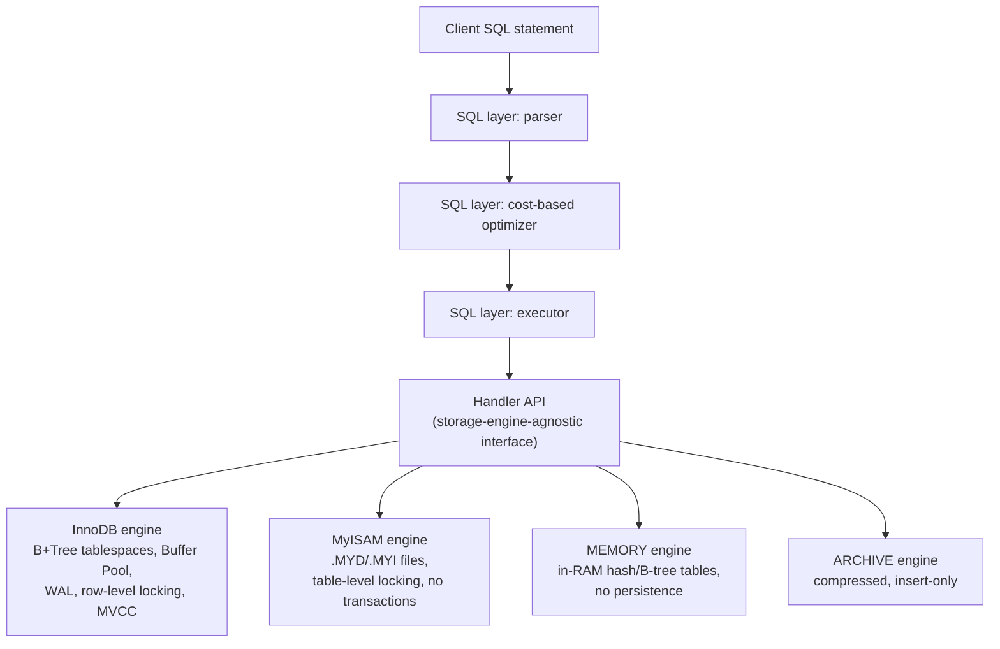
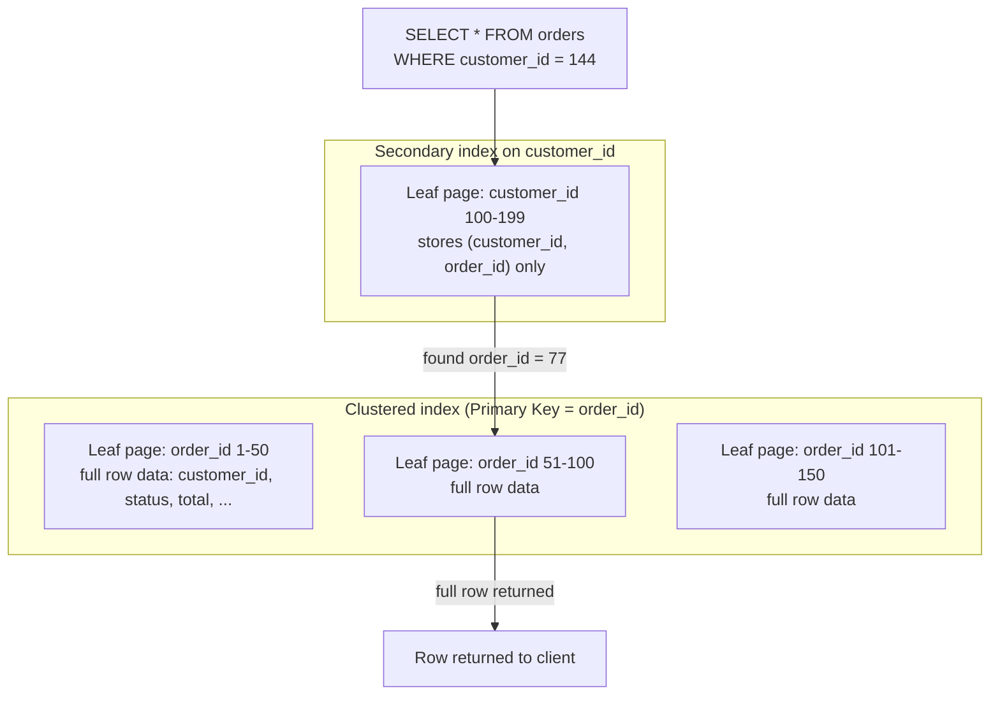
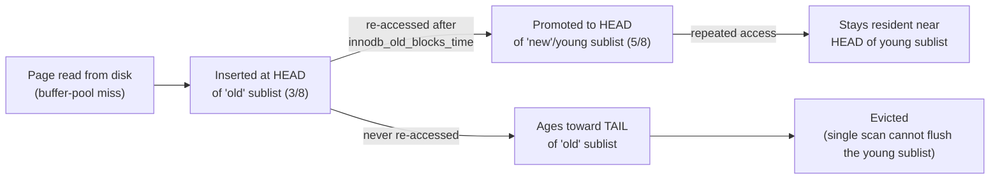
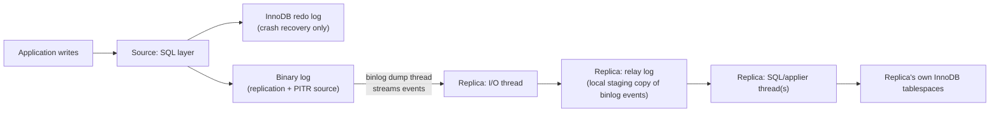
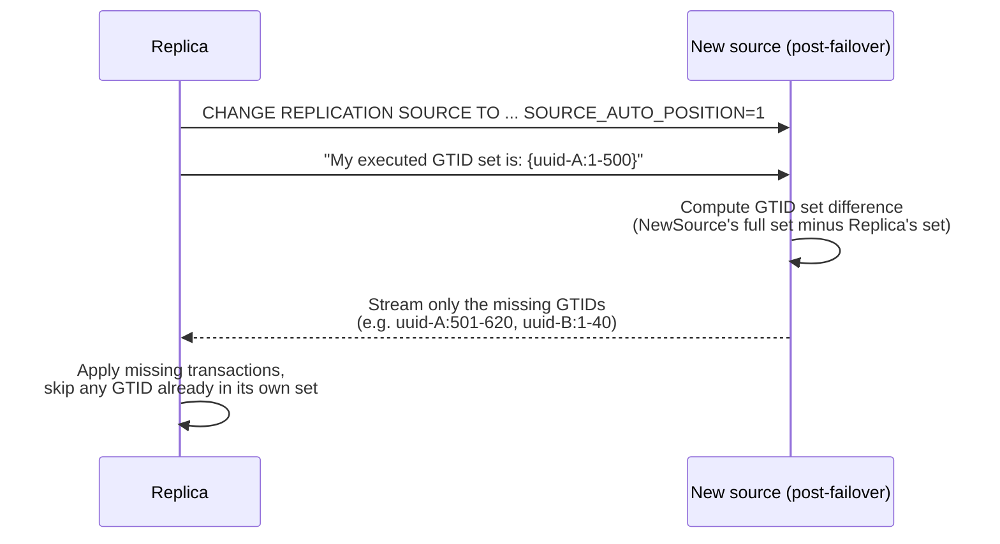
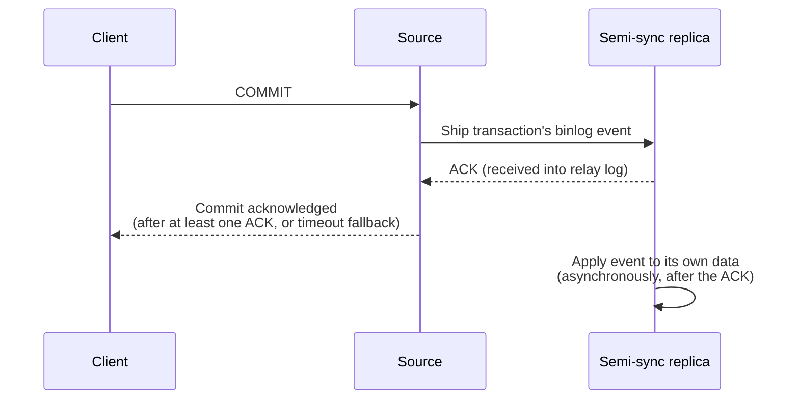
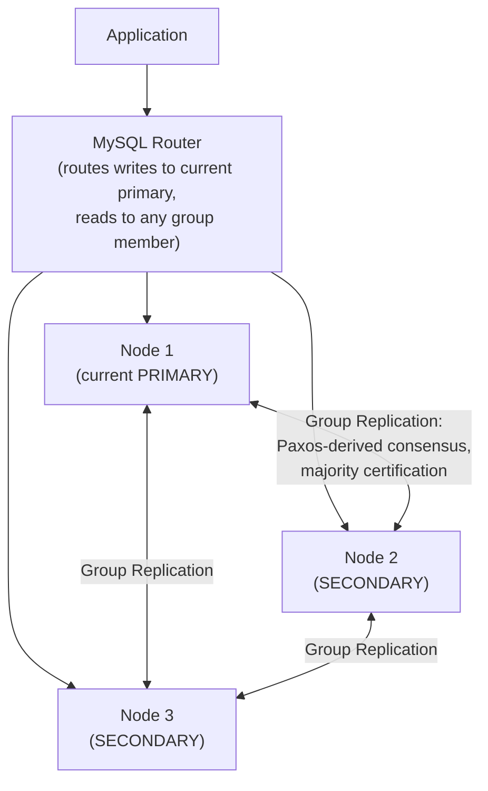
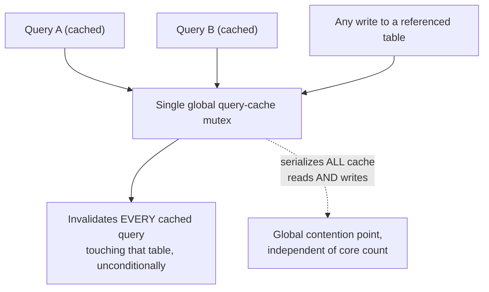
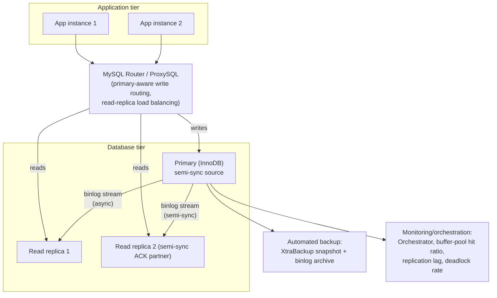

# Chapter: MySQL

Part: [06 — Databases and Storage](PART_OVERVIEW.md) · Status: Drafted

## 1. Introduction

MySQL is an open-source relational database management system distinguished
from most of its peers by a single architectural decision made early in its
life: the separation of the SQL layer (parser, optimizer, query cache
history, replication) from a **pluggable storage engine** layer that
actually stores and retrieves rows on disk. Where PostgreSQL, Oracle, and
SQL Server each ship one deeply integrated storage subsystem, MySQL lets
different tables in the same server — even the same query's join — be
served by entirely different storage engines with different durability,
concurrency, and locking guarantees. That architectural choice is not
trivia; it explains almost everything else this chapter teaches. It is why
MySQL shipped for a decade with a fast-but-crash-unsafe default engine
(MyISAM) before InnoDB won the default-engine slot in MySQL 5.5 (2010); it
is why the query cache — one of MySQL's most-loved early performance
features — was deprecated in 5.7.20 and removed outright in 8.0, precisely
because a single global structure could not coexist safely with modern
multi-core concurrency; and it is why "how does MySQL lock rows" has an
answer that depends entirely on which storage engine a table uses.

This chapter's job is **not** to re-teach relational database fundamentals
that Part 06's Database Design chapters already own — normalization,
indexing data structures, query optimization theory, partitioning,
sharding, generic replication topology vocabulary, transaction isolation
theory, caching patterns, or generic lock-type/deadlock-detection theory
are all taught once, engine-agnostically, in
[Normalization](CH01_Normalization.md), [Denormalization](CH02_Denormalization.md),
[Indexes](CH03_Indexes.md), [Query Optimizers](CH04_Query_Optimizers.md),
[Partitioning](CH05_Partitioning.md), [Sharding](CH06_Sharding.md),
[Replication](CH07_Replication.md), [Transactions](CH08_Transactions.md),
[Caching](CH09_Caching.md), and [Locking](CH10_Locking.md). This chapter's
job is to teach **MySQL specifically** — the parts of its architecture that
are genuinely its own and that an architect must understand to make sound
decisions about when to choose MySQL, how to configure it, and how to
reason about its failure modes: the pluggable storage engine architecture
and why InnoDB became the only sane default; InnoDB's clustered-index table
organization, in which the primary key literally *is* the physical layout
of the table rather than a separate structure pointing at rows; the InnoDB
Buffer Pool as the single most consequential piece of MySQL capacity
planning; the binary log (binlog) and its three logging formats
(STATEMENT, ROW, MIXED) plus Global Transaction Identifiers (GTIDs) as the
mechanism underlying MySQL-specific replication; InnoDB's particular
Multi-Version Concurrency Control (MVCC) and locking implementation —
specifically **next-key locking** and **gap locks**, the mechanism InnoDB
uses to close the phantom-read anomaly that Part 06's generic Locking
chapter describes only in the abstract; the query cache's rise, deprecation,
and removal as a cautionary architectural case study; and MySQL's specific
replication topology options — classic asynchronous source-replica,
semi-synchronous replication, and Group Replication/InnoDB Cluster as
MySQL's answer to synchronous, quorum-based high availability.

## 2. Historical Evolution

- **1995 — MySQL AB releases MySQL 1.0.** Created by Michael Widenius and
  David Axmark, MySQL was designed from the outset for speed and simplicity
  on the read-heavy web workloads of the era, deliberately trading some
  correctness and durability guarantees for raw throughput — a trade-off
  visible in its original default storage engine, ISAM, and ISAM's
  successor, MyISAM.
- **1996-2000 — MyISAM becomes MySQL's default engine.** MyISAM offered
  compact on-disk storage, fast full-table scans, and full-text indexing,
  but no transactions, no crash recovery beyond a repair pass, and
  table-level locking only — a single writer blocked every reader and every
  other writer on that table. This was an acceptable trade for the
  read-mostly web/CMS workloads MySQL was winning at the time.
  full-text search).
- **2000-2001 — InnoDB is created by Innobase Oy (Heikki Tuuri) and bundled
  with MySQL 3.23.** InnoDB brought row-level locking, ACID transactions
  with crash recovery via write-ahead logging, and Multi-Version
  Concurrency Control (MVCC) — Oracle-style architecture bolted onto
  MySQL's pluggable-engine seam, initially as an opt-in alternative to
  MyISAM rather than the default.
- **2005 — Oracle acquires Innobase.** This gave Oracle (which would later
  acquire Sun Microsystems, and with it MySQL itself, in 2010) direct
  control over MySQL's most important storage engine years before it
  controlled MySQL proper — a fact that mattered enormously once InnoDB
  became the default engine and Oracle's continued investment in it (rather
  than a hypothetical divestment) determined MySQL's future viability.
- **2008 — Sun Microsystems acquires MySQL AB** for approximately $1 billion,
  betting on open-source database adoption in the enterprise.
- **2010 — Oracle acquires Sun**, and with it, MySQL — triggering community
  anxiety about MySQL's open-source future under a commercial database
  vendor's ownership, and directly motivating the MariaDB fork (below).
- **2010 — MySQL 5.5 makes InnoDB the default storage engine**, formally
  ending MyISAM's decade as the default and marking the point at which
  "MySQL" and "crash-safe, transactional, row-locking relational database"
  became synonymous for the vast majority of new deployments (Section 4.2
  covers exactly why this was the correct call).
- **2009-2010 — the MariaDB fork.** Monty Widenius (MySQL's original
  co-creator) forked MySQL into MariaDB in response to the Oracle
  acquisition, aiming to guarantee a permanently open-source, community-
  governed alternative with drop-in compatibility. MariaDB has since
  diverged meaningfully (its own storage engines, its own optimizer
  improvements) but the two remain wire-compatible for most client
  workloads at the version this chapter was written against.
- **2013 — MySQL 5.6 introduces Global Transaction Identifiers (GTIDs).**
  GTIDs replaced binlog-file-plus-position coordinates as the unit of
  replication bookkeeping, letting a replica reattach to any source in a
  topology (including after a failover) without an operator manually
  computing the correct resume offset (Section 4.10).
- **2013 — MySQL 5.6 also deprecates unsafe defaults and hardens
  crash-recovery**, and semi-synchronous replication (introduced as a
  plugin in 5.5) matures into a broadly production-used HA building block
  (Section 4.14).
- **2016 — MySQL 5.7.17 introduces Group Replication** as a plugin, MySQL's
  first native, quorum-based, multi-primary-capable replication protocol
  built on a Paxos-derived consensus algorithm, bundled operationally as
  **InnoDB Cluster** together with MySQL Router and MySQL Shell.
- **2017 — MySQL 5.7.20 deprecates the query cache.** By this point the
  query cache's single global mutex had become a well-documented scalability
  cliff on multi-core hardware, and the MySQL team announced its removal in
  the next major version rather than attempting to fix its fundamentally
  serial design (Section 4.13 is a full case study).
- **2018 — MySQL 8.0 GA release removes the query cache entirely**,
  alongside a large number of other changes: a rewritten data dictionary
  stored in InnoDB tables (replacing the old `.frm` file metadata), window
  functions and Common Table Expressions (CTEs), invisible indexes, and
  descending indexes — the single biggest architectural release in MySQL's
  history to that point.
- **2020s — cloud-managed MySQL and MySQL-wire-compatible NewSQL.** Amazon
  Aurora MySQL (a storage-layer rewrite that keeps the InnoDB/MySQL SQL
  layer but replaces its physical storage with a distributed, log-structured
  storage service), Google Cloud SQL, Azure Database for MySQL, PlanetScale
  (built on the Vitess sharding middleware), and TiDB (MySQL-wire-compatible
  but backed by a distributed storage engine) all represent the industry
  building on top of — or intentionally working around — MySQL's InnoDB/
  binlog architecture rather than replacing it outright, which is itself
  evidence of how durable this chapter's architecture has proven.

## 3. Why It Exists

MySQL exists because the mid-1990s web needed a relational database that
was free to redistribute, fast enough for high-volume read-heavy websites
on commodity hardware, and simple enough to administer without a dedicated
Database Administrator (DBA) team — a real gap at a time when the credible
alternatives were expensive commercial engines (Oracle, Sybase, Informix)
designed for enterprise transaction-processing workloads, not for serving
web pages. The LAMP stack (Linux, Apache, MySQL, PHP/Perl/Python) that
defined a generation of web architecture existed specifically because
MySQL filled that gap: it was good enough, fast enough, and free enough
that an entire industry of startups, CMSs (WordPress, Drupal, Joomla), and
early social platforms (Facebook famously ran and heavily patched MySQL/
InnoDB at enormous scale) built directly on it rather than paying for a
commercial license.

The pluggable storage engine architecture specifically exists because
MySQL's original creators recognized — correctly — that "one size fits all"
storage is a false economy: a full-text-search-heavy CMS workload, a
write-heavy transactional order system, and a temporary staging table used
once during an Extract-Transform-Load (ETL) job have genuinely different
optimal physical storage strategies. Rather than build one storage engine
and force every workload through it (PostgreSQL and Oracle's approach),
MySQL exposed storage as a plugin interface (`ENGINE=InnoDB`,
`ENGINE=MyISAM`, `ENGINE=MEMORY`, `ENGINE=CSV`, `ENGINE=ARCHIVE`, and
third-party engines like MyRocks and TokuDB) so a schema designer could
choose per table. In practice, as Section 4.2 explains, this flexibility
narrowed sharply over two decades: almost every workload benefits more from
InnoDB's crash safety and row-level concurrency than it loses from
InnoDB's marginally higher per-row overhead versus MyISAM, so "pluggable"
today mostly means "InnoDB by default, with narrow, well-understood
exceptions" rather than a live smorgasbord of equally viable choices.

## 4. Core Concepts

### 4.1 Storage engine pluggability: the architectural seam that defines MySQL

**Definition.** A storage engine in MySQL is the component responsible for
everything below the SQL layer's parser/optimizer/executor: how rows are
physically laid out on disk or in memory, how indexes over those rows are
structured, what transactional and locking guarantees are offered, and how
crash recovery works. MySQL's server process (`mysqld`) defines a stable
internal Application Programming Interface (API) — the *handler interface*
— between the SQL layer and the storage layer, and any table can declare
which engine implements it via `CREATE TABLE ... ENGINE = <name>`.

**Mechanism.** Every SQL statement that touches a table is compiled by the
shared SQL layer (the same parser, the same cost-based optimizer described
in [Query Optimizers](CH04_Query_Optimizers.md)) into a sequence of calls
against the handler API: `ha_index_read`, `ha_write_row`,
`ha_update_row`, `ha_delete_row`, and so on. The chosen storage engine
implements those handler calls however it wants — InnoDB against its
B+Tree-organized tablespace files with a Buffer Pool and write-ahead
logging (Sections 4.3-4.4); MyISAM against its own `.MYD` (data) and
`.MYI` (index) files with no transaction log at all; the MEMORY engine
entirely inside RAM with no persistence; the ARCHIVE engine with
row-level compression optimized for insert-only audit-log-style tables.
Because the handler interface is the *only* thing the SQL layer depends on,
a single query can join a table stored in InnoDB against a table stored in
MEMORY, and the optimizer reasons about both using the same cost model,
oblivious to the wildly different physical realities underneath.



**Decision implications.** For a schema designer, pluggability means the
engine choice is a per-table decision, not a per-server one — but in
practice almost every table in a modern MySQL deployment should be InnoDB
unless there is a specific, articulable reason otherwise (Section 4.2).
The remaining legitimate uses of a non-InnoDB engine are narrow: MEMORY for
genuinely ephemeral session/lookup tables that can be rebuilt on restart
with zero durability requirement; ARCHIVE for append-only historical/audit
data that is rarely queried and benefits from its higher compression
ratio; and MyISAM survives mainly in legacy schemas that predate MySQL
5.5's default-engine switch and have not yet been migrated.

**Failure mode.** Mixing engines inside a single transaction is the
sharpest edge of pluggability: a transaction that writes to both an InnoDB
table and a MyISAM table cannot be rolled back atomically, because MyISAM
has no transaction log to undo — a `ROLLBACK` will correctly revert the
InnoDB changes but silently leave the MyISAM changes committed, corrupting
the application's atomicity assumption without raising any error. This is
one of the most common "MySQL lost my data" bug reports that traces back
not to a MySQL defect but to an unnoticed mixed-engine schema.

**Scenario.** A team migrating a decade-old CMS discovers, via
`SELECT table_name, engine FROM information_schema.tables WHERE table_schema = 'cms' AND engine <> 'InnoDB'`,
that a `search_index` table was created as MyISAM for its full-text index
support (MyISAM had full-text indexing years before InnoDB gained it in
MySQL 5.6) and a `session_cache` table was created as MEMORY. Neither
participates in the application's order-processing transactions, so the
mixed-engine risk above does not apply — but the team still migrates
`search_index` to InnoDB (which has supported full-text indexes since 5.6)
specifically to gain crash safety, since a MyISAM table left in a corrupted
state after an unclean shutdown requires a manual `REPAIR TABLE` pass that
can take the search feature offline for an unpredictable duration.

### 4.2 Why InnoDB won: the engine-selection decision in depth

**Definition.** "InnoDB won" describes the historical and technical
convergence by which InnoDB displaced MyISAM as MySQL's default storage
engine (MySQL 5.5, 2010) and, subsequently, as the *only* storage engine
most new MySQL schemas ever use — not because MyISAM disappeared, but
because the workloads MyISAM was historically chosen for turned out to be
rarer, and the cost of its limitations turned out to be higher, than the
industry initially assumed.

**Mechanism — the concrete trade-offs that decided it:**

| Property | MyISAM | InnoDB |
|---|---|---|
| Locking granularity | Table-level only | Row-level (Section 4.5) |
| Transactions | None | Full ACID (recap: [Transactions](CH08_Transactions.md)) |
| Crash recovery | Manual `REPAIR TABLE`; no redo log | Automatic via redo-log replay on restart |
| Concurrency under mixed read/write | Poor — one writer blocks all readers | High — MVCC lets readers avoid blocking on writers |
| Foreign keys | Not enforced | Enforced |
| Full-text indexing | Native since inception | Supported since MySQL 5.6 |
| Storage layout | Heap-organized `.MYD` file + separate `.MYI` index file | Clustered-index-organized (Section 4.3) |
| Typical disk footprint | Smaller (no MVCC version overhead, no clustering overhead) | Larger (row versions, clustering, page fill-factor slack) |

The decisive column is concurrency under mixed read/write load: as web
applications matured from "mostly static content with occasional writes"
into applications with continuous concurrent writes (comments, likes,
inventory decrements, session state), MyISAM's table-level lock became a
hard throughput ceiling — every `UPDATE` or `INSERT` serialized behind
every other writer *and* every reader on that table, regardless of whether
their row sets overlapped. InnoDB's row-level locking (Section 4.5) means
two transactions updating different rows in the same table proceed fully
in parallel, and InnoDB's MVCC (Section 4.5) means an ordinary read never
blocks on a concurrent writer at all.

**Decision implications.** By MySQL 8.0, the practical decision framework
is: use InnoDB unless you can name a *specific* property MyISAM (or another
non-default engine) provides that your workload genuinely needs and that
you have verified InnoDB cannot provide at acceptable cost — a smaller
on-disk footprint for a huge, rarely-updated, rarely-queried-concurrently
archive table is close to the only surviving legitimate case, and even
that is usually better served by InnoDB with page compression
(`ROW_FORMAT=COMPRESSED`) or by moving the data out of MySQL entirely into
columnar/object storage.

**Failure mode.** Teams that inherited a MyISAM-heavy schema and never
migrated it frequently discover the cost of that decision only during an
incident: an unclean shutdown (power loss, OOM-killed `mysqld`, forced
container restart) leaves MyISAM tables in a state MySQL flags as "marked
as crashed," refusing further reads/writes to that table until an operator
runs `REPAIR TABLE`, which for a large table can take the affected feature
offline for hours — precisely the crash-recovery gap InnoDB's redo log
exists to close automatically and near-instantly on restart.

**Scenario.** An architect reviewing a legacy e-commerce schema during a
platform modernization finds the `inventory_counts` table is still MyISAM,
apparently left over from an early prototype. Under Black Friday load, that
table's table-level lock becomes the visible bottleneck: every checkout
transaction that decrements stock serializes against every other checkout
touching *any* product, not just the same Stock Keeping Unit (SKU). A
straightforward `ALTER TABLE inventory_counts ENGINE=InnoDB` (run online via
`ALGORITHM=INPLACE` to avoid a full table lock during the migration itself)
converts the bottleneck from "one lock per table" to "one lock per row,"
letting concurrent checkouts on different SKUs proceed in full parallel.

### 4.3 InnoDB clustered-index table organization: the primary key IS the data

**Definition.** In InnoDB, a table's rows are not stored in a separate heap
file that indexes then point into (the model most other engines, including
MyISAM and PostgreSQL's heap-table model, use). Instead, the table's rows
*are* the leaf pages of a B+Tree built on the primary key — this is called
a **clustered index**. There is no separate "table file" distinct from the
primary-key index; the primary key's B+Tree leaf pages contain the complete
row (every column), physically ordered by primary-key value.

**Mechanism.** Every InnoDB table has exactly one clustered index, chosen
in this priority order: (1) the explicit `PRIMARY KEY`, if declared; (2) if
no primary key exists, the first `UNIQUE` index over non-nullable columns;
(3) if neither exists, InnoDB silently generates an invisible, monotonically
increasing 6-byte internal row identifier (`ROW_ID`) and clusters on that
instead — a fallback that works but forfeits the ability to cluster rows
by a business-meaningful key. Every *other* index on the table (a
"secondary index") is a separate B+Tree whose leaf pages store the indexed
column(s) plus the primary-key value — not a pointer to a physical page/
slot the way a heap-organized engine's secondary indexes typically work.
This is why a secondary-index lookup in InnoDB costs two B+Tree traversals
under the hood: one through the secondary index to find the matching
primary-key value(s), then a second through the clustered (primary-key)
index to fetch the rest of the row — unless the secondary index already
contains every column the query needs, in which case InnoDB can answer
straight from the secondary index's leaf pages alone (a covering index, an
"index-only" scan, recapped from [Indexes](CH03_Indexes.md#composite-covering-indexes)
here specifically as it applies to InnoDB's two-tree structure).



**Decision implications.** Clustering has three direct consequences an
architect must design around:

1. **Primary-key choice drives write performance directly.** A monotonically
   increasing primary key (an `AUTO_INCREMENT` integer, or a
   timestamp-prefixed identifier such as UUID v7/ULID) means every insert
   appends to the rightmost leaf page of the clustered B+Tree — sequential,
   cache-friendly, minimal page-split cost. A randomly distributed primary
   key (a random UUID v4, a hash) forces every insert to a random leaf
   page, causing frequent page splits, lower page fill-factor, and
   markedly worse cache locality, because the clustered index leaf pages
   *are* the row storage — there is no separate heap to absorb the
   randomness the way there is in a heap-organized engine.
2. **Row size directly bloats every secondary index**, because every
   secondary index's leaf entries carry the primary key's full value as
   the row locator. A wide composite primary key (multiple columns) or an
   oversized data type for the primary key multiplies that overhead across
   every secondary index on the table — a strong argument for a narrow,
   surrogate `BIGINT` primary key even when a natural key exists, deferring
   the natural key to a `UNIQUE` secondary index instead.
3. **A secondary-index-only scan (a covering index) is disproportionately
   valuable in InnoDB specifically**, because it is the only way to avoid
   the second (clustered) B+Tree traversal — the payoff is larger here than
   in a heap-organized engine, where a secondary index without covering
   columns still only costs one extra random I/O to the heap, not a full
   second tree descent.

**Failure mode.** The classic InnoDB anti-pattern is a random-UUID primary
key on a high-write table (see `code/sql/mysql-chapter/01_clustered_index_table_organization.sql`
for a full runnable example): insert throughput degrades as the table
grows past the point where the clustered index no longer fits in the
Buffer Pool (Section 4.4), because each insert now touches a leaf page
essentially at random across the entire keyspace, guaranteeing a Buffer
Pool miss (and therefore a physical disk read to fetch the target page
before it can even be split/written) on a large fraction of inserts.

**Scenario.** A team building a session-store table on InnoDB initially
uses a random UUID as the primary key "because that's what the session
identifier already is." Under load testing at 5x their expected peak
write rate, insert latency degrades non-linearly once the table exceeds
Buffer Pool capacity. The fix (also shown in the code example) is to
introduce a surrogate, monotonically increasing `BIGINT` clustering key and
demote the UUID to a `UNIQUE` secondary index — write throughput recovers
because inserts once again land on the rightmost (and therefore
Buffer-Pool-resident) leaf page.

### 4.4 The InnoDB Buffer Pool: InnoDB's in-memory cache and the central capacity-planning lever

**Definition.** The InnoDB Buffer Pool is a fixed-size, in-memory cache of
disk pages — both data pages (clustered and secondary index leaf/internal
pages) and, transitively, the change buffer and adaptive hash index
structures InnoDB layers on top. It is conceptually similar to a page
cache, but it is InnoDB's *own* private cache, managed independently of
the operating system's file-system page cache, precisely so InnoDB can
apply database-specific eviction and read-ahead policies the OS cache
cannot know to apply.

**Mechanism.** The Buffer Pool holds pages in a modified Least Recently
Used (LRU) list, but not a plain LRU — InnoDB uses a **midpoint insertion
strategy** that splits the LRU list into two sublists: a smaller "new"
(young) sublist for the most recently accessed 5/8 of the list by default,
and a larger "old" sublist for the remaining 3/8. A freshly read page from
disk is inserted at the *head of the old sublist*, not the head of the new
sublist — and is only promoted into the young sublist if it is accessed
again after a configurable delay (`innodb_old_blocks_time`, default 1000ms).
This deliberately defeats a naive full-table-scan from flooding the cache
and evicting the genuinely hot working set: a one-off analytics query that
scans a million rows touches each page only once, so under midpoint
insertion those pages stay confined to the old sublist and are evicted
first, without ever displacing pages the OLTP workload actually depends on.



A page in the Buffer Pool can be **clean** (identical to its on-disk copy)
or **dirty** (modified in memory but not yet flushed to the underlying
tablespace file). Dirty pages are flushed asynchronously by background I/O
threads, decoupling a transaction's commit latency (which depends on the
redo log's fsync, not on the data page's flush — see
[Transactions](CH08_Transactions.md#acid-properties-atomicity-consistency-isolation-durability-and-their-mechanisms)
for the general write-ahead-log durability mechanism this chapter recaps)
from the eventual, batched write-back of the actual data pages.

**Decision implications.** The Buffer Pool's size (`innodb_buffer_pool_size`)
is the single highest-leverage InnoDB tuning parameter that exists, because
it directly determines whether the *working set* — the pages actively
touched by the current query mix — fits in RAM. When the working set fits,
almost every read is served from memory at microsecond latency; when it
does not, InnoDB falls back to physical disk I/O on cache misses, and
latency degrades by one to three orders of magnitude depending on storage
medium. The standard sizing heuristic is roughly 60-75% of available RAM
on a dedicated database host (leaving headroom for connection-thread
memory, the OS, and other InnoDB structures like the log buffer and the
adaptive hash index) — see
`code/sql/mysql-chapter/04_buffer_pool_sizing_and_diagnostics.sql` for the
runnable sizing configuration and the diagnostic queries that confirm
whether a given size is actually sufficient (buffer-pool hit ratio, free-
page pressure, per-table page residency).

**Failure mode.** The most common Buffer Pool failure mode is silent,
gradual degradation as data grows past the pool's size — there is no hard
error, just a rising physical-read rate and a falling hit ratio, which is
why the hit-ratio query in the accompanying code example is a standard
first-response diagnostic for "MySQL got slower" incidents. A second,
sharper failure mode is a **cold-cache restart**: after any restart
(planned maintenance, crash recovery, failover promotion), the Buffer Pool
starts completely empty, and every query is a Buffer Pool miss until
enough of the working set has been re-read from disk — potentially minutes
of markedly elevated latency on a freshly restarted large instance. MySQL
mitigates this by default via `innodb_buffer_pool_dump_at_shutdown` /
`innodb_buffer_pool_load_at_startup`, which persist and reload a list of
which pages were resident, letting a restarted instance proactively
re-warm its cache instead of waiting for organic query traffic to do it.

**Scenario.** An on-call engineer investigating a "MySQL is slow" page
runs the hit-ratio query from the code example and finds it has fallen
from a historical baseline of 99.4% to 91%. Cross-referencing
`INNODB_BUFFER_POOL_STATS` shows `FREE_BUFFERS` near zero and a high
`MODIFIED_DATABASE_PAGES` count — the pool is fully occupied and under
write pressure. Correlating with a recent data-growth report (a new
high-volume `events` table added the previous week) confirms the working
set has outgrown the current `innodb_buffer_pool_size`; the remediation is
either to grow the pool (if RAM headroom exists) or to reconsider whether
the new table's older data should be partitioned/archived out of the hot
working set entirely (recap: [Partitioning](CH05_Partitioning.md#partition-maintenancerolling-window-pattern-local-vs-global-indexes-composite-sub-partitioning-storage-tiering)).

### 4.5 InnoDB's MVCC and locking implementation: next-key locking and gap locks

**Recap of the generic model this section specializes.** [Locking](CH10_Locking.md)
already teaches the general vocabulary this section builds on: shared vs.
exclusive locks, row/page/table lock granularity, pessimistic vs. optimistic
concurrency control, and database-specific deadlock detection via a
wait-for graph — this chapter does not re-derive any of that. Likewise,
[Transactions](CH08_Transactions.md#multi-version-concurrency-control-mvcc)
already teaches MVCC as a general concept (version chains, snapshot reads
avoiding reader/writer blocking) and the SQL-standard isolation levels and
anomaly taxonomy (dirty read, non-repeatable read, phantom read, write
skew). What neither of those chapters teaches — because it is specific to
InnoDB's implementation, not a general relational-database concept — is
**exactly how InnoDB's default isolation level (REPEATABLE READ) closes the
phantom-read anomaly using locks that cover more than just the matched
rows**, which is the subject of this section.

**Definition.** A **next-key lock** is InnoDB's combination of a record
lock (an exclusive or shared lock on an actual index record) with a **gap
lock** (a lock on the open interval, or "gap," immediately *before* that
record in index order). A **pure gap lock** is the same gap-locking
mechanism applied where there is no record to lock at all — for example,
locking the gap between two existing key values to prevent a new row from
being inserted there. Both are locks on the *space between index entries*,
not on any data value, which is precisely why they can block an `INSERT`
of a row that does not yet exist.

**Mechanism.** Under InnoDB's default REPEATABLE READ isolation level, any
locking read (`SELECT ... FOR UPDATE`, `SELECT ... FOR SHARE`) or any
`UPDATE`/`DELETE` that scans a *range* of a non-unique index takes a
next-key lock covering every matched record plus the gap before it,
effectively locking the entire scanned interval against phantom inserts.
Concretely, for a table with existing primary-key values 10, 20, and 30,
InnoDB conceptually tracks the gaps `(-inf, 10)`, `(10, 20)`, `(20, 30)`,
and `(30, +inf)`. A `SELECT * FROM accounts WHERE id BETWEEN 10 AND 20 FOR
UPDATE` takes next-key locks that, combined, cover the half-open range up
through 20 — including the gap between 10 and 20 — so a concurrent
`INSERT INTO accounts VALUES (15, ...)` blocks even though no row with
`id = 15` exists yet to conflict with. This is the mechanism, not an
implementation footnote: it is *how* REPEATABLE READ satisfies the promise
that a repeated range query returns the same rows within one transaction,
something a pure row-lock scheme (locking only rows that currently exist)
structurally cannot guarantee, because a new row could always appear inside
an unlocked gap between two committed reads.

```mermaid
sequenceDiagram
    participant TxA as Transaction A
    participant InnoDB as InnoDB lock manager
    participant TxB as Transaction B

    TxA->>InnoDB: SELECT * WHERE id BETWEEN 10 AND 20 FOR UPDATE
    InnoDB-->>TxA: rows returned; next-key locks held on<br/>(-inf,10], (10,20], record 20
    TxB->>InnoDB: INSERT INTO accounts VALUES (15, ...)
    InnoDB-->>TxB: BLOCKED (gap lock on (10,20) held by Transaction A)
    TxA->>InnoDB: COMMIT
    InnoDB-->>TxA: next-key locks released
    InnoDB-->>TxB: INSERT proceeds; row (15, ...) committed
```

A locking read against a **unique index with an exact-match equality
predicate on an existing row** is the one important exception: InnoDB
takes only a plain record lock, with no gap component at all, because an
exact match on a unique key cannot create a phantom — no other row could
ever satisfy that same equality predicate. This distinction (equality vs.
range, unique vs. non-unique index) is exactly why next-key locking
behavior is easy to reason about incorrectly: two superficially similar
queries against the same table can take structurally different locks
depending on whether the predicate is a range or an exact unique match.

**Decision implications.** Next-key/gap locking is the direct mechanical
reason InnoDB under REPEATABLE READ can see markedly more lock waits and
occasional deadlocks on workloads with concurrent range-scanning writes
(bulk inserts into a sequential range other transactions are also
scanning) than the same workload would see under READ COMMITTED, which
disables the gap-lock component for non-unique-index scans and locks only
the actual matched records. This is the concrete, InnoDB-specific version
of the abstract isolation-level trade-off [Transactions](CH08_Transactions.md#isolation-levels-and-anomaly-taxonomy-dirty-read-non-repeatable-read-phantom-read-write-skew)
already teaches: choosing READ COMMITTED for a high-concurrency,
insert-heavy InnoDB workload is a legitimate, deliberate trade of phantom-
read protection for meaningfully higher write concurrency, not a default
every schema should uncritically inherit from REPEATABLE READ.

**Failure mode.** The most common production surprise is an `INSERT`
blocking (or deadlocking) against a table where, from the application
developer's point of view, "nothing else is touching that row" — because
nothing else *is* touching that row; another transaction is holding a gap
lock on the space where the new row is about to land, usually from an
earlier range-scanning `SELECT ... FOR UPDATE` or a bulk `UPDATE`/`DELETE`
over a range that includes that gap. Diagnosing this requires recognizing
that InnoDB lock waits are not always explained by a conflicting row lock;
`performance_schema.data_locks` and `performance_schema.data_lock_waits`
(shown in the code example) surface gap-lock waits explicitly, and
`SHOW ENGINE INNODB STATUS` includes the most recently detected deadlock's
full lock-wait chain.

**Scenario.** A ticketing system runs
`SELECT * FROM seat_holds WHERE event_id = 42 AND seat_number BETWEEN 100 AND 120 FOR UPDATE`
to claim a block of seats, under REPEATABLE READ, on `seat_number`, a
non-unique secondary index. A concurrent request trying to insert a new
hold for `seat_number = 110` for a *different* event blocks unexpectedly —
because the range predicate's next-key lock, per InnoDB's implementation,
is taken on the secondary index structure covering that seat-number range
regardless of the `event_id` filter also present in the `WHERE` clause
(InnoDB locks the index records/gaps it actually scans to evaluate the
predicate, which for a composite condition on a non-covering index can be
broader than the final result set). The fix here is either a composite
index on `(event_id, seat_number)` so the range scan only walks entries for
that specific event, narrowing exactly which gaps get locked, or switching
this specific claim-workflow's transaction to READ COMMITTED if the
phantom-read protection isn't actually needed for this operation.

### 4.6 The binary log (binlog): MySQL's replication and point-in-time-recovery source of truth

**Definition.** The binary log (binlog) is an append-only, sequential log
of every data-modifying statement or row change MySQL commits, written by
the SQL layer (not by any individual storage engine) and used for two
purposes: driving replication to replicas, and point-in-time recovery from
a backup by replaying binlog events forward.

**Mechanism.** The binlog is deliberately a *separate* log from InnoDB's own
internal redo log — the redo log exists purely for InnoDB's own crash
recovery and durability (Section 4.4, and recapped generally in
[Transactions](CH08_Transactions.md#acid-properties-atomicity-consistency-isolation-durability-and-their-mechanisms)),
while the binlog exists at the server layer specifically to describe
*logical* changes in a form any replica (running any engine, in principle)
could apply. Because a single transaction writes to both logs, MySQL uses
an internal two-phase commit between the storage engine's redo log and the
binlog to guarantee the two stay consistent even across a crash — if the
redo log shows a transaction as committed, the binlog must also show it,
and vice versa; this is a genuinely separate, narrower two-phase-commit
usage from the distributed cross-node 2PC [Transactions](CH08_Transactions.md#two-phase-commit-2pc-saga-pattern-choreography-vs-orchestration-compensating-transactions)
already owns, and this chapter does not re-teach the general 2PC protocol.

Every replica connects to the source and requests binlog events starting
from a given position (or, with GTIDs, starting from "everything you have
that I don't," Section 4.10), then applies each event to its own copy of
the data via its SQL thread (or, in MySQL 8's multi-threaded-replica
architecture, a coordinated pool of *applier* threads).



**Decision implications.** Because the binlog is the *only* channel MySQL
replication uses, enabling it (`log_bin`) is a prerequisite for any form of
replication or point-in-time recovery — a MySQL instance with binary
logging disabled cannot have replicas at all, and can only be restored to
the exact moment of its last full backup, with no ability to replay
forward to a point between backups. `sync_binlog = 1` (fsync the binlog on
every commit, at some throughput cost) versus a looser setting is the same
kind of durability-vs-throughput lever [Replication](CH07_Replication.md#synchronous-asynchronous-and-semi-synchronous-replication)
already teaches generically for WAL shipping — this chapter's contribution
is naming the specific MySQL parameter and noting it must be considered
alongside `innodb_flush_log_at_trx_commit` (InnoDB's own redo-log fsync
setting) since both determine what data survives an OS crash.

**Failure mode.** A binlog retention policy that is too short
(`binlog_expire_logs_seconds`, or the older `expire_logs_days`) can delete
binlog files a lagging replica still needs before that replica has caught
up, breaking replication irrecoverably and forcing a full re-clone of the
replica from a fresh snapshot of the source — a slow, load-generating
operation on a production source at exactly the moment (a lagging,
presumably struggling replica) when the source is least able to absorb
extra load gracefully.

**Scenario.** An architect sizing binlog retention for a fleet with a
known worst-case replica-catch-up time (from a recent network-partition
incident, 6 hours) sets `binlog_expire_logs_seconds` comfortably above
that worst case (e.g. 24 hours) rather than the platform's low default,
explicitly trading a small amount of extra disk usage on the source for
insurance against exactly the kind of forced-reclone failure mode above.

### 4.7 Binlog formats: STATEMENT, ROW, and MIXED

**Definition.** MySQL can record binlog events in three formats, set via
`binlog_format`: **STATEMENT** (log the literal SQL text executed),
**ROW** (log the actual before/after row images changed), and **MIXED**
(default to STATEMENT but automatically switch to ROW for any statement
MySQL determines is unsafe to replicate as a statement).

**Mechanism — why STATEMENT is unsafe in the general case.** Logging the
literal SQL statement is compact and human-readable, but only reproduces
the same result on a replica if the statement is fully deterministic given
the same starting data — and many ordinary SQL constructs are not:
`NOW()`, `UUID()`, `RAND()`, any `AUTO_INCREMENT` interaction with
multi-row inserts under certain engines, and any statement whose result
depends on execution order under concurrent access (e.g. a
non-deterministic `LIMIT` without a fully qualifying `ORDER BY`) can
produce a different result on the replica than it did on the source, even
though the exact same SQL text ran. **ROW** format sidesteps this entirely
by logging the *actual resulting row changes* — the literal before-image
and after-image of every affected row — so the replica applies the same
factual data change regardless of how non-deterministic the original
statement's *evaluation* was; the trade-off is a binlog that can be
significantly larger for statements that change many rows via a compact
statement (a single `UPDATE` touching a million rows logs as one
short SQL string under STATEMENT but as up to a million individual row-
change events under ROW).

```mermaid
flowchart TD
    Stmt["UPDATE prices SET price = price * 1.1<br/>WHERE category = 'electronics'"] --> Choice{"binlog_format?"}
    Choice -- STATEMENT --> LogStmt["Binlog stores:<br/>the literal SQL text<br/>(compact, but replays<br/>price * 1.1 independently<br/>on the replica)"]
    Choice -- ROW --> LogRow["Binlog stores:<br/>before/after image of<br/>EVERY changed row<br/>(larger, but replica applies<br/>the exact resulting values,<br/>not a re-derivation)"]
    Choice -- MIXED --> Decide{"Statement deterministic?"}
    Decide -- yes --> LogStmt
    Decide -- no, e.g. contains NOW&#40;&#41;/UUID&#40;&#41;/nondeterministic LIMIT --> LogRow
```



**Decision implications.** MySQL 5.7+ defaults to ROW format, and this is
the correct default for the overwhelming majority of production systems:
it is safe by construction (no replica-side re-evaluation risk), it works
correctly with statement-based replication's historical gotchas already
eliminated, and it also underlies MySQL's row-based Change Data Capture
(CDC) tooling (Debezium and similar tools read the binlog in ROW format
specifically because it gives them the literal before/after row values
without needing to re-parse and re-evaluate arbitrary SQL). STATEMENT
format remains marginally more compact for bulk, single-statement,
many-row changes and is occasionally still chosen for that reason on
bandwidth-constrained replication links, but it requires the operator to
personally audit every statement type in the application for
determinism — a burden ROW format removes entirely. MIXED format is a
historical transitional default from before ROW became MySQL's own
default, offering little benefit over ROW today except marginally smaller
binlogs for the deterministic-statement subset of traffic.

**Failure mode.** A team running STATEMENT format that introduces a new
feature using `INSERT ... SELECT ... ORDER BY RAND() LIMIT 10` (a common
naive "pick 10 random rows" pattern) discovers weeks later that a replica's
data has silently diverged from the source in that table, because
`RAND()`'s seed and evaluation order are not guaranteed to reproduce
identically when the same statement is independently re-executed on the
replica — a silent data-correctness bug, not a replication error the
replica would ever surface as a failure.

**Scenario.** A platform team migrating from STATEMENT to ROW format
ahead of adopting Debezium-based CDC for a new event-driven pipeline
verifies first (via `pt-table-checksum` or an equivalent checksum tool)
that no existing replica has already silently drifted from the source
under the old STATEMENT format, before trusting either replica's data as a
change-data-capture source of truth.

### 4.8 Global Transaction Identifiers (GTIDs)

**Definition.** A Global Transaction Identifier (GTID) is a globally
unique identifier MySQL assigns to every committed transaction, of the
form `source_uuid:transaction_number` (e.g.
`3E11FA47-71CA-11E1-9E33-C80AA9429562:23`). Every server in a replication
topology accumulates a **GTID set** — the complete history of every GTID it
has executed — and uses that set, rather than a binlog filename-plus-byte-
offset pair, as the unit of replication position-tracking.

**Mechanism.** Before GTIDs (MySQL 5.5 and earlier), a replica reattaching
to a source — especially after a failover to a *different* new source —
required an operator to manually determine the correct binlog filename and
byte offset to resume from, a fragile, error-prone, entirely manual
process; getting it wrong meant either replaying already-applied changes
(usually harmless for idempotent statements, dangerous for non-idempotent
ones) or silently skipping changes (definite, silent data loss). With
GTIDs enabled (`gtid_mode = ON`), a replica instead tells its new source
"here is my complete executed-GTID set" via `SOURCE_AUTO_POSITION = 1`
(recap: shown in `code/sql/mysql-chapter/03_binlog_gtid_replication_config.sql`),
and the source computes the set difference — every GTID it has that the
replica does not — and streams exactly that difference, regardless of
which physical binlog files or positions those transactions originally
lived in.



`enforce_gtid_consistency = ON` additionally rejects, at the source, any
statement that GTID-based replication cannot safely represent — most
notably, a single statement that would need to be logged non-atomically
across both a transactional (InnoDB) and non-transactional (MyISAM) table
change, or certain `CREATE TABLE ... SELECT` patterns — trading a small
amount of DDL/DML flexibility for the guarantee that every committed
transaction really does correspond to exactly one clean GTID.

**Decision implications.** GTIDs are the mechanism that makes MySQL
failover *operationally* tractable at scale: without them, promoting a
replica and re-pointing N surviving siblings at it requires an operator
(or an orchestration tool like Orchestrator or MHA) to correctly compute N
different binlog-position resume points by hand, under incident pressure —
exactly the kind of manual, error-prone step that most often turns a
single-node outage into a data-consistency incident. With GTIDs, the same
re-pointing operation is the same one `SOURCE_AUTO_POSITION = 1` command
run identically against every replica, regardless of each replica's
individual apply progress.

**Failure mode.** `enforce_gtid_consistency` rejections are usually
discovered the hard way — a previously working statement now fails outright
once GTID mode is turned on for the first time on a schema that happens to
mix transactional and non-transactional engine writes in one statement, or
uses `CREATE TABLE ... SELECT` in a way GTID mode disallows — which is a
strong independent argument (alongside Section 4.2's) for eliminating
non-InnoDB engines from a schema before enabling GTID-based replication.

**Scenario.** During a real incident, a source instance fails ungracefully.
An operator, using an Orchestrator-style topology manager, has it
automatically promote the most caught-up replica and re-point every other
replica at the newly promoted instance using GTID auto-positioning — the
entire re-pointing operation completes in seconds rather than requiring a
human to manually reconcile binlog offsets across every surviving replica
under incident pressure.

### 4.9 MySQL replication topologies: source-replica, semi-synchronous, and Group Replication/InnoDB Cluster

**Recap of the generic model.** [Replication](CH07_Replication.md) already
teaches the general leader/follower vocabulary, the synchronous/
asynchronous/semi-synchronous spectrum, and failover/split-brain risk in
the abstract — this section names MySQL's concrete implementations of each
point on that spectrum, since the trade-offs are the same but the specific
mechanisms and tooling are MySQL's own.

**Classic source-replica (asynchronous) replication** is the mechanism
this section's Sections 4.6-4.8 already describe end to end: a single
source accepts all writes, streams its binlog to one or more replicas via
GTID-based auto-positioning, and the source acknowledges a client's commit
without waiting for any replica to receive or apply that transaction. This
is MySQL's default, lowest-latency mode, and its failure mode is exactly
the generic one [Replication](CH07_Replication.md#failover-mechanics-and-split-brain-risk)
already teaches: a source crash can lose the last few transactions that
were committed locally but never shipped to any replica.

**Semi-synchronous replication** (`rpl_semi_sync_source_enabled`,
`rpl_semi_sync_replica_enabled`) narrows that data-loss window: the source
waits for **at least one** replica to acknowledge that it has *received*
(not necessarily applied) the transaction's binlog event before
acknowledging the commit to the client, with a configurable timeout
(`rpl_semi_sync_source_timeout`) after which it silently falls back to
asynchronous behavior for that commit rather than blocking indefinitely.
This is MySQL's concrete implementation of the "middle ground"
[Replication](CH07_Replication.md#synchronous-asynchronous-and-semi-synchronous-replication)
already frames generically — receipt-acknowledgment, not full-apply
acknowledgment, is the specific guarantee MySQL's semi-sync plugin gives.



**Group Replication and InnoDB Cluster** are MySQL's answer to fully
synchronous, quorum-based, multi-primary-capable replication, introduced
as a plugin in MySQL 5.7.17. Group Replication uses a Paxos-derived
consensus protocol (the same lineage as Raft-family consensus algorithms
covered generally in distributed-systems literature) so that every
transaction must be certified by a majority of the group's members before
it commits anywhere — trading classic asynchronous replication's lower
latency for the guarantee that a committed transaction has already survived
on a majority of nodes, eliminating the asynchronous data-loss window
entirely at the cost of higher commit latency and requiring at least three
nodes for meaningful fault tolerance (a two-node group cannot distinguish
"my peer failed" from "I am partitioned away from my peer," the same
quorum-size reasoning [Replication](CH07_Replication.md#failoverfailover-mechanics-and-split-brain-risk)
teaches generically for any odd-sized-majority design). **InnoDB Cluster**
is the packaged, operational bundle around Group Replication: MySQL Shell
(the administrative tool used to provision and manage the group), MySQL
Router (a lightweight proxy that transparently routes application
connections to the current primary, or to any read replica for read-only
traffic, without the application needing to know which node currently
holds that role), and Group Replication itself.



**Decision implications.** The three options form a genuine spectrum an
architect chooses along deliberately, not by default: asynchronous
source-replica for read-scaling and low-stakes durability (analytics
replicas, read-heavy caches of primary data where a few seconds of
potential loss on an already-rare source crash is acceptable); semi-
synchronous for a meaningfully improved durability floor without adopting
full consensus overhead (a common default for financial or
order-processing systems that need "at least one other node has this" but
can tolerate slightly higher commit latency); and Group Replication/InnoDB
Cluster for workloads that need automated failover with a formal
correctness guarantee (no manually-triggered failover step required, no
possibility of promoting a replica that never actually received the lost
source's most recent transactions) at the cost of running at least three
nodes and accepting quorum-certification's added commit latency.

**Failure mode.** A common architectural mistake is deploying Group
Replication in **single-primary mode** (the default and generally
recommended mode) but then routing some write traffic directly at a
secondary node outside MySQL Router's awareness — Group Replication itself
will reject the write, but only after the application has already opened a
connection and issued the statement, surfacing as an unexpected
`ER_UNKNOWN_COM_ERROR`-class rejection unless every application connection
is guaranteed to flow exclusively through MySQL Router (or an equivalent
primary-aware proxy).

**Scenario.** A payments platform migrating off classic asynchronous
replication chooses semi-synchronous replication rather than jumping
straight to Group Replication, having assessed that their actual
durability requirement — "never acknowledge a payment as committed unless
at least one other durable copy exists" — is fully satisfied by semi-sync's
receipt acknowledgment, and that Group Replication's additional automated-
failover and multi-primary capabilities solve a problem (manual failover
operational toil) this team has already solved adequately with their
existing Orchestrator-based tooling, making the added consensus-protocol
complexity and node-count requirement a cost without a matching benefit
for their specific situation.

### 4.10 The query cache: rise, deprecation, and removal as an architectural case study

**Definition.** The MySQL query cache (removed in MySQL 8.0, present in
all earlier versions) was a single, server-wide cache mapping the exact
literal text of a `SELECT` statement to its previously computed result set.
An identical subsequent query — matched by byte-for-byte comparison of the
SQL text, including whitespace and case — could be served directly from
the cache without re-parsing, re-optimizing, or re-executing against any
storage engine at all.

**Mechanism — why it worked, and why it stopped working.** On a read-heavy,
low-write workload with a small number of frequently repeated exact
queries — precisely the LAMP-era web workload MySQL was built for
(Section 3) — the query cache delivered genuinely dramatic wins, since an
entire query's execution cost (parse, optimize, execute, fetch) collapsed
to a single hash-table lookup. The mechanism that made this fast for that
workload is exactly what made it catastrophic for a different one:
**any** write to **any** table invalidated **every** cached query result
that referenced that table, server-wide, regardless of whether the write
actually changed any row that query's result depended on. And every
cache read or write required acquiring a single, server-wide mutex
protecting the whole cache structure — there was no per-query, per-table,
or per-shard locking at all.



As multi-core hardware and higher-concurrency, higher-write-rate workloads
became the norm through the 2000s and 2010s, that single mutex became a
strict scalability ceiling: adding CPU cores did not help, because every
query — cache hit or miss — still had to serialize through the same lock,
and every write anywhere in a frequently-updated schema thrashed the cache
for queries that had nothing to do with the changed data. Benchmarks
repeatedly showed the query cache actively *reducing* throughput once
concurrency passed a fairly low threshold, compared to simply disabling it
and relying on the InnoDB Buffer Pool (Section 4.4) plus, where genuinely
needed, an external cache layer with fine-grained invalidation (recap:
[Caching](CH09_Caching.md#cache-invalidation-ttl-explicit-eventdriven-distributed-and-cache-stampede-mitigation)
already teaches event-driven and explicit invalidation strategies at the
application-cache layer generally — the query cache's failure is precisely
that it could only invalidate at whole-table granularity, with no way to
express a finer-grained dependency).

**Decision implications.** MySQL's team made the architecturally honest
call in 5.7.20 (deprecation) and 8.0 (removal): rather than attempt to
retrofit fine-grained, lock-free invalidation onto a structure whose
whole-table invalidation and single-mutex design were foundational, not
incidental, they removed it and pointed users toward the InnoDB Buffer
Pool (which needs no invalidation logic at all, because it caches physical
pages that are updated in place, not derived query results that go stale)
and toward application- or proxy-layer caching (Redis, Memcached, or an
HTTP-caching CDN layer, recap:
[CDN](../05_Networking_and_OS/CH09_CDN.md)) for genuinely repeated,
expensive query results, where the application has the context needed to
invalidate precisely rather than at whole-table granularity. The
architectural lesson generalizes well beyond MySQL: a cache whose
invalidation granularity is coarser than its write granularity will always
eventually become a scalability liability as write concurrency grows, no
matter how good its hit rate looks on paper at low concurrency.

**Failure mode.** Teams migrating an old MySQL 5.6-era deployment to 8.0
occasionally discover a workload that had (often unknowingly) become
dependent on the query cache for acceptable read latency, because the
underlying queries themselves were never properly indexed — the query
cache had been silently papering over a missing-index problem for years,
and its removal surfaces the real, previously hidden cost the moment it's
gone.

**Scenario.** A performance-regression investigation after a MySQL 8.0
upgrade traces a slowdown to exactly this pattern: a reporting dashboard's
underlying query, previously served almost entirely from the query cache
because dashboard refreshes issued the identical literal SQL text
repeatedly, now executes fully against InnoDB on every request. `EXPLAIN`
reveals the query was never covered by an appropriate index; the correct
fix is adding that index (recap: [Indexes](CH03_Indexes.md)) or introducing
an explicit, short-TTL application-layer cache for that specific dashboard
query — not attempting to resurrect query-cache-like behavior, which
MySQL 8.0 does not support at all.

## 5. Internal Working

This section traces the full lifecycle of a single write transaction
through MySQL/InnoDB end to end, tying together every mechanism from
Section 4 into one coherent flow: parsing and planning, clustered-index
row lookup/modification, Buffer Pool interaction, redo-log durability, and
binlog propagation to a replica.

```mermaid
sequenceDiagram
    participant Client
    participant SQLLayer as SQL layer (parser/optimizer)
    participant InnoDB as InnoDB engine
    participant BufferPool as Buffer Pool
    participant RedoLog as InnoDB redo log
    participant Binlog as Binary log
    participant Replica

    Client->>SQLLayer: UPDATE orders SET status='SHIPPED' WHERE order_id=77
    SQLLayer->>InnoDB: handler API call (ha_update_row)
    InnoDB->>BufferPool: Locate clustered-index page for order_id=77
    alt Page already resident (Buffer Pool hit)
        BufferPool-->>InnoDB: Page returned from memory
    else Page not resident (Buffer Pool miss)
        BufferPool->>BufferPool: Read page from disk,<br/>insert at head of "old" LRU sublist
        BufferPool-->>InnoDB: Page returned
    end
    InnoDB->>InnoDB: Take next-key/record lock; apply row change in memory (page now dirty)
    InnoDB->>RedoLog: Write redo-log record (WAL: log before data)
    InnoDB->>Binlog: Write logical change event (internal XA links redo+binlog)
    RedoLog-->>InnoDB: fsync complete (durability point)
    InnoDB-->>SQLLayer: Commit acknowledged
    SQLLayer-->>Client: Commit acknowledged
    Binlog-->>Replica: Streamed asynchronously/semi-synchronously (Section 4.9)
    Note over BufferPool: Dirty page flushed to tablespace<br/>asynchronously, later, in batches
```

The critical insight this diagram makes explicit is the **decoupling of
three separate "eventually" operations from the single, synchronous commit
point**: the dirty data page's actual write-back to the tablespace file
happens later, in batches, driven by background flush threads; the
binlog's delivery to any replica happens on its own schedule (immediately,
for semi-sync, or fully asynchronously otherwise); and only the redo log's
fsync is on the transaction's synchronous critical path, because it is the
one artifact InnoDB's crash-recovery process depends on to reconstruct any
change that was acknowledged as committed but whose data page had not yet
been physically written back when a crash occurred.

## 6. Design Principles

- **Default to InnoDB, always, without re-litigating it per table.**
  Section 4.2's trade-off table is settled for the overwhelming majority of
  workloads; treat a non-InnoDB engine choice as an exception requiring
  explicit written justification, not a routine per-table decision.
- **Choose primary keys for clustering behavior, not just uniqueness.**
  Because the primary key *is* the physical row order (Section 4.3), a
  primary-key choice is simultaneously a schema-correctness decision and a
  physical-storage-layout decision — treat it with the same design rigor
  as an index-selection decision, not as an afterthought.
- **Size the Buffer Pool to the working set, and monitor it as a first-
  class capacity signal, not a set-once configuration value.** Buffer Pool
  hit ratio should be tracked on the same dashboard as CPU and disk I/O,
  because it is the earliest leading indicator that a data-growth trend is
  about to become a latency incident.
- **Choose an isolation level and a replication durability mode
  deliberately, per workload, not once for the whole platform.** Section
  4.5's next-key locking behavior and Section 4.9's replication spectrum
  both expose real trade-offs; a payments-ledger table and a low-stakes
  analytics-ingestion table have no obligation to share the same isolation
  level or the same replication acknowledgment mode.
- **Prefer ROW binlog format and GTID-based replication as the default,
  not a migration target to defer.** Both remove entire categories of
  operational risk (non-deterministic-statement drift, manual failover
  position reconciliation) for a modest, well-understood storage/complexity
  cost.

## 7. Architecture Patterns

- **Read-scaling via asynchronous replicas behind a proxy.** A source
  handles all writes; multiple asynchronous replicas absorb read traffic,
  fronted by ProxySQL, MySQL Router, or an application-level read/write
  splitting layer that routes based on statement type and, ideally, a
  bounded staleness tolerance per query (recap: read-your-writes mitigation
  strategies, [Replication](CH07_Replication.md#readyourwrites-consistency-and-mitigation-strategies)).
- **Semi-synchronous source with automated-failover orchestration.** A
  single semi-sync source plus N replicas, monitored by an external
  topology manager (Orchestrator, MHA) that detects source failure,
  promotes the most caught-up replica, and re-points siblings via GTID
  auto-positioning — the pattern GitHub's real-world incident in Section
  22 both exemplifies and complicates.
- **InnoDB Cluster for automated, quorum-verified failover.** Group
  Replication plus MySQL Router for workloads that need failover without
  an external orchestrator making the promotion decision, at the cost of a
  minimum three-node footprint and higher commit latency (Section 4.9).
- **Sharding atop MySQL via Vitess (recap only).** Large-scale MySQL
  deployments (YouTube's original use case, and now PlanetScale's product)
  layer a sharding/routing middleware on top of ordinary MySQL/InnoDB
  instances rather than adopting a purpose-built distributed database —
  the sharding concepts themselves (shard-key selection, resharding, cross-
  shard query fan-out) are fully owned by [Sharding](CH06_Sharding.md);
  this chapter's contribution is only that MySQL/InnoDB is a common,
  well-understood per-shard storage unit underneath that pattern.

## 8. Production Architecture



A production-grade MySQL deployment treats the Buffer Pool hit ratio,
replication lag (`Seconds_Behind_Source`), and InnoDB deadlock/lock-wait
rate as the three first-tier health signals, alongside the generic
replication-lag and failover monitoring [Replication](CH07_Replication.md#observability-and-consistency-spectrum)
already establishes — this chapter narrows those generic signals to their
concrete MySQL metric names and `performance_schema`/`information_schema`
sources, several of which appear directly in
`code/sql/mysql-chapter/04_buffer_pool_sizing_and_diagnostics.sql`.

## 9. Implementation

A typical InnoDB-first schema implementation checklist, tying Section 4's
concepts to concrete DDL/configuration decisions:

1. Declare every table `ENGINE=InnoDB` explicitly (do not rely on the
   server default silently matching intent across a long-lived schema).
2. Choose a narrow, monotonically increasing surrogate primary key
   (`BIGINT UNSIGNED AUTO_INCREMENT`, or a timestamp-ordered UUID variant
   like UUID v7) for every high-write table, per Section 4.3.
3. Set `innodb_buffer_pool_size` to the sizing heuristic in Section 4.4,
   and wire the hit-ratio and free-page diagnostic queries into the
   platform's existing metrics pipeline, not just as an ad-hoc incident-
   response query.
4. Set `binlog_format = ROW`, `gtid_mode = ON`, and
   `enforce_gtid_consistency = ON` on every new deployment by default
   (Sections 4.7-4.8), rather than treating GTIDs as an optional upgrade.
5. Choose the replication durability mode (async/semi-sync/Group
   Replication, Section 4.9) per workload's actual durability requirement,
   documented alongside the schema, not inherited silently from whatever
   the platform team's last project used.
6. Confirm `information_schema.tables.engine` is `InnoDB` for every table
   as a standing schema-linting check in Continuous Integration (CI), to
   catch an accidental non-InnoDB table (for example, one created without
   an explicit `ENGINE` clause on a misconfigured server default) before
   it reaches production.

## 10. Complete Code Examples

Four runnable SQL examples accompany this chapter under
[code/sql/mysql-chapter/](../code/sql/mysql-chapter/):

1. [01_clustered_index_table_organization.sql](../code/sql/mysql-chapter/01_clustered_index_table_organization.sql) —
   demonstrates the clustered-index anti-pattern (random UUID primary key)
   versus the fix (surrogate monotonic key), plus `EXPLAIN` output showing
   the two-B+Tree-traversal cost of a non-covering secondary-index lookup
   and how a covering index eliminates it (Section 4.3).
2. [02_next_key_and_gap_locking_demo.sql](../code/sql/mysql-chapter/02_next_key_and_gap_locking_demo.sql) —
   a two-session interleaved script reproducing next-key locks and pure
   gap locks under REPEATABLE READ, contrasted against READ COMMITTED's
   narrower record-only locking, plus the `performance_schema` queries
   used to diagnose a live gap-lock wait (Section 4.5).
3. [03_binlog_gtid_replication_config.sql](../code/sql/mysql-chapter/03_binlog_gtid_replication_config.sql) —
   full source and replica `my.cnf` configuration for ROW-format, GTID-
   based, semi-synchronous replication, plus the GTID auto-positioning
   failover sequence (Sections 4.6-4.9).
4. [04_buffer_pool_sizing_and_diagnostics.sql](../code/sql/mysql-chapter/04_buffer_pool_sizing_and_diagnostics.sql) —
   Buffer Pool sizing configuration (including the online-resize path) and
   the hit-ratio, free-page-pressure, and per-table page-residency
   diagnostic queries referenced throughout Section 4.4.

## 11. Performance

Performance work on MySQL/InnoDB concentrates on the levers this chapter
has already named as first-class: Buffer Pool sizing and hit ratio
(Section 4.4) as the dominant lever for read latency; primary-key and
covering-index design (Section 4.3, recapping [Indexes](CH03_Indexes.md))
as the dominant lever for write throughput and secondary-index read cost;
and isolation-level choice (Section 4.5) as the dominant lever for
write-concurrency ceiling under contention. Beyond those, `sync_binlog`
and `innodb_flush_log_at_trx_commit` (Section 4.6) are the two settings
that most directly trade commit latency against crash-durability guarantees
per transaction, and should be tuned as a matched pair, not independently —
setting one to its most durable value while leaving the other at a looser
setting only weakens the theoretical durability floor to whichever setting
is looser, while still paying the latency cost of the stricter one.

## 12. Scalability

Scaling a MySQL deployment follows a fairly standard progression: vertical
scaling of a single InnoDB instance (bigger Buffer Pool, faster storage)
until the workload's read traffic exceeds what a single primary can serve
alongside its write load, at which point asynchronous read replicas
(Section 4.9, recap: [Replication](CH07_Replication.md)) absorb read
scaling; once *write* throughput itself exceeds a single primary's
capacity, horizontal partitioning within one schema
([Partitioning](CH05_Partitioning.md)) or full sharding across multiple
independent MySQL instances ([Sharding](CH06_Sharding.md), often via
Vitess as noted in Section 7) becomes necessary — this chapter does not
re-teach either, since both are fully general, engine-agnostic patterns
that apply identically whether the underlying engine happens to be MySQL,
PostgreSQL, or another relational engine.

## 13. Security

MySQL-specific security surface beyond the generally applicable database-
security practices (network encryption, credential rotation, least-
privilege roles) includes: never granting `SUPER` or `REPLICATION CLIENT`
privileges to application accounts (the dedicated `replicator` account
pattern in the binlog code example exists specifically to keep replication
credentials scoped away from application access); disabling
`LOCAL_INFILE` on both client and server unless a specific, audited bulk-
load workflow requires it, since it is a well-known vector for a malicious
or compromised client to read arbitrary server-accessible files via a
crafted `LOAD DATA LOCAL INFILE` interaction; and, in a Group Replication/
InnoDB Cluster topology, ensuring the group's inter-node communication is
configured with TLS (`group_replication_ssl_mode`) since group members
otherwise exchange transaction data and consensus traffic over the network
in the clear.

## 14. Observability

The concrete MySQL-specific signals this chapter's sections have already
named, consolidated: Buffer Pool hit ratio and free-page pressure (Section
4.4); `Seconds_Behind_Source` and GTID-set comparison across a topology
(Sections 4.8-4.9, recapping the general replication-lag concept from
[Replication](CH07_Replication.md#replication-lag-and-its-consequences));
`performance_schema.data_locks` / `data_lock_waits` and the InnoDB deadlock
counter for lock contention (Section 4.5); and binlog disk-space growth
rate versus retention policy (Section 4.6) as a leading indicator of an
impending forced-reclone risk on a lagging replica.

## 15. Failure Scenarios

- **Cold-cache restart latency spike** (Section 4.4) — mitigated by
  `innodb_buffer_pool_dump_at_shutdown`/`innodb_buffer_pool_load_at_startup`.
- **Mixed-engine transaction partial rollback** (Section 4.1) — a
  transaction spanning an InnoDB table and a MyISAM table cannot roll back
  atomically; the MyISAM portion silently stays committed.
- **Unexpected gap-lock-induced insert blocking or deadlock** (Section
  4.5) — diagnosed via `performance_schema.data_lock_waits` and `SHOW
  ENGINE INNODB STATUS`'s deadlock section.
- **Binlog retention shorter than worst-case replica catch-up time**
  (Section 4.6) — breaks replication irrecoverably, forcing a full
  re-clone from a fresh snapshot under load.
- **STATEMENT-format replication drift from non-deterministic statements**
  (Section 4.7) — silent data divergence between source and replica,
  undetectable without an explicit checksum pass.
- **Single-primary Group Replication write misrouted to a secondary**
  (Section 4.9) — rejected only after connection/statement submission if
  traffic bypasses MySQL Router.

## 16. Testing

Testing MySQL-specific behavior deliberately, rather than assuming generic
relational-database test coverage is sufficient, means: (1) a repeatable
two-session integration test reproducing the exact next-key/gap-lock
interleaving your application's hottest write paths depend on *not*
deadlocking under production concurrency, modeled directly on
`code/sql/mysql-chapter/02_next_key_and_gap_locking_demo.sql`; (2) a
failover drill against a staging replication topology that actually
exercises GTID auto-positioning re-pointing, not just a tabletop exercise,
since the operational failure mode in Section 4.8 only shows up under a
real reattachment; and (3) a schema-linting CI check asserting every table
is `ENGINE=InnoDB`, catching the Section 4.1 mixed-engine risk before it
ever reaches a production transaction.

## 17. Common Mistakes

- Leaving a legacy table on MyISAM "because it's always been that way"
  without re-evaluating it against Section 4.2's settled trade-off.
- Choosing a random UUID as a primary key on a high-write InnoDB table
  without understanding the clustered-index write-amplification
  consequence (Section 4.3).
- Sizing the Buffer Pool once at deployment time and never revisiting it
  as data volume grows (Section 4.4).
- Assuming REPEATABLE READ's next-key locks only affect rows that
  actually exist, and being surprised when an `INSERT` blocks against an
  empty gap (Section 4.5).
- Running STATEMENT-format replication with non-deterministic SQL
  constructs and discovering replica drift only via a downstream data
  inconsistency, not a replication error (Section 4.7).
- Attempting to reintroduce query-cache-like behavior after a MySQL 8.0
  upgrade instead of fixing the underlying missing index or adding a
  proper application-layer cache (Section 4.10).

## 18. Best Practices

- Default every new table to InnoDB and treat any deviation as an explicit,
  documented exception (Section 4.2).
- Design primary keys for clustering behavior as a first-class schema
  decision (Section 4.3).
- Monitor Buffer Pool hit ratio continuously, not just during incidents
  (Section 4.4).
- Choose isolation level and replication durability mode per workload,
  explicitly, rather than inheriting a platform-wide default without
  re-examination (Sections 4.5, 4.9).
- Default to ROW binlog format and GTID-based replication on every new
  deployment (Sections 4.7-4.8).
- Route every application write through a primary-aware proxy (MySQL
  Router or ProxySQL) in any topology with automated failover, never a
  hardcoded hostname (Section 4.9).

## 19. Anti-Patterns

- **Mixed-engine transactions** spanning InnoDB and MyISAM tables (Section
  4.1) — breaks atomicity silently.
- **Random-UUID clustering keys** on high-write tables (Section 4.3).
- **Treating the query cache as a substitute for proper indexing** —
  already structurally impossible in MySQL 8.0, but the underlying
  reasoning error (caching over fixing) recurs at the application-cache
  layer too (Section 4.10).
- **Direct-to-secondary writes in a single-primary Group Replication
  cluster**, bypassing MySQL Router's primary-awareness (Section 4.9).
- **Ever-growing binlog retention as a substitute for actually monitoring
  replica lag** — masks a replica that is chronically falling behind
  rather than surfacing it as the capacity problem it is (Section 4.6).

## 20. Trade-off Analysis

| Decision | Option A | Option B | Chosen when |
|---|---|---|---|
| Storage engine | InnoDB | MyISAM | InnoDB unless a narrow, documented exception applies (Section 4.2) |
| Primary key shape | Monotonic surrogate key | Random UUID | Monotonic for any high-write table (Section 4.3) |
| Isolation level | REPEATABLE READ (default) | READ COMMITTED | READ COMMITTED when phantom-read protection isn't needed and write concurrency under range predicates is the bottleneck (Section 4.5) |
| Binlog format | ROW (default, 5.7+) | STATEMENT | ROW unless bandwidth-constrained and every statement is audited deterministic (Section 4.7) |
| Replication mode | Asynchronous | Semi-synchronous / Group Replication | Semi-sync or Group Replication when the durability window of async is unacceptable for the workload (Section 4.9) |

## 21. Comparison Table

| Engine/System | Locking granularity | Transactions | Crash recovery | Typical use today |
|---|---|---|---|---|
| InnoDB | Row-level (next-key/gap) | Full ACID | Automatic (redo-log replay) | Default for essentially every workload |
| MyISAM | Table-level | None | Manual `REPAIR TABLE` | Legacy schemas only |
| MEMORY | Table-level | None | None (volatile) | Ephemeral lookup/session tables |
| ARCHIVE | Row-level insert-only | None | N/A (append-only) | Compressed audit/historical logs |
| PostgreSQL (contrast) | Row-level, heap-organized (recap: general concept) | Full ACID | WAL replay | Comparable general-purpose relational use case |

## 22. Real-World Case Study

In October 2018, GitHub experienced a 24-minute-plus availability incident
after a network partition briefly separated a data center hosting one of
its MySQL clusters from the rest of its infrastructure. Orchestrator, the
topology-management tool coordinating MySQL failover (recap: the same
tool named generically in [Replication](CH07_Replication.md#failover-mechanics-and-split-brain-risk)'s
own case study), correctly detected the primary as unreachable from the
majority side of the partition and promoted a replica in the primary
data center to a new primary — but because the partition healed only
seconds later and the *original* primary had itself continued accepting a
small number of writes during the brief network split (before it could be
fenced), GitHub ended up with two divergent copies of recently written
data: a classic split-brain outcome despite automated failover tooling
functioning exactly as designed. The incident's root cause was not a
MySQL defect in the narrow sense — GTID-based replication, semi-
synchronous acknowledgment, and Orchestrator's failure detection all
behaved correctly given the information available to each component in
real time — but a systemic gap in fencing the old primary fast enough
relative to the network partition's own healing time. GitHub's public
post-incident writeup led directly to hardening their failover automation
to require a stronger, faster-fencing guarantee (the old primary must be
positively confirmed unreachable/fenced, not merely presumed so) before a
promotion is allowed to proceed, and to re-examining semi-synchronous
timeout tuning across their fleet — a direct, concrete illustration of why
Section 4.9's replication-mode choice and Section 9's "always route
through a primary-aware proxy" guidance both matter operationally, not
just theoretically.

## 23. Interview Questions

1. Why does InnoDB's clustered-index organization make primary-key choice
   a physical-storage decision, not just a logical-uniqueness decision?
2. Walk through exactly what a next-key lock is, and explain why a
   REPEATABLE READ range-scanning `SELECT ... FOR UPDATE` can block an
   `INSERT` of a row that doesn't exist yet.
3. Why was MyISAM's table-level locking an acceptable trade-off in the
   1990s web-hosting era but not for a modern OLTP workload?
4. What specific problem does a Global Transaction Identifier solve that
   binlog-file-plus-position replication could not, and why does that
   matter operationally during a failover?
5. Why did the query cache's single global mutex make it a worse choice
   as concurrency grew, even though its hit-rate benefit on a low-
   concurrency read-heavy workload was genuinely large?
6. Contrast asynchronous, semi-synchronous, and Group Replication in terms
   of both their durability guarantee and their commit-latency cost.
7. Why is ROW binlog format the safer default versus STATEMENT format,
   and what specific SQL constructs make STATEMENT format unsafe?

## 24. Hands-on Exercises

1. Using `code/sql/mysql-chapter/01_clustered_index_table_organization.sql`,
   create both the random-UUID and surrogate-key tables, load each with
   100,000 rows via a scripted loop, and compare `INSERT` throughput and
   `INFORMATION_SCHEMA.INNODB_BUFFER_PAGE` fragmentation between the two.
2. Reproduce the next-key/gap-locking interleaving from
   `code/sql/mysql-chapter/02_next_key_and_gap_locking_demo.sql` in two
   terminal sessions, then repeat it under `READ COMMITTED` and confirm
   the previously blocking `INSERT` now succeeds immediately.
3. Stand up a source and one replica using
   `code/sql/mysql-chapter/03_binlog_gtid_replication_config.sql`, then
   deliberately stop the source, promote the replica, and re-point a
   second replica at it using GTID auto-positioning end to end.
4. Deliberately undersize `innodb_buffer_pool_size` relative to a loaded
   dataset, run a mixed read/write benchmark (e.g. `sysbench`), and use
   `code/sql/mysql-chapter/04_buffer_pool_sizing_and_diagnostics.sql`'s
   hit-ratio query to observe the degradation directly, then correct the
   sizing and re-run the benchmark to confirm recovery.

## 25. Design Exercises

1. Design the primary-key strategy, isolation level, and replication
   topology (async/semi-sync/Group Replication) for a ride-hailing
   platform's trip-ledger table, justifying each choice against this
   chapter's decision-implication subsections.
2. A legacy schema has 40 MyISAM tables. Design a zero-downtime migration
   plan to InnoDB, including how to detect and eliminate any mixed-engine
   transaction risk before, during, and after the migration.
3. Design the binlog-retention and replication-mode configuration for a
   fleet where the worst observed network-partition-driven replica lag is
   4 hours, balancing disk cost against forced-reclone risk.

## 26. Architecture Review Questions

1. Is every table in this schema explicitly `ENGINE=InnoDB`, and if not,
   is the exception documented with a specific justification?
2. Does the primary-key design for every high-write table account for
   clustered-index write-amplification, or was it chosen purely for
   logical uniqueness?
3. Is Buffer Pool hit ratio on the same monitoring dashboard as CPU/disk
   metrics, with an alert threshold set below the historical baseline?
4. Has the isolation level for each transactional workload been chosen
   deliberately against its actual phantom-read exposure, rather than
   left at the server default?
5. Is binlog format ROW and is GTID-based replication enabled, and if not,
   what specific legacy constraint is blocking that migration?
6. Does every application connection route through a primary-aware proxy
   in any topology with automated failover, with no hardcoded-hostname
   bypass path?

## 27. Summary

MySQL's defining architectural trait is the separation between its shared
SQL layer and a pluggable storage-engine layer beneath it — a decision that
explains InnoDB's rise to being effectively MySQL's only serious storage
engine (Section 4.2), because InnoDB's row-level MVCC-backed concurrency
and crash-safe write-ahead logging proved decisively more valuable at scale
than MyISAM's smaller footprint and simpler table-level locking. InnoDB's
clustered-index table organization means the primary key physically *is*
the table, making primary-key choice a physical-design decision with direct
write-throughput consequences (Section 4.3), while the Buffer Pool's
midpoint-insertion LRU cache is the single highest-leverage capacity-
planning lever for keeping that clustered data resident in memory (Section
4.4). InnoDB's own concurrency-control implementation — next-key locks
combining a record lock with a gap lock — is the concrete mechanism by
which REPEATABLE READ's phantom-read protection is actually enforced, a
detail the general locking and transaction chapters leave abstract on
purpose (Section 4.5). MySQL's replication architecture is built entirely
on the binary log, whose ROW format and GTID-based positioning (Sections
4.6-4.8) have become the safe, operationally tractable default, layered
underneath a genuine spectrum of replication durability modes — asynchronous,
semi-synchronous, and Group Replication/InnoDB Cluster — that an architect
must choose among deliberately per workload, not inherit as a platform-wide
default (Section 4.9). The query cache's rise and removal (Section 4.10)
stands as a durable architectural lesson well beyond MySQL itself: a cache
whose invalidation granularity is coarser than its write granularity is a
scalability liability waiting for enough concurrency to expose it, no
matter how strong its hit rate looks at low load.

## Further Reading

- [Normalization](CH01_Normalization.md), [Denormalization](CH02_Denormalization.md),
  [Indexes](CH03_Indexes.md), [Query Optimizers](CH04_Query_Optimizers.md) —
  the engine-agnostic schema-design and query-planning foundations this
  chapter builds on without re-teaching.
- [Partitioning](CH05_Partitioning.md) and [Sharding](CH06_Sharding.md) —
  the horizontal-scaling patterns this chapter's Section 12 defers to.
- [Replication](CH07_Replication.md) — the general leader/follower,
  sync/async/semi-sync, and failover/split-brain model this chapter's
  Section 4.9 names MySQL's concrete implementations of.
- [Transactions](CH08_Transactions.md) — ACID mechanisms, isolation-level
  theory, MVCC as a general concept, and 2PC/Saga, which this chapter's
  Section 4.5 specializes into InnoDB's specific locking implementation.
- [Caching](CH09_Caching.md) — application-tier caching patterns and
  invalidation strategies this chapter's Section 4.10 contrasts against
  the query cache's coarse, whole-table invalidation design.
- [Locking](CH10_Locking.md) — the general lock-type, granularity,
  pessimistic/optimistic, and deadlock-detection vocabulary this chapter's
  Section 4.5 assumes and specializes with InnoDB's next-key/gap-lock
  mechanism.
