# Chapter: Oracle

Part: [06 — Databases and Storage](PART_OVERVIEW.md) · Status: Drafted

## 1. Introduction

Oracle Database is a commercial, closed-source relational database
management system first shipped by Oracle Corporation in 1979 (as "Oracle
V2," the first commercially available SQL-based relational database) and
still, more than four decades later, the dominant engine of record inside
banks, telecoms, airlines, insurers, and large government systems. This
chapter is not a second pass through relational theory — normalization,
indexing, query optimization, partitioning, sharding, replication,
transactions, caching, and locking are all cross-cutting relational-database
concepts already owned by earlier chapters in this part
([Normalization](CH01_Normalization.md), [Denormalization](CH02_Denormalization.md),
[Indexes](CH03_Indexes.md), [Query Optimizers](CH04_Query_Optimizers.md),
[Partitioning](CH05_Partitioning.md), [Sharding](CH06_Sharding.md),
[Replication](CH07_Replication.md), [Transactions](CH08_Transactions.md),
[Caching](CH09_Caching.md), [Locking](CH10_Locking.md)) per the Concept
Ownership Rule in [STYLE_GUIDE.md](../STYLE_GUIDE.md), and this chapter
recaps rather than re-derives them. Instead, this chapter is the *owning*
chapter for what makes Oracle Database specifically Oracle: its multi-process
server architecture built around the System Global Area (SGA) and Program
Global Area (PGA) and a fixed roster of background processes (Process
Monitor/PMON, System Monitor/SMON, Database Writer/DBWn, Log Writer/LGWR,
Checkpoint/CKPT, and others); its physical storage model of tablespaces and
datafiles; its specific implementation of Multi-Version Concurrency Control
(MVCC) using undo segments and System Change Number (SCN)-based read
consistency; Real Application Clusters (RAC), Oracle's shared-everything
clustering architecture; Data Guard, Oracle's built-in disaster-recovery and
standby-database technology; PL/SQL (Procedural Language/SQL), Oracle's
first-class procedural extension to SQL; and the specific mechanics of
Oracle's Cost-Based Optimizer (CBO) — its statistics model, hints, and
execution-plan format — as distinct from the generic cost-based
optimization theory taught in [Query Optimizers](CH04_Query_Optimizers.md).

An architect evaluating Oracle for a new system, or inheriting an existing
Oracle estate, needs to reason about all of these: whether a workload's
availability requirements justify RAC's cost and operational complexity over
a simpler Data Guard standby; how undo-segment retention interacts with
long-running reports and the notorious "ORA-01555: snapshot too old" error;
how tablespace and datafile layout affects backup, recovery, and I/O
isolation; when PL/SQL belongs inside the database versus in an external
application tier; and how to read an Oracle execution plan and force a
better one when the optimizer's statistics are stale or its cardinality
estimate is wrong. This chapter builds the first-principles model needed to
answer each of those questions correctly, not just recite the vocabulary.

## 2. Historical Evolution

- **Oracle V2 (1979)** — Larry Ellison, Bob Miner, and Ed Oates's Relational
  Software Inc. (later Oracle Corporation) shipped the first commercially
  available SQL relational database, beating IBM's own commercial SQL
  product to market despite SQL itself being an IBM invention (System R,
  1970s).
- **Oracle Version 6 introduces PL/SQL and row-level locking (1988)** — prior
  versions used coarser table/page-level locking; Version 6 added true
  row-level locking and the first version of PL/SQL as a procedural
  extension embedded directly in the server.
- **Oracle7 introduces cost-based optimization and stored procedures (1992)**
  — Oracle7 replaced the earlier purely rule-based optimizer with an
  optional cost-based optimizer, and made PL/SQL stored procedures,
  functions, packages, and triggers first-class, compiled, server-resident
  objects rather than client-side conveniences.
- **Oracle8i embraces the internet and Java in the database (1999)** — the
  "i" branding marked Oracle's internet-computing pivot, adding a Java
  Virtual Machine (JVM) inside the database server alongside PL/SQL.
- **Oracle9i Real Application Clusters (2001)** — RAC replaced the earlier
  Oracle Parallel Server (OPS) with a redesigned "cache fusion" protocol
  (Section 4.9) that let multiple instances share a single set of datafiles
  with far less inter-node disk I/O than OPS's disk-based cache
  synchronization, making shared-everything clustering practical at
  production scale for the first time.
- **Oracle10g and Data Guard maturation (2003)** — the "g" (grid) branding
  emphasized Real Application Clusters and Automatic Storage Management
  (ASM); Data Guard (Section 4.10), first introduced under an earlier name
  in Oracle7/Oracle8, matured into a fully automated primary/standby
  replication and failover product with Fast-Start Failover.
- **Oracle11g introduces Active Data Guard (2007)** — Active Data Guard
  added the ability to open a physical standby database read-only while
  redo apply continued, turning what had been a pure disaster-recovery
  standby into a usable read-scaling replica as well — conceptually the
  same leader/follower trade-off taught generically in
  [Replication](CH07_Replication.md), applied to Oracle's specific redo-apply
  mechanism.
- **Oracle Exadata (2008)** — a purpose-built engineered-systems appliance
  co-designed with storage-tier "smart scan" offload (pushing filtering and
  some join/aggregation work down into storage cells), reflecting Oracle's
  strategy of vertically integrating hardware and database software for its
  highest-end customers.
- **Oracle12c and multitenant/pluggable databases (2013)** — the "c" (cloud)
  release introduced the Container Database (CDB) / Pluggable Database (PDB)
  architecture, letting many logically isolated PDBs share one set of
  background processes and one SGA, reducing per-tenant overhead versus one
  full instance per database.
- **Oracle 18c/19c/21c/23ai and the shift to continuous/AI-branded releases
  (2018-present)** — Oracle moved from multi-year "c" releases to an
  annual/continuous release model and, most recently, "23ai" branding adding
  native vector search and generative-AI-adjacent features directly into the
  core engine, while the fundamental SGA/PGA/background-process/undo/RAC/Data
  Guard architecture this chapter teaches has remained structurally stable
  since the 9i/10g era.

## 3. Why It Exists

Oracle Database exists to be the highest-assurance, highest-feature-depth
relational engine available to enterprises willing to pay for it: it targets
organizations for whom downtime, data loss, or an unrecoverable transaction
carries regulatory or existential business risk, and for whom Oracle's
licensing cost is smaller than the cost of an outage. Three forces explain
why it still holds this position four decades after its first release
despite intense competition from PostgreSQL, MySQL, SQL Server, and cloud-
native databases.

First, **incumbency and switching cost**: banks, telecoms, airlines, and
government agencies built core systems on Oracle in the 1980s-2000s, and
those systems accumulated decades of PL/SQL business logic, tuned execution
plans, and organizational expertise that make migration a multi-year,
high-risk program rather than a weekend `pg_dump`/`pg_restore`. This is the
same switching-cost dynamic that keeps mainframe COBOL systems alive; the
database itself does not need to be technically superior to remain
entrenched, only expensive enough to leave that leaving is deferred.

Second, **breadth of built-in enterprise features**: RAC, Data Guard,
Advanced Compression, Real Application Testing, Flashback (point-in-time
undo-based recovery), Transparent Data Encryption, and fine-grained auditing
all ship as (paid) options on top of the core engine, letting a single
vendor's stack satisfy availability, disaster-recovery, compliance, and
performance requirements that would otherwise require assembling and
integrating multiple third-party or open-source tools. For a regulated
enterprise, one vendor's integrated stack with one support contract is
frequently worth the licensing premium versus assembling PostgreSQL plus
Patroni plus pgBackRest plus a separate encryption-at-rest layer plus a
separate auditing tool, even when the open-source assembly is individually
cheaper.

Third, **workload assurance for the highest-stakes transactional systems**:
Oracle's decades of tuning around read consistency (Section 4.6), a mature
cost-based optimizer (Section 4.8), and RAC's shared-everything failover
model give architects a well-understood, heavily field-tested answer for
"what happens under this specific failure" questions that a newer engine may
not yet have accumulated enough production battle-scars to answer with equal
confidence. This chapter's job is to make that assurance legible — to show
*why* each piece of Oracle's architecture behaves the way it does, not just
that it is "enterprise-grade."

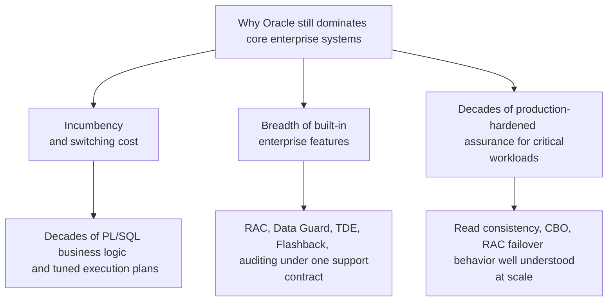

## 4. Core Concepts

Oracle Database's distinguishing architecture rests on ten interlocking
first-principles ideas: how memory is organized into shared and per-process
regions (Sections 4.1-4.3), the fixed roster of background processes that
keep those memory regions durable and consistent (Section 4.4), how data is
physically laid out on disk (Section 4.5), how readers see a consistent
snapshot of data without blocking writers (Section 4.6), Oracle's first-class
procedural language (Section 4.7), how the optimizer decides how to execute
a query (Section 4.8), and Oracle's two flagship high-availability
technologies for scaling out within a data center (Section 4.9, RAC) and
across data centers (Section 4.10, Data Guard).

### 4.1 The Instance/Database Distinction

**Definition.** Oracle draws a strict distinction between an **instance** —
the SGA plus the set of background processes running in memory — and a
**database** — the physical collection of datafiles, control files, and
redo log files on disk. A single-instance deployment has exactly one
instance mapped to exactly one database; RAC (Section 4.9) is precisely the
case where *multiple* instances, each on a different host, mount and open
the *same* physical database concurrently.

**Mechanism.** When Oracle "starts up," it proceeds through three
well-defined states: `NOMOUNT` (the instance's SGA is allocated and
background processes start, but no database is associated yet — Oracle
reads only its parameter file), `MOUNT` (the instance reads the control file
and associates itself with a specific database's physical structure, but
datafiles are not yet opened for general use), and `OPEN` (datafiles are
opened, any required crash-recovery redo is applied, and the database
becomes available for normal SQL). This staged startup is what lets a
Database Administrator (DBA) perform certain physical-structure operations
(renaming datafiles, enabling `ARCHIVELOG` mode) at the `MOUNT` stage before
the database is exposed to application traffic.

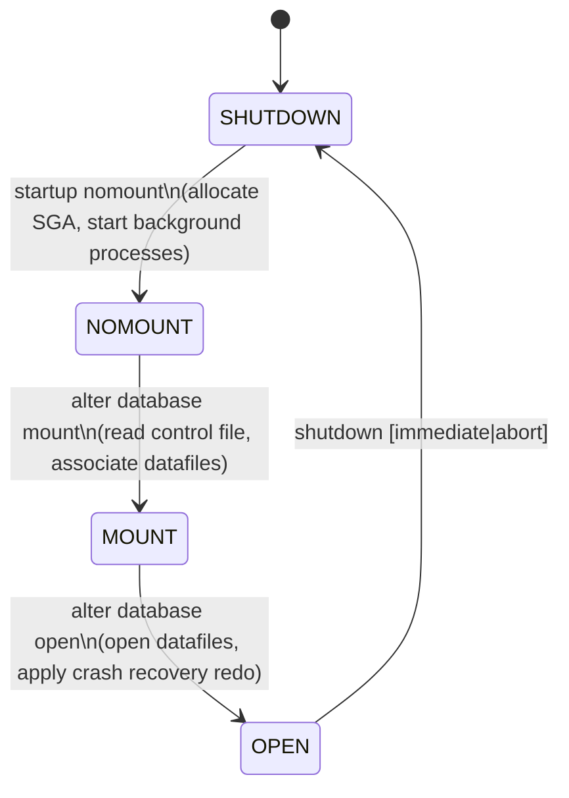

**Decision implications.** Understanding this distinction matters
operationally: a DBA restoring a backup or enabling archive logging must
know the state is `MOUNT`, not `OPEN`, and an architect designing monitoring
must know that "the instance is up" (background processes alive, SGA
allocated) is a necessary but not sufficient condition for "the database is
serving queries" (state `OPEN`).

**Failure mode.** Confusing instance-level and database-level failure is a
common operational mistake: an instance can crash (for example, `ORA-03113:
end-of-file on communication channel` from a killed background process)
while the underlying database's datafiles remain perfectly intact, requiring
only instance recovery (replaying redo, Section 4.4) rather than restoring
from backup — treating every crash as a "restore from backup" event wastes
hours of unnecessary recovery time.

**Scenario.** A batch job kills the server hosting a single-instance Oracle
database mid-transaction. On restart, Oracle automatically performs
*instance recovery*: it rolls forward all committed-but-not-yet-checkpointed
changes from the online redo log, then rolls back any transaction that was
in-flight (uncommitted) at the moment of the crash, using undo data (Section
4.6) — no DBA intervention, no restore, and no data loss for any transaction
that had already been durably written to the redo log at commit time.

### 4.2 SGA Architecture: The Shared Memory Backbone

**Definition.** The System Global Area (SGA) is a single block of shared
memory, allocated once at instance startup, that every server process and
background process for that instance can read and (with appropriate
synchronization) write. It is the backbone that lets many concurrent
sessions share cached data and metadata instead of each maintaining its own
private, redundant copy.

**Mechanism.** The SGA is subdivided into several distinct pools, each
serving a different purpose:

- **Buffer cache** — caches copies of datafile blocks (Section 4.5) in
  memory so repeated reads of the same block avoid physical disk I/O; dirty
  (modified) buffers are written back to disk by the Database Writer
  background process (Section 4.4), not synchronously by the session that
  modified them.
- **Shared pool** — caches parsed and optimized SQL execution plans (the
  *library cache*) and cached data-dictionary metadata (the *dictionary
  cache*), so that a second execution of an identical SQL statement can skip
  re-parsing and re-optimizing it entirely (a *soft parse* / cursor cache
  hit) instead of repeating the full parse-optimize cycle (a *hard parse*).
- **Redo log buffer** — a small, fast in-memory ring buffer holding redo
  records (the durable record of every change, Section 4.4) before the Log
  Writer background process flushes them to the on-disk online redo log.
- **Large pool** (optional) — used for memory-intensive operations that
  would otherwise fragment the shared pool, notably Recovery Manager (RMAN)
  backup buffers and shared-server session memory.
- **Java pool** (optional) — memory for the in-database JVM's session-level
  Java state, relevant only if the application uses Java stored procedures.

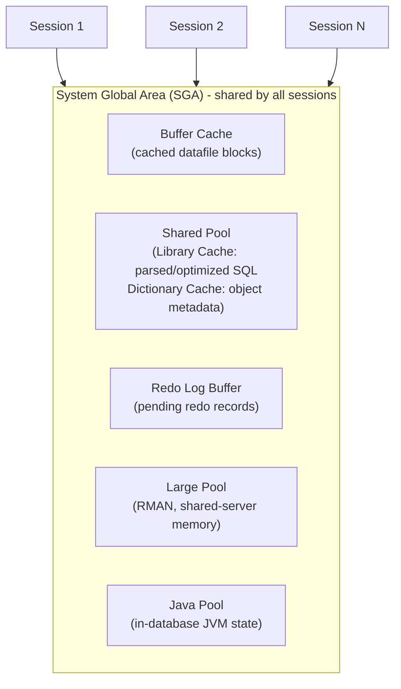

**Decision implications.** Sizing the buffer cache and shared pool is one of
the highest-leverage tuning decisions on an Oracle system: an undersized
buffer cache forces repeated physical reads of hot blocks (visible as high
`physical reads` in Automatic Workload Repository (AWR) reports), while an
undersized shared pool forces excessive hard parsing (visible as high
`parse count (hard)`), both of which are directly observable and directly
actionable, unlike more opaque tuning levers in some other engines.

**Failure mode.** The classic shared-pool failure mode is **not using bind
variables**: an application that embeds literal values directly in SQL text
(`WHERE customer_id = 40217` vs. `WHERE customer_id = :id`) causes every
distinct literal value to be treated as a distinct SQL statement requiring
its own hard parse and its own library-cache entry, exhausting the shared
pool and consuming CPU on unnecessary optimization work — a well-known
Oracle anti-pattern with its own name, "bind variable peeking" issues aside,
this is simply "not using bind variables at all," and it is one of the most
common root causes of shared-pool latch contention and library-cache
thrashing on legacy Oracle applications.

**Scenario.** A reporting application generates ad-hoc SQL by string-
concatenating filter values instead of using bind variables. Under load, the
shared pool fills with tens of thousands of near-identical, one-use-only
cursors, `V$SGASTAT` shows the shared pool at 100% utilization, and new hard
parses start evicting other sessions' still-useful cached plans — global
slowdown from a code-level SQL-construction decision, not from insufficient
memory.

### 4.3 PGA: Per-Process Private Memory

**Definition.** The Program Global Area (PGA) is memory private to a single
server process (or, in shared-server configurations, private to a single
session's active request), used for session-specific work that must not be
shared across sessions: sort space, hash-join work areas, PL/SQL variables,
and the session's cursor state.

**Mechanism.** Each server process gets its own PGA, sized dynamically (in
modern Oracle, via `PGA_AGGREGATE_TARGET`/`PGA_AGGREGATE_LIMIT`, which cap
total PGA memory across all sessions rather than per-session). When a sort
or hash join's working set fits inside the process's allotted PGA memory,
Oracle performs it entirely in memory (an *optimal* sort/join, visible in
`V$SQL_WORKAREA` statistics); when it does not fit, Oracle spills
intermediate results to temporary tablespace on disk (a *one-pass* or,
worse, *multi-pass* operation), which is dramatically slower because it
adds disk I/O to what would otherwise be a pure in-memory operation.

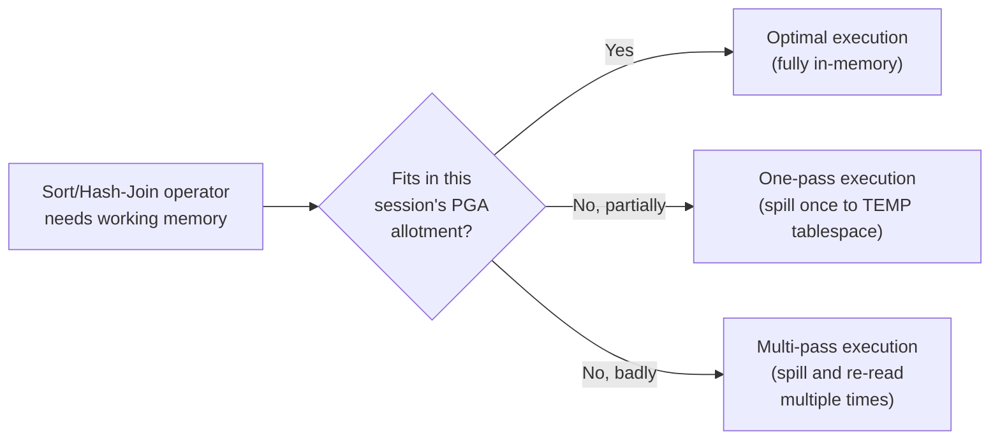

**Decision implications.** Because PGA is per-process, the total memory
footprint of an Oracle instance scales with the *number of concurrent
sessions*, not just the SGA's fixed size — this is the primary reason
connection pooling (bounding the number of concurrent server processes) and
Oracle's shared-server architecture (multiplexing many client sessions onto
fewer server processes) both matter directly for memory-capacity planning,
distinct from generic application-level connection-pooling advice.

**Failure mode.** An application that opens far more direct database
connections than the host has memory to support each with a comfortably
sized PGA will either force Oracle to shrink each session's effective sort
area (pushing more operations into one-pass or multi-pass spills) or exhaust
host memory entirely, causing the operating system to start paging or the
instance to fail allocation requests outright.

**Scenario.** A poorly bounded connection pool spikes from 50 to 800
concurrent connections during a traffic surge. `PGA_AGGREGATE_LIMIT` throttles
per-session work area allocations to stay within the aggregate cap, sort-
heavy reporting queries that used to run as optimal, fully in-memory sorts
now spill to the temporary tablespace, and disk I/O on the temp tablespace
becomes the new bottleneck — a connection-pool sizing decision, not a query
or index problem, is the actual root cause.

### 4.4 Background Processes: The Fixed Roster That Keeps the SGA Durable

**Definition.** Every Oracle instance runs a fixed set of background
processes, each with a single, narrowly scoped responsibility for keeping
the in-memory SGA and the on-disk database consistent, recoverable, and
performant. Unlike application server processes, these are not
configurable-away; they are part of what "an Oracle instance" *is*.

**Mechanism.** The core roster and each process's job:

- **PMON (Process Monitor)** — detects and cleans up after failed or
  disconnected sessions: releases their locks, rolls back their
  uncommitted transactions using undo data (Section 4.6), and returns their
  resources to the pool.
- **SMON (System Monitor)** — performs instance recovery at startup (rolling
  forward redo, then rolling back in-flight transactions), and performs
  ongoing space-management housekeeping such as coalescing free space and
  cleaning up temporary segments left behind by failed sorts.
- **DBWn (Database Writer, one or more processes numbered DBW0, DBW1, ...)**
  — writes modified ("dirty") buffers from the buffer cache back to
  datafiles, triggered by checkpoints, a full buffer cache, or a timeout —
  critically, DBWn writes are *asynchronous* to a transaction's commit; a
  `COMMIT` does not wait for dirty buffers to reach disk, only for the
  corresponding redo to reach the online redo log (this is why LGWR,
  next, is on the commit-latency critical path and DBWn is not).
- **LGWR (Log Writer)** — flushes the redo log buffer to the online redo log
  files on disk. Because Oracle's durability guarantee is "committed data is
  recoverable from redo," `COMMIT` in Oracle blocks until LGWR confirms the
  corresponding redo record is durably on disk (or, in some asynchronous
  commit configurations, accepts a reduced durability guarantee explicitly
  in exchange for lower commit latency) — this is Oracle's specific
  instantiation of the generic write-ahead-log-based durability mechanism
  taught in [Transactions](CH08_Transactions.md#acid-properties-atomicity-consistency-isolation-durability-and-their-mechanisms).
- **CKPT (Checkpoint)** — periodically signals a checkpoint: records in the
  control file and datafile headers the point up to which DBWn has written
  all dirty buffers, bounding how much redo instance recovery would ever
  need to replay after a crash.
- **ARCn (Archiver, one or more processes)** — when the database runs in
  `ARCHIVELOG` mode, copies each filled online redo log file to an archived
  location before it can be reused, which is what makes point-in-time
  recovery and Data Guard's redo shipping (Section 4.10) possible at all; in
  `NOARCHIVELOG` mode, filled redo logs are simply overwritten and only
  full/instance-level (not point-in-time) recovery is possible.

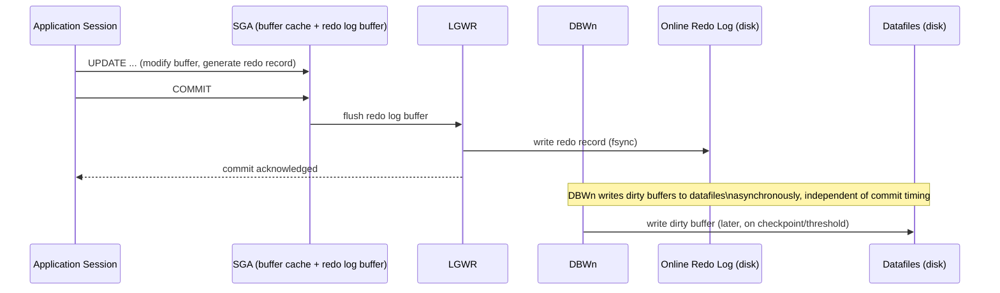

**Decision implications.** The DBWn/LGWR split is the architectural reason
Oracle (like every write-ahead-logging engine) can offer low commit latency
without sacrificing durability: only the small, sequentially written redo
record must hit disk synchronously at commit time; the larger, randomly
scattered datafile writes happen lazily and asynchronously, batched for
efficiency. An architect tuning commit latency should look first at redo log
placement (fast, low-latency storage, since LGWR is synchronous) and only
second at buffer-cache/DBWn tuning (which affects read performance and
recovery time, not commit latency directly).

**Failure mode.** If ARCn cannot archive a filled redo log fast enough
(destination full or unreachable) and all online redo log groups fill up
before the oldest is archived, Oracle *stalls all commits* rather than
silently switching to `NOARCHIVELOG` behavior and losing recoverability —
this is a deliberate, conservative design choice (durability and
recoverability over availability) that surprises teams who expect
degradation instead of a hard stop.

**Scenario.** A Data Guard standby's network link goes down for several
hours (Section 4.10). If the primary is configured to require the standby's
acknowledgment before archiving locally (a maximum-protection/maximum-
availability mode), ARCn on the primary can back up waiting for the
unreachable standby, and in the strictest protection mode the primary itself
will stall application commits rather than risk an unacknowledged, un-
replicated commit — a direct, observable trade-off between availability and
Data Guard's zero-data-loss guarantee that an architect must consciously
choose the protection mode for, not discover during an incident.

### 4.5 Tablespaces and Datafiles: The Physical Storage Model

**Definition.** A **tablespace** is Oracle's logical storage container — the
unit a DBA thinks and operates in ("put this table in the `USERS`
tablespace," "this tablespace is 80% full") — and it is backed by one or
more **datafiles**, the actual operating-system files on disk where bytes
physically live. Every table, index, and other storage-consuming object
belongs to exactly one tablespace (partitioned objects can span several),
and Oracle allocates space to that object from the tablespace's datafiles in
units called **extents** (contiguous runs of **blocks**, the fixed-size unit
— typically 8 KB — that is the smallest unit Oracle reads or writes).

**Mechanism.** The containment hierarchy is strict and one-directional:

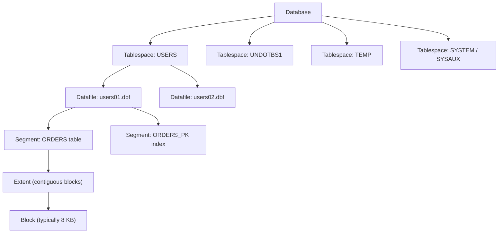

Special-purpose tablespaces exist by convention: `SYSTEM` holds the core
data dictionary, `SYSAUX` holds auxiliary metadata (AWR history, job
scheduler state) split out of `SYSTEM` since 10g to reduce contention on it,
`UNDOTBS1` (or similarly named) holds undo segments (Section 4.6), and
`TEMP` holds transient sort/hash-join spill space (Section 4.3) and is never
backed up because it holds no durable data.

**Decision implications.** Tablespace design is a direct lever over backup
scope, I/O isolation, and recovery granularity: separating high-churn
tables' tablespace from read-mostly reference-data tablespaces lets a DBA
back up the read-mostly tablespace far less frequently, place it on cheaper
storage, and — critically — restore or recover a single damaged tablespace's
datafiles without taking the whole database offline (an `OPEN` database can
have individual tablespaces `OFFLINE` for recovery while the rest stays
available). This is the direct physical-layer analogue of the logical
partitioning strategy taught generically in
[Partitioning](CH05_Partitioning.md#partition-maintenancerolling-window-pattern-local-vs-global-indexes-composite-sub-partitioning-storage-tiering);
Oracle additionally lets a DBA map partitions to specific tablespaces,
combining logical partition pruning with physical storage tiering (hot
partitions on fast storage, cold partitions on cheap storage) in one
mechanism.

**Failure mode.** Undersizing or mismanaging the `TEMP` tablespace is a
recurring production incident class: a runaway ad-hoc query with a bad join
order (Section 4.8) or missing index can request enough sort/hash-join
spill space to exhaust `TEMP`, throwing `ORA-1652: unable to extend temp
segment` and failing not just the offending query but potentially other
concurrent queries competing for the same shared `TEMP` tablespace.

**Scenario.** A data-warehouse nightly Extract, Transform, Load (ETL) job's
hash join spills to `TEMP` because a stale statistics-driven cardinality
misestimate (Section 4.8) causes Oracle to under-allocate PGA for the join.
The spill exhausts a shared, undersized `TEMP` tablespace mid-batch,
cascading failures to three unrelated concurrent reporting queries that
happened to need `TEMP` space at the same moment — a single query's
optimizer misestimate becomes a multi-tenant incident because `TEMP` space
is a shared resource across all sessions in the tablespace.

### 4.6 Undo Segments and Read Consistency: Oracle's MVCC

**Definition.** Oracle guarantees that every query sees a transactionally
consistent snapshot of the data as of a single point in time (the query's
start, by default) even while other sessions are concurrently modifying the
same rows — the general Multi-Version Concurrency Control (MVCC) idea taught
in [Transactions](CH08_Transactions.md#multi-version-concurrency-control-mvcc).
Oracle's specific mechanism for this is **undo segments**: before overwriting
a row's current value in a datafile block, Oracle first writes the row's
*previous* value into an undo segment, tagged with the System Change Number
(SCN) — a strictly increasing logical clock Oracle stamps on every commit —
of the transaction that is about to overwrite it.

**Mechanism.** When a query begins, Oracle records the current SCN as that
query's read-consistency snapshot point. If the query later needs to read a
block that has since been modified by a *newer* transaction (higher SCN
than the query's snapshot SCN), Oracle detects the mismatch, locates the
corresponding undo record, and reconstructs — "rolls back," in the read
sense, not the transactional sense — the block as it looked at the query's
snapshot SCN, entirely transparently to the querying session.

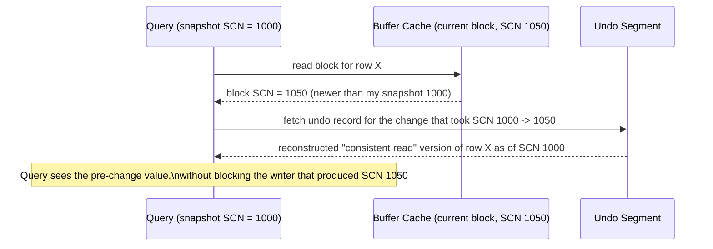

This is why Oracle's default read behavior needs no shared/read locks at
all for ordinary `SELECT` statements — a design point Oracle marketing has
long summarized as "writers don't block readers, and readers don't block
writers," in contrast to purely lock-based (non-MVCC) engines where a long-
running reader can hold shared locks that block writers.

**Decision implications.** Undo retention is a tunable, finite resource
(`UNDO_RETENTION` plus the undo tablespace's size), and it directly bounds
how long a long-running query can run before it might need undo that has
already been overwritten/reused by newer transactions. Architects designing
long-running reports or batch extracts against an actively written-to
Oracle database must explicitly size undo retention (or use Flashback Data
Archive for guaranteed longer retention) to cover the query's expected
runtime, not assume undo is unbounded.

**Failure mode.** **`ORA-01555: snapshot too old`** is the signature failure
of this mechanism: a long-running query needs an undo record that has
already been overwritten (because the undo tablespace filled up and Oracle
had to reuse that undo segment's space for a newer transaction's undo, or
because `UNDO_RETENTION` was configured too short relative to the query's
runtime). The fix is almost never "increase memory" — it is sizing the undo
tablespace and retention period to the *longest-running* concurrent query in
the workload, or reducing that query's runtime (better indexing, smaller
batches).

**Scenario.** A monthly reconciliation report takes four hours to run
against a database with heavy concurrent Online Transaction Processing
(OLTP) write traffic and an undersized undo tablespace tuned only for OLTP's
short transactions. Ninety minutes into the report, a burst of OLTP activity
forces Oracle to reuse undo space the report still needed for read
consistency, and the report fails with `ORA-01555` — an undo-sizing
architecture decision, not a bug in the report's SQL, is the root cause, and
the fix is either a larger, longer-retention undo tablespace or running the
report against an Active Data Guard standby (Section 4.10) that is isolated
from the primary's undo pressure entirely.

### 4.7 PL/SQL: Procedural Language as a First-Class Server Citizen

**Definition.** PL/SQL (Procedural Language/SQL) is Oracle's compiled,
server-resident procedural extension to SQL — an Ada-influenced language
with variables, conditionals, loops, exception handling, and modular units
(stored procedures, functions, packages, triggers) that is parsed, compiled
to an intermediate representation, and executed *inside the database
process itself*, not shipped to and executed by a separate application-tier
process.

**Mechanism.** PL/SQL blocks and SQL statements share a single execution
engine inside the server: a PL/SQL block can contain SQL statements without
any network round-trip between "the procedural logic" and "the SQL," and a
single client call to invoke a stored procedure that runs a loop of a
thousand `INSERT` statements incurs exactly one client-server network
round-trip, not a thousand. This is the core value proposition versus doing
the equivalent logic in an external application: eliminating chatty,
round-trip-per-statement network traffic when a workflow is naturally
several dependent SQL operations in sequence.

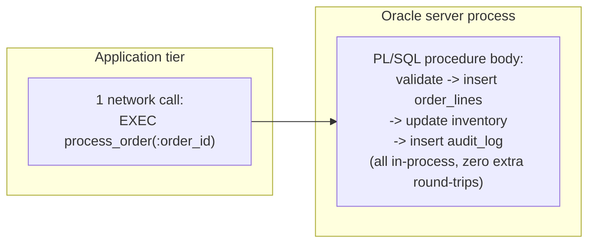

Compare this to the same four-step workflow implemented in an external
application tier issuing four separate SQL statements over the network:
four round-trips instead of one, each carrying its own network latency, even
though the actual database work is identical.

**Decision implications.** PL/SQL is the right tool for logic that is
*data-intensive and round-trip-sensitive* — bulk data validation,
multi-step data transformations, trigger-based auditing/enforcement, and
tight loops over large result sets (using PL/SQL's `BULK COLLECT`/`FORALL`
constructs to batch many rows per round-trip even within a single PL/SQL
call to the underlying SQL engine). It is the *wrong* tool for logic that
is business-rule-heavy but not data-intensive, for logic that must be
portable across database vendors, or for logic that benefits from an
external application tier's testing frameworks, dependency injection, and
deployment tooling — over-using PL/SQL for general business logic tightly
couples the application to Oracle specifically and moves compute load onto
often more expensive-to-scale database infrastructure instead of a
horizontally scalable application tier.

**Failure mode.** "Business logic sprawl into the database" is the classic
long-term risk: years of incrementally added triggers, packages, and stored
procedures accumulate into an opaque, hard-to-test, hard-to-version, and
hard-to-migrate-away-from layer of logic that lives only inside the
database, invisible to the application codebase's version control and code
review process unless the team is deliberately disciplined about treating
PL/SQL source as first-class, reviewed, version-controlled code.

**Scenario.** A financial-close batch job that used to make four thousand
individual round-trip `UPDATE` statements from a Java application, taking 40
minutes dominated by network latency, is rewritten as a single PL/SQL stored
procedure using `BULK COLLECT`/`FORALL` to batch the same logical updates —
the batch job's runtime drops to under 3 minutes, not because the database
does less work, but because it does the same work with orders of magnitude
fewer network round-trips.

### 4.8 Oracle's Cost-Based Optimizer: Statistics, Hints, and Execution Plans

**Definition.** Oracle's Cost-Based Optimizer (CBO) is Oracle's specific
implementation of the generic cost-based query optimization model taught in
[Query Optimizers](CH04_Query_Optimizers.md#cost-based-query-optimization-vs-rule-based-query-processing-pipeline-parsebindrewriteoptimizeexecute):
it estimates the resource cost of many candidate execution plans for a
given SQL statement and chooses the one with the lowest estimated cost,
using table/column/index statistics as its primary cardinality-estimation
input, exactly as the generic model describes. This section teaches Oracle's
concrete, product-specific realization of that generic model: how
statistics are gathered, how hints override the optimizer's own choice, and
how to read Oracle's specific execution-plan output format.

**Mechanism.** Oracle statistics are gathered (by default, via an automated
nightly job, or manually via `DBMS_STATS.GATHER_TABLE_STATS`) and stored in
the data dictionary: row counts, distinct-value counts per column,
column-value histograms for skewed columns, and index clustering-factor
statistics (how well-correlated an index's row order is with the table's
physical block order — a low clustering factor means an index range scan
will touch few distinct table blocks; a high one means it will touch nearly
one block per row, dramatically increasing the cost of using that index for
a range scan).

`EXPLAIN PLAN` (or `DBMS_XPLAN.DISPLAY_CURSOR` for an already-executed
statement's *actual* plan, including real row counts) shows the plan as an
indented tree, read using the same bottom-up, innermost-first discipline
taught generically in
[Query Optimizers](CH04_Query_Optimizers.md#explainexecution-plan-reading-model-plan-caching-and-parameter-sniffing):

```
--------------------------------------------------------------------
| Id | Operation                    | Name        | Rows | Cost (%CPU) |
--------------------------------------------------------------------
|  0 | SELECT STATEMENT             |             |      |     42 (100)|
|  1 |  NESTED LOOPS                |             |   18 |     42  (0) |
|  2 |   TABLE ACCESS BY INDEX ROWID| ORDERS      |    5 |     12  (0) |
|* 3 |    INDEX RANGE SCAN          | ORDERS_CUST |    5 |      4  (0) |
|  4 |   TABLE ACCESS BY INDEX ROWID| ORDER_LINES |    4 |      6  (0) |
|* 5 |    INDEX RANGE SCAN          | OL_ORDER_FK |    4 |      3  (0) |
--------------------------------------------------------------------
Predicate Information (identified by operation id):
   3 - access("O"."CUSTOMER_ID"=:CUST_ID)
   5 - access("OL"."ORDER_ID"="O"."ORDER_ID")
```

**Hints** (`/*+ INDEX(...) */`, `/*+ FULL(...) */`, `/*+ LEADING(...) */`,
`/*+ USE_HASH(...) */`, and dozens more) let a developer or DBA override a
specific optimizer decision — join method, join order, access path — when
the optimizer's own choice is demonstrably wrong for reasons the optimizer
cannot see (for example, a data distribution the current statistics do not
yet reflect, or business knowledge that a particular filter is far more
selective in production than the sampled statistics suggest).

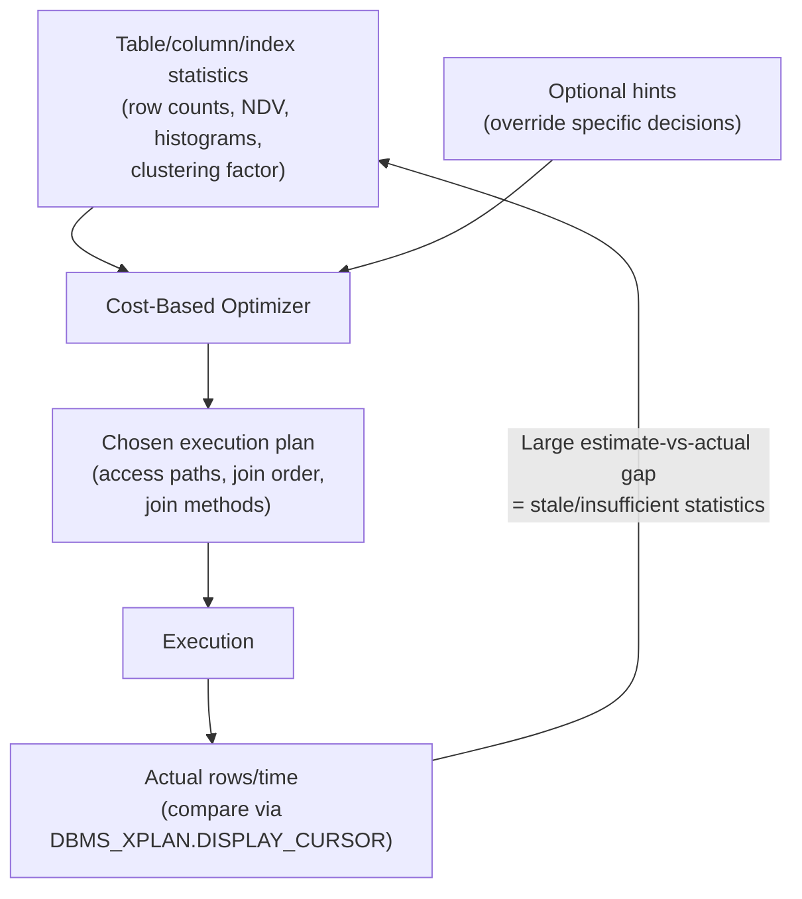

**Decision implications.** The first and almost-always-correct response to
"the optimizer chose a bad plan" is to check whether statistics are stale or
insufficient (missing histograms on a skewed column, statistics gathered
before a large data load) *before* reaching for a hint — hints are a
targeted, last-resort override for cases statistics genuinely cannot fix
(query-specific business knowledge, deliberately pinning a plan for
stability), not a first-line tuning tool, because hints hard-code a decision
that may become wrong as data distribution changes over time, while fixing
statistics lets the optimizer keep adapting correctly.

**Failure mode.** **Bind variable peeking combined with skewed data** is a
distinctive Oracle CBO failure mode: Oracle "peeks" at the actual literal
value bound to a bind variable the *first* time a statement is hard-parsed,
and caches a plan optimized for that specific value's selectivity; if a
later execution binds a very differently selective value (for example, a
status code that matches 1% of rows the first time and 90% of rows the
next), the cached plan — optimal for the first value — can be badly wrong
for the second, a phenomenon severe enough that Oracle later added Adaptive
Cursor Sharing specifically to detect and mitigate it by maintaining
multiple cached plans per statement when peeking proves unstable.

**Scenario.** An order-status query with a bind variable is first executed
filtering for a rare status (`'CANCELLED'`, 0.1% of rows), and the optimizer
correctly chooses an index range scan, caching that plan. A later execution
of the *identical* SQL text filters for a common status (`'COMPLETED'`, 60%
of rows) and reuses the cached index-scan plan (a soft parse skips
re-optimization), causing Oracle to perform tens of thousands of single-block
index-then-table lookups instead of one efficient full table scan —
diagnosable by comparing `DBMS_XPLAN.DISPLAY_CURSOR`'s estimated vs. actual
row counts, and fixable via Adaptive Cursor Sharing (automatic in modern
Oracle) or, historically, `NO_BIND_AWARE`/literal-based workarounds.

### 4.9 Real Application Clusters (RAC): Shared-Everything Clustering

**Definition.** Real Application Clusters (RAC) lets multiple Oracle
instances, each running on a different physical or virtual host, mount and
open the *same* physical database — the same set of datafiles on shared
storage — simultaneously, so a single database can serve traffic through
multiple concurrently active server nodes rather than one. This is a
**shared-everything** architecture: every RAC instance can read and write
any block in the shared datafiles, in contrast to a **shared-nothing**
architecture (as taught generically for horizontal scale-out in
[Sharding](CH06_Sharding.md)) where each node owns a disjoint subset of the
data.

**Mechanism.** The central problem RAC must solve is: if instance A on host
1 and instance B on host 2 can both cache and modify the same datafile
block in their respective local buffer caches, how do they stay consistent
without constantly re-reading from shared disk? RAC's answer is **Cache
Fusion**: instances communicate directly over a dedicated, low-latency
private interconnect network, and when instance B needs a block that
instance A currently holds in a modified (dirty) state in its buffer cache,
Cache Fusion ships the block *directly from instance A's memory to instance
B's memory* over the interconnect — no disk write and re-read required —
coordinated by a distributed lock manager (the Global Cache Service) that
tracks which instance currently "masters" each block's cache-coherency
state.

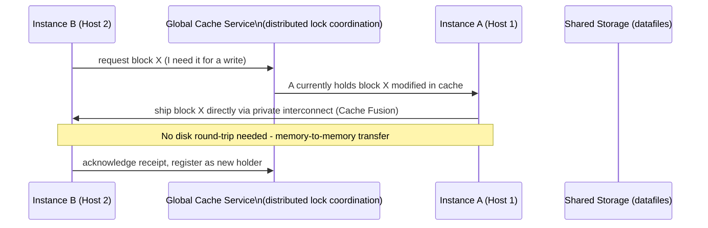

**Decision implications.** RAC's value proposition is **availability and
horizontal scale-out within a single logical database**, not disaster
recovery: because all instances share the same storage, a storage-level
failure or a shared-data corruption affects every instance equally — RAC
protects against a single *server/instance* failure (the surviving instances
keep serving traffic with no failover delay, since they were already
active), not against a storage failure or a data-center-level outage, which
is exactly the failure class Data Guard (Section 4.10) is designed for
instead. Architects frequently combine both: RAC for intra-data-center
instance-level high availability, Data Guard for inter-data-center disaster
recovery.

**Failure mode.** RAC's **interconnect** is the architecture's most
sensitive dependency: because Cache Fusion depends on fast, reliable
inter-instance communication, a slow, congested, or misconfigured private
interconnect network directly manifests as high `gc buffer busy`/`gc cr
request` wait events and degraded application response time across the
*entire* cluster, not just one node — a networking problem between database
servers becomes indistinguishable from a database performance problem
without specifically knowing to look at interconnect-related wait events.

**Scenario.** A workload with poor **application-to-instance affinity** —
transactions for the same "hot" rows (for example, a single popular
product's inventory row during a flash sale) randomly load-balanced across
all RAC instances instead of consistently routed to one — forces constant
Cache Fusion block transfers for that hot block back and forth between
instances, an anti-pattern often called "ping-ponging"; the fix is either
service-based connection routing that keeps a given workload's traffic
affinitized to one instance, or accepting that RAC's shared-everything model
has diminishing returns for workloads with extreme single-row write
contention, regardless of how many instances are added.

### 4.10 Data Guard: Standby Databases and Disaster Recovery

**Definition.** Data Guard is Oracle's built-in technology for maintaining
one or more synchronized copies (**standby databases**) of a **primary**
database, typically in a geographically separate data center, so that a
primary-site disaster (data-center loss, storage corruption, regional
outage) can be recovered from by failing over application traffic to a
standby with minimal data loss and minimal downtime — the same leader/
follower replication and failover concepts taught generically in
[Replication](CH07_Replication.md#leaderfollower-replication-mechanics-wal-shippingstreaming-syncasyncsemi-sync-tradeoff)
and
[Replication](CH07_Replication.md#failover-mechanics-and-split-brain-risk-fencing-tokens-stonith-cap-theorempacelc-framing),
applied to Oracle's specific redo-log-based replication mechanism.

**Mechanism.** Data Guard ships redo (the same redo records LGWR generates
for local durability, Section 4.4) from the primary to one or more standby
databases, which continuously *apply* that redo to stay synchronized. Two
standby types exist:

- **Physical standby** — a byte-for-byte identical copy of the primary,
  kept in sync via **Redo Apply**, which replays redo records directly
  against the standby's own datafiles (conceptually similar to
  streaming/log-shipping physical replication generically). Since 11g,
  **Active Data Guard** lets a physical standby be opened read-only while
  Redo Apply continues, enabling read-scaling exactly as described
  generically for read replicas in
  [Replication](CH07_Replication.md#leaderfollower-replication-mechanics-wal-shippingstreaming-syncasyncsemi-sync-tradeoff).
- **Logical standby** — kept in sync via **SQL Apply**, which mines the
  primary's redo, reconstructs the equivalent logical SQL statements, and
  re-executes them against the standby — this lets the logical standby's
  physical structure (different indexes, additional tables) diverge from
  the primary's, at the cost of SQL Apply supporting a narrower range of
  data types and DDL than a byte-identical physical standby.

Data Guard's **protection modes** govern the synchronous-vs-asynchronous
trade-off directly, the same fundamental durability-vs-latency spectrum
taught generically in
[Replication](CH07_Replication.md#leaderfollower-replication-mechanics-wal-shippingstreaming-syncasyncsemi-sync-tradeoff):
**Maximum Protection** requires the standby's acknowledgment of redo receipt
before the primary can commit at all (zero data loss, but the primary halts
if no standby is reachable — an explicit availability-for-durability
trade), **Maximum Availability** also waits for acknowledgment but degrades
gracefully to asynchronous behavior (accepting a small data-loss window) if
the standby becomes unreachable rather than halting the primary, and
**Maximum Performance** ships redo asynchronously with no commit-time wait
at all, minimizing latency impact on the primary at the cost of a larger
potential data-loss window on an unplanned failover.

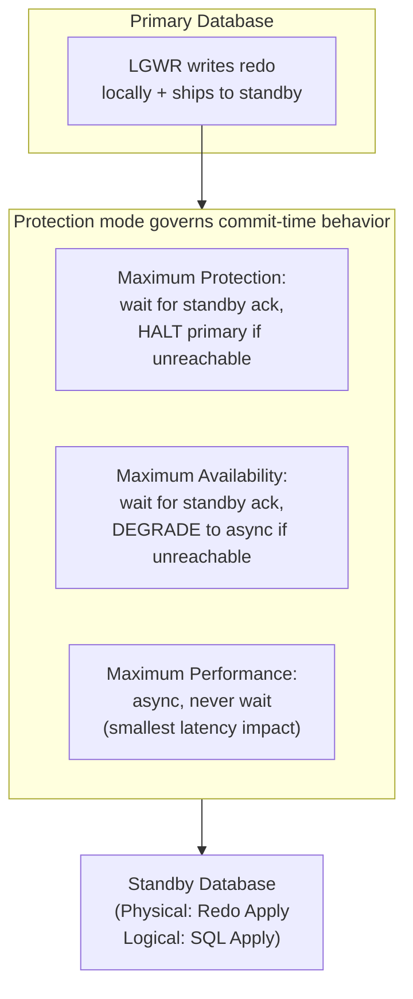

**Fast-Start Failover** automates the manual "switchover/failover" decision:
an Observer process monitors both primary and standby, and if it detects the
primary has genuinely failed (not merely a transient network partition —
the same leader-unreachable-vs-leader-dead distinction taught generically in
[Replication](CH07_Replication.md#failover-mechanics-and-split-brain-risk-fencing-tokens-stonith-cap-theorempacelc-framing)),
it automatically promotes the standby to primary and redirects the old
primary (once it recovers) to reinstate as the new standby.

**Decision implications.** Choosing a protection mode is choosing a point on
the same durability-vs-latency line every replicated system must choose,
made concrete in Oracle-specific terms: a payments system may justify
Maximum Availability's latency cost for its zero-data-loss guarantee, while
a high-throughput analytics-ingestion pipeline may accept Maximum
Performance's small data-loss window in exchange for the primary never
being throttled by a distant standby's acknowledgment latency.

**Failure mode.** Running in **Maximum Protection mode with only one
standby** recreates the exact single-point-of-failure risk the whole
architecture is meant to eliminate: if that one standby becomes unreachable,
the primary *halts all commits* rather than silently weaken its durability
guarantee — a correct and deliberate design choice, but one that
demonstrates why production Maximum Protection deployments require at least
two independent standbys, so one standby's outage never stalls the primary.

**Scenario.** A bank runs Data Guard in Maximum Availability mode with a
standby in a second region. A regional network partition makes the standby
briefly unreachable; Data Guard automatically and transparently degrades to
asynchronous shipping rather than halting the primary, logging the gap so
that once connectivity is restored, the standby catches up via gap
resolution (fetching the missed archived redo, Section 4.4's ARCn) before
resynchronized protection resumes — the "degrade gracefully" behavior
Maximum Availability was specifically designed to provide over Maximum
Protection's harder failure mode.

## 5. Internal Working

This section traces two of Oracle's most operationally significant internal
sequences end-to-end: how a single `UPDATE ... COMMIT;` actually flows
through the architecture from Sections 4.1-4.6, and how Oracle recovers a
crashed instance using exactly the durability mechanism that made the
`COMMIT` safe in the first place.

### 5.1 Anatomy of a Committed Write

When a session issues `UPDATE accounts SET balance = balance - 100 WHERE
id = 1; COMMIT;`, the following sequence occurs:

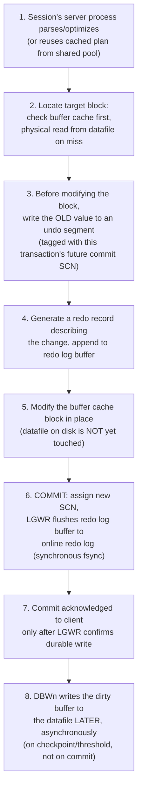

The critical, easy-to-miss detail is step 5 versus step 8: the *in-memory*
buffer cache block is modified immediately, but the *on-disk datafile* is
not modified until DBWn gets around to it, potentially much later. Durability
comes entirely from step 6-7's redo-log fsync, not from the datafile write —
this is precisely why instance recovery (Section 5.2) exists: on a crash
between commit and the eventual DBWn write, the change is durable (it is in
the redo log) but not yet reflected in the datafile, and recovery must
replay the redo to bring the datafile up to date.

### 5.2 Instance Recovery: Rolling Forward, Then Rolling Back

When Oracle restarts after an unplanned instance crash (Section 4.1), SMON
performs **instance recovery** in two distinct phases that must run in this
exact order:

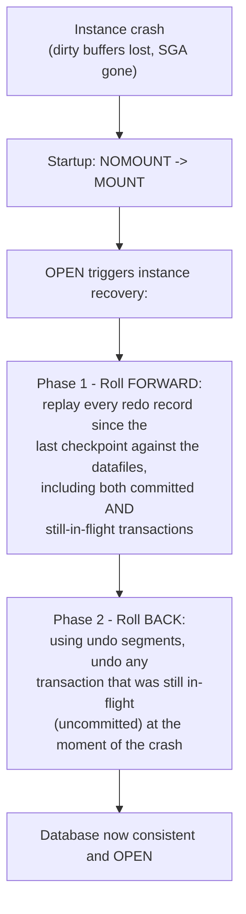

Rolling forward *first* re-creates the exact physical state the database was
in at the instant of the crash — including the effects of transactions that
had not yet committed — because redo alone cannot distinguish "committed"
from "not yet committed" without also having the corresponding undo data
available to reverse the latter; only after the crash-instant state is fully
reconstructed can Oracle correctly identify and undo the specific
transactions that were genuinely in-flight, using the same undo mechanism
that powers ordinary read consistency (Section 4.6). This two-phase
redo-then-undo recovery algorithm is architecturally identical in spirit to
the ARIES recovery algorithm that underlies write-ahead logging in most
mainstream relational engines, applied here with Oracle's specific SCN-based
bookkeeping.

## 6. Design Principles

- **Durability comes from the log, not the data file.** Every design and
  tuning decision in Oracle should respect that commit durability is
  provided by LGWR's synchronous redo write (Section 5.1), not by DBWn's
  asynchronous datafile write — this principle explains why redo log
  placement on the fastest available storage is almost always a higher-
  leverage tuning investment than buffer-cache-only tuning for
  write-heavy, commit-latency-sensitive workloads.
- **Readers must never block writers, and writers must never block
  readers.** Undo-based read consistency (Section 4.6) exists specifically
  to uphold this principle; any design that reintroduces heavy explicit
  locking for ordinary reads (for example, unnecessary `SELECT ... FOR
  UPDATE` on read paths) works against this architecture's core value
  proposition rather than with it.
- **Match the high-availability technology to the failure domain it
  actually covers.** RAC (Section 4.9) addresses instance/server-level
  failure inside one storage domain; Data Guard (Section 4.10) addresses
  site-level/storage-level failure across independent storage domains —
  treating either as a substitute for the other, rather than the
  complementary pair they are designed to be, leaves a real failure class
  unprotected.
- **Push data-intensive, round-trip-sensitive logic into PL/SQL
  deliberately, not by default.** Section 4.7's trade-off should be an
  explicit architectural decision per workflow, weighing network-round-trip
  savings against the coupling and testability cost, not a default habit of
  "when in doubt, write a stored procedure."
- **Trust statistics over hints as the default optimizer-tuning lever.**
  Section 4.8's CBO makes good decisions when given good statistics; fix
  the statistics first, and reserve hints for the narrow set of cases
  statistics genuinely cannot resolve.

## 7. Architecture Patterns

- **Single-instance primary + Active Data Guard standby for read
  scale-out.** A common, relatively low-complexity pattern: one primary
  instance handles all writes, and a physical standby, opened read-only via
  Active Data Guard (Section 4.10), absorbs reporting/analytics read
  traffic — offloading read load without RAC's operational complexity,
  accepting the standby's small replication-lag staleness window (the same
  staleness trade-off taught generically in
  [Replication](CH07_Replication.md#replication-lag-and-read-your-writes-consistency-multi-leader-conflict-resolution)).
- **RAC primary + Data Guard standby ("RAC + DR") for maximum
  availability.** The canonical top-tier enterprise pattern: RAC (Section
  4.9) provides instance-level high availability within the primary site,
  and Data Guard (Section 4.10) provides an entirely separate standby site
  for disaster recovery — two independent, complementary layers of
  redundancy against two different failure domains, common in
  systemically-important-financial-institution deployments.
- **Multitenant Container Database (CDB) with Pluggable Databases (PDBs)
  for consolidation.** Many logically isolated application databases (PDBs)
  share one Container Database's background processes and SGA, reducing
  per-application memory and process overhead versus running each as a
  fully separate instance — a consolidation pattern analogous to
  multi-tenancy patterns in other systems, applied at the database-instance
  level.
- **PL/SQL API layer as the sole write path.** Rather than letting every
  application directly issue raw `INSERT`/`UPDATE`/`DELETE` statements, some
  Oracle shops expose all writes exclusively through a curated PL/SQL
  package API, centralizing business-rule enforcement, auditing, and
  access control inside the database itself — trading application-tier
  flexibility for a single, consistently enforced write-path contract.

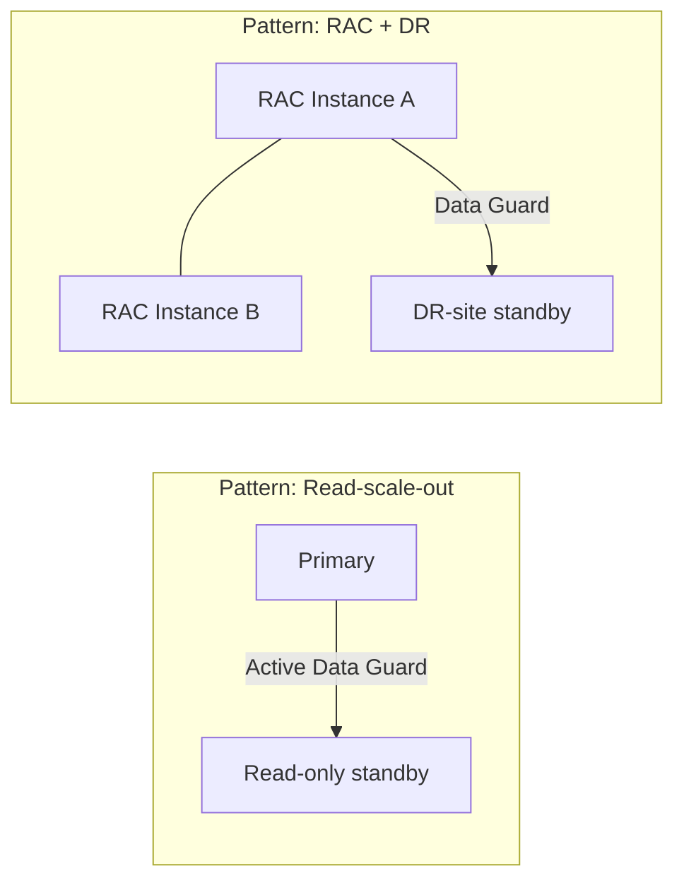

## 8. Production Architecture

A production Oracle deployment for a systemically important workload
typically layers: RAC across two or more nodes within a primary data center
for instance-level availability (Section 4.9), Automatic Storage Management
(ASM) striping datafiles across shared storage for both the RAC nodes,
Active Data Guard shipping redo to at least one, often two, geographically
separate standby sites (Section 4.10) — one for disaster recovery and
optionally a second for read-scale-out reporting — Recovery Manager (RMAN)
performing regular incremental backups against the primary (or, to avoid
backup I/O competing with production traffic, against a standby instead),
and Oracle Enterprise Manager or a third-party observability stack (Section
14) collecting Automatic Workload Repository (AWR) snapshots for capacity
planning and Automatic Database Diagnostic Monitor (ADDM) recommendations.

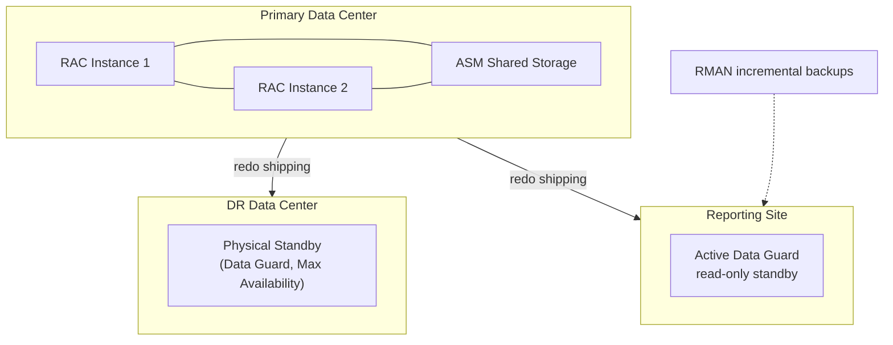

## 9. Implementation

Implementing against Oracle in application code follows the same
JDBC/ODBC/OCI (Oracle Call Interface) driver patterns as any relational
database, with a small number of Oracle-specific concerns an architect
should bake into the application's data-access layer from the start:
always use bind variables (Section 4.2) rather than string-concatenated
literals, size connection pools with PGA capacity in mind (Section 4.3),
explicitly decide which workflows belong in PL/SQL versus the application
tier (Section 4.7), and, for any workload sensitive to plan instability,
consider SQL Plan Baselines (a mechanism, not covered in the generic
[Query Optimizers](CH04_Query_Optimizers.md) chapter, that lets Oracle
persist and prefer a known-good historical plan even if the optimizer would
otherwise choose differently after a statistics change) to protect
production stability against a well-intentioned statistics-gathering job
accidentally regressing a critical query's plan.

## 10. Complete Code Examples

Five runnable/executable examples live under
[code/sql/oracle-chapter/](../code/sql/oracle-chapter/) and
[code/python/oracle-chapter/](../code/python/oracle-chapter/):

1. [`01_tablespace_and_undo_setup.sql`](../code/sql/oracle-chapter/01_tablespace_and_undo_setup.sql)
   — creates a data tablespace and demonstrates undo-tablespace/retention
   configuration (Sections 4.5-4.6), plus a query against
   `V$UNDOSTAT`/`DBA_TABLESPACES` to inspect the resulting layout.
2. [`02_read_consistency_demo.sql`](../code/sql/oracle-chapter/02_read_consistency_demo.sql)
   — a two-session, interleaved walkthrough proving Oracle's undo-based read
   consistency (Section 4.6): a long-running query keeps returning its
   original snapshot while a concurrent session commits changes to the same
   rows.
3. [`03_bulk_plsql_batch.sql`](../code/sql/oracle-chapter/03_bulk_plsql_batch.sql)
   — a PL/SQL package (Section 4.7) using `BULK COLLECT`/`FORALL` to batch
   thousands of logical updates into a handful of round-trips, contrasted
   with an equivalent row-by-row version.
4. [`04_explain_plan_and_hints.sql`](../code/sql/oracle-chapter/04_explain_plan_and_hints.sql)
   — gathers statistics, runs `EXPLAIN PLAN`/`DBMS_XPLAN.DISPLAY`, and
   demonstrates a targeted optimizer hint changing the chosen join method
   (Section 4.8).
5. [`05_sga_pga_diagnostics.py`](../code/python/oracle-chapter/05_sga_pga_diagnostics.py)
   — a Python/`oracledb` script that connects to an Oracle instance and
   prints a human-readable SGA component breakdown, PGA aggregate usage, and
   top wait events, tying the Section 4.2-4.3 memory model to live
   diagnostic queries an architect can run against a real system.

## 11. Performance

Oracle performance tuning follows a strict, evidence-based order of
investigation rather than guesswork: first confirm statistics are current
and representative (Section 4.8) — the majority of "Oracle is slow" incidents
trace back to stale or missing statistics producing a bad cardinality
estimate — then examine wait events (`V$SESSION_WAIT`/AWR reports) to
classify whether the bottleneck is CPU, I/O (physical reads against an
undersized buffer cache, Section 4.2), interconnect (`gc` wait classes on
RAC, Section 4.9), or log-write latency (`log file sync`, tying back to
LGWR, Section 4.4), and only then reach for structural changes (better
indexing, partitioning, or a plan-shaping hint/SQL Plan Baseline) once the
actual bottleneck class is confirmed by evidence rather than assumed.

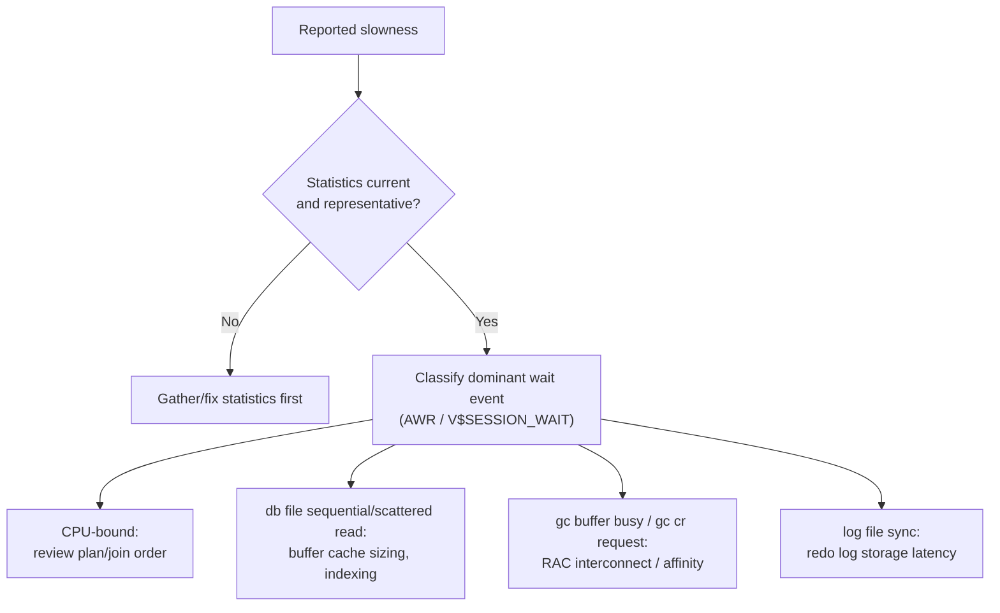

## 12. Scalability

Oracle offers two structurally different scaling axes, and choosing between
them is itself an architectural decision, not a default: **scale up**
(bigger single instance, more CPU/memory on one host, simplest operationally
but bounded by the largest available host) versus **RAC scale-out** (Section
4.9, adding instances within one shared-everything cluster, unbounded by a
single host's ceiling but bounded by interconnect capacity and any
hot-row/affinity contention). For read-heavy scale-out specifically, Active
Data Guard standbys (Section 4.10) add read capacity with far less
operational complexity than RAC, at the cost of a small, bounded replication-
lag staleness window that must be acceptable to the read workload in
question.

## 13. Security

Oracle's security surface includes Transparent Data Encryption (TDE,
encrypting datafiles/tablespaces at rest so an attacker with only the
physical datafiles cannot read them without the encryption keys), Virtual
Private Database (VPD, injecting a row-level security predicate
transparently into every query against a protected table, enforced inside
the database rather than trusted to every application's own filtering
logic), fine-grained auditing (`AUDIT`/Unified Auditing, recording who ran
what against which objects, independent of and not bypassable by
application-tier logging), and Database Vault (restricting even
privileged/DBA accounts from viewing sensitive application data without a
separate authorization). The unifying architectural principle is
**defense enforced inside the engine, not only in the application tier** —
a compromised or misconfigured application cannot bypass VPD row filtering
or TDE encryption the way it could bypass an application-layer-only access
check.

## 14. Observability

The Automatic Workload Repository (AWR) is Oracle's built-in, continuously
sampled performance-history repository: it snapshots hundreds of internal
statistics (wait events, SQL execution statistics, I/O rates, SGA/PGA
utilization) on a regular interval and retains history for trend analysis
and point-in-time incident investigation, feeding both manually generated
AWR reports and the Automatic Database Diagnostic Monitor's (ADDM)
automated bottleneck-classification recommendations. `V$` dynamic
performance views (`V$SESSION`, `V$SQL`, `V$SESSION_WAIT`, `V$SGASTAT`) give
real-time visibility into the exact structures this chapter's Section 4
describes, letting an architect or DBA directly correlate a live incident
back to a specific memory pool, background process, or wait-event class
rather than reasoning about the architecture only in the abstract.

## 15. Failure Scenarios

- **Media/storage failure destroying a datafile.** Recovered by restoring
  the affected datafile from an RMAN backup and applying archived + online
  redo (ARCn's archived logs, Section 4.4) up to the point of failure —
  possible only because the database runs in `ARCHIVELOG` mode; in
  `NOARCHIVELOG` mode, recovery is limited to the last full backup with no
  point-in-time granularity.
- **Coordinator/primary failure during a distributed transaction spanning
  Oracle and an external resource.** Handled by Oracle's XA-compliant
  Two-Phase Commit support (the generic mechanism taught in
  [Transactions](CH08_Transactions.md#two-phase-commit-2pc-saga-pattern-choreography-vs-orchestration-compensating-transactions)),
  which can leave an in-doubt transaction requiring manual DBA resolution
  (`DBA_2PC_PENDING`) if the coordinator crashes mid-protocol.
- **RAC interconnect partition ("split-brain risk").** RAC's Cluster Ready
  Services (CRS) uses a voting-disk-based quorum mechanism to fence off and
  evict any instance that loses interconnect connectivity to the majority,
  preventing two instances from independently believing they each hold
  exclusive ownership of the same block — the same split-brain-prevention
  principle taught generically via fencing tokens/STONITH in
  [Replication](CH07_Replication.md#failover-mechanics-and-split-brain-risk-fencing-tokens-stonith-cap-theorempacelc-framing),
  applied at the intra-cluster level rather than the primary/standby level.
- **`ORA-01555: snapshot too old`.** Covered in depth in Section 4.6 — an
  undersized or misconfigured undo tablespace/retention relative to the
  longest-running concurrent query.

## 16. Testing

Testing against Oracle-specific behavior should exercise: statement
behavior under each relevant isolation level (recapping the generic anomaly
taxonomy in
[Transactions](CH08_Transactions.md#isolation-levels-and-anomaly-taxonomy-dirty-read-non-repeatable-read-phantom-read-write-skew)),
PL/SQL package unit tests (utPLSQL is the dominant open-source PL/SQL
testing framework, providing assertion and mocking primitives inside
PL/SQL itself), execution-plan regression tests (capturing a known-good
plan and failing a build if a statistics or code change silently changes
it, motivating SQL Plan Baselines' production-stability use case from
Section 9), and Data Guard failover drills (regularly rehearsing an actual
switchover, not just trusting the documented Recovery Time
Objective/Recovery Point Objective on paper).

## 17. Common Mistakes

- Building SQL by string concatenation instead of bind variables (Section
  4.2), silently exhausting the shared pool.
- Treating undo retention as unbounded and being surprised by
  `ORA-01555` on the first genuinely long-running report (Section 4.6).
- Reaching for optimizer hints before checking whether statistics are
  stale (Section 4.8) — hard-coding a plan decision that then becomes wrong
  as data changes.
- Treating RAC as a disaster-recovery solution, or Data Guard as a
  substitute for instance-level high availability, instead of understanding
  each addresses a distinct failure domain (Sections 4.9-4.10).
- Letting PL/SQL business logic accumulate for years without the same code
  review, version control, and testing discipline applied to application-
  tier code (Section 4.7).
- Running Data Guard in Maximum Protection mode with only a single standby
  (Section 4.10), reintroducing a single point of failure into an
  architecture meant to eliminate one.

## 18. Best Practices

- Gather and validate statistics as a routine, monitored operational task,
  not an afterthought (Section 4.8).
- Separate high-churn and read-mostly data into distinct tablespaces to
  control backup scope and I/O isolation (Section 4.5).
- Size undo retention and the undo tablespace explicitly against the
  longest-running concurrent query the workload will ever run, not just
  typical OLTP transaction length (Section 4.6).
- Choose Data Guard's protection mode as a deliberate, documented trade-off
  between commit latency and data-loss tolerance, and provision at least
  two standbys before using Maximum Protection mode (Section 4.10).
- Treat PL/SQL source as first-class, version-controlled, code-reviewed,
  and unit-tested code, exactly like application-tier code (Section 4.7).

## 19. Anti-Patterns

- **The "just add a hint" reflex** — reaching for `/*+ INDEX(...) */` or
  similar as the default fix for any bad plan, rather than diagnosing
  whether stale statistics are the real cause (Section 4.8).
- **The monolithic PL/SQL "god package"** — one enormous package
  accumulating unrelated business logic over years with no clear ownership
  boundary, the database-side equivalent of a monolithic god-class
  (Section 4.7).
- **Single, undersized, shared `TEMP` tablespace across wildly different
  workloads** — letting one runaway ad-hoc query's spill starve unrelated
  concurrent queries of temporary space (Section 4.5).
- **"RAC will fix our scaling problem"** — adding RAC nodes to a workload
  whose actual bottleneck is single-row/hot-block write contention (Section
  4.9's ping-ponging failure mode), where more instances make Cache Fusion
  traffic worse, not better.

## 20. Trade-off Analysis

| Decision | Option A | Option B | When to choose A |
|---|---|---|---|
| Availability strategy | RAC (shared-everything, intra-site) | Data Guard (standby, inter-site) | Need survives single-instance/server failure with zero failover delay within one site |
| Standby type | Physical standby (Redo Apply) | Logical standby (SQL Apply) | Need byte-identical failover target and simplest, broadest data-type support |
| Protection mode | Maximum Availability | Maximum Performance | Zero-data-loss is a hard requirement worth some commit-latency cost |
| Business logic placement | PL/SQL in the database | Application-tier code | Workflow is data-intensive and round-trip-sensitive (Section 4.7) |
| Optimizer correction | Fix statistics | Add a hint | The optimizer's estimate is wrong because inputs are stale/insufficient, not because of a case statistics fundamentally cannot capture |

## 21. Comparison Table

| Aspect | Oracle Database | PostgreSQL (generic MVCC engine) | Engine using pure 2PL, no MVCC |
|---|---|---|---|
| Read-consistency mechanism | Undo segments + SCN (Section 4.6) | Tuple versions in the heap + vacuum | Shared/exclusive locks on reads |
| Do readers block writers? | No | No | Often yes |
| Built-in shared-everything clustering | RAC (Section 4.9) | No native equivalent (relies on external tools) | Varies by engine |
| Built-in standby/DR technology | Data Guard (Section 4.10) | Streaming replication (external tooling for automated failover) | Varies by engine |
| First-class in-database procedural language | PL/SQL (Section 4.7) | PL/pgSQL (similar concept, different language) | Varies by engine |
| Licensing model | Commercial, per-core/named-user | Open-source | Varies |

## 22. Real-World Case Study

A large retail bank's core deposits system ran on a single-instance Oracle
database for over a decade with no RAC and no Data Guard, tolerating the
risk because scheduled maintenance windows and nightly backups were judged
sufficient for the observed failure rate. A regional data-center cooling
failure took the primary site fully offline for eleven hours; the bank's
recovery plan (restoring from the previous night's RMAN backup plus
archived redo, Section 15) succeeded but incurred roughly six hours of
unplanned downtime and lost the last few minutes of transactions generated
after the most recent archived-redo shipment off-site — an outcome
inconsistent with the bank's actual regulatory recovery-point requirements.
The remediation program added an Active Data Guard standby in a second
region under Maximum Availability protection mode (Section 4.10): the next
comparable site-level incident, eighteen months later, resulted in an
automated Fast-Start Failover to the standby with under four minutes of
application-visible downtime and zero committed-transaction data loss — the
direct, measurable payoff of moving from "backup and restore" to "hot
standby with automated failover" as the site-failure recovery strategy,
justifying Data Guard's licensing and operational cost against the earlier
incident's actual business impact.

## 23. Interview Questions

1. Explain the difference between an Oracle *instance* and a *database*,
   and why that distinction matters for RAC.
2. How does Oracle achieve "readers never block writers, writers never
   block readers"? What data structure makes this possible, and what is
   its associated failure mode?
3. Walk through what happens, step by step, between a session issuing
   `COMMIT` and that commit being acknowledged to the client. Which
   background process is on the critical path, and which is not?
4. What is the difference between RAC and Data Guard, and what failure
   domain does each protect against?
5. A query's execution plan looks wrong. What do you check first, before
   reaching for a hint, and why?
6. What is `ORA-01555`, what actually causes it, and how do you fix it?
7. When is PL/SQL the right tool for a piece of business logic, and when
   is it the wrong tool?
8. Explain the difference between Maximum Protection, Maximum Availability,
   and Maximum Performance Data Guard protection modes.

## 24. Hands-on Exercises

1. Using the setup script in
   [`01_tablespace_and_undo_setup.sql`](../code/sql/oracle-chapter/01_tablespace_and_undo_setup.sql),
   create a dedicated tablespace and an intentionally small undo
   tablespace, then reproduce `ORA-01555` with a long-running query
   concurrent with heavy writes.
2. Run the two-session read-consistency demo
   ([`02_read_consistency_demo.sql`](../code/sql/oracle-chapter/02_read_consistency_demo.sql))
   and, in your own words, explain at which exact statement the two
   sessions' views of the data diverge and why.
3. Convert the row-by-row loop in
   [`03_bulk_plsql_batch.sql`](../code/sql/oracle-chapter/03_bulk_plsql_batch.sql)
   back into an equivalent set of individual round-trip statements issued
   from an external script, and measure the wall-clock difference.
4. Using [`04_explain_plan_and_hints.sql`](../code/sql/oracle-chapter/04_explain_plan_and_hints.sql),
   deliberately stale the statistics on one table, observe the resulting
   plan change, then fix it by regathering statistics rather than adding a
   hint.
5. Run [`05_sga_pga_diagnostics.py`](../code/python/oracle-chapter/05_sga_pga_diagnostics.py)
   against a test instance and identify which SGA component is consuming
   the largest share of memory, and what that implies about the workload.

## 25. Design Exercises

1. Design the high-availability architecture for a payments-processing
   Oracle database with a zero-data-loss requirement and a Recovery Time
   Objective (RTO) under five minutes, justifying your choice of RAC,
   Data Guard, protection mode, and standby count.
2. Design a tablespace layout for a multi-tenant SaaS application storing
   both high-churn transactional data and rarely changed reference data,
   optimizing for backup scope and I/O isolation.
3. Design an undo-tablespace sizing and retention policy for a system that
   must support both sub-second OLTP transactions and a four-hour nightly
   reconciliation report against the same live database, without either
   workload starving the other.
4. Design the decision criteria your team will use to decide whether a
   given piece of business logic belongs in a PL/SQL package or in the
   application tier, and apply it to three concrete example workflows.
5. Design a plan-stability strategy (SQL Plan Baselines or an equivalent)
   for a critical, latency-sensitive query that must not regress after a
   routine statistics-gathering job runs.

## 26. Architecture Review Questions

1. Does every SQL statement in this application use bind variables, and
   has shared-pool sizing been validated under expected concurrent load?
2. Has undo retention been explicitly sized against the longest-running
   query this system will run, not just typical OLTP transaction length?
3. Which failure domain does this system's high-availability design
   actually protect against — single-instance failure, single-site
   failure, or both — and is that domain coverage explicitly documented
   and tested?
4. If this design uses Maximum Protection mode, are at least two
   independent standbys provisioned, so a single standby's outage cannot
   halt the primary?
5. Is there a documented, tested policy for when business logic belongs in
   PL/SQL versus the application tier, and has it been consistently
   applied?
6. Is plan stability protected (via SQL Plan Baselines or an equivalent)
   for every latency-sensitive query that must not regress after routine
   statistics maintenance?

## 27. Summary

Oracle Database's enduring architecture rests on a small number of
first-principles ideas that this chapter, not the generic relational-
database chapters earlier in this part, is responsible for teaching: a
strict split between shared, instance-wide memory (the SGA, Sections
4.2-4.3) and a fixed roster of background processes (Section 4.4) that keep
that memory durable and consistent with a physical storage model of
tablespaces and datafiles (Section 4.5); a specific, undo-segment-and-SCN-
based implementation of Multi-Version Concurrency Control that lets readers
and writers never block each other (Section 4.6); PL/SQL as a first-class,
in-process procedural extension purpose-built to eliminate network round-
trips for data-intensive workflows (Section 4.7); a Cost-Based Optimizer
whose statistics-driven decisions can be inspected via execution plans and,
when genuinely necessary, overridden with hints (Section 4.8); and two
complementary, purpose-specific high-availability technologies — RAC for
shared-everything, intra-site instance failover (Section 4.9) and Data
Guard for inter-site disaster recovery via standby databases (Section 4.10)
— that an architect must choose between, or combine, based on which
specific failure domain a given workload's availability requirements
actually demand.

## Further Reading

- [Transactions](CH08_Transactions.md) — the generic ACID, isolation-level,
  and MVCC theory this chapter's Section 4.6 applies specifically to
  Oracle's undo-segment mechanism.
- [Replication](CH07_Replication.md) — the generic leader/follower
  replication, lag, and split-brain-prevention theory this chapter's
  Section 4.10 applies specifically to Data Guard.
- [Sharding](CH06_Sharding.md) — the shared-nothing distributed model
  contrasted against RAC's shared-everything model in Section 4.9.
- [Query Optimizers](CH04_Query_Optimizers.md) — the generic cost-based
  optimization pipeline, statistics model, and plan-reading discipline this
  chapter's Section 4.8 specializes to Oracle's CBO, hints, and
  `DBMS_XPLAN` output format.
- [Indexes](CH03_Indexes.md) — the generic B-tree structure underlying
  Oracle's index range scans referenced throughout Section 4.8.
- [Locking](CH10_Locking.md) — the generic lock-type/granularity/deadlock-
  detection mechanics that complement, rather than replace, Oracle's
  MVCC-first concurrency model.
