# Chapter: SQL Server

Part: [06 — Databases and Storage](PART_OVERVIEW.md) · Status: Drafted

## 1. Introduction

Microsoft SQL Server is a commercial, closed-source relational database
management system that has run production workloads inside enterprises
since 1989, and it remains one of the three or four relational engines an
enterprise Solution Architect is statistically most likely to encounter
inside a large organization — alongside PostgreSQL, MySQL/InnoDB, and
Oracle. Part 06's Database Design subsection (Normalization through
Locking) already taught the vocabulary every relational engine shares:
functional dependencies and normal forms, B-tree indexing, cost-based query
optimization, horizontal partitioning and sharding, leader/follower
replication, the ACID (Atomicity, Consistency, Isolation, Durability)
transaction contract, caching, and lock-manager mechanics. This chapter does
**not** re-teach any of that generic theory — it recaps each concept in a
sentence or two, links to its owning chapter, and then spends its full depth
on what makes SQL Server a *specific* engine rather than an interchangeable
implementation of relational theory: its Write-Ahead Logging (WAL)
transaction log and the checkpoint/recovery machinery built on top of it;
the fact that a SQL Server table's rows are physically stored *inside* its
clustered index rather than in a separate heap addressed by a generic index
(a design choice PostgreSQL and MySQL/InnoDB make differently, each with
consequences); Transact-SQL (T-SQL) as a first-class procedural extension of
the SQL standard baked into the query optimizer's execution model; In-Memory
Online Transaction Processing (In-Memory OLTP, codenamed Hekaton) as a
genuinely different, lock-free and latch-free storage engine running inside
the same process as the classical disk-based engine; Query Store as a
built-in, always-on plan-history and regression-diagnosis subsystem; and
columnstore indexes as a column-oriented storage and batch-mode execution
model bolted onto a row-oriented engine for analytical workloads. A reader
who finishes this chapter should be able to explain, from first principles,
why a checkpoint lets SQL Server truncate its transaction log, why a
clustered index choice is a once-per-table physical-storage decision rather
than just another index, how Always On Availability Groups achieve
high availability and disaster recovery without shared storage, why
In-Memory OLTP's optimistic multi-version design eliminates latch
contention that a disk-based table cannot avoid under high concurrency, how
Query Store catches a query that "used to be fast," and when a columnstore
index beats a rowstore index for the same table.

This chapter is the *owning* chapter, per the Concept Ownership Rule in
[STYLE_GUIDE.md](../STYLE_GUIDE.md), for SQL Server-specific architecture:
the transaction log's Logical Sequence Number (LSN) chain and Virtual Log
File (VLF) structure, the checkpoint types and log-truncation prerequisites,
the ARIES-style Analysis/Redo/Undo crash-recovery algorithm as SQL Server
implements it, clustered-index-as-physical-row-storage (as distinct from the
generic clustered-vs-non-clustered *concept* already owned by
[Indexes](CH03_Indexes.md)), Always On Availability Groups (synchronous and
asynchronous replicas, the availability group listener, automatic vs. manual
failover, readable secondaries), In-Memory OLTP's Hekaton engine (lock-free
hash and range indexes, optimistic multi-version rows, natively compiled
stored procedures), Query Store (plan history capture, regressed-query
detection, plan forcing), and columnstore indexes (column segment
compression, batch-mode execution, the Deltastore for trickle inserts).
Everything else in this chapter that overlaps with generic relational theory
— normalization, generic B-tree indexing, cost-based optimization, ACID and
isolation levels, MVCC in the abstract, partitioning, sharding, generic
replication theory, caching, and generic lock-manager mechanics — is
recapped in Section 4 and linked to its owning chapter rather than
re-explained.

## 2. Historical Evolution

- **1989 — SQL Server 1.0 (OS/2, with Sybase)** — Microsoft, Sybase, and
  Ashton-Tate jointly shipped SQL Server 1.0 for IBM's OS/2, itself a port of
  Sybase SQL Server; this is the direct ancestor of Sybase ASE (Adaptive
  Server Enterprise) and modern SQL Server's shared early lineage explains
  why T-SQL and Sybase's own dialect still share deep syntactic roots.
- **1993 — SQL Server 4.2 for Windows NT** — the first version built for
  Microsoft's own Windows NT operating system rather than OS/2, marking the
  platform's decisive move away from Sybase's codebase and toward a
  Windows-native product.
- **1995 — the Sybase partnership ends** — Microsoft and Sybase formally
  split; Microsoft's engineering team (led by figures who had come from the
  Sybase side) rewrote the storage engine from scratch, culminating in SQL
  Server 6.0/6.5 as an independently developed product.
- **1998 — SQL Server 7.0, a full storage-engine rewrite** — 7.0 replaced
  the legacy storage engine entirely, introducing the row/page structure,
  the modern query optimizer, and much of the physical-storage model this
  chapter's Section 4 still describes today.
- **2000 — SQL Server 2000** — widely regarded as the version that
  established SQL Server as an enterprise-credible platform, with clustering
  support and the beginnings of serious Business Intelligence (BI) tooling
  (Analysis Services, Integration Services precursors).
- **2005 — SQL Server 2005, database mirroring and the CLR** — introduced
  Database Mirroring (Always On Availability Groups' direct architectural
  ancestor), the Common Language Runtime (CLR) integration for
  in-process .NET stored procedures, and Dynamic Management Views (DMVs) —
  the observability foundation this chapter's Section 14 still relies on.
- **2008 — SQL Server 2008, Resource Governor and Transparent Data
  Encryption** — added workload-isolation tooling and encryption-at-rest,
  reflecting the platform's push into regulated-industry enterprise
  deployments.
- **2012 — SQL Server 2012, Always On Availability Groups replace database
  mirroring** — this release replaced the deprecated single-database
  mirroring feature with Availability Groups, letting a set of databases
  fail over together as a unit with readable secondaries — the feature this
  chapter's Section 4.3 covers in depth.
- **2014 — SQL Server 2014, In-Memory OLTP (Hekaton) ships** — the Hekaton
  research project (a Microsoft Research collaboration, publicly detailed in
  the 2013 SIGMOD paper "Hekaton: SQL Server's Memory-Optimized OLTP
  Engine") shipped as a production feature, giving SQL Server a genuinely
  different, lock-free storage engine running inside the same process —
  Section 4.4 covers its design.
- **2016 — SQL Server 2016, Query Store ships and columnstore matures** —
  Query Store (this chapter's Section 4.7) shipped as a built-in plan-history
  subsystem, and updatable non-clustered columnstore indexes matured
  analytics support alongside the classical rowstore engine.
- **2017 — SQL Server on Linux** — SQL Server 2017 ran natively on Linux for
  the first time (via a Windows-compatibility-shim architecture internally
  called SQLPAL), decoupling the engine from Windows Server as a hard
  dependency and enabling containerized deployment.
- **2019-2022 — Accelerated Database Recovery, Intelligent Query Processing,
  and cloud convergence** — Accelerated Database Recovery (ADR) changed the
  undo-phase recovery model discussed in Section 4.1; Intelligent Query
  Processing folded adaptive-optimizer techniques (memory-grant feedback,
  approximate `COUNT DISTINCT`) directly into the optimizer; and Azure SQL
  Database/Managed Instance became first-class deployment targets sharing
  the same relational-engine codebase as boxed SQL Server.

## 3. Why It Exists

SQL Server exists to answer a durable enterprise question: which relational
database can an organization run under a single commercial support contract,
tightly integrated with a Windows-and-.NET (or increasingly Linux-and-
containers) operating environment, with built-in high availability,
built-in analytics tooling (Analysis Services, Reporting Services,
Integration Services), and a query language (T-SQL) that behaves as a
first-class procedural language rather than a bolt-on scripting layer —
without assembling that stack from separately sourced open-source
components. Three forces explain why that answer still matters:

- **Enterprise procurement and support economics.** Large regulated
  organizations (banking, insurance, government, healthcare) frequently
  prefer a single vendor accountable for the entire stack under a support
  contract with defined Service-Level Agreements (SLAs), over assembling and
  self-supporting PostgreSQL plus a separate replication tool plus a
  separate BI stack plus a separate monitoring tool. Microsoft's enterprise
  agreements bundle SQL Server licensing with the rest of the Microsoft
  estate (Windows Server, Active Directory, .NET, Azure), which lowers the
  marginal procurement friction of adding "one more SQL Server instance" for
  an organization already deep in that ecosystem.
- **Deep Windows/.NET and Active Directory integration.** SQL Server's
  authentication model layers Windows Authentication (Kerberos against
  Active Directory) on top of SQL authentication, letting an enterprise
  reuse its existing identity infrastructure for database access control
  without a separate identity bridge — a genuine integration advantage for
  organizations already standardized on Active Directory.
- **T-SQL's procedural depth as a competitive differentiator.** Where the
  ANSI SQL standard defines only a query language, Sybase (and inherited by
  SQL Server) extended it early with genuine procedural constructs —
  variables, control flow, error handling, and stored-procedure compilation
  — that let complex business logic run *inside* the database process,
  co-located with the data it operates on. Section 4.6 covers why this
  matters architecturally, not just as a syntax convenience.

The alternative — building the same capability set from PostgreSQL plus
Patroni plus pgBackRest plus a separately operated BI stack — is a
legitimate and often cheaper choice for organizations with the in-house
expertise to run it; SQL Server's value proposition is trading a licensing
cost for reduced integration and operational assembly cost, and a Solution
Architect's job is to make that trade-off explicit rather than assume either
answer by default.

## 4. Core Concepts

### 4.0 Recap: concepts owned by earlier Database Design chapters

The following concepts are foundational to everything SQL Server does, but
are already taught in full depth elsewhere in this part; this chapter
recaps each in one or two sentences and links to the owning chapter rather
than re-teaching it.

- **Normalization and denormalization** (see
  [Normalization](CH01_Normalization.md),
  [Denormalization](CH02_Denormalization.md)) — SQL Server schemas follow
  the same normal-form design discipline and the same star-schema/
  materialized-view denormalization trade-offs as any relational engine;
  nothing about SQL Server changes the underlying relational-algebra
  reasoning.
- **B-tree/B+tree indexing, composite/covering indexes, and the generic
  clustered-vs-non-clustered concept** (see
  [Indexes](CH03_Indexes.md#4-core-concepts)) — Indexes owns the abstract
  data structure and the general "does the index store the row or a
  pointer to it" distinction; this chapter's Section 4.2 goes one level
  deeper into SQL Server's specific physical row layout, which is a
  genuinely distinguishing engine design choice, not a repeat of the
  general concept.
- **Cost-based query optimization, statistics/histograms, join algorithms,
  and EXPLAIN-equivalent plan reading** (see
  [Query Optimizers](CH04_Query_Optimizers.md#4-core-concepts)) — SQL
  Server's optimizer is a cost-based optimizer in the same family this
  chapter already teaches; SQL Server-specific plan tooling (the *actual*
  execution plan viewer, `sys.dm_exec_query_stats`) is a thin, engine-
  specific presentation layer over the same underlying theory, and Query
  Store (Section 4.7) is what's genuinely new here — a persistent history
  of those plans across restarts, not a different optimizer.
- **Horizontal partitioning and sharding** (see
  [Partitioning](CH05_Partitioning.md#4-core-concepts),
  [Sharding](CH06_Sharding.md#4-core-concepts)) — SQL Server's native table
  partitioning (partition functions and partition schemes) is a direct
  implementation of the generic range/list/hash partitioning theory those
  chapters teach; SQL Server has no native automatic sharding layer
  equivalent to a Dynamo-style ring, so cross-node scale-out (Elastic
  Database Tools on Azure SQL Database) is a thinner, more manual
  application of Sharding's shard-map concept rather than a distinct
  mechanism worth re-deriving here.
- **Replication in the abstract (leader/follower, sync/async,
  quorum, failover/split-brain)** (see
  [Replication](CH07_Replication.md#4-core-concepts)) — Always On
  Availability Groups (Section 4.3) *is* SQL Server's specific
  implementation of leader/follower replication with configurable
  synchronous/asynchronous commit modes; this chapter assumes the reader
  already understands the general trade-off (durability vs. write latency
  per acknowledgment mode) and teaches only what Availability Groups add on
  top: the listener abstraction, group-level failover, and the specific
  quorum mechanics of Windows Server Failover Clustering (WSFC).
- **ACID properties, isolation levels, and MVCC in the abstract** (see
  [Transactions](CH08_Transactions.md#4-core-concepts)) — SQL Server
  implements all four SQL-standard isolation levels plus a
  Snapshot-Isolation variant (`READ COMMITTED SNAPSHOT` and
  `SNAPSHOT` isolation) on top of a row-versioning store, conceptually the
  same Multi-Version Concurrency Control (MVCC) mechanism Transactions
  already teaches; Section 4.4's In-Memory OLTP is where SQL Server's MVCC
  story becomes genuinely distinctive and earns full first-principles
  treatment here.
- **Caching (application-tier patterns and eviction policies)** (see
  [Caching](CH09_Caching.md#4-core-concepts)) — this chapter is about the
  database engine's own internal buffer pool (an engine-managed page cache,
  covered briefly in Section 5) and does not re-teach cache-aside/
  read-through/write-through application patterns, which belong entirely to
  the owning chapter.
- **Lock types, granularity, escalation, pessimistic/optimistic concurrency
  control, and deadlock detection** (see
  [Locking](CH10_Locking.md#4-core-concepts)) — SQL Server's classical
  disk-based engine uses exactly the shared/exclusive/intent lock hierarchy,
  row/page/table escalation, and wait-for-graph deadlock detection that
  chapter already teaches in full depth; this chapter recaps only the one
  point where SQL Server is genuinely different — In-Memory OLTP
  (Section 4.4) abandons locks and latches entirely in favor of optimistic
  multi-version validation, which is the interesting architectural contrast
  Section 4.4 draws out explicitly.

### 4.1 The Transaction Log, Checkpoints, and Recovery

**Definition.** SQL Server's transaction log is a serial, append-only
record of every change made to a database, written *before* the
corresponding data page is modified on disk — the classical Write-Ahead
Logging (WAL) discipline. Every row insert, update, delete, index change,
and schema change is first described as one or more log records, each
tagged with a monotonically increasing Logical Sequence Number (LSN); only
after the log record describing a change is durably written to disk is the
in-memory copy of the affected data page allowed to be modified, and that
modified data page itself may sit in memory, unwritten to its final disk
location, for an arbitrarily long time afterward. This ordering — log
before data — is what makes crash recovery possible at all: if the server
crashes with a modified page still only in memory, the log record already
on disk describes exactly what that page's final state should have been,
and recovery can reconstruct it.

**Mechanism.** Internally, the transaction log file is divided into
Virtual Log Files (VLFs) — fixed-size internal segments that SQL Server
creates and retires as the log grows and shrinks; the log format is
logically a single sequential structure, but VLFs are the physical unit
SQL Server tracks for space reuse. A **checkpoint** is the mechanism that
lets SQL Server eventually treat old VLFs as reusable: at a checkpoint, SQL
Server writes all currently "dirty" pages (pages modified in the buffer
pool but not yet written to disk) out to their final locations, and records
in the log a checkpoint marker noting the earliest LSN whose corresponding
data changes are now guaranteed durable on disk (the **Minimum Recovery
LSN**, or MinLSN). Once every log record older than the MinLSN belongs to
a transaction that has both committed *and* had its dirty pages flushed —
and, critically, once every log record older than that point has also been
captured by a log backup if the database is in Full or Bulk-Logged recovery
model — the VLFs containing only those older records become eligible for
**log truncation**: SQL Server marks them as inactive and available for
reuse, which is what keeps the log file from growing forever. This is why
a database administrator who never takes log backups on a Full-recovery-
model database sees the log file grow unboundedly even though checkpoints
are running constantly — checkpointing flushes dirty pages, but truncation
additionally requires that a log backup has already captured the log
records being discarded, because those log backups are the only mechanism
for point-in-time restore.

```mermaid
sequenceDiagram
    participant Client
    participant Engine as SQL Server Engine
    participant Log as Transaction Log (WAL)
    participant Pool as Buffer Pool (in memory)
    participant Disk as Data File on Disk

    Client->>Engine: UPDATE Orders SET Status = &quot;Shipped&quot;
    Engine->>Log: Write log record (LSN N) - durable append
    Log-->>Engine: fsync confirmed
    Engine->>Pool: Modify data page in memory (marked dirty)
    Engine-->>Client: COMMIT acknowledged
    Note over Pool,Disk: Dirty page may sit in memory for some time
    Engine->>Pool: Checkpoint triggers dirty-page flush
    Pool->>Disk: Write dirty page to its final location
    Engine->>Log: Record checkpoint marker (MinLSN advances)
```

**Recovery (crash restart).** When SQL Server restarts after an unclean
shutdown, it runs an ARIES-style (Algorithm for Recovery and Isolation
Exploiting Semantics) three-phase recovery over the log records since the
last checkpoint:

1. **Analysis phase** — scans forward from the last checkpoint to rebuild
   the list of transactions that were active at the moment of the crash
   (the "dirty page table" and "active transaction table"), without
   modifying any data yet.
2. **Redo phase** — replays forward, in LSN order, every logged change
   whose effect might not yet be on disk — including changes made by
   transactions that had not yet committed — to guarantee the database
   ends up in exactly the state it was in at the instant of the crash, not
   some earlier or inconsistent state.
3. **Undo phase** — rolls back, in reverse LSN order, every change made by
   transactions that were still active (uncommitted) at crash time, using
   the log's own undo information, so the database converges to a state
   where only committed work survives.

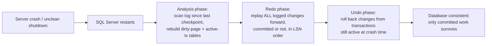

Redoing even uncommitted transactions' changes before undoing them looks
counterintuitive, but it is what guarantees the *disk* state is
byte-for-byte the same as it was the instant before the crash, before any
rollback logic runs against it — a database that skipped redoing
uncommitted changes could find itself trying to undo a change that was
never actually applied to the on-disk page, corrupting the undo logic.
Modern SQL Server (2019+) adds **Accelerated Database Recovery (ADR)**,
which maintains a per-database version store (conceptually similar to the
row-versioning mechanism in Section 4.0's MVCC recap) so that long-running
transactions can be instantly rolled back using row versions instead of a
slow, log-record-by-log-record undo pass — directly attacking the classic
failure mode below.

**Decision implications.** The recovery model (`SIMPLE`, `FULL`, or
`BULK_LOGGED`) is a per-database, architecture-relevant choice, not a
tuning knob: `SIMPLE` recovery model truncates the log automatically at
every checkpoint and cannot support point-in-time restore or log shipping
because there is no continuous log-backup chain to replay — appropriate
only for databases where losing all changes since the last full backup is
acceptable (development databases, some data-warehouse staging tables).
`FULL` recovery model requires a running log-backup schedule and enables
point-in-time restore, which is mandatory for any transactional system with
a Recovery Point Objective (RPO) tighter than "since last full backup," and
is also a prerequisite for Always On Availability Groups (Section 4.3),
which replicate log records to secondaries.

**Failure mode.** The most common SQL Server transaction-log incident is
uncontrolled log growth from a `FULL`-recovery-model database with no log
backup job configured (or one that silently stopped running) — every
checkpoint flushes dirty pages but cannot truncate the log because no log
backup has yet captured those records, so the log file grows until it
exhausts the disk volume and the database stops accepting writes entirely.
A second common failure mode is a single very long-running, uncommitted
transaction (an accidentally-open transaction left by a client, or a bulk
operation without periodic commits) that pins the MinLSN at an old point,
preventing truncation of every VLF since that transaction began even if log
backups are running normally.

**Scenario.** An e-commerce order-processing database on `FULL` recovery
model has its nightly log-backup job silently fail after a credential
rotation breaks the backup account's permissions; over three days the
transaction log grows from 20 GB to 400 GB and finally exhausts the log
volume, taking the database offline during a peak shopping period. The
root cause was not "SQL Server's log is broken" — it is that log
truncation has a hard dependency on a successfully completing log backup
under `FULL` recovery model, and that dependency was not being monitored
(Section 14 covers monitoring `log_reuse_wait_desc` for exactly this
failure signature).

### 4.2 Clustered Index Physical Row Storage

**Definition.** In SQL Server, a table's **clustered index** is not "just
another index that happens to be marked clustered" — it *is* the physical
storage structure of the table's rows. When a table has a clustered index,
there is no separate heap; the table's data rows are stored as the leaf
level of the clustered index's B+tree, physically sorted (and kept sorted,
via page splits) by the clustering key. When a table has no clustered index
at all, SQL Server stores its rows in an unordered **heap**, addressed by a
fixed Row Identifier (RID) consisting of file:page:slot. This is a stronger
architectural commitment than the generic "clustered index" concept
[Indexes](CH03_Indexes.md#4-core-concepts) already introduces: in SQL
Server a table can have *at most one* clustered index (there is only one
physical row order to choose), and choosing it is a once-per-table,
schema-defining decision with wide-reaching consequences for every other
index on that table.

**Mechanism.** Every **non-clustered index** on a clustered table stores,
at its leaf level, the clustering key value(s) of the row it points to —
not a RID. This means a lookup via a non-clustered index is a two-step
operation: first traverse the non-clustered index's B+tree to find the
clustering key, then perform a second B+tree traversal down the clustered
index using that key to fetch the actual row (a **key lookup**, shown as
"RID Lookup" only for heap tables and "Key Lookup" for clustered tables in
an execution plan). This is the direct physical consequence of the
clustered-index-as-storage design: every non-clustered index's row size
grows by the width of the clustering key, and every write to a
clustered table implicitly touches the clustered index (since that *is*
the table), whereas PostgreSQL's clustered index (`CLUSTER` command) is a
one-time physical reorganization that immediately starts drifting out of
order again on subsequent inserts, and MySQL/InnoDB shares SQL Server's
"clustered index is the table" model for its primary key but calls it a
clustered index for identical reasons.

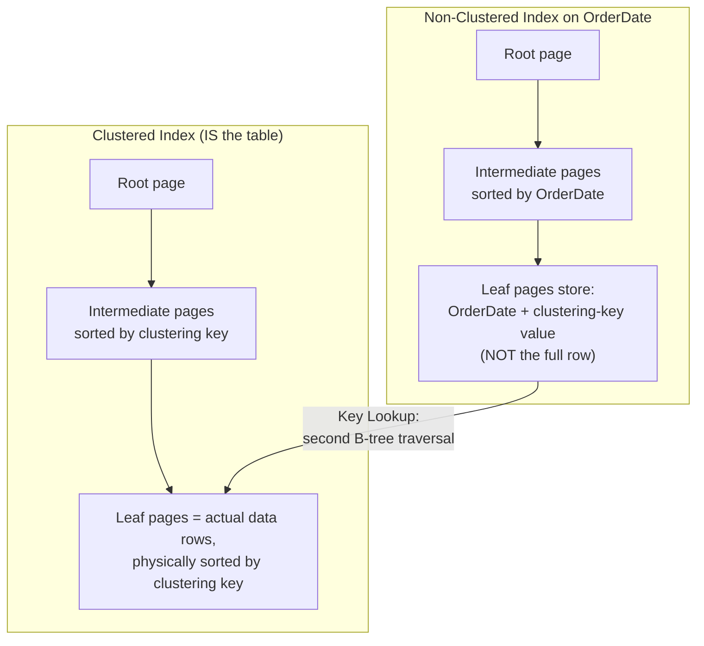

**Decision implications.** Because every non-clustered index carries the
clustering key at its leaf level, choosing a **narrow, static, ever-
increasing clustering key** (the canonical example is an `IDENTITY` integer
primary key) minimizes the size of every other index on the table and
avoids expensive page splits from out-of-order inserts. Choosing a **wide
or naturally random clustering key** (a `GUID`/`uniqueidentifier` generated
via `NEWID()`, or a natural composite business key) bloats every
non-clustered index's leaf rows and causes random-order inserts to
constantly split pages out of sequence, fragmenting the clustered index
and degrading range-scan performance — this is one of the most common,
avoidable SQL Server schema-design mistakes, and Section 17 covers it
explicitly. A table's clustered index should therefore usually be chosen
for the *table's* dominant access pattern (frequent range scans by date,
sequential inserts) rather than defaulting mechanically to "primary key
equals clustered index," even though that is the out-of-the-box default
when a primary key constraint is created without specifying otherwise.

**Failure mode.** A team migrating a schema from a database engine whose
primary key is *not* automatically the physical row order (for example, a
heap-oriented engine, or a naive read of "primary key" documentation)
creates every SQL Server table with `NEWID()`-generated GUID primary keys
and lets the default clustered index land on that column; the resulting
random-order inserts cause severe page-split-driven fragmentation, and
every one of the table's non-clustered indexes silently balloons in size
because each leaf row now carries a 16-byte GUID instead of a 4-byte
integer. The database "just gets slower over time" with no application
code change, and the root cause is invisible unless someone actually reads
the clustered index's physical design, not just its logical schema.

**Scenario.** A high-write telemetry-ingestion table clustered on an
`IDENTITY` integer surrogate key, with a separate non-clustered index on
`DeviceId, EventTimestamp` for query access, gets inserts that are always
physically appended at the end of the clustered index's last page (no page
splits, minimal fragmentation) while still supporting efficient
device-scoped range queries through the narrower non-clustered index — the
textbook example of aligning clustering-key choice with insert pattern
rather than defaulting to "whatever column has the primary key constraint."

### 4.3 Always On Availability Groups

**Definition.** An Always On Availability Group is SQL Server's native
high-availability and disaster-recovery feature: a set of user databases
(the availability replicas' databases) that fail over together as a single
unit across two or more SQL Server instances, without requiring shared
storage — unlike the older failover-clustering model, where instances
shared a single storage array and only one instance owned the data at a
time. One replica is the **primary replica**, accepting all reads and
writes; the others are **secondary replicas**, continuously receiving and
applying the primary's transaction log records to stay in sync, and
optionally serving read-only queries (**readable secondaries**) to offload
reporting workload from the primary.

**Mechanism.** Availability Groups implement Replication's leader/follower
model (see [Replication, Section
4.1](CH07_Replication.md#4-core-concepts)) using log-record shipping rather
than statement replication: every committed transaction's log records
stream from the primary to each secondary, which replays them against its
own copy of the database — the same redo mechanism Section 4.1 describes
for crash recovery, applied continuously against a remote copy instead of
only after a crash. Each secondary replica is configured for either
**synchronous-commit mode** (the primary waits for a secondary to confirm
the log record is hardened to disk before acknowledging the client's
commit — zero data loss, at the cost of added write latency) or
**asynchronous-commit mode** (the primary acknowledges the client
immediately and ships the log records without waiting — lower latency, at
the cost of a small data-loss window if the primary fails before shipping
completes) — precisely the sync/async trade-off Replication's Section 4.1
already teaches in the abstract, applied here at the granularity of an
entire Availability Group. Client applications connect through an
**Availability Group Listener** — a virtual network name and IP address
that always resolves to the current primary replica, so that a failover
does not require every client's connection string to change; the listener
is what makes failover application-transparent rather than a manual
reconfiguration event.

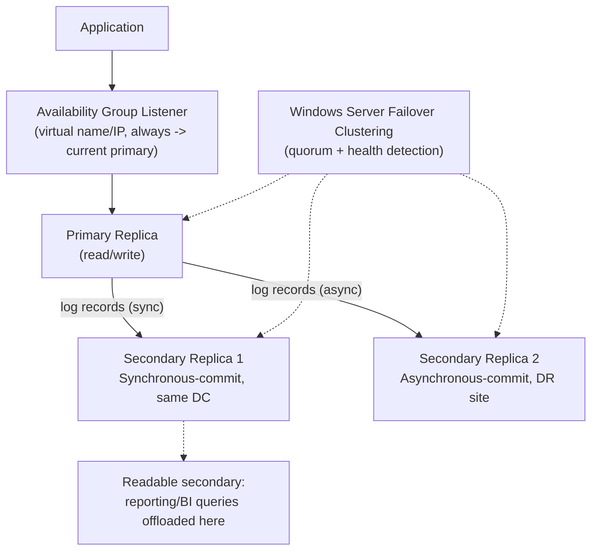

**Failover.** Windows Server Failover Clustering (WSFC) — or, on Linux,
Pacemaker — provides the underlying quorum and health-detection layer that
decides whether the primary is actually unreachable versus merely slow, the
same "leader-unreachable vs. leader-dead" distinction Replication's Section
4.4 already frames in the abstract. **Automatic failover** is only possible
against a synchronous-commit secondary that is currently in a healthy,
synchronized state — WSFC promotes that secondary to primary and redirects
the listener, and because that secondary was synchronous-commit, no
committed transaction is lost. **Manual failover** against an asynchronous
secondary is always possible but is explicitly a data-loss operation — any
log records not yet shipped and applied are gone, and the failover
operation surfaces that risk rather than hiding it.

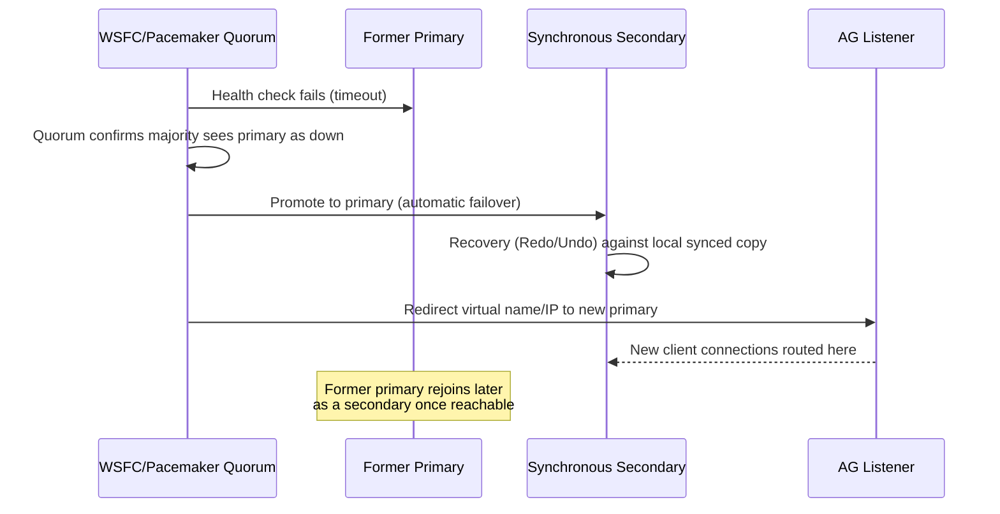

**Decision implications.** The number of synchronous replicas is a direct
trade-off between write latency and zero-data-loss guarantees: every
additional synchronous replica adds the round-trip time to that replica
into every committing transaction's critical path, so most production
topologies use exactly one synchronous replica (for automatic local
failover) plus one or more asynchronous replicas (for cross-region disaster
recovery, where the network latency alone would make synchronous commit
impractical). Readable secondaries let an architecture offload reporting
and analytics load off the primary without building a separate data
pipeline, at the cost of accepting replication lag on that reporting data —
the same read-your-writes trade-off Replication's Section 4.2 already
covers generically.

**Failure mode.** A synchronous-commit secondary that falls behind or
becomes unreachable does not silently become asynchronous — by design, a
synchronous secondary that cannot keep up will, depending on configuration,
either stall the primary's commits (in strict synchronous mode) or the
Availability Group will flag it as `NOT SYNCHRONIZED`, at which point
*automatic* failover to it is no longer safe and WSFC will refuse it,
because promoting a stale secondary would silently lose committed data —
this refusal is the correct, safe behavior, but it surprises teams who
expected automatic failover to always be available and discover during an
actual incident that it silently downgraded to manual-only failover.

**Scenario.** A bank's core-ledger database runs a three-replica
Availability Group: a synchronous secondary in the same datacenter (for
automatic zero-data-loss local failover covering hardware failure), an
asynchronous secondary in a different region (for disaster recovery
covering a full datacenter loss, accepting a small Recovery Point Objective
in that rare case), and the asynchronous secondary is also configured as a
readable secondary serving the bank's overnight regulatory-reporting
queries so those long-running analytical scans never contend with the
primary's transactional workload.

### 4.4 In-Memory OLTP (Hekaton): Optimistic, Lock-Free, Latch-Free Design

**Definition.** In-Memory Online Transaction Processing (In-Memory OLTP,
internally codenamed Hekaton) is a second, fundamentally different storage
and execution engine that runs inside the same SQL Server process alongside
the classical disk-based engine. A table declared `MEMORY_OPTIMIZED = ON`
is not simply "a disk-based table pinned in RAM" — it uses entirely
different data structures (lock-free hash and range indexes instead of
B+trees with page latches) and an entirely different concurrency-control
model (pure optimistic multi-versioning with no locks and no latches at
all, instead of the classical engine's shared/exclusive locks plus latches
protecting in-memory page structures).

**Why it exists.** The classical disk-based engine's pages are protected
by **latches** — lightweight, short-duration synchronization primitives
(distinct from the transactional locks Locking's Section 4.1 teaches) that
guard a page's in-memory structure against concurrent modification by
multiple threads. Under very high concurrency on a small number of hot
pages — the classic pattern for a high-throughput OLTP workload like
stock-trading order entry or ticket-sale inventory decrement, where many
threads all need to update the same few rows in the same few pages — latch
contention itself becomes the throughput ceiling, independent of and in
addition to ordinary transactional lock waits. Hekaton was built
specifically to eliminate that ceiling by removing latches and locks from
the equation entirely for the tables that need it most.

**Mechanism.** Every row in a memory-optimized table carries a **Begin-Ts**
and **End-Ts** (begin/end timestamp) pair marking the range of transaction
timestamps for which that specific row version is visible — a direct,
purpose-built implementation of the same version-chain Multi-Version
Concurrency Control idea Transactions' Section 4 already introduces
generically, but here it is the *only* concurrency mechanism, with no
locking fallback. An update never modifies a row in place; it creates a new
row version linked into the version chain and marks the old version's
End-Ts, so readers who started before the update continue to see the
version that was current at their start time — no reader ever blocks a
writer and no writer ever blocks a reader, because there is nothing to
lock. Rows are indexed by **lock-free hash indexes** (for equality lookups,
implemented as a hash bucket array using atomic compare-and-swap operations
instead of latch-protected pointer updates) and **lock-free range indexes**
called Bw-trees (a latch-free B-tree variant that uses atomic
compare-and-swap on delta records instead of in-place page modification
under a latch).

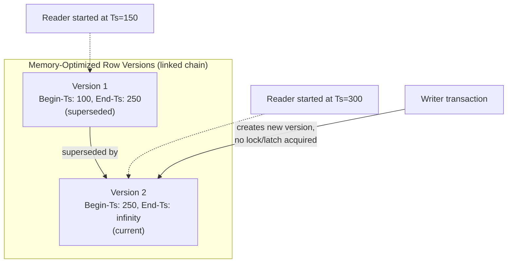

Because there is no locking, write-write conflicts cannot be resolved by
blocking — they are resolved by **optimistic validation at commit time**:
if two transactions attempt to create a new version of the same row
concurrently, the second one to attempt the update detects the conflict
immediately (a write-write conflict, failing fast rather than queuing), and
if a transaction's snapshot read set is invalidated by another
transaction's commit before it can itself commit, SQL Server aborts it with
a specific error, and the application is expected to retry. This is the
same acquire-vs.-validate philosophy Locking's Section 4.2 already
contrasts generically (pessimistic vs. optimistic concurrency control),
applied here as the *only* mechanism, with no pessimistic fallback
available.

```mermaid
sequenceDiagram
    participant Tx1
    participant Tx2
    participant Row as Memory-Optimized Row

    Tx1->>Row: Read version current at Tx1 start (no lock taken)
    Tx2->>Row: Read same version (no lock taken)
    Tx1->>Row: Create new version, commit succeeds
    Tx2->>Row: Attempt to create new version of same row
    Row-->>Tx2: Write-write conflict detected -&gt; abort immediately
    Tx2->>Tx2: Application retries transaction from scratch
```

**Natively compiled stored procedures.** For maximum throughput,
memory-optimized tables can be paired with **natively compiled stored
procedures** — T-SQL procedures compiled ahead of time into native machine
code (via a C-compiler toolchain invoked at deployment) rather than
interpreted or plan-cached at runtime, eliminating both interpretation
overhead and the plan-cache lookup entirely for that procedure's
execution path; this is the deepest expression of Section 4.6's "T-SQL as
a first-class procedural extension" claim, since ordinary interpreted
stored procedures still benefit from a compiled call but natively compiled
ones remove the interpreter layer completely.

**Decision implications.** In-Memory OLTP is not a general-purpose
"make everything faster" switch — it earns its complexity for a narrow,
specific pattern: a small number of tables experiencing extreme
per-row/per-page contention under high concurrency, where the classical
engine's latch waits are a measurable throughput ceiling (visible as
`PAGELATCH` or `PAGELATCH_UP` wait types in Section 14's monitoring). It
is a poor fit for large historical/reporting tables (memory-resident data
has a real memory-capacity cost) and for workloads whose bottleneck is
actually disk I/O or CPU-bound query execution rather than concurrency
contention — applying it there adds engineering complexity (schema
restrictions, retry-on-conflict application logic) without addressing the
actual bottleneck.

**Failure mode.** An application migrated to memory-optimized tables
without adding retry logic for the optimistic-conflict error code will see
transactions fail outright under contention instead of transparently
queuing and waiting as the classical locking engine did — teams that treat
this as "In-Memory OLTP is unreliable" rather than "optimistic concurrency
requires the client to retry" have misunderstood the trade-off; the
correct architectural response is a bounded retry loop around the
transaction, the same operational discipline Locking's Section 4.2 already
requires for any optimistic-concurrency-control scheme.

**Scenario.** A ticketing platform's seat-reservation table for a
high-demand on-sale event — thousands of concurrent transactions all
attempting to decrement inventory rows for the same few popular seat
categories in the first seconds of the sale — is converted to a
memory-optimized table with a natively compiled stored procedure handling
the reservation logic; the classical engine's `PAGELATCH_EX` contention on
those hot rows, previously the platform's hard throughput ceiling during
every on-sale event, disappears because there are no pages or latches left
to contend over, and the application's existing retry-on-conflict logic
(already needed for the general optimistic-concurrency case) absorbs the
occasional write-write conflict.

### 4.5 Columnstore Indexes for Analytics Workloads

**Definition.** A columnstore index stores a table's data organized and
compressed **by column** rather than by row — the physical inverse of every
index this chapter has discussed so far, all of which are row-oriented
(**rowstore**). SQL Server offers both **clustered columnstore indexes**
(the columnstore *is* the table's primary storage, directly analogous to
how a clustered rowstore index is the table's storage in Section 4.2) and
**non-clustered columnstore indexes** (a columnstore copy layered on top of
an existing rowstore table, letting the same table serve both transactional
row-oriented access and analytical column-oriented scans).

**Mechanism.** Internally, a columnstore index divides a table's rows into
groups of roughly one million rows called **rowgroups**, and within each
rowgroup, stores each column separately as a **column segment**, each
independently and heavily compressed (dictionary encoding for
low-cardinality columns, run-length encoding for sorted or repetitive
values, bit-packing for narrow integer ranges) — because values within a
single column tend to be far more similar to each other than values across
a whole row, column-wise compression ratios of 5-10x over row-wise storage
are common. This directly changes which queries the structure is good at:
an analytical query that aggregates one or two columns across billions of
rows (`SELECT SUM(SaleAmount) FROM Sales WHERE Region = 'West'`) needs to
read only the compressed segments for `SaleAmount` and `Region` — not the
other forty columns of a wide fact table — where a rowstore index would
have to read every column of every qualifying row regardless of which
columns the query actually needs.

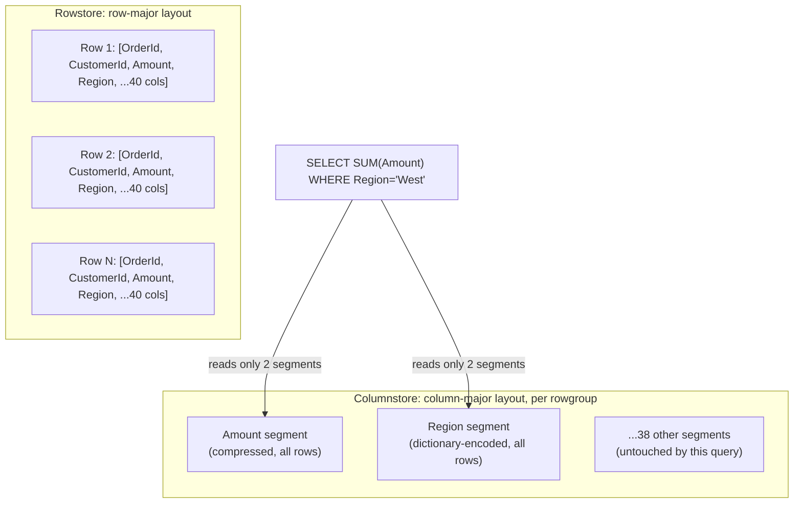

Query execution against a columnstore index also switches to **batch-mode
execution**: rather than the classical row-mode iterator model (each
operator in the plan pulls one row at a time from the operator below it),
batch mode processes rows in batches of roughly 900 at a time using
vectorized, Single Instruction Multiple Data (SIMD)-friendly CPU
operations, dramatically reducing the per-row interpretation overhead that
dominates cost when scanning and aggregating billions of rows.

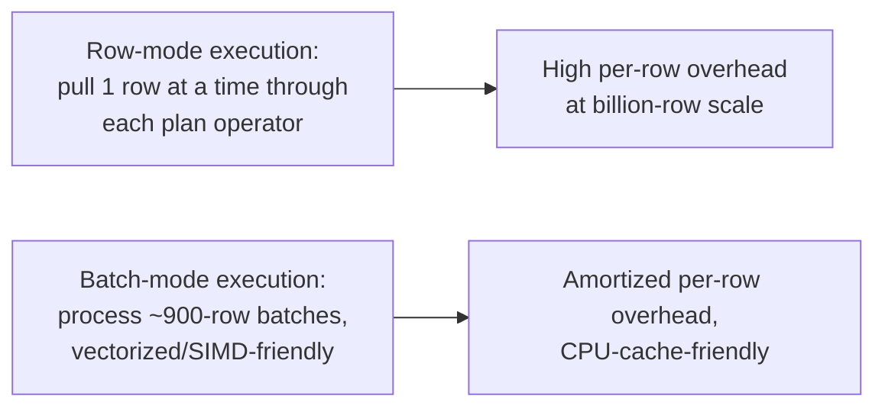

**The Deltastore.** A columnstore index is fundamentally a bulk,
compress-once structure, poorly suited to individual row-at-a-time inserts
— compressing a single new row into an existing million-row rowgroup on
every insert would be prohibitively expensive. Instead, new rows land first
in an uncompressed, rowstore-structured **Deltastore** (a B-tree, exactly
like the structures in Section 4.2), and a background process (the
**tuple-mover**) periodically compresses full Deltastore rowgroups into the
compressed columnstore format once they accumulate roughly a million rows —
this is what lets modern updatable columnstore indexes tolerate a trickle
of Online Transaction Processing (OLTP)-style inserts without abandoning
their analytical performance profile, at the cost of queries needing to
scan both the compressed segments and any not-yet-compressed Deltastore
rows to get a complete answer.

**Decision implications.** Columnstore indexes win decisively for wide
fact tables scanned and aggregated across few columns over many rows —
the canonical data-warehouse/star-schema pattern Denormalization's Section
4 already frames — and lose for narrow, highly selective, single-row
lookups (`WHERE OrderId = 12345`), where a targeted rowstore B-tree seek
touching one page is unambiguously cheaper than even a well-compressed
columnstore scan. The choice between clustered columnstore (analytics-only
tables) and a rowstore-clustered table with a non-clustered columnstore
index layered on top (mixed OLTP-plus-reporting tables) is the practical
architectural decision, not "columnstore vs. rowstore" in the abstract.

**Failure mode.** A team applies a clustered columnstore index to a table
that actually receives a continuous high-rate stream of individual
row-level updates and single-row point lookups (an operational table
mistaken for an analytics table); the Deltastore grows faster than the
tuple-mover can compress it, an increasing fraction of every scan has to
fall back to the slow uncompressed Deltastore path, and single-row updates
against already-compressed rowgroups are especially expensive because a
columnstore update is internally a delete-plus-insert against the
compressed structure, not an in-place row modification.

**Scenario.** A retail chain's sales-fact table — hundreds of millions of
rows, ~40 columns, loaded nightly in bulk from Point-of-Sale systems and
queried almost exclusively through regional/quarterly aggregate reports —
is converted from a rowstore clustered index to a clustered columnstore
index; nightly load times improve because bulk-loaded rows land directly in
compressed rowgroups rather than a Deltastore, storage footprint drops by
roughly 8x from column-wise compression, and the aggregate reporting
queries that used to scan the entire wide table now touch only the 3-4
columns each report actually needs.

### 4.6 T-SQL as a First-Class Procedural Extension

**Definition.** Transact-SQL (T-SQL) is SQL Server's implementation of the
SQL standard extended with genuine procedural programming constructs —
local variables, `IF`/`WHILE` control flow, structured error handling
(`TRY`/`CATCH`), cursors, and user-defined functions and stored procedures
— compiled and executed by the same query-processing engine that handles
ordinary `SELECT`/`INSERT`/`UPDATE`/`DELETE` statements, rather than a
separate scripting layer bolted on top of a "pure" SQL engine.

**Mechanism.** A T-SQL stored procedure is parsed, bound, and optimized
much like any query, but its resulting plan is cached and reused across
executions keyed by the procedure's identity (this is the mechanism behind
Query Optimizers' generically-taught "plan caching and parameter sniffing"
concept — see [Query Optimizers, Section
4.9](CH04_Query_Optimizers.md#4-core-concepts) — applied specifically to
stored-procedure execution rather than ad-hoc statement text). Because
procedural logic executes *inside* the database engine's process, a stored
procedure that performs several dependent steps (validate input, look up a
related row, conditionally branch, then write) avoids round-tripping each
intermediate result back to an application server over the network —
each round trip having its own latency cost — collapsing what would be
several network round trips in an application-tier implementation into a
single call.

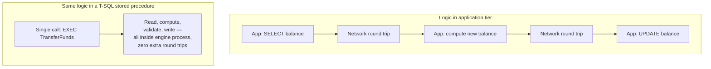

**Decision implications.** Pushing business logic into T-SQL stored
procedures trades application-tier portability and easy unit-testing for
reduced network round-trip latency and centralized enforcement of
data-integrity rules that must hold regardless of which application
touches the data — a defensible choice for shared, multi-application
databases (a core banking ledger accessed by several independent front
ends) and a poor choice for a single-application microservice's private
database, where keeping business logic in the application tier alongside
its version control and test suite is usually the better trade-off. This
is an architecture decision with real consequences, not a matter of
taste: logic embedded in stored procedures is harder to unit-test outside
a live database, harder to diff meaningfully in code review, and creates
a coupling point between database schema changes and application release
cycles that a purely application-tier design avoids.

**Failure mode.** Teams that treat T-SQL stored procedures as a dumping
ground for arbitrarily large amounts of business logic, with minimal
version control discipline (procedures edited directly against a shared
development database rather than through migration scripts), lose the
traceability and reviewability that application-tier code gets "for free"
from a standard source-control workflow — the risk is organizational and
process-related, not a technical limitation of T-SQL itself.

**Scenario.** A shared claims-processing database serving both a legacy
mainframe-integration batch job and a newer web application enforces its
core "a claim cannot be approved above policy limit" business rule inside
a single T-SQL stored procedure that both callers invoke, guaranteeing the
rule cannot be bypassed by one caller forgetting to reimplement it —
exactly the shared-enforcement argument for pushing logic into the
database that a single-application microservice would not need.

### 4.7 Query Store: Plan History and Regression Diagnosis

**Definition.** Query Store is a built-in, per-database subsystem that
persistently records every distinct query text, every execution plan SQL
Server has generated for it, and runtime statistics (duration, CPU,
logical reads) for each plan over time — surviving server restarts, unlike
the classical plan cache, which is entirely in-memory and lost on restart
or memory pressure. Where Query Optimizers' Section 4.9 already teaches
the general concept of plan caching and the parameter-sniffing failure
mode (a plan compiled for one parameter value being reused, suboptimally,
for a very different value), Query Store is the operational tool built
specifically to *detect and fix* exactly that failure mode after the fact,
with historical evidence.

**Mechanism.** Query Store captures a query's plan the first time it
compiles, and again every time the optimizer produces a *new* plan for the
same query (for example, after a parameter-sniffing-triggered recompile, a
statistics update, or an index change) — so a single query can accumulate
a history of several distinct plan shapes, each with its own tracked
performance metrics over time windows. This turns "this query got slower"
from an anecdotal complaint into a directly queryable fact: an
administrator can compare a query's average duration under Plan A last
week against Plan B this week and see precisely when and why the
regression started.

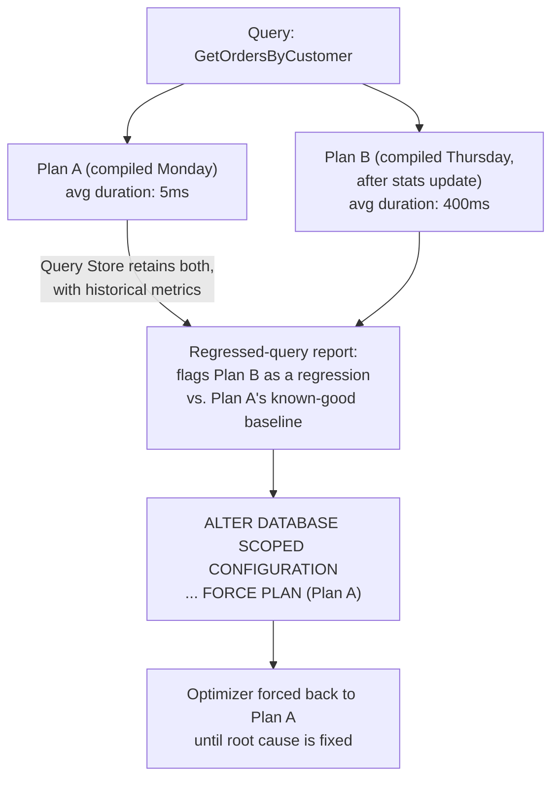

**Plan forcing.** Once a regression is identified, Query Store lets an
administrator **force** the optimizer to reuse a specific historical plan
for that query going forward, overriding the optimizer's own new choice —
an immediate, surgical mitigation for a production incident that buys time
to investigate the underlying cause (stale statistics, an index that was
dropped, a data-distribution shift) without waiting for a schema fix or a
statistics-maintenance job to run.

**Decision implications.** Query Store is close to a "just enable it"
default in modern SQL Server (on by default since SQL Server 2016, and
mandatory-on for Azure SQL Database), because its overhead is modest and
its diagnostic value during an incident is high; the real decision is
sizing its retention window and capture policy (`ALL` vs. `AUTO`, which
throttles capture of trivial/ad-hoc queries) to avoid the store itself
becoming a storage or contention concern on very high-query-volume
systems.

**Failure mode.** Query Store's regressed-query report tells an
administrator *that* a regression happened and gives a fast mitigation
(plan forcing), but forcing a plan is not a fix — teams that force a plan
and consider the incident closed without ever addressing why the optimizer
chose a worse plan (stale statistics being the most common root cause)
leave the forced plan in place indefinitely, which itself becomes stale
once data distribution shifts again, eventually forcing a *worse* plan
than the optimizer's current, unforced choice would be.

**Scenario.** An overnight batch job's query duration jumps from seconds
to tens of minutes after an automatic statistics update runs mid-week; an
on-call engineer uses Query Store's regressed-query report to confirm the
regression started at the exact timestamp of that statistics update,
forces the previously known-good plan to restore batch-window compliance
immediately, and schedules a proper statistics-maintenance review rather
than treating the forced plan as a permanent fix.

## 5. Internal Working

SQL Server's engine is organized into two broad layers that this section
ties together using the concepts from Section 4: the **relational engine**
(also called the query processor) and the **storage engine**.

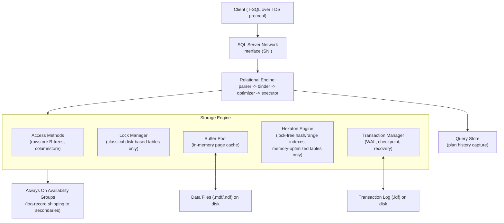

The relational engine's optimizer chooses a plan and hands the executor a
tree of physical operators; for a classical disk-based table, those
operators call into the storage engine's **access methods** layer, which
in turn coordinates with the **lock manager** (Locking's Section 4.1) to
acquire the appropriate locks and with the **buffer pool** to read or
write pages, all protected by page latches. For a memory-optimized table,
the executor instead calls directly into the separate **Hekaton engine**,
bypassing the lock manager and buffer pool entirely — the two storage
engines coexist inside one process, and a single query can even join a
classical disk-based table with a memory-optimized table, with the
optimizer producing a plan that stitches both access paths together. The
**transaction manager** is the component that actually implements Section
4.1's write-ahead logging, checkpoint, and recovery mechanics, and it is
also the component whose log stream Always On Availability Groups (Section
4.3) ship to secondary replicas — recovery on a secondary replica after
receiving new log records is, mechanically, the same redo logic the
transaction manager runs during crash recovery, just applied continuously
against a remote copy instead of only after a local crash. SQL Server's
own internal thread scheduler, the SQLOS/User Mode Scheduler (UMS), adds
one more distinguishing detail: rather than relying purely on the
operating system's thread scheduler, SQL Server implements cooperative,
non-preemptive scheduling of its own worker threads onto a fixed pool of
schedulers (one per logical CPU by default), so that a runaway query
cannot starve the rest of the engine's threads without SQL Server's own
scheduler detecting and intervening on it — a deliberate architectural
choice to keep engine-level scheduling decisions inside SQL Server's own
process rather than delegating them entirely to the operating system.

## 6. Design Principles

- **Log before data, always.** Every design decision in Section 4.1 flows
  from one non-negotiable invariant: a change is never durable until its
  log record is durable, and data pages may lag behind the log
  indefinitely. Anything that would violate this ordering (an
  administrator disabling `fsync`-equivalent durability at the operating-
  system or storage level, for example) breaks crash recovery's
  correctness guarantee entirely, not just its performance.
- **Physical storage is a schema decision, not a tuning knob.** The
  clustered index choice (Section 4.2) is baked into the table's physical
  layout and every other index's leaf-row width; treating it as
  reversible without a rebuild, or leaving it to a framework's default
  convention without deliberate thought, is a design omission, not a
  neutral default.
- **Match the concurrency-control mechanism to the contention profile.**
  The classical lock-based engine, In-Memory OLTP's lock-free optimistic
  model (Section 4.4), and columnstore's batch-oriented analytical model
  (Section 4.5) are three different answers to "how should concurrent
  access to this data be coordinated," and a Solution Architect's job is
  matching the table's actual access pattern to the right one rather than
  defaulting every table to the classical engine.
- **Prefer durable, queryable evidence over anecdote for performance
  regressions.** Query Store (Section 4.7) exists because "it feels
  slower" is not an actionable diagnosis; every performance-sensitive
  production database should have Query Store enabled with a retention
  window long enough to cover its incident-response window.
- **High availability is a topology decision with an explicit RPO/RTO,
  not a checkbox.** Always On Availability Groups (Section 4.3) support a
  wide range of sync/async replica combinations; the correct topology is
  derived from the business's actual Recovery Point Objective (RPO) and
  Recovery Time Objective (RTO), not copied from a vendor reference
  architecture without adaptation.

## 7. Architecture Patterns

- **Hybrid rowstore-plus-columnstore table.** A single wide table carries
  its normal clustered rowstore index for OLTP-style point lookups and
  updates, plus a non-clustered columnstore index for analytical
  aggregate queries, letting one physical table serve both access
  patterns without an ETL (Extract, Transform, Load) pipeline into a
  separate warehouse — appropriate when the reporting freshness
  requirement is "near real time" rather than "nightly batch."
- **Hot-table isolation via In-Memory OLTP.** Rather than converting an
  entire database to memory-optimized tables, isolate only the small
  number of tables that actually exhibit extreme latch contention
  (Section 4.4) into memory-optimized storage, leaving the rest of the
  schema on the classical disk-based engine — the pattern this chapter's
  Section 4.4 scenario illustrates.
- **Tiered Availability Group topology.** One synchronous secondary for
  automatic local failover (covering single-node hardware failure) plus
  one or more asynchronous secondaries in other regions for disaster
  recovery and readable-secondary reporting offload (Section 4.3) — the
  standard production pattern rather than a single all-synchronous or
  all-asynchronous topology.
- **Query Store as a mandatory pre-deployment gate.** Some organizations
  require a new release's query plans to be captured and compared in
  Query Store against the previous release's baseline before a
  statistics-update or index-change deployment is allowed to proceed —
  treating plan regression as a release-quality gate rather than a
  reactive incident-response tool only.

## 8. Production Architecture

A representative production topology combines several of Section 4's
concepts into one deployment: a primary replica handling all transactional
traffic through a listener, a synchronous secondary in the same
availability zone for automatic failover, an asynchronous secondary in a
paired region for disaster recovery, nightly full backups plus 15-minute
transaction-log backups feeding the log-truncation chain described in
Section 4.1, Query Store enabled on every replica's primary role,
Resource Governor classifying and capping ad-hoc reporting connections
separately from the core transactional workload, and a small number of
hot tables carrying In-Memory OLTP for the highest-contention paths.

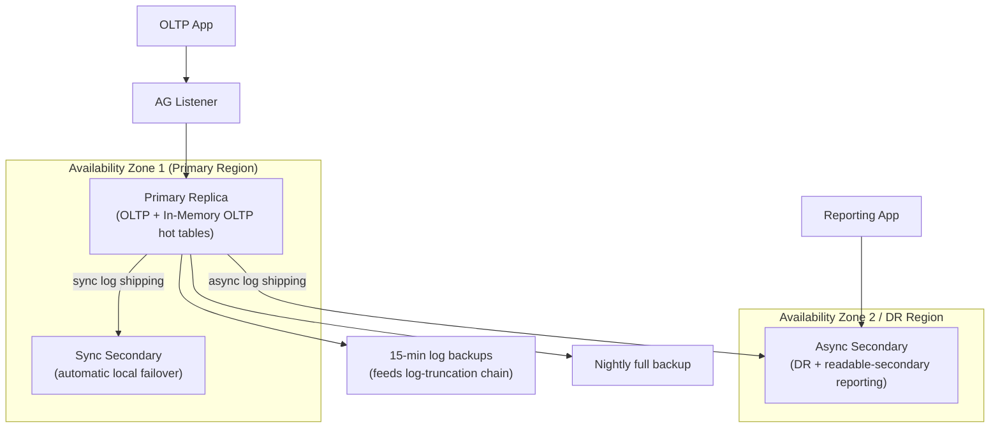

## 9. Implementation

Implementing the concepts above in a real deployment involves: choosing
and setting the recovery model per database (`FULL` for anything requiring
point-in-time restore or Availability Groups); explicitly choosing a
clustered index rather than accepting a primary-key default without review;
enabling Query Store at database creation time; scoping In-Memory OLTP to
a deliberately small set of tables identified from real latch-contention
telemetry rather than applied speculatively; and standing up the
Availability Group's Windows Server Failover Clustering (or Pacemaker, on
Linux) quorum layer before creating the group itself, since the group's
failover behavior depends entirely on that underlying quorum
infrastructure being correctly configured first. Section 10 provides
runnable T-SQL demonstrating the four highest-value, most distinguishing
pieces of this implementation surface.

## 10. Complete Code Examples

Full runnable examples live under
[`code/sql/sqlserver-chapter/`](../code/sql/sqlserver-chapter/):

1. [`01_availability_group_setup.sql`](../code/sql/sqlserver-chapter/01_availability_group_setup.sql)
   — annotated Always On Availability Group creation: database preparation
   under `FULL` recovery model, adding a synchronous and an asynchronous
   replica, creating the listener, and the `log_reuse_wait_desc` check tied
   to Section 4.1's truncation prerequisites.
2. [`02_in_memory_oltp_table.sql`](../code/sql/sqlserver-chapter/02_in_memory_oltp_table.sql)
   — a memory-optimized filegroup, a `MEMORY_OPTIMIZED = ON` table with a
   lock-free hash index, a natively compiled stored procedure, and a
   retry-on-conflict pattern demonstrating Section 4.4's optimistic
   validation failure mode.
3. [`03_query_store_plan_regression.sql`](../code/sql/sqlserver-chapter/03_query_store_plan_regression.sql)
   — enabling Query Store, querying its regressed-queries view, and
   forcing a historical plan, tied directly to Section 4.7.
4. [`04_columnstore_index_analytics.sql`](../code/sql/sqlserver-chapter/04_columnstore_index_analytics.sql)
   — creating a clustered columnstore index on a fact table, inspecting
   rowgroup/Deltastore state via a Dynamic Management View (DMV), and
   contrasting a batch-mode aggregate plan against the equivalent rowstore
   plan, tied to Section 4.5.

## 11. Performance

Section 4's mechanisms translate directly into a small set of
high-leverage performance levers: keeping the clustering key narrow and
sequential (Section 4.2) to control non-clustered index bloat and
fragmentation; sizing and pre-growing the transaction log (Section 4.1) to
avoid frequent, expensive autogrow events during high-write bursts;
matching the concurrency-control mechanism to contention (moving only
genuinely latch-contended tables to In-Memory OLTP, Section 4.4, rather
than converting speculatively); and choosing columnstore (Section 4.5) for
wide-scan analytical workloads while leaving narrow, highly selective OLTP
access paths on rowstore. Query Store (Section 4.7) is the primary tool
for confirming these levers actually improved measured plan performance
rather than trusting an untested assumption.

## 12. Scalability

SQL Server scales vertically first (more CPU/memory/faster storage on a
single primary) and then through the mechanisms this chapter already
covers: readable secondaries (Section 4.3) offload read-only reporting
load without adding write capacity; native table partitioning (recapped in
Section 4.0, owned by [Partitioning](CH05_Partitioning.md)) scales a single
table's manageability and query pruning within one node; and true
horizontal write scale-out across many nodes is comparatively thin in
native SQL Server — Elastic Database Tools on Azure SQL Database is a
manual, shard-map-based application of [Sharding](CH06_Sharding.md)'s
concepts rather than an automatic ring, which is an honest limitation
relative to natively distributed engines and a real factor in a
build-vs-buy or engine-selection decision.

## 13. Security

SQL Server layers Windows Authentication (Kerberos against Active
Directory) and native SQL Authentication, row-level security predicates,
dynamic data masking for sensitive columns, and Transparent Data
Encryption (TDE) for encryption-at-rest of the data and log files
discussed throughout Section 4 — encrypting the transaction log matters
specifically because Section 4.1 established that the log contains a
durable record of every change, including the pre-encryption values of
any row ever modified, so an unencrypted log file is a security gap even
if the data file itself is protected. Always On Availability Groups
(Section 4.3) should encrypt the endpoint used for log-shipping traffic
between replicas, since that traffic carries the same sensitive log
content across the network between nodes.

## 14. Observability

The Dynamic Management Views (DMVs) introduced in SQL Server 2005 are the
primary observability surface tying directly back to Section 4's
mechanisms: `sys.database_files` and `log_reuse_wait_desc` on
`sys.databases` diagnose exactly why a transaction log cannot truncate
(Section 4.1's failure mode); `sys.dm_db_index_physical_stats` reports
clustered-index fragmentation (Section 4.2's failure mode);
`sys.dm_hadr_availability_replica_states` and
`sys.dm_hadr_database_replica_states` report each Availability Group
replica's synchronization health (Section 4.3); `sys.dm_db_wait_stats`
filtered to `PAGELATCH*` wait types is the standard signal that a table is
a genuine In-Memory OLTP candidate (Section 4.4); and Query Store's own
built-in reports (`sys.query_store_query`, `sys.query_store_plan`,
`sys.query_store_runtime_stats`) directly surface Section 4.7's plan
history for ad-hoc investigation beyond the built-in regressed-query
report.

## 15. Failure Scenarios

- **Log-truncation stall** (Section 4.1): a failed log-backup job, or a
  single long-running open transaction, pins the log's MinLSN and causes
  unbounded log growth until the disk volume fills and the database
  refuses writes.
- **Clustered-index fragmentation from a poorly chosen clustering key**
  (Section 4.2): random-order inserts against a wide or non-sequential
  clustering key cause continuous page splits, degrading both write
  throughput and range-scan read performance over time.
- **Silent downgrade from automatic to manual-only failover** (Section
  4.3): a synchronous secondary that falls behind is marked
  `NOT SYNCHRONIZED`, and automatic failover — assumed available — is
  refused precisely when an incident makes it most wanted.
- **Unhandled optimistic-conflict errors under In-Memory OLTP** (Section
  4.4): application code that assumes the classical engine's blocking
  semantics fails outright under contention instead of retrying, because
  Hekaton has no locking fallback to queue against.
- **Deltastore backlog on a misapplied columnstore index** (Section 4.5):
  a table receiving continuous single-row OLTP-style writes against a
  clustered columnstore index accumulates an uncompressed Deltastore
  faster than the tuple-mover can absorb it, degrading both write and
  scan performance.
- **A forced Query Store plan going stale** (Section 4.7): a plan forced
  during an incident and never revisited eventually becomes worse than the
  optimizer's current unforced choice once the underlying data
  distribution shifts again.

## 16. Testing

Test the transaction-log/recovery contract by simulating an unclean
shutdown (a hard `kill` of the SQL Server process, or a VM power-cycle in
a lower environment) mid-transaction and verifying on restart that
committed work survives and uncommitted work is rolled back, exercising
Section 4.1's Analysis/Redo/Undo phases directly rather than only reading
about them. Test Always On Availability Group failover by forcing a
planned manual failover in a non-production environment and confirming
the listener redirects application connections without a connection-string
change (Section 4.3). Test In-Memory OLTP's retry logic (Section 4.4) with
a concurrency test harness that deliberately drives two transactions to
conflict on the same row, asserting the application's retry loop recovers
correctly rather than surfacing the raw conflict error to an end user.
Test columnstore correctness (Section 4.5) by comparing aggregate query
results between a columnstore-indexed copy and a rowstore-indexed copy of
the same data, not only comparing performance.

## 17. Common Mistakes

- Defaulting every table's clustered index to its primary key without
  reviewing the table's actual access pattern (Section 4.2), especially
  using a random `GUID` as both primary key and clustering key.
- Running a `FULL`-recovery-model database with no scheduled, monitored
  log backup job, guaranteeing eventual uncontrolled log growth (Section
  4.1).
- Converting an entire schema to In-Memory OLTP speculatively rather than
  targeting only tables with measured latch contention (Section 4.4),
  paying migration and retry-logic complexity cost without a matching
  benefit.
- Applying a clustered columnstore index to a table that is actually an
  operational, single-row-update-heavy OLTP table rather than a
  wide-scan analytical fact table (Section 4.5).
- Treating a Query Store forced plan as a permanent fix rather than a
  temporary mitigation pending root-cause remediation (Section 4.7).
- Assuming Always On Availability Groups' automatic failover is always
  available without monitoring each secondary's actual synchronization
  health (Section 4.3).

## 18. Best Practices

- Choose a table's clustered index deliberately based on its dominant
  access pattern, and default to a narrow, ever-increasing surrogate key
  only when no better natural access pattern exists (Section 4.2).
- Monitor `log_reuse_wait_desc` and alert on sustained `LOG_BACKUP` waits
  before log growth becomes an incident (Section 4.1).
- Enable Query Store on every production database by default and set a
  retention window that comfortably covers the organization's
  incident-response window (Section 4.7).
- Scope In-Memory OLTP adoption to tables with measured `PAGELATCH`
  contention evidence, and build retry-on-conflict handling into the
  application layer before relying on it in production (Section 4.4).
- Size Always On Availability Group topologies from an explicit RPO/RTO
  requirement, using synchronous replicas only where the network latency
  cost is acceptable (Section 4.3).

## 19. Anti-Patterns

- **"Encrypt the data file, forget the log file"** — Transparent Data
  Encryption applied inconsistently, leaving the transaction log (which
  contains the same sensitive values, per Section 4.1) unencrypted.
- **"GUID primary key by convention"** — adopting a `GUID` primary key
  pattern from a different engine's conventions without accounting for
  its clustered-index fragmentation cost in SQL Server specifically
  (Section 4.2).
- **"In-Memory OLTP as a magic performance switch"** — converting tables
  to memory-optimized storage without contention evidence, then blaming
  the feature when it doesn't help a bottleneck it was never designed to
  address (Section 4.4).
- **"Force and forget"** — using Query Store's plan forcing as a
  permanent substitute for statistics maintenance and index review
  (Section 4.7).

## 20. Trade-off Analysis

| Decision | Choose this when... | Avoid when... |
|---|---|---|
| Narrow sequential clustering key | Sequential inserts dominate; range scans are common (Section 4.2) | The table's access pattern is genuinely random-key point lookups with no range-scan benefit |
| Synchronous Availability Group replica | Zero-data-loss automatic failover is required and latency budget allows it (Section 4.3) | Cross-region latency would make every commit unacceptably slow |
| In-Memory OLTP | Measured latch contention is the actual throughput ceiling (Section 4.4) | The bottleneck is disk I/O, CPU-bound computation, or the table is large/cold data |
| Clustered columnstore index | Wide fact table, few-column wide-row aggregate scans dominate (Section 4.5) | Continuous single-row OLTP writes and narrow point lookups dominate |
| Business logic in T-SQL stored procedures | Multiple independent applications must share one enforced rule set (Section 4.6) | A single application owns the database and needs application-tier testability/portability |

## 21. Comparison Table

| Aspect | SQL Server | PostgreSQL | MySQL/InnoDB |
|---|---|---|---|
| Clustered index model | Table rows ARE the clustered index leaf level; at most one per table (Section 4.2) | No true clustered storage; `CLUSTER` is a one-time reorg that drifts back out of order | Primary key IS the clustered index leaf level, conceptually identical to SQL Server |
| In-process lock-free OLTP engine | Yes — Hekaton/In-Memory OLTP (Section 4.4) | No native equivalent | No native equivalent |
| Built-in persistent plan-history/regression tool | Yes — Query Store, survives restarts (Section 4.7) | No built-in equivalent (relies on external tools, e.g. `pg_stat_statements` without persistent plan history) | No built-in equivalent |
| Native high-availability replica grouping | Always On Availability Groups: multi-database group failover with a listener (Section 4.3) | Streaming replication + external tools (Patroni, repmgr) for automated failover | Group Replication / semisynchronous replication + external orchestration |
| Native columnstore/batch-mode analytics | Yes, built into the core engine (Section 4.5) | No native equivalent (relies on extensions, e.g. Citus columnar) | No native equivalent |

## 22. Real-World Case Study

A large regional bank's core-ledger platform ran on a single SQL Server
instance with a `SIMPLE`-recovery-model database (inherited from an
early cost-cutting decision) and no Availability Group. A storage
controller failure took the primary offline; because the database was on
`SIMPLE` recovery model, the most recent restorable point was the last
nightly full backup — nearly 20 hours of committed transactions were
unrecoverable, a direct, textbook consequence of Section 4.1's recovery-
model decision tree, not a SQL Server defect. The bank's remediation
combined three of this chapter's Section 4 mechanisms: the database was
moved to `FULL` recovery model with 15-minute log backups (closing the
log-truncation and point-in-time-restore gap), a three-replica Always On
Availability Group was stood up with one synchronous secondary for
automatic local failover and one asynchronous secondary in a second region
for disaster recovery (Section 4.3), and Query Store was enabled across
every replica so that the post-incident capacity-planning review had real
plan-history evidence to work from (Section 4.7) rather than reconstructing
performance history from application logs alone. The case illustrates that
"which recovery model" and "whether an Availability Group exists" are not
neutral defaults — they are the direct determinants of how much committed
work an organization is willing to lose in exactly this kind of incident.

## 23. Interview Questions

1. Why does SQL Server write to the transaction log before modifying a
   data page, and what specifically breaks if that ordering is violated?
2. What is the difference between a checkpoint and log truncation, and why
   can a database checkpoint constantly while its log still grows
   unboundedly?
3. Explain why a table can have only one clustered index, and what
   changes physically in every non-clustered index when the clustering
   key is wide versus narrow.
4. Walk through what happens to reads and writes on a synchronous
   Always On Availability Group secondary that falls behind — why can it
   not simply be automatically failed over to?
5. Why does In-Memory OLTP eliminate both locks and latches, and what
   does an application have to do differently to work correctly against
   it?
6. What problem does Query Store solve that the classical plan cache
   cannot, given that both ultimately store execution plans?
7. Why is a columnstore index a poor fit for a table that receives
   continuous single-row updates, in terms of the Deltastore mechanism
   specifically?
8. When would you choose to put business logic in a T-SQL stored
   procedure versus the application tier, and what do you give up either
   way?

## 24. Hands-on Exercises

1. Create a database on `FULL` recovery model with no log backup job,
   generate sustained write load, and observe `log_reuse_wait_desc` and
   log file growth over time; then add a log backup job and observe
   truncation resume.
2. Create two versions of the same table — one clustered on a sequential
   `IDENTITY` column, one clustered on a `NEWID()` GUID — load both with
   the same random-order insert pattern, and compare
   `sys.dm_db_index_physical_stats` fragmentation between them.
3. Stand up a two-node Always On Availability Group in a lab environment,
   force a manual failover, and verify the listener redirects a live
   client connection without a connection-string change.
4. Convert a synthetic hot table to a memory-optimized table with a
   natively compiled stored procedure, and load-test it against an
   equivalent classical disk-based table under high write concurrency,
   observing `PAGELATCH` waits on the classical table and their absence
   on the memory-optimized one.
5. Create a clustered columnstore index over a synthetic wide fact table,
   run an aggregate query against it, and compare its actual execution
   plan's batch-mode operators against the same query's row-mode plan
   against a rowstore-indexed copy.

## 25. Design Exercises

1. Design an Always On Availability Group topology for a multi-region
   retail platform with an explicit Recovery Point Objective (RPO) of
   zero for its order database and a Recovery Time Objective (RTO) of
   under 60 seconds for regional failover, justifying replica count,
   placement, and sync/async mode per replica.
2. Given a wide fact table currently on a rowstore clustered index and
   queried almost exclusively via few-column aggregate reports, design a
   migration plan to a clustered columnstore index that accounts for the
   Deltastore's trickle-insert behavior during the transition window.
3. Given telemetry showing `PAGELATCH_EX` waits concentrated on three
   specific tables during a promotional sales event, design a scoped
   In-Memory OLTP migration plan for just those tables, including the
   application-side retry strategy the migration requires.

## 26. Architecture Review Questions

1. Does every production database's recovery model match its actual
   Recovery Point Objective, or is any `FULL`-recovery-model database
   missing a monitored log backup job?
2. Was each table's clustered index chosen deliberately from its access
   pattern, or inherited by default from a primary-key constraint without
   review?
3. Is Query Store enabled with a retention window that covers the
   organization's actual incident-response and capacity-planning
   timelines?
4. For any table proposed for In-Memory OLTP, is there measured latch-
   contention evidence, and has the application's retry-on-conflict
   handling been implemented and tested?
5. Does the Always On Availability Group topology's sync/async replica
   mix match an explicit, documented RPO/RTO, rather than a copied
   reference architecture?

## 27. Summary

SQL Server is best understood not as a generic relational engine wearing a
Microsoft label, but as a specific set of architectural bets layered on top
of the relational theory Part 06's Database Design chapters already teach:
a strict write-ahead-logging transaction log whose checkpoint and
truncation mechanics directly determine how much committed work an
organization can lose in an incident; a clustered-index-as-physical-
storage model that makes the clustering-key choice a once-per-table
schema decision with real consequences for every other index; Always On
Availability Groups as a listener-fronted, quorum-backed implementation of
leader/follower replication with configurable sync/async trade-offs per
replica; In-Memory OLTP as a genuinely different, lock-free and
latch-free optimistic storage engine solving a narrow but real contention
problem the classical engine cannot; Query Store as a persistent,
queryable plan-history subsystem purpose-built to catch the parameter-
sniffing and statistics-drift regressions the abstract query-optimizer
theory predicts but cannot itself diagnose after the fact; columnstore
indexes as a column-oriented, batch-mode-executed storage model for
analytical workloads sharing the same engine and the same table as
transactional rowstore access; and T-SQL as a procedural language whose
in-process execution model is a deliberate trade of application-tier
portability for reduced network round trips and centralized rule
enforcement. A Solution Architect evaluating or operating SQL Server
should treat every one of these as a decision with an explicit trade-off,
not a default to accept unexamined.

## Further Reading

- [Indexes](CH03_Indexes.md) — the generic B-tree/clustered-vs-non-
  clustered concepts this chapter's Section 4.2 builds on.
- [Query Optimizers](CH04_Query_Optimizers.md) — cost-based optimization,
  statistics, and plan caching/parameter sniffing that Section 4.7's Query
  Store diagnoses.
- [Replication](CH07_Replication.md) — the general leader/follower,
  sync/async, and failover theory Section 4.3's Always On Availability
  Groups implement concretely.
- [Transactions](CH08_Transactions.md) — ACID, isolation levels, and MVCC
  that Section 4.4's In-Memory OLTP implements with a purpose-built,
  lock-free version-chain mechanism.
- [Locking](CH10_Locking.md) — the classical lock manager and pessimistic/
  optimistic concurrency-control theory Section 4.4 contrasts against
  Hekaton's pure-optimistic design.
