# Chapter: MongoDB

Part: [06 — Databases and Storage](PART_OVERVIEW.md) · Status: Drafted

## 1. Introduction

MongoDB is a document-oriented database that stores data as Binary JSON
(BSON) documents grouped into collections rather than as rows constrained
to a fixed table schema, and it is the first chapter in this book's NoSQL
subsection. Every chapter before this one in Part 06 — Normalization
([Normalization](CH01_Normalization.md)), Denormalization
([Denormalization](CH02_Denormalization.md)), index data structures
([Indexes](CH03_Indexes.md)), the cost-based optimizer
([Query Optimizers](CH04_Query_Optimizers.md)), horizontal partitioning
([Partitioning](CH05_Partitioning.md)), distributed sharding
([Sharding](CH06_Sharding.md)), replication mechanics
([Replication](CH07_Replication.md)), transactions and Multi-Version
Concurrency Control (MVCC) as a concept
([Transactions](CH08_Transactions.md)), caching
([Caching](CH09_Caching.md)), and locking
([Locking](CH10_Locking.md)) — taught generic, engine-agnostic theory, and
the relational subsection (PostgreSQL, MySQL, Oracle, SQL Server) taught how
one specific relational engine implements that theory. This chapter does the
same thing for MongoDB, but MongoDB's starting assumptions differ from every
relational engine covered so far: there is no fixed table schema to enforce
before a row can be written, there is no single-node ACID transaction
boundary as the default unit of work (though one now exists, added later and
at a real cost — Section 4.7), and horizontal scale-out via sharding is a
first-class, built-in deployment topology rather than an application-level
pattern bolted on top of a single-writer engine.

This chapter is the *owning* chapter for MongoDB's BSON document model and
its type system, the dynamic-schema/schema-on-read model and its concrete
trade-offs against the schema-on-write model the relational chapters
assumed, MongoDB's specific replica set mechanics (the oplog as an
idempotent, capped replication log; the Raft-inspired election protocol;
rollback on divergent writes), MongoDB's sharded-cluster architecture
(shard keys, chunks, the `mongos` query router, and config servers as the
cluster's own strongly-consistent metadata store), the WiredTiger storage
engine (per-document Multi-Version Concurrency Control (MVCC) via
point-in-time snapshots and B-tree pages, plus WiredTiger's document-level
locking granularity), the aggregation pipeline as MongoDB's primary query
and transformation language, and MongoDB's tunable read-concern/write-concern/
read-preference consistency model. It recaps, rather than re-teaches, the
generic forms of sharding, replication, transactions, MVCC, and locking per
the Concept Ownership Rule in [STYLE_GUIDE.md](../STYLE_GUIDE.md) — every
recap below is flagged inline with a link back to the owning chapter, and
this chapter's own `review/concept-proposals/mongodb.md` staging file
records the same recap boundaries explicitly so later NoSQL siblings
(Redis, DynamoDB, Cassandra, Neo4j, ElasticSearch, Vector Databases, Time
Series Databases — CH16-CH22) have a concrete example to follow: recap the
generic distributed-systems theory in 2-3 sentences with a link, then teach
only what is genuinely engine-specific.

## 2. Historical Evolution

- **10gen and the birth of MongoDB (2007-2009)** — Dwight Merriman, Eliot
  Horowitz, and Kevin Ryan founded 10gen originally to build a Platform as a
  Service (PaaS); MongoDB began as one internal component of that stack and
  was open-sourced in 2009 once the team recognized the database itself,
  not the PaaS, was the more valuable and more widely needed piece.
- **Name and query model (2009)** — "Mongo" (from "humongous") signaled the
  project's founding bet: that a document model with a rich, JSON-like
  query language could scale horizontally to very large datasets while
  staying easier for application developers to reason about than mapping
  objects onto normalized relational tables.
- **Replica sets replace master-slave replication (1.6, 2010)** — MongoDB's
  earlier master-slave replication lacked automatic failover; replica sets
  (Section 4.3) added the election protocol and a formalized topology that
  is still the operational unit MongoDB deploys today.
- **Sharding matures (1.6-2.0, 2010-2011)** — auto-sharding, present in
  early form since 1.6, became production-viable with better balancer
  behavior and config server replication in the 2.0 line, establishing the
  `mongos`/config-server/shard architecture this chapter teaches in Section
  4.4.
- **Aggregation framework introduced (2.2, 2012)** — before this release,
  complex data transformations required MongoDB's `mapReduce` command
  (JavaScript-based, slow, and hard to optimize); the aggregation pipeline
  (Section 4.6) gave MongoDB a declarative, stage-based query language that
  the query planner could actually optimize, and it has been the primary
  way to query MongoDB at any complexity ever since.
- **WiredTiger becomes the default storage engine (3.0 as an option, 3.2 as
  default, 2015-2016)** — MongoDB acquired WiredTiger Inc. in 2014 and
  replaced the original MMAPv1 storage engine (which locked at the
  collection level and mapped data directly into virtual memory) with
  WiredTiger (Section 4.5), which introduced document-level locking and a
  true MVCC snapshot model — the single largest concurrency and compression
  improvement in MongoDB's history.
- **Read/write concern and causal consistency formalized (3.2-3.6,
  2015-2017)** — as replica sets and sharded clusters became more common in
  production, MongoDB formalized the tunable `readConcern`/`writeConcern`
  vocabulary (Section 4.7) and added client-side causal consistency
  sessions, giving architects explicit knobs instead of implicit defaults.
- **Multi-document ACID transactions (4.0 for replica sets, 4.2 for sharded
  clusters, 2018-2019)** — MongoDB added snapshot-isolated, multi-document
  transactions across a replica set and later across a sharded cluster,
  closing the single biggest gap architects cited versus relational
  engines, while keeping single-document operations atomic-by-default (as
  they always had been) and transactions as an opt-in, higher-cost feature
  rather than the default unit of work.
- **Compass, Atlas, and the managed-service era (2016-present)** — MongoDB
  Compass (a GUI client) and, more significantly, MongoDB Atlas (a fully
  managed, multi-cloud database-as-a-service) shifted most new production
  deployments away from self-hosted clusters, changing the operational
  calculus this chapter's Production Architecture and Observability
  sections describe.
- **Server-Side Public License and continued core investment (2018-present)**
  — MongoDB relicensed the server (not the drivers) under the Server Side
  Public License (SSPL) in response to cloud providers offering MongoDB as
  a managed service without contributing back; subsequent releases (5.0+)
  added time-series collections, clustered collections, and continued
  aggregation-pipeline and query-planner improvements.

## 3. Why It Exists

MongoDB exists to answer a specific mismatch that became increasingly
common as web and mobile applications matured in the 2000s: application
code was already organized around rich, nested objects (a user with
embedded addresses, an order with embedded line items), but persisting
those objects into a normalized relational schema
([recapped from Normalization](CH01_Normalization.md#third-normal-form-3nf))
required a mapping layer — an Object-Relational Mapper (ORM) or hand-written
join logic — that reconstructed the object graph from multiple tables on
every read and decomposed it again on every write. MongoDB's founding bet
was that storing the object's natural nested shape directly, as a document,
eliminates that impedance mismatch for the access patterns where an entire
object is read or written as a unit, at the cost of losing the relational
engine's guarantee that the *same* piece of data, referenced from many
places, is stored exactly once.

A second reason MongoDB exists is horizontal write scalability as a
built-in deployment mode rather than an application-level retrofit.
Relational engines historically scaled writes vertically (bigger hardware)
or via bolted-on sharding layers built by the application team
([recapped from Sharding](CH06_Sharding.md#shard-key-selection-criteria-shard-mapdirectory-routing-consistent-hashing-ring--virtual-nodes-vs-hash-mod-routing));
MongoDB shipped `mongos`, config servers, and chunk-based balancing
(Section 4.4) as first-class server components from early in its history,
so an architect choosing MongoDB for a write-heavy, horizontally-scaled
workload gets a supported, documented sharding topology rather than a
custom one to design and maintain.

A third reason, closely tied to the first, is *schema agility* during rapid
product iteration: a schema-on-read model (Section 4.2) lets a team add a
new field to a subset of documents without a blocking schema migration
against a live, large table — valuable during early-stage product
development where the shape of the data is still being discovered, and
costly later if that same agility is used carelessly on a mature system
whose readers all assume a shape the writers have quietly drifted away
from.

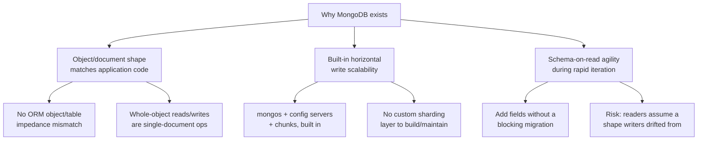

## 4. Core Concepts

This section teaches MongoDB's distinguishing internals from first
principles: the document format itself, the trade-offs of not enforcing a
schema at write time, how a replica set stays available through primary
failure, how a sharded cluster routes and rebalances data, how the
WiredTiger storage engine gives each transaction a consistent snapshot
without blocking readers against writers, how the aggregation pipeline
processes documents, and how MongoDB lets an application trade latency for
durability and consistency guarantees on a per-operation basis.

### 4.1 The BSON Document Model

**Definition.** A MongoDB document is a single ordered set of field/value
pairs encoded in BSON (Binary JSON), a binary-serialized superset of JSON
that adds a richer type system (distinct integer widths, a native `Date`
type, `ObjectId`, `Decimal128` for exact decimal arithmetic, `Binary` for
raw byte blobs, and native support for embedded sub-documents and arrays)
and, critically, prefixes every value with an explicit length and type
byte rather than requiring the reader to tokenize text character by
character. A collection is a named group of documents that need not share
identical fields, analogous to a table but without an enforced column set.

**Mechanism.** Every BSON document is stored as: a 4-byte total document
length, followed by a sequence of elements (each a 1-byte type code, a
null-terminated field name, and a type-specific value encoding), terminated
by a trailing zero byte. Because the total length is known up front and
every element carries an explicit type and length, WiredTiger (Section 4.5)
and any BSON parser can skip directly to a given byte offset or field
without a full tokenizing scan the way a JSON text parser must — this is
the core reason BSON exists as a distinct format rather than MongoDB simply
storing JSON text: JSON's text representation must be re-parsed
character-by-character on every read, while BSON's length-prefixed binary
layout supports fast field-level access and efficient binary comparison
during index traversal. Every document has a mandatory `_id` field (an
`ObjectId` by default — a 12-byte value encoding a 4-byte timestamp, a
5-byte random machine/process identifier, and a 3-byte incrementing
counter, making it roughly, but not strictly, time-sortable) which MongoDB
automatically indexes as the collection's unique primary key.

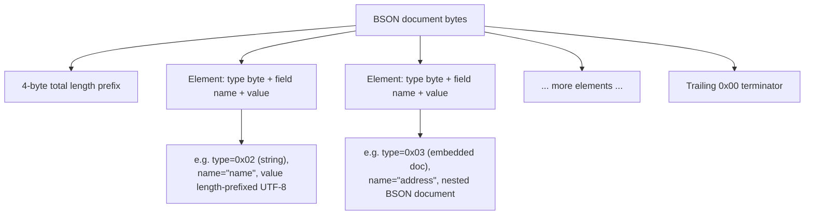

**Decision implications.** Because embedded sub-documents and arrays are
native BSON types, a one-to-few relationship (an order and its line items,
a user and their two or three shipping addresses) can be stored as a single
document, making the common case — read or write the whole object — a
single-document operation with MongoDB's default atomic single-document
guarantee, no join and no transaction required. This is the direct
architectural payoff of the document model versus normalized relational
storage for that access pattern, but it is a payoff that depends entirely
on the embedded data actually being read and written together and staying
bounded in size (documents have a 16 MB hard limit); the moment a
sub-collection grows unbounded (comments on a post, events on a device)
embedding stops being a payoff and becomes Section 17's unbounded-array
anti-pattern.

**Failure mode.** Teams new to MongoDB frequently model data exactly as
they would a relational schema — one document type per relational table,
foreign-key-style `ObjectId` references between them — and then discover
that every read now requires an application-level or `$lookup`-based join
(Section 4.6) across several round trips or an aggregation stage, giving up
the document model's main advantage while still carrying its schema-on-read
risk (Section 4.2). The BSON model is a genuine trade-off, not a strictly
better replacement for normalization: it wins for whole-object,
bounded-size access patterns and loses when data is naturally
many-to-many or unboundedly repeating.

**Scenario.** A product catalog document embeds `variants` (color/size/SKU
combinations, typically single digits to low tens per product) directly
inside the product document, because a storefront page always reads the
product and all its variants together and a variant is never queried
independent of its parent product — a textbook case for embedding. The same
catalog's `reviews`, which can grow into the thousands per popular product
and are frequently queried, paginated, and filtered independent of the
product itself, are instead stored as a separate `reviews` collection
referencing the product's `_id`, because reviews are unbounded and have
their own independent access pattern — the referencing choice Section 4.2
frames as the schema-design decision every document-model architect must
make deliberately, field by field.

### 4.2 Dynamic Schema (Schema-on-Read) and Its Trade-offs vs. Schema-on-Write

**Definition.** MongoDB does not require a collection to declare a fixed
set of fields, types, or constraints before a document can be inserted —
this is *schema-on-read*: the "shape" of the data is defined by what the
application code expects when it reads a document back, not enforced by
the database when the document is written. This directly inverts the
relational default this book has assumed throughout Part 06's earlier
chapters — *schema-on-write*, where `CREATE TABLE` and its `NOT NULL`/type/
foreign-key constraints reject any row that doesn't conform, before it is
ever stored.

**Mechanism.** With no enforcement layer, two documents in the same
MongoDB collection can legally have entirely different fields, field
orders, or even different types for the same field name (one document's
`price` a `Decimal128`, another's a plain integer, if the application
happened to write it that way) — MongoDB will store and index either
without complaint. MongoDB does provide an optional middle ground: JSON
Schema validation rules attached to a collection (`$jsonSchema` inside
`createCollection`'s or `collMod`'s validator option, demonstrated in
Section 10) that reject non-conforming inserts/updates at write time if
enabled, plus `validationLevel` (`strict` vs. `moderate`, controlling
whether pre-existing non-conforming documents are grandfathered) and
`validationAction` (`error` and reject, or `warn` and log only) — meaning
schema-on-write discipline is available in MongoDB as an opt-in guardrail
layered on top of a fundamentally schema-on-read engine, not the reverse.

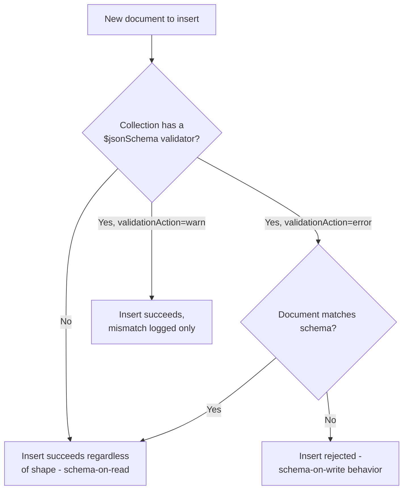

**Decision implications.** Schema-on-read shifts the cost of a shape change
from *migration time* to *read time, indefinitely*: adding a new required
field to a relational table is a single blocking (or, with modern online
Data Definition Language (DDL), non-blocking) migration that leaves every
row conforming afterward; adding a conceptually-required field in MongoDB
means every application code path that reads that field must handle its
absence forever, or a background migration must backfill every existing
document — and until that backfill finishes (or if it is never run), old
and new document shapes coexist silently. This is a genuine trade-off, not
a strictly worse choice: for a rapidly-iterating product where the schema
is still being discovered and most fields are additive and optional,
schema-on-read avoids the coordination cost of a formal migration process
on every iteration; for a mature system with many independent readers of
the same collection (multiple services, batch jobs, and BI tools all
reading the same data), the coordination cost that schema-on-write forces
at write time is exactly the safety net that prevents a silent shape drift
from becoming a production incident discovered only when a reader crashes
on a missing field.

**Failure mode.** The most common production incident this trade-off
produces is a silent, partial schema migration: a team renames or changes
the type of a field in application code and deploys it, and every document
written *after* the deploy has the new shape while every document written
*before* it keeps the old shape — with no database-level error at any
point, because nothing enforced the old shape in the first place. The bug
surfaces later, and non-deterministically, whenever a code path (a report,
an export, a rarely-hit branch) reads an old-shaped document expecting the
new shape.

**Scenario.** An application evolves a `user.address` field from a single
embedded sub-document to an array of embedded sub-documents (to support
multiple saved addresses). Without a backfill migration and without
`$jsonSchema` validation, the collection now permanently contains both
shapes: old documents with `address` as an object, new documents with
`address` as an array. Every reader — the checkout flow, the shipping-label
generator, an analytics job — must defensively check `Array.isArray()` (or
equivalent) forever, or the team must run and verify a one-time migration
that rewrites every old document into the new shape before the old-shape
code path is ever removed.

### 4.3 Replica Sets: Primary-Secondary Topology, Oplog-Based Replication, Elections

**Definition.** A MongoDB replica set is a group of `mongod` (MongoDB
daemon) instances holding the same data, with exactly one member elected
*primary* at any moment and the remaining members *secondaries* that
replicate the primary's writes and can serve reads under specific
read-preference settings (Section 4.7). This is MongoDB's specific
implementation of the leader/follower replication concept
([recapped from Replication](CH07_Replication.md#leaderfollower-replication-mechanics-wal-shippingstreaming-syncasyncsemi-sync-trade-off)):
this chapter teaches only what is distinctive about MongoDB's mechanism —
the oplog format and the election protocol — not the general
single-writer/durability-spectrum theory Replication already owns.

**Mechanism.** Every write accepted by the primary is recorded as an entry
in the *oplog* (operation log), a special capped collection
(`local.oplog.rs`) where each entry is an *idempotent* description of the
change (not, as in a Write-Ahead Log (WAL)-shipping engine, a literal
redo-log byte diff) tagged with the primary's current *term* (an
incrementing election generation number) and an `optime` (a
timestamp-plus-counter that totally orders every oplog entry). Idempotency
matters specifically because a secondary that crashes and reconnects
mid-replication, or a member recovering from a rollback, can safely
re-apply oplog entries it already applied without corrupting state — the
oplog entry for an `$inc` update, for instance, is stored and replayed as
"set field X to its known resulting value," not as "add 1 to whatever X
currently is." Secondaries continuously *tail* the primary's oplog (an
open, long-poll-style cursor against the capped collection) and apply
entries in order to their own copy of the data.

When the primary becomes unreachable (a heartbeat from every other member
times out, default 10 seconds), the replica set runs an election modeled
on the Raft consensus algorithm's leader-election phase: an eligible
secondary increments the term, requests votes from every other voting
member, and a member votes for the first eligible candidate it sees in a
given term (subject to `priority` settings that bias which member is
preferred, and requiring the candidate's oplog to be at least as
up-to-date as the voter's own) — a candidate that receives votes from a
strict majority of voting members becomes primary for that term. This
Raft-inspired majority requirement is precisely why replica sets deploy
with an odd number of voting members (or an explicit arbiter, a
data-less member that votes but replicates nothing) — an even-member
topology risks a tied vote and no majority, leaving the set without a
primary until the tie is broken.

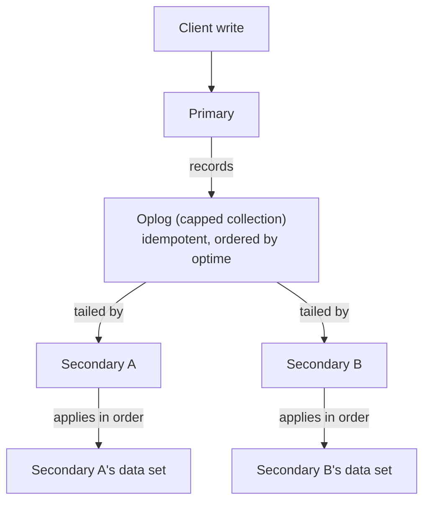

```mermaid
sequenceDiagram
    participant Client
    participant Primary
    participant SecondaryA
    participant SecondaryB
    Client->>Primary: heartbeat (every ~2s)
    Note over Primary,SecondaryB: Primary crashes / network partition
    SecondaryA->>SecondaryA: heartbeat timeout (10s) -&gt; starts election, term+1
    SecondaryA->>SecondaryB: RequestVote(term, lastOptime)
    SecondaryB->>SecondaryB: candidate oplog is caught up -&gt; grant vote
    SecondaryB-->>SecondaryA: vote granted
    SecondaryA->>SecondaryA: has majority (2 of 3) -&gt; becomes Primary
    Client->>SecondaryA: subsequent writes routed to new Primary
```

**Decision implications.** Because a candidate can only win an election if
its oplog is at least as current as a majority of voters, a secondary that
has fallen far behind (severe replication lag) cannot become primary until
it catches up — protecting against data loss on failover but meaning a
badly lagging secondary is not a usable failover target in an emergency,
the same operational trade-off Replication's general treatment already
frames as the lag-vs-durability spectrum
([recapped from Replication](CH07_Replication.md#replication-lag-and-read-your-writes-consistency-multi-leader-conflict-resolution)).
Architects size replica sets (typically 3 or 5 voting members, occasionally
adding non-voting or delayed/hidden members for backup or disaster-recovery
isolation) explicitly around this majority-vote requirement, not around
simple redundancy counting.

**Failure mode.** A *rollback* occurs when a primary accepted writes, was
partitioned away before those writes replicated to a majority, and a
different secondary (which never saw those writes) wins the subsequent
election — the old primary, on rejoining, must discard (roll back) any of
its own writes that the new primary's oplog history diverges from,
because the cluster's authoritative history is now whatever the elected
primary's oplog says it is. This is precisely the risk `w: majority` write
concern (Section 4.7) exists to eliminate for an application willing to
accept its added latency: a write acknowledged by a majority of the set
cannot be rolled back, because a majority-acknowledged write is guaranteed
to already be present in whichever oplog history any future election
majority must include.

**Scenario.** A three-member replica set spanning two data centers (two
members in the primary region, one in a secondary region) loses network
connectivity to the secondary region entirely. The two co-located members
still form a majority (2 of 3) and continue serving reads and writes
without an election — this is why replica set topology design accounts
explicitly for which physical failure domains can still form a majority,
not just how many total copies of the data exist.

### 4.4 Sharding Architecture: Shard Keys, Chunks, `mongos`, Config Servers

**Definition.** MongoDB sharding is this engine's specific implementation
of the general distributed horizontal-partitioning-plus-routing concept
([recapped from Sharding](CH06_Sharding.md#shard-key-selection-criteria-shard-mapdirectory-routing-consistent-hashing-ring--virtual-nodes-vs-hash-mod-routing)):
a *sharded cluster* splits a collection's documents across multiple shards
(each shard itself typically a replica set, Section 4.3, for its own
availability), fronted by one or more stateless `mongos` query routers that
applications actually connect to, with a small, separately-replicated
*config server replica set* holding the cluster's routing metadata — which
ranges of shard-key values live on which shard.

**Mechanism.** Every sharded collection has a *shard key*: one or more
indexed fields chosen at the time sharding is enabled, whose values
determine which shard owns a given document. MongoDB divides the shard
key's value range into contiguous *chunks* (by default targeting roughly
128 MB per chunk before splitting, configurable), and the config servers
record which chunk range currently lives on which shard. A `mongos`
receiving a query first consults (and caches) this routing table: a query
that includes the full shard key can be routed directly to the single
owning shard (a *targeted* query); a query that omits the shard key must be
broadcast to every shard and the results merged by `mongos` (a
*scatter-gather* query — the same scatter-gather cost Sharding's general
treatment already names
([recapped from Sharding](CH06_Sharding.md#rebalancinglive-data-migration-cross-shard-queries-scatter-gather-cross-shard-transactions2pc-cost-hot-shard-mitigation))).
A background *balancer* process continuously monitors chunk-count skew
across shards and migrates chunks from over-loaded to under-loaded shards
to keep the distribution even, using a two-phase copy-then-atomically-
switch-ownership protocol so an in-flight migration never loses or
duplicates a document.

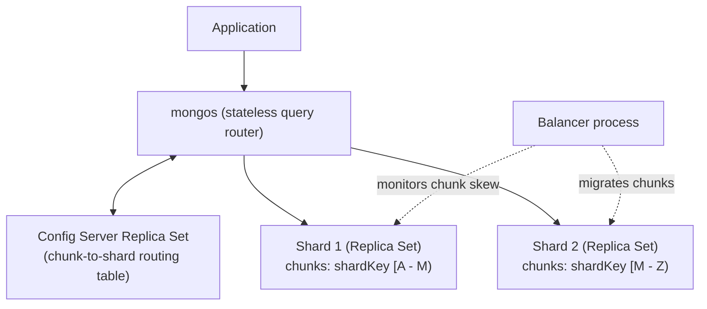

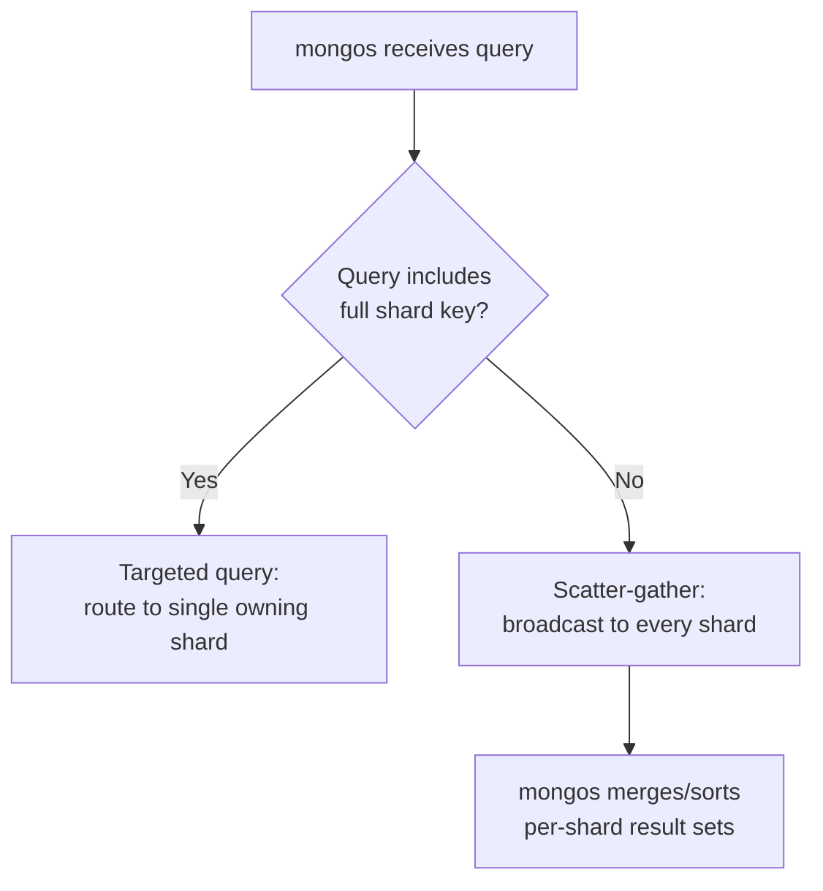

**Decision implications.** Shard-key choice is the single highest-leverage,
hardest-to-reverse decision in a MongoDB sharded-cluster design, for
exactly the reasons Sharding's general treatment teaches
([recapped from Sharding](CH06_Sharding.md#shard-key-selection-criteria-shard-mapdirectory-routing-consistent-hashing-ring--virtual-nodes-vs-hash-mod-routing)):
a monotonically increasing key (a timestamp, an auto-incrementing counter,
or the default `ObjectId` used naively) concentrates all new writes onto
whichever single chunk currently owns the highest value — the *hot shard*
failure mode below — while a key with too little cardinality cannot be
split into enough chunks to spread load at all. MongoDB additionally
supports *hashed* sharding (hashing the shard-key value before ranging it
into chunks) specifically to break up monotonic keys' write concentration
at the cost of losing efficient range-query targeting, and *zone sharding*
(pinning specific shard-key ranges to specific physical shards, commonly
used for geographic data residency or hot/cold tiering) as a targeting
override on top of the base range/hash choice.

**Failure mode.** A *jumbo chunk* is a chunk that has grown past the
splittable size threshold but cannot actually be split, because every
document inside it shares the identical shard-key value (the most common
cause: a shard key with too few distinct values, or a single logical
tenant's data all sharing one key value in a multi-tenant collection) — the
balancer can migrate a jumbo chunk as a single unit but cannot further
subdivide the hot range within it, so write load to that one shard-key
value stays permanently concentrated on whichever single shard owns it.

**Scenario.** A time-series sensor-readings collection sharded on
`{deviceId: 1, timestamp: 1}` (a compound shard key) distributes write load
evenly across shards by device while still supporting efficient
range-targeted queries for a single device's history over time, whereas
the naive alternative — sharding on `timestamp` alone — would funnel every
new reading, across every device, onto whichever single shard currently
owns "now," turning the entire cluster's aggregate write throughput into
that one shard's single-node ceiling.

### 4.5 WiredTiger Storage Engine: MVCC via Snapshots, Document-Level Locking

**Definition.** WiredTiger is MongoDB's default storage engine (Section 2),
responsible for how documents are actually laid out on disk, how
concurrent operations see a consistent view of data, and how compression
is applied. It gives MongoDB per-document Multi-Version Concurrency Control
via *point-in-time snapshots* — MongoDB's specific realization of the
generic MVCC concept
([recapped from Transactions](CH08_Transactions.md#multi-version-concurrency-control-mvcc)),
and this chapter teaches only WiredTiger's own snapshot/checkpoint
mechanism and document-level locking granularity, not the generic
version-chain-visibility theory Transactions already owns.

**Mechanism.** WiredTiger organizes each collection and each index as its
own B-tree, and every write is applied *copy-on-write*: modifying a page
never overwrites it in place, it creates a new version of that page in
memory, leaving any transaction already holding a reference to the old
page version unaffected. A *checkpoint* (by default every 60 seconds, or
sooner if enough data has accumulated) writes a fully consistent, complete
set of B-tree root pages to disk representing the entire dataset's state at
that instant — this is the mechanism that lets WiredTiger recover instantly
to a known-good state after a crash without replaying every write since
the beginning of time; writes between checkpoints are additionally
recorded to a *write-ahead journal* so any writes not yet captured in a
checkpoint can still be replayed after a crash. When a read operation
begins, WiredTiger assigns it a snapshot — the set of committed writes
visible as of that instant — and the read sees only that consistent
version of every page it touches for its entire duration, regardless of
concurrent writes happening elsewhere; this is what lets MongoDB readers
never block on concurrent writers, the same reader/writer non-blocking
property PostgreSQL's heap-tuple MVCC provides for the same underlying
reason
([recapped from PostgreSQL](CH11_PostgreSQL.md#41-mvcc-in-postgresql-heap-tuples-xminxmax)).

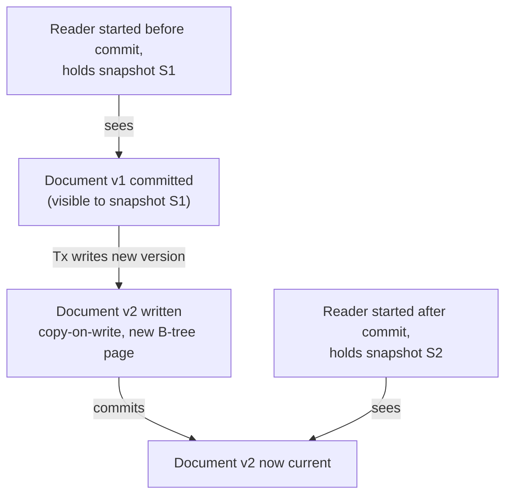

Concurrency control at the operation level is *document-level locking*:
WiredTiger takes an intent lock at the collection level and a fine-grained
lock only on the specific document(s) a write actually touches, so two
concurrent updates to two different documents in the same collection never
block each other — a direct, substantial improvement over the predecessor
MMAPv1 engine's collection-level locking, and this chapter's concrete
instance of the general lock-granularity trade-off Locking already teaches
([recapped from Locking](CH10_Locking.md#lock-typescompatibility-matrix-sharedexclusiveintent-lock-granularity-and-escalation)).

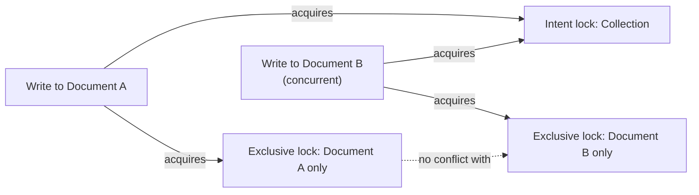

**Decision implications.** Because every uncommitted write exists as an
in-memory copy-on-write page until the next checkpoint, WiredTiger's
memory footprint (the *WiredTiger internal cache*, sized by default to
roughly half of available RAM minus 1 GB) is a first-order capacity-
planning input: a working set that fits comfortably inside this cache
serves reads without touching disk at all, while a working set that
exceeds it forces WiredTiger to evict pages under memory pressure and
re-read them from disk on the next access — the same working-set-vs-cache
sizing discipline this book has already taught for buffer pools generally
([recapped from Caching](CH09_Caching.md#cache-eviction-policies-lru-lfu-fifo-arc-cache-vs-materialized-view-distinction)),
here applied specifically to WiredTiger's own internal cache rather than an
external cache tier.

**Failure mode.** *WiredTiger cache pressure* — sustained write volume
faster than checkpoints and eviction threads can keep the in-memory
copy-on-write page backlog under control — manifests as write operations
being deliberately throttled (ticket-based admission control) to protect
the storage engine from running out of memory, visible operationally as a
sudden, cluster-wide latency spike under heavy write load rather than a
crash; the standard mitigation is reducing document/index size, adding
shards to spread the write load (Section 4.4), or increasing available
RAM.

**Scenario.** A bulk data-import job inserting millions of documents per
minute against an undersized replica set drives WiredTiger cache
utilization to its eviction threshold; write latency climbs from
single-digit milliseconds to hundreds of milliseconds as the storage
engine throttles new writes to let eviction threads catch up — the fix in
this scenario is typically batching the import with deliberate pacing
(or `bulkWrite` with a bounded batch size) rather than a single unthrottled
burst, alongside verifying the target replica set's cache is sized for the
import's working set.

### 4.6 The Aggregation Pipeline

**Definition.** The aggregation pipeline is MongoDB's primary query and
data-transformation language: a `db.collection.aggregate()` call takes an
ordered array of *stages* (`$match`, `$group`, `$project`, `$sort`,
`$lookup`, `$unwind`, `$facet`, and dozens more), and documents flow through
the stages in sequence, each stage's output becoming the next stage's
input — conceptually a Unix-pipe-style data-transformation pipeline
expressed declaratively rather than as procedural code.

**Mechanism.** MongoDB's query planner (its own engine-specific instance of
the generic query-processing pipeline
([recapped from Query Optimizers](CH04_Query_Optimizers.md#cost-based-query-optimization-vs-rule-based-query-processing-pipeline-parsebindrewriteoptimizeexecute)))
performs pipeline-level optimizations before execution: it reorders
`$match` and `$sort` stages earlier in the pipeline when doing so is
semantically safe (filtering before grouping is always cheaper than
grouping everything then filtering), merges adjacent compatible stages,
and — critically — pushes an early `$match` down to use an index exactly
as a normal `find()` query would, meaning a well-written pipeline with an
index-eligible first `$match` stage does not scan the entire collection
before beginning its transformation work. `$lookup` performs a left-outer-
join-style operation, correlating documents in the pipeline's current
collection against a second collection by a specified key — enabling
relational-style joins when a reference (Section 4.1) rather than an
embed was the right modeling choice, at the cost of an additional lookup
per document (or per group, if placed after a `$group` stage) that a
single-collection query never pays.

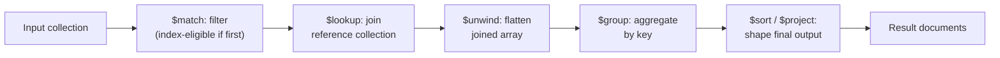

**Decision implications.** Placing `$match` (and, where possible, `$sort`
on an indexed field) as early as possible in a pipeline is the single
highest-leverage aggregation-performance decision an architect can make,
directly analogous to predicate pushdown in a relational cost-based
optimizer — the difference is that MongoDB's pipeline optimizer will
attempt to reorder stages automatically, but only where it is provably
safe to do so, so an author who places a filter *after* an expensive
`$group` or `$lookup` for readability reasons pays the full unfiltered cost
regardless of the optimizer's best effort. `$facet` (running several
independent sub-pipelines over the same input set in parallel within one
aggregation call, useful for computing a result set and its total count or
several different groupings in a single round trip) trades a single
larger query for eliminating multiple separate round trips.

**Failure mode.** A `$lookup` placed inside a pipeline stage that runs once
per document in a large intermediate result set (for example, after an
`$unwind` that has already exploded one document into many) multiplies the
join cost by the exploded document count — the classic aggregation
performance mistake, and the aggregation-pipeline-specific instance of the
general "join explosion" risk that unindexed, high-fan-out joins carry in
any query engine.

**Scenario.** An order-analytics pipeline first `$match`-filters to the
current month using an indexed `orderDate` field (cheap, index-eligible,
placed first), then `$group`s by `customerId` to compute per-customer
totals, then `$lookup`s against the `customers` collection *after*
grouping — one lookup per distinct customer rather than one per raw order
document — deliberately ordering the pipeline to minimize the number of
join operations rather than joining before aggregating.

### 4.7 Read Concern, Write Concern, and Read Preference: MongoDB's Consistency Model

**Definition.** MongoDB exposes three independent, per-operation tunable
knobs that together determine a specific operation's consistency and
durability guarantees: *write concern* (how many replica set members must
acknowledge a write before the driver considers it successful), *read
concern* (what guarantee the data returned by a read carries — whether it
could still be rolled back, Section 4.3's failure mode), and *read
preference* (which member of the replica set — primary or a specific class
of secondary — a read is even routed to). This three-knob model is
MongoDB's specific mechanism for the general durability-vs-latency spectrum
every replicated system exposes
([recapped from Replication](CH07_Replication.md#leaderfollower-replication-mechanics-wal-shippingstreaming-syncasyncsemi-sync-trade-off)).

**Mechanism.** Write concern is expressed as `w` (a number of members, or
the literal string `"majority"`) plus an optional `j` (require the write to
be journaled to disk before acknowledging) and `wtimeout` (how long to wait
for the requested acknowledgment before returning a timeout error, not a
rollback of the write itself). `w: 1` (the historical default) acknowledges
as soon as the primary itself has applied the write in memory — fastest,
but vulnerable to Section 4.3's rollback if the primary fails before
replicating to anyone. `w: "majority"` waits for acknowledgment from a
majority of voting members, which — combined with the majority requirement
elections already enforce — guarantees the write can never be rolled back
by any future election outcome. Read concern's most consequential values
are `"local"` (return whatever data is currently on the node the read hits,
even if it could later be rolled back), `"majority"` (return only data
already acknowledged by a majority — cannot be rolled back, but reflects
a slightly older point in time), and `"snapshot"` (used specifically inside
multi-document transactions, guaranteeing every read within the
transaction sees one single, consistent point-in-time snapshot across
possibly-many documents and possibly-many shards). Read preference
(`primary`, `primaryPreferred`, `secondary`, `secondaryPreferred`,
`nearest`) is evaluated independently of both concerns and determines
routing only — a `secondaryPreferred` read with `readConcern: "majority"`
can still return slightly stale data relative to the primary, because
secondaries apply the oplog (Section 4.3) asynchronously even though the
data it does return is guaranteed non-rollback-able.

```mermaid
sequenceDiagram
    participant Client
    participant Primary
    participant SecondaryA
    participant SecondaryB
    Client->>Primary: write, w:&quot;majority&quot;
    Primary->>Primary: apply write locally
    Primary-->>SecondaryA: replicate via oplog
    Primary-->>SecondaryB: replicate via oplog
    SecondaryA-->>Primary: ack
    Primary->>Primary: majority reached (2 of 3, incl. self)
    Primary-->>Client: write acknowledged
```

**Decision implications.** These three knobs are independently tunable per
operation, not a single global "consistency level" — an architect chooses
`w: "majority"` for a payment write where durability matters more than the
extra round-trip latency, `w: 1` for a high-volume, tolerable-to-lose
telemetry write where throughput matters more, `readConcern: "majority"`
plus `readPreference: secondaryPreferred` for an analytics read that can
tolerate slightly stale-but-never-wrong data while offloading load from the
primary, and reserves `readConcern: "snapshot"` for the specific case of
multi-document transactions where cross-document consistency, not just
per-document consistency, is required. Getting this wrong in either
direction is a real production risk: defaulting everything to `w:
"majority"` pays unnecessary latency on writes that never needed the
guarantee, while defaulting everything to `w: 1` silently accepts
rollback risk on writes that actually needed durability.

**Failure mode.** Reading from a secondary with `readPreference: secondary`
and no read-concern consideration can return data that is both stale
*and*, in a network-partition edge case, later rolled back — a common
mistake is treating "read from a secondary" as purely a load-distribution
optimization without separately reasoning about what read-concern
guarantee that secondary's data actually carries.

**Scenario.** An e-commerce checkout flow uses `w: "majority"` for the
order-creation write (a lost or rolled-back order is a customer-facing and
financial-integrity problem) but `w: 1` for a "last viewed products"
tracking write on the same request path (losing that write on primary
failure has no customer-facing consequence) — the same request issuing two
writes with deliberately different durability guarantees because the two
writes have genuinely different cost-of-loss.

## 5. Internal Working

Beyond the seven Core Concepts above, three additional mechanics determine
how a MongoDB deployment actually behaves under load: the query execution
path from a client call to a result set, the journal-plus-checkpoint
durability pipeline underlying every write, and the storage-engine
abstraction layer that let WiredTiger itself be swapped in as MongoDB's
default engine.

A query (whether a `find()` or an aggregation pipeline, Section 4.6) is
first parsed into a canonical query shape, which the query planner uses to
generate one or more *candidate plans* — different combinations of which
index (if any) to use and in what order to apply predicates. Unlike a
relational cost-based optimizer that estimates plan cost from table/column
statistics before ever running the plan
([recapped from Query Optimizers](CH04_Query_Optimizers.md#tablecolumn-statistics-and-histograms)),
MongoDB's classic planner instead runs multiple candidate plans in a
resource-limited race (a fixed number of documents or a time budget) and
picks whichever plan finishes fastest — a heuristic called *plan ranking
by trial*, and the winning plan is cached (the *plan cache*) so subsequent
identically-shaped queries skip the race and reuse the winner directly,
until the cache entry is invalidated (an index is added or dropped, or the
collection's data distribution has shifted enough to warrant a re-race).

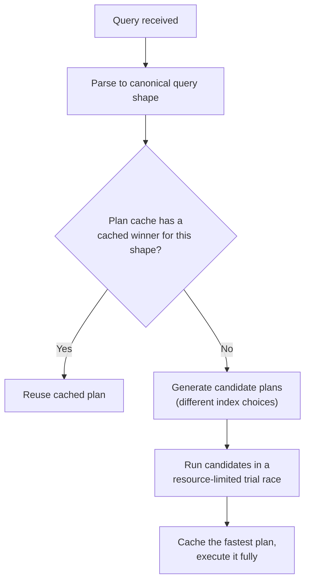

Durability at the single-node level layers two mechanisms already
introduced in Section 4.5: the *journal* (a write-ahead log of every
operation, flushed to disk far more frequently than a checkpoint — by
default every 100 ms, or immediately if any pending write requested
`j: true` write concern) and the *checkpoint* (a full consistent snapshot
of every B-tree's current state, written roughly every 60 seconds). On an
unclean shutdown, `mongod` recovers by loading the most recent checkpoint
and replaying only the journal entries recorded after that checkpoint —
never the entire history of writes — which bounds crash-recovery time to
"time since the last checkpoint" rather than "time since the database was
created," the same journal-plus-checkpoint recovery-time-bounding pattern
this book has already taught for relational Write-Ahead Logs
([recapped from PostgreSQL](CH11_PostgreSQL.md#43-write-ahead-logging-wal-fundamentals)).

Finally, the *storage engine API* is the internal abstraction boundary
that made WiredTiger's introduction possible without rewriting MongoDB's
query layer, replication layer, or wire protocol: every storage engine
(MMAPv1 historically, WiredTiger today, and the in-memory engine used for
specific latency-sensitive or ephemeral-cache deployments) implements the
same internal contract for reading, writing, and iterating BSON documents
and index entries, letting MongoDB's server-level code stay identical
regardless of which engine is actually storing bytes on disk underneath it.

## 6. Design Principles

Schema design in MongoDB is a deliberate, per-relationship decision between
*embedding* (Section 4.1's whole-object payoff) and *referencing* (storing
an `ObjectId` and looking it up via `$lookup`, Section 4.6, or a separate
application-level query), not a single rule applied uniformly across an
entire domain model. The standard decision framework asks three questions
per relationship: is it one-to-few, one-to-many, or many-to-many; is the
related data read together with its parent most of the time, or queried
independently most of the time; and is the related data's growth bounded
or effectively unbounded. One-to-few, read-together, bounded relationships
embed; one-to-many-or-more, independently-queried, or unbounded
relationships reference.

```mermaid
flowchart TD
    A[Relationship between two entities] --> B{Read together<br/>most of the time?}
    B -->|Yes| C{Bounded growth<br/>(few, not thousands+)?}
    C -->|Yes| D[Embed]
    C -->|No| E[Reference<br/>- avoid unbounded array]
    B -->|No| E
```

A second design principle is *modeling for the access pattern, not for the
entity-relationship diagram* — the direct consequence of schema-on-read
(Section 4.2) removing the schema-on-write engine's incentive to normalize
first and optimize access patterns later. Two collections that would be a
single normalized table in a relational design might correctly be two
separate MongoDB collections, or one embedded document, purely depending
on how the application actually reads the data; this is the document-model
analog of denormalization-for-read-performance
([recapped from Denormalization](CH02_Denormalization.md#precomputed-aggregatesrollups-read-model-duplication-cqrs-style)),
except applied as the primary modeling technique from the start rather than
as a secondary optimization layered on top of an already-normalized schema.

## 7. Architecture Patterns

The two canonical MongoDB deployment shapes are the standalone replica set
(Section 4.3) for workloads whose data and throughput fit comfortably on
one shard's worth of hardware, and the sharded cluster (Section 4.4) for
workloads that have outgrown a single shard's write or storage capacity —
architects should default to the former and only adopt the latter once a
concrete, measured scaling need exists, since a sharded cluster adds
`mongos`/config-server operational surface area and the permanent
shard-key-cannot-be-changed-without-a-full-resharding-operation constraint
(mitigated somewhat by MongoDB's newer online resharding feature, though
still a non-trivial operation).

A common architecture pattern layers MongoDB inside a polyglot-persistence
design: MongoDB holds the flexible, document-shaped operational data (user
profiles, product catalogs, content), while a relational engine
([recapped from PostgreSQL](CH11_PostgreSQL.md#3-why-it-exists)) holds data
with strong cross-entity referential-integrity requirements (billing,
inventory ledgers) — the two systems kept in sync via application-level
writes or event-driven Change Data Capture (CDC), rather than treating
either engine as a universal default for every data shape in the system.

## 8. Production Architecture

A production MongoDB deployment typically places multiple `mongos` routers
behind the application tier (often one per application-server host or a
small pool, since `mongos` itself holds no persistent data and is cheap to
scale horizontally), a 3-member config server replica set holding routing
metadata, and one replica set per shard, with each shard's members spread
across availability zones so a single zone failure never removes an entire
shard's majority.

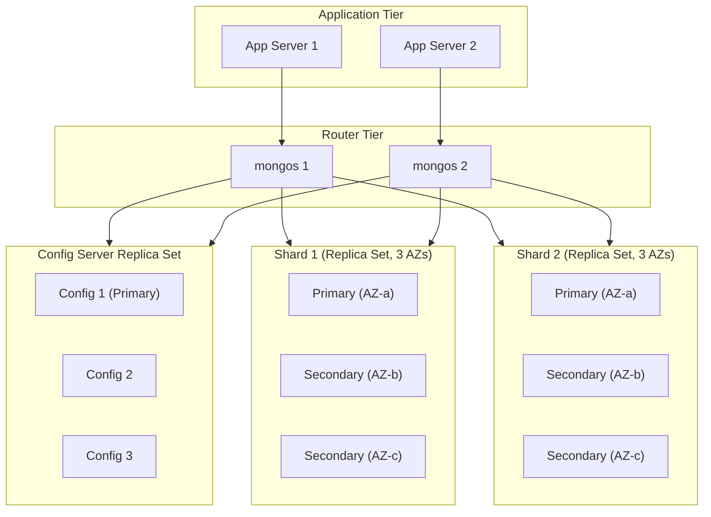

Managed offerings (MongoDB Atlas, or equivalent self-managed automation)
handle most of this topology's provisioning, TLS certificate rotation, and
automated failover directly, which is why most new production deployments
since roughly 2018 (Section 2) run on a managed control plane rather than
hand-rolled `mongod`/`mongos`/config-server orchestration.

## 9. Implementation

Connecting to MongoDB from application code means choosing a driver for
the application's language (the official MongoDB drivers exist for every
mainstream language and share a common design: a `MongoClient` object that
internally manages a connection pool and, for a replica set or sharded
cluster, automatically discovers topology and redirects operations to the
current primary or an eligible secondary per the configured read
preference, Section 4.7). Index creation (Section 11) and, optionally,
`$jsonSchema` validation (Section 4.2) are typically applied once at
collection-creation or migration time rather than on every application
startup, and connection strings for a replica set or sharded cluster list
every seed member so the driver can discover the full topology even if the
specific member it first contacts is unavailable. Section 10 demonstrates
these pieces end to end using the official Node.js MongoDB driver.

## 10. Complete Code Examples

The following runnable examples live under
[code/node/mongodb-chapter/](../code/node/mongodb-chapter/) and use the
official `mongodb` Node.js driver.

1. [`01_schema_validation_and_indexes.js`](../code/node/mongodb-chapter/01_schema_validation_and_indexes.js) —
   creates a collection with a `$jsonSchema` validator (Section 4.2) and a
   compound + partial index (Section 11).
2. [`02_aggregation_pipeline.js`](../code/node/mongodb-chapter/02_aggregation_pipeline.js) —
   a multi-stage aggregation pipeline (Section 4.6) combining `$match`,
   `$group`, `$lookup`, and `$facet`.
3. [`03_write_concern_and_read_preference.js`](../code/node/mongodb-chapter/03_write_concern_and_read_preference.js) —
   demonstrates per-operation write concern and read preference tuning
   (Section 4.7) on the same logical request.
4. [`04_multi_document_transaction.js`](../code/node/mongodb-chapter/04_multi_document_transaction.js) —
   a multi-document ACID transaction (Section 4.7's `readConcern:
   "snapshot"`) with retry-on-transient-error logic, modeling a funds
   transfer across two documents.

## 11. Performance

Indexing is the dominant performance lever: every query's `$match`/`find()`
predicate and sort should be covered by an index whose leading fields match
the query's equality predicates and whose trailing field matches the sort
direction (the same equality-sort-range field-ordering discipline this book
already teaches for composite indexes generally
([recapped from Indexes](CH03_Indexes.md#composite--covering-indexes))), and
`explain("executionStats")` reveals whether a query used an index scan
(`IXSCAN`) or fell back to a full collection scan (`COLLSCAN`) — the single
most important MongoDB performance diagnostic. A *covered query* — one
where every field the query needs (both the filter and the projection) is
present in the index itself — never touches the underlying document at
all, avoiding a separate document fetch per matched index entry. Beyond
indexing, keeping each shard's (or replica set's) working set inside the
WiredTiger cache (Section 4.5) is the second major lever, since any working
set that regularly exceeds available cache forces disk reads on the hot
path.

## 12. Scalability

Read scalability comes from adding secondaries and routing eligible reads
to them via read preference (Section 4.7); write scalability beyond a
single shard's ceiling comes from sharding (Section 4.4) — the general
horizontal-vs-vertical scaling trade-off already taught for relational
engines
([recapped from Sharding](CH06_Sharding.md#shard-key-selection-criteria-shard-mapdirectory-routing-consistent-hashing-ring--virtual-nodes-vs-hash-mod-routing))
applies identically here, with the specific twist that MongoDB's shard key
cannot be changed without a resharding operation, making the initial
shard-key choice materially more consequential than choosing to add a
secondary later. *Zone sharding* extends the base architecture for
geographically-distributed or hot/cold-tiered scale-out: specific
shard-key ranges are pinned to specific physical shards (and can be pinned
further to specific data-center tags), letting an architect keep a given
region's or tenant's data physically local while still presenting a single
logical sharded collection to the application.

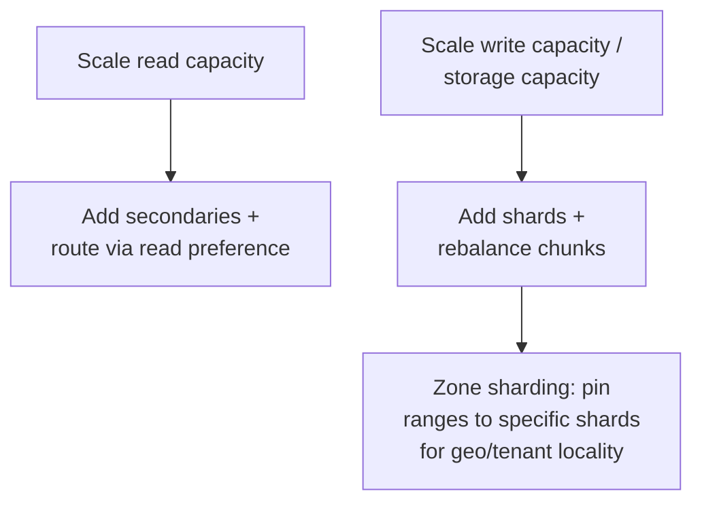

## 13. Security

MongoDB's Role-Based Access Control (RBAC) grants built-in or custom roles
(each a set of privileges against specific databases/collections) to
authenticated users, and `$jsonSchema` validation (Section 4.2) can double
as a lightweight data-integrity guardrail alongside access control, though
it is not itself a security boundary. Transport security uses standard TLS
([recapped from TLS](../05_Networking_and_OS/CH06_TLS.md#tls-13-handshake-0-rtt))
between drivers and `mongod`/`mongos`, and between replica set/sharded
cluster members themselves; encryption at rest is available via a native
WiredTiger encrypted-storage-engine option (backed by a key management
system) or via the underlying storage volume's own encryption. *Client-Side
Field Level Encryption (CSFLE)* and its successor *Queryable Encryption*
go further, encrypting specific sensitive fields on the client before they
ever leave the application process, so even a database administrator with
full server access cannot read the plaintext of those fields — a
meaningfully stronger guarantee than transport-plus-at-rest encryption
alone, at the cost of losing most query capability against the encrypted
fields (Queryable Encryption restores equality queries against encrypted
fields specifically).

## 14. Observability

`db.serverStatus()` exposes engine-wide counters (connections, opcounters,
WiredTiger cache statistics from Section 4.5); `db.currentOp()` shows every
in-flight operation on a given node, the standard first tool during an
active incident; the *database profiler* (enabled per-database, logging
operations slower than a configurable threshold) is the equivalent of a
slow-query log; and `rs.status()`/`sh.status()` report replica set member
health and oplog window (Section 4.3) or sharded-cluster chunk distribution
(Section 4.4) respectively. Managed platforms (Atlas or equivalent) surface
most of these as dashboards and alerting rules directly rather than
requiring an operator to poll each command manually.

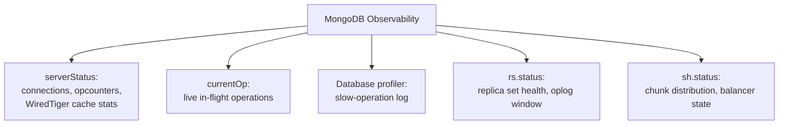

## 15. Failure Scenarios

An *election storm* (repeated, rapid re-elections without the replica set
ever stabilizing on a durable primary) typically results from flapping
network connectivity or an overloaded member unable to respond to
heartbeats in time — the fix is almost always addressing the underlying
resource or network instability, not tuning election timeouts as a
band-aid. *Orphaned documents* can accumulate on a shard after a chunk
migration (Section 4.4) if the migration's cleanup step is interrupted,
leaving a stale copy of migrated documents on the source shard that no
longer owns that chunk range — background cleanup normally handles this,
but a repeatedly-interrupted migration can leave enough orphans to skew
storage-usage metrics or, in rare edge cases, be returned by a scatter-
gather query that doesn't correctly filter by current chunk ownership.
Sustained write throughput against a poorly chosen monotonic shard key
(Section 4.4) produces the hot-shard failure mode where one shard's
resource ceiling becomes the entire cluster's effective write ceiling
regardless of how many additional shards exist.

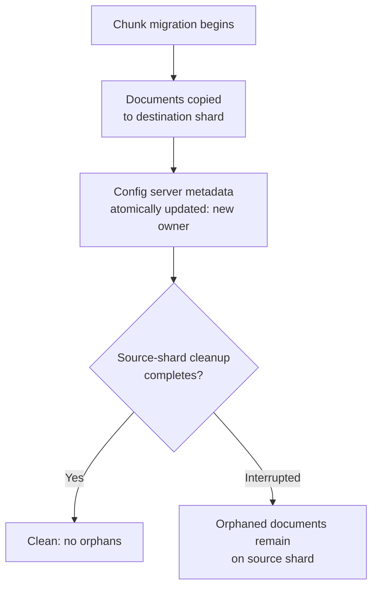

## 16. Testing

`mongodb-memory-server` (Node.js) and equivalent embedded/ephemeral MongoDB
libraries in other languages spin up a real, disposable `mongod` process
per test run, giving integration tests true MongoDB semantics (including
aggregation pipeline behavior that a generic in-memory fake could not
replicate faithfully) without depending on a shared, stateful test
database. Replica-set-specific behavior (elections, write concern,
transactions) requires a genuine multi-member replica set in the test
harness rather than a single standalone `mongod`, since single-node
deployments don't support multi-document transactions at all — a detail
worth testing explicitly given how easy it is to develop against a
standalone instance and discover the gap only when transactions are first
exercised against a real replica set.

## 17. Common Mistakes

- **Unbounded embedded arrays** — embedding a sub-collection (comments,
  events, audit history) that grows without bound violates Section 4.1's
  bounded-size assumption and eventually risks the 16 MB document limit,
  plus steadily degrading read/write performance well before that limit is
  reached.
- **Choosing a monotonic shard key naively** — as Section 4.4 details, this
  concentrates all new writes on a single, ever-shifting hot shard.
- **Treating `_id` as sequential/sortable for business logic** —
  `ObjectId` is roughly, not strictly, time-ordered (Section 4.1); relying
  on strict ordering across concurrent inserts is unsafe.
- **Modeling every relationship exactly like a normalized relational
  schema** — reintroduces join-per-read cost (Section 4.6) while still
  carrying schema-on-read's shape-drift risk (Section 4.2), without
  gaining the document model's embedding payoff.
- **Defaulting every write to `w: 1`** — accepts Section 4.3's rollback
  risk even for writes where durability actually matters.
- **Ignoring `explain()` before shipping a new query pattern** — deploying
  a query that silently falls back to `COLLSCAN` (Section 11) against a
  large, growing collection.

## 18. Best Practices

Choose the shard key (if sharding at all) based on measured write and query
patterns before data volume makes resharding painful; enable `$jsonSchema`
validation on collections with more than one independent writer or reader
to convert Section 4.2's silent shape-drift risk into an explicit,
early-rejected error; default to `w: "majority"` for any write whose loss
has a real business cost and reserve `w: 1` deliberately for
loss-tolerant, high-volume writes; monitor oplog window size (how far back
the oplog's capped collection still reaches) against the slowest
secondary's typical lag, since a secondary that falls behind the oplog
window's retention cannot resume replication incrementally and must
resync from scratch; and run `explain()` against any new or materially
changed query pattern before it reaches production, not after a slowdown
is reported.

## 19. Anti-Patterns

- **The "one giant document" anti-pattern** — embedding an entire object
  graph regardless of size or independent-access-pattern, the mirror image
  of Section 4.1's deliberate, per-relationship embed/reference decision.
- **Application-level joins in a loop** — issuing a separate query per
  document to fetch related data instead of a single `$lookup` stage
  (Section 4.6) or a single `$in`-based batch query.
- **Sharding before there is a measured scaling need** — adopting Section
  4.4's operational complexity preemptively, "because MongoDB can shard,"
  without a concrete single-shard capacity ceiling actually being
  approached.
- **Read preference used purely as a load-balancing knob** — routing reads
  to secondaries (Section 4.7) without separately reasoning about which
  read concern that traffic actually requires.

## 20. Trade-off Analysis

| Dimension | MongoDB's position | Trade-off accepted |
|---|---|---|
| Schema flexibility | Schema-on-read by default, opt-in `$jsonSchema` | Faster iteration vs. shape-drift risk (Section 4.2) |
| Write scale-out | Built-in sharding (Section 4.4) | Operational complexity + hard-to-reverse shard-key choice |
| Cross-document consistency | Multi-document transactions available, opt-in (Section 4.7) | Higher latency/lock cost than the single-document default |
| Read/write durability | Fully tunable per operation (`w`, `readConcern`) | Requires the architect to choose correctly per write, not a single global setting |
| Query language | Aggregation pipeline (Section 4.6), rich and declarative | Steeper learning curve than SQL for equivalent joins/grouping |

## 21. Comparison Table

| Engine | Data model | Consistency default | Horizontal scale-out | Best fit |
|---|---|---|---|---|
| MongoDB | Document (BSON) | Tunable per-op (Section 4.7) | Built-in sharding (Section 4.4) | Flexible, evolving object-shaped data; whole-object access patterns |
| PostgreSQL ([recapped](CH11_PostgreSQL.md)) | Relational + native JSONB | Strong (MVCC snapshot isolation) | Extension-based (Citus) or app-level | Strong cross-entity integrity, complex ad hoc SQL joins |
| Cassandra (forward reference, not yet drafted) | Wide-column | Tunable (quorum-style) | Peer-to-peer, no single router | Very high write throughput, linear scale, no joins |
| DynamoDB (forward reference, not yet drafted) | Key-value/document | Tunable (eventual/strong per read) | Fully managed, automatic | Predictable-access-pattern workloads at AWS-native scale |

## 22. Real-World Case Study

The New York Times used MongoDB to power its internal Content API and
digital-archive systems, embracing the document model specifically because
editorial content (an article with embedded metadata, media references,
and varying, evolving field sets across content types and eras of
publishing history) does not fit naturally into a single rigid relational
schema — new content types and fields could be introduced without a
blocking migration against decades of archived articles, directly
realizing Section 4.2's schema-on-read agility payoff for a workload whose
data shape was known to keep evolving indefinitely, while the fixed core
fields every article does share (headline, publish date, author) were
still enforced where it mattered via application-level and, in later
deployments, `$jsonSchema`-based validation.

## 23. Interview Questions

1. Explain the difference between schema-on-write and schema-on-read, and
   give one production scenario where each is the better default.
2. Walk through what happens, step by step, when a MongoDB replica set's
   primary becomes unreachable.
3. Why does MongoDB support hashed sharding in addition to range sharding,
   and what specific failure mode does hashing address?
4. What is the difference between write concern, read concern, and read
   preference, and why are they independently tunable rather than a single
   setting?
5. How does WiredTiger's document-level locking differ from MMAPv1's
   collection-level locking, and what concurrency behavior changed as a
   result?
6. When would you choose to embed a relationship versus reference it, and
   what happens if that decision is revisited after the collection has
   grown large?
7. What is a jumbo chunk, and why can't the balancer always fix one by
   itself?

## 24. Hands-on Exercises

1. Stand up a 3-member replica set locally, insert data with `w:
   "majority"`, then forcibly stop the primary process and observe the
   election and subsequent primary re-election via `rs.status()`.
2. Enable the database profiler, run a query that falls back to
   `COLLSCAN`, add the appropriate index, and confirm the same query now
   reports `IXSCAN` via `explain("executionStats")`.
3. Design and implement a `$jsonSchema` validator for a collection with at
   least one required field and one type constraint, then attempt an
   insert that violates each rule and observe the rejection.

## 25. Design Exercises

1. Design the shard key for a multi-tenant SaaS application's `events`
   collection, where each tenant generates a highly variable volume of
   time-ordered events, and justify your choice against both the hot-shard
   and jumbo-chunk failure modes.
2. Given a social-network "posts with comments" domain, decide which
   relationships to embed and which to reference, and justify each
   decision against Section 6's three-question framework.

## 26. Architecture Review Questions

1. Does every write path in this design specify an explicit, justified
   write concern, or is the driver default being used unexamined?
2. Has the shard key (if sharding) been validated against measured write
   distribution, not just theoretical cardinality?
3. Is `$jsonSchema` validation applied to any collection with more than one
   independent writer?
4. Are read-preference choices paired with an explicit read-concern
   decision, or chosen purely for load distribution?
5. Does the replica set's physical topology (member placement across
   availability zones/regions) still permit a majority after the most
   likely single-failure-domain outage?

## 27. Summary

MongoDB's document model, schema-on-read default, replica-set-based
availability, native sharding, WiredTiger's snapshot-based MVCC and
document-level locking, aggregation pipeline, and tunable consistency
knobs together form a coherent but genuinely different set of trade-offs
than the relational engines this book has covered so far — not a strictly
better or worse choice, but one whose payoffs (schema agility, whole-object
access-pattern performance, built-in horizontal write scaling) are real
only when the schema-design decisions in Section 6, the shard-key decision
in Section 4.4, and the per-operation consistency decisions in Section 4.7
are all made deliberately rather than defaulted. The next chapters in
Part 06's NoSQL subsection (Redis, DynamoDB, Cassandra, Neo4j,
ElasticSearch, Vector Databases, Time Series Databases) each recap this
chapter's and the earlier Database Design/Relational chapters' generic
concepts the same way this chapter recapped Sharding, Replication,
Transactions, and Locking — teaching only what is genuinely specific to
their own engine.

## Further Reading

- [Sharding](CH06_Sharding.md), [Replication](CH07_Replication.md),
  [Transactions](CH08_Transactions.md), [Locking](CH10_Locking.md) — the
  generic distributed-systems theory this chapter recapped throughout.
- [PostgreSQL](CH11_PostgreSQL.md) — a contrasting schema-on-write,
  single-primary MVCC engine, useful as a direct comparison point for
  Sections 4.1-4.2 and 4.5.
- [TLS](../05_Networking_and_OS/CH06_TLS.md) — transport encryption
  mechanics recapped in Section 13.

## Design Review Checklist

- [ ] Shard key (if sharding) chosen from measured access patterns, not
      convenience.
- [ ] Embed/reference decision made explicitly per relationship (Section 6).
- [ ] Write concern and read concern set deliberately per operation, not
      left at driver defaults everywhere.
- [ ] `$jsonSchema` validation considered for any multi-writer/multi-reader
      collection.
- [ ] Replica set member placement survives the most likely single-failure-
      domain outage with a majority intact.

## Trade-off Matrix

See Section 20.
