# Chapter: Redis

Part: [06 — Databases and Storage](PART_OVERVIEW.md) · Status: Drafted

## 1. Introduction

Redis (**RE**mote **DI**ctionary **S**erver) is an in-memory data structure
store that architects reach for constantly and, more often than the industry
admits, misunderstand. The word most people attach to Redis is "cache," and
that word is not wrong, but it is dangerously incomplete: a cache is a
*pattern* — cache-aside, read-through, write-through, write-behind, each with
its own consistency and durability trade-offs, already taught in full in
[Caching](CH09_Caching.md) — and Redis is a *substrate*, a concrete piece of
software with its own internal architecture, its own command set, its own
persistence model, and its own failure modes, that those generic patterns
happen to run on top of extremely well. This distinction matters more than
it looks. An architect who thinks of Redis only as "the cache" will reach
for `Redis.set(key, value, ttl)` and never notice that the same server is
also a fully-featured sorted-set engine that can implement a leaderboard
without an external ranking service, a lightweight message bus that can
decouple two microservices without standing up Kafka, a probabilistic
counter that can estimate the cardinality of a billion-element stream in
12 kilobytes, and a durable-enough system of record for session state or a
rate-limiter's counters if — and only if — its persistence and replication
knobs are configured with the same rigor a relational engine's would be.

This chapter's job is to teach Redis as a piece of engineering, not as a
cache. It assumes the reader already understands caching's application-level
*patterns* (cache-aside, TTL invalidation, stampede mitigation, generic
eviction-policy theory) from [Caching](CH09_Caching.md), generic replication
theory (leader/follower topology, sync/async/semi-sync trade-offs, split-brain
risk, fencing tokens) from [Replication](CH07_Replication.md), and generic
distributed sharding theory (shard-key selection, consistent hashing,
rebalancing, cross-shard-query cost) from [Sharding](CH06_Sharding.md). None
of those chapters is re-taught here. What this chapter teaches, from first
principles, is what makes Redis *Redis*: a single-threaded command-processing
core built around an event loop instead of a thread pool, a small number of
purpose-built data structures whose command-level time complexity you must
know before you run them in production, two genuinely different persistence
mechanisms (Redis Database (RDB) snapshotting and Append-Only File (AOF)
logging) that trade durability for restart speed in opposite directions,
Redis's own concrete hash-slot sharding scheme and gossip-based cluster
membership protocol (Redis Cluster), its own concrete quorum-based failover
implementation (Redis Sentinel), a fire-and-forget publish/subscribe bus that
is *not* a durable message queue, and a `maxmemory`-driven eviction system
whose approximated Least Recently Used (LRU) and Least Frequently Used (LFU)
algorithms are deliberately different from the textbook versions the Caching
chapter describes in the abstract.

## 2. Historical Evolution

- **2006-2008, Sicilia, Italy — the LLOA project** — Salvatore Sanfilippo
  ("antirez") was building a real-time web analytics product (`LLOA`, later
  `Redis`) and needed to serve millions of small counter/list updates per
  second with latency his relational database of choice could not
  guarantee. He started prototyping a purpose-built in-memory key-value
  store to sit in front of it.
- **2009 — first public release** — Redis 1.0 shipped with strings, lists,
  sets, and a single-threaded, event-driven core. The initial design
  decision to keep the server single-threaded (Section 4.1) was made not as
  a limitation but as a deliberate simplicity-and-correctness trade against
  the fine-grained-locking complexity multi-threaded in-memory stores of the
  era were struggling with.
- **2010-2011 — hashes and sorted sets** — Redis 2.0 added hashes; Redis 2.2
  added the sorted set (`ZSET`), which became one of Redis's signature data
  structures because no other mainstream store offered an ordered,
  range-queryable structure with the same command-level ergonomics
  (leaderboards, priority queues, sliding-window rate limiters).
- **2012-2013 — VMware/Pivotal sponsorship and clustering research** —
  antirez, sponsored first by VMware then Pivotal, spent this period
  designing what would become Redis Cluster; early public design documents
  proposing hash-slot-based sharding (Section 4.4) date to this era, long
  before the feature actually shipped, because getting cluster consensus
  right without introducing a heavyweight coordination service (etcd,
  ZooKeeper) proved to be a hard design problem.
- **2013 — Redis Sentinel (Redis 2.8)** — rather than waiting for full
  clustering, Redis shipped a narrower, immediately useful feature first:
  a quorum-based sidecar process that monitors a leader/follower topology and
  automates failover (Section 4.5), addressing the single-point-of-failure
  problem for the far more common single-primary deployment shape.
- **2015 — Redis Cluster ships (Redis 3.0)** — hash-slot sharding with a
  gossip protocol for cluster-state propagation (Section 4.4) finally
  reached general availability, letting a single logical Redis deployment
  scale writes horizontally across many primaries for the first time.
- **2017 — Streams (Redis 5.0)** — the `XADD`/`XREAD`/consumer-group family
  added an append-only, replayable log structure inspired by Kafka's
  semantics, closing Redis's biggest structural gap against pub/sub's
  fire-and-forget delivery model (Section 4.6).
- **2020 — I/O threading (Redis 6.0)** — network I/O (reading requests off
  the socket and writing responses back) was made multi-threaded while
  command *execution* stayed strictly single-threaded, a nuance that
  surprises many architects who assume "Redis went multi-threaded" means the
  single-threaded execution guarantees (Section 4.1) disappeared — they did
  not.
- **2021-2022 — corporate fork and relicensing pressure begins** — Redis
  Labs (later renamed Redis, Inc.) started shifting some modules and
  eventually parts of Redis itself away from a purely permissive license,
  which triggered the community events described in Section 22's case
  study.
- **2024 — Redis switches to a Server Side Public License (SSPL)-family
  license; the Valkey fork** — the Linux Foundation, with backing from AWS,
  Google Cloud, and Oracle Cloud, forked the last permissively-licensed
  Redis release as **Valkey**, a project this chapter's licensing discussion
  (Section 22) covers in depth because it materially changes the
  build-vs-buy calculus for new deployments.

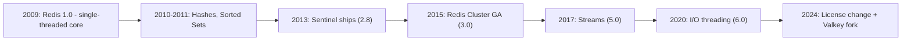

## 3. Why It Exists

Redis exists because two properties that most databases treat as opposed —
extremely low, predictable per-operation latency and rich, application-aware
data structures — are both achievable simultaneously if you are willing to
give up two things most databases refuse to give up: disk as the primary
storage medium, and multi-threaded command execution. Every other design
choice in Redis follows from that trade.

Keeping the entire working dataset in Random Access Memory (RAM) removes the
single largest source of latency variance in a database: disk (or even
Solid-State Drive (SSD)) seek and I/O queueing time. A relational database
optimized for durability must, in the general case, touch disk before it can
acknowledge a write; Redis's default posture inverts that — it acknowledges
the write the instant it is applied to an in-memory structure, and treats
durability (Section 4.3) as a separately configurable, explicitly-chosen
trade-off rather than a mandatory per-write cost. This is precisely why
Redis is unsuitable as a primary system of record for data an organization
cannot afford to lose even in a narrow crash window, and precisely why it is
so effective for data whose value depends more on speed than on absolute
durability: a session token, a leaderboard, a rate-limiter counter, a hot
cache entry.

The second reason Redis exists is that a plain key-value `GET`/`SET`
interface forces application code to re-implement, in every service that
needs one, the same handful of data structures a computer science curriculum
teaches in an introductory course: a queue, a set, a sorted collection, a
counter. Redis instead exposes those structures as first-class server-side
primitives with atomic, single-round-trip commands (`LPUSH`, `SADD`,
`ZADD`, `INCR`) — the server does the structural bookkeeping, and the client
never has to read-modify-write a blob and race another client doing the
same thing. This is why Redis is more honestly described as a **data
structure server** than a cache: caching is simply the most common *use* of
that server, not a description of what the server fundamentally is.

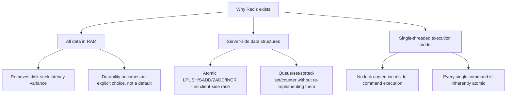

## 4. Core Concepts

This section teaches, from first principles, the seven mechanisms that
distinguish Redis as a system: its single-threaded event-loop execution
model, its core data structures and their command-level complexity, its two
persistence mechanisms (RDB and AOF), Redis Cluster's hash-slot sharding,
Redis Sentinel's quorum-based failover, its publish/subscribe bus, and its
`maxmemory` eviction policies. Each subsection follows definition, mechanism,
decision implications, failure mode, and a concrete scenario, per this
book's Core Concepts depth rule.

### 4.1 Single-Threaded Event-Loop Architecture

**Definition.** Redis executes all commands on a single logical thread using
an event loop: one thread repeatedly asks the operating system "which of my
open sockets are ready to be read from or written to right now?", processes
those ready sockets' commands to completion one at a time, and repeats. No
two commands ever execute concurrently against the same in-memory data
structures.

**Mechanism.** Redis's event loop (`ae.c` in the source, an abstraction the
project calls "the event library") wraps whichever OS-level I/O
multiplexing primitive is fastest on the platform it is running on: `epoll`
on Linux, `kqueue` on BSD/macOS, `evport` on Solaris, with a `select()`
fallback. All of these mechanisms answer the same question in one system
call: "of these N file descriptors I'm watching, which ones have data
ready?" — turning what would otherwise require N blocking `read()` calls (or
N dedicated threads) into a single non-blocking call that returns a small
list of ready descriptors. The main thread then services each ready client
in turn: read the command off the socket, parse it, execute it fully against
memory, write the response back, move to the next ready client. Because
command *execution* never yields control mid-command, a `LPUSH` followed
immediately by an `LRANGE` from a different client can never observe a
half-updated list — every command is atomic simply because nothing else can
run while it runs. This is fundamentally different from a relational
database's own concurrency model
([Locking](CH10_Locking.md)/[Transactions](CH08_Transactions.md)'s Multi-
Version Concurrency Control (MVCC)), which exists precisely because those
systems *do* run many operations concurrently and need a mechanism to keep
them from corrupting each other; Redis sidesteps the entire problem class by
construction rather than solving it with locks or version chains.

As of Redis 6.0, network I/O (the socket `read()`/`write()` system calls
themselves) can be handled by a small pool of I/O threads
(`io-threads` config), but this only parallelizes the mechanical work of
moving bytes between the socket buffer and Redis's internal buffers —
command *parsing and execution* still happens on the single main thread.
This is the single most common architecture question about modern Redis:
"is Redis multi-threaded now?" The honest answer is "the I/O plumbing can
be, the atomicity guarantee that makes every command safe without a lock is
not, and was never meant to be."

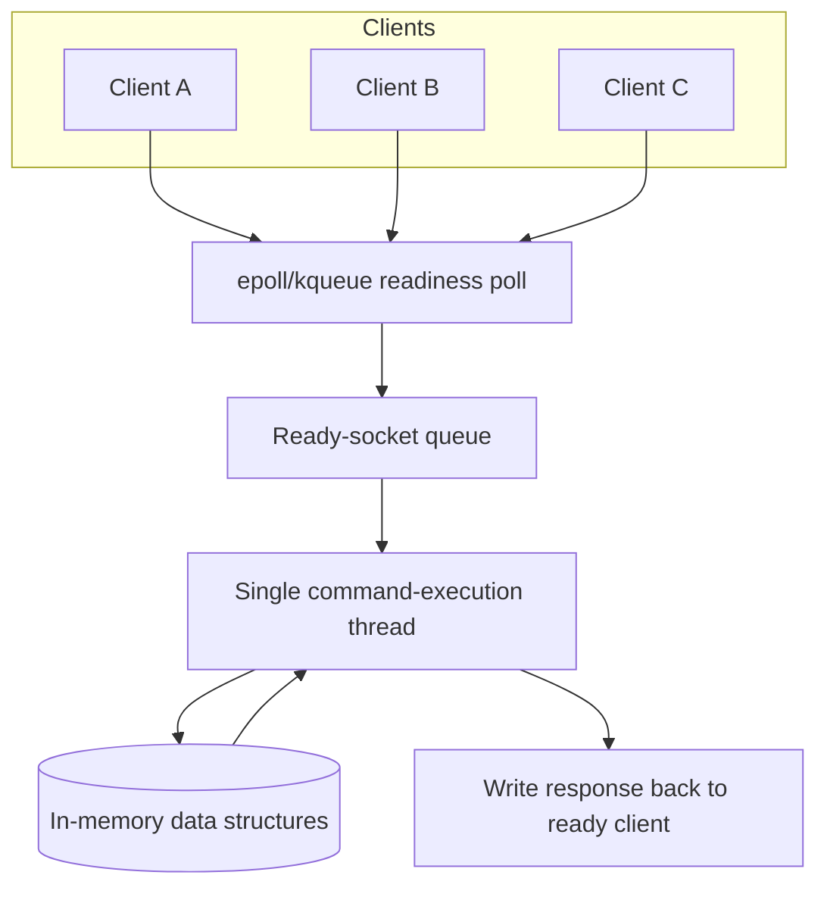

**Decision implications.** Because there is exactly one thread executing
commands, Redis's throughput ceiling for any single instance is bounded by
single-core Central Processing Unit (CPU) speed, not by adding more cores —
scaling Redis horizontally means running more Redis processes (Redis
Cluster, Section 4.4, or simple client-side sharding across independent
instances), not giving one instance more cores. It also means **any single
slow command blocks every other client for its full duration** — this is
the architecture's single sharpest edge, and the reason commands like
`KEYS *` (an O(N) full-keyspace scan), unbounded `SMEMBERS`/`LRANGE` on a
huge collection, or a poorly-chosen Lua script are treated as production
incidents waiting to happen rather than convenience commands.

**Failure mode.** A single long-running command — a `KEYS *` against a
10-million-key instance, a `SORT` on an enormous unsorted list, a badly
written Lua script with an unbounded loop — stalls the entire event loop for
its duration. Every other client, including replication traffic and the
Sentinel/Cluster heartbeat commands that detect liveness, is blocked behind
it. In a clustered or Sentinel-monitored deployment this can cascade into a
false-positive failover: the blocked primary looks "dead" to the monitoring
layer even though the process is still running, just not reachable, and a
healthy replica gets promoted while the original primary is still holding
data that was never replicated.

**Scenario.** An engineer runs `KEYS user:*` from a debugging session
against a production Redis instance holding 40 million keys to find a
handful of stale entries. The single-threaded event loop spends several
hundred milliseconds to multiple seconds scanning the entire keyspace before
it can service any other client, during which every application request
hitting that Redis instance queues up and times out. The fix is architectural
discipline, not a bigger instance: use `SCAN` (Section 9), which walks the
keyspace incrementally across many small round trips instead of one blocking
call, and ban `KEYS` from any code path that is not an offline, isolated
maintenance tool.

### 4.2 Core Data Structures and Command-Level Complexity

**Definition.** Redis exposes eight primary data-structure families as
server-side types, each with its own command set and, critically, its own
per-command time complexity that an architect must know before deciding
which structure and which command to use for a given access pattern.

**Mechanism.** Redis picks an internal *encoding* for each structure based
on its size and content, transparently switching from a compact encoding to
a general-purpose one as the collection grows — this is why the same
logical data type (say, a hash) can behave with very different memory
footprints depending on how many fields it holds.

| Type | What it models | Compact encoding (small) | General encoding (large) | Representative commands and complexity |
|---|---|---|---|---|
| String | Binary-safe byte sequence, up to 512 MB | `int` (for numeric values) / `embstr` (short strings) | `raw` (Simple Dynamic String, heap-allocated) | `GET`/`SET` O(1); `INCR`/`APPEND` O(1); `GETRANGE` O(N) in range length |
| Hash | Field-to-value map | `listpack` (compact, sequential scan) | Hash table | `HSET`/`HGET` O(1); `HGETALL` O(N) in field count |
| List | Ordered sequence, insert/pop at either end | `listpack` | `quicklist` (linked list of listpacks) | `LPUSH`/`RPUSH`/`LPOP` O(1); `LRANGE` O(S+N), S = start offset |
| Set | Unordered unique-member collection | `intset` (all-integer, sorted array) / `listpack` | Hash table | `SADD`/`SISMEMBER` O(1); `SMEMBERS` O(N); `SINTERSTORE` O(N*M) across M sets |
| Sorted Set (ZSET) | Unique members ordered by a floating-point score | `listpack` | Skip list + hash table (dual structure) | `ZADD` O(log N); `ZRANGE`/`ZRANGEBYSCORE` O(log N + M), M = result size; `ZRANK` O(log N) |
| Stream | Append-only log of ID-stamped field-value entries | Radix tree of "listpacks" (`rax`) | Same, unbounded | `XADD` O(1) amortized; `XRANGE` O(log N + M); `XREADGROUP` O(M) per consumer |
| HyperLogLog | Probabilistic cardinality estimator | Sparse (a compact run-length-style encoding) | Dense (fixed 12 KB registers) | `PFADD` O(1); `PFCOUNT` O(1) single key, O(N) across N merged keys |
| Bitmap | Bit-addressable string used as a bit array | N/A (backed by `String`) | N/A | `SETBIT`/`GETBIT` O(1); `BITCOUNT`/`BITOP` O(N) in byte-range length |

The sorted set deserves special attention because it is Redis's most
distinctive structure: internally it maintains *two* data structures for
the same logical collection — a skip list (a probabilistic, layered linked
list that gives O(log N) ordered search/insert without a balanced tree's
rebalancing complexity) for range and rank queries, and a hash table mapping
member to score for O(1) score lookups by member name — so that both "give
me the top 10 by score" and "what is this specific member's score" stay
fast, a combination no single classical structure provides as cleanly.

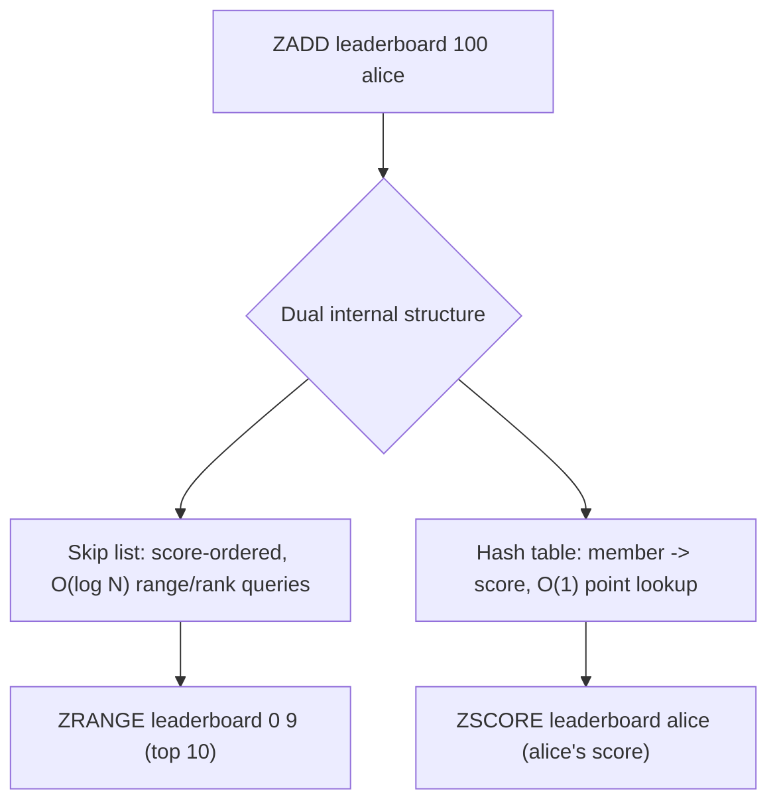

**Decision implications.** Choosing the right structure is a modeling
decision with real consequences: a naive design that stores a user's
recent-activity feed as a JSON blob inside a `String` forces the
application to fetch and re-serialize the *entire* blob for every append,
paying O(N) bandwidth and CPU for what should be an O(1) `LPUSH`; a
leaderboard implemented with a plain `Hash` (member to score) loses the
ability to answer "who's in the top 10" without pulling every entry and
sorting client-side, when a `ZSET` answers it natively in O(log N + 10). The
complexity column above is not academic trivia — it is the difference
between an endpoint that stays fast at 10x traffic and one that silently
degrades because the collection it touches quietly grew past the size where
its O(N) command was cheap.

**Failure mode.** The most common production incident from this section is
an unbounded collection meeting an O(N) command: a `Set` that grows to
millions of members because nothing ever expires old entries, then a
`SMEMBERS` or `SINTERSTORE` against it blocks the single event-loop thread
(Section 4.1) for the full duration of an O(N) or O(N*M) scan. A close
second is choosing `HGETALL` on a hash used as a wide, ever-growing table
(thousands of fields per key) instead of `HRANDFIELD`/`HSCAN` for the actual
access pattern needed.

**Scenario.** A rate-limiter is implemented by storing each request
timestamp as a member of a `Set` per user, intending to count requests in
the last 60 seconds with `SCARD` after removing stale entries. Under load
this set grows unbounded between cleanup passes, and the removal step (an
O(N) client-side loop of `SREM` calls) itself becomes the bottleneck. The
architecturally correct structure is a `ZSET` keyed by the request
timestamp as the score: `ZADD` to record a request, `ZREMRANGEBYSCORE` to
evict everything older than the window in a single O(log N + M) server-side
call, and `ZCARD` to read the current count — one atomic command replaces
an entire client-side loop.

### 4.3 Persistence: RDB Snapshotting vs. AOF, and AOF Rewrite

**Definition.** Redis offers two independent, combinable persistence
mechanisms for recovering data after a restart or crash: RDB, a
point-in-time binary snapshot of the entire dataset written at intervals,
and AOF, a continuously-appended log of every write command that can be
replayed from the beginning to reconstruct the exact dataset state.

**Mechanism — RDB.** On a configured schedule (`save 900 1` meaning "snapshot
if at least 1 key changed in 900 seconds," or on-demand via `BGSAVE`), Redis
forks a child process. Because of the operating system's copy-on-write
(COW) page semantics, the fork is nearly instantaneous and initially shares
all memory pages with the parent; the child then walks the entire dataset
and writes it to a compact binary `.rdb` file, while the parent process
keeps serving live traffic on the original single thread. If the parent
mutates a page the child hasn't finished reading yet, the kernel duplicates
only that one page — the child's view stays a consistent snapshot as of the
fork instant, without pausing command processing, at the cost of transient
extra memory proportional to how much of the dataset gets mutated during the
snapshot's lifetime (potentially catastrophic on write-heavy workloads with
insufficient headroom, one of RDB's core failure modes).

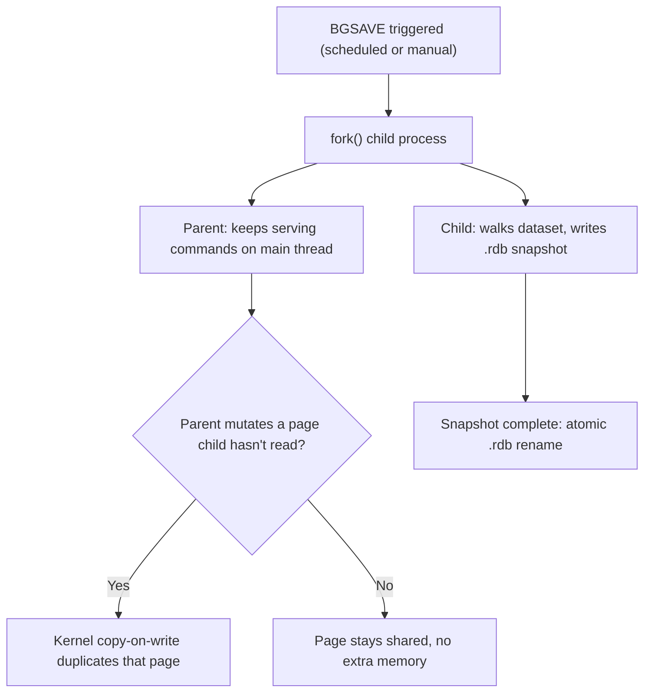

**Mechanism — AOF.** Every write command Redis executes is appended, in
Redis's own command-serialization protocol (RESP), to an append-only log
file, immediately after the command is applied to memory. The `appendfsync`
setting controls the trade-off between durability and write latency: `always`
calls `fsync()` after every single write (safest, slowest — every command
now pays disk-sync latency), `everysec` (the default) batches `fsync()` once
per second (loses at most ~1 second of writes on a crash, and is the
practical default almost every production deployment uses), and `no` lets
the OS decide when to flush (fastest, and can lose an unbounded amount of
data if the OS itself buffers aggressively before a crash).

**Mechanism — AOF rewrite.** Because the AOF is a literal command log, it
grows forever and would eventually contain, for example, a million
`INCR counter` lines for a counter whose *current* value could be expressed
in one line. AOF rewrite (`BGREWRITEAOF`, automatic once the file crosses a
configured growth ratio) forks a child process exactly like RDB's snapshot
mechanism, but instead of writing a binary snapshot, the child writes the
*minimal set of commands* that would reproduce the current dataset from
empty — collapsing that million `INCR` lines into a single `SET counter
1000000`. While the child writes the new, compact file, the parent keeps
appending new writes to the *old* AOF and also buffers them for the new
file; once the child finishes, Redis atomically swaps to the new, smaller
AOF and discards the old one.

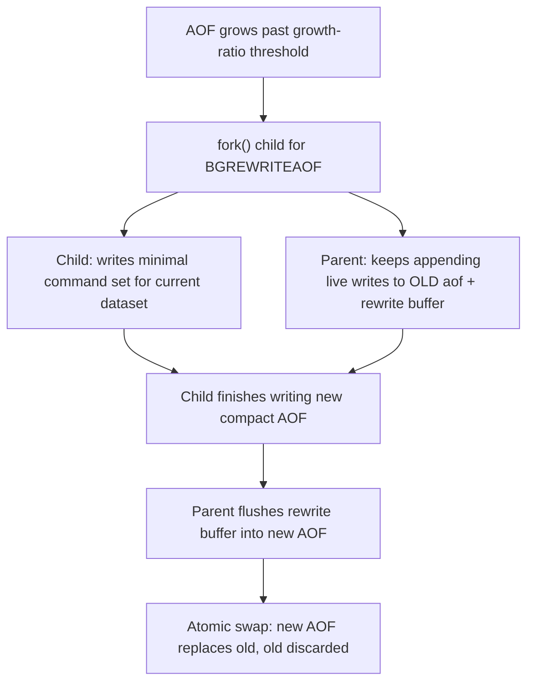

**Decision implications.** RDB restarts faster (loading one compact binary
file beats replaying potentially millions of log lines) and produces smaller
files ideal for backups, but loses everything since the last completed
snapshot on a crash — potentially minutes of data. AOF with `everysec` loses
at most about one second of writes and is the closer analogue to a
relational engine's Write-Ahead Log (WAL) durability story, but restarts
slower and the file is larger. Production Redis deployments that treat their
data as anything more valuable than a pure cache almost always run **both**:
RDB for fast, compact backups and disaster-recovery snapshots, AOF (with
`everysec`) as the primary crash-recovery mechanism, because Redis prefers
the AOF file for reconstruction on startup when both are present and
`aof-use-rdb-preamble` is enabled (Redis 4.0+'s hybrid format writes an RDB
snapshot as the AOF's preamble, then appends only commands since that
snapshot, combining RDB's fast-load property with AOF's low data-loss
window).

**Failure mode.** The single most damaging RDB failure mode is running with
persistence disabled entirely (`save ""`) on data the team believes is
"just a cache" until an unplanned restart empties it and every downstream
service starts computing from a cold, empty Redis simultaneously — a
correlated cache-stampede-on-restart failure distinct from, but related to,
the generic stampede-mitigation problem [Caching](CH09_Caching.md) already
teaches. The single most damaging AOF failure mode is choosing
`appendfsync always` without benchmarking the write-latency cost, then
discovering every write now blocks on a disk `fsync()` round trip, erasing
most of the latency advantage that justified choosing Redis in the first
place.

**Scenario.** A team stores session tokens exclusively in Redis with RDB
snapshotting every 15 minutes and no AOF. A routine host maintenance reboot
restarts Redis 8 minutes after the last successful snapshot; every session
created in that 8-minute window is gone, and every logged-in user in that
window is unexpectedly signed out. Adding AOF with `everysec` would have
bounded the loss window to roughly one second instead of up to 15 minutes,
at the cost of a slightly larger file on disk and a marginally slower
restart — the correct trade for session data that users actively notice
losing.

### 4.4 Redis Cluster: Hash-Slot Sharding and the Gossip Protocol

**Definition.** Redis Cluster is Redis's own built-in horizontal-scaling
mechanism: it partitions the entire keyspace into exactly 16384 fixed hash
slots, distributes ownership of those slots across multiple primary nodes,
and propagates cluster membership and slot-ownership state between nodes
using a gossip protocol rather than a separate coordination service.

Generic distributed sharding concepts — shard-key selection criteria,
consistent-hashing rings with virtual nodes, shard-map/directory routing,
rebalancing/live migration, cross-shard query cost — are already taught in
full in [Sharding](CH06_Sharding.md) and are not re-derived here. What this
subsection teaches is Redis's own **concrete, fixed-slot-count** variant of
sharding, which is deliberately *not* the same mechanism as a consistent-
hashing ring, and the reason for that difference matters architecturally.

**Mechanism.** Every key is mapped to one of exactly 16384 slots by
computing `CRC16(key) mod 16384`, where CRC16 is a 16-bit Cyclic
Redundancy Check hash function. Each primary node in the cluster owns a
contiguous or scattered subset of these 16384 slots (for example, a
3-primary cluster might assign roughly slots 0-5460 to node A, 5461-10922
to node B, and 10923-16383 to node C), and every node in the cluster knows,
via the gossip protocol described below, which node owns which slot. A
client can send a command to *any* node in the cluster; if that node does
not own the key's slot, it replies with a `MOVED` redirect telling the
client the correct node to retry against (and cluster-aware clients cache
this slot-to-node map so subsequent requests for the same slot go directly
to the right node without a redirect round trip). A transient `ASK`
redirect (rather than `MOVED`) signals that the slot is *in the middle of
being migrated* to another node during a live resharding operation — the
client should retry against the new node but only for that one request,
because the migration is not yet finalized.

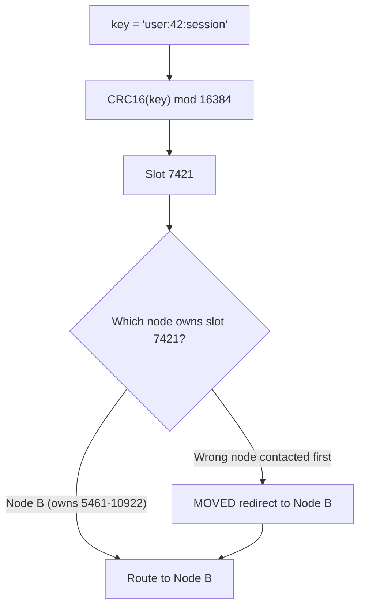

This fixed-16384-slot design is deliberately unlike a general consistent-
hashing ring: instead of computing a position on a continuous hash ring and
finding the nearest virtual node (the mechanism [Sharding](CH06_Sharding.md)
teaches in depth), Redis Cluster pre-divides the keyspace into a small,
*fixed* number of discrete, independently-reassignable buckets. Adding or
removing a primary node means reassigning a set of whole slot *numbers*
between existing owners — an explicit, administrator- (or
`redis-cli --cluster reshard`-) driven operation that moves specific slots'
keys between two specific nodes, rather than the automatic, proportional
remapping a consistent-hashing ring provides. The trade-off: Redis Cluster's
scheme is simpler to reason about and query ("which node owns key X" is a
pure function of a 16-bit hash, no ring traversal needed) at the cost of
requiring an explicit resharding step (rather than automatic minimal
remapping) whenever cluster topology changes.

**Mechanism — the gossip protocol.** Cluster nodes do not rely on a central
coordinator (no separate ZooKeeper/etcd-style service) to agree on cluster
topology. Instead, every node periodically (roughly once per second, to a
handful of randomly-chosen peers, not the entire cluster) exchanges compact
binary `PING`/`PONG` messages over a dedicated cluster bus port (the node's
normal port plus 10000) containing its own view of cluster state: which
nodes it believes are alive, which slots it believes each node owns, and
which nodes it suspects have failed. Because every node gossips with a
random subset of peers rather than broadcasting to all of them, cluster
state propagates in O(log N) rounds rather than requiring O(N) direct
connections from every node to every other node, which is what makes the
protocol scale to hundreds of nodes without a coordination bottleneck.

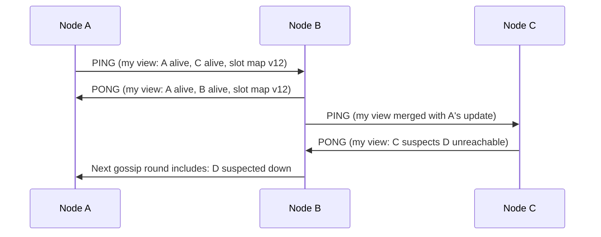

When enough independent nodes (a majority of primaries holding slots) mark
the same node as failed (`PFAIL` escalating to `FAIL` once cross-confirmed),
the cluster automatically promotes one of that primary's replicas to take
over its slots — Redis Cluster has its own built-in failover mechanism for
node loss, distinct from, but philosophically similar to, Sentinel's
quorum-based approach (Section 4.5); a cluster deployment does not need
Sentinel running alongside it.

**Decision implications.** Redis Cluster is the right choice when a single
Redis instance's dataset size or single-threaded write throughput ceiling
(Section 4.1) becomes the bottleneck and the application can tolerate
multi-key operations being restricted: commands that touch multiple keys
(`MGET`, a Lua script, a transaction via `MULTI`/`EXEC`) only work
atomically across keys that hash to the *same* slot, which is why Redis
Cluster supports "hash tags" — wrapping the part of a key that should
determine its slot in curly braces, e.g. `{user:42}:profile` and
`{user:42}:sessions` both hash only on `user:42` and are therefore
guaranteed to land on the same slot and be safely operated on together.

**Failure mode.** A team migrates to Redis Cluster expecting all existing
multi-key commands to keep working unchanged, and discovers in production
that a Lua script or `MULTI`/`EXEC` transaction spanning two keys that
happen to hash to different slots now fails with a `CROSSSLOT` error — a
class of bug that is invisible in single-instance testing and only surfaces
once the cluster's slot distribution actually splits those specific keys
across nodes.

**Scenario.** An e-commerce platform shards its cart data across a 6-primary
Redis Cluster. Cart operations touch both a `cart:{userId}` hash and a
`cart_expiry:{userId}` sorted set for a shared Time To Live (TTL) sweep; by
using the same `{userId}` hash tag on both keys, the team guarantees both
keys always land on the same slot and node, so a Lua script that atomically
updates both in one round trip continues to work correctly regardless of
how the cluster later reshards.

### 4.5 Redis Sentinel: Quorum-Based Failover

**Definition.** Redis Sentinel is a set of separate, lightweight Redis
processes (typically deployed as a group of 3 or 5, an odd number for clean
quorum math) whose only job is to monitor a primary/replica Redis topology,
detect when the primary is genuinely unreachable, and automate promoting a
replica to primary without a human paging in at 3 AM.

This is Redis's own concrete implementation of the generic failover and
split-brain-avoidance theory already taught in
[Replication](CH07_Replication.md) (leader-unreachable vs. leader-dead
distinction, fencing tokens, CAP theorem/PACELC framing) — that theory is
not re-derived here; this subsection teaches specifically how Sentinel
implements it.

**Mechanism.** Each Sentinel process independently pings the primary (and
every replica) it is configured to watch, roughly once per second. If a
Sentinel does not get a timely reply, it marks that primary as
**subjectively down (`SDOWN`)** — subjective because *that one Sentinel*
might simply have a network problem reaching the primary while the primary
is perfectly healthy from every other client's perspective. Before doing
anything drastic, Sentinels ask each other, over their own gossip-like
channel (Redis's Pub/Sub mechanism, Section 4.6, running on the monitored
Redis instances themselves), whether they *also* see the primary as down.
Once a configured quorum of Sentinels agree, the primary is marked
**objectively down (`ODOWN`)**, and the Sentinels elect a leader among
themselves (using a variant of the Raft consensus algorithm's leader-
election idea) to actually execute the failover: pick the best-qualified
replica (least replication lag, highest replica priority configured), issue
`REPLICAOF NO ONE` to promote it, reconfigure the remaining replicas to
follow the new primary, and update every client's view of "who is the
primary" via Sentinel's own service-discovery Application Programming
Interface (API) (`SENTINEL get-master-addr-by-name`).

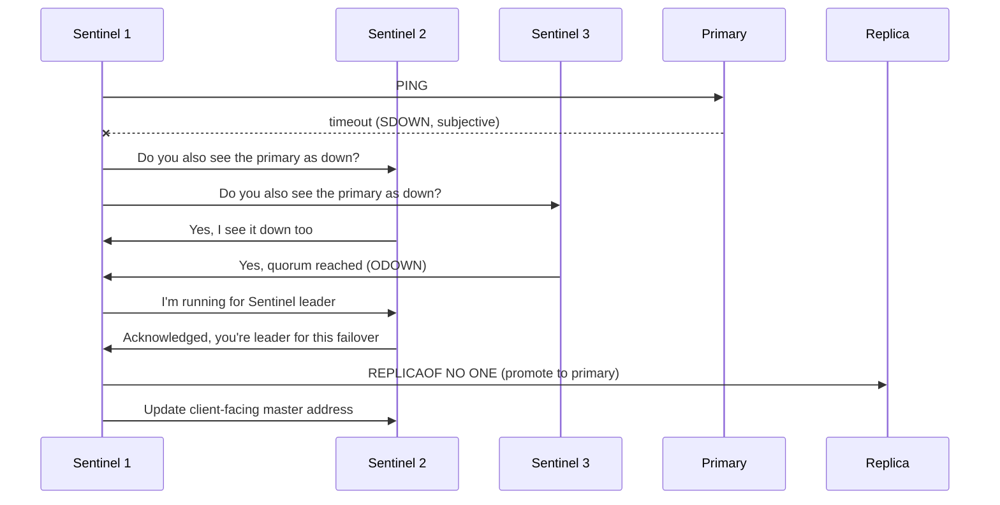

**Decision implications.** Sentinel requires an odd number of Sentinel
processes (commonly 3), each ideally on a separate failure domain (separate
Availability Zone in a cloud deployment) so that a single zone outage cannot
by itself constitute quorum in either direction — losing an entire zone
should neither force nor block a failover incorrectly. Sentinel is the
right tool for a single primary/replica topology that needs automated
failover without the added operational complexity, multi-key-operation
restrictions, and larger minimum node count of full Redis Cluster (Section
4.4); it is the wrong tool once write throughput, not just availability,
is the actual scaling bottleneck, because Sentinel does not shard data —
every write still goes to one primary.

**Failure mode.** Because Redis's default replication is *asynchronous*
(the primary acknowledges a client's write before confirming any replica
has received it — a concrete instance of
[Replication](CH07_Replication.md)'s general async-durability trade-off),
a failover promoted by Sentinel can lose the last few writes the old
primary accepted but never got to ship to the promoted replica before it
died. This is not a Sentinel bug; it is the direct, unavoidable consequence
of choosing asynchronous replication for latency, and it is why teams
storing data they cannot afford to silently lose configure
`min-replicas-to-write` (refusing a write if fewer than N replicas are
currently connected) to bound, though not eliminate, this exposure.

**Scenario.** A payments-adjacent rate-limiting service backed by
Sentinel-monitored Redis experiences a primary crash. Sentinel correctly
detects `ODOWN` after quorum agreement and promotes the least-lagged
replica within about 10-15 seconds (the configured `down-after-milliseconds`
plus election time). During those 10-15 seconds, application writes fail or
queue depending on the client's retry configuration — an availability gap
the team had already accounted for in their Service Level Objective (SLO),
because they had explicitly chosen Sentinel's brief-unavailability-then-
consistent-recovery trade-off over a more complex always-writable multi-
primary design.

### 4.6 Publish/Subscribe (Pub/Sub)

**Definition.** Redis pub/sub is a fire-and-forget message-broadcasting
mechanism: a publisher sends a message to a named channel, and every client
currently subscribed to that channel (or to a glob-style pattern matching
it) receives the message immediately — but a subscriber that was not
connected at the moment of publication never receives it, because nothing
is stored.

**Mechanism.** Internally, each Redis instance maintains an in-memory map
from channel name to the list of currently-subscribed client connections.
`PUBLISH channel message` looks up that list and, still on the single
command-execution thread (Section 4.1), writes the message directly to each
subscribed connection's output buffer — there is no persistence step, no
disk write, and no buffering for a client that is not currently connected.
`PSUBSCRIBE` extends this with glob-style pattern matching (`news.*`
matches `news.sports` and `news.weather`), letting a subscriber register
interest in a family of channels without knowing every channel name in
advance.

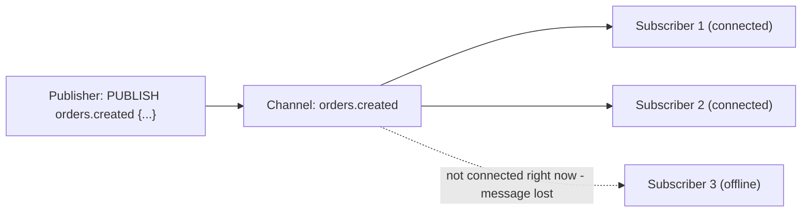

**Decision implications.** Pub/sub is the right tool for ephemeral,
best-effort fan-out where a missed message is acceptable or quickly
superseded by the next one — invalidating an in-process application cache
across a fleet of instances, broadcasting a "typing..." indicator in a chat
Ul, or notifying connected WebSocket gateways of an event to relay onward
(a pattern already referenced from
[WebSockets](../05_Networking_and_OS/CH17_WebSockets.md)'s "Redis pub/sub
backplane" for fanning events across gateway processes). It is emphatically
the *wrong* tool whenever "the consumer must eventually process every
message even if it was offline for a while" is a real requirement — that
durability and replay guarantee is exactly what Redis Streams (Section 4.2's
`XADD`/`XREADGROUP` family) or a dedicated durable message broker provide,
and is a distinction this book leaves for a future dedicated messaging/event-
streaming chapter to teach the broker side of in full; this chapter's scope
stops at teaching pub/sub as a Redis primitive, not as a system-design
pattern comparison against Kafka/RabbitMQ.

**Failure mode.** A team builds a "critical notification" pipeline on
Redis pub/sub, assuming — because the message clearly left the publisher
successfully — that it was delivered. A brief network blip or a consumer
process mid-restart at the exact moment of publication silently drops that
message with no error visible anywhere: pub/sub has no acknowledgment,
no persistence, and no redelivery mechanism by design.

**Scenario.** A multiplayer game server fleet uses Redis pub/sub to
broadcast "player joined lobby" events to every gateway process so
connected clients see the update in near-real-time. A gateway process that
restarts mid-match misses whatever lobby events were published during its
few seconds of downtime — acceptable here because the next state-sync
message (published seconds later on the same channel) supersedes the missed
one entirely, which is exactly the profile of workload pub/sub is built for.

### 4.7 `maxmemory` and Eviction Policies

**Definition.** `maxmemory` is the configuration ceiling on how much memory
a Redis instance is allowed to use for data; once that ceiling is reached,
the configured eviction policy decides what Redis does next — evict some
existing keys to make room for new writes, or refuse new writes outright.

Generic eviction-policy *theory* — what LRU, Least Frequently Used (LFU),
First-In-First-Out (FIFO), and Adaptive Replacement Cache (ARC) mean in the
abstract, and the workload-fit trade-offs between them — is already taught
in [Caching](CH09_Caching.md) and is not re-derived here. What this
subsection teaches is Redis's own **concrete, approximated** implementation
of LRU and LFU, which deliberately trades textbook precision for O(1)
memory overhead and near-O(1) eviction cost.

**Mechanism.** Redis offers eight `maxmemory-policy` values:

| Policy | Behavior |
|---|---|
| `noeviction` | Refuse writes with an error once the limit is reached; reads still work |
| `allkeys-lru` | Evict the least-recently-used key from the *entire* keyspace |
| `volatile-lru` | Evict the least-recently-used key *among keys with a TTL set* |
| `allkeys-lfu` | Evict the least-frequently-used key from the entire keyspace |
| `volatile-lfu` | Evict the least-frequently-used key among keys with a TTL |
| `allkeys-random` | Evict a random key from the entire keyspace |
| `volatile-random` | Evict a random key among keys with a TTL |
| `volatile-ttl` | Evict the key with the nearest expiration time first |

A textbook LRU implementation needs a doubly-linked list (or equivalent)
threading every key in access order, updated on every single read — an
O(1)-per-access but memory- and bookkeeping-heavy structure that Redis
deliberately avoids maintaining for every key in the keyspace. Instead,
Redis approximates LRU: each key carries a small (24-bit) "last accessed"
timestamp field piggy-backed onto its existing object header (near-zero
extra memory), and when eviction is needed, Redis samples a small random
set of keys (`maxmemory-samples`, default 5), compares their timestamps, and
evicts the oldest one from that sample — not the true global least-recently-
used key, but a statistically good approximation that gets closer to exact
LRU as the sample size increases, at the cost of slightly more CPU per
eviction. LFU works the same sampling way but tracks an 8-bit
logarithmic-decay access-frequency counter per key instead of a timestamp —
logarithmic so that a key accessed a million times doesn't need a counter
field 20 bits wide, and decaying over time so that a key that was very
popular yesterday but is cold today doesn't stay artificially protected from
eviction forever.

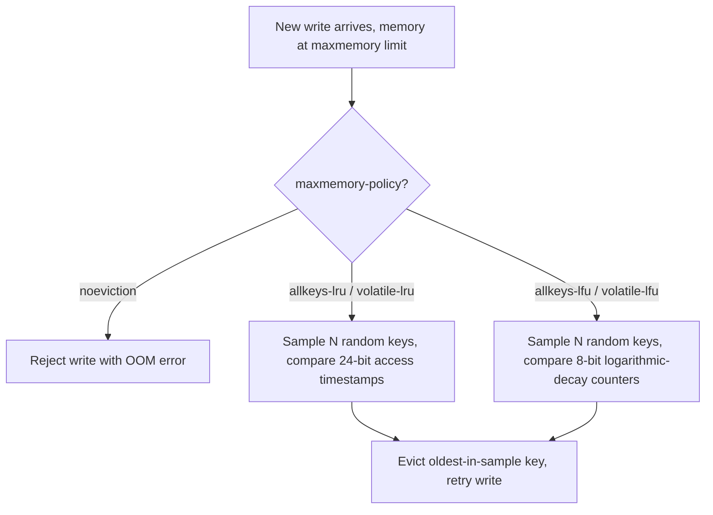

**Decision implications.** `volatile-*` policies only ever evict keys that
already carry an explicit TTL, which is the safer default for a mixed
workload where some keys are genuinely ephemeral cache entries (safe to
evict) and others are meant to persist indefinitely (a counter, a
configuration value) — `allkeys-*` policies will happily evict *any* key
regardless of whether the application ever intended it to expire, which is
correct only when the entire instance is dedicated purely to cache data.
Choosing `noeviction` on an instance that is genuinely a durable data store
(not a cache) is the architecturally correct choice specifically *because*
it fails loudly (an application-visible write error) rather than silently
discarding data the application assumed was safe.

**Failure mode.** A team runs `allkeys-lru` on a Redis instance that also
holds a handful of long-lived configuration keys with no TTL, assuming
"LRU means my hot config keys are safe because they get read constantly." A
traffic spike of cache writes pushes memory to the ceiling; because
`allkeys-lru` considers *every* key, not just TTL'd ones, and the sampling
approximation occasionally evicts a less-recently-touched configuration key
purely because it happened to land in an unlucky sample, the application's
configuration silently disappears mid-incident, compounding the original
problem.

**Scenario.** A session store and a request-deduplication cache share one
Redis instance. The session keys are set with a 30-minute TTL; the
dedup-cache keys are also set with a short TTL. The team correctly chooses
`volatile-lru` (not `allkeys-lru`) specifically so that if anyone later adds
a non-TTL'd key to this instance by mistake (a leaked feature flag, a
one-off debug counter), that key is structurally protected from eviction
rather than silently disappearing under memory pressure — a defense-in-
depth choice, not just a performance one.

## 5. Internal Working

Redis's process model layers a handful of background mechanisms around the
single-threaded command-execution core described in Section 4.1, each
existing specifically to keep that single thread from blocking on work that
does not strictly need to happen synchronously.

**Lazy freeing.** Deleting a very large collection (a hash with millions of
fields, say) with a plain `DEL` would block the single command thread for
however long it takes to walk and free every internal allocation. Redis 4.0+
offers `UNLINK` (and `lazyfree-lazy-*` config options that make this the
default behavior for expirations and evictions too), which detaches the key
from the keyspace instantly on the main thread but defers the actual memory
deallocation to a separate background thread — the client sees an
instant response, and the expensive `free()` work happens off the
latency-critical path.

**Background I/O threads.** RDB `BGSAVE` and AOF `BGREWRITEAOF` (Section
4.3) both use `fork()`-based child processes rather than in-process threads
specifically to get a consistent, non-blocking snapshot via the operating
system's copy-on-write page semantics, without needing any in-process
coordination with the main command thread at all.

**Replication internals.** A replica connects to its primary and performs
either a full resynchronization (the primary triggers a `BGSAVE`-equivalent
snapshot, streams that snapshot to the replica, then streams every command
executed since as a live replication stream) or, if the replica was only
briefly disconnected, a **partial resynchronization**: the primary maintains
a bounded in-memory **replication backlog buffer** of recent write commands,
and if the replica's last-known replication offset still falls within that
backlog, the primary can just replay the missing slice instead of paying for
an entire full resync. This backlog-based partial-resync mechanism is
Redis's specific, concrete answer to the generic replication-lag/rejoin
problem [Replication](CH07_Replication.md) already frames in the abstract.

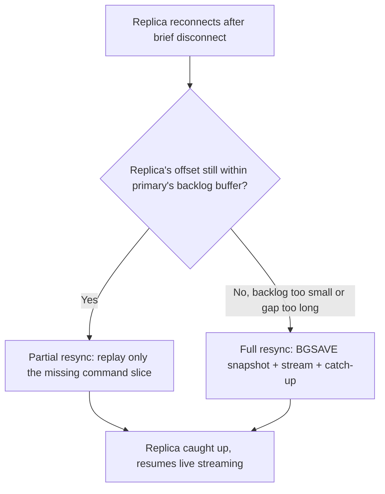

**Expiration.** Keys with a TTL are not actively swept the instant they
expire; Redis uses a hybrid **lazy + active** expiration strategy: lazily,
any read of an expired key triggers its deletion at access time; actively, a
background cycle running dozens of times per second samples a handful of
TTL'd keys, deletes any that have expired, and repeats more aggressively if
it finds a high proportion of expired keys in its sample — bounding both
"expired keys never get cleaned up because nobody reads them" and "the
active sweep itself becomes a latency problem."

## 6. Design Principles

- **Simplicity over generality.** Redis deliberately ships a small,
  well-understood set of data structures rather than a general document or
  graph model, trading flexibility for predictable performance
  characteristics an architect can reason about from the complexity table
  in Section 4.2 alone.
- **Explicit trade-offs over hidden defaults.** Persistence (RDB vs. AOF vs.
  both vs. neither), eviction policy, and replication acknowledgment mode
  are all opt-in configuration decisions with clearly documented
  consequences, rather than a single "safe by default" mode that hides the
  cost of safety from the operator.
- **Mechanism, not policy, in the core.** The server provides atomic
  primitives (`ZADD`, `LPUSH`, `INCR`); it deliberately does not prescribe
  *how* an application should use them — the cache-aside/write-through
  policy decisions belong in [Caching](CH09_Caching.md), not in Redis
  itself.
- **Fail loud when configured to.** `noeviction` and `min-replicas-to-write`
  exist precisely so an architect can choose to make Redis reject an
  operation rather than silently lose or overwrite data, when the workload
  demands that guarantee.
- **Horizontal scale through partitioning, not through concurrency inside a
  single node.** Because Section 4.1's single-threaded core caps one
  instance's throughput, Redis's entire scaling story (Cluster, Section 4.4)
  is built around distributing the *keyspace*, not around parallelizing
  execution within one node.

## 7. Architecture Patterns

Redis participates in several distinct application-architecture patterns,
only the first of which is "the cache" most engineers default to thinking
of:

- **Substrate for caching patterns.** Cache-aside, read-through, write-
  through, and write-behind (all fully taught in
  [Caching](CH09_Caching.md)) are typically *implemented on top of* Redis:
  Redis provides the fast key-value/TTL primitives; the pattern is an
  application-level decision about *when* to populate and invalidate them.
- **Session store.** Storing web-session state in Redis (rather than
  in-process, which breaks horizontal scaling of stateless application
  servers) is one of the most common production uses; it requires the
  persistence and replication discipline of Sections 4.3-4.5, not just
  cache defaults, because losing a session store means logging out every
  active user.
- **Rate limiting and counters.** `INCR`/`EXPIRE` or the sliding-window
  `ZSET` technique from Section 4.2's scenario implement distributed rate
  limiters without a dedicated rate-limiting service, because Redis's
  atomic single-thread execution (Section 4.1) makes the check-and-increment
  step race-free by construction.
- **Leaderboard and ranking engine.** Sorted sets (Section 4.2) provide a
  ranking primitive most application databases would need a separate
  materialized-view/batch-recompute job to approximate.
- **Lightweight pub/sub event fan-out.** Section 4.6's pub/sub mechanism
  decouples publishers and subscribers for ephemeral, best-effort,
  in-process-cache-invalidation-style signaling without standing up a
  dedicated message broker.
- **Durable-ish work queue via Streams.** Redis Streams' consumer groups
  (Section 4.2) provide at-least-once delivery with acknowledgment and
  replay, a materially stronger guarantee than pub/sub, for workloads that
  need durability but not a full dedicated broker's feature set.

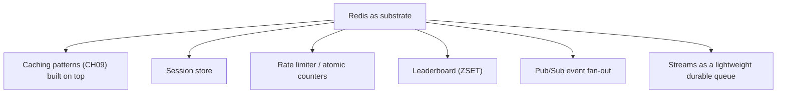

## 8. Production Architecture

A typical production-grade Redis deployment layers the mechanisms from
Section 4 into one of two shapes, chosen based on whether the bottleneck is
availability alone or availability *and* write throughput:

- **Single-primary + Sentinel shape**, for workloads whose dataset fits
  comfortably in one instance's memory and whose write volume stays within
  one core's throughput ceiling: one primary, two or more replicas, three
  or five Sentinel processes spread across separate Availability Zones,
  AOF (`everysec`) plus periodic RDB snapshots for both fast crash recovery
  and portable backups.
- **Redis Cluster shape**, once dataset size or single-node write
  throughput is the actual bottleneck: multiple primary/replica pairs, each
  owning a disjoint range of the 16384 hash slots, with the cluster's own
  built-in gossip-based failure detection and promotion (Section 4.4)
  replacing Sentinel (a Cluster deployment does not also run Sentinel — its
  failover logic is self-contained).

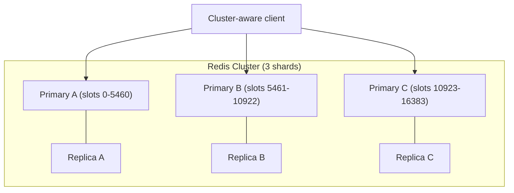

Both shapes typically sit behind a connection-pooling client library (most
mainstream Redis clients pool connections internally) and are placed on the
same private network segment as the application tier they serve, never
directly Internet-exposed — Redis's authentication and Access Control List
(ACL) model (Section 13) is deliberately lightweight compared to a
relational engine's, and is not a substitute for network-level isolation.

## 9. Implementation

Interacting with Redis from application code follows a consistent shape
across languages: acquire a pooled connection from a client library, issue
commands that map almost one-to-one onto the Redis command names from
Section 4, and, for anything touching more than one key atomically, use
either a `MULTI`/`EXEC` transaction, a Lua script (`EVAL`), or — in Redis
7.0+ — a server-side function, rather than a client-side read-modify-write
sequence that would race against other clients.

A few implementation idioms every architect implementing on Redis should
know:

- **`SCAN` instead of `KEYS`.** `SCAN` walks the keyspace in small
  configurable-size batches across many round trips, returning a cursor to
  resume from, specifically so it never blocks the single command thread
  (Section 4.1) the way a single `KEYS *` call does.
- **Pipelining.** Because each command still costs one network round trip
  even though execution itself is fast, sending a batch of independent
  commands together in one pipelined request (without waiting for each
  individual reply before sending the next) amortizes network latency
  across the whole batch — the code example in Section 10 measures this
  concretely.
- **Lua scripting (`EVAL`) and server-side functions.** A Lua script
  executes atomically and entirely on the single command thread (no other
  client's command can interleave partway through it), making it the right
  tool for multi-step logic that must be atomic — but exactly *because* it
  blocks the single thread for its full duration, an unbounded loop inside
  a script is just as dangerous as the `KEYS *` failure mode from Section
  4.1.
- **Client-side caching (`CLIENT TRACKING`, Redis 6.0+).** A client can ask
  Redis to notify it when a key it has cached locally changes, letting an
  application layer a very small, invalidation-aware, in-process cache in
  front of Redis itself for the hottest of hot keys.

## 10. Complete Code Examples

Four runnable Python examples (using the `redis-py` client) live under
[code/python/redis-chapter/](../code/python/redis-chapter/), each isolating
one of this chapter's core concepts:

1. [01_data_structures_and_complexity_demo.py](../code/python/redis-chapter/01_data_structures_and_complexity_demo.py) —
   exercises strings, hashes, lists, sets, sorted sets, a stream, a
   HyperLogLog, and a bitmap, timing each command family and annotating the
   Big-O complexity from Section 4.2's table against measured latency.
2. [02_pipeline_vs_roundtrip_benchmark.py](../code/python/redis-chapter/02_pipeline_vs_roundtrip_benchmark.py) —
   benchmarks N individual round trips against one pipelined batch of the
   same N commands, making Section 4.1's single-threaded/one-round-trip-
   per-command cost concrete and measurable.
3. [03_cluster_hash_slot_routing.py](../code/python/redis-chapter/03_cluster_hash_slot_routing.py) —
   implements Redis Cluster's CRC16-mod-16384 slot function from scratch,
   connects to a real cluster via `redis.cluster.RedisCluster`, and prints
   which physical node each of several keys routes to, including a
   hash-tag example that forces two keys onto the same slot.
4. [04_sentinel_aware_client.py](../code/python/redis-chapter/04_sentinel_aware_client.py) —
   uses `redis.sentinel.Sentinel` to discover the current primary
   dynamically, issues writes through the Sentinel-resolved connection, and
   demonstrates the client re-resolving the primary address after a
   simulated failover.

## 11. Performance

Redis's performance profile follows directly from Section 4.1's
architecture: single-digit-microsecond in-memory operation cost, dominated
in practice by network round-trip time rather than server-side compute, on
the order of 100,000+ simple operations per second per core for small
payloads. The practical performance levers, in order of impact, are:
choosing the right data structure and command complexity (Section 4.2) so
no single command is accidentally O(N) against an unexpectedly large
collection; pipelining (Section 9) to amortize round-trip cost across
batches; keeping `appendfsync` at `everysec` rather than `always` unless the
durability requirement genuinely demands per-write `fsync()`; and avoiding
any command that blocks the single event-loop thread (`KEYS`, unbounded
`SORT`, an unbounded Lua script) on a hot path. Because everything lives in
RAM, the other major performance lever is simply sizing the instance's
memory correctly relative to the working set and the chosen `maxmemory`
eviction policy (Section 4.7) — swapping is catastrophic for Redis
specifically because the OS may swap out pages the single command thread
needs synchronously, turning a microsecond in-memory operation into a
millisecond-plus disk-bound one.

## 12. Scalability

Vertical scaling (a bigger instance) helps only up to the point where a
single CPU core's command-processing throughput (Section 4.1) is the
ceiling — after that, scaling requires either read replicas (for read-heavy
workloads, distributing `GET`-style traffic across several replicas of the
same data) or Redis Cluster (Section 4.4, for write-heavy or dataset-size-
bound workloads, distributing the keyspace itself across many independent
primaries). The two are frequently combined: a Redis Cluster where each of
several primary shards also has one or more read replicas, so both the
keyspace and the read traffic scale independently.

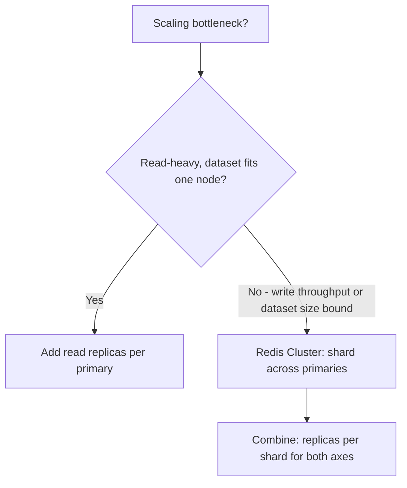

## 13. Security

Redis's default posture is *not* secure-by-default and this must be treated
as an explicit design input, not an afterthought: historically Redis shipped
with no authentication at all, and instances accidentally exposed to the
public Internet with no password have been repeatedly compromised (Section
15 covers a concrete class of this). Production security practice layers:
`requirepass` or, preferably, Redis 6.0+'s Access Control List (ACL) system
(`ACL SETUSER`), which supports per-user command and key-pattern
restrictions rather than one shared password with full access; Transport
Layer Security (TLS) for encryption-in-transit (owned in full by
[TLS](../05_Networking_and_OS/CH06_TLS.md), recapped here only as "enable it
for any Redis traffic crossing a network boundary you do not fully
control"); network-level isolation (private subnet, security group/firewall
rules restricting the Redis port to only the application tier); and
explicitly renaming or disabling dangerous administrative commands
(`FLUSHALL`, `CONFIG`, `KEYS`) via `rename-command` in environments where an
application credential leak should not also mean "and now the attacker can
wipe the entire dataset in one command."

## 14. Observability

Key operational signals to monitor, mapped back to the mechanisms Section 4
describes: `INFO` command output (or a metrics exporter surfacing the same
data) exposes `instantaneous_ops_per_sec` and per-command latency
histograms (`INFO commandstats`/`LATENCY HISTORY`) that reveal whether a
specific slow command is stalling the single event-loop thread (Section
4.1); `used_memory` vs. `maxmemory` and `evicted_keys` (Section 4.7) reveal
whether the eviction policy is actively shedding data and how aggressively;
`rdb_changes_since_last_save`/`rdb_last_bgsave_status` and
`aof_rewrite_in_progress`/`aof_last_bgrewrite_status` (Section 4.3) reveal
whether persistence is healthy or silently failing; `master_repl_offset`
alongside each replica's `slave_repl_offset` (Section 5) exposes
replication lag directly; and `connected_clients` alongside
`blocked_clients` reveals whether the application is accidentally holding
many blocking commands (`BLPOP`, `XREAD BLOCK`) open simultaneously.
Sentinel deployments additionally expose `+sdown`/`+odown`/`+switch-master`
events (Section 4.5) that should be piped directly into alerting.

## 15. Failure Scenarios

- **Single slow command stalls everything (Section 4.1).** A `KEYS *` or
  unbounded `SORT`/Lua script blocks the entire event loop, and if the
  block lasts longer than a Sentinel's or Cluster's failure-detection
  timeout, a healthy primary can be falsely failed over while it is still
  holding un-replicated writes.
- **RDB-only persistence loses a restart window (Section 4.3).** With RDB
  as the sole persistence mechanism, any crash between snapshots loses
  every write since the last one — the correlated, fleet-wide
  cold-cache-stampede-on-restart failure this can trigger downstream is
  distinct from, but compounds, the generic stampede problem
  [Caching](CH09_Caching.md) already covers.
- **Async replication loses the failover tail (Section 4.5).** A Sentinel-
  or Cluster-triggered promotion after a primary crash can silently drop
  the last few writes the crashed primary accepted but never shipped to
  the promoted replica — bounded, not eliminated, by
  `min-replicas-to-write`.
- **`CROSSSLOT` errors on multi-key operations (Section 4.4).** A
  transaction or Lua script touching keys that hash to different slots
  fails outright on Redis Cluster — a class of bug invisible until the
  cluster's actual slot distribution happens to split those specific keys.
- **Unauthenticated or weakly-secured exposure (Section 13).** A default,
  no-password Redis instance reachable from the public Internet is a
  historically common, fully automatable compromise vector — attackers
  scan for exactly this and can write arbitrary files to disk via crafted
  `CONFIG SET`/`SAVE` sequences.

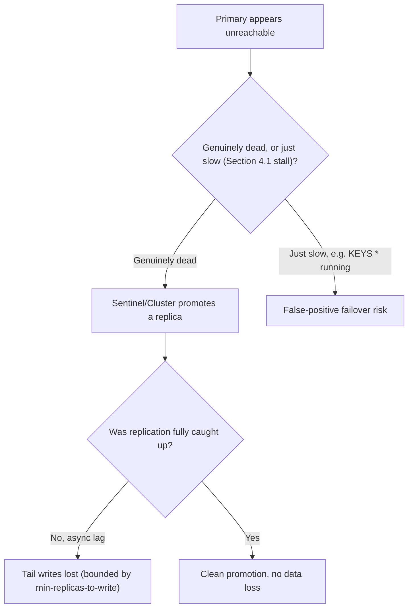

## 16. Testing

Testing Redis-dependent application code should exercise, at minimum: a
real Redis instance (via a lightweight container in Continuous Integration
(CI), not a mocked client) for anything touching Lua scripts, `MULTI`/
`EXEC` transactions, or hash-tag-dependent Cluster routing, because those
behaviors are difficult to fake faithfully; explicit tests for TTL
expiration boundaries (a key that should have expired by the time a test
asserts against it); explicit tests that a `SCAN`-based iteration correctly
handles a keyspace mutating mid-scan (Redis's `SCAN` guarantees every key
present for the entire scan duration is returned at least once, but not
exactly once, and code that assumes exactly-once iteration is a common
bug); and, for Sentinel/Cluster-topology-aware code, a test that simulates a
primary disappearing and asserts the client correctly re-resolves the new
primary rather than retrying the dead address forever.

## 17. Common Mistakes

- Treating `KEYS *` as a safe, everyday command instead of an offline-only
  diagnostic tool (Section 4.1).
- Storing an ever-growing collection with no expiration or bound and later
  being surprised an O(N) command against it is slow (Section 4.2).
- Assuming "it's just a cache" and running with persistence fully disabled
  on data users actually notice losing, like sessions (Section 4.3).
- Assuming Redis Cluster transparently supports every multi-key
  transaction unchanged, without using hash tags (Section 4.4).
- Assuming Sentinel/Cluster failover means zero data loss, when default
  asynchronous replication means it does not (Section 4.5).
- Building a "must not miss a message" pipeline on pub/sub instead of
  Streams or a dedicated broker (Section 4.6).
- Choosing `allkeys-lru` for a mixed cache-and-durable-data instance instead
  of `volatile-lru` (Section 4.7).
- Exposing a Redis port directly to the Internet with no `requirepass` or
  ACLs (Section 13).

## 18. Best Practices

- Use `SCAN` family commands, never `KEYS`, in any code path that runs
  against a production-sized keyspace.
- Model data with the structure whose command complexity matches the
  actual access pattern (Section 4.2's table), not the structure that was
  easiest to reach for.
- Run both RDB and AOF (`everysec`) in any deployment where losing recent
  writes on an unplanned restart is a real business cost.
- Use hash tags deliberately on Redis Cluster for any keys that must be
  operated on together atomically.
- Set `min-replicas-to-write` on data whose loss during a failover would be
  unacceptable.
- Choose `volatile-*` eviction policies whenever the instance holds any
  key that must never be evicted, even if most keys on it are pure cache
  entries.
- Enable ACLs and TLS, and keep Redis on a private network segment never
  directly reachable from outside the application tier.

## 19. Anti-Patterns

- **Redis as the only copy of business-critical data with no persistence
  and no replica** — a single process crash is a full, unrecoverable data
  loss event.
- **Using pub/sub as a durable task queue** — messages published while no
  consumer is connected are gone forever, silently.
- **Unbounded Lua scripts or transactions on a hot path** — an atomic
  script is only safe if its own execution time is small and bounded,
  because it blocks the single thread for its entire duration.
- **One Redis instance serving as both a high-churn cache and a
  long-lived-configuration store with `allkeys-*` eviction** — the
  configuration data is not actually protected from eviction the way the
  team assumes.
- **Treating Redis Cluster as a drop-in replacement for a single instance
  without auditing multi-key command usage first** — `CROSSSLOT` failures
  surface only in production traffic patterns, not necessarily in testing.

## 20. Trade-off Analysis

| Decision | Choosing this favors | At the cost of |
|---|---|---|
| RDB only | Fast restarts, compact backups | Losing everything since the last snapshot on crash |
| AOF `everysec` | Bounded (~1s) data loss window | Slightly larger files, slightly slower restart than RDB alone |
| AOF `always` | Near-zero data loss | Every write pays a disk `fsync()` round trip |
| Sentinel | Simple automated failover, fewer moving parts | No sharding — write throughput still capped by one primary |
| Redis Cluster | Horizontal write/dataset-size scaling | Multi-key operation restrictions, more operational complexity |
| `allkeys-lru`/`lfu` | Simpler mental model for a pure-cache instance | Any accidentally-added non-TTL key is not protected from eviction |
| `volatile-lru`/`lfu` | Non-TTL keys structurally protected | Slightly more configuration discipline required (must set TTLs deliberately) |
| Pub/Sub for fan-out | Lowest latency, simplest API | No durability, no replay, silent message loss if subscriber is offline |
| Streams for fan-out | At-least-once delivery, replay, consumer groups | More API surface, more state to manage than pub/sub |

## 21. Comparison Table

| Dimension | Redis | A durable message broker (Kafka/RabbitMQ) | A relational database |
|---|---|---|---|
| Primary storage medium | RAM (disk optional, via RDB/AOF) | Disk-backed log/queue by design | Disk-backed by design |
| Concurrency model | Single-threaded command execution | Varies by broker; typically multi-threaded/partitioned | Multi-threaded with MVCC/locking |
| Data model | Purpose-built structures (string/hash/list/set/zset/stream) | Topic/queue of opaque messages | Relational tables/rows |
| Consistency default | Async replication, eventual on failover | Broker-specific (Kafka: per-partition ordering, ack levels) | Strong, transactional (ACID) |
| Sharding mechanism | Fixed 16384 hash slots (Redis Cluster) | Partitions (Kafka) or queue-per-node | Application-level or engine-specific sharding |
| Best-fit workload | Low-latency structures, cache, session store, rate limiting | Durable event streaming, decoupled async processing | System of record, complex relational queries |

## 22. Real-World Case Study

In March 2024, Redis, Inc. announced that future versions of Redis would
move away from the permissive BSD-3-Clause license to a dual license under
the Redis Source Available License (RSALv2) and the Server Side Public
License (SSPLv1) — licenses that restrict cloud providers from offering
Redis as a managed service without a commercial agreement, while remaining
free for most other uses. This was not Redis's first brush with this
tension: several Redis *modules* (RedisJSON, RedisSearch, RediSearch,
RedisGraph) had already moved to more restrictive licenses years earlier for
the same competitive reason — large cloud providers were offering managed
Redis-compatible services built directly on the open-source project's own
code without contributing back or paying for a commercial license,
capturing a large share of the commercial value the core maintainers
created. Within days of the March 2024 announcement, a coalition led by
AWS, Google Cloud, Oracle Cloud, and Ericsson announced **Valkey**, a fork
of the last permissively-licensed Redis release (7.2.4), placed under the
stewardship of the Linux Foundation specifically to guarantee it would stay
open-source and vendor-neutral going forward. This split is directly
relevant to any architect making a build-vs-buy or platform-selection
decision today: it changes the license terms under which a self-hosted Redis
deployment operates, has already caused several Linux distributions and
cloud-managed-service providers to switch their default offering to Valkey
instead of Redis, and is a live, evolving situation an architecture
decision record for "why we chose Redis/Valkey" should explicitly document
rather than assume is a stable, settled fact — the two projects share a
common history and near-identical command sets today, but are diverging
codebases under different governance going forward.

## 23. Interview Questions

1. Why is Redis single-threaded for command execution, and what problem
   does that design choice actually solve? What did Redis 6.0's I/O
   threading change, and what did it deliberately not change?
2. Walk through the command-level time complexity of `ZADD`, `ZRANGE`, and
   `ZRANK` and explain why a sorted set maintains two internal structures
   simultaneously.
3. Compare RDB and AOF: what does each lose on a crash, and why would a
   production system run both rather than picking one?
4. Explain Redis Cluster's hash-slot sharding scheme and contrast it with a
   consistent-hashing ring. Why does a multi-key Lua script sometimes fail
   with `CROSSSLOT`, and how do hash tags fix it?
5. Walk through Sentinel's `SDOWN` → `ODOWN` → leader-election → promotion
   sequence, and explain the specific data-loss risk that remains even
   after a "successful" automated failover.
6. Why is Redis pub/sub unsuitable as a durable task queue, and what Redis
   feature would you use instead if the workload needs at-least-once
   delivery with replay?
7. Explain how Redis approximates LRU eviction instead of maintaining a
   true access-order list, and why that approximation is an acceptable
   engineering trade-off.
8. When would you choose Redis Sentinel over Redis Cluster, and vice versa,
   for a system whose primary bottleneck is write throughput?

## 24. Hands-on Exercises

1. Stand up a single Redis instance locally, insert a hash with 5 fields
   and a sorted set with 20 members, and use `redis-cli --latency-history`
   while running a deliberately slow `KEYS *` from a second terminal to
   observe the event-loop stall firsthand.
2. Configure both RDB (`save 60 1`) and AOF (`appendonly yes`,
   `appendfsync everysec`) on a local instance; write data, kill the
   process with `kill -9`, and confirm what was and was not recovered on
   restart under each persistence configuration in isolation.
3. Run the code example in
   [code/python/redis-chapter/02_pipeline_vs_roundtrip_benchmark.py](../code/python/redis-chapter/02_pipeline_vs_roundtrip_benchmark.py)
   against a local instance and record the measured speedup from
   pipelining at three different batch sizes.
4. Bring up a 3-Sentinel, 1-primary, 2-replica local topology with Docker
   Compose; kill the primary process and time how long Sentinel takes to
   promote a replica, then confirm the application client re-resolves the
   new primary address correctly.

## 25. Design Exercises

1. Design the Redis data model (which structures, which keys, which TTLs)
   for a live sporting-event leaderboard that must answer "top 10 players
   right now" and "this specific player's current rank" both in
   sub-millisecond time at 50,000 score updates per second.
2. A team wants to migrate a single Redis instance holding 200 GB of data
   and sustaining 400,000 writes/second to Redis Cluster. Design the
   sharding key strategy (including which keys need hash tags and why),
   and identify which existing multi-key operations would need to change.
3. Design the persistence and replication configuration (RDB schedule, AOF
   `appendfsync` setting, Sentinel vs. Cluster, `min-replicas-to-write`)
   for three different workloads: (a) a pure request-deduplication cache,
   (b) a session store, and (c) a financial rate-limiter whose counters
   feed into a compliance audit. Justify each choice's data-loss exposure
   explicitly.

## 26. Architecture Review Questions

1. For every Redis-backed feature in this system, is the current
   `maxmemory-policy` the deliberately correct one for that specific
   key's data, or an unexamined default?
2. Does any code path in this system issue `KEYS`, an unbounded `SORT`, or
   an unbounded-iteration Lua script against a production Redis instance?
3. Is Redis persistence (RDB/AOF) configured proportionally to how costly
   it would actually be to lose the last few seconds/minutes of data in
   this specific instance's workload?
4. If this Redis deployment is on Redis Cluster, has every multi-key
   command in the codebase been audited for `CROSSSLOT` safety and hash-tag
   correctness?
5. Is any workload relying on pub/sub for a guarantee (durability, replay,
   at-least-once delivery) that pub/sub does not actually provide?
6. Is the Redis instance's replication acknowledgment mode
   (`min-replicas-to-write`) aligned with how much data loss this specific
   workload can tolerate during an automated failover?
7. Is Redis network-isolated and authenticated (ACLs/TLS), or reachable
   with only a shared password, or no password at all?

## 27. Summary

Redis is a single-threaded, in-memory data structure server whose every
major architectural choice — the event loop instead of a thread pool, the
small set of purpose-built structures with documented command-level
complexity, the RDB/AOF persistence split, the fixed-16384-slot Cluster
sharding scheme, Sentinel's quorum-based failover, fire-and-forget pub/sub,
and approximated-LRU/LFU eviction — follows from a deliberate trade of
generality and multi-threaded parallelism for speed, predictability, and
atomic-by-construction command semantics. The generic patterns this book
already teaches (caching strategies in [Caching](CH09_Caching.md), failover
and replication theory in [Replication](CH07_Replication.md), and
consistent-hashing sharding theory in [Sharding](CH06_Sharding.md)) describe
*what problem* to solve and *why*; this chapter describes the concrete
engine those patterns most commonly run on top of, and the specific,
sometimes surprising, ways that engine's real internals shape which
patterns work safely and which ones quietly fail under production load.

## Further Reading

- [Caching](CH09_Caching.md) — generic cache-population/invalidation/
  eviction-policy patterns Redis implements as a concrete substrate.
- [Replication](CH07_Replication.md) — generic leader/follower replication,
  failover, and split-brain theory Sentinel and Cluster concretely
  implement.
- [Sharding](CH06_Sharding.md) — generic consistent-hashing and shard-key
  theory contrasted against Redis Cluster's fixed-slot scheme.
- [Transactions](CH08_Transactions.md) / [Locking](CH10_Locking.md) —
  generic MVCC/locking concurrency control Redis's single-threaded
  execution model sidesteps by construction.
- [WebSockets](../05_Networking_and_OS/CH17_WebSockets.md) — an existing
  reference to a Redis pub/sub backplane pattern for gateway fan-out.
