# Chapter: DynamoDB

Part: [06 — Databases and Storage](PART_OVERVIEW.md) · Status: Drafted

## 1. Introduction

Amazon DynamoDB is a fully-managed, serverless key-value/document
database built by Amazon Web Services (AWS) to guarantee predictable,
single-digit-millisecond latency at effectively unbounded scale, without an
architect ever provisioning a server, choosing a storage engine, or tuning
a buffer pool. That last clause is the point of this chapter: every
relational engine this book has covered so far —
[PostgreSQL](CH11_PostgreSQL.md), [MySQL](CH12_MySQL.md),
[Oracle](CH13_Oracle.md), [SQL Server](CH14_SQLServer.md) — exposes deep
internals (Multi-Version Concurrency Control (MVCC) heap tuples, buffer
pools, undo segments, transaction logs) that an architect must understand
and tune to run the engine well. DynamoDB deliberately hides nearly all of
that from the operator; there is no instance to size, no storage engine
version to patch, no buffer-pool hit ratio to monitor, and no replication
topology to wire up by hand. That does not mean DynamoDB has no internals
worth understanding — it means the *architectural decisions an engineer
still must get right* move up a level, from "how do I tune this storage
engine" to "how do I design my keys, indexes, and capacity model so the
fully-managed engine can do its job." A DynamoDB table with a poorly chosen
partition key behaves badly in ways no amount of AWS-side tuning can fix,
because the very consistent-hashing distribution mechanism that makes
DynamoDB scale (Section 4.2) depends entirely on the *key design choices*
the application makes.

This chapter is the owning chapter for DynamoDB's specific data model
(partition key/sort key composition and the single-table design
philosophy it enables), its consistent-hashing partition-distribution
mechanism, its two capacity modes (on-demand and provisioned Read/Write
Capacity Units with adaptive capacity), Global Secondary Indexes (GSIs) and
Local Secondary Indexes (LSIs), DynamoDB Streams as a change-data-capture
mechanism, its tunable eventual-versus-strong read consistency model,
DynamoDB Transactions (a two-phase-commit-style protocol), and Global
Tables (multi-region active-active replication). It recaps, rather than
re-teaches, the generic distributed-systems concepts it builds on —
consistent hashing and shard-key selection
([recapped from Sharding](CH06_Sharding.md)), leader/follower and
leaderless/quorum replication and CAP-theorem framing
([recapped from Replication](CH07_Replication.md)), Two-Phase Commit (2PC)
as a distributed-transaction protocol and ACID semantics
([recapped from Transactions](CH08_Transactions.md)), and B-tree/hash
index structures ([recapped from Indexes](CH03_Indexes.md)) — per the
Concept Ownership Rule in [STYLE_GUIDE.md](../STYLE_GUIDE.md); each recap
is flagged inline with a link back to its owning chapter.

## 2. Historical Evolution

- **The 2004 Amazon.com shopping-cart outage** — a large-scale relational
  database outage during a peak shopping period exposed how a single
  monolithic Atomicity Consistency Isolation Durability (ACID) database
  could become an availability bottleneck for a workload (shopping cart
  reads/writes) that did not actually need full relational query power,
  cross-row joins, or strict consistency for every operation — it needed
  availability and predictable latency above almost everything else.
- **Dynamo, the internal Amazon paper (2007)** — Amazon's engineers
  published "Dynamo: Amazon's Highly Available Key-value Store" (SOSP
  2007), describing a leaderless, quorum-based, consistent-hashed key-value
  store built specifically to prioritize availability and partition
  tolerance over strict consistency for Amazon.com's internal
  shopping-cart-class workloads — the direct intellectual ancestor of both
  DynamoDB and, independently, open-source systems like Apache Cassandra
  that implemented the same Dynamo paper's ideas.
- **DynamoDB launch (2012)** — AWS released DynamoDB as a public,
  fully-managed service rebuilding Dynamo's ideas from scratch as an AWS
  product, not a direct code-reuse of the original internal Dynamo system;
  the defining promise was **provisioned throughput as the operator's only
  capacity dial** — no server sizing, no storage-engine choice, no manual
  sharding.
- **Global Secondary Indexes (2013)** — the original DynamoDB service
  launched with only Local Secondary Indexes; GSIs (Section 4.4) arrived a
  year later, letting a table support query patterns on attributes outside
  the base table's key schema without a second table.
- **DynamoDB Streams (2014)** — a change-data-capture feed exposing every
  item-level mutation (Section 4.5) enabled event-driven architectures
  (Lambda triggers, cross-region replication precursors, search-index
  synchronization) without polling the table.
- **On-demand capacity mode (2018)** — replacing manually provisioned
  Read Capacity Units (RCUs)/Write Capacity Units (WCUs) with a pay-per-
  request model (Section 4.3) removed the capacity-planning burden
  entirely for unpredictable or spiky workloads, at a materially higher
  per-request cost than well-utilized provisioned capacity.
- **DynamoDB Transactions (2018)** — `TransactWriteItems`/`TransactGetItems`
  (Section 4.8) added atomic, all-or-nothing multi-item operations across
  up to 100 items/four megabytes, closing a gap where multi-item atomicity
  previously required application-level compensating logic.
- **Global Tables, first generation (2017) and second generation (2019)** —
  multi-region active-active replication (Section 4.7) matured from a
  Streams-plus-Lambda-based customer-managed pattern into a fully-managed,
  last-writer-wins-resolved native feature; the 2019 rewrite removed the
  original version's requirement that all replicated tables be created
  empty simultaneously.
- **Adaptive capacity (2017, continuously refined since)** — AWS
  progressively reduced the operational pain of uneven key-space access
  patterns (Section 4.3) by automatically shifting a partition's effective
  throughput allowance toward frequently accessed partitions, without any
  customer-visible configuration.
- **DynamoDB Standard-Infrequent Access table class (2021)** — a
  storage-cost-optimized table class for data accessed rarely but still
  needing single-digit-millisecond latency when it is accessed, extending
  the "fully managed, just pick a policy" operating model to storage cost
  as well as throughput.

## 3. Why It Exists

DynamoDB exists because a large class of production workloads —
session state, shopping carts, user profiles, IoT device state, gaming
leaderboards, feature flags — need **predictable low latency at
unpredictable and potentially enormous scale** far more than they need
relational joins, ad-hoc query flexibility, or strict global ordering. A
relational engine like [PostgreSQL](CH11_PostgreSQL.md) can be scaled to
handle enormous load, but doing so requires an architect to actively design
and operate [sharding](CH06_Sharding.md), tune
[replication](CH07_Replication.md) topology, monitor
[MVCC bloat and vacuum health](CH11_PostgreSQL.md#42-vacuum-and-tableindex-bloat),
and reason about a query planner that may occasionally choose a
catastrophic plan under skewed statistics. DynamoDB's founding bet was that
if the query surface is deliberately restricted to key-based lookups and a
small set of predictable access patterns declared up front (Section 4.1's
single-table design discipline), the *database itself* — not the operator —
can guarantee predictable latency by construction, because every operation
touches at most one (or a small, known set of) partitions rather than an
unbounded, planner-chosen subset of the whole dataset.

A second reason DynamoDB exists and persists is the economics and
operational load of being **serverless**: an organization running
thousands of microservices, each with its own small, latency-sensitive
data store, cannot realistically staff a database-administration function
per service the way it might for a handful of large relational systems.
DynamoDB moves the entire operational surface — capacity, storage-engine
internals, failover, patching, multi-region replication topology — behind
a managed API, trading the deep tunability of a self-managed engine for
near-zero operational burden and elastic, pay-for-what-you-use economics.

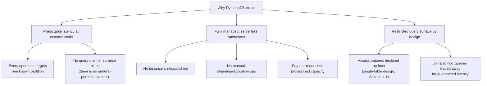

## 4. Core Concepts

This section teaches DynamoDB's distinguishing internals from first
principles: how its key schema shapes both data modeling and physical
storage, how consistent hashing spreads data and load across partitions,
how the two capacity modes translate application throughput into billed
and enforced limits, how secondary indexes extend the query surface, how
Streams exposes a change feed, how the consistency model trades latency
and cost against read freshness, and how Global Tables replicate a table
across regions.

### 4.1 Partition Key/Sort Key Model and Single-Table Design

**Definition.** Every DynamoDB table has a *primary key* that is either a
**simple primary key** (a partition key alone) or a **composite primary
key** (a partition key plus a *sort key*). The partition key determines
which physical partition an item lives on (Section 4.2); the sort key, when
present, orders items *within* that same partition key, letting a single
partition key group a whole family of related items that can be fetched
together in one request. **Single-table design** is the DynamoDB-specific
modeling philosophy of deliberately storing multiple, logically distinct
entity types (customers, orders, order line items) in one physical table by
overloading the partition-key and sort-key attributes with generic,
prefixed string values (`CUSTOMER#123`, `ORDER#456`) rather than giving
each entity type its own table.

**Mechanism.** A composite key's partition key is typically a coarse
grouping value (a customer ID, a tenant ID, a device ID) and the sort key
distinguishes items within that group using a structured, prefix-friendly
string (`ORDER#2024-01-15#O1001`) so that a single `Query` operation
against one partition key can retrieve an entire related set of items —
sorted, range-filterable by sort-key prefix or comparison operator, and
delivered in one round trip. Single-table design pushes this further: by
choosing generic attribute names (`PK`, `SK`) and prefixing every value
with an entity-type tag, one table can hold a customer's profile
(`PK=CUSTOMER#123`, `SK=METADATA`), that customer's orders
(`PK=CUSTOMER#123`, `SK=ORDER#456`), and even a given order's line items
under a *different* partition key rooted at the order itself
(`PK=ORDER#456`, `SK=ITEM#sku-1`) — the same physical table serving
multiple, independently query-able "shapes" of data, chosen specifically so
that every one of the application's known access patterns becomes a single
`Query` against one partition, never a multi-table join DynamoDB has no
native way to perform.

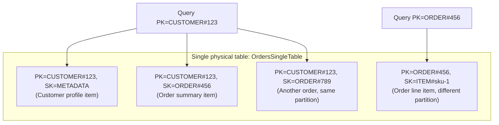

**Decision implications.** Single-table design is a deliberate trade of
schema flexibility for query-time performance and cost: every access
pattern the application will ever need must be enumerated *before* the
table is designed, because DynamoDB has no equivalent of a relational
engine's ad-hoc `JOIN`/aggregation query surface to fall back on when a new,
unplanned access pattern appears later — adding a genuinely new pattern
after the fact usually means adding a new Global Secondary Index (Section
4.4) or, in the worst case, re-modeling and migrating data. This is the
single most consequential architectural decision in a DynamoDB design: an
architect who models entities the way they would in a relational schema
(one table per entity type, foreign keys linking them) gets correctness,
but pays for it with multiple round trips and no atomic cross-table
consistency, exactly the operational cost DynamoDB exists to eliminate.
Multi-table designs remain legitimate when entities have genuinely
unrelated, independently scaled access patterns, or when a team's
operational maturity with single-table design is still low — DynamoDB does
not *require* single-table design, it only rewards the access patterns it
enables.

**Failure mode.** Retrofitting a new query need onto a single-table design
built without anticipating it — for example, "list every order placed in
the last hour across all customers" onto a table keyed purely by
`CUSTOMER#id` — has no efficient native answer: it would require a full
table `Scan` (reading every item in the table, filtering client-side), which
is both slow and, under provisioned capacity, extremely expensive relative
to a targeted `Query`. Teams new to DynamoDB frequently discover this only
in production, after the application's real query needs diverge from the
ones the original key design anticipated.

**Scenario.** A ticketing platform models a single table with
`PK=EVENT#<eventId>` and `SK=SEAT#<seatId>` for seat inventory, plus a
second entity family `PK=USER#<userId>`, `SK=RESERVATION#<reservationId>`
for a user's own reservation history — two independently useful access
patterns ("all seats for an event" and "a user's reservations") served by
one table, with a Global Secondary Index (Section 4.4) added later to
support a third pattern ("all reservations for an event, regardless of
which seat") that the original two key structures could not answer without
a `Scan`.

### 4.2 Consistent Hashing for Partition Distribution

**Definition.** DynamoDB distributes a table's items across many physical
storage nodes (*partitions*) using **consistent hashing**
([recapped generically from Sharding](CH06_Sharding.md#shard-key-selection-criteria-shard-mapdirectory-routing-consistent-hashing-ring-virtual-nodes-vs-hash-mod-routing)):
every item's partition key is hashed, and the resulting hash value
determines which partition physically stores that item, with DynamoDB
managing partition boundaries and rebalancing transparently as a table
grows — the operator never manually assigns a shard.

**Mechanism.** DynamoDB internally maps each table's partition-key hash
space onto a set of physical partitions, each with its own bounded storage
capacity (historically around 10 gigabytes per partition) and its own
bounded throughput allowance. As a table's item count or throughput demand
grows, DynamoDB automatically splits a partition into two, redistributing
the affected key range across the new partitions — the same "only remap a
narrow slice of the key space, not the whole table" property that
consistent hashing generically provides ([Sharding's ring-remap-cost
argument](CH06_Sharding.md#shard-key-selection-criteria-shard-mapdirectory-routing-consistent-hashing-ring-virtual-nodes-vs-hash-mod-routing)
applies directly here), except DynamoDB performs the split and rebalance
automatically and invisibly rather than requiring an operator-driven
migration. Every partition key an application chooses is therefore, from
DynamoDB's perspective, a coordinate into this hash space — a "hot" key
(one value receiving disproportionate traffic relative to others) maps to
one physical partition regardless of how much traffic that single value
receives, because the hash of one fixed string always lands in the same
place.

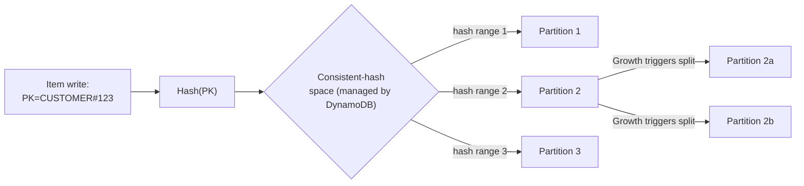

**Decision implications.** Because partition-key *value diversity* is what
lets consistent hashing spread load, an architect's partition-key choice is
the single largest lever over whether a table's throughput scales linearly
or hits an early, hard ceiling: a partition key with millions of distinct,
roughly evenly accessed values (a customer ID, a device ID) spreads
naturally across many partitions, while a partition key with few distinct
values (a fixed `STATUS` string, a single tenant ID for an enormous tenant)
concentrates all writes for that value onto one partition's throughput
ceiling no matter how much total table-level capacity is provisioned
(Section 4.3 covers the resulting throttling mechanism in depth). This is
why DynamoDB data modeling is described as "key-design-first": the
partition key is chosen for its hashing/distribution properties as much as
for its business meaning.

**Failure mode.** A "hot partition" occurs when one partition-key value
receives a disproportionate share of a table's total read or write volume —
common causes include a single extremely popular item (a viral product, a
celebrity's social profile), a low-cardinality attribute used directly as
the partition key (a boolean flag, a small enumeration), or a
monotonically increasing key (a timestamp or auto-incrementing ID used
directly, causing all *new* writes to briefly cluster on the newest
partition before the key space grows enough to split). The application-
visible symptom is throttling (Section 4.3), even though the table's
aggregate provisioned or on-demand capacity looks more than sufficient on
average.

**Scenario.** A flash-sale system that used a fixed partition key like
`PK=SALE#2024-BLACKFRIDAY` for every order placed during the sale window
concentrates the entire event's write volume onto one partition-key hash
value; the standard fix is a **write-sharding** pattern — appending a
random or hashed suffix (`SALE#2024-BLACKFRIDAY#7`) to spread writes across
several partition-key values, then fanning a read out across all suffixes
when the full picture is needed (a "scatter-gather" query, conceptually the
same
[cross-shard scatter-gather pattern Sharding already teaches](CH06_Sharding.md#rebalancinglive-data-migration-cross-shard-queries-scatter-gather-cross-shard-transactions2pc-cost-hot-shard-mitigation)).

### 4.3 Capacity Modes: On-Demand vs. Provisioned (RCU/WCU) and Adaptive Capacity

**Definition.** DynamoDB bills and enforces throughput using two modes.
**Provisioned capacity** requires declaring a table's sustained Read
Capacity Units (RCUs) and Write Capacity Units (WCUs) in advance — one RCU
covers one strongly consistent read (or two eventually consistent reads,
Section 4.6) of up to 4 kilobytes per second, and one WCU covers one write
of up to 1 kilobyte per second — with requests beyond the provisioned
amount throttled. **On-demand capacity** removes advance provisioning
entirely, billing per actual request and automatically scaling to
accommodate traffic, at a materially higher per-request price than
well-utilized provisioned capacity. **Adaptive capacity** is a background
mechanism that automatically shifts a *portion* of a table's overall
provisioned throughput toward partitions receiving disproportionate
traffic, narrowing (but not eliminating) the gap between table-level
provisioned capacity and any single partition's actual throughput ceiling.

**Mechanism.** Under provisioned capacity, DynamoDB divides the table's
declared RCU/WCU allotment across its physical partitions (Section 4.2)
roughly evenly at the time of the split; a partition therefore has its own
effective throughput ceiling, not merely a share of an abstract table-wide
pool. If traffic against one partition's key range exceeds that
partition's current allotment, DynamoDB returns a
`ProvisionedThroughputExceededException` to the client for the excess
requests, even if the table's total consumed capacity across all
partitions is well under its overall provisioned total. Adaptive capacity
continuously monitors per-partition consumption and, within limits,
temporarily boosts a hot partition's allotment by borrowing headroom from
the table's underused partitions, and in some cases can isolate a
persistently hot key onto its own partition to give it more dedicated
throughput — but adaptive capacity has its own ceiling (bounded by the
table's total provisioned throughput and per-partition hard limits) and
does not turn a single-key hotspot into infinite scale (Section 4.2's
write-sharding pattern remains the durable fix for that). On-demand mode
sidesteps this provisioning exercise entirely: DynamoDB manages the
underlying partition-level capacity dynamically per table based on recent
traffic, still subject to the same underlying per-partition physical
limits, just without the customer manually declaring an RCU/WCU number.

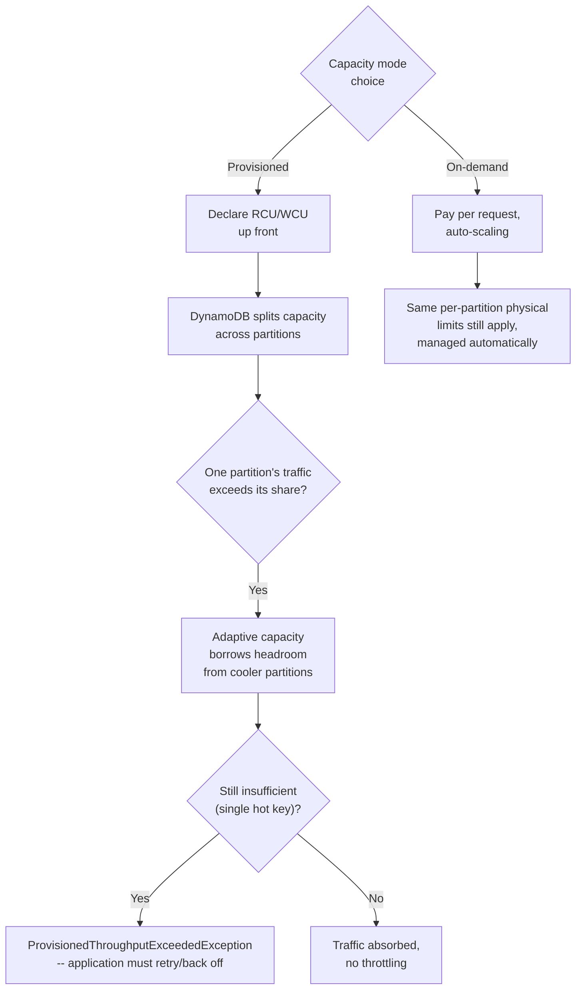

**Decision implications.** Provisioned capacity is materially cheaper per
request for steady, predictable workloads an architect can forecast, and
supports Auto Scaling policies that adjust the provisioned RCU/WCU within
minutes as sustained utilization changes — but it requires genuine
forecasting discipline and reacts slowly (minutes, not requests) to sudden
spikes, unlike on-demand's near-immediate elasticity. On-demand mode is the
right default for unpredictable, spiky, or early-stage workloads where the
cost of over-provisioning (paying for idle capacity) or under-provisioning
(throttling real traffic) both outweigh on-demand's per-request premium;
mature, high-volume, steady-state workloads typically migrate to
provisioned capacity (or a hybrid, since a table can switch modes) once
their traffic shape is well understood, purely for cost.

**Failure mode.** A retry storm during throttling is a common secondary
incident: when `ProvisionedThroughputExceededException` responses trigger
naive, un-backed-off client retries, the retries themselves add to the
very load causing the throttling, amplifying the incident instead of
draining it — the DynamoDB Software Development Kit (SDK)'s built-in
exponential backoff-with-jitter retry policy exists specifically to avoid
this, and disabling or reimplementing it carelessly is a frequent
production mistake.

**Scenario.** A gaming leaderboard service provisions capacity sized for
its typical daily active-user volume, but a promotional in-game event
drives a tenfold spike concentrated on a handful of newly popular player
IDs; adaptive capacity absorbs part of the imbalance automatically, but the
team also pre-emptively switches the leaderboard table to on-demand mode
for the event's duration specifically because the spike's shape (which
exact keys will be hot) is not knowable in advance, then switches back to
provisioned capacity afterward once the steady-state traffic shape is
known again.

### 4.4 Global Secondary Indexes (GSI) and Local Secondary Indexes (LSI)

**Definition.** A base table's primary key defines exactly one way to
`Query` it directly. A **Local Secondary Index (LSI)** provides an
*alternate sort key* for the *same* partition key as the base table,
letting a table support a second ordering/range-query pattern within a
partition. A **Global Secondary Index (GSI)** provides an entirely
*different* partition key (and optionally sort key), functioning as a
second, independently queryable "view" of the table's data with its own
distribution across partitions.

**Mechanism.** An LSI must be created at table-creation time (it cannot be
added later), shares the base table's partition key, consumes RCU/WCU from
the *same* provisioned capacity pool as the base table, and is strongly
consistent-read-capable because it lives on the same physical partition as
its corresponding base-table items. A GSI can be added or removed at any
time after table creation, has its own independently provisioned (or
on-demand) capacity, is updated *asynchronously* after the base table write
completes — meaning a GSI read can briefly return stale data relative to a
concurrent base-table write, a stronger version of the general eventual-
consistency trade-off (Section 4.6) — and, because it uses a different
partition key, may distribute data across an entirely different set of
physical partitions than the base table. Every GSI's `Projection` setting
(`KEYS_ONLY`, `INCLUDE`, or `ALL`) determines which non-key attributes are
copied into the index, trading index storage/write cost against how often a
query must fall back to a separate `GetItem` against the base table to
fetch attributes the index didn't project.

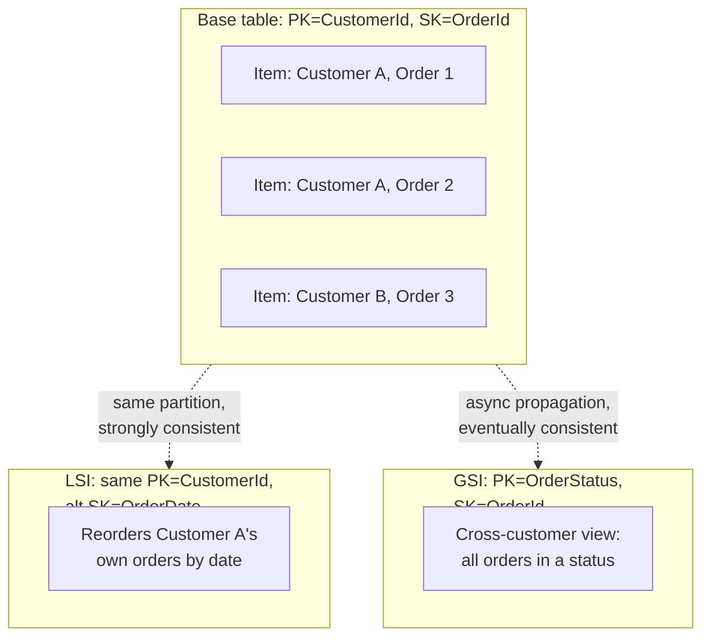

**Decision implications.** The choice between an LSI and a GSI is largely
about *when* the access pattern is known and *whether* it needs to cross
partition keys: if the pattern is "reorder or range-filter items already
grouped by the same partition key," and can be anticipated at table-design
time, an LSI is cheaper (shared capacity) and strongly-consistent-capable;
if the pattern needs to query across a different grouping entirely (as
Section 4.1's "all orders by status, across customers" example needed), a
GSI is the only option, and its eventual-consistency and separate-capacity
characteristics must be designed around explicitly. LSIs also carry a
firm constraint that materially affects design: all items sharing one
partition key across all of a table's LSIs are capped at 10 gigabytes
total, a limit that does not apply to GSIs — high-volume, unbounded-growth
partition keys should generally avoid LSIs for this reason alone.

**Failure mode.** A GSI's independent capacity means it can throttle even
when the base table is nowhere near its own limits — a common surprise for
teams who provisioned the base table generously but left a newly added
GSI at default/low capacity, then discover write throttling that traces
back not to the base table but to the GSI's own insufficient WCU, since
every base-table write that touches a GSI's projected attributes also
consumes that GSI's write capacity.

**Scenario.** An inventory system's base table is keyed by
`PK=WarehouseId, SK=Sku` (fast lookups within one warehouse); a
newly required "find every warehouse currently holding a given SKU below
its reorder threshold" pattern is added later via a GSI keyed by
`PK=Sku, SK=WarehouseId`, deliberately projecting only the attributes that
query needs (`ProjectionType=INCLUDE`) to minimize the GSI's storage and
write-capacity cost relative to copying the entire item.

### 4.5 DynamoDB Streams (Change Data Capture)

**Definition.** DynamoDB Streams is an ordered, time-limited (24-hour
retention) change-data-capture feed that records every item-level create,
update, and delete on a table as a sequence of stream records, which
downstream consumers (most commonly AWS Lambda, via an event-source
mapping) can process to react to data changes without polling the table.

**Mechanism.** Each table's stream is divided into *shards* (a
DynamoDB-Streams-specific concept, distinct from the table's own storage
partitions, though shards roughly track partition activity/splits);
DynamoDB guarantees ordering of records *within* a shard for a given item's
key, but not a single global order across the whole stream. A consumer
opens a *shard iterator* (of type `TRIM_HORIZON` to start from the oldest
available record, `LATEST` to start from now, or an `AT_SEQUENCE_NUMBER`
to resume from a specific point) and polls `GetRecords` against it,
receiving batches of records; each record carries the modified item's key,
the type of modification (`INSERT`/`MODIFY`/`REMOVE`), and — depending on
the table's configured `StreamViewType` — the item's new image, old image,
both, or only the changed keys. A Lambda event-source mapping automates
this entire iterator/polling/checkpointing loop, invoking a function with
a batch of records and retrying on function failure according to a
configurable policy (including moving persistently failing batches to a
dead-letter destination rather than blocking the whole shard indefinitely).

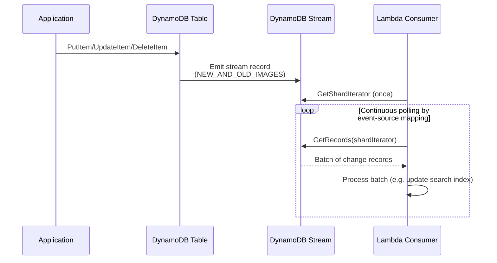

**Decision implications.** Streams turns DynamoDB into an event-sourcing-
friendly primitive: search-index synchronization (projecting changes into
an Amazon OpenSearch Service index), materialized cross-table aggregates,
audit logging, and Global Tables' own cross-region replication (Section
4.7) are all built on the same underlying stream mechanism. Because
retention is a fixed, short 24-hour window, Streams is not a durable event
log an architect can replay arbitrarily far back — any consumer needing
longer retention or replay must persist processed records elsewhere (for
example, into an append-only log service) rather than relying on the
stream itself as that durable store.

**Failure mode.** A Lambda consumer that throws on every invocation for a
"poison" record (malformed data, a downstream dependency permanently down)
can, without a configured retry limit and dead-letter destination, block
that shard's processing indefinitely — later records in the same shard
cannot be delivered until the stuck record's batch is either processed or
explicitly given up on, so unattended Streams consumers must always
configure `MaximumRetryAttempts` and a failure destination.

**Scenario.** An e-commerce platform uses Streams plus a Lambda consumer
to keep a separate OpenSearch full-text product-search index synchronized
with the DynamoDB catalog table in near-real-time: every `PutItem`/
`UpdateItem` on the catalog table triggers a stream record, the Lambda
function transforms the new image into the search index's document shape,
and search-index staleness is bounded by the stream's processing lag rather
than by a slower, periodic batch-reindexing job.

### 4.6 Consistency Model: Eventual vs. Strongly Consistent Reads

**Definition.** DynamoDB replicates every item across (by default) three
storage nodes within a region for durability and read availability.
**Eventually consistent reads** (the default, and half the RCU cost of a
strong read) may be served by any of these replicas, including one that
has not yet applied the very latest write. **Strongly consistent reads**
always route to a replica guaranteed to reflect every successfully
completed write prior to the read, at double the RCU cost, and are never
available against a Global Secondary Index (Section 4.4) or a Global Table
replica in another region (Section 4.7) — only the base table (or an LSI)
within the writing region.

**Mechanism.** A write to DynamoDB is acknowledged as successful once it
has been durably applied to a quorum of the item's replicas (in the common
case, at least two of three), not necessarily all three — the remaining
replica catches up asynchronously, typically within milliseconds. An
eventually consistent read may be routed (for load-balancing purposes) to
that lagging replica and, in a narrow timing window, return the item's
prior value; a strongly consistent read is instead directed specifically to
a replica known to hold the fully committed value, at the cost of that
request no longer being freely load-balanceable across all three replicas
and consuming twice the RCU. This is a direct, deliberate application of
the availability/consistency trade-off Replication and CAP theorem already
generalize
([recapped from Replication](CH07_Replication.md#failover-mechanics-and-split-brain-risk-fencing-tokens-stonith-cap-theorempacelc-framing)) —
DynamoDB simply exposes the trade-off as a per-request, per-call parameter
(`ConsistentRead=True/False`) rather than a fixed, table-wide policy.

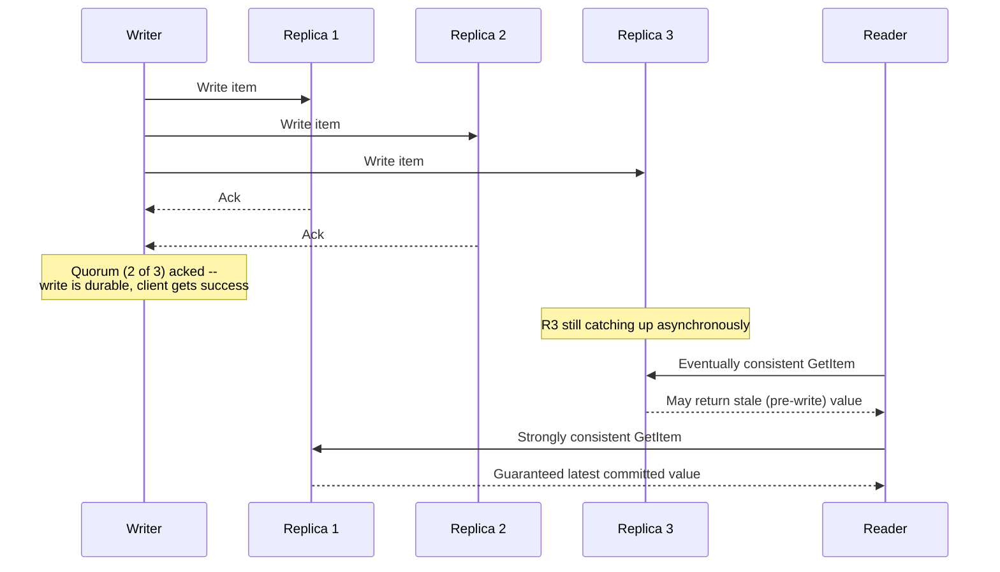

**Decision implications.** Most DynamoDB access patterns should default to
eventually consistent reads — the staleness window is typically single-
digit milliseconds, half the RCU cost compounds meaningfully at scale, and
the majority of read-heavy workloads (product catalogs, most dashboards,
most user-profile reads) tolerate a few milliseconds of staleness without
any observable business impact. Strongly consistent reads are reserved for
the narrower set of patterns where read-your-own-writes correctness
matters immediately after a write — for example, reading back a just-
created order to confirm it to the same user in the same request, or any
read that feeds directly into a subsequent write decision where acting on
stale data would be incorrect (an inventory check immediately before a
reservation write, for instance, though DynamoDB Transactions, Section 4.8,
are usually the more robust fix for that exact case).

**Failure mode.** Assuming a GSI supports strongly consistent reads (it
never does, unconditionally) is a recurring modeling mistake: an
application that reads its own just-written data back through a GSI query
immediately after the write can observe a stale (or entirely absent)
result purely because GSI propagation is asynchronous by design, not
because of a transient error — the fix is either reading the required data
back through the base table (where strong consistency is at least
available as an option) or architecting the workflow to tolerate the
GSI's inherent lag.

**Scenario.** A ride-sharing platform's driver-location updates are read
by nearby-rider-matching logic using eventually consistent reads (a few
milliseconds of staleness in a driver's last known position is immaterial
at the granularity riders perceive), while the same platform's fare-
finalization step, which reads a ride record immediately after writing its
final status, uses a strongly consistent read specifically because
returning a stale "in progress" status to a payment step immediately after
marking the ride "completed" would be a visible correctness bug, not merely
a cosmetic staleness issue.

### 4.7 Global Tables (Multi-Region Active-Active Replication)

**Definition.** Global Tables replicate a DynamoDB table's data across
multiple AWS regions in an **active-active** topology — every regional
replica accepts both reads and writes locally, with changes propagated to
every other region's replica asynchronously, in contrast to the
active-passive (single-writer) leader/follower model
[Replication](CH07_Replication.md) teaches as the generic default.

**Mechanism.** Global Tables are built directly on top of DynamoDB Streams
(Section 4.5): every write to one region's replica generates a stream
record, which a fully-managed internal replication process reads and
applies to every other region's replica table, carrying the item's
metadata needed for conflict resolution. Because any region can accept a
write to the same item concurrently with another region, Global Tables use
a **last-writer-wins** conflict-resolution policy based on each write's
internal timestamp — if two regions both write the same item within the
cross-region propagation window, the write with the later timestamp
"wins" and is what every region eventually converges on, and the earlier
write is silently discarded, not merged field-by-field. This is the same
active-active conflict-resolution problem
[Replication's leaderless/quorum section already frames generically](CH07_Replication.md#leaderlessquorum-based-replication-dynamo-style-nwr-sloppy-quorum-hinted-handoff-read-repair) —
Global Tables' specific answer is last-writer-wins rather than
application-supplied merge logic or Conflict-free Replicated Data Types
(CRDTs).

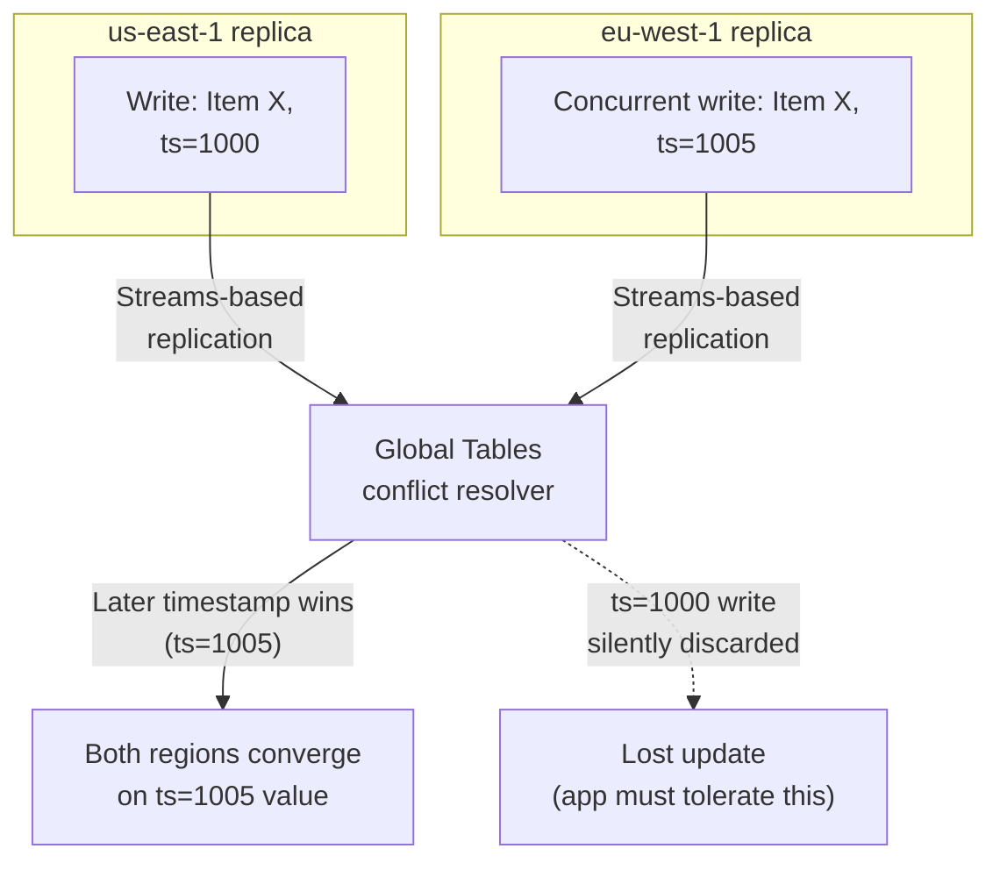

**Decision implications.** Global Tables trade strict correctness for
regional write availability and low local write latency: an application
that cannot tolerate a silently discarded concurrent write under
last-writer-wins (financial ledgers, inventory decrements, anything
requiring true cross-region atomicity) needs either a design that avoids
concurrent cross-region writes to the same item (routing all writes for a
given item's key to one "home" region, a common pattern) or an entirely
different consistency strategy — Global Tables are not a substitute for
[DynamoDB Transactions](#48-dynamodb-transactions-two-phase-commit-based)
across regions, since transactions are scoped to a single region's
replica. The primary, well-suited use case is instead **low-latency local
reads/writes for genuinely regional or eventually-reconcilable data** —
user profile/preferences, session state, product catalogs — where read
latency for globally distributed users matters far more than perfect
cross-region write ordering.

**Failure mode.** "Split writes" — a bug class where an application
assumes a Global Table behaves like a single logical table with one
consistent state at all times, and performs a read-modify-write sequence
(read current value, compute new value, write it back) against a local
replica without realizing a concurrent write in another region can be
silently overwritten by last-writer-wins — is the most common Global
Tables production surprise; the durable fix is DynamoDB Transactions or
conditional writes scoped to a single region, or redesigning the access
pattern to be commutative (increment-by-delta rather than read-then-write
an absolute value) so last-writer-wins cannot silently lose an update.

**Scenario.** A global Software-as-a-Service (SaaS) product stores user
preference settings in a Global Table so that a user in Singapore and a
user in Ireland each read and write their own preferences against their
nearest regional replica with low latency; because each user's writes are
almost never concurrent with a write to the *same* item from a different
region (each user's own preferences are effectively single-writer in
practice), last-writer-wins never actually triggers a meaningful conflict —
the architecture works precisely because the access pattern was chosen to
avoid genuine concurrent cross-region writes to the same key, not because
Global Tables solved the conflict problem generally.

## 5. Internal Working

Putting Section 4's mechanisms together, a single `PutItem` call's full
internal path looks like this: the client SDK hashes the item's partition
key to determine (implicitly, via the request router) which partition owns
it (Section 4.2), the request is routed to that partition's current
storage nodes, the write is applied and replicated to a quorum of that
partition's replicas before being acknowledged (Section 4.6), any
Global Secondary Index whose key attributes the item touches is
asynchronously updated (Section 4.4), a DynamoDB Streams record is emitted
if the table has a stream enabled (Section 4.5), and — if the table is
part of a Global Table — the same Streams record is picked up by the
cross-region replication process and applied to every other region's
replica (Section 4.7), all without the application's request needing to
wait for any of the asynchronous steps to complete.

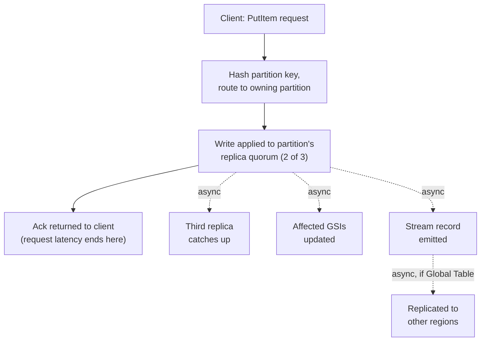

A `Query` against a partition key, by contrast, never needs to consult any
partition other than the one the hashed key routes to (Section 4.2) —
this single-partition guarantee, not any clever query optimization, is the
actual mechanical reason DynamoDB `Query` latency stays flat regardless of
total table size: the operation's cost is a function of how many items
share that one partition key, never a function of the table's overall row
count. A `Scan`, by contrast, must visit every partition in the table
sequentially (optionally in parallel via `Segment`/`TotalSegments`), which
is why `Scan` cost and latency scale with total table size and why it is
treated as an operation of last resort in a well-modeled table (Section
4.1's failure mode).

## 6. Design Principles

- **Model access patterns before attributes.** Enumerate every query the
  application needs to run *before* choosing partition/sort keys (Section
  4.1) — DynamoDB schema design starts from "what will I ask this table"
  rather than from "what entities exist," the inverse of relational
  normalization's usual starting point ([recapped from
  Normalization](CH01_Normalization.md)).
- **Design for distribution, not just correctness.** A partition-key
  choice must satisfy both the application's query needs *and* consistent
  hashing's need for high-cardinality, evenly-accessed values (Section
  4.2) — a key that is "correct" from a data-modeling standpoint but low-
  cardinality is still a design defect in DynamoDB specifically.
- **Prefer sparse, purposeful secondary indexes over broad ones.** Every
  GSI (Section 4.4) is a second, independently-billed copy of (a subset
  of) the table's data with its own throughput and storage cost — add one
  per genuinely distinct access pattern, not speculatively.
- **Treat strong consistency as the exception, not the default.** Default
  to eventually consistent reads (Section 4.6) and reach for strong
  consistency only where read-your-own-writes correctness is a genuine
  requirement, not a reflexive safety margin.
- **Push atomicity into the item, or into a transaction, explicitly.**
  DynamoDB has no implicit cross-item transaction scope; either shape the
  data so single-item atomic updates (conditional expressions,
  `UpdateItem`'s atomic counters) suffice, or explicitly reach for
  DynamoDB Transactions (Section 4.8) when multiple items must change
  together.

## 7. Architecture Patterns

- **Single-table design (Section 4.1)** for a bounded, well-understood
  microservice's own data store — the dominant pattern for greenfield
  DynamoDB use.
- **Write-sharded high-cardinality suffix pattern (Section 4.2)** for
  workloads with an inherently low-cardinality "natural" partition key
  (a fixed event ID, a global counter) that would otherwise hot-partition.
- **GSI-overloading pattern**: reusing the same two GSI attribute names
  (`GSI1PK`, `GSI1SK`) across multiple entity types in a single-table
  design, exactly as the base table's `PK`/`SK` are overloaded (Section
  4.1), so one GSI serves several different query shapes simultaneously.
- **Streams-to-Lambda fan-out (Section 4.5)** for keeping downstream
  systems (search indexes, caches, analytics pipelines, audit logs) in
  sync with a DynamoDB table's changes without polling.
- **Time-to-Live (TTL)-based expiry pattern**: an item attribute holding an
  epoch expiry timestamp that DynamoDB's background TTL process uses to
  automatically delete expired items (session tokens, ephemeral
  rate-limit counters) at no additional write cost, itself emitting a
  Streams `REMOVE` record consumers can react to.
- **Regional-home-key pattern for Global Tables (Section 4.7)**: routing
  all writes for a given item's key to one designated "home" region to
  avoid genuine concurrent cross-region writes, while still allowing
  low-latency local reads everywhere.

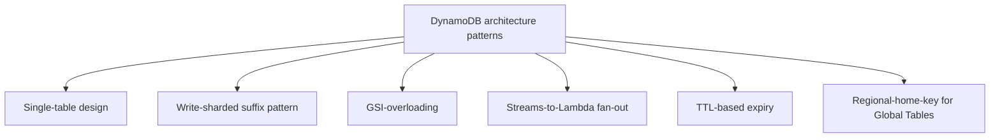

## 8. Production Architecture

A typical production DynamoDB deployment behind a microservice sits inside
a Virtual Private Cloud (VPC) accessed either via a VPC Gateway Endpoint
(avoiding public internet egress for DynamoDB traffic entirely, at no
additional cost) or directly over AWS's public API endpoint with
Identity and Access Management (IAM)-scoped credentials; a service
typically owns exactly one or a small number of tables, each with
CloudWatch alarms on consumed-vs-provisioned capacity (or, in on-demand
mode, on request-latency and throttled-request-count metrics), a DynamoDB
Streams-backed Lambda consumer for any downstream synchronization needs
(Section 4.5), and — for latency-sensitive global products — a Global
Table (Section 4.7) fronted by a routing layer (typically Amazon Route 53
latency-based or geolocation routing) that directs each user's requests to
their nearest regional replica.

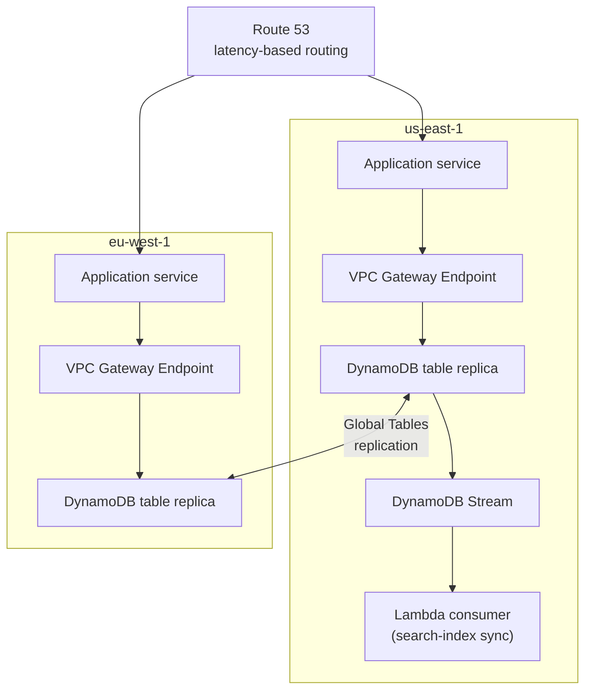

## 9. Implementation

Implementing against DynamoDB means, concretely: choosing a partition/sort
key schema and any GSIs up front (Section 4.1/4.4), selecting a capacity
mode (Section 4.3), deciding per-call consistency (Section 4.6), and
deciding whether multi-item writes need DynamoDB Transactions (Section
4.8). The AWS SDK for Python, boto3, exposes both a low-level client
(raw, typed request/response dictionaries matching the DynamoDB API
exactly) and a higher-level `resource`/`Table` interface (Pythonic types —
plain strings, `Decimal` for numbers, native `dict`/`list` — automatically
marshalled to and from DynamoDB's wire format); most application code
should prefer the resource interface for readability and reserve the
low-level client for operations (like `TransactWriteItems`'s typed
attribute-value syntax) that need precise control.

## 10. Complete Code Examples

Four runnable Python examples using boto3 accompany this chapter under
[code/python/dynamodb-chapter/](../code/python/dynamodb-chapter/):

- [01_single_table_design.py](../code/python/dynamodb-chapter/01_single_table_design.py) —
  creates a single table holding both `Customer` and `Order` entities
  (Section 4.1) with a GSI supporting a second, cross-customer access
  pattern (Section 4.4), demonstrating that a single partition-key `Query`
  retrieves a customer and all their orders in one round trip.
- [02_capacity_and_throttling_demo.py](../code/python/dynamodb-chapter/02_capacity_and_throttling_demo.py) —
  provisions a deliberately small WCU allotment and writes a burst of
  items sharing one partition key, reproducing
  `ProvisionedThroughputExceededException` to make Section 4.2/4.3's
  hot-partition mechanism directly observable.
- [03_transactions_and_consistency.py](../code/python/dynamodb-chapter/03_transactions_and_consistency.py) —
  uses `TransactWriteItems` to atomically transfer funds between two
  accounts with a `ConditionExpression` guarding against overdraft
  (Section 4.8), then contrasts an eventually consistent read against a
  strongly consistent one (Section 4.6).
- [04_streams_and_global_tables.py](../code/python/dynamodb-chapter/04_streams_and_global_tables.py) —
  enables a Streams feed with `NEW_AND_OLD_IMAGES`, polls a shard directly
  to show the raw change-record shape a Lambda trigger would receive
  (Section 4.5), and includes a simplified last-writer-wins conflict
  resolver illustrating Global Tables' policy (Section 4.7).

## 11. Performance

DynamoDB's headline performance property — single-digit-millisecond
latency independent of table size — holds only when every hot-path
operation is a `GetItem`/`PutItem`/`Query` against a single, well-
distributed partition key (Section 4.2); any `Scan` on a hot path, any
low-cardinality partition key, and any GSI with insufficient provisioned
capacity (Section 4.4's failure mode) are the three most common ways an
application defeats this guarantee itself. Batch operations
(`BatchGetItem`/`BatchWriteItem`) reduce round-trip overhead for known sets
of keys but still consume the same aggregate RCU/WCU as the equivalent
individual calls — they save network round trips, not capacity.

## 12. Scalability

Scalability in DynamoDB is close to automatic by design: a table's storage
and, given adequate provisioned or on-demand capacity, its throughput both
scale by DynamoDB transparently splitting partitions (Section 4.2) as data
grows — there is no analogous "vertical scaling ceiling then re-architect"
moment the way a single-primary relational engine eventually faces
([contrast with PostgreSQL's scaling ladder](CH11_PostgreSQL.md#12-scalability)).
The scaling limits that remain are almost entirely a function of key
design (Section 4.2's hot-partition ceiling) rather than the engine's own
architecture, which is precisely the trade this chapter has emphasized
throughout: DynamoDB moved the scaling problem from "operate a distributed
system well" to "design your keys well."

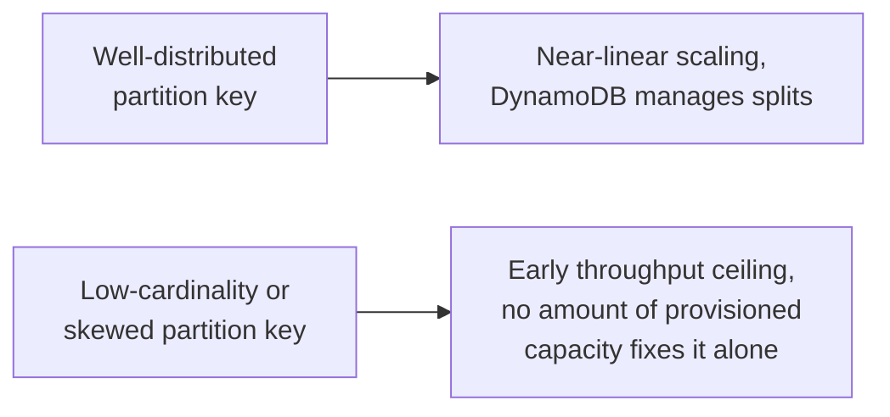

## 13. Security

Access control is entirely IAM-based: policies can scope permissions down
to specific actions (`dynamodb:GetItem`, `dynamodb:Query`) and even to
specific attributes or leading-key-value conditions via
`dynamodb:LeadingKeys`, enabling a single table to serve multiple tenants
with IAM-enforced row-level isolation without any application-level
`WHERE tenant_id = ...` filter to get wrong — a stronger, engine-enforced
analog to
[PostgreSQL's Row-Level Security](CH11_PostgreSQL.md#13-security). Data is
encrypted at rest by default using an AWS-owned or AWS Key Management
Service (KMS)-managed key, and in transit via Transport Layer Security
(TLS) ([recapped from TLS](../05_Networking_and_OS/CH06_TLS.md)), and VPC
Gateway Endpoints let traffic reach DynamoDB without traversing the public
internet at all.

## 14. Observability

Key CloudWatch metrics to monitor, tied directly to Section 4's
mechanisms: `ConsumedReadCapacityUnits`/`ConsumedWriteCapacityUnits`
against provisioned values (Section 4.3), `ThrottledRequests` and
`ReadThrottleEvents`/`WriteThrottleEvents` (Section 4.2/4.3's hot-partition
symptom), `SuccessfulRequestLatency` per operation type, GSI-specific
versions of the same capacity/throttle metrics (Section 4.4's independent-
capacity failure mode), `IteratorAge` for a Streams-consuming Lambda
(Section 4.5's processing-lag signal), and, for Global Tables,
`ReplicationLatency` per region pair (Section 4.7).

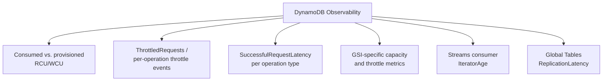

## 15. Failure Scenarios

- **Sudden hot-partition throttling** after a marketing-driven traffic
  spike concentrates load on a small set of keys (Section 4.2/4.3) —
  mitigated by write-sharding, adaptive capacity, or a temporary switch to
  on-demand mode.
- **GSI-specific throttling invisible in base-table metrics** (Section
  4.4's failure mode) — mitigated by monitoring GSI capacity metrics
  independently, never assuming base-table headroom implies GSI headroom.
- **Stale GSI/Global-Table reads misinterpreted as bugs** (Section 4.4 and
  4.6's asynchronous-propagation nature) — mitigated by architecting
  read-your-own-writes-sensitive paths to use the base table with strong
  consistency, or DynamoDB Transactions, instead.
- **Stuck Streams shard from an unhandled poison record** (Section 4.5's
  failure mode) — mitigated by configuring `MaximumRetryAttempts` and a
  dead-letter destination on every Streams-based Lambda event-source
  mapping.
- **Silent lost update under Global Tables' last-writer-wins policy**
  (Section 4.7's failure mode) — mitigated by a regional-home-key routing
  pattern or by redesigning the write to be commutative.

## 16. Testing

DynamoDB Local (a downloadable JAR, or the `amazon/dynamodb-local` Docker
image) reproduces the DynamoDB API surface for fast, offline unit and
integration testing without incurring AWS costs or network latency,
though it does not perfectly replicate every production behavior (its
Streams support in particular is limited, and it does not model
consistent-hashing partition splits or adaptive capacity, so hot-partition
and capacity-mode tests still need a real AWS account against a
disposable test table). Integration tests should exercise
`ConditionExpression` failure paths and `TransactWriteItems` rollback
behavior explicitly (Section 4.8), since these are exactly the code paths
most likely to be undertested relative to the "happy path" write.

## 17. Common Mistakes

- Modeling entities in DynamoDB the way one would in a relational schema
  (one table per entity, foreign-key-style references) and then
  discovering every cross-entity read needs multiple round trips (Section
  4.1's core lesson).
- Choosing a partition key for its business meaning alone without checking
  its cardinality/distribution properties (Section 4.2).
- Assuming a GSI can serve a strongly consistent read (Section 4.4/4.6 —
  it never can).
- Treating on-demand mode as a permanent substitute for understanding
  access patterns, rather than an appropriate choice for genuinely
  unpredictable traffic (Section 4.3).
- Building a read-modify-write sequence against a Global Table without
  either a home-region routing pattern or DynamoDB Transactions, and being
  surprised by last-writer-wins data loss (Section 4.7).

## 18. Best Practices

- Enumerate every access pattern before finalizing key design (Section
  4.1), and revisit the design explicitly (not reactively) whenever a
  genuinely new pattern emerges.
- Default every read to eventually consistent unless a specific,
  documented reason requires strong consistency (Section 4.6).
- Provision or monitor GSIs' capacity independently from the base table
  (Section 4.4).
- Use `ConditionExpression`s to make single-item writes safe under
  concurrency (optimistic-concurrency-style version checks,
  [recapping Locking's optimistic-concurrency-control
  pattern](CH10_Locking.md#pessimistic-vs-optimistic-concurrency-control))
  before reaching for a full multi-item transaction where a conditional
  single-item update would suffice.
- Configure dead-letter handling on every Streams-based consumer (Section
  4.5).

## 19. Anti-Patterns

- **The relational-schema-in-disguise table**: one table per entity type
  with application-side joins, forfeiting single-table design's single-
  round-trip payoff (Section 4.1).
- **Scan-as-a-query-pattern**: relying on `Scan` with a `FilterExpression`
  for a recurring, known access pattern instead of designing a `Query`-
  capable key or index for it (Section 4.1's failure mode).
- **Monotonic-key-as-partition-key**: using a raw, ever-increasing
  timestamp or auto-incrementing ID directly as a partition key, clustering
  all new writes onto the newest key range (Section 4.2).
- **Silent last-writer-wins reliance for financial or inventory data**
  under Global Tables without a home-region or transactional safeguard
  (Section 4.7).

## 20. Trade-off Analysis

| Decision | Choose provisioned capacity | Choose on-demand capacity |
|---|---|---|
| Traffic shape | Predictable, forecastable | Unpredictable, spiky, or unknown |
| Cost sensitivity | High — optimizing cost per request matters | Lower — simplicity outweighs marginal per-request cost |
| Operational maturity | Comfortable running Auto Scaling policies | Prefers zero capacity management |

| Decision | Choose GSI | Choose LSI |
|---|---|---|
| Partition key | Different from base table | Same as base table |
| Consistency | Eventually consistent only | Strongly consistent available |
| When addable | Any time after table creation | Table-creation time only |
| Capacity | Independently provisioned | Shares base table's capacity |

## 21. Comparison Table

| Dimension | DynamoDB | PostgreSQL ([CH11](CH11_PostgreSQL.md)) | Redis (not yet drafted) |
|---|---|---|---|
| Management model | Fully managed, serverless | Self-managed (or managed-service-wrapped) relational engine | Self-managed or managed in-memory store |
| Query surface | Key-based access patterns, no joins | Full SQL, joins, ad-hoc queries | Key-based, data-structure-specific commands |
| Scaling model | Automatic partition splitting | Vertical, then sharding/read-replicas | Vertical, then clustering |
| Consistency | Tunable per-request (eventual/strong) | Strong (MVCC snapshots) | Strong, single-node; tunable in cluster mode |
| Multi-region writes | Global Tables (active-active, LWW) | Requires external tooling/extensions | Requires external tooling |

## 22. Real-World Case Study

Amazon.com's own internal migration of its shopping-cart service from a
relational datastore to a Dynamo-derived key-value store (the same
motivating incident from Section 2's historical evolution) remains the
canonical case study for this exact architectural trade-off: the
shopping-cart workload's actual requirements — read/write a customer's
cart by customer ID, tolerate eventual consistency across replicas,
survive partial infrastructure failures without becoming unavailable —
mapped almost perfectly onto a key-value, partition-key-addressed,
eventually-consistent-by-default model, and mapped poorly onto a
single-writer relational engine's assumptions. The lesson generalizes
directly to DynamoDB adoption decisions today: workloads whose access
patterns are genuinely key-based and whose consistency requirements
genuinely tolerate eventual consistency for most operations are DynamoDB's
strongest fit; workloads needing ad-hoc relational queries, multi-table
joins, or strict global consistency by default are a weaker fit and often
better served by a relational engine or a purpose-built alternative.

## 23. Interview Questions

1. Explain why a low-cardinality partition key causes throttling even when
   a table's aggregate provisioned throughput looks sufficient.
2. What is the difference between a Local Secondary Index and a Global
   Secondary Index, and why can't an LSI be added after table creation?
3. Walk through what happens internally between a `PutItem` call
   returning success and a Global Secondary Index reflecting that write.
4. Why does DynamoDB Transactions' `ConditionExpression` failure abort the
   entire transaction rather than only the failing item?
5. Describe a scenario where Global Tables' last-writer-wins conflict
   resolution would cause a real data-correctness bug, and how you would
   redesign around it.
6. When would you choose on-demand capacity over provisioned capacity,
   and what does adaptive capacity change about that decision?
7. Why is `Scan` considered an anti-pattern for a recurring access
   pattern, and what are the two typical fixes?

## 24. Hands-on Exercises

1. Run [01_single_table_design.py](../code/python/dynamodb-chapter/01_single_table_design.py)
   against DynamoDB Local and extend it with a third entity type
   (`Payment`) sharing the same table, adding a new access pattern of your
   own design.
2. Run [02_capacity_and_throttling_demo.py](../code/python/dynamodb-chapter/02_capacity_and_throttling_demo.py),
   observe the throttling, then modify the hot key to a write-sharded
   suffix pattern (Section 4.2) and re-run to confirm the throttling
   disappears.
3. Modify [03_transactions_and_consistency.py](../code/python/dynamodb-chapter/03_transactions_and_consistency.py)
   to add a third account to the transaction and verify that a failed
   condition on any one of the three items rolls back all three.
4. Enable a real AWS DynamoDB table's Streams feed, wire it to a minimal
   Lambda function, and confirm the change-record shape matches
   [04_streams_and_global_tables.py](../code/python/dynamodb-chapter/04_streams_and_global_tables.py)'s
   manual polling output.

## 25. Design Exercises

1. Design a single-table schema for a multi-tenant help-desk ticketing
   system supporting: "all tickets for a tenant," "all tickets assigned to
   an agent, across tenants," and "a ticket's full comment history" —
   identify which patterns need a GSI and justify each key choice.
2. Design a write-sharding scheme for a global product's "trending items"
   counter that receives extremely skewed traffic on a handful of viral
   items, including how a read would reassemble the sharded counts.
3. Design a Global Tables topology for a user-notification-preferences
   service spanning three regions, including your conflict-avoidance
   strategy and justification for why (or why not) DynamoDB Transactions
   are needed.

## 26. Architecture Review Questions

- Has every planned access pattern been enumerated and mapped to a
  specific `Query` (base table, LSI, or GSI), with no reliance on `Scan`
  for a recurring pattern?
- Does the chosen partition key have sufficient cardinality and even
  access distribution to avoid a hot-partition ceiling under peak load?
- Is capacity mode (provisioned vs. on-demand) justified by an actual
  traffic-predictability assessment, not a default choice?
- For any multi-item write requiring atomicity, is DynamoDB Transactions
  used explicitly, rather than assuming implicit cross-item consistency?
- For any Global Table, is there an explicit strategy (home-region
  routing, commutative writes, or documented tolerance) for last-writer-
  wins conflicts?

## 27. Summary

DynamoDB trades the deep, tunable internals of a self-managed relational
engine for a fully-managed, serverless operating model whose scalability
and latency guarantees hold by construction — but only when an architect
gets the choices DynamoDB *does* expose right: partition/sort key design
and single-table modeling (Section 4.1), a partition key with genuine
distribution properties (Section 4.2), an appropriately chosen and
monitored capacity mode (Section 4.3), secondary indexes matched
precisely to real access patterns (Section 4.4), Streams for event-driven
downstream synchronization (Section 4.5), a deliberate per-request
consistency choice (Section 4.6), DynamoDB Transactions for genuine
multi-item atomicity (Section 4.8), and, where global reach is needed,
Global Tables with an explicit conflict-avoidance strategy (Section 4.7).
The recurring theme across every one of these decisions is that DynamoDB
did not eliminate the hard distributed-systems problems this book's
[Sharding](CH06_Sharding.md), [Replication](CH07_Replication.md), and
[Transactions](CH08_Transactions.md) chapters teach generically — it
moved responsibility for them from "operate the infrastructure correctly"
to "design the schema and access pattern correctly," and a Solution
Architect who treats DynamoDB as "a database with no decisions left to
make" will discover those decisions the hard way, in production.
