\
# Chapter: Cassandra

Part: [06 — Databases and Storage](PART_OVERVIEW.md) · Status: Drafted

## 1. Introduction

Apache Cassandra is a masterless, wide-column distributed database built to
answer a question most relational engines cannot: how do you keep accepting
writes and serving reads when an entire datacenter disappears? Every
generic concept this book has already taught about distributing data —
horizontal partitioning and shard-key selection
([Sharding](CH06_Sharding.md)), consistent hashing with virtual nodes
([Sharding](CH06_Sharding.md) Section 4.5), leaderless quorum-based
replication with Dynamo-style N/W/R tuning, sloppy quorum, hinted handoff,
and read repair ([Replication](CH07_Replication.md) Section 4.7), and the
CAP (Consistency, Availability, Partition tolerance) theorem framing
([Replication](CH07_Replication.md) Section 4.8) — applies to Cassandra,
because Cassandra is one of the two systems (alongside Amazon's internal
Dynamo) that made those ideas mainstream in the first place. This chapter
is not a re-derivation of those generic mechanisms; it is the *engineering
realization* of them inside one specific, extraordinarily widely deployed
engine, plus the concepts Cassandra owns outright: the gossip protocol that
lets a masterless cluster agree on its own membership without any
coordination service, the Log-Structured Merge-tree (LSM-tree) storage
engine that makes Cassandra's writes among the fastest of any general-
purpose database, the Cassandra Query Language (CQL) and the query-first
data-modeling discipline it forces on every schema decision, and
Lightweight Transactions (LWTs) — a Paxos-based compare-and-set mechanism
bolted onto an otherwise eventually-consistent system for the narrow cases
that genuinely need it.

This chapter assumes the reader already understands, at the depth their
owning chapters teach: normalization and denormalization
([Normalization](CH01_Normalization.md),
[Denormalization](CH02_Denormalization.md)), B-tree index structures
([Indexes](CH03_Indexes.md)), horizontal partitioning
([Partitioning](CH05_Partitioning.md)), sharding and consistent hashing
([Sharding](CH06_Sharding.md)), leader/follower and leaderless replication
plus CAP/PACELC (Partition tolerance, Availability, Consistency, Else
Latency, Else Consistency) framing ([Replication](CH07_Replication.md)),
ACID (Atomicity, Consistency, Isolation, Durability) transactions and MVCC
(Multi-Version Concurrency Control) ([Transactions](CH08_Transactions.md)),
and lock-based concurrency control ([Locking](CH10_Locking.md)) — each is
recapped in 2-3 sentences at the point Cassandra's own mechanism builds on
it, per the Concept Ownership Rule in [STYLE_GUIDE.md](../STYLE_GUIDE.md),
never re-taught from scratch.

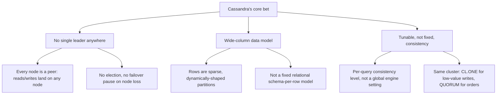

## 2. Historical Evolution

- **Google Bigtable paper (2006)** — described a distributed, sparse,
  sorted map keyed by (row, column, timestamp) backed by an
  LSM-tree-like storage engine on top of the Google File System; Cassandra
  borrows this data model almost directly (Section 4.5, Section 4.6).
- **Amazon's Dynamo paper (2007)** — described consistent hashing with
  virtual nodes, leaderless quorum-based (N/W/R) replication, sloppy
  quorum, hinted handoff, and read repair as a fully available, partition-
  tolerant key-value store; Cassandra borrows this distribution model
  almost directly (recapped throughout Section 4, owned in full generic
  form by [Sharding](CH06_Sharding.md) and [Replication](CH07_Replication.md)).
- **Built at Facebook (2007-2008)** — Avinash Lakshman (a Dynamo co-author)
  and Prashant Malik built Cassandra internally to power Facebook's Inbox
  Search feature, explicitly combining Bigtable's data model with Dynamo's
  distribution model — the "Bigtable data model, Dynamo distribution model"
  framing is still the single best one-sentence description of the engine.
- **Open-sourced (2008), Apache incubation (2009), top-level project
  (2010)** — Facebook released Cassandra as open source; it entered the
  Apache Software Foundation incubator and graduated to a top-level Apache
  project within about a year, and DataStax was founded to provide
  commercial support and drive much of its subsequent development.
- **Virtual nodes / vnodes (1.2, 2013)** — before vnodes, each physical
  node owned exactly one large contiguous token range, meaning adding or
  removing a node required manually recalculating and reassigning ranges
  cluster-wide; vnodes (Section 4.1) let each node own many small,
  scattered ranges, automating rebalancing and bounding its cost to
  roughly 1/N of the cluster's data.
- **Lightweight Transactions via Paxos (2.0, 2013)** — added
  `IF NOT EXISTS` / `IF <condition>` compare-and-set semantics (Section
  4.7) to an engine that had, until then, been purely last-write-wins,
  explicitly trading the normal single-round-trip write for a four-phase
  Paxos round only when a caller opts in.
- **Materialized Views (3.0, 2015) and their later deprecation warning
  (4.0)** — server-maintained denormalized projections (Section 4.6)
  promised to remove the burden of manually fanning writes out to multiple
  query-shaped tables, but production experience with view-write failure
  modes under node failure led the project to mark them experimental and
  discourage new adoption — a cautionary case study in Section 22.
  discourage new adoption.
- **Default vnodes count lowered (3.0-4.0, 2015-2021)** — the default
  `num_tokens` dropped from 256 toward 16, after operational experience
  showed 256 vnodes per node caused excessive streaming fan-out and
  unnecessarily long repair times during scale-out/scale-in, without a
  proportional load-balancing benefit past a much smaller vnode count
  (Section 4.1's failure-mode discussion).
- **Zero-copy streaming and incremental repair (4.0, 2021)** — after a long
  stabilization cycle, Cassandra 4.0 shipped major operational wins:
  zero-copy `sendfile`-based SSTable streaming (dramatically faster
  bootstrap/rebalancing) and default incremental (rather than always-full)
  anti-entropy repair (Section 4.4).
- **Storage-attached indexing / SAI (5.0, 2024)** — a new secondary-index
  implementation designed to avoid the older secondary index
  implementation's cluster-wide scatter-gather cost (Section 4.6's
  anti-pattern discussion) for a useful subset of query shapes, alongside
  vector-search support aimed at retrieval-augmented AI (Artificial
  Intelligence) workloads.

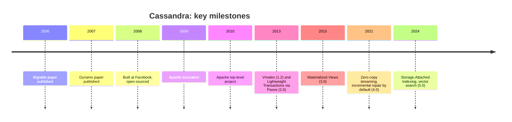

## 3. Why It Exists

Cassandra exists to solve a specific, painful production problem that
Facebook's Inbox Search team hit directly: a single-leader relational
database's availability is bounded by the leader's availability, and a
failover (however automated) still introduces a window of unavailability
or, worse, split-brain risk if done incorrectly
([Replication](CH07_Replication.md) Section 4.8 already teaches this
generic failover/split-brain trade-off in full). A masterless architecture
where every node can accept both reads and writes for the partitions it
owns removes that single point of coordination-induced unavailability
entirely: there is no leader to fail over, because there was never a
leader to begin with. This is a deliberate trade against the alternative —
Cassandra gives up the strict, single-writer-per-row consistency guarantee
a leader-based system can offer by default, and instead lets the caller
*choose*, per query, how much consistency to trade for how much
availability (Section 4.2).

A second reason Cassandra exists is horizontal, linear write scalability
with predictable latency. Cassandra's LSM-tree storage engine (Section 4.5)
converts every write — insert, update, and even delete — into a sequential
append to an in-memory structure and, eventually, an immutable on-disk
file, never an in-place random-access disk write. This gives Cassandra
write latency that stays flat as data volume grows, which is precisely the
property write-heavy workloads at Facebook's, and later Netflix's,
Instagram's, Apple's, and Discord's scale needed and a B-tree-based engine
optimized for read-heavy, in-place-update workloads
([Indexes](CH03_Indexes.md)) does not provide as cheaply at that write
volume.

A third, more subtle reason: Cassandra makes the CAP theorem trade-off
*tunable* rather than fixed. Most systems pick one point on the
consistency/availability spectrum and hard-code it; Cassandra's per-query
consistency levels (Section 4.2) let the same cluster serve a
"like count" write at `ONE` (maximally available, eventually consistent) and
an "account balance" write at `QUORUM` (strongly consistent within the
overlap guarantee, less available under partition) side by side, on the
same tables, in the same application, without provisioning two different
databases.

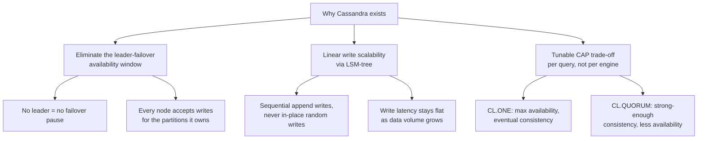

## 4. Core Concepts

### 4.0 Recap: what earlier chapters already own

Before this chapter's Cassandra-specific mechanisms, a short recap of the
generic concepts they build on, per the Concept Ownership Rule:

- **Consistent hashing and virtual nodes** are taught in full generic
  depth by [Sharding](CH06_Sharding.md) Section 4.5: keys and shards both
  hash onto the same ring, virtual nodes spread each physical shard's
  ownership across many small ring positions to bound remap cost to
  roughly 1/N on scale-out/in, versus hash-mod's roughly (N-1)/N. This
  chapter's Section 4.1 is Cassandra's specific implementation of that
  generic mechanism, not a re-derivation of consistent hashing itself.
- **Leaderless, quorum-based (N/W/R) replication** — Dynamo-style tunable
  consistency, the W+R>N overlap correctness rule, sloppy quorum, hinted
  handoff, and read repair are taught in full generic depth by
  [Replication](CH07_Replication.md) Section 4.7. This chapter's Sections
  4.2 and 4.4 are Cassandra's specific named consistency levels, hint
  storage/expiry mechanics, and repair implementation built on that
  generic model.
- **The CAP theorem and PACELC framing** — the unifying availability-
  versus-consistency trade-off vocabulary is owned by
  [Replication](CH07_Replication.md) Section 4.8. Cassandra is one of the
  canonical AP (Availability, Partition-tolerance)-leaning systems that
  framing was built to describe.
- **Horizontal partitioning and partition-key selection reasoning** —
  choosing a key that spreads load evenly and avoids hotspots is owned by
  [Partitioning](CH05_Partitioning.md); Cassandra's partition key is that
  same decision applied to a distributed, multi-node ring rather than a
  single node's local partitions.
- **B-tree index structures** ([Indexes](CH03_Indexes.md)) are the
  structure Cassandra's LSM-tree engine (Section 4.5) is explicitly *not*
  — understanding the B-tree's in-place-update cost model is what makes
  the LSM-tree's append-only design legible as a genuine alternative, not
  just a different name for the same idea.
- **ACID transactions and MVCC** ([Transactions](CH08_Transactions.md)) —
  Cassandra deliberately does not offer multi-partition ACID transactions;
  Section 4.7's Lightweight Transactions are a narrow, expensive,
  single-partition compare-and-set primitive, not a general substitute.

The remaining seven subsections are concepts this chapter owns outright.

### 4.1 Ring architecture, consistent hashing, and virtual nodes

**Definition.** Every Cassandra node owns a set of numeric *tokens* on a
logical ring (conceptually, integers from a large fixed range, wrapping
from the maximum value back to the minimum). Cassandra's default
partitioner (`Murmur3Partitioner`) hashes every partition key to a token in
that same range; a row's data lives on whichever node(s) own the token
range containing (or immediately following, walking clockwise) that key's
hashed token. Rather than owning one large contiguous range, each physical
node is assigned many small, scattered *virtual nodes* (vnodes) — historic
default 256 tokens per node, current default 16 — so its share of the ring
is spread across many small non-contiguous slices instead of one large
block.

**Mechanism.** Placing a partition key means: hash the key with
Murmur3Partitioner to a token, walk clockwise around the ring to the first
vnode whose owning node is responsible for that range, and that node
becomes the *first replica*. The next `replication_factor - 1` **distinct
physical nodes** encountered continuing clockwise become the remaining
replicas (skipping vnodes that belong to a physical node already selected,
and, when `NetworkTopologyStrategy` is used, additionally constrained to
place replicas across distinct racks/datacenters per the keyspace's
replication map, not just the next N distinct nodes blindly). A
Cassandra client driver that knows the ring's token-to-node mapping (kept
current via gossip, Section 4.3) can compute this placement locally and
route a query directly to a replica — *token-aware routing* — skipping an
otherwise-necessary extra coordinator hop to whichever node the client
happened to connect to.

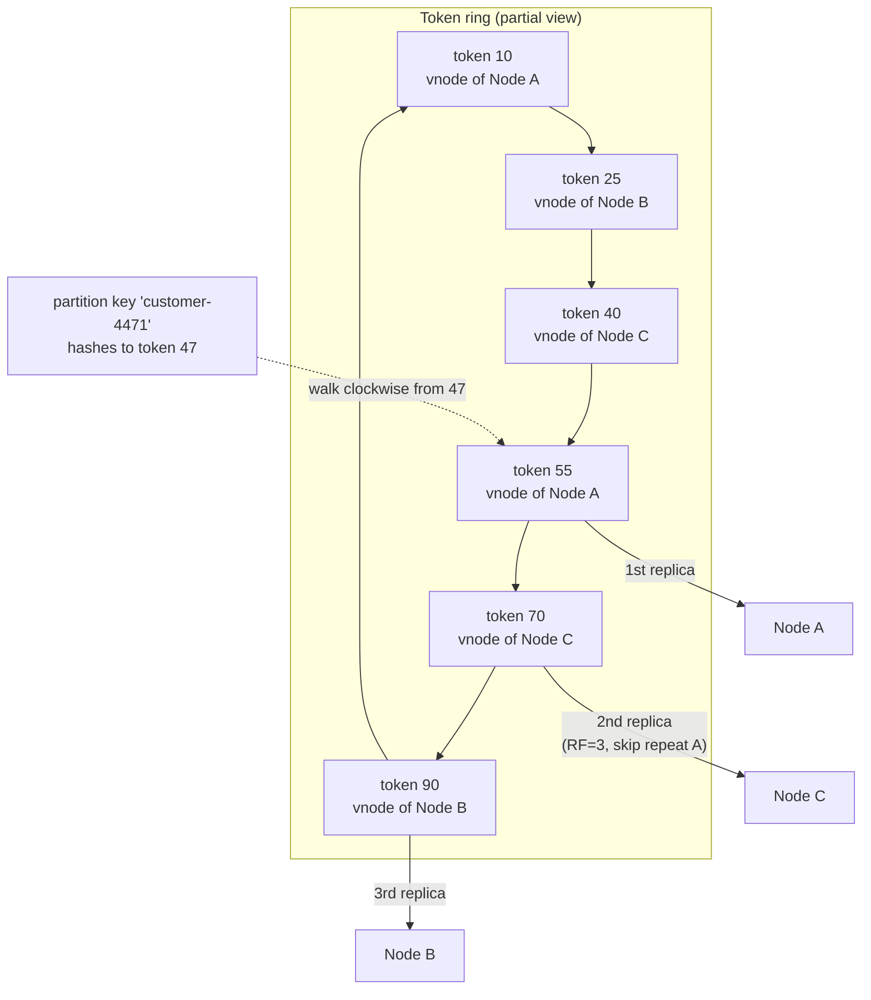

**Decision implications.** Vnode count is a direct rebalancing-cost knob:
more vnodes per node means finer-grained, more evenly distributed load
when nodes join or leave, but also more streaming sessions and more
Merkle-tree comparison work during repair (Section 4.4), because data
ownership is fragmented across more, smaller ranges. This is exactly why
the ecosystem's practical default moved from 256 down toward 16 — most
clusters get "good enough" load evenness at 16, at a fraction of the
streaming/repair fan-out cost 256 vnodes imposed. `NetworkTopologyStrategy`
(always preferred over rack/datacenter-blind `SimpleStrategy`, even in a
single-datacenter deployment planning future expansion) additionally
determines *which* physical racks/datacenters replicas land in, layered on
top of the ring's token-based node selection.

**Common failure mode.** Choosing too few vnodes (or, worse, the old
single-large-range-per-node model) reintroduces load imbalance: if node
ownership isn't spread across many small ranges, a single busy range can
overload one physical node while its neighbors sit idle, and adding a new
node to relieve that hotspot requires moving one enormous contiguous range
rather than incrementally borrowing many small slices from several
existing nodes. The opposite failure — too many vnodes on a very large
cluster — manifests as multi-hour repair and bootstrap operations because
every one of thousands of small ranges requires its own streaming session
and Merkle-tree exchange.

**Scenario.** A 6-node Cassandra cluster with 16 vnodes per node
(96 total vnode slices) needs to scale out to 9 nodes ahead of a seasonal
peak. Because each existing node's ownership is fragmented across 16
scattered ranges rather than one contiguous block, the 3 new nodes each
borrow a proportional slice of load *from every existing node
simultaneously*, converging on an even ~1/9-per-node distribution far
faster, and with far less single-node data-transfer pressure, than a
single-large-range design ever could.

### 4.2 Tunable consistency and the N/R/W quorum formula

**Definition.** Every read and write in Cassandra specifies a named
*consistency level* (CL) — `ONE`, `TWO`, `THREE`, `QUORUM`, `ALL`,
`LOCAL_ONE`, `LOCAL_QUORUM`, `EACH_QUORUM`, `ANY`, `SERIAL`, and
`LOCAL_SERIAL` — which translates to a concrete number of replicas (out of
the row's replication factor N) that must acknowledge before the
coordinator responds to the client. This is the N/W/R quorum formula
([Replication](CH07_Replication.md) Section 4.7) made concrete and named:
N is the keyspace's replication factor, W is the CL-derived acknowledgment
count required for a write, and R is the CL-derived count required for a
read.

**Mechanism.** `QUORUM` resolves to `floor(N/2) + 1` replicas
cluster-wide, regardless of datacenter. `LOCAL_QUORUM` resolves to
`floor(local_N/2) + 1` — a majority of *only the coordinator's own
datacenter's* replicas — so a remote-datacenter outage or high-latency link
never sits on the request's critical path; this is the consistency level
most production multi-datacenter Cassandra deployments default to for
both reads and writes, because it gives the same overlap guarantee as
global `QUORUM` *within one datacenter* without ever waiting on
cross-region round trips. `EACH_QUORUM` (write-only) is the strictest
multi-datacenter option: a local quorum in *every* datacenter must
acknowledge, guaranteeing every datacenter has a consistent view at the
cost of write availability during any single datacenter's outage. `ONE`
requires exactly one replica to acknowledge — maximally available, weakest
consistency. `ALL` requires every replica — strongest consistency,
weakest availability (a single unreachable replica blocks the entire
request). `ANY` (write-only, rarely used) is satisfied even by a hint
being stored (Section 4.4) with zero replicas actually acknowledging yet —
the weakest possible durability guarantee Cassandra exposes.

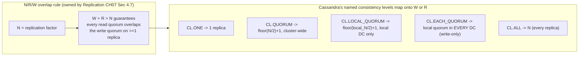

**Decision implications.** Because the consistency level is chosen *per
query*, not once for the whole engine, the same table can be written at
`ONE` for a low-value, high-volume event (a page-view counter increment)
and read at `QUORUM` for a value where staleness is costly (an account
balance before allowing a withdrawal) — this per-request tunability is
Cassandra's (and Dynamo-style systems' generally) defining trade-off, and
the concrete reason architects reach for Cassandra over a fixed-consistency
system when different data in the same domain has genuinely different
consistency requirements. `LOCAL_QUORUM` for both reads and writes is the
practical default for most multi-region deployments precisely because it
gives the W+R>N overlap guarantee *within a region* while remaining fully
available if any other region goes dark.

**Common failure mode.** Choosing `ONE` for both the write and the
subsequent read (W=1, R=1, so W+R=2 while N is typically 3) means the read
can land on a replica the write never reached, returning a genuinely stale
value — this is not a bug, it is the explicit contract of that consistency
level, but teams that don't realize the CL choice is per-query (and
therefore easy to get inconsistent across an application's different code
paths) are frequently surprised by "the write I just made isn't showing up
yet" bugs traced back to a mismatched CL pairing.
[02_consistency_level_quorum_demo.py](../../code/python/cassandra-chapter/02_consistency_level_quorum_demo.py)
simulates exactly this contrast side by side with the safe `QUORUM`/`QUORUM`
pairing.

**Scenario.** An e-commerce platform writes order-status updates at
`LOCAL_QUORUM` (a customer support agent's status change must be durable
and immediately visible to that same region's read replicas) but writes
"item viewed" analytics events at `ONE` (losing an occasional view event
under a rare replica outage is an acceptable trade for never blocking on a
write acknowledgment on the read-heavy product page's hot path).

### 4.3 Gossip protocol

**Definition.** Gossip is Cassandra's peer-to-peer cluster-membership and
failure-detection protocol: every node periodically exchanges state
information with a small number of randomly (but not-quite-uniformly;
biased toward including at least one configured seed node) chosen peers,
and that state — including each peer's current view of every *other*
node's liveness — propagates exponentially through the cluster within a
few rounds, without any centralized coordination service (no ZooKeeper, no
etcd, no single "membership leader") ever being consulted.

**Mechanism.** Each node maintains a `HeartBeatState` (a monotonically
incrementing generation number reset only on process restart, plus a
version number incremented on every gossip round) and an
`ApplicationState` map (token ownership, datacenter/rack, schema version,
load, and status) for itself and for every other node it has heard about.
Roughly once per second, each node picks a small number of peers — at
least one of which is drawn from the configured `seed` node list to
guarantee new or rejoining nodes always have a bootstrap entry point — and
exchanges digests (version numbers only, not full state) of what it
currently knows; whichever side's information is staler for a given peer
then pulls the full updated state. Because every exchange also forwards
what each side has heard *about other nodes*, not just about the two
gossiping nodes themselves, full cluster membership state converges in
roughly `O(log N)` gossip rounds even on a very large cluster — the
"gossip spreads like rumor/epidemic" framing this protocol family is named
for.

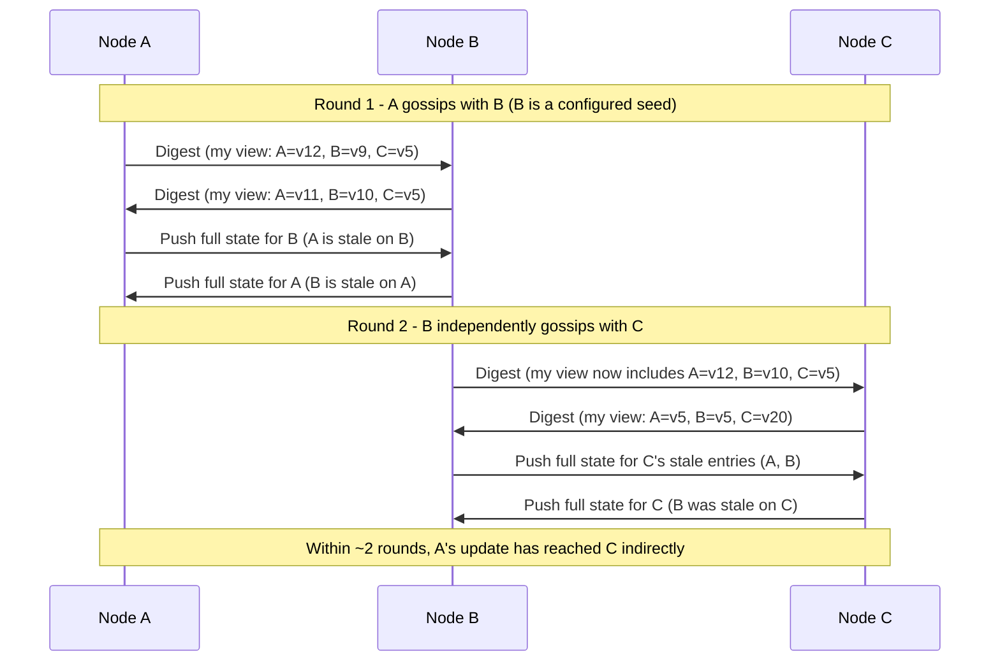

Failure detection layered on top of gossip uses a **Phi Accrual failure
detector** rather than a fixed heartbeat-timeout threshold: each node
tracks the historical distribution of inter-arrival times between
heartbeats from each peer, and computes a continuous suspicion level
(`phi`) representing how statistically unlikely the current silence is
for a healthy peer, rather than a binary "missed N heartbeats = dead."
This lets a node on a slow, jittery WAN (Wide Area Network) link naturally
tolerate more variance before triggering false-positive DOWN marks than a
node on a fast, stable LAN (Local Area Network) link, without any manual
per-link timeout tuning.
[04_TokenRingRoutingSimulation.java](../../code/java/cassandra-chapter/04_TokenRingRoutingSimulation.java)
implements a simplified version of this phi calculation.

**Decision implications.** Gossip's peer-to-peer design is precisely what
lets Cassandra remain masterless for membership itself, not only for data:
there is no membership-service leader to fail over either. The trade-off
is convergence latency — a state change takes a small but nonzero number
of seconds to propagate cluster-wide, versus a centralized coordination
service that could, in principle, broadcast a change instantly to
everyone who is watching. For a database whose entire design already
assumes eventual (not instant) consistency for data, this is a consistent
design choice, not an oversight.

**Common failure mode.** A network partition that splits a cluster into
two halves, each of which can still gossip internally, produces two
groups of nodes with genuinely different, self-consistent views of who is
UP — this is the same "leader-unreachable versus leader-dead" ambiguity
[Replication](CH07_Replication.md) Section 4.8 describes generically,
manifesting here as each side's coordinators still accepting writes for
partitions they believe they own, which is exactly why Cassandra's
consistency model must be tunable *per query* rather than assuming gossip
membership state is always instantaneously accurate cluster-wide.

**Scenario.** A newly provisioned node joins a 12-node cluster by
gossiping with a configured seed node first; within roughly 4-5 gossip
rounds (a few seconds), every existing node in the cluster has learned the
new node's token ownership and begun routing the appropriate slice of
reads/writes to it, without any operator having to manually update
membership configuration on the other 11 nodes.

### 4.4 Hinted handoff, read repair, and anti-entropy

**Definition.** These are Cassandra's three concrete mechanisms for
converging replicas back toward agreement after a write reaches fewer
than all N replicas — the general Dynamo-style leaderless-replication
mechanisms [Replication](CH07_Replication.md) Section 4.7 already teaches
in full, given Cassandra-specific storage and configuration detail here.

**Mechanism — hinted handoff.** When a coordinator's write reaches fewer
than N replicas because one is temporarily unreachable, the coordinator
stores a *hint* — the mutation plus the intended target replica's
identity — in a local system table (`system.hints`), rather than simply
dropping the write for that replica. Once the target replica rejoins
(detected via gossip, Section 4.3), the coordinator holding the hint
replays it directly to that replica. Hints are bounded by
`max_hint_window` (historically 3 hours by default): a replica down
longer than that window is assumed to need a full anti-entropy repair
instead, because the volume of accumulated hints would otherwise itself
become an operational burden.

**Mechanism — read repair.** When a read's required replicas (per the
query's consistency level) return conflicting versions of the same row,
the coordinator reconciles by timestamp (last-write-wins per cell) and, in
the same request, pushes the winning version back to whichever replica(s)
returned stale data — a **foreground/blocking** repair that happens
automatically whenever a multi-replica read at `QUORUM` or higher detects
a mismatch, before the client receives its response. Older Cassandra
versions additionally supported a **probabilistic background** read
repair (`dclocal_read_repair_chance`), triggered on some percentage of
reads regardless of whether a mismatch was detected on that particular
read, as an additional convergence nudge — this mechanism is deprecated in
current versions in favor of the always-on foreground behavior at
sufficient consistency levels plus scheduled anti-entropy repair.

**Mechanism — anti-entropy repair (`nodetool repair`).** Hinted handoff
and read repair both only fix rows a client actually touches; **anti-
entropy repair** is the mechanism that finds and fixes divergence across
*all* data, touched or not, using **Merkle trees**: each replica builds a
hash tree over its data range, and two replicas compare trees top-down,
recursing only into branches whose hashes differ, so only genuinely
divergent sub-ranges are ever streamed — never a full replica-to-replica
data comparison. Because Cassandra treats deletes as *tombstones*
(markers, not physical removal, so a replica that missed the delete
doesn't resurrect old data on the next read) rather than immediate
physical removal, repair must run at least once within
`gc_grace_seconds` (default 10 days) on every table with deletes, or a
replica that missed a delete and whose tombstone has since been garbage-
collected on other replicas can cause a deleted row to silently
"resurrect" the next time that stale replica participates in a read or
compaction.

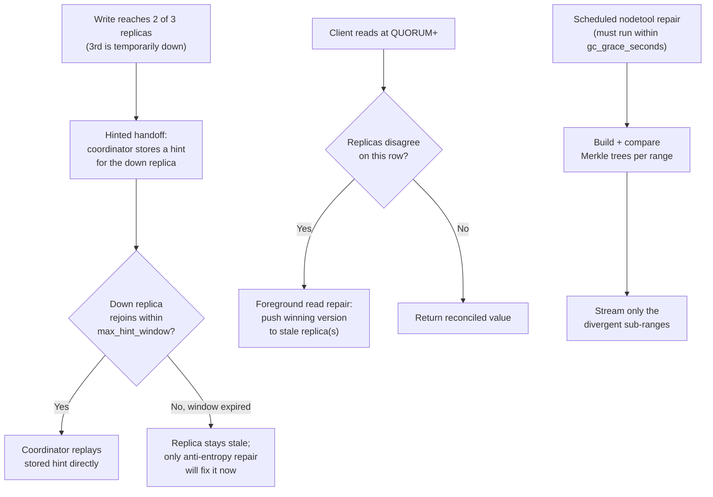

**Decision implications.** Hinted handoff and read repair are cheap,
client-transparent, opportunistic convergence — they only fix what a
client happens to touch, and only within the hint window. Anti-entropy
repair is the mandatory, scheduled backstop that fixes *everything*,
including cold data no client has read in months, and it is the only
mechanism that protects against tombstone-related data resurrection.
Production Cassandra operations treat scheduled `nodetool repair` (or an
automated repair scheduler layered on top of it) as non-optional
maintenance, not an occasional troubleshooting tool.

**Common failure mode.** Skipping scheduled anti-entropy repair entirely
(a genuinely common operational mistake, because the cluster keeps working
fine in the absence of node failures) means that once a replica misses a
delete and its tombstone is garbage-collected past `gc_grace_seconds` on
the replicas that *did* apply it, the next repair, read, or compaction
touching that stale replica can resurrect the deleted row — a subtle,
delayed-onset data-correctness bug that is very difficult to diagnose
after the fact because the resurrection can happen weeks after the
original delete.

**Scenario.** A payments team deletes a fraudulent transaction row.
Replica C was network-partitioned away for 20 minutes during the delete
and missed it entirely; hinted handoff recovers most of Replica C's missed
writes automatically within the hint window, but the delete's tombstone
happened to be garbage-collected on Replicas A and B before Replica C ever
participated in a repair (an operational gap: the team's scheduled repair
job had silently stopped running weeks earlier). Three months later, a
`QUORUM` read that happens to include Replica C in its read set sees the
old, "deleted" row reappear in a customer-facing report — resolved only by
re-running anti-entropy repair and re-issuing the delete.

### 4.5 LSM-tree storage engine: memtable, SSTables, and compaction

**Definition.** Cassandra's storage engine is a Log-Structured Merge-tree
(LSM-tree): writes are never applied in place to an existing on-disk
structure (contrast [Indexes](CH03_Indexes.md)'s B-tree, which *does*
update pages in place); instead, every write is appended to an in-memory
sorted structure (the **memtable**) and, once that memtable fills, flushed
wholesale to a new immutable on-disk file (an **SSTable**, Sorted String
Table). Reads may need to check the memtable plus several SSTables, and a
background **compaction** process periodically merges multiple SSTables
into fewer, larger ones to bound how many files a read must check and to
physically remove data superseded by a later write or a tombstone.

**Mechanism.** A write first goes to the **commit log** — a sequential,
append-only, durable file — before being applied to the in-memory
memtable, so a crash before the memtable is flushed can still be recovered
by replaying the commit log (the same write-ahead-durability idea
underlying the WAL (Write-Ahead Log) mechanisms owned generically by
[Transactions](CH08_Transactions.md)). The memtable itself is an in-memory
sorted structure (conceptually a skip list) keyed by partition key plus
clustering columns, so a flush can stream it out to disk already in sorted
order. Each flushed SSTable is immutable once written and carries three
supporting structures: a **partition index** (sorted partition-key ->
offset mapping enabling binary search within the file), a **partition
summary** (a sparser, memory-resident sample of that index for fast
initial lookup), and a **Bloom filter** (a probabilistic structure that
can definitively say "this key is *not* in this SSTable" with zero false
negatives, letting a read skip SSTables that provably don't contain the
requested key without touching disk at all).

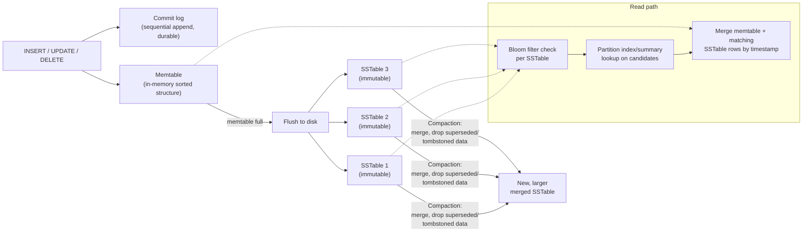

Cassandra offers several **compaction strategies**, each tuned for a
different workload shape:

- **Size-Tiered Compaction Strategy (STCS)** — the default: SSTables of
  similar size are grouped and merged once enough of them accumulate,
  producing progressively larger SSTables over time. Simple and effective
  for write-heavy, insert-mostly workloads, but can transiently need up to
  roughly 2x the data's disk space during a large compaction and offers
  weaker guarantees about how many SSTables a single-row read must check.
- **Leveled Compaction Strategy (LCS)** — organizes SSTables into levels
  of exponentially increasing size (borrowed from LevelDB/RocksDB's
  design), guaranteeing non-overlapping key ranges within each level above
  the first; this bounds worst-case SSTables-per-read far more tightly
  than STCS, at the cost of substantially higher and more constant
  background I/O (Input/Output) from more frequent, smaller compactions —
  the standard choice for read-heavy or read-latency-sensitive workloads.
- **Time-Window Compaction Strategy (TWCS)** — groups SSTables by
  time-bucket (e.g. one bucket per day) and compacts only within a bucket,
  never across buckets; purpose-built for time-series data with
  Time To Live (TTL)-based expiry, since an entire time-bucket's SSTables
  can eventually be dropped wholesale once every row in it has expired,
  without ever needing to compact old and new data together.

**Decision implications.** Choosing a compaction strategy is a direct,
consequential trade-off, not a cosmetic setting: STCS favors write
throughput and simplicity; LCS favors predictable read latency at higher
sustained background I/O cost; TWCS is close to mandatory for genuinely
time-series/TTL-expiring workloads, because STCS or LCS would otherwise
keep merging expired and non-expired data together indefinitely, never
letting an SSTable become wholly droppable.

**Common failure mode.** Running STCS (the default) on a table with heavy
overwrite or delete traffic against a small, hot set of partitions leads
to **read amplification**: because STCS doesn't guarantee non-overlapping
key ranges across SSTables the way LCS does, a single-row read may need to
consult many separate SSTables (each checked via Bloom filter first, but
still a per-SSTable index lookup for any that don't definitively rule the
key out), and heavy compaction backlog under sustained write pressure can
also cause **tombstone accumulation**: an application that uses Cassandra
as a queue (writing a row, then deleting it once "processed") produces a
huge ratio of tombstones to live data, and reads that must scan past many
tombstones before finding (or definitively not finding) live data degrade
sharply — a well-known Cassandra anti-pattern (Section 19 revisits this).

**Scenario.** A metrics ingestion table stores 90 days of per-minute
counters with TTL(7776000) (90 days in seconds). Configuring it with TWCS
using 1-day buckets means each day's SSTables age out and become droppable
as a unit once every row inside has expired — the compaction process
never wastes I/O merging month-old, already-expiring data back together
with today's fresh writes, keeping both write and background-compaction
cost flat as the table's total row count grows.

### 4.6 Query-first data modeling discipline (CQL)

**Definition.** The Cassandra Query Language (CQL) is Cassandra's
SQL-like query language, but its data-modeling discipline inverts the
relational default: instead of designing a normalized schema first and
deriving queries from it via joins
([Normalization](CH01_Normalization.md)), Cassandra schema design starts
from the application's known access patterns and shapes one table *per
query*, denormalizing (duplicating data across multiple tables) as needed
— because CQL has **no JOIN operator at all**, and arbitrary
non-partition-key filtering (`ALLOW FILTERING`) is a documented anti-
pattern, not a real query-planning fallback the way a relational
optimizer's sequential scan is.

**Mechanism.** Every CQL table's primary key has two parts: the
**partition key** (one or more columns whose hashed value determines
which physical replicas own the row, per Section 4.1's ring placement) and
optional **clustering columns** (which determine sort order *within* a
partition, stored physically adjacent on disk in that sorted order). A
query that supplies the full partition key is a fast, single-partition
lookup routed directly to the owning replicas; a query that omits the
partition key has no way to know which of potentially thousands of nodes
holds the matching rows, and must either scan every partition
cluster-wide (`ALLOW FILTERING`, an anti-pattern outside of small reference
tables) or simply be rejected by CQL's planner. This constraint is what
forces the "one table per query pattern" discipline: an application
needing to look up orders both by customer and by order ID needs *two*
separate tables holding the same logical order data, each keyed by the
column that query filters on, kept in sync by writing to both at write
time (a manual denormalization) or via a Cassandra **Materialized View**
(a Cassandra-specific mechanism that auto-maintains one such projection
server-side from a base table — recapping, not re-teaching, the general
Materialized View concept [Denormalization](CH02_Denormalization.md) Section
4.1 already owns; Cassandra's version has a narrower contract than a
general refresh-strategy materialized view, is best-effort/asynchronous
relative to the base table write, and, per Section 2's history, is no
longer recommended for new schemas by the project itself).

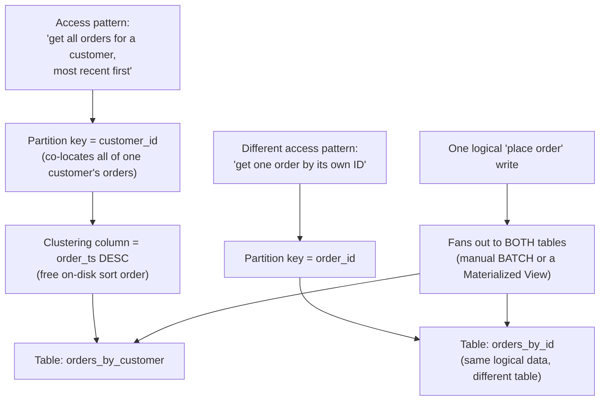

**Decision implications.** Denormalizing for query pattern (not for
storage efficiency, the more common relational-world reason to
denormalize — recapped from [Denormalization](CH02_Denormalization.md))
means write cost and storage cost both go up in direct proportion to how
many differently-shaped tables one logical entity is written into, in
exchange for every read being a fast, predictable, single-partition
lookup with no join cost and no query-planner uncertainty. This is a
deliberate, load-bearing trade: Cassandra's architects accept "harder,
more repetitive writes" so that "every read has flat, predictable
latency regardless of cluster size" — the opposite trade-off emphasis
from a normalized relational schema optimized for write-side integrity
and read-side flexibility.

**Common failure mode.** Modeling Cassandra schemas the way a relational
schema would be modeled — normalized, expecting to join at read time, or
relying on a low-cardinality secondary index (`CREATE INDEX`) as a
substitute for proper partition-key design — either doesn't work at all
(no JOIN exists) or works but silently turns an O(1) single-partition
lookup into an O(N) cluster-wide scatter-gather across every node, because
a non-partition-key secondary index has no way to route the query to a
bounded set of replicas.
[01_schema_and_query_first_modeling.cql](../../code/cql/cassandra-chapter/01_schema_and_query_first_modeling.cql)
walks through exactly this pattern, including the anti-pattern called out
explicitly at the end of the file.

**Scenario.** A support-ticketing platform initially models one
normalized `tickets` table and a separate `ticket_comments` table,
expecting to join them at read time the way a relational schema would —
the join fails outright in CQL. The team re-models around its two actual
access patterns ("all comments for one ticket, chronological" and "a
single comment by its own ID for a deep link") as two purpose-built
tables, each keyed and clustered for its own query, and writes to both at
ticket-comment-creation time.

### 4.7 Lightweight Transactions: Paxos-based compare-and-set

**Definition.** A Lightweight Transaction (LWT) is Cassandra's mechanism
for `INSERT ... IF NOT EXISTS` and `UPDATE ... IF <condition>` —
linearizable, single-partition compare-and-set semantics layered on top of
an otherwise last-write-wins, eventually-consistent engine, implemented
using a variant of the **Paxos** consensus protocol scoped to the
replicas of one partition.

**Mechanism.** Where a normal Cassandra write is a single round trip (the
coordinator fans the mutation out to N replicas and waits for the CL-
required acknowledgment count), an LWT runs a four-phase protocol against
that partition's replicas: **(1) Prepare/Promise** — the coordinator
proposes a ballot (a strictly increasing proposal number) and each replica
promises not to accept any earlier-numbered proposal, rejecting the round
outright if it has already promised a higher ballot to a competing
coordinator; **(2) Read** — the coordinator reads the current value to
evaluate the `IF` condition against genuinely current state, not a
client-cached copy; **(3) Propose/Accept** — if the condition holds, the
coordinator proposes the new value at that same ballot, and each replica
accepts it, again rejecting if a higher ballot has since been promised to
someone else; **(4) Commit** — once a majority of replicas have accepted,
the coordinator commits the value and informs the replicas, at which
point it becomes durably visible to subsequent normal reads. Consistency
levels `SERIAL` (linearizable across the whole cluster) and `LOCAL_SERIAL`
(linearizable within the local datacenter only, analogous to
`LOCAL_QUORUM`'s scoping) govern this protocol's own read/accept quorum
sizing, layered independently on top of whatever CL the surrounding normal
read/write portions of the statement use.

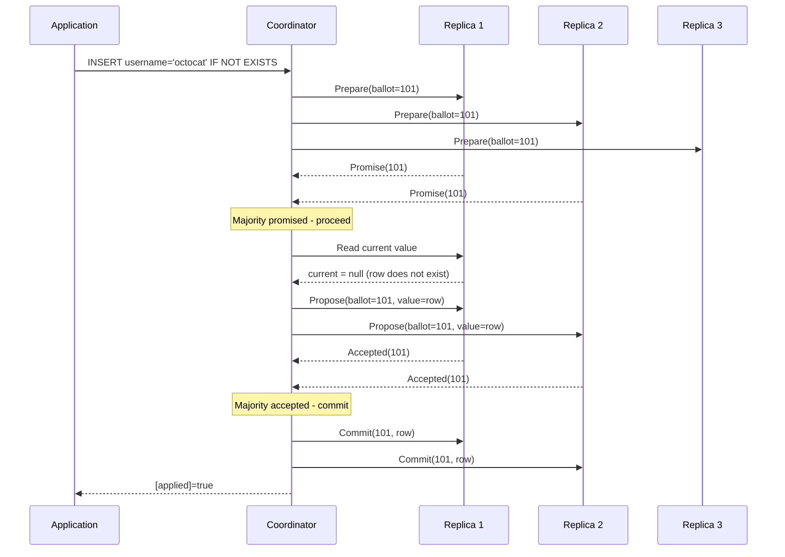

**Decision implications.** An LWT costs roughly four network round trips
to the replica set versus one for a normal write, and that cost is per
*contended partition*, not amortized across the cluster — this is a
narrow tool for genuine uniqueness/compare-and-set needs (claiming a
username, a distributed lock row, a job-queue "claim this task exactly
once" pattern) and explicitly not a general substitute for
[Transactions](CH08_Transactions.md)'s ACID guarantees: an LWT only
guarantees linearizability for a *single partition*, never across multiple
partitions the way a relational multi-row transaction would.

**Common failure mode.** Using LWTs as a routine write path (for example,
every write conditioned on some business-rule check "just to be safe")
imposes the 4x round-trip cost cluster-wide and, under high write
concurrency to the *same* partition, can cause **Paxos contention**:
competing coordinators keep issuing higher ballots to out-race each other,
each round invalidating the previous one's in-flight Prepare/Propose
phase, producing retries and, in pathological cases, an effective
livelock where no single write ever completes the full four phases before
a newer ballot preempts it.
[03_lightweight_transaction_cas_demo.py](../../code/python/cassandra-chapter/03_lightweight_transaction_cas_demo.py)
demonstrates both the intended single-winner outcome and the stale-ballot
rejection that forces a retry.

**Scenario.** A ticket-booking system uses
`UPDATE seats SET status='RESERVED' WHERE seat_id=? IF status='AVAILABLE'`
as the sole mechanism preventing two customers from reserving the same
seat concurrently — exactly the narrow, genuinely-needs-compare-and-set
case LWTs exist for — while every other write in the same application
(seat-map display counters, browsing-history logs) uses ordinary writes at
`LOCAL_QUORUM`, keeping the expensive Paxos path reserved for the one
query pattern that actually requires it.

## 5. Internal Working

Putting Sections 4.1-4.7 together, a single write's full journey through a
3-replica (N=3), `LOCAL_QUORUM`-consistency Cassandra cluster looks like
this:

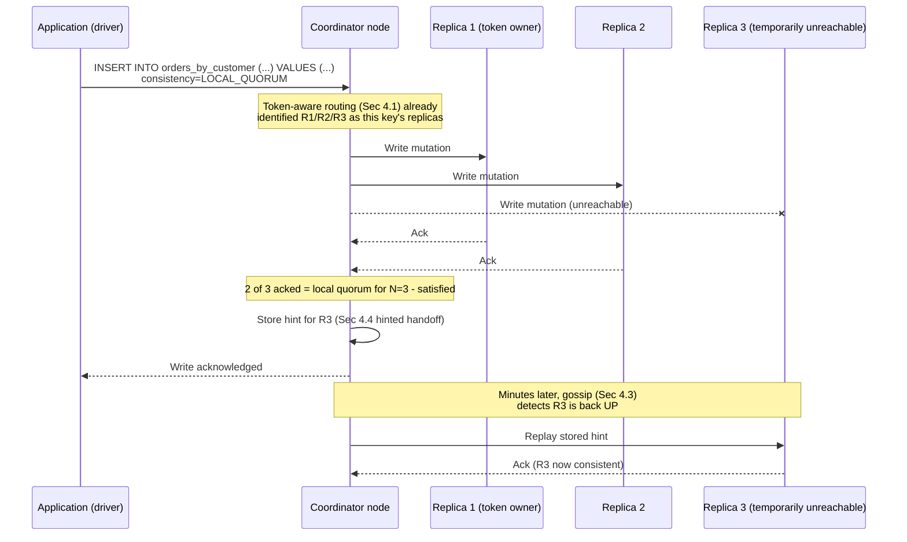

Underneath each replica, the write itself follows the LSM-tree path from
Section 4.5: append to the commit log, apply to the memtable, and
eventually flush to an SSTable once the memtable fills — none of that
storage-engine mechanics is visible to the coordinator-level flow above,
which only cares about acknowledgment counts against the requested
consistency level.

## 6. Design Principles

- **No single point of coordination, anywhere.** Not for data placement
  (Section 4.1's ring), not for membership (Section 4.3's gossip), and not
  for consistency enforcement (Section 4.2's per-query quorum) — every
  mechanism this chapter teaches is deliberately peer-to-peer.
- **Tunability over a single fixed guarantee.** Rather than picking one
  point on the consistency/availability spectrum for the whole engine,
  every read and write independently chooses its own point, letting one
  cluster serve wildly different consistency needs.
- **Writes are cheap; reads pay the complexity.** The LSM-tree design
  (Section 4.5) makes every write a fast sequential append; the
  complexity (Bloom filters, compaction, merging multiple SSTables) is
  concentrated on the read path, which is the correct trade for
  Cassandra's target write-heavy workloads.
- **Model the query, not the entity.** Section 4.6's query-first
  discipline treats each distinct access pattern as its own schema
  artifact, rather than treating "one entity, one table" as a default the
  way relational modeling does.
- **Escape hatches (LWTs) exist but are narrow by design.** Section 4.7
  intentionally costs 4x more than a normal write specifically to keep it
  from becoming the default write path.

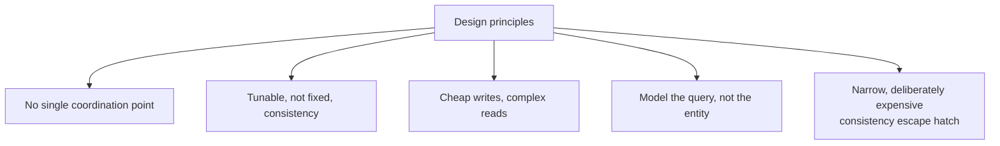

## 7. Architecture Patterns

- **Multi-datacenter active-active with `NetworkTopologyStrategy` and
  `LOCAL_QUORUM`.** The most common production topology: replicas placed
  across two or more datacenters (or cloud regions), every application
  instance reads/writes with `LOCAL_QUORUM` against its own datacenter,
  and cross-datacenter replication happens asynchronously in the
  background — giving each region full read/write availability
  independent of the others' health.
- **Time-series ingestion with TWCS and TTL.** Section 4.5's
  Time-Window Compaction Strategy paired with per-row TTL is the standard
  pattern for metrics, logs, and event-stream data with a fixed retention
  window.
- **Wide-partition event log per entity.** Modeling one partition key per
  logical entity (a user, a device, an order) with a monotonically
  increasing clustering column (a timestamp or a `TIMEUUID`) turns "append
  an event" and "read this entity's recent history" into single-partition
  operations — a pattern that shows up across almost every Cassandra
  schema, including [01_schema_and_query_first_modeling.cql](../../code/cql/cassandra-chapter/01_schema_and_query_first_modeling.cql)'s
  `orders_by_customer` table.
- **CQRS-adjacent denormalization at write time.** Because there is no
  join, "the read model *is* the write model, chosen per query" — closely
  related to, but distinct from, the general CQRS (Command Query
  Responsibility Segregation) read-model-duplication pattern
  ([Denormalization](CH02_Denormalization.md) Section 4.2 owns the general
  concept); Cassandra's version happens synchronously in the same
  application write path (a `BATCH` across tables), not via an
  asynchronous event pipeline the way a CQRS read-model projector
  typically works.

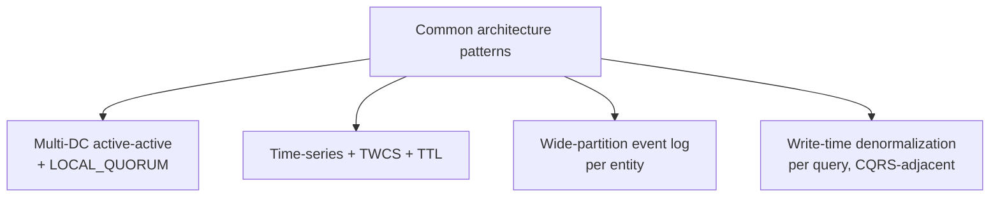

## 8. Production Architecture

A representative production deployment looks like: application services
connecting via a token-aware, retry-policy-configured driver (recapping
[Load Balancer](../05_Networking_and_OS/CH10_Load_Balancer.md)'s general
routing-policy vocabulary — here applied client-side, not through a
network load balancer, since the driver itself routes each query directly
to the owning replicas per Section 4.1) to a ring spanning multiple
availability zones within each of several regions, each region configured
as a Cassandra datacenter under `NetworkTopologyStrategy`. Dedicated
seed nodes (Section 4.3) per datacenter bootstrap gossip for newly joining
nodes; a scheduled repair service runs continuous, incremental
anti-entropy repair (Section 4.4) across the whole ring rather than relying
on ad hoc manual `nodetool repair` invocations; and monitoring tracks
per-node compaction backlog, pending-compaction-task count, and SSTable
count per partition as leading indicators of the read-amplification
failure mode Section 4.5 describes, well before it becomes visible as
elevated read latency.

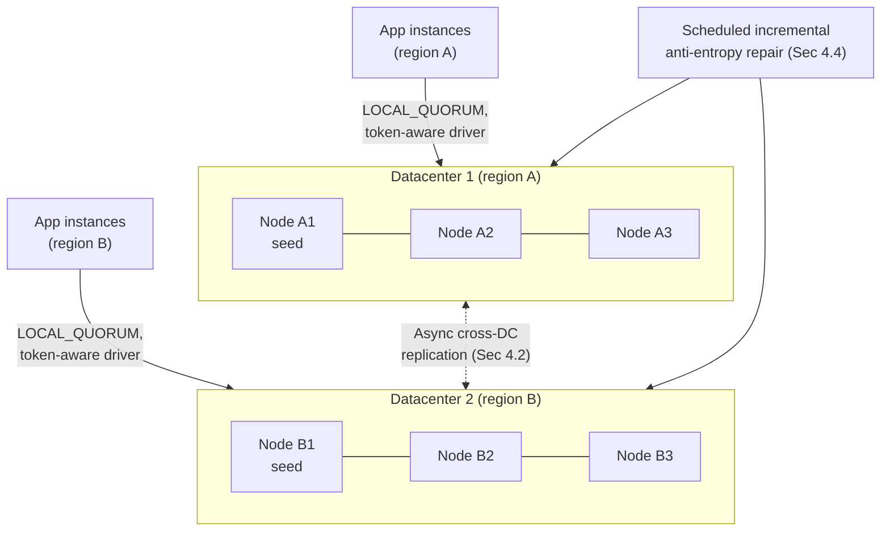

## 9. Implementation

Provisioning a keyspace and its tables follows Section 4.6's query-first
discipline directly: enumerate the application's actual access patterns
first, then design one table per pattern. A typical implementation
checklist:

1. Choose `NetworkTopologyStrategy` with an explicit per-datacenter
   replication factor (commonly RF=3 per datacenter) even for a
   single-datacenter deployment, to avoid a later replication-strategy
   migration.
2. For each access pattern, identify the partition key (what must be
   co-located) and clustering columns (what must be pre-sorted on disk).
3. Choose consistency levels per query, not once globally — typically
   `LOCAL_QUORUM` for both reads and writes as the default, with `ONE`
   reserved for genuinely loss-tolerant paths and `SERIAL`/`LOCAL_SERIAL`
   reserved for the narrow LWT use cases Section 4.7 describes.
4. Choose a compaction strategy per table based on its write/read/TTL
   shape (Section 4.5) — STCS as a default, LCS for read-latency-sensitive
   tables, TWCS for time-series/TTL-expiring tables.
5. Configure and schedule anti-entropy repair (Section 4.4) as
   non-optional recurring maintenance from day one, not as an
   incident-response afterthought.

## 10. Complete Code Examples

Four runnable examples accompany this chapter, each verified to execute
successfully:

- [01_schema_and_query_first_modeling.cql](../../code/cql/cassandra-chapter/01_schema_and_query_first_modeling.cql)
  — a full keyspace/table set demonstrating query-first modeling (Section
  4.6): three denormalized tables for three different access patterns over
  the same logical order data, a `BATCH`-based manual fan-out write, a
  Materialized View, TTL-based expiry, and an explicitly flagged secondary-
  index anti-pattern.
- [02_consistency_level_quorum_demo.py](../../code/python/cassandra-chapter/02_consistency_level_quorum_demo.py)
  — a self-contained in-memory simulation of the N/R/W quorum formula
  (Section 4.2), contrasting a safe `QUORUM`/`QUORUM` pairing (guaranteed
  overlap) against an unsafe `ONE`/`ONE` pairing (possible stale read), plus
  a `LOCAL_QUORUM` multi-datacenter example tolerating a full remote-
  datacenter outage.
- [03_lightweight_transaction_cas_demo.py](../../code/python/cassandra-chapter/03_lightweight_transaction_cas_demo.py)
  — a self-contained simulation of Section 4.7's Paxos-based compare-and-
  set, running two concurrent threads racing to claim the same row and
  demonstrating both the single-winner outcome and a stale-ballot rejection
  forcing a retry.
- [04_TokenRingRoutingSimulation.java](../../code/java/cassandra-chapter/04_TokenRingRoutingSimulation.java)
  — a self-contained simulation of Section 4.1's consistent-hashing token
  ring with virtual nodes (token-aware routing for a given replication
  factor) and Section 4.3's Phi Accrual failure-detector suspicion scoring.

All four were executed during authoring: both Python scripts ran to
completion via a plain interpreter, and the Java example compiled with
`javac` and ran with `java` producing the expected token-routing and
phi-suspicion output, with no external driver dependency required for any
of the four.

## 11. Performance

Write throughput is dominated by the LSM-tree's sequential-append design
(Section 4.5) — commit-log and memtable writes are both O(1) amortized
regardless of total data volume, which is why Cassandra's write latency
stays flat as a table grows to billions of rows, unlike a B-tree-based
engine whose in-place page updates ([Indexes](CH03_Indexes.md)) can
degrade as working-set size exceeds available buffer-cache memory. Read
latency is dominated by how many SSTables a query must consult: Bloom
filters (Section 4.5) cheaply rule out SSTables that provably don't
contain the key, but a poorly chosen compaction strategy, heavy
tombstone accumulation, or an unusually wide (many-clustering-row)
partition can all still force a read to merge data from many SSTables,
directly increasing tail latency. Coordinator-side network fan-out cost
(one round trip to each of N replicas, waiting only for the CL-required
subset) means `ALL`-consistency reads/writes have materially higher and
less predictable tail latency than `QUORUM`/`LOCAL_QUORUM`, since they
wait on the single slowest replica out of every one, not merely a
majority.

## 12. Scalability

Cassandra's headline scalability property is **near-linear write
throughput scaling by adding nodes**: because vnodes (Section 4.1) already
bound each new node's rebalancing cost to roughly its fair share of
existing load, and because writes require no cross-partition coordination
whatsoever, doubling the node count for a workload with an evenly
distributed partition key roughly doubles sustainable write throughput.
This scaling story breaks down under partition-key skew (recapping
[Partitioning](CH05_Partitioning.md) and [Sharding](CH06_Sharding.md)'s
hot-partition failure mode): a poorly chosen partition key that
concentrates disproportionate traffic on one logical partition cannot be
helped by adding more nodes, because that partition's data — and the
requests targeting it — still land on the same fixed set of N replicas
regardless of total cluster size.

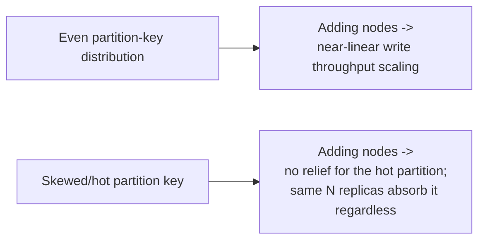

## 13. Security

Cassandra's security surface layers standard mechanisms this book already
owns in depth onto the cluster: Transport Layer Security (TLS) for both
client-to-node and node-to-node traffic (recapping the full TLS handshake
mechanics owned by [TLS](../05_Networking_and_OS/CH06_TLS.md)), role-based
authentication and authorization (`CREATE ROLE`, `GRANT`/`REVOKE` on
keyspaces and tables), and encryption at rest for SSTable files. A
Cassandra-specific consideration: because gossip (Section 4.3) and inter-
node streaming traffic both flow over the cluster's internal network,
node-to-node TLS (distinct from and in addition to client-to-node TLS) is
required to protect that traffic in any deployment spanning
untrusted network segments, such as cross-region replication over the
public internet.

## 14. Observability

Key operational signals specific to the mechanisms this chapter teaches:
pending-compaction-task count and SSTable-count-per-partition (leading
indicators of Section 4.5's read-amplification failure mode), hint count
and hint-replay backlog (Section 4.4 — a persistently growing hint backlog
signals a replica that isn't recovering, not merely a transient blip),
gossip-reported node status flapping (Section 4.3 — repeated UP/DOWN
transitions for the same node often indicate a Phi Accrual threshold
tuned too aggressively for that link's actual latency variance, not a
genuinely unreliable node), and repair completion/age per keyspace
(Section 4.4 — the single most important leading indicator against
tombstone-resurrection risk, since a "healthy-looking" cluster can still
be silently accumulating unrepaired divergence).

## 15. Failure Scenarios

- **Single replica down within `max_hint_window`.** Hinted handoff (Section
  4.4) recovers it transparently once it rejoins; no manual intervention
  needed if the outage is shorter than the window.
- **Replica down longer than `max_hint_window`, or hints themselves lost.**
  Requires a full anti-entropy repair (Section 4.4) before that replica can
  be trusted for reads at any consistency level that might select it.
- **Network partition splitting the cluster.** Each side continues
  accepting reads/writes for partitions it believes it owns (Section
  4.3's gossip-membership-divergence scenario); the consistency level in
  use (Section 4.2) determines whether a given request can even be
  satisfied (e.g. `QUORUM` may become unreachable if the majority side's
  replica count for a given partition happens to fall in the minority
  partition) or silently proceeds on stale/divergent data.
- **Skipped or failed scheduled repair.** The tombstone-resurrection
  scenario from Section 4.4's failure-mode discussion — a slow-onset,
  hard-to-diagnose correctness bug rather than an availability incident.
- **Compaction falling behind write rate.** SSTable count per partition
  grows unbounded, and read latency degrades progressively (Section 4.5,
  Section 11) rather than failing outright — an availability-adjacent
  failure mode that manifests as a slow-burning performance regression.

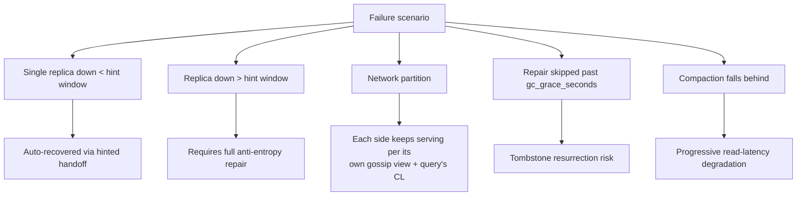

## 16. Testing

Testing a Cassandra-backed application should specifically exercise: (1)
consistency-level behavior under simulated replica unavailability — does
the application degrade gracefully at `QUORUM` when only 2 of 3 replicas
are reachable, and does it correctly surface an error rather than hang
when even `QUORUM` becomes unsatisfiable; (2) query-first schema
correctness — every access pattern the application relies on should have
an integration test issuing that exact query shape, since a schema
mistake here isn't caught by a query planner the way a missing relational
index might be, it simply fails at query time or, worse, silently forces
`ALLOW FILTERING`; (3) idempotency of write-fan-out logic across
denormalized tables (Section 4.6) — a partial failure writing to only
some of several denormalized tables for one logical entity is a real,
testable failure mode unique to this manual-denormalization pattern; and
(4) Lightweight Transaction contention behavior (Section 4.7) under
concurrent competing writers, using a test analogous to
[03_lightweight_transaction_cas_demo.py](../../code/python/cassandra-chapter/03_lightweight_transaction_cas_demo.py)'s
race-condition demonstration.

## 17. Common Mistakes

- Modeling schemas relationally first and attempting to bolt CQL onto
  that shape afterward, rather than starting from access patterns
  (Section 4.6).
- Using a low-cardinality secondary index as a substitute for proper
  partition-key design, triggering cluster-wide scatter-gather reads.
- Using Cassandra as a queue (write-then-immediately-delete), producing
  severe tombstone accumulation (Section 4.5, Section 19).
- Choosing consistency levels inconsistently across an application's
  different code paths for the same logical data, producing confusing,
  intermittent "my own write isn't visible yet" bugs (Section 4.2).
- Treating Lightweight Transactions as a general-purpose write path
  instead of reserving them for genuine compare-and-set needs (Section
  4.7), incurring unnecessary 4x round-trip cost and Paxos contention risk.
- Skipping scheduled anti-entropy repair because the cluster "seems fine"
  without it (Section 4.4) — the tombstone-resurrection failure mode is
  slow-onset and easy to miss until it surfaces in production data.
- Setting `num_tokens` far higher than needed "for better distribution"
  without accounting for the streaming/repair fan-out cost that comes with
  it (Section 4.1).

## 18. Best Practices

- Default to `NetworkTopologyStrategy` and `LOCAL_QUORUM` for both reads
  and writes, reserving weaker/stronger consistency levels for
  specifically justified cases (Section 4.2).
- Design tables from access patterns outward, one table per genuinely
  distinct query shape (Section 4.6), accepting the write-side
  duplication cost deliberately.
- Choose a compaction strategy (Section 4.5) matching the table's actual
  write/read/expiry shape rather than leaving every table on the default.
- Schedule and monitor anti-entropy repair as continuous, non-optional
  operational infrastructure (Section 4.4), not a manual, ad hoc tool.
- Reserve Lightweight Transactions (Section 4.7) for genuine uniqueness/
  compare-and-set requirements only.
- Size vnode count (Section 4.1) to the cluster's actual scale — a modest
  count (the modern default, around 16) for most production clusters
  rather than the historical 256 default.

## 19. Anti-Patterns

- **Cassandra-as-a-queue.** Writing and then quickly deleting rows to
  simulate a queue produces a tombstone-heavy access pattern this engine's
  LSM-tree design (Section 4.5) handles poorly; use a purpose-built queue
  or streaming system instead.
- **Unbounded partition growth.** A partition key that never rotates
  (e.g. bucketing by a global constant rather than by time or another
  naturally bounding dimension) grows one logical partition without limit,
  eventually producing an oversized "wide partition" that is slow to read,
  slow to compact, and slow to repair — recapping
  [Partitioning](CH05_Partitioning.md)'s rolling-window pattern as the fix.
- **`ALLOW FILTERING` on a hot path.** Turns a bounded, predictable
  single-partition read into an unbounded, cluster-wide scan; acceptable
  only for small, rarely-run ad hoc/reference-data queries.
- **Secondary indexes as a primary access path.** As described in Section
  4.6 — a real query mechanism, but not a substitute for partition-key
  design on any hot path.
- **Treating Materialized Views as a universally safe denormalization
  shortcut.** Given the project's own deprecation guidance (Section 2),
  new schemas should generally prefer manual, application-controlled
  fan-out writes over relying on Materialized Views' best-effort,
  asynchronous consistency contract.

## 20. Trade-off Analysis

| Dimension | Cassandra's choice | What it costs |
|---|---|---|
| Coordination | Masterless (ring + gossip) | No single-leader failover pause, but eventual (not instant) membership convergence |
| Consistency | Tunable per query (Section 4.2) | Requires the application to reason explicitly about consistency per query, rather than one engine-wide guarantee |
| Writes vs. reads | Optimized for cheap, fast writes (LSM-tree) | Read complexity (Bloom filters, multi-SSTable merge, compaction) absorbs the cost instead |
| Schema flexibility | Query-first, denormalized (Section 4.6) | Write-side duplication; schema changes to add a new query often mean adding a whole new table |
| Strong consistency escape hatch | Lightweight Transactions (Section 4.7) | 4x round-trip cost, narrow applicability, Paxos contention risk under hot-partition concurrency |

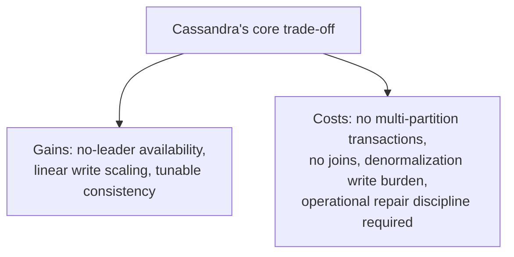

## 21. Comparison Table

| Property | Cassandra | PostgreSQL ([CH11](CH11_PostgreSQL.md)) | MySQL/InnoDB ([CH12](CH12_MySQL.md)) |
|---|---|---|---|
| Coordination model | Masterless, peer-to-peer (Sections 4.1, 4.3) | Single-writer primary + replicas | Single-writer primary + replicas |
| Storage engine | LSM-tree (memtable/SSTable/compaction, Section 4.5) | Heap-tuple MVCC (copy-on-write rows) | Clustered-index (B+tree, primary-key-as-data) |
| Query language | CQL, no joins, query-first modeling (Section 4.6) | Full SQL with joins | Full SQL with joins |
| Consistency | Tunable per query (Section 4.2) | Configurable isolation levels, single-writer strong consistency | Configurable isolation levels, single-writer strong consistency |
| Multi-row transactions | Not supported (single-partition LWTs only, Section 4.7) | Full ACID multi-row/multi-table | Full ACID multi-row/multi-table |
| Best-fit workload | High-write-volume, denormalized, availability-critical | General-purpose OLTP + light analytics, rich indexing needs | General-purpose OLTP, web-application default |

## 22. Real-World Case Study

**Discord's messages table: Cassandra at hundreds of billions of rows, and
the migration it eventually forced.** Discord adopted Cassandra in 2017
specifically for its `messages` table, replacing an earlier MongoDB-based
design that could not sustain the write volume of an ever-growing chat
history at acceptable latency — a textbook fit for Section 4.5's
LSM-tree write-throughput story and Section 4.6's wide-partition-per-
channel modeling pattern (one partition per channel, clustering by message
timestamp). Over the following years, as the `messages` table grew into
the hundreds of billions of rows, Discord's engineering team publicly
documented two distinct classes of pain that trace directly back to
mechanisms this chapter teaches: **compaction falling behind** on their
most active, oldest partitions once total data volume and per-partition
row counts grew large enough that background compaction (Section 4.5)
could no longer keep pace with write and delete (message-edit/-deletion)
traffic, producing the read-amplification and tail-latency degradation
Section 11 and Section 15 describe; and **tombstone accumulation from
message deletions**, which is precisely Section 19's Cassandra-as-a-queue-
adjacent anti-pattern manifesting organically from a legitimate product
feature (users deleting their own messages), not from a modeling mistake.
Discord's team ultimately re-platformed the `messages` table onto
ScyllaDB, a Cassandra-wire-protocol-compatible, C++-rewritten engine, citing
exactly these compaction-and-tombstone pressure points at their specific
scale as the deciding factor — a case study that illustrates both why
Cassandra's core design (Sections 4.1-4.7) was the right initial choice for
their write volume, and why every mechanism this chapter frames as a
"failure mode" (compaction backlog, tombstone accumulation) is a genuine,
scale-dependent operational limit an architect must plan monitoring and
mitigation for from day one, not a hypothetical edge case.

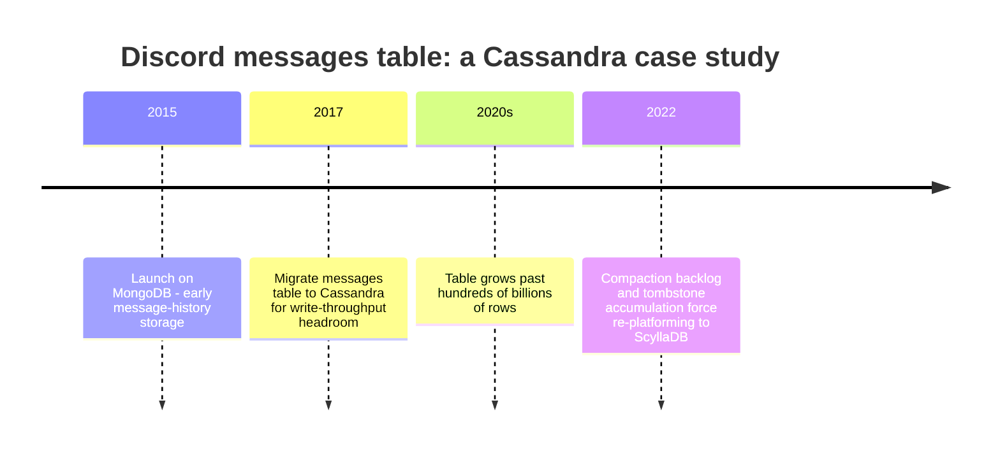

## 23. Interview Questions

1. Explain why Cassandra has no single leader, and what specific
   availability problem that solves versus a leader-based replication
   scheme.
2. What is a virtual node (vnode), and why did the ecosystem's practical
   default vnode count move down from 256 toward 16?
3. Walk through the N/R/W quorum formula and explain why `LOCAL_QUORUM`
   is the typical production default over global `QUORUM` in a multi-
   datacenter deployment.
4. What problem does the gossip protocol solve, and why does Cassandra use
   a Phi Accrual failure detector instead of a fixed heartbeat timeout?
5. Explain the difference between hinted handoff, read repair, and
   anti-entropy repair — what does each one fix, and what does it *not*
   fix?
6. Why must anti-entropy repair run within `gc_grace_seconds`, and what
   specifically goes wrong if it doesn't?
7. Describe Cassandra's LSM-tree write path from a client's INSERT through
   the commit log, memtable, and eventual SSTable flush.
8. Compare Size-Tiered, Leveled, and Time-Window compaction strategies —
   which workload shape fits each one, and why?
9. Why does CQL have no JOIN operator, and how does that constraint drive
   Cassandra's query-first data-modeling discipline?
10. Explain how a Lightweight Transaction's four-phase Paxos protocol
    differs from a normal Cassandra write, and why LWTs should be reserved
    for narrow use cases rather than used as the default write path.

## 24. Hands-on Exercises

1. Using [01_schema_and_query_first_modeling.cql](../../code/cql/cassandra-chapter/01_schema_and_query_first_modeling.cql)
   as a starting point, add a fourth table supporting a new access pattern
   ("get all orders above a given total amount, per day") and write the
   corresponding fan-out `BATCH` insert.
2. Run [02_consistency_level_quorum_demo.py](../../code/python/cassandra-chapter/02_consistency_level_quorum_demo.py),
   then modify it to simulate `N=5` with `W=THREE`/`R=THREE` and confirm
   the overlap guarantee still holds algebraically (W+R > N).
3. Run [04_TokenRingRoutingSimulation.java](../../code/java/cassandra-chapter/04_TokenRingRoutingSimulation.java),
   then add a fourth physical node to the ring and observe how the
   replica assignment for the existing three sample keys changes.
4. Modify [03_lightweight_transaction_cas_demo.py](../../code/python/cassandra-chapter/03_lightweight_transaction_cas_demo.py)
   to run five concurrent coordinators instead of two, and confirm exactly
   one still wins regardless of contention level.
5. Design (on paper) the table set for a "direct messages" feature
   supporting both "get a conversation's messages, most recent first" and
   "get a user's list of conversations, most recently active first,"
   explicitly identifying each table's partition key and clustering
   columns.

## 25. Design Exercises

1. Design a multi-datacenter Cassandra deployment for a global e-commerce
   platform with three regions, specifying replication factor per
   datacenter, default consistency levels per operation type (browsing
   events, cart updates, order placement, payment confirmation), and which
   operations (if any) warrant Lightweight Transactions.
2. Given a time-series IoT (Internet of Things) telemetry workload
   ingesting 500,000 writes/second with a 30-day retention requirement,
   design the partition key, clustering columns, TTL configuration, and
   compaction strategy, and justify each choice against Sections 4.1,
   4.5, and 4.6.
3. Propose a repair-scheduling and monitoring strategy (Section 4.4, 14)
   for a 50-node cluster, including how you would detect a silently
   broken repair schedule before it causes a tombstone-resurrection
   incident.

## 26. Architecture Review Questions

1. Does every table in this design have a partition key that spreads load
   evenly across the cluster, with no single partition absorbing a
   disproportionate share of traffic (Sections 4.1, 4.6, 12)?
2. Is the consistency level for each distinct operation type explicitly
   chosen and justified, rather than left at a copy-pasted default
   (Section 4.2)?
3. Is scheduled anti-entropy repair configured, monitored, and alerting on
   staleness (Section 4.4, 14) — not merely present in documentation?
4. Are Lightweight Transactions used only where genuine compare-and-set
   semantics are required, with their 4x round-trip cost explicitly
   justified (Section 4.7)?
5. Does any table exhibit delete-heavy or queue-like write patterns that
   should be re-modeled to avoid tombstone accumulation (Sections 4.5,
   19)?
6. Is the compaction strategy per table matched to its actual workload
   shape, rather than left on the engine default everywhere (Section 4.5)?

## 27. Summary

Cassandra takes the two foundational distributed-systems ideas this book
already teaches in generic depth — consistent hashing with virtual nodes
([Sharding](CH06_Sharding.md)) and leaderless, quorum-tunable replication
([Replication](CH07_Replication.md)) — and builds a complete, masterless,
horizontally-scalable database around them, adding a gossip protocol for
membership, an LSM-tree storage engine for cheap sequential writes, a
query-first data-modeling discipline enforced by CQL's lack of joins, and
a narrow Paxos-based compare-and-set escape hatch for the rare cases that
need it. Its defining trade-off is tunability: the same cluster can serve
maximally available, eventually-consistent workloads and strongly
consistent ones side by side, at the cost of pushing the responsibility
for choosing correctly, per query, onto the application architect — and of
requiring genuine, continuous operational discipline (scheduled repair,
compaction-strategy selection, partition-key hygiene) to keep that
tunability's failure modes from becoming production incidents.

---

**Further reading**: [Sharding](CH06_Sharding.md) (consistent hashing,
vnodes, shard-key selection), [Replication](CH07_Replication.md)
(leaderless/quorum replication, CAP/PACELC), [Partitioning](CH05_Partitioning.md)
(partition-key selection framework), [Transactions](CH08_Transactions.md)
(ACID, MVCC, Two-Phase Commit, Saga), [Indexes](CH03_Indexes.md) (B-tree
structures contrasted against this chapter's LSM-tree),
[Denormalization](CH02_Denormalization.md) (Materialized Views, write-
amplification/staleness trade-off), [PostgreSQL](CH11_PostgreSQL.md) and
[MySQL](CH12_MySQL.md) (contrasting single-writer relational engines).
