# Chapter: Neo4j

Part: [06 — Databases and Storage](PART_OVERVIEW.md) · Status: Drafted

## 1. Introduction

Neo4j is a native graph database: a database whose storage engine, query
language, and query planner all treat a **property graph** — nodes and the
relationships between them, each optionally carrying properties — as the
fundamental unit of data, rather than treating connectedness as an
after-the-fact join computed at query time. Every chapter before this one
in Part 06's NoSQL subsection — [MongoDB](CH15_MongoDB.md),
[Redis](CH16_Redis.md), [DynamoDB](CH17_DynamoDB.md), and
[Cassandra](CH18_Cassandra.md) — taught an engine that optimizes for a
different access shape: documents read and written as a unit, in-memory
key/value structures, single-item lookups by partition key at massive
scale, and denormalized, query-first wide-row modeling. This chapter's
subject optimizes for a shape none of those four handle well: data whose
*value is disproportionately in the connections between records*, not just
the records themselves — a social graph, a fraud ring, a recommendation
engine's "customers who bought X also bought Y" edge set, an
identity-and-access-management permission graph, or a supply chain's
multi-tier dependency network. In every one of those domains, the
question an application actually asks is rarely "give me this record" —
it is "give me everything reachable from this record within N hops,
following relationships of a particular shape," and answering that
question efficiently is precisely what a native graph engine is built to
do and what a relational engine, however well-indexed, is structurally
disadvantaged at doing once the traversal depth is not known in advance.

This chapter is the *owning* chapter for the property graph data model
(nodes, relationships, properties, and labels as first-class citizens),
**index-free adjacency** as a storage-engine design (why a graph-native
traversal is a constant-time pointer hop rather than an index lookup plus a
join), the **Cypher** query language and its declarative pattern-matching
syntax, Neo4j's native storage engine built from fixed-size records that
make direct pointer-chasing possible, the Graph Data Science (GDS) library's
algorithm catalog (pathfinding, centrality, and community detection), and
**Causal Clustering** — Neo4j's replication and consensus architecture,
built on the Raft protocol. It recaps, rather than re-teaches, the generic
theory already owned elsewhere per the Concept Ownership Rule in
[STYLE_GUIDE.md](../STYLE_GUIDE.md): B-tree indexing
([recapped from Indexes](CH03_Indexes.md#b-tree--btree-index-structure-fanout-leaf-linking-node-splitmerge)),
join algorithms and cost-based query planning
([recapped from Query Optimizers](CH04_Query_Optimizers.md#cost-based-query-optimization-vs-rule-based-query-processing-pipeline-parsebindrewriteoptimizeexecute)),
leader/follower replication and quorum arithmetic
([recapped from Replication](CH07_Replication.md#leaderfollower-replication-mechanics-wal-shippingstreaming-syncasyncsemi-sync-trade-off)),
ACID transaction guarantees and MVCC
([recapped from Transactions](CH08_Transactions.md#acid-properties-atomicity-consistency-isolation-durability-and-their-mechanisms)),
and normalization's join-table pattern for many-to-many relationships
([recapped from Normalization](CH01_Normalization.md#third-normal-form-3nf)).
What this chapter teaches that no prior chapter owns: index-free adjacency
as a distinct storage mechanism from B-tree indexing, Cypher's ASCII-art
pattern-matching syntax, graph-specific algorithms (shortest path,
PageRank, community detection), Raft-based consensus as Neo4j concretely
implements it for Causal Clustering, and — the chapter's central
architectural payoff — a rigorous decision framework for when connected-data
problems are better served by a graph engine than by a relational engine
using recursive Common Table Expressions (CTEs) or many-to-many join
tables.

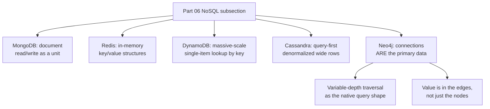

## 2. Historical Evolution

- **Origins at Neo Technology (2000-2007)** — Neo4j began as an internal
  data layer inside a Swedish content-management company that found its
  relational schema for managing hierarchical, richly interlinked media
  assets required an unmanageable number of self-joins; the founding team
  (Emil Eifrem, Johan Svensson, Peter Neubauer) built a purpose-specific
  graph storage engine instead, and Neo Technology was formed in 2007 to
  commercialize it.
- **First public releases and the "native graph" positioning (2007-2010)**
  — early 1.x releases established the storage-engine design this chapter
  teaches in Section 4.4 (fixed-size records, direct pointer offsets)
  as the technical basis for Neo4j's marketing claim of being a "native"
  graph database, distinguishing it from graph layers built on top of a
  relational or key-value store, which must simulate adjacency through
  secondary indexes rather than storing it directly.
- **Cypher introduced (2011, Neo4j 2.0 in 2014 stabilizes the label
  system)** — Cypher (Section 4.3) gave Neo4j a declarative,
  pattern-matching query language distinct from the imperative
  traversal-API style (`TraversalDescription`) that earlier versions
  required; Neo4j 2.0 added node **labels** as a first-class concept,
  letting a single graph hold multiple node "types" without a
  relational-style fixed schema per table.
- **openCypher and cross-vendor standardization efforts (2015-2019)** —
  Neo4j open-sourced the Cypher grammar as openCypher so other engines
  (SAP HANA Graph, Redis's RedisGraph, Amazon Neptune's openCypher support)
  could implement compatible query syntax, and later contributed core
  ideas to the ISO/IEC **GQL** (Graph Query Language) standard, ratified in
  2024 — the first new ISO database query language standard since SQL
  itself, a signal of how much industry graph-query demand had grown.
  Neo4j's own Cypher continues to extend beyond the GQL core standard.
- **Causal Clustering replaces the original HA cluster (Neo4j 3.1, 2017)**
  — earlier Neo4j versions used a Paxos-derived clustering protocol with
  a "master" and "slaves"; Causal Clustering (Section 4.6) replaced this
  with a Raft-based consensus protocol for a stronger, more explicit
  consistency model (causal consistency across the cluster via
  *bookmarks*) and a clean separation between Core servers (which
  participate in Raft consensus and can become the writer) and Read
  Replicas (which replicate asynchronously and can never become writers).
- **The Graph Data Science library formalizes graph algorithms as a
  product (Neo4j 4.x-onward, 2020-present)** — algorithms that previously
  lived in a community-maintained "graph algorithms" library (APOC-adjacent
  or bundled) were re-architected into GDS: an in-memory projected-graph
  execution model (Section 4.5) with a much larger, more actively
  optimized algorithm catalog (PageRank, Louvain community detection,
  node2vec embeddings, and dozens more), sold and licensed as a distinct
  product tier from the core transactional database.
- **Fabric and composite databases for horizontal scale (Neo4j 4.x-5.x,
  2020-present)** — because a single Neo4j database instance (even in a
  Causal Cluster) is still a single logical graph replicated across Core
  servers rather than sharded, Neo4j added Fabric (and later composite
  database queries in Neo4j 5) to let a query span multiple independent
  graph databases as if they were one, addressing the "how do you scale
  writes beyond one graph" question this chapter's Section 4.6 and Section
  12 return to explicitly.
- **Neo4j 5 and Aura managed-service era (2023-present)** — Neo4j 5
  consolidated the clustering model (every deployment, including a
  single-instance one, is now internally a one-member cluster, simplifying
  the topology this chapter's diagrams describe), and Neo4j Aura (a fully
  managed, multi-cloud database-as-a-service) shifted most new production
  deployments away from self-managed Causal Clusters, echoing the same
  managed-service shift already described for
  [MongoDB Atlas](CH15_MongoDB.md#2-historical-evolution).

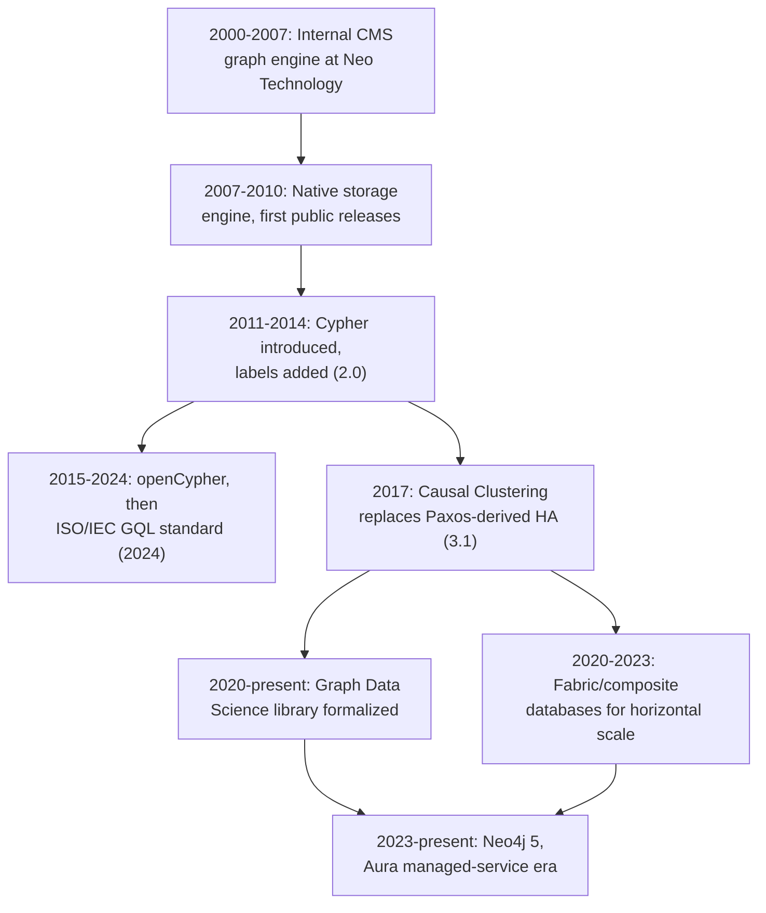

## 3. Why It Exists

Neo4j exists to answer a mismatch that the relational model handles
correctly but inefficiently as connection depth grows: relational
databases represent a relationship as a **foreign key** and answer
"who is connected to whom" by executing a **join** — matching rows across
tables using an index lookup per hop. A single join (find a customer's
orders) is cheap. Two or three joins (find a customer's orders' line
items' products) are still tractable, if verbose. But the moment a query's
required depth is *not known in advance* — "find all products co-purchased
by anyone within three degrees of this customer's social connections," or
"find the shortest approval chain between these two employees regardless
of how many management layers separate them" — the relational answer is
either a fixed, hard-coded number of self-joins (wrong if the real depth
varies) or a **recursive CTE** that re-executes an index lookup at every
single level of recursion. Each of those per-level lookups still costs
$O(\log n)$ against a B-tree index
([recapped from Indexes](CH03_Indexes.md#b-tree--btree-index-structure-fanout-leaf-linking-node-splitmerge)),
and the total cost of a recursive traversal to depth $d$ across a
fan-out of $f$ relationships per node grows as roughly $O(f^d \log n)$ —
exponential in depth, logarithmic-per-hop in graph size. Neo4j's central
bet, detailed in Section 4.2, is that if the storage engine keeps a
direct pointer from every node to its actual relationships instead of an
index that must be searched, each hop becomes $O(1)$ regardless of how
large $n$ (the total node count) is, collapsing that same traversal's cost
to $O(f^d)$ — no logarithmic index-search term at all, at any depth.

A second reason Neo4j exists is that many real-world data problems are
*naturally* graph-shaped in the modeling sense, independent of query
performance: an organizational chart, a road network, a bill-of-materials
tree, a fraud ring of shared phone numbers/addresses/payment
instruments, and a knowledge graph of typed facts ("Person WORKS_AT
Company", "Company SUPPLIES Company") are all more directly expressed as
nodes and typed, directional relationships than as a set of normalized
tables joined by surrogate foreign keys. Cypher's declarative pattern
syntax (Section 4.3) lets a developer write a query that visually
resembles the graph shape being searched for, which is a genuine
cognitive-load reduction for graph-shaped domains, distinct from and
additional to the traversal-performance argument above.

A third reason is that graph algorithms — PageRank, community detection,
centrality measures, shortest-path variants — are a mature, decades-old
body of computer science that is directly applicable to a wide range of
architecture problems (fraud detection, recommendation, network
resilience analysis, org-influence mapping) but is awkward to express as
SQL aggregate queries and expensive to compute by round-tripping a graph
out of a relational store into an external analytics library on every run;
the Graph Data Science library (Section 4.5) makes those algorithms a
first-class, in-database capability directly against the same property
graph the transactional workload already writes to.

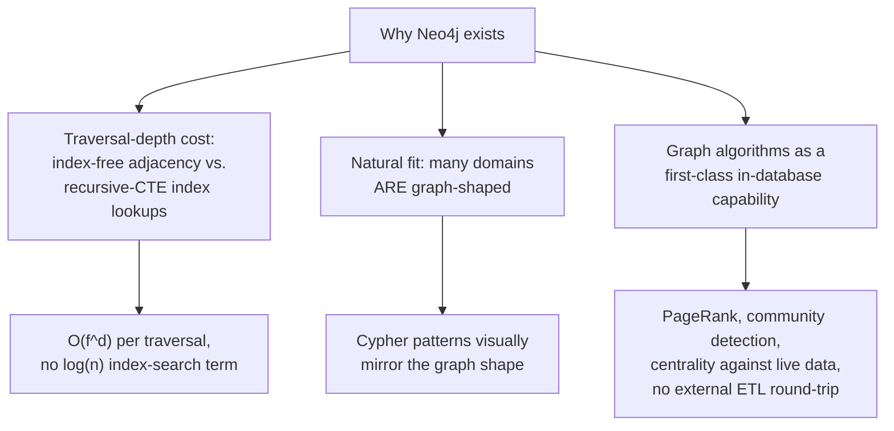

## 4. Core Concepts

This section teaches, from first principles, the seven ideas that make
Neo4j structurally different from every relational and NoSQL engine
covered earlier in this part: the property graph data model itself, the
index-free-adjacency storage design that makes traversal fast, Cypher's
declarative pattern-matching query language, the fixed-size-record storage
engine that implements index-free adjacency concretely, the Graph Data
Science algorithm catalog, Causal Clustering's Raft-based consensus and
replication architecture, and — synthesizing everything before it — a
decision framework for choosing a graph engine over a relational engine
for connected-data problems.

### 4.1 The Property Graph Model

**Definition.** A **property graph** consists of **nodes** (also called
vertices — entities such as a `Person`, a `Product`, or an `Account`),
**relationships** (also called edges — a typed, *directed* connection
between exactly two nodes, such as `FOLLOWS`, `PURCHASED`, or
`REPORTS_TO`), and **properties** — key/value pairs attached to *either* a
node or a relationship. Nodes carry zero or more **labels** (a
lightweight, non-exclusive type tag — a single node can carry both
`Person` and `Employee` labels simultaneously), and every relationship
carries exactly one **relationship type** (unlike node labels,
relationship type is singular and mandatory — a relationship cannot be
untyped or multi-typed). This is the "LPG" — Labeled Property Graph —
model that Neo4j, and most other property-graph engines, implement; it is
distinct from the older **RDF** (Resource Description Framework) triple
model used by some graph databases (a subject-predicate-object triple
store), which has no native concept of a property attached directly to an
edge — an RDF edge property must itself be reified as an extra node, an
awkwardness the property graph model avoids by letting relationships carry
properties natively.

**Mechanism.** Concretely, a property graph is a set of nodes
$N = \{n_1, n_2, \ldots\}$, a set of relationships
$R \subseteq N \times N \times \text{Type}$ (each relationship is an
ordered pair of nodes plus a type, i.e. relationships are always
directional even though a query can traverse either direction or treat
direction as irrelevant), and two property-assignment functions mapping
nodes and relationships respectively to sets of key/value pairs. Because
labels and relationship types are just string tags rather than a
CREATE TABLE-style schema declaration, a Neo4j database is, by default,
**schema-optional**: two `Person` nodes can carry different property sets
without any migration, similar in spirit to MongoDB's
[schema-on-read model](CH15_MongoDB.md#42-dynamic-schema-schema-on-read-vs-schema-on-write),
though Neo4j additionally supports optional schema constraints (uniqueness,
existence, node-key) layered on top for the properties an application
wants to enforce.

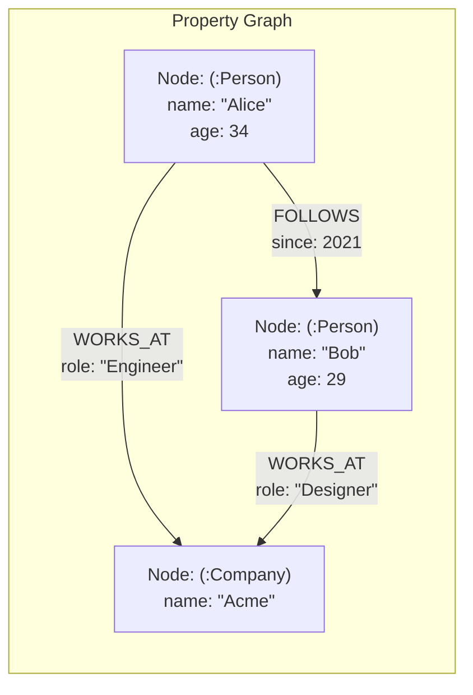

**Decision implications.** A property graph's directness pays off exactly
when the *relationships themselves* carry meaningful, queryable data (a
`FOLLOWS` relationship's `since` date, a `PURCHASED` relationship's
`quantity` and `price_at_purchase`) — the relational equivalent of this is
an associative/join table
([recapped from Normalization](CH01_Normalization.md#third-normal-form-3nf)),
which works but forces every relationship-attribute query through an
extra join to reach the join table's own columns; a property graph reads
those relationship properties in the same traversal step that follows the
relationship, with no additional join. The trade-off in the other
direction: a property graph has no native concept of a fixed row shape
or column set to validate against, so an application that genuinely wants
every node of a given label to have an identical, enforced property set is
better served by a relational table's `NOT NULL`/`CHECK` constraints than
by bolting schema discipline onto an inherently schema-optional model.

**Common failure mode.** Modeling a property that should be its *own*
node as a bare property value instead — for example, storing a
`department: "Engineering"` property directly on every `Employee` node
rather than creating a `(:Department {name: "Engineering"})` node and a
`BELONGS_TO` relationship. The bare-property version cannot be traversed
(there is no relationship to follow from one employee to a sibling
employee in the same department without a full label scan and an
equality filter on the property), cannot itself carry properties (a
department's budget, its manager, its founding date), and cannot
participate in graph algorithms (Section 4.5) that operate over
relationships. The general modeling heuristic: if a value is ever queried
as "all X that share this Y" or needs its own attributes, model Y as a
node, not a property.

**Scenario.** An access-control system models `User`, `Role`, and
`Resource` nodes connected by `HAS_ROLE` and `GRANTS_ACCESS_TO`
relationships. Adding a new permission dimension — a `Team` node that
itself `HAS_ROLE` — requires only one new label and one new relationship
type; no `ALTER TABLE`, no new join table, and the existing "can user U
access resource R" query pattern (a variable-length traversal, Section
4.3) automatically extends to cover team-inherited permissions without
being rewritten, because the traversal follows whatever relationship
types are present rather than a fixed join plan.

### 4.2 Index-Free Adjacency

**Definition.** Index-free adjacency is a storage-engine property in
which every node stores a **direct reference** (a physical pointer or
fixed-offset record address, Section 4.4) to each of its relationships,
so that finding a node's neighbors requires following that direct
reference rather than searching an index structure. This is Neo4j's
foundational architectural claim and the single biggest technical
difference between a "native" graph database and a graph layer built as
an application-level abstraction on top of a relational or key-value
store (which must maintain a secondary index — e.g. a table mapping
`node_id -> [related_node_ids]` — and perform an index lookup, an
operation with cost that grows with the size of that index, to answer the
same "who is this node connected to" question).

**Mechanism.** In a relational engine, "who is connected to node X" is
answered by an index lookup:
`SELECT * FROM edges WHERE from_id = X`, which costs $O(\log n)$ against
a B-tree index regardless of how well-tuned the index is, because a
B-tree's height (and therefore its lookup cost) grows logarithmically with
the total number of indexed rows $n$
([recapped from Indexes](CH03_Indexes.md#b-tree--btree-index-structure-fanout-leaf-linking-node-splitmerge)).
In Neo4j's storage engine, node X's fixed-size node record (Section 4.4)
contains a direct pointer to the first record in that node's own
relationship chain — a doubly linked list of relationship records specific
to that node — so reading node X's relationships means jumping directly
to a known byte offset and then following `next`/`previous` pointers
within that node-local chain: an $O(1)$ operation per relationship,
completely independent of $n$, because the storage engine never consults
a global index to answer the question at all. The distinction matters
most as the graph grows: an index lookup against a billion-edge index
costs measurably more than one against a thousand-edge index (both are
$O(\log n)$, but the constant and the $\log n$ term both grow), while a
pointer-chase from a specific node's relationship-chain head costs the
same regardless of how many other nodes and relationships exist elsewhere
in the graph, because the traversal never touches them.

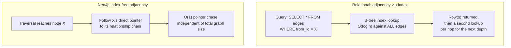

**Decision implications.** Index-free adjacency's payoff compounds with
traversal *depth*, not with dataset size alone: a single-hop "get this
node's direct neighbors" query is not dramatically faster in Neo4j than a
well-indexed relational join, because both are already cheap at depth one.
The gap widens sharply at depth three, four, or an unbounded/
variable-length traversal (Section 4.3), because the relational query
must perform a new $O(\log n)$ index lookup at *every* level of recursion
while Neo4j performs a new $O(1)$ pointer chase at every level — the
per-hop cost difference, multiplied across many hops, is what produces
Neo4j's headline claim of traversal performance that stays roughly
constant per hop regardless of overall graph size, which Section 4.7
formalizes into a concrete decision framework.

**Common failure mode.** Assuming index-free adjacency makes *every*
Neo4j query fast, including queries that do not traverse relationships at
all — for example, "find every `Person` node where `age > 30`" is a
property-filter query, not a traversal, and its cost is governed by
whether a property index exists on `age` (Neo4j's B-tree property indexes,
which behave like any other B-tree index and are subject to the same
selectivity considerations
[recapped from Indexes](CH03_Indexes.md#index-selectivity-and-cardinality-estimation-index-maintenance-costwrite-amplification))
— not by index-free adjacency, which only accelerates *relationship*
traversal, never property lookups by value. Un-indexed property filters
against a large label in Neo4j degrade the same way an un-indexed
`WHERE` clause degrades in any relational engine: a full label scan.

**Scenario.** A fraud-detection query — "find any account within four
hops of this flagged account, connected only through `SHARED_DEVICE` or
`SHARED_PAYMENT_METHOD` relationships" — starts from one indexed lookup
(find the flagged account by its account-number property index) and then
performs four rounds of pure pointer-chasing, each round following only
relationships of the two named types from every node reached at the
previous depth. The equivalent relational query, run as a 4-level
recursive CTE against an `edges` table, performs an index lookup at each
of the four recursive levels for *every* row produced by the previous
level — the relational query's total index-lookup count grows with the
graph's actual fan-out at each hop, while Neo4j's pointer-chase count
grows identically but without the added per-hop $\log n$ index-search
cost.

### 4.3 Cypher Pattern Matching

**Definition.** Cypher is Neo4j's declarative query language, built
around **ASCII-art pattern syntax** in which a query's `MATCH` clause
visually resembles the graph shape it searches for: parentheses `()`
denote nodes, square brackets `[]` denote relationships, and arrows
`-->` / `<--` / `--` denote relationship direction (or its absence, for a
direction-agnostic match). This is the query-language counterpart to
Section 4.1's data model — the same visual grammar (nodes as shapes,
relationships as connecting lines) used to *draw* a property graph on a
whiteboard is, almost unchanged, the syntax used to *query* one in
Cypher.

**Mechanism.** A minimal Cypher pattern —
`MATCH (p:Person)-[:WORKS_AT]->(c:Company {name: "Acme"}) RETURN p.name`
— reads left to right as: find a node labeled `Person` (bound to variable
`p`), connected by an outgoing `WORKS_AT` relationship, to a node labeled
`Company` whose `name` property equals `"Acme"` (bound to variable `c`);
return the `name` property of every matching `p`. Cypher supports
**variable-length paths**, written `[:KNOWS*1..4]`, meaning "follow one to
four `KNOWS` relationships in sequence" — the direct syntactic expression
of the unbounded-depth traversal problem Section 4.2 introduced, letting
a single query express "somewhere between one and four hops" without
hand-writing a recursive construct. The built-in `shortestPath()` and
`allShortestPaths()` functions instruct the query planner to use a
bidirectional breadth-first search rather than exhaustively enumerating
every path up to the specified maximum length, which matters because
naively enumerating all paths in a densely connected graph grows
combinatorially, while a bidirectional BFS that searches outward from
both endpoints simultaneously and stops the moment the two search
frontiers meet bounds the work far more tightly for the specific
shortest-path question. Cypher's clause pipeline — `MATCH` (pattern
search) → `WHERE` (predicate filtering) → `WITH` (intermediate
projection/aggregation, chaining one query stage into the next) →
`RETURN` (final projection) — mirrors, at a conceptual level, the
parse/bind/rewrite/optimize/execute pipeline any query language runs
through
([recapped from Query Optimizers](CH04_Query_Optimizers.md#cost-based-query-optimization-vs-rule-based-query-processing-pipeline-parsebindrewriteoptimizeexecute)),
specialized here to a pattern-matching, rather than relational-algebra,
execution model: Cypher's planner turns a `MATCH` pattern into a plan of
graph-native operators (`NodeByLabelScan`, `Expand` for a single-hop
traversal, `VarLengthExpand` for the `*1..4` case) rather than into
relational join operators.

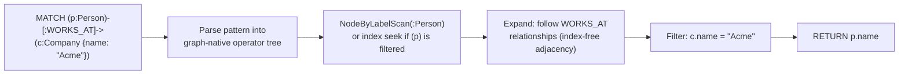

**Decision implications.** Cypher's declarative pattern syntax means the
query author specifies the *shape* being searched for, and the planner —
not the author — decides execution order and which end of the pattern to
start scanning from (typically the most selective anchor, chosen using
the same cardinality-estimation reasoning
[recapped from Query Optimizers](CH04_Query_Optimizers.md#table-column-statistics-and-histograms)
any cost-based optimizer applies): a query author does not write
`FOR EACH person, FOR EACH relationship...` imperative loops the way
Neo4j's pre-Cypher `TraversalDescription` Java API required, trading some
low-level control for a shorter, more maintainable, and independently
optimizable query text — the same declarative-versus-imperative trade-off
SQL made relative to hand-written record-at-a-time file access decades
earlier.

**Common failure mode.** Writing an unbounded variable-length pattern —
`[:KNOWS*]` with no upper bound — against a densely connected graph. Because
a densely connected component can produce an enormous, even
combinatorially exploding, number of distinct paths as the traversal
depth grows unbounded, an unbounded `*` pattern with no `LIMIT` or an
overly generous upper bound is one of the most common sources of a
runaway, resource-exhausting Cypher query; the fix is nearly always to
supply a concrete, domain-justified upper bound (`*1..6`, not `*`) and to
anchor the pattern's other end with a selective filter so the search
space is bounded from both directions rather than expanding freely from
just one.

**Scenario.** A recommendation feature — "products purchased by people who
also purchased what this customer bought, excluding products the customer
already owns" — is naturally expressed as one bounded, two-hop Cypher
pattern:
`MATCH (me:Customer {id: $id})-[:PURCHASED]->(:Product)<-[:PURCHASED]-(other:Customer)-[:PURCHASED]->(rec:Product) WHERE NOT (me)-[:PURCHASED]->(rec) RETURN rec, count(*) AS strength ORDER BY strength DESC LIMIT 10`.
The pattern's shape — customer, purchased product, co-purchasing
customer, recommended product — is directly legible from the query text
itself, in a way the equivalent multi-way self-join SQL query (joining an
`orders` table to itself twice through an intermediate `products` join)
typically is not.

### 4.4 Native Storage Engine: Fixed-Size Records

**Definition.** Neo4j's storage engine implements index-free adjacency
(Section 4.2) concretely using **fixed-size records**: every node,
relationship, and property is stored in its own dedicated store file
(the node store, the relationship store, the property store, each a
flat, contiguous array of records) where every record in a given store is
exactly the same byte length. This is the specific mechanical reason a
"direct pointer" in Section 4.2 is affordable and simple: a fixed-size
record's location can be computed by pure arithmetic (record ID
multiplied by the fixed record size, plus the store file's base offset),
with no index, no variable-length scanning, and no need to read a
length prefix before locating the *next* record.

**Mechanism.** A node record (historically 15 bytes, though exact sizes
have evolved across versions) holds: an in-use flag, a pointer to the
first relationship record in that node's relationship chain, a pointer to
the node's first property record, and its label information. A
relationship record (34 bytes historically) holds: an in-use flag, the
IDs of its two endpoint nodes, its relationship type, and — critically —
**four separate pointers**: the previous and next relationship in the
*start* node's relationship chain, and the previous and next relationship
in the *end* node's relationship chain. This is what makes a
relationship's chain **doubly linked from both ends simultaneously**: the
same physical relationship record is a link in two different linked
lists at once, one anchored at each of its two endpoint nodes, so
traversing outward from either endpoint node means following that node's
own two pointers into the relationship record, without needing to scan
every relationship in the store to find the ones touching a given node.
Property records are stored separately from node/relationship records
(also as fixed-size records, chained in the same doubly-linked style) so
that a node's core connectivity structure — its relationship chain
pointers — stays compact and cache-friendly independent of how many or
how large its properties are; a property whose value exceeds the fixed
property-record's inline capacity (a long string, a large byte array)
spills into a separate, variable-length "dynamic store" referenced by
pointer, keeping the fixed-size stores' arithmetic-offset addressing
property intact for the common case.

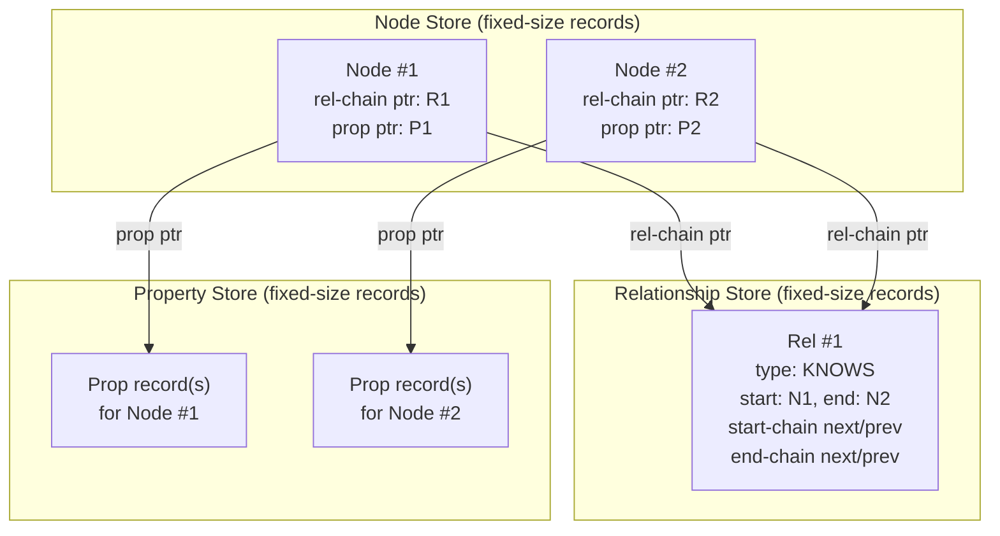

**Decision implications.** Fixed-size records trade some storage density
(every record reserves its maximum-slot size even when a specific node
has few relationships or small properties, and a deleted record's slot is
reused rather than reclaiming variable space) for O(1) record addressing
and, therefore, O(1) pointer-chasing (Section 4.2). This is the same
general engineering trade-off WiredTiger's fixed-size-page B-tree design
makes for a different reason
([recapped from MongoDB's WiredTiger storage engine](CH15_MongoDB.md#45-the-wiredtiger-storage-engine-mvcc-and-locking-granularity)):
predictable record/page layout in exchange for some space overhead versus
a fully variable-length, tightly packed alternative.

**Common failure mode.** A **supernode** — a single node with an
extremely large number of relationships (a celebrity account in a social
graph with millions of followers, or a single "country" node in a
geographic graph connected to every city in that country) — degrades
index-free adjacency's O(1)-per-hop promise for operations that must
touch *all* of that node's relationships, because the relationship chain
anchored at a supernode is itself enormous: finding one specific
relationship among millions in an unindexed linear chain scan is no
longer meaningfully O(1) in practice, even though each individual
next-pointer hop within the chain still is. Neo4j's mitigation is
relationship-type and, in newer versions, relationship-property indexing
on the chain itself, plus a modeling discipline of avoiding supernodes
where a domain redesign (e.g. splitting one giant node into several
sharded "bucket" nodes) is feasible.

**Scenario.** An architecture team modeling IoT sensor telemetry initially
attaches every sensor reading as a relationship directly from a single
`Building` node — after a few months of five-second-interval readings,
that one `Building` node's relationship chain reaches tens of millions of
entries, and even a simple "does this building have any sensor" existence
check becomes slow, because the storage engine still must locate a
specific relationship within that oversized chain. The fix (an
architecture-review-worthy redesign, not a query tweak): introduce
intermediate `Sensor` nodes between `Building` and each individual
`Reading`, so no single node's relationship chain grows past a
manageable size, restoring the O(1)-per-hop property the supernode had
silently broken.

### 4.5 Graph Algorithms and the Graph Data Science Library

**Definition.** A graph algorithm is a computation whose input and
intermediate state are the graph's structure itself (which nodes connect
to which, and via what relationships) rather than individual property
values in isolation. The **Graph Data Science (GDS)** library is Neo4j's
dedicated execution environment for this class of algorithm, organized
into three broad families this chapter teaches by category rather than
exhaustively: **pathfinding** (Dijkstra's shortest path, A*, and
all-pairs variants), **centrality** (PageRank and Betweenness Centrality,
which rank nodes by structural importance), and **community detection**
(the Louvain method and Weakly Connected Components, which partition a
graph into densely-interconnected clusters).

**Mechanism.** GDS algorithms run against an **in-memory projected
graph** — a compact, algorithm-optimized copy of the relevant subset of
nodes and relationships loaded from the transactional graph store into
memory specifically for analytical computation — rather than running
directly against the live, disk-backed transactional store the way a
single Cypher `MATCH` traversal does. This separation exists because most
graph algorithms are inherently **iterative and global**: PageRank, for
example, repeatedly recomputes every node's score as a function of its
neighbors' *previous-iteration* scores until the scores converge (or a
fixed iteration count is reached) — a computation pattern that would be
prohibitively slow and would hold transactional locks far too long if run
directly, one iteration at a time, against the live transactional store's
fixed-size records (Section 4.4). Projecting the relevant subgraph once
into an in-memory, columnar-ish representation optimized for repeated
whole-graph passes (the same **Bulk Synchronous Parallel** execution
pattern popularized by Google's Pregel paper — every node updates its own
state in parallel each "superstep," using only values computed in the
*previous* superstep, then all nodes synchronize before the next superstep
begins) lets GDS run dozens of iterations efficiently, then write the
final results (a PageRank score, a community ID) back to the
transactional graph as ordinary node properties for the application to
query with plain Cypher.

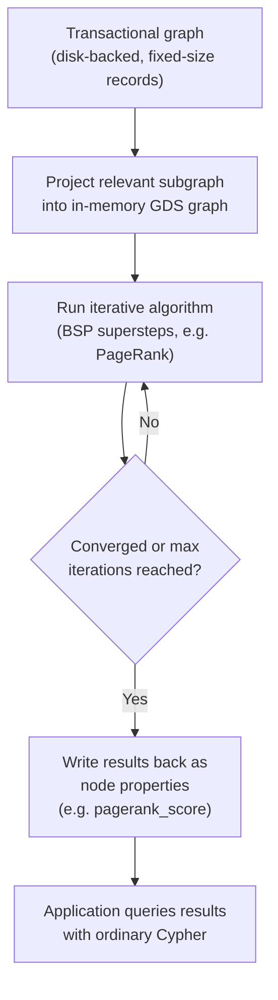

**Decision implications.** PageRank's mechanism — a node's score is high
if it is linked to by *other high-scoring* nodes, not merely by *many*
nodes — makes it structurally different from, and often more useful than,
a naive "count of incoming relationships" (in-degree) popularity metric:
a node linked to by ten low-importance nodes scores lower than a node
linked to by two extremely-high-importance ones, correctly modeling the
intuition that an endorsement's weight depends on the endorser's own
standing. The Louvain method's decision trade-off is different: it
optimizes **modularity** (a measure of how much denser connections are
*within* a proposed community than would be expected by chance) via a
fast, greedy, hierarchical merging heuristic rather than an
exhaustive/exact partition search — a deliberate, disclosed
approximation, chosen because exact modularity optimization is
NP-hard, that produces good-quality (not provably optimal) community
partitions at a computational cost that scales to graphs orders of
magnitude larger than an exact method could handle.

**Common failure mode.** Running a global, whole-graph algorithm (Louvain,
full-graph PageRank) directly against the live transactional Cypher
engine, one Cypher query at a time per iteration, instead of projecting
into GDS first — this reproduces exactly the "too slow, holds
transactional resources too long" problem GDS's separate in-memory
projection step exists to avoid, and is the single most common reason a
team new to Neo4j concludes graph algorithms are impractically slow when
the actual mistake was skipping the projection step, not a limitation of
the algorithms themselves.

**Scenario.** A payments-fraud team projects a subgraph of
`Account`-`SHARED_DEVICE`/`SHARED_PAYMENT_INSTRUMENT`-`Account`
relationships into GDS, runs Weakly Connected Components to identify
clusters of accounts that share enough device/payment fingerprints to be
suspicious as a group, then runs Betweenness Centrality *within* each
flagged cluster to identify which specific account is structurally
central to that cluster (a likely ring organizer, since removing a
high-betweenness node would fragment the cluster's connectivity the most)
— a two-stage analytical workflow (partition, then rank within
partitions) that would be substantially harder to express as SQL
aggregate queries against a normalized relational schema.

### 4.6 Causal Clustering and Raft Consensus

**Definition.** Causal Clustering is Neo4j's replication and
high-availability architecture: a cluster of **Core servers** that
participate in a Raft consensus protocol to agree, one at a time, on
every write transaction and its commit order, plus zero or more **Read
Replicas** that asynchronously stream committed transactions from the
Core servers but never participate in the consensus vote and can never
become the writer. This chapter's Section 4.6 is the recap point for
[Replication](CH07_Replication.md)'s and
[Locking](CH10_Locking.md)'s generic distributed-systems theory — leader
election, quorum arithmetic, and split-brain avoidance
([recapped from Replication](CH07_Replication.md#failover-mechanics-and-split-brain-risk-fencing-tokens-stonith-cap-theorempacelc-framing))
— and teaches only what is genuinely new here: **Raft** as a specific,
concrete consensus algorithm, distinct from the generic "some quorum-based
consensus system" framing Replication's Section 4.7-4.8 already covers at
the theory level.

**Mechanism.** Raft organizes time into **terms**, each identified by a
monotonically increasing integer. At any moment, every Core server is in
one of three roles: **Leader** (the single writer for the current term),
**Follower** (passively replicating the leader's log), or **Candidate**
(a follower that has stopped hearing the leader's heartbeat and is
soliciting votes to become the new leader for a new term). A Core server
becomes a Candidate after a randomized election timeout elapses with no
heartbeat from the current leader; it increments the term number, votes
for itself, and requests votes from every other Core server. Each Core
server votes for at most one candidate per term, on a first-come basis,
and only if the candidate's log is at least as up to date as its own (the
same "cannot elect a stale-data node as leader" safety property any
correct consensus protocol must guarantee) — a candidate that receives
votes from a **strict majority** of Core servers (not merely a plurality)
becomes the new leader for that term and immediately begins sending
heartbeats to suppress further elections. Every write transaction is
appended to the leader's Raft log and is only considered **committed** —
safe to acknowledge back to the client and safe to apply to the actual
graph store — once a majority of Core servers have durably persisted that
log entry, the same majority-quorum-write-before-acknowledge principle
[recapped from Replication's synchronous replication trade-off](CH07_Replication.md#leaderfollower-replication-mechanics-wal-shippingstreaming-syncasyncsemi-sync-trade-off),
here made concrete as "majority of Raft log replicas," not a
configurable W/R tunable.

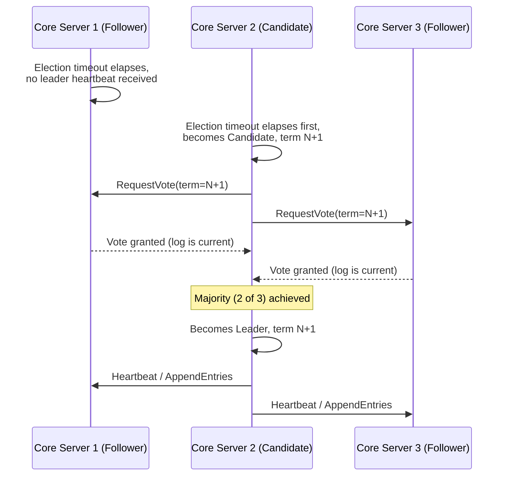

Read Replicas sit entirely outside the Raft voting membership: they
subscribe to the transaction stream committed by the current Core-server
leader and apply it asynchronously, which means a Read Replica's data is
always at least slightly behind the leader (the same replication-lag
concept
[recapped from Replication](CH07_Replication.md#replication-lag-and-read-your-writes-consistency-multi-leader-conflict-resolution))
and, unlike a Core server, a Read Replica can never win a Raft election
or become the writer — its role is purely to absorb read traffic and
scale read capacity horizontally without adding to the Raft quorum size
(adding more Core servers makes each write commit *slower*, since a
larger majority must acknowledge every write, while adding Read Replicas
adds read capacity at no such cost). Because a client's read might land
on a Read Replica that has not yet applied a write the same client just
made against the leader, Neo4j exposes **causal consistency** via
**bookmarks**: after a write, the driver receives a bookmark token
representing "the transaction state as of this write"; a subsequent read
against any cluster member, presented with that bookmark, blocks briefly
until that member's applied state has caught up to at least that
bookmark's point — giving the specific *session* a read-your-writes
guarantee without requiring every reader in the cluster to be
fully synchronous.

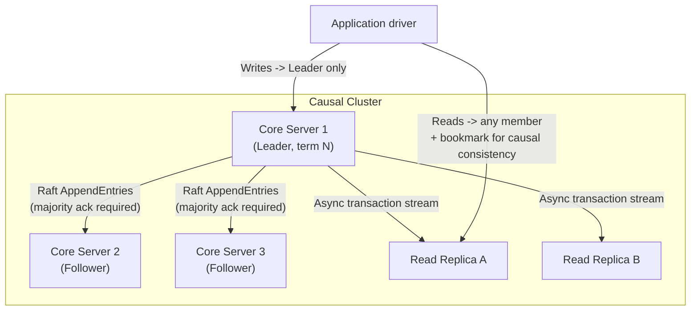

**Decision implications.** Raft's majority-quorum commit rule means a
Causal Cluster's fault tolerance follows the standard odd-sized-quorum
arithmetic: a 3-Core-server cluster tolerates one Core-server failure
(2 of 3 remaining still form a majority); a 5-Core-server cluster
tolerates two failures, at the cost of every write now requiring
acknowledgment from three servers instead of two, trading availability
headroom for write latency — the identical even-versus-odd cluster-sizing
reasoning
[recapped from Replication's quorum common-failure-mode discussion](CH07_Replication.md#common-failure-mode)
applies directly to Core-server count choices. Because writes must
reach a majority of Core servers specifically (never Read Replicas),
horizontally adding Read Replicas scales read throughput without any
write-latency cost, making "how many Core servers vs. how many Read
Replicas" the primary Causal Clustering capacity-planning decision,
distinct from a purely read/write ratio question.

**Common failure mode.** Deploying an even number of Core servers (four,
say) under the mistaken belief that more nodes always means more
fault tolerance — a 4-node cluster's majority is three, meaning it can
only tolerate a single node failure before losing quorum, identical
fault tolerance to a 3-node cluster but at a higher per-write
acknowledgment cost (three acks instead of two) and higher infrastructure
spend, with zero fault-tolerance benefit gained — the same even-cluster
anti-pattern flagged generically
[in Replication's common failure mode](CH07_Replication.md#common-failure-mode),
here manifesting concretely as a Neo4j Core-server topology choice.

**Scenario.** A Causal Cluster's current leader (Core server 1) suffers a
hardware failure. The remaining two Core servers detect the missing
heartbeat, each starts a randomized election timer, and — assuming no
split vote — one of them wins a majority and becomes leader for the next
term within, typically, a low-single-digit number of seconds (governed by
the configured election timeout range); writes that were in flight to the
old leader but had not yet reached a majority are not acknowledged as
committed and must be retried by the client against the new leader, while
writes that *had* already reached a majority before the failure are
preserved in the new leader's log, because the Raft election safety rule
guarantees only a candidate whose log is at least as up to date as a
majority of the cluster can win the election in the first place.

### 4.7 Graph vs. Relational: A Decision Framework

**Definition.** This is the chapter's synthesizing concept: a structured,
repeatable framework for deciding whether a connected-data problem is
better served by Neo4j (or another native graph engine) versus a
relational engine using join tables and, where recursion is required,
recursive CTEs. It is a decision framework, not a universal ranking —
most transactional, tabular-shaped business data (an e-commerce order
ledger, a payroll system) remains correctly and efficiently served by a
relational engine, and the framework below exists precisely to identify
the *specific* subset of problems where that default choice stops being
the efficient one.

**Mechanism.** Four questions, applied in sequence, identify a
graph-favoring workload:

1. **Is the traversal depth known and fixed, or unknown/variable at query
   time?** A fixed, small depth (two or three joins) is efficiently
   expressed either way; an *unknown or effectively unbounded* depth
   ("find any path," "find the shortest chain regardless of length") is
   where Section 4.2's per-hop cost gap between index-free adjacency
   ($O(1)$ per hop) and recursive-CTE index lookups ($O(\log n)$ per hop,
   compounding across every recursive level) becomes structurally
   decisive, not merely a constant-factor difference.
2. **Is the query pattern itself variable, or does the application always
   ask the same fixed-shape question?** A system that only ever runs one
   or two known join patterns can have those patterns tuned once
   (materialized views, precomputed join tables,
   [recapped from Denormalization](CH02_Denormalization.md#precomputed-aggregatesrollups-read-model-duplication-cqrs-style));
   a system where analysts or end users construct *ad hoc*,
   unpredictable traversal patterns against the same underlying data
   benefits from a query language (Cypher) whose planner reasons about
   pattern shape generically, rather than requiring a new
   hand-tuned join/index strategy for every new pattern shape a user
   invents.
3. **Does the relationship itself carry meaningful, frequently queried
   data?** If most queries only ever check *whether* a connection exists
   (a boolean join-table membership check), a relational join table is
   entirely sufficient; if queries routinely need a relationship's own
   attributes (a `PURCHASED` relationship's quantity and timestamp,
   Section 4.1) in the same step as following the connection, the
   property-graph model removes a join a relational schema cannot avoid.
4. **Does the workload need graph algorithms (Section 4.5) — centrality,
   community detection, pathfinding at scale — as a first-class,
   recurring capability, not a one-off analytics job?** If so, an
   in-database GDS-style execution model is a materially better fit than
   exporting a relational dataset into an external graph-analytics
   library on a recurring, hand-maintained schedule.

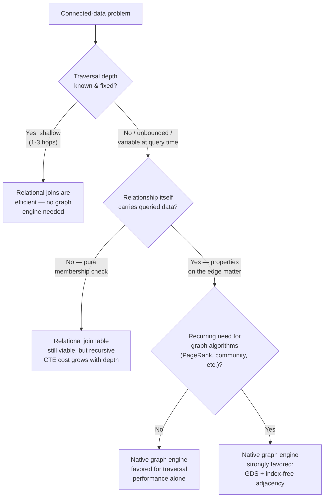

**Decision implications.** A relational recursive CTE is not "wrong" for
connected data — it is a correct, standard SQL tool, and for genuinely
shallow or depth-bounded hierarchies (an org chart rarely exceeding eight
or ten levels, a bill-of-materials with a known maximum nesting depth) a
recursive CTE against a well-indexed `parent_id` foreign key performs
entirely adequately, and introducing a second database technology (Neo4j
alongside an existing relational system) has a real operational cost —
another engine to operate, another driver/toolchain, another
consistency boundary between systems if data must be kept in sync across
both — that must be justified by the traversal-cost or algorithm-need
argument above, not adopted reflexively because "the data has
relationships in it," since nearly all data has some relationships in it.

**Common failure mode.** Choosing a graph database purely because the
problem *domain* sounds graph-shaped (a social network, an org chart)
without checking whether the actual *query workload* exhibits unbounded
or highly variable traversal depth — many social-network and org-chart
applications, in practice, only ever query one or two hops deep ("who
does this person follow," "who is this person's direct manager"), a
workload a relational join handles perfectly well; introducing Neo4j for
a workload that never needs more than a two-hop join adds operational
cost without a corresponding traversal-performance payoff, since Section
4.2's per-hop cost gap only compounds meaningfully at real depth.

**Scenario.** An enterprise architecture review compares two systems: an
HR org chart (strictly hierarchical, bounded depth, one relationship type,
queried almost exclusively as "direct reports" or "full reporting chain
to the CEO") and a fraud-investigation platform (arbitrary-depth,
multi-relationship-type traversal across shared devices, shared payment
instruments, and shared addresses, plus a recurring need to run community
detection over the resulting connection clusters). Applying the
framework: the org chart scores "shallow, fixed pattern, no algorithmic
need" on all four questions and stays on the existing relational system
using a recursive CTE; the fraud platform scores "unbounded depth,
ad hoc analyst-driven patterns, relationship-carried properties, and a
recurring GDS-style algorithmic need" on all four, and is migrated to
Neo4j — the same architecture team, applying the same framework
consistently, reaches two different, both correct, conclusions for two
different workloads.

## 5. Internal Working

A single Cypher query's execution, end to end, runs through five stages.
**Parsing** turns the query text into an abstract syntax tree. **Semantic
analysis and binding** resolves every variable, label, and property
reference against the current graph's schema (its declared constraints
and any known indexes) and rejects a query referencing an undeclared
variable or a type-mismatched comparison before execution begins.
**Logical planning** turns the bound query into a tree of logical
operators — `NodeByLabelScan`, `NodeIndexSeek`, `Expand`,
`VarLengthExpand`, `Filter`, `Aggregation` — choosing, for each `MATCH`
pattern, which anchor node to start from based on cardinality estimates
([recapped from Query Optimizers](CH04_Query_Optimizers.md#table-column-statistics-and-histograms))
computed from the graph's label/relationship-type/property statistics,
exactly mirroring the cost-based, statistics-driven planning approach any
relational optimizer takes, specialized to graph-native operators instead
of relational join operators. **Physical planning** turns the logical
plan into concrete, executable operators (choosing, for instance, whether
an `Expand` step should use a lazy, pipelined iterator or a fully
materialized intermediate result, based on estimated result size).
**Execution** runs the physical plan, using index-free adjacency
(Section 4.2) for every `Expand`/`VarLengthExpand` step and either a
label scan or a B-tree/property index seek
([recapped from Indexes](CH03_Indexes.md#b-tree--btree-index-structure-fanout-leaf-linking-node-splitmerge))
for the pattern's initial anchor node.

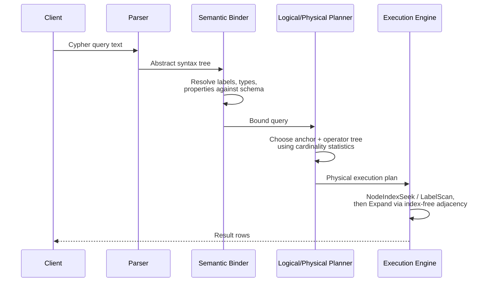

Within a Causal Cluster (Section 4.6), a write transaction's internal path
extends this sequence: the transaction is executed against the current
Raft leader's in-memory graph state, the resulting change set is appended
to the leader's Raft log, and the transaction is only reported back to
the client as committed once a majority of Core servers have durably
persisted that log entry — meaning the "execution" stage above, for a
write, is not complete in the durability sense until the Raft majority
acknowledgment described in Section 4.6 has occurred, not merely once the
leader's own local execution finishes. A read against a Read Replica
follows the same five-stage pipeline locally on that replica's own copy
of the graph, but that replica's graph state can lag the leader's by
however long asynchronous log-streaming replication takes to catch up,
which is exactly the gap **causal consistency bookmarks** (Section 4.6)
exist to bridge for a specific client session.

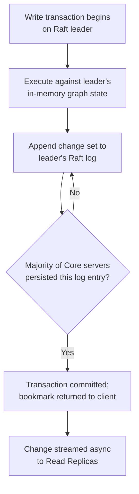

## 6. Design Principles

Neo4j's design principles follow directly from Sections 4.2 and 4.4:
**locality of reference over centralized indirection** — a relationship
lives physically adjacent, in pointer terms, to the two nodes it
connects, rather than being indexed centrally and looked up on demand,
so that traversal cost is a function of the *local* neighborhood being
walked, not of the graph's total size. **Schema-optional by default, with
opt-in constraints** — labels and relationship types impose no fixed
column set, but uniqueness/existence/node-key constraints can be layered
on for the specific properties an application chooses to enforce,
mirroring the "flexible by default, disciplined where it matters" design
posture already discussed for MongoDB's
[schema-on-read trade-off](CH15_MongoDB.md#42-dynamic-schema-schema-on-read-vs-schema-on-write).
**Declarative query shape mirrors data shape** — Cypher's pattern syntax
(Section 4.3) is designed so the query author reasons visually about the
same nodes-and-relationships shape the storage engine and the whiteboard
diagram both use, minimizing the translation distance between "what I
want" and "what I write." **Separation of transactional and analytical
execution** — Section 4.5's GDS in-memory projection keeps expensive,
iterative, whole-graph computation from ever competing for locks or
buffer-pool space with live transactional traffic, an explicit
architectural boundary rather than an afterthought.

## 7. Architecture Patterns

**Polyglot persistence**, where Neo4j owns only the connection-heavy
subset of an application's data model and a relational or document
engine owns the rest, is the most common production pattern: an
e-commerce platform might keep its order ledger, inventory, and payment
records in a relational engine (where ACID guarantees over money-moving
transactions
[recapped from Transactions](CH08_Transactions.md#acid-properties-atomicity-consistency-isolation-durability-and-their-mechanisms)
are the priority) while syncing a derived, denormalized
customer/product/purchase graph into Neo4j specifically to power its
recommendation and fraud-detection features, keeping the two data stores
consistent via change-data-capture or event-driven synchronization rather
than treating Neo4j as the system of record for order data it was never
optimized to hold. **Graph as a derived, read-optimized index** extends
this pattern further: the relational system remains authoritative, and
the graph is treated explicitly as a specialized, rebuildable read-model
projection — if the graph is ever lost or corrupted, it can be
reconstructed entirely from the relational source of truth, an
architecture decision that removes Neo4j from the durability-critical
path entirely.

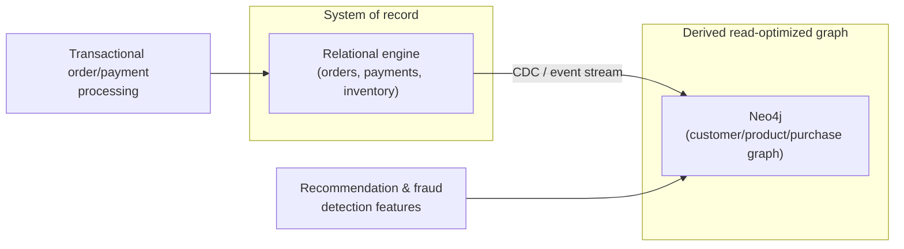

**Knowledge-graph architecture** is a second common pattern where Neo4j
*is* the system of record: typed facts (entities and their relationships,
often sourced from multiple upstream systems and reconciled into a single
canonical graph) are queried directly by search, recommendation, or
question-answering features, with the graph itself — not a derived
projection of something else — being the primary asset.

## 8. Production Architecture

A production Causal Cluster deployment typically spans an odd number of
Core servers (three or five, per Section 4.6's quorum-sizing reasoning)
distributed across separate failure domains — different Availability
Zones within a region, or, for disaster-recovery-conscious deployments,
across separate metropolitan regions with careful attention to the
added Raft round-trip latency cross-region placement introduces on every
write's majority-acknowledgment step — plus a pool of Read Replicas
sized to the read-traffic volume, placed close to the application tier
they serve (including, for globally distributed applications, Read
Replicas in regions with no local Core server at all, accepting a larger
replication-lag window in exchange for low local read latency). A load
balancer or the official Neo4j driver's own cluster-routing logic directs
write traffic exclusively to the current Raft leader (discovered via a
cluster-topology query, since the leader can change after any election)
and distributes read traffic across Read Replicas and/or Follower Core
servers according to the application's chosen routing policy and causal
consistency requirements (Section 4.6).

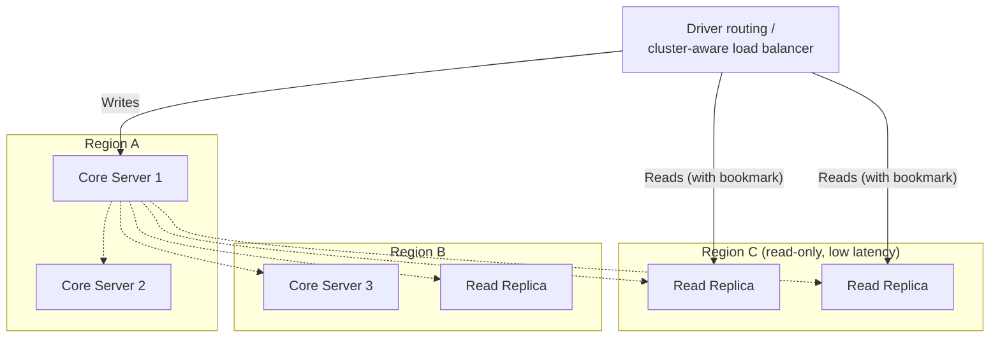

## 9. Implementation

Implementing against Neo4j means choosing a driver (Neo4j provides
official drivers for Java, Python, JavaScript/Node.js, .NET, and Go, all
speaking the same Bolt binary protocol), structuring queries as
parameterized Cypher (never string-concatenating user input into a query
— the graph-query-language equivalent of SQL injection, and defended
against identically, via bound parameters rather than string
interpolation), and choosing an explicit transaction function pattern
(the driver's `execute_read`/`execute_write` — or equivalent —
transaction functions automatically retry a transaction that fails due to
a transient cluster condition, such as a leader election happening
mid-transaction, rather than requiring the application to hand-roll retry
logic for every write). Section 10 below provides complete, runnable
Cypher and Python examples of this pattern.

## 10. Complete Code Examples

Four Cypher examples and one Python example live under
[`code/cypher/neo4j-chapter/`](../code/cypher/neo4j-chapter/) and
[`code/python/neo4j-chapter/`](../code/python/neo4j-chapter/):

1. [`code/cypher/neo4j-chapter/01_property_graph_schema_and_constraints.cypher`](../code/cypher/neo4j-chapter/01_property_graph_schema_and_constraints.cypher)
   — creates a small property graph (Section 4.1) with `Person`,
   `Company`, and `Product` nodes and typed relationships, then declares
   a uniqueness constraint, a node-key constraint, and a property index,
   showing how Neo4j's optional schema layer sits on top of an otherwise
   schema-optional model.
2. [`code/cypher/neo4j-chapter/02_pattern_matching_and_traversals.cypher`](../code/cypher/neo4j-chapter/02_pattern_matching_and_traversals.cypher)
   — demonstrates Section 4.3's pattern-matching syntax: a fixed-depth
   pattern, a bounded variable-length path (`*1..4`), `shortestPath()`,
   and the two-hop recommendation-style pattern from Section 4.3's
   scenario, each annotated with what makes it a graph-native, rather
   than relational-join, query.
3. [`code/cypher/neo4j-chapter/03_graph_data_science_algorithms.cypher`](../code/cypher/neo4j-chapter/03_graph_data_science_algorithms.cypher)
   — projects an in-memory graph and runs Section 4.5's three algorithm
   families against it: Dijkstra shortest path, PageRank, and Louvain
   community detection, writing each result back to the transactional
   graph as a node property.
4. [`code/cypher/neo4j-chapter/04_recursive_relational_vs_graph_traversal.cypher`](../code/cypher/neo4j-chapter/04_recursive_relational_vs_graph_traversal.cypher)
   — the Section 4.7 decision-framework example made concrete: an
   equivalent-intent variable-length Cypher traversal alongside inline
   comments showing the SQL recursive-CTE equivalent it replaces, so a
   reader can compare both approaches to the same query side by side.
5. [`code/python/neo4j-chapter/05_neo4j_driver_transaction_example.py`](../code/python/neo4j-chapter/05_neo4j_driver_transaction_example.py)
   — a runnable Python example using the official `neo4j` driver:
   parameterized Cypher (avoiding injection, Section 13), an explicit
   write transaction function with automatic retry-on-transient-failure
   (Section 9), and a causally-consistent read using a bookmark (Section
   4.6), demonstrating the write-then-read-your-own-write pattern against
   a Causal Cluster end to end.

## 11. Performance

Query performance in Neo4j is governed by three levers, in the order a
performance investigation should check them: first, whether the pattern's
anchor node is reached via an index seek or a full label scan (identical
in principle to any relational query's first performance question,
[recapped from Query Optimizers' EXPLAIN discipline](CH04_Query_Optimizers.md#explainexecution-plan-reading-model-plan-caching-and-parameter-sniffing));
second, whether any traversal step is an unbounded or overly generous
variable-length pattern (Section 4.3's common failure mode); and third,
whether a supernode (Section 4.4's common failure mode) sits on the
traversal path. `PROFILE` (Cypher's equivalent of `EXPLAIN ANALYZE`) shows
actual row counts and database-hit counts per operator, making all three
of these directly visible rather than requiring guesswork.

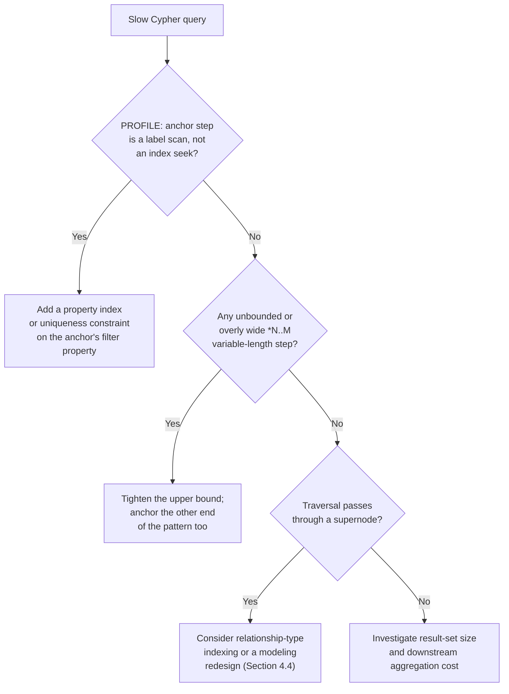

## 12. Scalability

Because a single logical Neo4j graph, even across a Causal Cluster, is
replicated (every Core server holds the *entire* graph), Causal
Clustering scales **read** capacity by adding Read Replicas but does not,
by itself, scale **write** capacity or total addressable dataset size
past what a single Core server's storage and memory can hold — a
materially different scaling model from [Sharding](CH06_Sharding.md)'s
horizontal, partition-the-dataset-across-nodes approach, and from
[Cassandra's](CH18_Cassandra.md#41-ring-architecture-consistent-hashing-and-vnodes)
or [DynamoDB's](CH17_DynamoDB.md#41-partition-key-sort-key-and-single-table-design)
partition-per-node models. Neo4j's answer to write/dataset-size scaling
beyond one graph is **Fabric**/composite databases: multiple independent
Neo4j graphs (each its own Causal Cluster, each independently
write-scalable only up to its own single-graph ceiling) federated behind
one query surface, letting a query span graphs the way a federated query
engine spans independent relational databases — a fundamentally different
scaling strategy from partitioning one dataset across nodes, and one that
pushes the data-partitioning decision (which entities belong in which
graph) back onto the application/data-modeling team rather than
automating it the way [Sharding](CH06_Sharding.md#shard-key-selection-criteria-shard-mapdirectory-routing-consistent-hashing-ring--virtual-nodes-vs-hash-mod-routing)'s
consistent-hashing ring does.

## 13. Security

Role-Based Access Control (RBAC) grants privileges scoped down to the
label, relationship-type, and even property level, letting an
administrator, for example, grant read access to `Person` nodes' `name`
property while denying access to a `salary` property on the same node
label. Transport security uses standard TLS between drivers and the
cluster, and between Core servers/Read Replicas themselves
([recapped from TLS](../05_Networking_and_OS/CH06_TLS.md#tls-13-handshake-0-rtt)).
Because Cypher parameters are bound rather than string-interpolated
(Section 9), a driver-level parameterized query is not vulnerable to the
graph-query-language equivalent of SQL injection — but a Cypher query
built by string-concatenating untrusted input (common in ad hoc scripts
or naive dynamic-query-builder code) is exactly as vulnerable as
concatenated SQL, and the fix is identical: always bind parameters,
never interpolate.

## 14. Observability

`PROFILE`/`EXPLAIN` (Section 11) are the query-level diagnostic tools;
cluster-level health is exposed via `SHOW SERVERS` and Raft-specific
metrics (current term, leader identity, per-server Raft log position)
that surface exactly the election and replication-lag mechanics Section
4.6 describes, letting an operator directly observe how far a given Read
Replica's applied log position lags the current leader's, and whether a
Core server has recently participated in an unexpected election (a signal
worth investigating even if the election resolved cleanly, since frequent
elections usually indicate network instability or an overloaded Core
server unable to send heartbeats in time — the same election-storm
failure mode
[recapped from MongoDB's replica-set elections](CH15_MongoDB.md#15-failure-scenarios)).

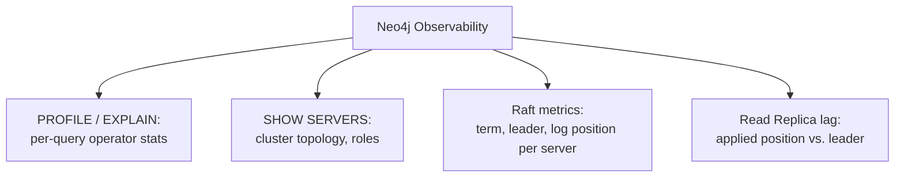

## 15. Failure Scenarios

If enough Core servers become unreachable that no majority can be formed
(for example, two of three Core servers fail simultaneously in a
3-server cluster), the remaining minority cannot elect a leader and the
cluster **refuses writes entirely** rather than risking a split-brain
scenario where two disconnected minority partitions might each elect a
different leader and accept conflicting writes — the same
correctness-over-availability trade-off
[recapped from Replication's CAP/PACELC framing](CH07_Replication.md#failover-mechanics-and-split-brain-risk-fencing-tokens-stonith-cap-theorempacelc-framing),
here enforced structurally by Raft's majority-vote requirement rather
than by an operator-configured fencing mechanism. A supernode (Section
4.4) under heavy concurrent write load can become a **lock contention
hotspot**, since a write that appends to a node's relationship chain must
serialize against other concurrent writers touching that same node's
chain — a graph-native manifestation of the general hot-key/hot-partition
failure mode already seen in
[DynamoDB's hot-partition scenario](CH17_DynamoDB.md#42-consistent-hashing-and-partition-distribution)
and [Cassandra's key/temporal skew discussion](CH18_Cassandra.md#41-ring-architecture-consistent-hashing-and-vnodes).

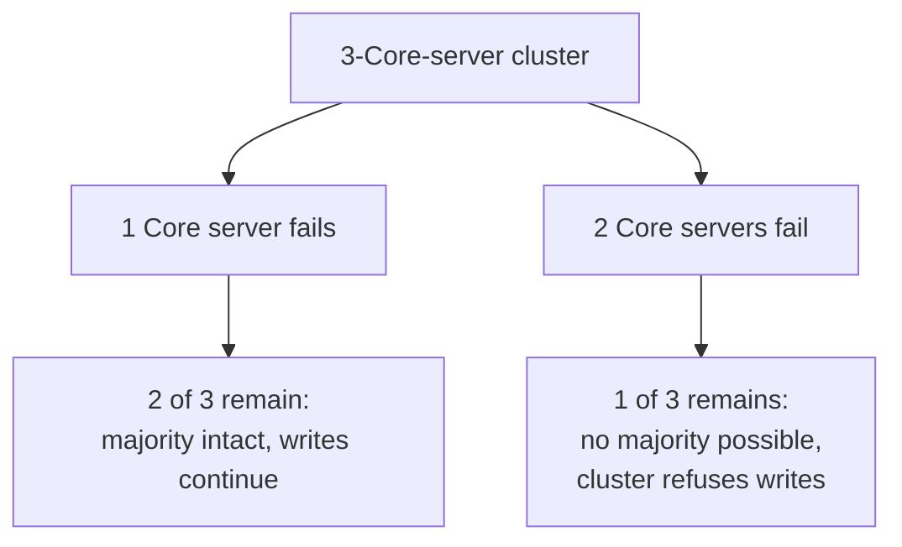

## 16. Testing

Neo4j provides an official embeddable **Neo4j Test Harness** and
Testcontainers-based Neo4j images, letting integration tests spin up a
real, disposable Neo4j instance per test run — the same
disposable-real-instance testing philosophy
[recapped from MongoDB's testing approach](CH15_MongoDB.md#16-testing) —
so Cypher-specific behavior (pattern matching, constraint enforcement,
GDS algorithm output) is exercised against genuine Neo4j semantics rather
than a hand-rolled in-memory graph fake that would inevitably drift from
real Cypher planner behavior. Causal-Clustering-specific behavior
(leader failover, causal-consistency bookmark propagation) requires a
genuine multi-member cluster in the test harness, since a single-instance
test setup cannot exercise Raft election or replication-lag behavior at
all.

## 17. Common Mistakes

- **Modeling a many-valued attribute as a bare property instead of a node**
  (Section 4.1's common failure mode) — losing traversability and the
  ability to attach further properties to what should have been its own
  node.
- **Unbounded variable-length patterns** (Section 4.3) — `[:REL*]` with no
  upper bound against a densely connected graph.
- **Running GDS-class algorithms directly against the transactional
  engine** instead of via an explicit in-memory projection (Section 4.5).
- **Ignoring supernodes** (Section 4.4) until a specific traversal or
  write against that node degrades noticeably.
- **String-concatenating Cypher instead of parameterizing it** (Section
  13) — the graph-query-language injection risk.
- **Sizing a Causal Cluster with an even number of Core servers** (Section
  4.6's common failure mode) — no fault-tolerance benefit over the
  next-lower odd number, at a higher write-latency cost.

## 18. Best Practices

Always start a performance investigation with `PROFILE` (Section 11)
before guessing at the cause; bound every variable-length pattern with an
upper limit justified by the domain, not left open by default; project
into GDS explicitly before running any iterative, whole-graph algorithm;
size Causal Clusters with an odd Core-server count chosen from measured
write-latency and fault-tolerance requirements, not an arbitrary round
number; route reads through the driver's causal-consistency bookmark
mechanism (Section 4.6) whenever a client must observe its own prior
write; and treat Neo4j, in a polyglot-persistence architecture (Section
7), as a purpose-fit derived store unless the connected-data decision
framework (Section 4.7) genuinely justifies making it the system of
record.

## 19. Anti-Patterns

- **Graph-database-first modeling** — choosing Neo4j because the domain
  *sounds* graph-shaped, without applying Section 4.7's framework to the
  actual query workload's traversal depth and pattern variability.
- **Recreating a relational schema inside a property graph** — modeling
  every entity as a node connected only by fixed, single-hop
  relationships that mirror a normalized relational schema exactly,
  gaining none of index-free adjacency's payoff because no query ever
  actually traverses more than one hop.
- **Using Neo4j purely as a key/value store**, ignoring relationships
  entirely and querying only by an indexed property — a workload better
  served by a simpler, cheaper-to-operate engine.
- **Treating the supernode problem as unsolvable** rather than a modeling
  decision (Section 4.4) — accepting degraded performance around a
  hub node instead of introducing an intermediate node layer.

## 20. Trade-off Analysis

| Dimension | Neo4j's position | Trade-off accepted |
|---|---|---|
| Traversal cost at unknown/variable depth | O(1) per hop via index-free adjacency (Section 4.2) | Property-value filtering still needs the same B-tree indexes any engine needs — traversal speed is not a substitute for indexing |
| Write scalability / dataset size | Fabric/composite databases federate multiple independent graphs (Section 12) | No single-graph horizontal write-sharding the way Cassandra/DynamoDB provide natively |
| Schema flexibility | Schema-optional by default, opt-in constraints (Section 4.1) | No enforced fixed row shape unless constraints are explicitly declared |
| Query expressiveness for connected data | Cypher patterns mirror graph shape directly (Section 4.3) | A second query language/toolchain to operate alongside SQL in a polyglot architecture |
| Analytical graph algorithms | GDS's in-memory BSP-style execution (Section 4.5) is a first-class, in-database capability | Requires an explicit, separately-sized in-memory projection step, not free |
| Consistency across the cluster | Raft majority-commit writes; causal-consistency bookmarks for reads (Section 4.6) | Read Replicas can lag; a client must use bookmarks to guarantee read-your-writes |

## 21. Comparison Table

| Engine | Adjacency model | Query language | Primary scaling axis | Best-fit workload |
|---|---|---|---|---|
| Neo4j | Index-free adjacency, fixed-size records | Cypher (declarative pattern matching) | Read scale-out (Read Replicas); Fabric for multi-graph federation | Unbounded/variable-depth traversal, relationship-carried data, recurring graph algorithms |
| Relational (e.g. [PostgreSQL](CH11_PostgreSQL.md)) | B-tree index lookup per join/recursive-CTE level | SQL (declarative, relational algebra) | Vertical, or [Sharding](CH06_Sharding.md)/read replicas | Fixed-shape, shallow-to-moderate-depth joins; strong ACID transactional guarantees |
| [MongoDB](CH15_MongoDB.md) | N/A (document embedding, not adjacency) | MQL / aggregation pipeline | Sharded cluster (Section 4.4 there) | Whole-object read/write as a unit; schema-on-read agility |
| [DynamoDB](CH17_DynamoDB.md) | N/A (consistent-hashed key/value) | PartiQL / API-level key access | Massive horizontal partition scale-out | Single-item lookup by key at very large scale |

## 22. Real-World Case Study

A global professional-networking platform's "how are we connected"
feature — showing a user the shortest chain of mutual connections between
themselves and another member, and surfacing "people you may know"
recommendations based on shared second-degree connections — is a
canonical instance of Section 4.7's graph-favoring workload: the
traversal depth is unknown at query time (two members might be connected
at one hop or at five), the query pattern is effectively fixed in shape
(shortest path, or a bounded two-hop co-connection pattern) but must run
at very high volume and low latency across a graph of hundreds of
millions of members and tens of billions of relationships, and the
underlying data — who is connected to whom, and since when — is exactly
the kind of relationship-centric structure Section 4.1's property graph
model represents directly. Platforms operating at this scale have
publicly described moving this specific feature off a relational,
join-table-based implementation and onto a purpose-built or native graph
engine specifically because `shortestPath()`-style bidirectional search
(Section 4.3) against index-free adjacency (Section 4.2) kept per-query
latency roughly stable as the underlying connection graph continued to
grow, whereas the equivalent recursive join query's latency grew with
the graph's size in a way that eventually failed to meet the feature's
latency budget — a direct, large-scale confirmation of this chapter's
central architectural claim in Section 4.2 and Section 4.7.

## 23. Interview Questions

1. Explain index-free adjacency and derive why its per-hop cost is
   independent of total graph size, while a relational index lookup's
   cost is not.
2. Walk through Neo4j's fixed-size-record storage design — node,
   relationship, and property stores — and explain how a relationship
   record's four pointers implement a doubly-linked chain from both of
   its endpoint nodes simultaneously.
3. Write a Cypher pattern using a bounded variable-length relationship
   and explain why an unbounded `*` pattern is dangerous against a
   densely connected graph.
4. Explain why PageRank's iterative, whole-graph nature motivates
   Neo4j's separate GDS in-memory projection step rather than running
   the algorithm directly against the live transactional store.
5. Describe Raft's term/leader/follower/candidate state machine and
   explain why an even number of Core servers provides no additional
   fault tolerance over the next-lower odd number.
6. What is a supernode, and why does it locally break index-free
   adjacency's O(1)-per-hop guarantee even though the rest of the graph
   is unaffected?
7. Using the Section 4.7 decision framework, argue for or against
   introducing Neo4j alongside an existing relational system for a
   specific connected-data workload of your choosing.
8. Explain causal-consistency bookmarks and why a Causal Cluster needs
   them given that Read Replicas replicate asynchronously.
9. Contrast a property graph's relationship-with-properties model against
   a relational many-to-many join table, and identify the specific query
   pattern where each is structurally favored.
10. Why does Fabric/composite-database federation, rather than
    single-graph sharding, represent Neo4j's answer to write-scalability
    beyond one graph's capacity?

## 24. Hands-on Exercises

1. Load a small social-graph dataset (people, `FOLLOWS` relationships)
   using [`01_property_graph_schema_and_constraints.cypher`](../code/cypher/neo4j-chapter/01_property_graph_schema_and_constraints.cypher),
   then write a bounded variable-length Cypher query finding every person
   within three hops of a given starting person.
2. Run [`03_graph_data_science_algorithms.cypher`](../code/cypher/neo4j-chapter/03_graph_data_science_algorithms.cypher)'s
   PageRank projection against your loaded dataset and identify the three
   highest-scoring nodes; explain in your own words why they scored
   higher than nodes with a larger raw in-degree.
3. Deliberately construct a supernode (a single node with several
   thousand relationships) and use `PROFILE` to compare the cost of a
   traversal that must scan that node's full relationship chain against
   an equivalent traversal through a non-supernode.
4. Run the Python example
   ([`05_neo4j_driver_transaction_example.py`](../code/python/neo4j-chapter/05_neo4j_driver_transaction_example.py))
   against a local Neo4j instance, then intentionally disable
   parameter binding and demonstrate the resulting Cypher-injection risk
   with a crafted input value.

## 25. Design Exercises

1. Design a property graph schema (labels, relationship types,
   properties, and any constraints) for a supply-chain dependency network
   spanning suppliers, components, and finished products, and identify
   which two or three queries against that graph would most benefit from
   index-free adjacency versus an equivalent relational join-table
   design.
2. Design a Causal Cluster topology (Core-server count and placement,
   Read Replica count and placement) for a globally distributed
   application with read traffic concentrated in three regions and a
   write-latency budget that tolerates cross-region Raft round trips in
   only one of those regions.
3. Apply the Section 4.7 decision framework to a workload of your
   choosing from your own organization and produce a written
   recommendation, including the specific evidence (query patterns,
   traversal depth, algorithmic needs) that supports your conclusion.

## 26. Architecture Review Questions

1. Does this workload's traversal depth vary at query time, or is it
   fixed and shallow — and has that been measured, not assumed?
2. Does any relationship in this model carry properties that queries
   routinely need in the same step as following the connection?
3. Is there a recurring, not one-off, need for graph algorithms
   (centrality, community detection, pathfinding) against this data?
4. If Neo4j is adopted, is it the system of record or a derived,
   rebuildable projection — and is that boundary enforced architecturally
   (Section 7), not just documented?
5. Is the Causal Cluster's Core-server count odd, and does its
   Read-Replica placement match measured regional read-traffic
   distribution (Section 8)?
6. Are all Cypher queries built from application code using bound
   parameters, with no string-concatenated user input anywhere in the
   query path (Section 13)?

## 27. Summary

Neo4j is a native graph database whose defining architectural bet is that
storing a direct, physical pointer from every node to its relationships —
index-free adjacency, implemented concretely via fixed-size node,
relationship, and property records — makes traversal cost per hop
constant, independent of total graph size, in exchange for giving up a
relational engine's flexibility to answer arbitrary, non-relationship
queries via secondary indexing alone. Cypher's declarative,
pattern-matching syntax lets that traversal be expressed in a form that
visually mirrors the graph being searched, the Graph Data Science library
extends the same engine to iterative, whole-graph algorithms via an
explicit in-memory projection step, and Causal Clustering provides
Raft-based consensus for writes plus causally-consistent, horizontally
scalable reads. None of this makes Neo4j a universal replacement for a
relational engine — Section 4.7's decision framework exists precisely
because most tabular business data is still correctly and efficiently
served by joins and, where needed, recursive CTEs — but for the specific
class of problem where traversal depth is unknown at query time,
relationships themselves carry meaningful data, and graph algorithms are
a recurring analytical need, a native graph engine's structural advantage
over a relational engine widens, not narrows, as the graph grows.

**Further reading**: [Normalization](CH01_Normalization.md),
[Indexes](CH03_Indexes.md), [Query Optimizers](CH04_Query_Optimizers.md),
[Sharding](CH06_Sharding.md), [Replication](CH07_Replication.md),
[Transactions](CH08_Transactions.md), [MongoDB](CH15_MongoDB.md),
[Cassandra](CH18_Cassandra.md).
