# Chapter: ElasticSearch

Part: [06 — Databases and Storage](PART_OVERVIEW.md) · Status: Drafted

## 1. Introduction

ElasticSearch is a distributed search and analytics engine built on top of
Apache Lucene, a mature, single-node, in-process Java search library.
Every relational engine this book has covered so far (PostgreSQL, MySQL,
Oracle, SQL Server) and every NoSQL engine covered so far (MongoDB, Redis,
DynamoDB, Cassandra) answers "find the row/document matching this exact
key or range" using a B-tree, a hash table, or a Log-Structured Merge-tree
([recapped from Indexes](CH03_Indexes.md)). ElasticSearch answers a
fundamentally different question: "find every document whose *text*
contains something *like* this," ranked by how relevant each match is —
a question a B-tree cannot answer at all, because the data structure a
B-tree is built on (an ordered key) doesn't exist for free-text content.
ElasticSearch's foundational data structure, the *inverted index*
(Section 4.1), is a genuinely different index structure from the B-tree
this book has assumed throughout Part 06's earlier chapters, not a
variation on it — this distinction is the single most important idea in
this chapter and the reason ElasticSearch exists as its own category of
database rather than as "another NoSQL document store."

This chapter is the owning chapter for the inverted index and the
full-text analysis chain (tokenization, analyzers, stemming — Section 4.1),
relevance scoring via BM25 and its TF-IDF predecessor (Section 4.2),
Lucene's segment-based storage architecture (Section 4.3), ElasticSearch's
own cluster architecture of nodes, shards, replicas, and master election
(Section 4.4) — a genuinely different distribution model from the
consistent-hashing rings this book has already taught
([recapped from Sharding](CH06_Sharding.md)) — the mapping/schema system
and its dynamic-mapping pitfalls (Section 4.5), the Query DSL and
aggregations framework (Section 4.6), and near-real-time search via the
refresh interval and translog (Section 4.7). It recaps, rather than
re-teaches, the generic forms of sharding, replication, indexing,
transactions, and caching per the Concept Ownership Rule in
[STYLE_GUIDE.md](../STYLE_GUIDE.md) — every recap below is flagged inline
with a link back to the owning chapter, and this chapter's own
`review/concept-proposals/elasticsearch.md` staging file records the same
recap boundaries explicitly, following the pattern MongoDB
([MongoDB](CH15_MongoDB.md)) established for this book's NoSQL subsection.

The chapter closes with a deliberately blunt comparison this book owes its
readers: ElasticSearch is excellent as a log-analytics and observability
backend (the "ELK stack" — ElasticSearch, Logstash, Kibana, Section 7) and
dangerous as a system's *primary* datastore (Section 19), and understanding
exactly why — no true ACID transactions, an eventually-consistent
near-real-time model, and a documented history of data loss under network
partition (Section 22's Jepsen case study) — is as important as
understanding how the engine's internals work.

## 2. Historical Evolution

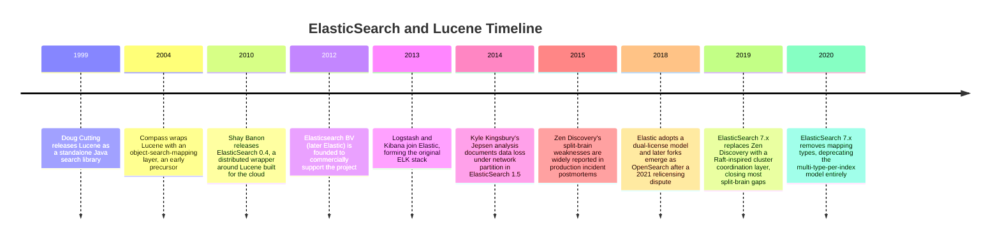

- **Lucene's origin (1999)** — Doug Cutting wrote Lucene as a pure Java
  library implementing an inverted index and a scoring model; Lucene has
  no concept of a network, a cluster, or even a server — it is a
  single-process library any Java application can embed directly, and
  every ElasticSearch node still embeds Lucene internally today
  (Section 4.3).
- **Distributed wrapper (2010)** — Shay Banon had already built Compass, an
  earlier Lucene wrapper, but rebuilt it from scratch as ElasticSearch
  specifically to be distributed-by-default and JSON/REST-native from day
  one, targeting the cloud-native deployment model that was becoming
  standard as Compass's single-node design could not.
- **The ELK stack forms (2013)** — Logstash (log ingestion/transformation)
  and Kibana (visualization) joined the same company, and the three
  together became the default open-source stack for centralized log
  analytics — still ElasticSearch's most common production use case today
  (Section 7).
- **The Jepsen findings (2014)** — Kyle Kingsbury's Jepsen testing
  framework subjected ElasticSearch 1.5 to network partitions and found
  that acknowledged writes could be silently lost — a foundational,
  widely-cited case study (Section 22) for why ElasticSearch was, at that
  time, unsuitable as a system of record.
- **Zen Discovery's split-brain era (roughly 2010-2019)** — ElasticSearch's
  original cluster-membership and master-election protocol, Zen Discovery,
  used a `minimum_master_nodes` setting operators had to configure
  correctly by hand; misconfigured or default clusters could elect two
  masters simultaneously during a network partition, corrupting cluster
  state (Section 4.4, Section 15).
- **Cluster coordination rewrite (7.0, 2019)** — ElasticSearch replaced Zen
  Discovery with a new coordination subsystem modeled closely on the Raft
  consensus algorithm, removing the manual `minimum_master_nodes` tuning
  requirement and closing most (not all) of the split-brain failure modes
  Section 15 still discusses as a matter of engine history and residual
  risk during upgrades of long-lived clusters.
- **Removal of mapping types (7.0, 2019)** — early ElasticSearch allowed
  multiple "types" per index (an artifact of an early attempt to imitate
  relational tables inside one Lucene index); this was fully removed in
  7.0, simplifying the mapping model (Section 4.5) to one mapping per
  index.
- **License changes and the OpenSearch fork (2021)** — Elastic changed
  Elasticsearch's and Kibana's license away from the original Apache 2.0 in
  2021 in response to competitive pressure from managed-service resellers;
  Amazon Web Services (AWS) forked the last Apache-licensed version into
  OpenSearch, which now evolves as a separate but closely related project
  — this chapter teaches ElasticSearch's mechanics, nearly all of which
  apply directly to OpenSearch as well, since the fork happened after the
  core engine (Lucene-based inverted index, shard/replica model, Query
  Domain-Specific Language (DSL)) was already mature.

## 3. Why It Exists

ElasticSearch exists to answer a question that arrives at every system with
enough scale: how do you let a user search free-form text — a product
description, a support ticket, a log line, a chat message — and get back
results ranked by relevance, fast, across potentially billions of
documents? A relational engine's B-tree index
([recapped from Indexes](CH03_Indexes.md)) can answer "find rows where
`status = 'open'`" in effectively constant time because equality on a
single ordered key is exactly what a B-tree is built for, and it can
answer prefix-style text matching (`LIKE 'foo%'`) reasonably well because a
prefix search is still a bounded range scan on the same ordered key — but
it cannot efficiently answer "find every row whose `description` column
contains any of these words, in any order, ranked by how well each row
matches," because that question requires an index built around *terms
extracted from inside* a text field, not around the field's whole value.
Bolt-on relational full-text-search features exist (`tsvector` in
PostgreSQL, `FULLTEXT` indexes in MySQL) and are genuinely useful for
moderate-scale text search, but a purpose-built engine that treats
full-text search as its central design goal — supporting per-language
analysis, relevance tuning, faceted aggregation over search results, and
horizontal scale-out of both the index and the query load — outgrows what
a bolt-on feature can offer once search becomes a primary, high-traffic
capability rather than an occasional convenience query.

A second, related reason ElasticSearch exists is that structured
*analytics* over semi-structured, high-volume data (the dominant example:
log lines and application/infrastructure telemetry) turned out to need
almost the same machinery as full-text search: both need to ingest
high-volume, loosely-structured documents quickly; both need to filter
and aggregate over fields whose exact shape varies document to document;
and both benefit from the same near-real-time indexing model
(Section 4.7) rather than the batch-oriented ingestion pipelines a
traditional data warehouse assumes. This convergence is why ElasticSearch,
originally built purely as a search engine, became the "E" in the ELK
stack and the default backend for log analytics and observability
dashboards (Section 7) — a use case its creators did not originally design
for but that its architecture turned out to fit unusually well.

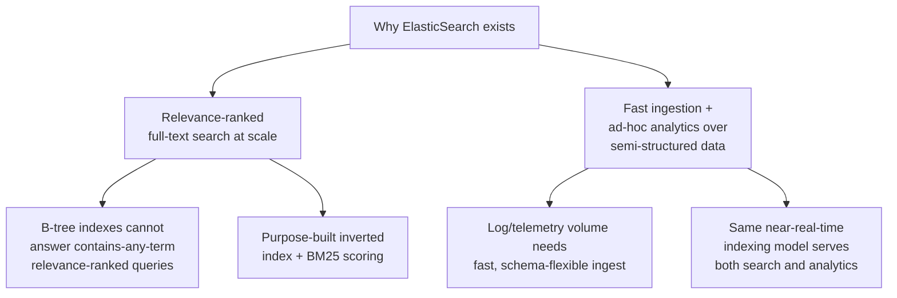

## 4. Core Concepts

This section teaches ElasticSearch's distinguishing internals from first
principles: how an inverted index and the analysis chain turn free text
into searchable terms, how BM25 ranks matching documents, how Lucene's
segment architecture stores those terms durably and efficiently, how a
cluster of ElasticSearch nodes distributes and replicates that data, how
the mapping system defines (or accidentally infers) a document's shape,
how the Query DSL and aggregations framework let an application query and
summarize that data, and how ElasticSearch makes newly-indexed documents
searchable within roughly a second without sacrificing durability.

### 4.1 The Inverted Index, Tokenization, and Analyzers

**Definition.** An inverted index is a data structure that maps each unique
*term* (a word, or word-fragment, extracted from a text field) to a
*postings list*: the set of documents containing that term, along with
enough positional/frequency metadata to support both matching and
relevance scoring (Section 4.2). This is the *inverse* of the natural,
"forward" way of storing text — a forward index maps a document to its
full text; an inverted index maps each term back to every document
containing it — and it is why the structure can answer "which documents
contain word X" in time proportional to how many documents contain X,
rather than having to scan every document's full text on every query.
An *analyzer* is the pipeline that turns a raw text field's value into the
sequence of terms actually stored in the inverted index; it is the single
most consequential configuration choice in an ElasticSearch mapping
(Section 4.5), because a term the analyzer never produces at index time can
never match a query at search time, no matter how the query itself is
written.

**Mechanism.** An analyzer is composed of three ordered stages: zero or
more *character filters* (operating on the raw string before tokenization —
for example, stripping HTML tags, or converting `&` to `and`), exactly one
*tokenizer* (splitting the character-filtered text into individual tokens —
the `standard` tokenizer splits on whitespace and punctuation per Unicode
text-segmentation rules, while a `keyword` tokenizer emits the entire input
as a single, unsplit token, useful for exact-match fields like a status
code), and zero or more *token filters* (transforming the token stream
after tokenization — lowercasing, removing *stop words* like "the" and "a"
that carry little discriminating signal, and *stemming*, which reduces a
word to its root form, for example collapsing "running," "runs," and "ran"
toward a common stem so a search for "run" also matches documents
containing any of those inflected forms). ElasticSearch ships several
built-in analyzers (the `standard` analyzer — Unicode-aware tokenization,
lowercasing, no stemming by default — is the mapping default for any text
field that doesn't specify one explicitly) and lets an index define fully
custom analyzers composed from these three stage types.

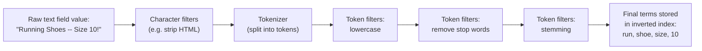

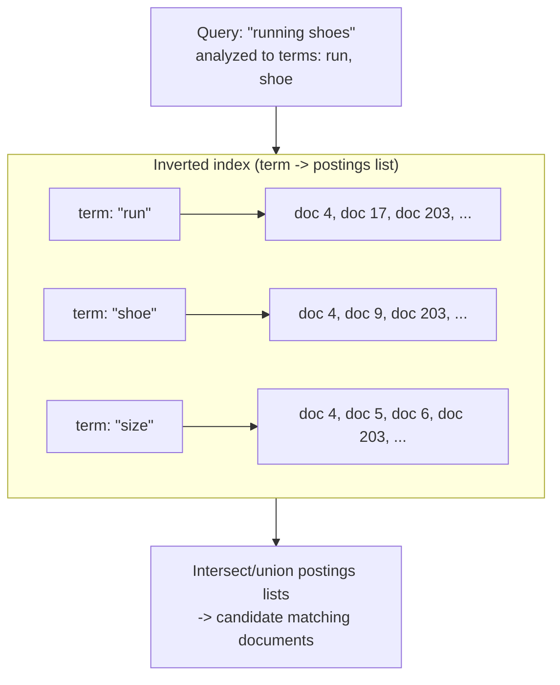

**Decision implications.** Because analysis happens once, at index time,
changing a field's analyzer (switching stemming languages, adding
synonyms, changing tokenization rules) does not retroactively change terms
already stored for existing documents — it only affects documents indexed
*after* the mapping change, meaning a full reindex (copying every document
through the new analysis pipeline into a new index, Section 4.5's
mapping-immutability implication) is required to apply a new analyzer
retroactively. This makes analyzer choice a decision worth making
deliberately and early: a `text` field intended for full-text search
(analyzed, tokenized, lowercased, stemmed) and a `keyword` field intended
for exact match/aggregation/sorting (stored as a single unanalyzed token)
are genuinely different structures serving genuinely different query
needs, and ElasticSearch's `text`/`keyword` multi-field pattern (mapping
the same underlying value both ways under different sub-field names)
exists specifically so one field's value can serve both needs without
choosing only one at index time.

**Failure mode.** The most common analyzer mistake is applying a
full-text analyzer (with stemming and stop-word removal) to a field that
actually needs exact matching — a product SKU, a country code, an email
address — because stemming can silently and unpredictably transform the
stored term away from the field's literal value (an email's local part
tokenized and lowercased, breaking a case-sensitive exact-match query
against it), and stop-word removal can drop a short but meaningful token
entirely. The inverse mistake — mapping a genuinely free-text field (a
product description, a support-ticket body) as `keyword` — means the
*entire string* becomes a single term, so a search for one word inside a
long description never matches anything at all, because the inverted
index has no entry for that word in isolation.

**Scenario.** A support-ticket search index maps `ticket.body` as `text`
with the `standard` analyzer plus stemming (so a search for "cancel" also
surfaces tickets containing "cancelled" or "cancelling"), while
`ticket.status` and `ticket.assignee_email` are mapped as `keyword` (so an
exact-match filter like `status: "closed"` or an aggregation counting
tickets per assignee behaves predictably, with no stemming or tokenization
altering the stored value). A single field, `ticket.subject`, is mapped as
a multi-field: `subject` (analyzed, for relevance-ranked full-text search)
and `subject.raw` (`keyword`, for exact-match deduplication and
alphabetical sorting in a ticket list view) — one underlying value, two
purpose-built representations.

### 4.2 Relevance Scoring: TF-IDF and BM25

**Definition.** Relevance scoring is the mechanism that decides, among all
documents whose postings lists intersect a query's terms (Section 4.1),
which documents are the *best* matches and in what order to return them —
the property that separates a search engine from a simple boolean filter.
ElasticSearch's default scoring algorithm since version 5.0 is Okapi BM25
("Best Matching 25"), which succeeded the earlier TF-IDF (Term
Frequency-Inverse Document Frequency) model that both ElasticSearch and
Lucene originally used and that this section explains first because BM25
is best understood as TF-IDF's refinement, not a wholly separate idea.

**Mechanism.** TF-IDF scores a document for a query term by multiplying two
factors: *term frequency* (TF — how many times the term appears in this
document; naively, more occurrences should mean more relevance) and
*inverse document frequency* (IDF — a downweighting factor for terms that
appear in many documents across the whole index, since a term nearly every
document contains, like "the" after stop-word removal fails to catch it,
or a domain-common word like "error" in a log index, carries little
discriminating power precisely because it doesn't help distinguish one
document from another). TF-IDF's practical weakness is that raw term
frequency grows the score linearly and without bound: a document that
repeats the query term 100 times scores roughly ten times higher than one
that mentions it 10 times, even though the marginal relevance of each
additional repetition genuinely shrinks — the tenth occurrence of a word
in a document tells you far less than the first. BM25 corrects exactly
this: it applies a saturating function to term frequency (controlled by a
tunable parameter `k1`) so that additional occurrences of a term keep
increasing the score but with rapidly diminishing returns, and it adds a
second tunable parameter (`b`) that normalizes term frequency against the
document's length relative to the average document length in the index —
so a query term appearing twice in a 20-word document scores higher than
the same two occurrences in a 2,000-word document, because the shorter
document is proportionally more "about" that term.

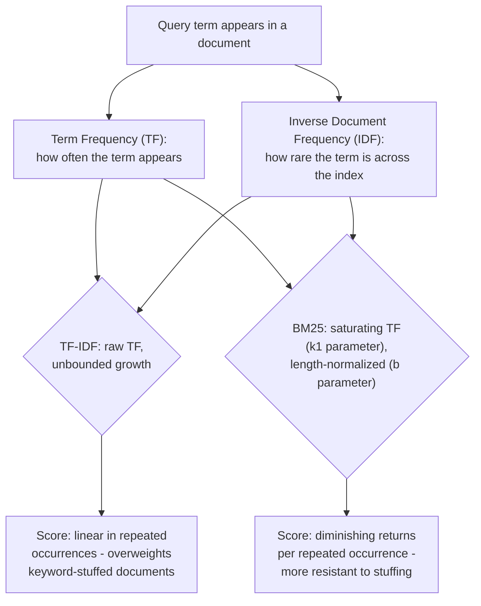

**Decision implications.** BM25's two tunable parameters give an architect
real, if narrow, control over relevance behavior without writing a custom
scoring function: raising `k1` makes additional term occurrences continue
to matter more before saturating (useful for domains where genuine
topical depth correlates with repeated mentions), while lowering `b`
reduces how much a document's length is penalized (useful when short and
long documents are both legitimately "about" the same things, such as a
mixed index of short product titles and long product descriptions sharing
one query). In practice, most production ElasticSearch deployments never
touch these parameters and instead compose relevance through query
structure — `bool` query clause weighting, `function_score` boosting
specific fields or recency, and multi-field `text`/`keyword` matching
(Section 4.1) — because getting BM25's raw parameters right for a
specific corpus is a much narrower lever than getting query structure
right.

**Failure mode.** A common relevance-tuning mistake is judging search
quality purely by whether the *correct* document appears anywhere in the
results, without checking *where* it ranks — a search that returns the
right document at position 47 out of 50 has effectively failed for a
typical user who never scrolls that far, even though a naive precision
check ("was it in the result set at all?") would call it correct. This is
why relevance evaluation in practice uses ranking-aware metrics (such as
Normalized Discounted Cumulative Gain) rather than simple set-membership
precision/recall, and why relevance tuning is an iterative, measured
process rather than a one-time configuration choice.

**Scenario.** An e-commerce search index scores a query for "running
shoes" using BM25 by default; a listing titled "Running Shoes — Men's
Trail Edition" (short title, term appears once, high term-to-length ratio)
outranks a listing whose long, keyword-stuffed description mentions
"running shoes" a dozen times inside several paragraphs of unrelated
marketing copy — BM25's length normalization and TF saturation together
produce the ranking a human reviewer would actually consider more
relevant, which is precisely the failure TF-IDF's unbounded linear scoring
was prone to before BM25 became the default.

### 4.3 Lucene: Segment Architecture, Immutability, and Merging

**Definition.** Every ElasticSearch shard (Section 4.4) is, underneath,
one Lucene index, and every Lucene index is physically composed of one or
more *segments*: self-contained, independently searchable mini-indexes
(each holding its own inverted index, stored field data, and metadata)
that are **immutable** once written — a segment is never modified in place
after it is created. This immutability is the foundational design
decision Lucene's entire storage model is built around, and it is the
mechanism that ultimately makes near-real-time search (Section 4.7)
possible at all.

**Mechanism.** New documents are first buffered in an in-memory structure;
periodically (driven by the refresh process, Section 4.7), that buffer is
written out as a brand-new, immutable segment on disk, and a query against
the shard now searches across *every* existing segment plus the new one,
merging each segment's independently-ranked results into one combined
result set. Because segments accumulate over time (every refresh can
produce a new one) and because deletes and updates cannot modify an
existing immutable segment, a delete is implemented as a *tombstone*
marker (the document is flagged as deleted in a bitset associated with its
segment, but its bytes remain on disk, physically removed later) and an
update is implemented as a delete of the old document plus an insert of a
new one — Lucene, and therefore ElasticSearch, has no true in-place update
at the storage layer. A background *merge* process periodically combines
several smaller segments into one larger segment, physically discarding
tombstoned documents in the process and reducing the total segment count
(and therefore the per-query fan-out cost of searching many small
segments) — the same compaction/consolidation trade-off this book has
already taught for Cassandra's Log-Structured Merge-tree (LSM-tree)
storage engine
([recapped from Cassandra](CH18_Cassandra.md)), applied here to Lucene's
own segment model rather than Cassandra's memtable/SSTable model.

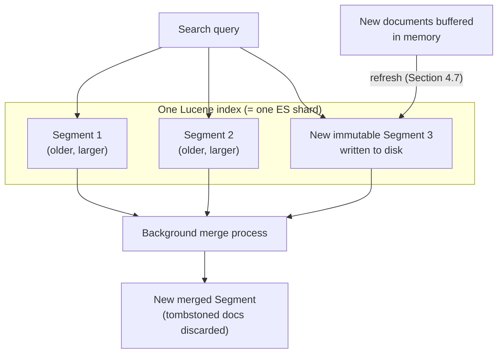

**Decision implications.** Segment immutability trades write simplicity
and read-without-locking (any query sees a fully consistent, unchanging
view of every segment it touches, with no reader/writer contention at the
segment level) for a permanent background merge cost: every document that
is ever updated or deleted continues occupying disk space and continues
being scanned as a tombstone by every query touching its original segment
until a merge physically reclaims it, meaning update- or delete-heavy
workloads carry a materially higher steady-state I/O cost than
insert-mostly workloads such as log ingestion (Section 7). Merge policy
(how aggressively and on what schedule ElasticSearch triggers merges) is
consequently a real performance lever: too little merging leaves too many
small segments, slowing every query's fan-out; too much merging spends
disk Input/Output (I/O) and CPU rewriting data that didn't need to move
yet.

**Failure mode.** An index under sustained heavy update/delete load without
merge policy tuned for that workload accumulates a growing fraction of
tombstoned-but-not-yet-reclaimed documents, silently inflating disk usage
and per-query scan cost even though the *logical* document count stays
flat or shrinks — an operator inspecting only the logical document count
can be misled into thinking the index is healthy while its physical
segment footprint grows unbounded, a failure mode operationally very
similar to the "bloat" this book already taught for PostgreSQL's own
copy-on-write MVCC heap tuples
([recapped from PostgreSQL](CH11_PostgreSQL.md)).

**Scenario.** A high-cardinality "item view count" field updated on every
page view (a genuinely bad ElasticSearch use case, Section 17) forces a
delete-plus-reinsert of the entire parent document on every single view
event; at even moderate traffic, this generates enormous tombstone churn
and constant merge pressure, versus the same counter tracked as a
separate, append-only "view event" document type (or, better, outside
ElasticSearch entirely in a purpose-built counter store) that never
touches the parent document's segments at all.

### 4.4 Cluster Architecture: Nodes, Shards, Replicas, and Master Election

**Definition.** An ElasticSearch cluster is a set of nodes (individual
ElasticSearch server processes) that together hold one or more indices,
where each index is split into a fixed number of *primary shards* — chosen
at index-creation time and, in modern ElasticSearch versions, not
changeable afterward without reindexing — and each primary shard can have
zero or more *replica shards*, full copies kept in sync with the primary
for both read scale-out and failover. This is ElasticSearch's own concrete
distribution model, related to but distinct from the generic sharding and
replication theory this book already teaches
([recapped from Sharding](CH06_Sharding.md);
[recapped from Replication](CH07_Replication.md)): a document's target
shard is chosen by hashing its `_id` (or a custom routing value) modulo the
*fixed* primary-shard count — closer to the hash-mod routing this book's
Sharding chapter contrasts against consistent hashing than to a
consistent-hashing ring, and specifically why the primary-shard count
cannot be changed after index creation without a full reindex: changing
the modulus would relocate every document to a different shard.

**Mechanism.** Every ElasticSearch node can hold one or more roles: a
*master-eligible* node participates in cluster-state changes and master
election; a *data* node physically stores shards and executes search/index
operations against them; an *ingest* node runs pre-processing pipelines on
documents before indexing; and a *coordinating* node (every node can act as
one, even a node with no other role) is simply whichever node an
application's request happens to land on, responsible for routing that
request to the shards that actually hold the relevant data and merging
their partial results into one final response — the same coordinator/
scatter-gather pattern this book's MongoDB chapter already taught for
`mongos`
([recapped from MongoDB](CH15_MongoDB.md)), here built into every
ElasticSearch node rather than a dedicated separate process. Exactly one
master-eligible node is elected *the* active master at any time,
responsible for cluster-wide bookkeeping — which nodes are in the cluster,
which shards live on which nodes, mapping changes — using a
Raft-inspired coordination protocol (Section 2) that requires a strict
majority ("quorum") of master-eligible nodes to agree before any cluster-
state change is committed, the same majority-vote discipline this book's
Replication chapter already teaches for leader election generally
([recapped from Replication](CH07_Replication.md)).

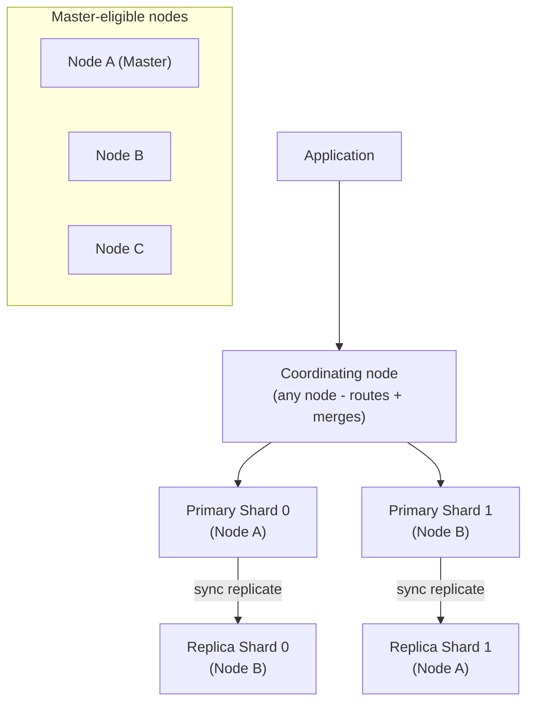

```mermaid
sequenceDiagram
    participant NodeA
    participant NodeB
    participant NodeC
    Note over NodeA,NodeC: NodeA (current master) becomes unreachable
    NodeB->>NodeB: detects master failure via ping timeout
    NodeB->>NodeC: propose election, request votes
    NodeC->>NodeC: evaluates candidate, grants vote
    NodeC-->>NodeB: vote granted
    NodeB->>NodeB: has quorum (2 of 3 master-eligible) -&gt; becomes master
    NodeB-->>NodeC: publishes new cluster state as master
```

A shard itself can be in one of several states the master tracks and
reports as overall cluster health:

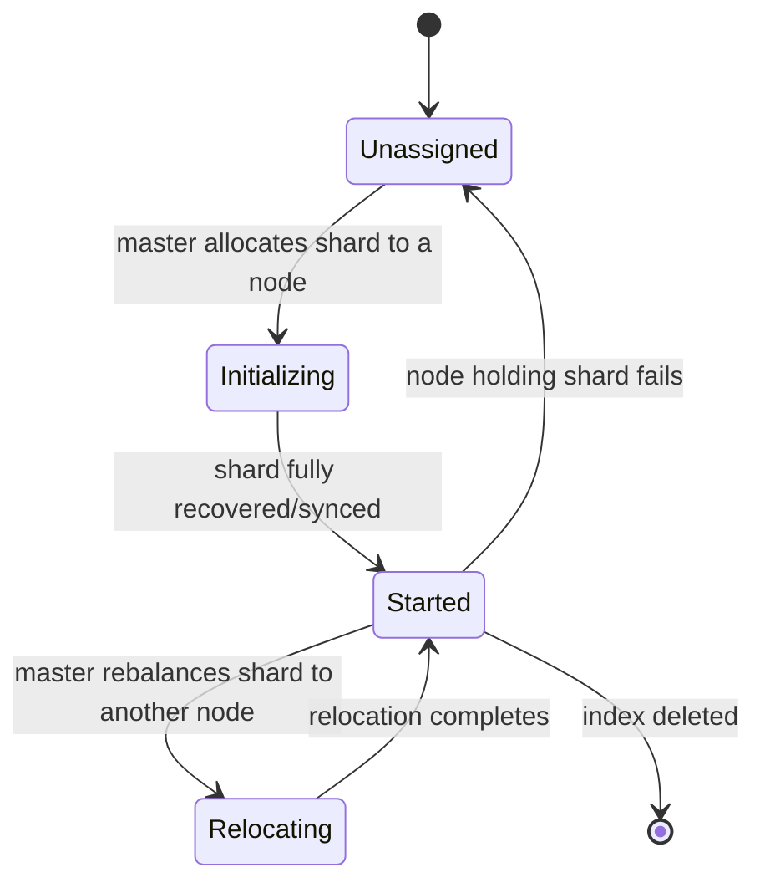

Cluster health itself rolls up from shard state into three colors: green
(every primary and every replica shard is `Started`), yellow (every
primary is `Started` but at least one replica is not — the cluster is
fully readable/writable but under-replicated and at reduced failover
capacity), and red (at least one primary shard is not `Started` — some
data is entirely unavailable until that shard recovers or is restored from
a snapshot).

**Decision implications.** Because the primary-shard count is effectively
permanent per index, choosing it is one of the highest-leverage,
hardest-to-reverse decisions in an ElasticSearch deployment — directly
analogous to MongoDB's shard-key choice
([recapped from Sharding](CH06_Sharding.md)) but for a different reason:
too few primary shards limits how much a single index can scale across
nodes and how parallel a query against it can become; too many primary
shards for a small dataset wastes overhead (every shard carries its own
Lucene segment/merge machinery, Section 4.3, and its own per-shard memory
cost) and slows down queries that must fan out across more shards than the
data volume justifies. Modern ElasticSearch mitigates the "wrong shard
count chosen too early" risk for time-series/log workloads specifically
through *index lifecycle management* and rolling daily/hourly indices
(Section 12), sidestepping the need to guess a single index's shard count
correctly for the workload's entire multi-year lifetime.

**Failure mode.** Under Zen Discovery (Section 2, pre-7.0), a network
partition splitting master-eligible nodes into two groups that each
believed they held a quorum could result in *split-brain*: two masters
simultaneously believing they were authoritative, each accepting writes
and diverging cluster state, requiring manual reconciliation once the
partition healed — the canonical distributed-systems failure this book's
Replication chapter already frames generically
([recapped from Replication](CH07_Replication.md)). The 7.0 coordination
rewrite (Section 2) closes most of this risk by enforcing a stricter,
Raft-inspired quorum rule automatically rather than relying on an operator
to hand-configure `minimum_master_nodes` correctly, but the underlying
majority-quorum math is identical to what this book has already taught,
just now enforced by the engine rather than by operator discipline.

**Scenario.** A three-node cluster with one replica configured per primary
shard survives any single node failure without data loss or unavailability
(green health degrades briefly to yellow while the surviving nodes
re-establish replica coverage, then back to green), because losing one
node still leaves every primary shard's data present on at least one
surviving node — the concrete reason production ElasticSearch guidance
almost universally recommends at least one replica per primary shard even
though replicas double a shard's steady-state storage and indexing cost.

### 4.5 The Mapping System and Dynamic Mapping Pitfalls

**Definition.** A *mapping* is ElasticSearch's schema: for each field in an
index, the mapping declares the field's data type (`text`, `keyword`,
`long`, `date`, `boolean`, nested object, and others) and, for `text`
fields, which analyzer (Section 4.1) to apply. Unlike a relational
`CREATE TABLE`, a mapping can be extended (new fields added) after an
index already contains documents, but an *existing* field's mapped type
cannot be changed in place once ElasticSearch has inferred or been told
what it is — the only way to change an existing field's type is to create
a new index with the corrected mapping and reindex every document into it.
*Dynamic mapping* is ElasticSearch's default behavior when a document
contains a field the current mapping has never seen before: rather than
rejecting the document, ElasticSearch guesses a type from the field's
JavaScript Object Notation (JSON) value and permanently adds that guessed
mapping to the index.

**Mechanism.** Dynamic mapping's type-guessing rules are simple and,
critically, based only on the *first* document ElasticSearch ever sees
containing a given field: a JSON string is mapped as a `text` field with a
`keyword` sub-field (Section 4.1's multi-field pattern) by default; a JSON
number becomes `long` or `double` depending on whether it looks like an
integer or a float; a value that looks like an International Organization
for Standardization (ISO) 8601 date string is mapped as `date`. Because
this guess is locked in permanently as soon as the first document sets it,
every subsequent document is validated against that first guess, and a
later document whose value for the same field doesn't fit the guessed type
(a numeric-looking field that later receives a genuinely non-numeric
string, for example) is rejected outright at index time with a mapping
conflict error — not silently coerced, and not silently accepted as a
second, parallel shape the way MongoDB's schema-on-read model would allow
([recapped from MongoDB](CH15_MongoDB.md)); ElasticSearch's dynamic mapping
is better understood as "schema-on-first-write, then strictly enforced,"
a meaningfully different trade-off from MongoDB's fully open schema-on-read
model even though both are sometimes casually described as "schemaless."

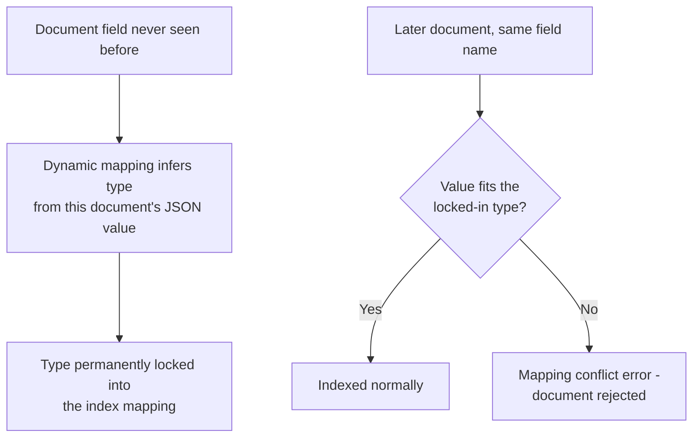

**Decision implications.** Because dynamic mapping's first-guess-wins
behavior can be triggered by whatever document happens to arrive first —
not necessarily a representative one — production ElasticSearch guidance
strongly favors *explicit* mappings (declaring every expected field's type
before the first document is ever indexed) for any index whose schema is
known in advance, reserving dynamic mapping for genuinely exploratory or
highly variable data such as raw log ingestion, where the field set truly
cannot be enumerated ahead of time. Even for log-style indices, most
production deployments still constrain dynamic mapping with *dynamic
templates* (pattern-based rules mapping, for example, every field ending
in `_ip` to an `ip` type, or every field ending in `_count` to a `long`)
rather than leaving type inference fully unconstrained.

**Failure mode.** The single most common ElasticSearch production incident
in this category is the numeric/string mapping conflict: a log field like
`user_id` happens to be numeric in the first several thousand log lines
ElasticSearch indexes (locking the field in as `long`), and days or weeks
later an upstream service change starts emitting `user_id` as a string
(perhaps a Universally Unique Identifier (UUID) migration) — every log
line containing the new string value is now silently rejected at the
ingestion layer (or, depending on pipeline configuration, dropped or routed
to a dead-letter index), often for a substantial period before anyone
notices the resulting gap in log/analytics coverage, because a rejected
document produces no visible error to the application that originally
emitted the log line — only to whatever ingestion pipeline attempted to
index it.

**Scenario.** A team migrating a microservice's `order_id` field from an
auto-incrementing integer to a UUID discovers, only after the migration
ships, that their log-analytics ElasticSearch index has been silently
dropping every log line containing the new UUID-formatted `order_id` since
the field was first dynamically mapped as `long` months earlier from
integer-only historical data — the fix requires both a reindex with an
explicit `keyword` mapping for `order_id` and, more importantly, a
process change: any field intended to ever change format should be
mapped explicitly from the start, or the ingestion pipeline should
validate/normalize field types before they ever reach ElasticSearch.

### 4.6 Query DSL: match/term/bool Queries and the Aggregations Framework

**Definition.** The Query DSL (Domain-Specific Language) is a JSON-based
query language ElasticSearch exposes over its REST Application Programming
Interface (API); every query is itself a JSON document describing which
documents to match and (optionally) how to score them. The two most
fundamental *leaf* query types are `match` (analyzes the query text through
the same analyzer the target field uses at index time, then finds
documents whose inverted-index terms overlap — this is *full-text query
context*, where results are scored by relevance, Section 4.2) and `term`
(matches an exact, unanalyzed value against a field — typically a
`keyword` field — with no analysis applied to the query value at all).
`bool` is the primary *compound* query, combining leaf queries with four
clause types: `must` (the clause must match, and contributes to the
relevance score), `should` (the clause is optional but boosts the score if
it matches — the mechanism behind "nice to have" relevance signals),
`must_not` (the clause must not match, and is evaluated in *filter
context*), and `filter` (the clause must match, but — critically — does
*not* contribute to scoring at all).

**Mechanism.** The distinction between *query context* (`must`/`should`,
which compute a relevance score) and *filter context* (`filter`/
`must_not`, which only answer yes/no) is not a stylistic choice — filter
context clauses are both cheaper to execute (no scoring computation) and,
critically, cacheable: ElasticSearch maintains a filter cache of frequently
used filter-context clause results as compact bitsets, so a repeated
`filter` clause (such as `status: "published"` on nearly every query
against a content index) can be answered from cache without re-scanning
the underlying postings lists on every request — a smaller-scoped,
more mechanically specific analog of the general cache-aside pattern this
book already teaches
([recapped from Caching](CH09_Caching.md)). Any clause whose match/no-match
answer is genuinely binary and doesn't need to influence ranking (a status
filter, a date range, a tenant identifier) belongs in `filter`, not `must`,
purely for this performance reason — putting a pure filter into `must`
computes and discards a relevance contribution the application never
needed.

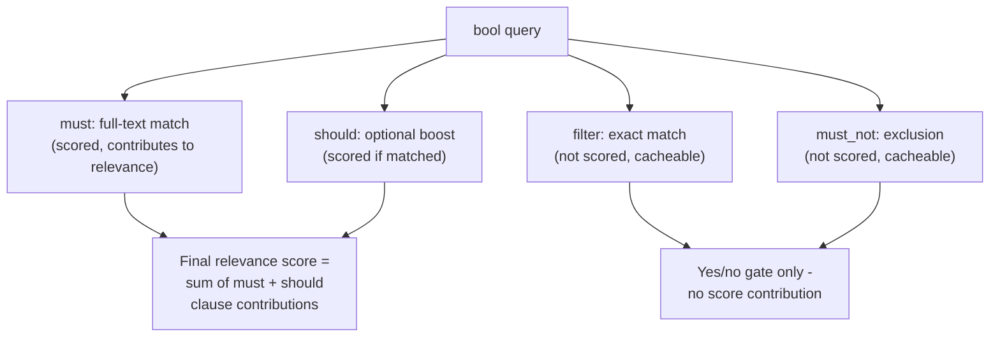

The *aggregations framework* runs alongside (not instead of) a query's
matching phase, computing summary statistics over the set of matched
documents in the same request — the ElasticSearch analog of a relational
`GROUP BY` plus aggregate functions, but computed over a search result set
rather than a full table scan. *Bucket* aggregations (`terms`, grouping
documents by a field's distinct values; `date_histogram`, grouping into
fixed time intervals; `range`, grouping into custom numeric bands) each
produce a set of buckets, and *metric* aggregations (`avg`, `sum`, `min`,
`max`, `cardinality` for approximate distinct counts) compute a value
either globally or, more commonly, *nested inside* each bucket a parent
bucket aggregation produced — for example, a `date_histogram` bucketing
log volume by hour, with a nested `terms` aggregation inside each hourly
bucket breaking that hour's volume down by `status_code`.

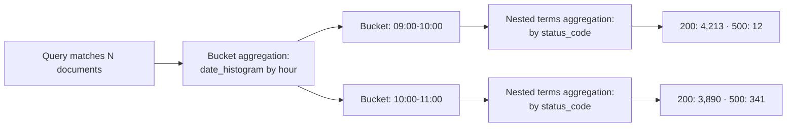

**Decision implications.** Because `terms` and `cardinality` aggregations
operate per-shard and merge results at the coordinating node (the same
scatter-gather pattern Section 4.4 already introduced), both are
inherently *approximate* at scale for high-cardinality fields: a `terms`
aggregation only returns the top N terms *per shard* before merging, which
can undercount a term whose documents are spread thinly across many
shards rather than concentrated in one, and `cardinality` uses a
probabilistic algorithm (HyperLogLog++) trading a small, bounded error
rate for the ability to estimate distinct counts across billions of
values without holding every distinct value in memory. An architect
building a dashboard that depends on exact counts must know this
trade-off exists rather than assuming aggregation results carry the same
exactness a relational `COUNT(DISTINCT ...)` guarantees.

**Failure mode.** A `terms` aggregation with a high `size` parameter (the
number of top buckets requested) against a high-cardinality field (a raw
User ID or a full Uniform Resource Locator (URL)) is a classic
ElasticSearch performance incident: it forces every shard to hold and
transmit far more candidate buckets than the final result needs merely so
the coordinating node can merge accurately, consuming large amounts of
heap memory on every node holding a shard for that index and, in severe
cases, triggering ElasticSearch's own circuit breaker to reject the
request outright to protect node stability rather than let it exhaust
memory.

**Scenario.** A log-analytics dashboard's "top 10 error messages in the
last hour" panel uses a `filter` clause for the time range and log level
(cheap, cacheable, unscored) combined with a `terms` aggregation on a
`keyword`-mapped `error_message.raw` field bucketed to the top 10 —
deliberately keeping the aggregation's `size` small and the filtering work
in filter context, versus a naive implementation that puts the time-range
check in `must` (paying an unnecessary scoring cost on a clause that was
always going to be a plain boolean gate).

### 4.7 Near-Real-Time Search: Refresh Interval and the Translog

**Definition.** ElasticSearch is described as *near-real-time*, not
real-time, because a document is not immediately searchable the instant it
is indexed — it becomes searchable only after the next *refresh*, a
periodic operation (by default every one second) that makes recently
indexed documents visible to search without waiting for those documents to
be durably flushed (fsynced) to disk. The *translog* (transaction log) is
the mechanism that makes this safe: every indexing operation is first
appended to the translog before it is acknowledged, so a crash between
refreshes never loses acknowledged writes even though those writes may not
yet be searchable or durably persisted in a Lucene segment.

**Mechanism.** When a document is indexed, ElasticSearch writes it into an
in-memory buffer (not yet searchable) and simultaneously appends it to the
translog (an append-only, disk-backed log, analogous in purpose to the
Write-Ahead Logs this book has already taught for relational engines
([recapped from PostgreSQL](CH11_PostgreSQL.md))) before returning
acknowledgment to the client. On the default one-second cadence, a
*refresh* takes everything currently sitting in the in-memory buffer and
writes it out as a new, immutable Lucene segment (Section 4.3) held in the
operating system's filesystem cache — at this point the document becomes
searchable, but the segment has not necessarily been fsynced to durable
storage yet. Separately and less frequently (by default every 30 minutes,
or sooner if the translog grows past a configured size), a *flush*
fsyncs all segments to durable disk storage and then safely clears (starts
a new) translog, since every operation the cleared translog held is now
durably represented in a flushed segment and no longer needs replaying
from the log on recovery. On an unclean shutdown, ElasticSearch recovers
by loading the most recent flushed segments and replaying only the
translog entries recorded since the last flush — the identical
recovery-time-bounding pattern this book's PostgreSQL and MongoDB chapters
already teach for their own write-ahead-log-plus-checkpoint designs
([recapped from MongoDB](CH15_MongoDB.md)).

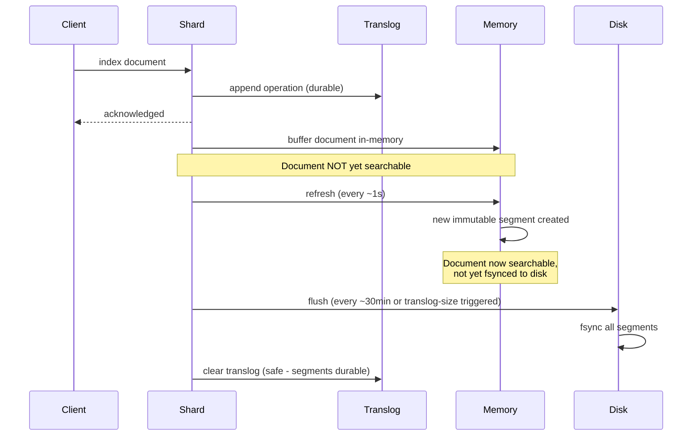

**Decision implications.** The refresh interval is a direct, explicit
latency-vs-throughput knob: a shorter refresh interval (or an
application-triggered manual refresh) makes documents searchable sooner
but forces more frequent, smaller Lucene segments (Section 4.3), which
increases merge pressure; a longer refresh interval reduces segment churn
and improves indexing throughput at the cost of a longer window before new
documents become searchable. High-volume, ingestion-heavy workloads (bulk
log ingestion, Section 7) commonly *increase* the refresh interval well
beyond the one-second default (or disable automatic refresh entirely
during a large bulk-load operation, re-enabling it afterward) specifically
to trade search latency, which log-analytics dashboards can usually
tolerate being a few seconds stale, for materially higher indexing
throughput.

**Failure mode.** A team that assumes ElasticSearch is a real-time,
read-your-writes system — indexing a document and immediately querying for
it in the same request-response cycle, expecting to find it — will
intermittently fail to see the document at all, because the query can run
before the next refresh has made that specific write searchable; this is a
frequent source of confusing, hard-to-reproduce "missing data" bug reports
that are, in fact, ElasticSearch behaving exactly as documented. The fix,
where genuinely necessary, is either an explicit `refresh=wait_for` (or
`refresh=true`) parameter on the specific write that must be immediately
visible (at a real, non-trivial latency cost, since the caller now waits
for the next refresh cycle to complete) or, better, redesigning the calling
code to not depend on immediate post-write visibility at all.

**Scenario.** A search-as-you-type product catalog accepts new product
listings continuously; the default one-second refresh interval means a
newly published product is searchable within roughly a second of being
indexed — acceptable for this use case, since no caller expects to search
for a product in the same request that created it. A test suite that
indexes a document and immediately asserts it is searchable, however, must
explicitly request `refresh=true` on the test's index operation (a pattern
this chapter's Section 10 code examples demonstrate directly), or the test
will be flaky, passing or failing depending on timing rather than on
correctness.

## 5. Internal Working

Beyond the seven Core Concepts above, two additional mechanics determine
how a request actually flows through an ElasticSearch cluster end to end:
the write path from a client's index request to a durable, searchable
document, and the read path from a client's search request to a merged,
ranked result set.

The write path begins at whichever node receives the request (acting as
coordinating node, Section 4.4), which routes the document to the correct
primary shard by hashing its `_id` (or an explicit routing value) modulo
the primary-shard count. The primary shard indexes the document into its
Lucene index (appending to the translog first, Section 4.7) and then
forwards the same operation to every replica shard for that primary,
waiting for each replica to acknowledge before the primary itself
acknowledges the write back to the coordinating node — a synchronous,
primary-then-replicas fan-out broadly analogous to the leader/follower
replication mechanics this book already teaches
([recapped from Replication](CH07_Replication.md)), but scoped to a single
shard's primary/replica group rather than a whole-database leader.

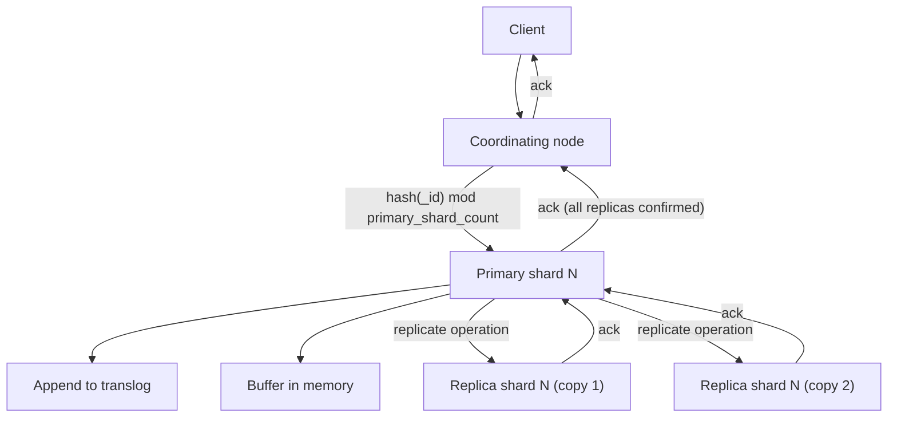

The read path is a two-phase scatter-gather: the coordinating node sends
the query to one copy (primary or any replica, chosen for load balancing)
of every shard the target index(es) span; each shard independently
executes the query against its own Lucene segments (Section 4.3) and
returns its own locally-ranked top results plus enough metadata for the
coordinating node to determine the globally correct top results without
every shard having to transfer its entire matching set; the coordinating
node then fetches the full document bodies only for the final, globally
top-ranked results (the *query-then-fetch* execution model) rather than
transferring every candidate document's full body from every shard
up front.

## 6. Design Principles

Index design in ElasticSearch centers on two largely-fixed-at-creation-time
decisions that this chapter's Core Concepts already motivate individually:
primary-shard count (Section 4.4) and mapping (Section 4.5) — both of
which are expensive or impossible to change after the fact without a
reindex, so both should be decided deliberately against the workload's
expected data volume and query shape, not left to defaults. A second,
equally important design principle is *analyzer selection per field*
(Section 4.1): every text field's analyzer should be chosen for that
field's actual query need (full-text relevance vs. exact match vs.
aggregation/sorting) rather than accepting whatever the mapping's default
or dynamic-mapping guess happens to produce.

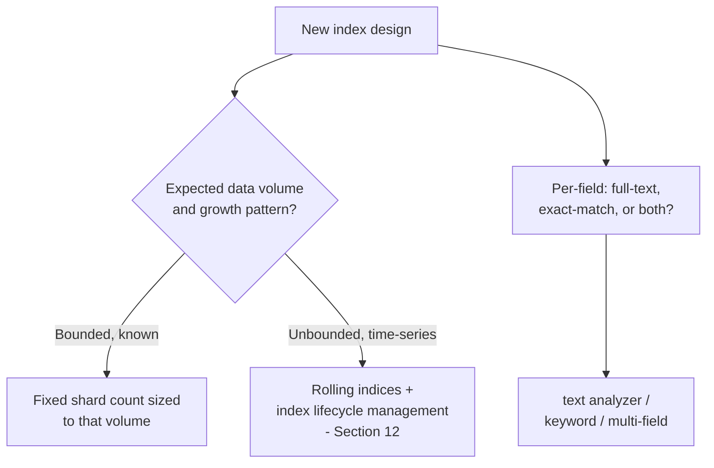

## 7. Architecture Patterns

The single most common ElasticSearch architecture pattern is the ELK
(ElasticSearch, Logstash, Kibana) or its Filebeat/Fluentd-fronted variants:
application and infrastructure logs are shipped (often via a lightweight
agent) into a transformation pipeline, indexed into rolling,
time-partitioned ElasticSearch indices, and visualized through Kibana
dashboards — an architecture where ElasticSearch is explicitly a
*derived*, rebuildable analytics store, not a system of record, because
the original log lines (or the systems that produced them) remain the
authoritative source.


A second common pattern is *search-as-a-secondary-index*: an application's
system of record remains a relational or document database, and
ElasticSearch holds a denormalized, search-optimized copy of a subset of
that data, kept in sync via Change Data Capture (CDC) or application-level
dual writes — the same derived-read-model pattern this book already
teaches generically
([recapped from Denormalization](CH02_Denormalization.md)), applied here
specifically to full-text search rather than to a general read-model
optimization. Section 19 examines the far riskier third pattern —
ElasticSearch *as* the system of record — and why it is generally an
anti-pattern rather than an architecture choice to default into.

## 8. Production Architecture

A production ElasticSearch deployment separates node roles explicitly
rather than running every node as a monolithic "does everything" instance:
dedicated master-eligible nodes (small, stable, rarely under memory
pressure, since their job is cluster-state bookkeeping, Section 4.4, not
data storage or query execution), dedicated data nodes (sized for storage
and query load, often split further into "hot" nodes on fast storage for
recent, actively-queried data and "warm"/"cold" nodes on cheaper storage
for older, rarely-queried data — Section 12's data-tiering pattern), and
dedicated coordinating-only nodes (no data, no master eligibility — purely
absorbing query fan-out/merge load, Section 5, to shield data nodes from
that overhead) for very large, high-query-volume clusters.

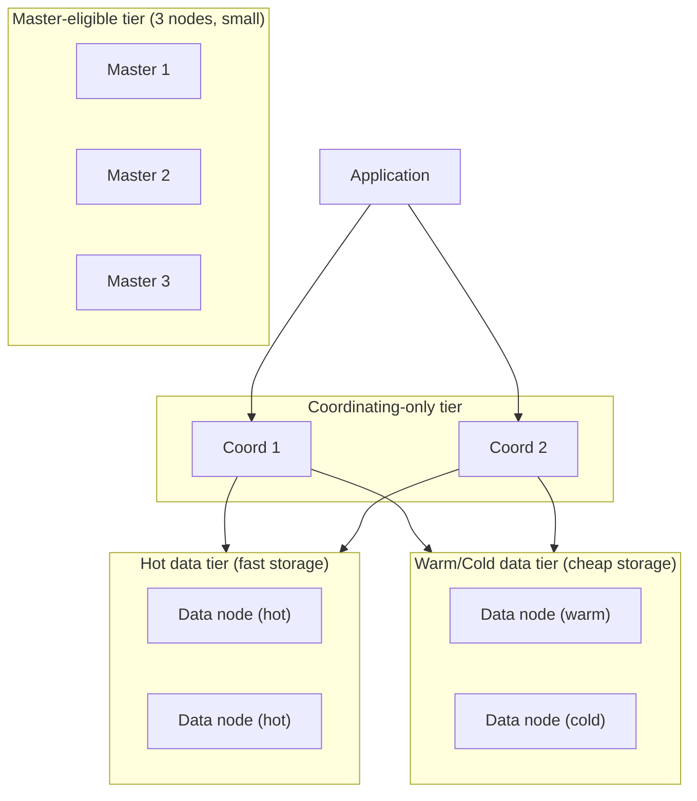

## 9. Implementation

Applications typically connect to ElasticSearch through an official
client library for their language (this chapter's Section 10 examples use
the official Python client, `elasticsearch-py`) that wraps the REST/JSON
API described throughout Section 4, or issue raw Hypertext Transfer
Protocol (HTTP) requests directly against the REST endpoint since the
entire API is a well-documented, stable HTTP/JSON contract with no
proprietary wire protocol to implement. Explicit mappings (Section 4.5)
and index settings (primary-shard count, Section 4.4; refresh interval,
Section 4.7) are almost always defined once, at index-creation time,
rather than relying on defaults, and bulk indexing (the `_bulk` API,
batching many index/update/delete operations into a single HTTP request)
is the standard high-throughput ingestion pattern rather than issuing one
HTTP request per document.

## 10. Complete Code Examples

The following examples live under
[code/python/elasticsearch-chapter/](../code/python/elasticsearch-chapter/)
(using the official `elasticsearch-py` client) and
[code/json/elasticsearch-chapter/](../code/json/elasticsearch-chapter/)
(raw Query DSL request bodies, runnable directly against the REST API with
any HTTP client or `curl`).

1. [`01_custom_analyzer_and_mapping.py`](../code/python/elasticsearch-chapter/01_custom_analyzer_and_mapping.py) —
   creates an index with an explicit mapping (Section 4.5) and a custom
   analyzer (Section 4.1) composed of a character filter, tokenizer, and
   stemming token filter, deliberately avoiding the dynamic-mapping
   pitfall Section 4.5 describes.
2. [`02_bool_query_with_filters.json`](../code/json/elasticsearch-chapter/02_bool_query_with_filters.json) —
   a `bool` query (Section 4.6) combining a scored `must` full-text
   `match` clause with cacheable, unscored `filter` clauses, demonstrating
   query-context vs. filter-context separation.
3. [`03_aggregations_terms_and_date_histogram.json`](../code/json/elasticsearch-chapter/03_aggregations_terms_and_date_histogram.json) —
   a nested aggregation (Section 4.6): a `date_histogram` bucketing log
   volume by hour with a nested `terms` aggregation breaking each hour
   down by status code, alongside a filter-context query scoping the
   aggregated document set.
4. [`04_bulk_index_and_refresh_demo.py`](../code/python/elasticsearch-chapter/04_bulk_index_and_refresh_demo.py) —
   bulk-indexes a batch of documents via the `_bulk` API, then
   demonstrates the near-real-time visibility gap (Section 4.7) by
   querying immediately (showing partial or no results) versus after an
   explicit `refresh=wait_for`.

## 11. Performance

The dominant ElasticSearch performance levers are, in order of typical
impact: correct mapping (Section 4.5, avoiding expensive dynamic-mapping
surprises and unnecessary `text` analysis on fields that only need exact
match), disciplined use of filter context over query context for any
clause that doesn't need to contribute to relevance scoring (Section 4.6),
bulk indexing with a sensibly sized batch (typically a few thousand
documents or a few megabytes per `_bulk` request — too small wastes
per-request overhead, too large risks timeouts and memory pressure) rather
than one-document-at-a-time indexing, and refresh-interval tuning
(Section 4.7) for ingestion-heavy workloads. Query profiling (the
`_profile` API) shows the actual per-clause and per-shard execution cost
of a specific query, the ElasticSearch analog of the `EXPLAIN` discipline
this book already teaches for relational query plans
([recapped from Query Optimizers](CH04_Query_Optimizers.md)).

## 12. Scalability

Read scalability comes from adding replica shards (Section 4.4) and
distributing query load across them; write/storage scalability beyond a
single node's capacity comes from the primary-shard count chosen at index
creation, which is why time-series and log workloads default to *rolling
indices* — creating a new index (with its own, independently-chosen
shard count) per day or per fixed size threshold, rather than one
enormous, single, forever-growing index — sidestepping the "shard count
is fixed forever" constraint entirely for workloads whose natural access
pattern is time-bounded anyway (searching "the last 7 days of logs," not
"all logs ever, in one index"). *Index Lifecycle Management (ILM)*
automates this rolling pattern further: a policy defines when an index
rolls over to a new one (by age or size), when it migrates from the hot
tier to the warm or cold tier (Section 8), and when it is finally deleted
or archived — a fully automated hot-warm-cold-delete pipeline requiring no
manual index management once configured.


## 13. Security

ElasticSearch's security layer (bundled since 6.8/7.1 rather than a
separate paid plugin) provides Role-Based Access Control (RBAC) over
indices and operations, transport-layer and HTTP-layer Transport Layer
Security (TLS)
([recapped from TLS](../05_Networking_and_OS/CH06_TLS.md)) between nodes
and between clients and the cluster, and *document-level* and
*field-level* security — restricting which specific documents or fields a
given role can see, evaluated as an additional filter applied
transparently to every query that role issues, rather than an
all-or-nothing index-level grant. Because ElasticSearch's REST API is
directly network-reachable by default, exposing an ElasticSearch cluster
to the public internet without authentication enabled is a persistent,
widely-documented real-world misconfiguration (numerous publicly reported
data exposures have traced back to exactly this mistake) — security
should be enabled and verified as a deployment-time default, not an
opt-in hardening step applied later.

## 14. Observability

Cluster health (green/yellow/red, Section 4.4) is the first signal any
operator checks; per-node Java Virtual Machine (JVM) heap usage and
garbage-collection pause time are critical because ElasticSearch nodes are
Java processes whose data-node role is heavily memory-sensitive (the
filter cache, field-data structures for aggregations, and Lucene's own
segment file-handle/memory-mapping usage all compete for the same heap
and off-heap memory), and per-index/per-shard indexing and search
latency/throughput metrics reveal whether a specific index or shard is
the actual bottleneck rather than the cluster as a whole. The `_cat` and
`_nodes/stats` APIs expose these metrics directly; most production
deployments instead feed them into the same ELK/observability stack
(Section 7) ElasticSearch itself often powers for other data — a notable,
slightly recursive detail worth being explicit about: monitoring the
cluster that runs your monitoring stack has real operational implications
if both live in the same cluster (Section 15).

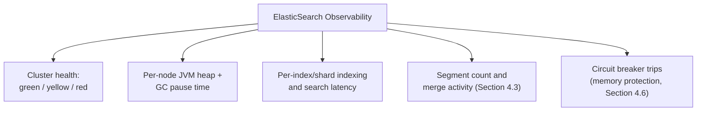

## 15. Failure Scenarios

A **node failure** with at least one replica configured (Section 4.4) is
the best-case failure: the cluster briefly turns yellow while the master
promotes a surviving replica to primary (for any primary that lived on the
failed node) and schedules new replica copies, then returns to green once
replication catches up, with no data loss and no indexing interruption. A
**split-brain during master election** (Section 2, Section 4.4) — now rare
under the post-7.0 Raft-inspired coordination layer but a real risk on
older or misconfigured clusters — can corrupt cluster state and require
manual intervention to reconcile. A **disk-watermark breach** (a node
running low on disk space) triggers ElasticSearch's built-in disk-based
shard allocation protection, first blocking new shard allocation to that
node and, past a second, stricter threshold, forcing all indices with a
shard on that node into a read-only state to prevent an out-of-disk crash
— a protective mechanism that itself becomes an incident (unexpected
write rejections across many indices) if the underlying disk-pressure
cause isn't understood.

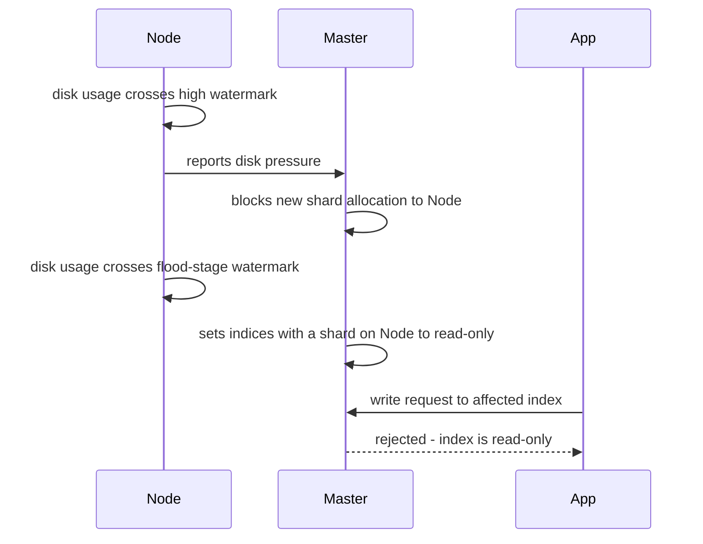

## 16. Testing

Mapping and analyzer behavior should be tested explicitly with the
`_analyze` API against representative sample text before an index goes to
production, verifying the exact terms an analyzer produces rather than
assuming a built-in analyzer behaves as expected for a given language or
domain vocabulary. Integration tests that index a document and immediately
assert search visibility must account for the near-real-time model
(Section 4.7), either using `refresh=true`/`refresh=wait_for` on the
indexing call or explicitly issuing a manual refresh before asserting,
to avoid flaky, timing-dependent test failures. Relevance-quality testing
(verifying that a known-good document ranks near the top for a
representative query set) should use ranking-aware metrics rather than
simple result-set-membership checks, per Section 4.2's ranking-evaluation
discussion.

## 17. Common Mistakes

- **Treating ElasticSearch as read-your-writes consistent** — ignoring the
  near-real-time refresh gap (Section 4.7) and being surprised when a
  just-indexed document isn't immediately searchable.
- **Letting dynamic mapping guess types for a production schema** —
  accepting whatever the first document's shape happens to be as the
  field's type forever (Section 4.5), rather than declaring an explicit
  mapping.
- **Mapping a free-text field as `keyword` or a code/identifier field as
  `text`** — mismatching analysis to the actual query need (Section 4.1).
- **Using `must` for pure boolean filters** — paying an unnecessary,
  uncacheable scoring cost for a clause that was always going to be a
  binary yes/no gate (Section 4.6).
- **High-frequency partial updates to large documents** — generating
  excessive tombstone/merge churn (Section 4.3) by treating a
  frequently-mutated counter or status field as part of a large,
  otherwise-stable parent document.
- **Choosing a shard count without a capacity plan** — picking a
  primary-shard count arbitrarily (often just the ElasticSearch default)
  rather than sizing it against expected data volume, discovering only
  much later that the index cannot scale further without a full reindex
  (Section 4.4).
- **Running high-cardinality `terms` aggregations without bounding `size`**
  — the memory/circuit-breaker risk Section 4.6 describes.

## 18. Best Practices

- Define explicit mappings for any index whose schema is knowable ahead of
  time; reserve dynamic mapping (constrained by dynamic templates) for
  genuinely exploratory data.
- Put every clause that doesn't need to affect relevance scoring into
  `filter`, not `must`.
- Use rolling, time-partitioned indices plus Index Lifecycle Management
  for time-series/log data rather than one unbounded index.
- Size bulk-indexing batches deliberately (typically a few thousand
  documents or a few megabytes) rather than indexing one document per
  request or an unbounded single giant batch.
- Separate node roles (dedicated master-eligible, data, coordinating-only
  nodes) once a cluster grows beyond a small handful of nodes.
- Treat ElasticSearch as a derived, rebuildable index over a system of
  record wherever the data genuinely has one (Section 19), and design a
  reindex-from-source path as a first-class operational capability, not
  an afterthought.

## 19. Anti-Patterns

The most consequential anti-pattern this chapter must name directly is
using ElasticSearch as a system's *sole, primary* datastore — the only
place a piece of business-critical data is durably stored, with no
independent source of truth it can be rebuilt from. ElasticSearch's design
priorities are search availability and query performance, not
transactional durability guarantees: it provides no true multi-document
ACID transactions
([recapped from Transactions](CH08_Transactions.md)) — a document write is
atomic only at the single-document level, closely analogous to MongoDB's
single-document atomicity before multi-document transactions existed
([recapped from MongoDB](CH15_MongoDB.md)) — its consistency model is
built around near-real-time, eventually-visible writes (Section 4.7)
rather than strict read-your-writes guarantees, and, as Section 22's
Jepsen case study documents concretely, its distributed-coordination layer
has a real, publicly documented history of acknowledged writes being lost
during network partitions. None of this makes ElasticSearch a bad piece of
software — it makes it software optimized for a different problem
(searchable, highly-available, horizontally-scaled read access to
data whose loss is recoverable) than the problem a system of record must
solve (durable, strongly-consistent storage of data that cannot be
reconstructed if lost). The safe pattern is Section 7's
search-as-a-secondary-index: keep the authoritative copy of business-
critical data in a system built for that job (a relational engine's ACID
transactions, or an event log/Change Data Capture pipeline that can
deterministically rebuild an ElasticSearch index from scratch), and treat
every ElasticSearch index as disposable and rebuildable by design.

A second anti-pattern is over-relying on a single enormous index rather
than the rolling-index pattern (Section 12) for time-series or log data,
locking in a shard count decision that cannot flex as data volume grows
across the index's entire (often years-long) lifetime.

```mermaid
flowchart TD
    A["Is this data reconstructible<br/>from another source if lost?"] -->|Yes| B["Safe: ElasticSearch as a<br/>derived, rebuildable index<br/>(Section 7 pattern)"]
    A -->|No| C["Anti-pattern: ElasticSearch<br/>as sole system of record<br/>(no ACID, NRT visibility,<br/>Jepsen-documented data loss risk)"]
```

## 20. Trade-off Analysis

| Dimension | ElasticSearch strength | ElasticSearch cost |
|---|---|---|
| Full-text relevance search | Purpose-built inverted index + BM25 (Sections 4.1-4.2) | Not a strength of relational/NoSQL key-value engines |
| Horizontal scale-out | Built-in shard/replica model (Section 4.4) | Shard count effectively fixed per index without reindexing |
| Ingestion throughput | Near-real-time indexing, bulk API (Sections 4.7, 11) | Search visibility lags indexing by the refresh interval |
| Ad-hoc analytics/aggregations | Rich bucket/metric aggregation framework (Section 4.6) | High-cardinality aggregations are approximate and memory-costly |
| Transactional integrity | N/A — not ElasticSearch's design goal | No multi-document ACID transactions; single-document atomicity only |
| Operational simplicity as sole datastore | N/A | Documented history of write loss under partition (Section 22); anti-pattern (Section 19) |

## 21. Comparison Table

| System | Primary index structure | Consistency model | Best-fit role |
|---|---|---|---|
| ElasticSearch | Inverted index (Lucene segments) | Near-real-time, eventually visible; no multi-doc ACID | Search + log/observability analytics (derived store) |
| PostgreSQL (`tsvector`) | Generalized Inverted Index (GIN) over a normalized relational schema | Strict ACID | Moderate full-text search as one feature of a system-of-record relational database |
| MongoDB | B-tree secondary indexes over BSON documents | Tunable per-operation; multi-doc transactions available | Flexible document storage as a system of record |
| Cassandra | LSM-tree (SSTables) | Tunable per-operation quorum | Massive-scale, write-heavy, masterless system of record |

## 22. Real-World Case Study

In 2014, distributed-systems researcher Kyle Kingsbury ran his Jepsen
testing framework against ElasticSearch 1.5, deliberately injecting
network partitions between cluster nodes while a client continuously wrote
and read data. The published findings were stark and specific: under
certain partition patterns, ElasticSearch's coordination layer at the time
(pre-7.0 Zen Discovery, Section 2) could acknowledge a write to a client
and then, once the partition healed, silently discard that write —
because a stale primary that had briefly lost quorum could still accept
and acknowledge writes locally before a partition was detected, and those
writes were later overwritten by a newly-elected primary's diverging
history, with no error ever surfaced to the client that had received a
success acknowledgment. This finding became one of the most widely cited
case studies in distributed-systems engineering for exactly the reason
Section 19 states directly: it demonstrated concretely, with reproducible
test data rather than anecdote, why treating an eventually-consistent,
availability-optimized search engine as an unconditionally durable system
of record is a real, not theoretical, risk. Elastic's own subsequent
engineering work — culminating in the 7.0 coordination-layer rewrite
(Section 2, Section 4.4) — was directly motivated by closing exactly this
class of gap, and the case study remains instructive today less because
the specific 1.5-era bug still exists (it largely does not, post-7.0) and
more because it crystallizes the general principle: a system's
availability/partition-tolerance design priorities are not automatically
compatible with a system-of-record's durability requirements, and an
architect must verify which priorities a given engine was actually built
around rather than assume "database" implies the same guarantees
universally.

## 23. Interview Questions

1. Explain why an inverted index cannot be implemented as a variant of a
   B-tree, and what specifically about full-text search requires a
   different structure.
2. Walk through how BM25 improves on TF-IDF, and name the two tunable
   parameters and what each controls.
3. What is a Lucene segment, why is it immutable, and how does that
   immutability affect how deletes and updates are actually implemented?
4. Describe what happens, step by step, from an ElasticSearch node
   failing to the cluster returning to green health.
5. Why can't a primary-shard count be changed after an index is created,
   and what operational strategies exist to avoid being locked into a
   wrong choice?
6. What is dynamic mapping, and what specific production incident pattern
   does it commonly cause?
7. Explain the difference between query context and filter context in the
   Query DSL, and why the distinction matters for performance.
8. What does "near-real-time" mean precisely in ElasticSearch, and what
   two mechanisms (refresh and translog) make it both fast and durable?
9. Why is ElasticSearch generally considered unsuitable as a sole system
   of record, and what does the Jepsen case study demonstrate concretely?
10. When would you choose ElasticSearch over a relational database's
    built-in full-text search feature, and when would the relational
    option still be the better choice?

## 24. Hands-on Exercises

1. Create an index with an explicit mapping and a custom analyzer (custom
   char filter, tokenizer, and a stemmer token filter); use the
   `_analyze` API to verify the exact terms it produces for several
   sample inputs.
2. Deliberately trigger a dynamic-mapping type conflict: index a document
   with a numeric-looking field, then attempt to index a second document
   with a non-numeric value for the same field, and observe the rejection.
3. Build a `bool` query combining a scored `match` clause with two
   `filter` clauses; use the `_profile` API to compare its execution cost
   against an equivalent query that puts the filter conditions into
   `must` instead.
4. Index a document, immediately query for it (observe it may not yet
   appear), then repeat using `refresh=wait_for` and observe the
   difference.
5. Simulate a node failure in a local multi-node test cluster and observe
   the cluster health transition from green to yellow and back to green
   as the master reallocates shards.

## 25. Design Exercises

1. Design an ElasticSearch index strategy for a log-analytics platform
   ingesting 500 GB of logs per day with a 90-day retention requirement,
   specifying rolling-index cadence, shard count per index, and an Index
   Lifecycle Management (hot/warm/cold/delete) policy.
2. Design the mapping and analyzer strategy for a multilingual product
   catalog search feature supporting English, German, and Japanese
   descriptions, addressing per-language stemming and tokenization
   differences.
3. Design a data-consistency architecture for a system where ElasticSearch
   powers product search but PostgreSQL remains the system of record,
   including how the ElasticSearch index is kept in sync and how it would
   be fully rebuilt from scratch if it were ever lost or corrupted.
4. Design node-role topology and capacity sizing for a cluster expected to
   grow from 3 nodes to 30 nodes over two years, specifying when to
   introduce dedicated master-eligible and coordinating-only node roles.

## 26. Architecture Review Questions

1. Is any business-critical data stored *only* in ElasticSearch, with no
   independently reconstructible source of truth? If so, what is the plan
   to eliminate that risk?
2. Are mappings for every production index explicit, or is dynamic
   mapping relied on for data whose shape is actually predictable in
   advance?
3. Do queries correctly separate filter-context clauses from
   scored-query-context clauses, and has this been verified with the
   `_profile` API for the highest-traffic queries?
4. Was the primary-shard count for each major index chosen against an
   actual capacity plan, or left at a default?
5. Does the cluster have at least one replica per primary shard in
   production, and has a single-node-failure scenario actually been
   tested, not just assumed to work?
6. For time-series/log indices, is Index Lifecycle Management configured,
   or is data accumulating in an unbounded, ever-growing index?

## 27. Summary

ElasticSearch is a distributed search and analytics engine built around
Lucene's inverted index and BM25 relevance scoring — a genuinely different
index structure and query model from the B-tree/range-query world this
book's earlier Part 06 chapters assumed, purpose-built to answer "which
documents best match this free text" rather than "find the row with this
exact key." Its cluster architecture distributes that inverted index
across primary and replica shards, coordinated by a Raft-inspired
master-election layer; its mapping system defines (or, if left to dynamic
mapping, silently infers) each field's type and analysis behavior; its
Query DSL and aggregations framework expose relevance-scored search and
Structured Query Language (SQL)-`GROUP BY`-like summarization over the
same result set; and its near-real-time indexing model, built on a
refresh-plus-translog design, makes new documents searchable within about
a second while still guaranteeing crash durability. ElasticSearch is an
excellent, purpose-built backend for full-text search and for the
log-analytics/observability workload the ELK stack made ubiquitous — and,
as the 2014 Jepsen findings and this chapter's Section 19 both make
explicit, a genuinely risky choice as a system's sole, primary datastore,
precisely because its design priorities (availability, partition
tolerance, near-real-time visibility) are not the same priorities a
system of record requires (strict durability, multi-document ACID
transactions, read-your-writes consistency). Knowing which category a
given workload actually belongs to — and designing the reindex-from-source
path accordingly — is the single most important architectural judgment
call this chapter asks its reader to make correctly.
