# Chapter: Vector Databases

Part: [06 — Databases and Storage](PART_OVERVIEW.md) · Status: Drafted

## 1. Introduction

A vector database is a storage and retrieval system purpose-built around one
operation that relational engines, document stores, and key-value stores were
never designed to do efficiently: given a query vector, find the *k* stored
vectors that are geometrically closest to it in a high-dimensional space,
across a collection that may hold hundreds of millions of vectors, in single-
digit milliseconds. This chapter is the twenty-first in Part 06 and the sixth
NoSQL engine chapter after the document, key-value, wide-column, and
partition-key-oriented systems already covered. Every chapter before it in
this part taught either engine-agnostic theory — schema design
([Normalization](CH01_Normalization.md), [Denormalization](CH02_Denormalization.md)),
data structures ([Indexes](CH03_Indexes.md)), query planning
([Query Optimizers](CH04_Query_Optimizers.md)), horizontal scale-out
([Partitioning](CH05_Partitioning.md), [Sharding](CH06_Sharding.md)),
distributed consistency ([Replication](CH07_Replication.md),
[Transactions](CH08_Transactions.md)), read-path acceleration
([Caching](CH09_Caching.md)), and concurrency control
([Locking](CH10_Locking.md)) — or how one specific relational or NoSQL engine
concretely implements that theory ([PostgreSQL](CH11_PostgreSQL.md),
[MySQL](CH12_MySQL.md), [Oracle](CH13_Oracle.md), [SQL Server](CH14_SQLServer.md),
[MongoDB](CH15_MongoDB.md), [Redis](CH16_Redis.md), [DynamoDB](CH17_DynamoDB.md),
[Cassandra](CH18_Cassandra.md)). Vector databases are a different kind of
departure than any of those NoSQL engines: MongoDB, Redis, DynamoDB, and
Cassandra all still answer queries of the form "give me the row/document whose
*key or predicate* matches exactly" — the same equality- or range-based
retrieval model relational databases use, just with different consistency and
scaling trade-offs. A vector database answers a fundamentally different
question: "give me the rows whose *meaning* is closest to this meaning,"
where meaning has been encoded as a point in a space with hundreds or
thousands of dimensions, and "closest" is a continuous geometric notion, not
a Boolean match.

That shift matters architecturally because it breaks the index structure this
book has relied on since [Indexes CH03](CH03_Indexes.md#42-b-treeb-tree-internals--why-b-tree-specifically-for-disk-backed-indexes):
B-trees and hash indexes are built to answer *exact* or *ordered-range*
questions over one or a few columns, and they degrade to no better than a
full scan the moment the question becomes "which of these thousand numbers,
taken together as a single point, is nearest to this other point in
thousand-dimensional space" — a phenomenon covered in depth in Section 4.2
as the *curse of dimensionality*. Vector databases exist because that
question — approximate nearest-neighbor (ANN) search over dense embedding
vectors — has become the retrieval substrate for an entire category of
modern applications: semantic search, recommendation, image and audio
similarity, anomaly detection, and, above all, Retrieval-Augmented Generation
(RAG), the architecture pattern that lets a Large Language Model (LLM) answer
questions using an organization's own documents instead of only what it
memorized during training. This chapter is the *owning* chapter, within
Part 06, for the embedding concept as consumed by a storage engine, the
mathematics and decision framework behind similarity metrics, why exact
k-Nearest-Neighbor (k-NN) search does not scale, the two dominant families of
Approximate Nearest Neighbor (ANN) algorithms — Hierarchical Navigable Small
World (HNSW) graphs and Inverted File (IVF) indexes with product
quantization — hybrid search that combines vector similarity with keyword and
metadata filtering, and RAG's retrieval-side architecture. It recaps, rather
than re-teaches, generic sharding/partitioning/replication/caching/locking
theory and the relational and NoSQL engines already covered, and it
explicitly flags two forward-looking arbitration notes in this chapter's
`review/concept-proposals/vector-databases.md` staging file: Part 16 (AI and
GenAI) lists both a dedicated "Vector Databases" chapter and a dedicated "RAG"
chapter that do not exist yet, and this chapter stakes out the boundary those
future chapters should recap rather than re-derive.

This chapter surveys five representative systems — Pinecone, Weaviate,
Milvus, `pgvector` (a PostgreSQL extension), and Redis's vector search
capability — at a level that explains their *architectural* differences
without declaring any one of them canonical; an architect's job is to map a
workload's requirements onto the right point in that design space, not to
memorize a single product's Application Programming Interface (API).

## 2. Historical Evolution

- **Word embeddings make "meaning as a vector" practical (2013)** — Word2Vec
  (Mikolov et al., Google) showed that training a shallow neural network to
  predict neighboring words from a word (or vice versa) produced dense
  vectors where geometric distance correlated with semantic similarity — the
  famous `king - man + woman ≈ queen` result. This was the first widely used
  demonstration that "embed then measure distance" could substitute for
  hand-built taxonomies and keyword matching.
- **Approximate nearest-neighbor research predates the embedding boom
  (1990s-2000s)** — Locality-Sensitive Hashing (LSH) and k-d trees were
  developed for high-dimensional similarity search in image retrieval and
  computational geometry well before embeddings were mainstream; they proved
  that exact nearest-neighbor search is intractable at scale in high
  dimensions (Section 4.2), motivating decades of approximate-algorithm
  research that vector databases now productize.
- **Product quantization formalized (2011)** — Jégou, Douze, and Schmid's
  "Product Quantization for Nearest Neighbor Search" gave the field a
  practical way to compress high-dimensional vectors into compact codes,
  making billion-scale in-memory ANN search feasible for the first time
  (Section 4.4).
- **HNSW published (2016, widely adopted 2018+)** — Malkov and Yashunin's
  "Efficient and robust approximate nearest neighbor search using
  Hierarchical Navigable Small World graphs" introduced the layered
  small-world graph structure (Section 4.3) that became the dominant ANN
  index in production vector databases, displacing tree-based and pure LSH
  approaches for most workloads due to its superior recall-versus-latency
  curve.
- **FAISS open-sourced (2017, Meta/Facebook AI Research)** — Facebook AI
  Similarity Search (FAISS) packaged IVF, product quantization, and later
  HNSW into a single high-performance library, becoming the reference
  implementation most early vector-search systems embedded or benchmarked
  against rather than reimplementing ANN algorithms from scratch.
- **Purpose-built vector database startups founded (2019)** — Pinecone,
  Weaviate, and Milvus (Zilliz) were all founded or launched in 2019,
  betting that vector similarity search would become common enough to
  justify a dedicated, managed data-plane rather than a library embedded
  inside an application, years before that bet was validated by the
  generative-AI boom.
- **Transformer-based embeddings raise the bar (2018-2020)** — BERT (2018)
  and later sentence-embedding models (Sentence-BERT, 2019; OpenAI's
  `text-embedding-ada-002`, 2022) produced dense vectors that captured
  sentence- and paragraph-level semantics far better than Word2Vec's
  word-level vectors, expanding the addressable use cases from word
  similarity to document and passage similarity.
- **Retrieval-Augmented Generation formalized (2020)** — Lewis et al.'s
  "Retrieval-Augmented Generation for Knowledge-Intensive NLP Tasks" (Meta AI)
  named and formalized the pattern of retrieving relevant passages via
  similarity search and conditioning a generative model's output on them
  (Section 4.6), years before it became the default architecture for
  building LLM applications over private data.
- **`pgvector` released (2021)** — Andrew Kane's `pgvector` extension added a
  native `vector` column type and ANN indexes directly inside PostgreSQL,
  proving that vector search could be bolted onto an existing, mature
  relational engine via its extension architecture (recapped from
  [PostgreSQL Section 4.5](CH11_PostgreSQL.md#45-extension-architecture))
  rather than requiring a new, standalone system for every workload.
- **The generative-AI/RAG boom (2022-present)** — the public release of
  ChatGPT (November 2022) and the subsequent explosion of LLM application
  development made RAG the default pattern for grounding LLM answers in
  private, current data, which in turn made vector search — previously a
  niche recommendation/search-engineering technique — a mainstream data
  infrastructure requirement. Existing databases raced to add vector
  capabilities (MongoDB Atlas Vector Search, Redis's vector search module,
  Elasticsearch's `dense_vector` field and k-NN query type, Cassandra's SAI
  vector support) alongside the purpose-built vector database vendors,
  turning "does this database do vector search" into a checkbox question
  almost every engine now answers "yes" to, in some form.

## 3. Why It Exists

Vector databases exist because embeddings turn "similarity" into a geometry
problem, and geometry problems at scale need index structures and query
engines that no engine covered so far in this part provides. Relational and
document databases excel at exact-match and range predicates over structured
fields — "find the order where `order_id = 42`," or "find users where
`signup_date > 2024-01-01`" — because their B-tree and hash indexes
([recapped from Indexes](CH03_Indexes.md#41-what-an-index-is-and-the-fundamental-trade-off))
are built around total or partial *orderability* of a single scalar column,
or exact-equality hashing of one. A dense embedding vector is neither: two
vectors that are "close" in 768-dimensional space have no natural single-
column ordering that a B-tree could exploit, and no two vectors representing
semantically similar text are ever bit-for-bit equal, so hashing on the raw
vector value is useless for finding neighbors. There was no way to bolt
"find me the nearest points in a 768-dimensional space" onto a B-tree without
inventing an entirely new class of index — which is exactly what HNSW and IVF
are (Section 4.3, 4.4).

A second reason is retrieval accuracy on unstructured or semi-structured
content that keyword search alone handles poorly. A traditional
full-text/inverted-index search (the kind Elasticsearch is built around, not
yet covered in this book's forthcoming [ElasticSearch chapter](CH20_ElasticSearch.md))
matches on literal tokens: a search for "cardiac arrest" will not, by
default, surface a document about a "heart attack" even though the concepts
overlap heavily, because the tokens do not match. An embedding of both
phrases lands in nearly the same region of vector space because the encoding
model learned the *semantic* relationship between them during training,
letting vector similarity search retrieve documents that never share a single
keyword with the query but are nonetheless the most relevant results.

A third and, as of this writing, dominant reason is Retrieval-Augmented
Generation. LLMs are trained on a fixed corpus up to a cutoff date, cannot
answer questions about an organization's private documents, and are prone to
confidently fabricating answers (a failure mode usually called
"hallucination") when asked about facts outside their training data. RAG
addresses this by retrieving the most relevant passages from an
organization's own document store — using exactly the embedding-plus-vector-
similarity mechanism this chapter teaches — and inserting them into the
model's prompt so the model generates its answer *grounded* in real,
retrieved text rather than only its parametric memory (Section 4.6). Because
RAG's retrieval step must run in the low tens-of-milliseconds range against
collections that can hold tens of millions of chunks, and because keyword
search alone misses too many semantically relevant passages, RAG's rapid
adoption from 2022 onward is the single largest driver behind vector
databases moving from a specialized recommendation-systems tool into
mainstream data infrastructure that every architect now needs to understand.

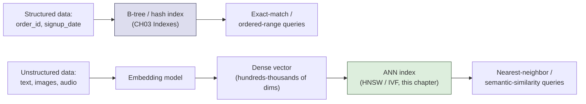

## 4. Core Concepts

### 4.1 Embeddings and Similarity Metrics

**Definition.** An embedding is a fixed-length, dense vector of real numbers
that a machine learning model produces as a numeric encoding of a piece of
data — text, an image, audio, a user's behavior history, or any other
content — such that geometric proximity between two vectors corresponds to
semantic or perceptual similarity between the two original inputs. "Dense"
here contrasts with the sparse, mostly-zero vectors a bag-of-words or
one-hot encoding would produce: a modern text embedding might have 384, 768,
1536, or 3072 dimensions, and nearly every one of those dimensions carries
some non-zero signal contributed by the model's internal representation,
rather than being a mostly-empty lookup table indexed by vocabulary.

**Mechanism.** An embedding model — most commonly today a transformer-based
neural network fine-tuned specifically for producing embeddings (examples:
OpenAI's `text-embedding-3-small`, Cohere's `embed-english-v3`, open models
like `all-MiniLM-L6-v2` or `BGE`) — is trained so that inputs the model
considers similar produce vectors that are close together under a chosen
distance function, and dissimilar inputs produce vectors that are far apart.
Training typically uses a contrastive objective: the model is shown pairs of
inputs known to be similar (two paraphrases of the same sentence, an image
and its caption) and pairs known to be dissimilar, and its weights are
adjusted via gradient descent to pull similar pairs' output vectors closer
together and push dissimilar pairs' vectors farther apart. Once trained, the
model is frozen and used purely as an encoder: at ingestion time, every
document (or document chunk) is passed through the model once to produce its
vector, which is stored; at query time, the user's query text is passed
through the *same* model to produce a query vector in the *same* vector
space, and the database's job is to find the stored vectors nearest to it.

Three similarity/distance metrics dominate practice, and choosing among them
is not cosmetic — it changes which vectors count as "close":

- **Cosine similarity** measures the cosine of the angle between two
  vectors, ignoring their magnitude: $\text{cos}(\mathbf{a}, \mathbf{b}) =
  \frac{\mathbf{a} \cdot \mathbf{b}}{\|\mathbf{a}\| \, \|\mathbf{b}\|}$. It
  ranges from -1 (opposite direction) to 1 (identical direction), with 0
  meaning orthogonal (unrelated). Because it normalizes out magnitude, two
  vectors pointing the same direction are maximally similar regardless of
  how long either vector is — the property that makes cosine similarity the
  default choice for most text embedding models, whose vector *magnitude*
  is often an artifact of the input's length or the model's internal
  normalization rather than a meaningful signal.
- **Euclidean distance (L2 distance)** measures straight-line distance in
  the vector space: $d(\mathbf{a}, \mathbf{b}) = \sqrt{\sum_i (a_i - b_i)^2}$.
  Unlike cosine similarity, L2 *does* care about magnitude — two vectors
  pointing in the same direction but with very different lengths are *not*
  considered close under L2, even though they would be under cosine. L2 is
  the natural choice when the embedding model was trained to place semantic
  meaning in both direction *and* magnitude (common for image embeddings and
  for models explicitly trained against an L2 objective), and it is the only
  one of the three that satisfies the mathematical definition of a metric
  (it obeys the triangle inequality), which matters for some ANN index
  structures that rely on that property for pruning.
- **Dot product (inner product)** is the un-normalized version of cosine
  similarity: $\mathbf{a} \cdot \mathbf{b} = \sum_i a_i b_i$, with no
  division by vector length. It is the cheapest of the three to compute (no
  square root, no normalization division) and is mathematically equivalent
  to cosine similarity *only* when all vectors are pre-normalized to unit
  length — a normalization step many production pipelines apply once at
  ingestion time specifically so they can use the faster dot-product
  computation while still getting cosine-similarity semantics. Some
  embedding models (notably ones optimized for recommendation systems) are
  trained directly against a dot-product objective where vector *magnitude
  encodes importance or popularity*, in which case switching to cosine
  similarity would silently discard that signal.

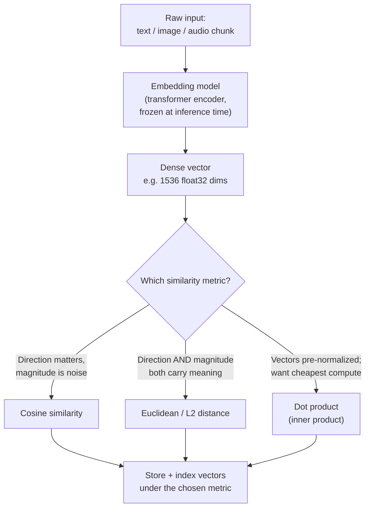

**Decision implications.** The similarity metric is not an afterthought
tunable at query time — it must match the metric the embedding model was
*trained* against, and most production vector databases require the metric
to be fixed per collection at index-creation time because the ANN index
structure itself (Sections 4.3-4.4) is built around one distance function's
geometry. Mixing metrics — indexing under L2 but querying with cosine
intent, for example — silently returns technically-valid-but-semantically-
wrong nearest neighbors, because "nearest under L2" and "nearest under
cosine" are genuinely different orderings whenever vector magnitudes vary.
Architects should treat "which metric does this embedding model expect" as
a first-class fact to pull from the model's documentation before designing
the schema, not a default left unexamined.

**Failure mode.** The most common production bug is querying with an
un-normalized vector against an index built assuming normalized (unit-
length) vectors for dot-product search — the model's own documentation
usually states whether it normalizes internally, and skipping that check
produces search results that look plausible (the top result is rarely
*wildly* wrong) but silently rank worse-matching, larger-magnitude vectors
above better-matching, smaller-magnitude ones, degrading recall in a way
that is very hard to detect without a labeled evaluation set.

**Scenario.** An e-commerce team embeds product descriptions with a
sentence-embedding model documented as trained for cosine similarity, but a
teammate configures the vector index with Euclidean distance because it "felt
like the more standard default." Search results are subtly worse — near-
duplicate product descriptions that differ mainly in length (a short title
versus a long marketing paragraph) rank far apart under L2 even though they
describe the same product, because L2 penalizes the length-driven magnitude
difference that cosine similarity would have ignored. The fix is purely a
configuration change (switch the index's distance metric to cosine), with no
change to the embeddings themselves, illustrating why metric choice belongs
in a documented, reviewed schema decision rather than an implicit default.

### 4.2 The Curse of Dimensionality and Why Exact k-NN Does Not Scale

**Definition.** The curse of dimensionality is the general phenomenon,
well-established in high-dimensional geometry, that many of the intuitions
that hold in two or three dimensions break down as dimensionality grows: in
particular, as the number of dimensions increases, the *ratio* between the
distance to the nearest point and the distance to the farthest point among a
set of random points converges toward 1 — every point becomes almost
equally far from every other point, and "nearest" stops being a
discriminative signal in the naive sense. Exact k-Nearest-Neighbor (k-NN)
search — computing the true distance from a query vector to *every* stored
vector and returning the true top-*k* closest — is the search vector
databases would run if this problem did not exist, and it does not scale
because of a combination of this geometric effect and simple computational
cost.

**Mechanism.** Two compounding forces make exact k-NN infeasible at
production scale:

1. **Computational cost is linear in the collection size** — computing the
   distance between a query vector and *N* stored vectors requires *O(N)*
   distance computations, each of which is itself *O(d)* work for a
   *d*-dimensional vector. For a collection of 100 million vectors at 768
   dimensions, a single query requires roughly 77 billion floating-point
   multiply-accumulate operations — technically parallelizable across cores
   or Graphics Processing Units (GPUs), but still fundamentally a full scan
   of the entire dataset for every single query, with no way to skip
   irrelevant regions the way a B-tree skips irrelevant key ranges.
2. **The curse of dimensionality erodes the payoff of any pruning strategy**
   — the entire reason a B-tree, a k-d tree, or any spatial partitioning
   structure can avoid a full scan in low dimensions is that most of the
   data can be safely *excluded* early once a query is known to be far from
   a partition's bounding region. In high dimensions, that pruning stops
   working: as dimensionality grows, the volume of a high-dimensional space
   concentrates overwhelmingly near its "surface" rather than its interior,
   which means nearly every partition boundary ends up close to nearly
   every query point, and structures like k-d trees degrade toward
   examining almost every partition anyway — the exact failure mode that
   motivated abandoning exact tree-based search for high-dimensional vectors
   in the first place, and the reason ANN research (Section 2) exists at
   all.

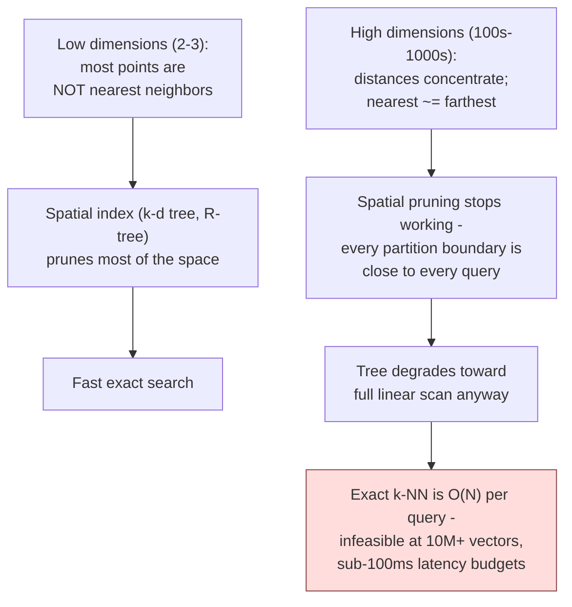

**Decision implications.** Because exact search cannot be made fast in high
dimensions, every production vector database trades *some* recall (the
fraction of true nearest neighbors actually returned) for dramatically lower
latency and cost, via an Approximate Nearest Neighbor (ANN) index — this is
not an implementation shortcut vendors are hiding, it is the field's
foundational, unavoidable trade-off, and it is the reason "recall@k" (what
fraction of the true top-*k* results the ANN index actually returned) is the
central benchmark metric for every ANN algorithm and every vector database
product, rather than raw query latency alone. An architect choosing a vector
database is implicitly choosing a point on the recall-versus-latency-versus-
memory curve, and that choice should be driven by the application's
tolerance for missing an occasional true neighbor — a RAG system retrieving
the top 5 of 10 million candidate passages can usually tolerate 95% recall
without a user noticing, while a fraud-detection nearest-duplicate check may
need much higher recall guarantees.

**Failure mode.** Teams that prototype with a small dataset (a few thousand
vectors) often see exact brute-force search perform perfectly well —
because at that scale, an *O(N)* scan is genuinely fast in absolute terms —
and conclude an ANN index is an unnecessary complexity. The failure surfaces
only once the collection grows past roughly a few hundred thousand to a
million vectors, at which point query latency degrades linearly with
collection size and the system that "worked fine in the demo" becomes
unusable in production; because the degradation is smooth and predictable
rather than a sudden cliff, it is frequently caught late, during a load test
or after a customer complaint, rather than during initial design review.

**Scenario.** A team building a document-search feature starts with brute-
force cosine similarity over a NumPy array of 5,000 embedded support-ticket
resolutions, hard-coded into the application layer because "it's simple and
fast enough." Eighteen months later the corpus has grown to 8 million
resolutions as the product scales, and the same brute-force code now takes
several seconds per query — the exact linear-cost failure mode above — and
the team must retrofit an ANN index (Sections 4.3-4.4) under production
pressure rather than having planned for the collection's growth curve from
the start; the reference brute-force-versus-approximate comparison in
Section 10's code example demonstrates exactly this crossover point.

### 4.3 HNSW: Hierarchical Navigable Small World Graphs

**Definition.** Hierarchical Navigable Small World (HNSW) is a graph-based
Approximate Nearest Neighbor algorithm that organizes stored vectors into a
multi-layer graph where each vector is a node, edges connect a node to a
small number of its approximate nearest neighbors, and higher layers contain
exponentially fewer nodes with proportionally longer-range edges — a
structure directly inspired by "six degrees of separation" small-world
network theory and by the same skip-list idea that lets a sorted list be
searched in logarithmic time without a full B-tree.

**Mechanism.** HNSW builds its structure incrementally, one vector at a
time, as follows:

1. **Layer assignment.** When a new vector is inserted, it is randomly
   assigned a maximum layer using a probability distribution that decays
   exponentially (a vector has roughly a 1-in-*m* chance of appearing in
   each layer above the base layer, for a tunable parameter *m*) — this is
   the same probabilistic construction a skip list uses to decide how many
   "express lanes" a new element belongs to, and it guarantees the higher
   layers stay sparse without needing an explicit rebalancing step.
2. **Greedy graph descent.** To insert (or search for) a vector, HNSW starts
   at a fixed entry point in the topmost, sparsest layer and greedily walks
   to whichever neighbor is closest to the target vector, repeating until no
   neighbor improves the distance — at which point it descends one layer and
   repeats the greedy walk there, using the current best node as the new
   starting point. Because each layer is progressively denser and has
   shorter-range edges, this process behaves like coarse-to-fine navigation:
   the top layers make large jumps across the entire vector space cheaply,
   and the bottom layer refines the answer among close neighbors.
3. **Neighbor-list maintenance.** At each layer a node participates in, HNSW
   keeps only a bounded number of edges to its approximate nearest
   neighbors (a parameter usually called `M`), pruning to keep the graph's
   node degree controlled — this bound is what keeps both memory use and
   per-node search cost from growing unboundedly as the collection scales.
4. **Search-time beam width (`ef_search`).** At query time, instead of
   greedily keeping only the single best candidate at each step, HNSW
   maintains a small candidate list (a "beam") of the `ef_search` best
   candidates seen so far, expanding all of their neighbors before deciding
   which to keep — a higher `ef_search` explores more of the graph, trading
   query latency for higher recall, and is the single most important
   runtime tunable knob for balancing that trade-off without rebuilding the
   index.

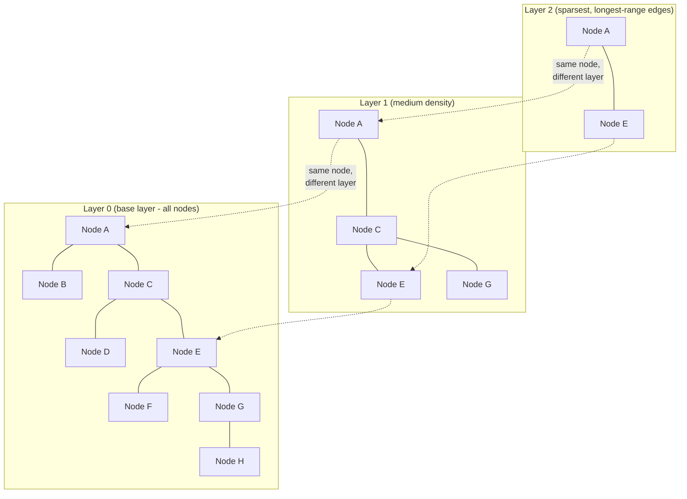

The diagram above shows the shape of the layered index: the top layer holds
only nodes A and E with one long-range edge between them, the middle layer
adds C and G, and the base layer (Layer 0) contains every node with the
graph's full, dense connectivity. A search for a query vector near node H
enters at the top layer's fixed entry point, jumps toward E across the
long-range edge, descends and refines through C and G in the middle layer,
and only in the dense base layer does it walk the short hop from G to H —
touching a small fraction of the graph's total nodes rather than all of
them.

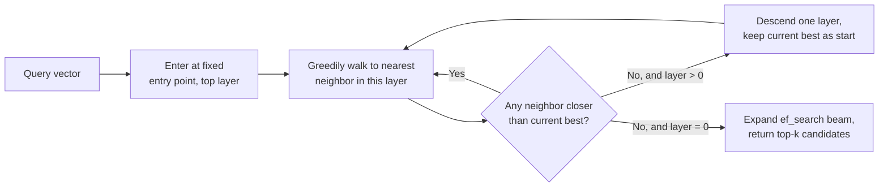

**Decision implications.** HNSW gives excellent recall-versus-latency
performance and supports incremental inserts without a full index rebuild,
which is why it is the default ANN algorithm in most modern vector
databases (Pinecone, Weaviate, Milvus, `pgvector`, and Redis all offer it).
Its primary cost is memory: because it is a genuine in-memory graph with
explicit neighbor-pointer lists per node (unlike IVF's more compact
cluster-assignment representation, Section 4.4), HNSW indexes typically
require noticeably more Random Access Memory (RAM) per vector than IVF for
the same recall target, which becomes the dominant cost driver at
billion-vector scale. Architects should also budget separately for build
time: HNSW's incremental, greedy insertion is more expensive per vector to
build than IVF's batch cluster assignment, so very large one-time bulk loads
sometimes favor IVF for the initial build even when HNSW is used for the
serving index.

**Failure mode.** Setting `ef_search` too low to save latency silently
degrades recall without an obvious error signal — queries still return *k*
results, they simply are not the true nearest ones, and because there is no
built-in comparison against the ground truth in production, this
misconfiguration is usually only caught by a dedicated recall-evaluation
pipeline (Section 16) run against a labeled or brute-force-computed
reference set, not by observing query behavior directly.

**Scenario.** A recommendation team migrates from a brute-force nightly
batch job to a live HNSW index to serve real-time "similar items" queries.
Initial load testing at `ef_search = 10` shows excellent latency (2ms per
query) but a subsequent offline recall evaluation shows only 71% recall
against a brute-force ground truth — well below the 95%+ the product
requires. Raising `ef_search` to 100 brings recall to 97% at a latency cost
of roughly 8ms, still comfortably inside the product's 50ms budget; the
lesson generalizes: `ef_search` should be tuned against a measured recall
target, not guessed from a default, because the "safe-looking" default is
frequently tuned for latency benchmarks rather than the specific
recall requirement of a given application.

### 4.4 IVF (Inverted File Index) and Product Quantization

**Definition.** An Inverted File (IVF) index is an ANN structure that first
partitions the vector space into a fixed number of clusters (using an
unsupervised clustering algorithm, almost always k-means) and, at query
time, searches only the handful of clusters whose centroids are closest to
the query vector — trading the guarantee of examining every vector for the
much cheaper guarantee of examining only the vectors in a small, relevant
subset of the space. Product Quantization (PQ) is a complementary
*compression* technique, frequently paired with IVF (the combination is
often written "IVF-PQ"), that reduces each stored vector's memory footprint
by splitting it into sub-vectors and replacing each sub-vector with a short
learned code, at the cost of some additional approximation error on top of
IVF's own approximation.

**Mechanism — IVF clustering and search.** Building an IVF index runs
k-means (or a similar clustering algorithm) over a representative sample of
the vector collection to produce a fixed number of cluster centroids — a
parameter usually called `nlist`. Every stored vector is then assigned to
its single nearest centroid, and the index keeps, per centroid, a list (the
"inverted file," borrowing the term from classic information-retrieval
inverted indexes) of every vector assigned to it. At query time, the query
vector's distance is computed only against the `nlist` centroids
themselves — a cheap operation since `nlist` is typically in the thousands,
not millions — and only the vectors inside the closest `nprobe` clusters
(`nprobe` is a tunable search-time parameter, analogous to HNSW's
`ef_search`) are actually compared against the query vector in full. A
higher `nprobe` searches more clusters, improving recall at the cost of
examining more vectors, giving IVF the same explicit recall/latency dial
HNSW has via `ef_search`.

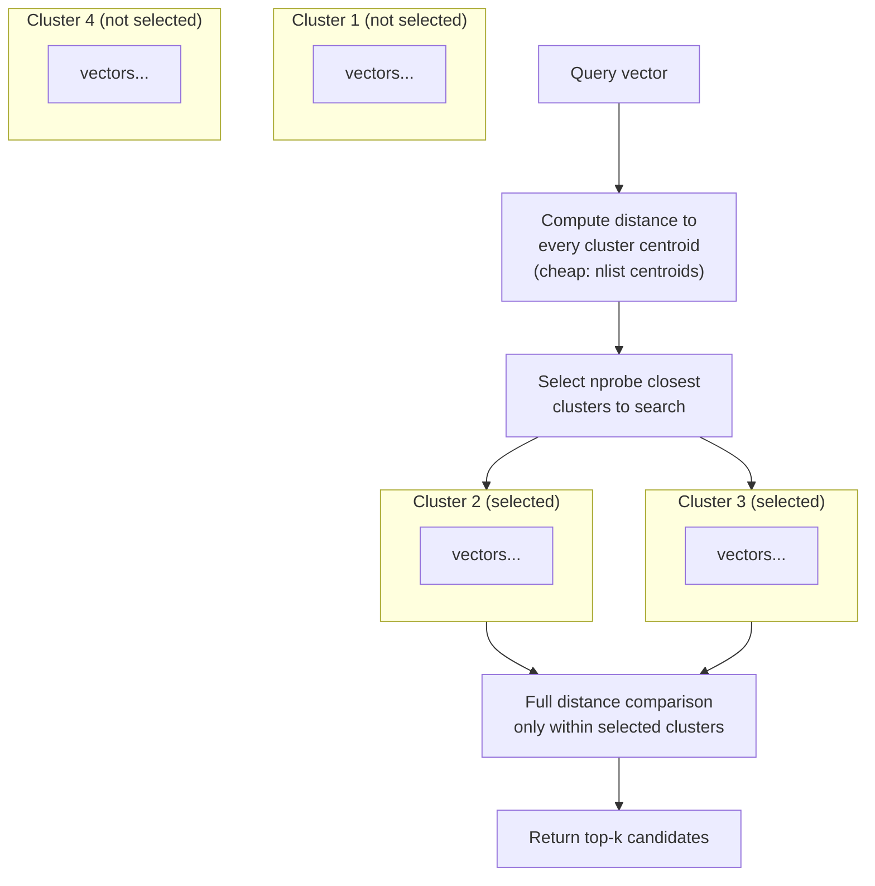

**Mechanism — product quantization.** PQ compresses a *d*-dimensional
vector by splitting it into *m* equal-length sub-vectors (for example, a
768-dimension vector split into 96 sub-vectors of 8 dimensions each). For
each of the *m* sub-vector positions, PQ runs k-means independently over a
training sample to learn a small codebook of representative sub-vectors
(commonly 256 entries per sub-vector position, so each entry's index fits in
a single byte). Every stored vector is then re-encoded as *m* single-byte
codebook indices — a 768-dimension, 3072-byte float32 vector compresses to
just 96 bytes, roughly a 32x reduction — and distance computation at query
time uses precomputed lookup tables between the query's sub-vectors and
each codebook's entries rather than decompressing the stored vectors back
into full floating-point form.

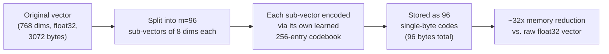

**Decision implications.** IVF-PQ's central trade-off is memory and
throughput versus precision: the compact byte-code representation lets a
single machine hold and search collections an order of magnitude larger
than an equivalent uncompressed HNSW index, which matters enormously once a
collection reaches the hundreds-of-millions to billions-of-vectors range
where the raw float32 storage cost alone becomes the limiting factor. The
cost is additional approximation error on top of IVF's own cluster-based
approximation, since PQ's compressed codes can only reconstruct an
*approximation* of the original vector's distance, not the exact value —
production systems frequently mitigate this with a re-ranking step that
recomputes exact (uncompressed) distances for only the small final
candidate set PQ narrowed the search down to, recovering most of the lost
precision at a fraction of the cost of using exact distances throughout.
Architects choosing between HNSW and IVF-PQ are choosing between
"best recall/latency at moderate memory cost" (HNSW) and "acceptable
recall/latency at dramatically lower memory cost" (IVF-PQ) — a decision
that should be driven primarily by whether the collection's vector count and
available RAM budget make an uncompressed graph index affordable at all.

**Failure mode.** Choosing `nlist` too small relative to the collection
size produces clusters so large that searching even a handful of them barely
narrows the search space at all (functionally degrading toward brute force);
choosing `nlist` too large produces so many tiny clusters that a query
vector sitting near a cluster boundary risks missing its true nearest
neighbors entirely because they landed in an adjacent, unsearched cluster —
this "boundary effect" is IVF's most characteristic recall failure mode and
is mitigated by increasing `nprobe`, at a direct latency cost, rather than by
changing `nlist` after the fact (which requires a full index rebuild since
cluster assignments are fixed at build time).

**Scenario.** A visual-search platform storing 500 million product image
embeddings finds that an HNSW index would require roughly 3TB of RAM across
its fleet at their target recall level — an unaffordable infrastructure
cost. Switching to IVF-PQ with `nlist=16384` and 96-byte PQ codes reduces
memory to roughly 200GB, fitting comfortably on far fewer, cheaper machines,
at the cost of raising `nprobe` (and therefore accepting slightly higher
query latency) to recover recall back to their required 90%+ threshold —
illustrating the memory-for-latency trade IVF-PQ is specifically designed to
offer at this scale.

### 4.5 Hybrid Search: Combining Vector Similarity with Keyword and Metadata Filtering

**Definition.** Hybrid search is the practice of combining a vector-
similarity nearest-neighbor query with a traditional exact-match or
keyword/full-text filter — for example, "find the 10 passages most similar
to this query vector, but only among documents where `department = 'legal'`
and `status = 'published'`," or blending vector similarity scores with a
classic keyword-based relevance score (commonly BM25) into a single ranked
result list.

**Mechanism.** There are two structurally different ways a vector database
can combine a metadata/keyword filter with a vector search, and the
distinction has real performance consequences:

- **Post-filtering** runs the ANN search first (returning, say, the top 1000
  nearest neighbors by vector similarity) and then discards any result that
  fails the metadata filter, returning only the top *k* survivors. This is
  simple to implement on top of any ANN index unmodified, but it has a
  correctness risk: if the filter is highly selective (few documents match
  `department = 'legal'`) and none of the ANN search's top 1000 candidates
  happen to satisfy it, the query returns fewer than *k* results — or none
  at all — even though qualifying nearest neighbors genuinely exist further
  down the true similarity ranking that the ANN search never examined.
- **Pre-filtering** (sometimes called filtered search or metadata-aware ANN)
  restricts the ANN graph or cluster traversal itself to only nodes/vectors
  that already satisfy the metadata filter, so the search never wastes time
  on — or gets starved by — candidates that would be discarded anyway. This
  requires the ANN index structure to be filter-aware (HNSW implementations
  that support pre-filtering typically skip non-matching nodes during graph
  traversal rather than pruning after the fact), which is more complex to
  implement correctly but avoids post-filtering's under-return risk entirely.

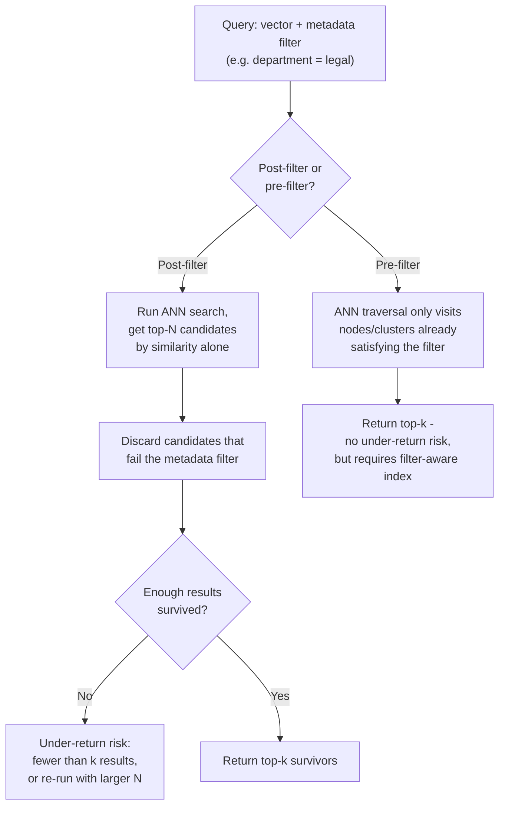

A separate but related concern is *score fusion*: when hybrid search blends
a vector-similarity score with a keyword-based score (BM25 or similar), the
two scores live on different, incomparable scales — cosine similarity is
bounded between -1 and 1, while a BM25 score is an unbounded, corpus-
dependent number — so a naive weighted sum of the two raw scores is
meaningless. Production systems typically use Reciprocal Rank Fusion (RRF),
which converts each scoring method's result list into ranks first (1st
place, 2nd place, and so on) and combines the *reciprocal ranks*
($\frac{1}{k + \text{rank}}$ for a small constant *k*) across both methods,
sidestepping the scale-incompatibility problem entirely because ranks are
always comparable regardless of the underlying scoring function's units.

**Decision implications.** Hybrid search exists because pure vector
similarity alone systematically underperforms on queries that hinge on an
exact term a user expects to match literally — a product-support search for
an exact error code, a legal search for an exact statute number, or any
query where the user's intent is unambiguously a specific token rather than
a general concept. Combining both retrieval methods captures the strengths
of each: keyword/BM25 search excels at exact-term precision, vector search
excels at conceptual/semantic recall, and RRF-based fusion lets a single
query benefit from both without an application team hand-tuning a fragile
weighted-sum formula. Architects should choose pre-filtering over post-
filtering whenever metadata filters are expected to be highly selective
(narrowing the candidate set to a small fraction of the collection), since
that is exactly the condition under which post-filtering's under-return risk
is most likely to bite in production.

**Failure mode.** Post-filtering silently returning fewer results than
requested is easy to miss in testing if the test dataset happens to have
enough matching documents in the ANN search's default candidate window, and
only surfaces once a production filter (perhaps a newly added, more
selective tenant or department scope) is narrow enough to expose the gap —
frequently manifesting as an intermittent, hard-to-reproduce "search
sometimes returns too few results" bug report rather than a clear error.

**Scenario.** A multi-tenant SaaS knowledge-base search initially uses
post-filtering to scope every vector query to `tenant_id = X`. It works
correctly for large tenants (many thousands of documents, so the ANN
search's top-1000 candidate window nearly always contains enough of that
tenant's documents) but silently returns zero or near-zero results for
brand-new, small tenants with only a handful of documents, because those few
documents rarely land inside the ANN search's un-filtered top-1000
candidates drawn from the entire multi-tenant collection. Switching to
pre-filtering (or, where unavailable, filtering at the storage layer by
maintaining a per-tenant index/partition rather than one shared index) fixes
the bug structurally rather than by widening the post-filter candidate
window and hoping it is wide enough for every tenant size.

### 4.6 Retrieval-Augmented Generation (RAG) as an Architecture Pattern

**Definition.** Retrieval-Augmented Generation is an architecture pattern
that answers a user's question by first retrieving the most relevant pieces
of an organization's own document corpus via similarity search, then
inserting those retrieved passages into the prompt sent to a generative
LLM, so the model's answer is grounded in retrieved, verifiable text instead
of relying solely on facts it may or may not have memorized during training.
This chapter owns RAG's *retrieval-side* architecture — the ingestion
pipeline, chunking, embedding, and vector-index query mechanics that this
section describes — while the generation-side concerns (prompt-template
design, hallucination-mitigation techniques specific to the generation step,
multi-hop/agentic retrieval loops, and answer-quality evaluation frameworks
like RAGAS) are flagged in this chapter's staging file as belonging to Part
16's not-yet-drafted dedicated RAG chapter, which should recap this
section's retrieval mechanics rather than re-deriving them.

**Mechanism.** A RAG pipeline has two distinct phases that run on very
different schedules:

1. **Ingestion (offline, batch or continuously updated).** Source documents
   are split into *chunks* — typically a few hundred tokens each, since
   embedding models have an input length limit and because retrieving a
   focused, relevant chunk produces a more useful prompt than retrieving an
   entire long document. Each chunk is passed through the embedding model
   (Section 4.1) to produce a vector, and the vector — along with the
   original chunk text and any metadata (source document, section,
   permissions scope) — is written into the vector database's index.
   Chunking strategy materially affects retrieval quality: chunks that are
   too small lose surrounding context needed to make sense of the passage in
   isolation, while chunks that are too large dilute a specific relevant
   sentence with enough surrounding, irrelevant text that its embedding
   drifts away from the query's embedding.
2. **Query time (online, per user request).** The user's question is
   embedded with the same model used during ingestion, the vector database
   returns the top-*k* most similar chunks (optionally via hybrid search,
   Section 4.5, to also enforce access-control or freshness filters), and
   the retrieved chunks are concatenated into the LLM's prompt alongside the
   original question and an instruction to answer using only the provided
   context. The LLM then generates its answer conditioned on that assembled
   prompt.

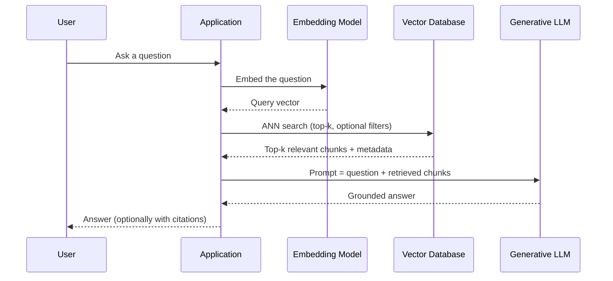

**Decision implications.** RAG's core architectural payoff is decoupling
*what the model knows* from *what the model was trained on*: updating the
answer to a factual question only requires updating a document and
re-embedding it (a data-pipeline operation, typically completing in seconds
to minutes) rather than retraining or fine-tuning the LLM itself (an
expensive, slow, and much riskier operation). This makes RAG the default
architecture whenever an application needs the LLM to reason over private,
frequently changing, or simply too-large-to-fit-in-training-data content —
which describes the overwhelming majority of enterprise LLM applications.
The vector database's role in this pattern is purely retrieval: it never
sees or influences what the LLM generates, only which passages the LLM is
given as source material, which is exactly why the recall/latency trade-offs
taught in Sections 4.2-4.4 translate directly into RAG answer quality — if
the vector index fails to retrieve the one chunk that actually answers the
question, no amount of prompt engineering at the generation step can recover
the missing information.

**Failure mode.** The most common RAG failure traces back not to the LLM but
to retrieval: a chunking strategy that splits a critical fact across two
chunk boundaries, an embedding model mismatch between ingestion and query
time (Section 4.1's normalization/metric mismatch failure mode, now
compounded across an entire corpus), or a recall-degrading ANN
misconfiguration (Sections 4.3-4.4) all silently produce a RAG system that
generates fluent, confident-sounding answers built from the *wrong* or
*incomplete* retrieved context — a failure mode that is harder to detect
than an LLM refusing to answer, because the output still reads as a
plausible, well-formed answer.

**Scenario.** An internal support-bot team observes that their RAG system
answers most questions well but occasionally gives confidently wrong answers
to questions about a specific policy document. Investigation traces the bug
to that document's chunking: the policy's key exception clause fell exactly
at a chunk boundary, splitting "employees may not X" from "except in case
Y" into two separate chunks whose embeddings, taken individually, are less
relevant to the user's question than the two sentences would have been
together — so the retrieval step returns the first chunk alone, and the LLM
generates a technically-grounded-in-retrieved-text but practically
incomplete answer. The fix is a chunking-strategy change (overlapping chunk
windows, so no sentence boundary is ever the *only* copy of a fact), not a
prompt-engineering or model change — reinforcing that RAG answer quality is
frequently a retrieval-architecture problem wearing a generation-quality
costume.

## 5. Internal Working

Understanding how a vector database is built internally clarifies *why* the
Section 4 concepts show up as the specific tunable parameters (`ef_search`,
`nprobe`, `M`, `nlist`) that every production system exposes, rather than
being fully automatic.

**Ingestion and index-build pipeline.** Every vector database separates the
write path (accepting new vectors) from the index-build path (organizing
those vectors into a searchable HNSW graph or IVF cluster assignment),
because building or updating an ANN index is meaningfully more expensive
than a simple append. Most systems buffer newly written vectors in an
unindexed or lightly-indexed "staging" area and periodically (or
continuously, in systems designed for real-time ingestion) merge them into
the main ANN index in the background, trading a short window of reduced
search accuracy over the newest data for avoiding a synchronous, per-write
index-rebuild cost on the write path.

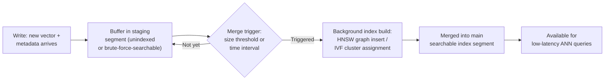

**Query execution engine.** At query time, most production vector databases
search *both* the fully-built main index segment and any newer, still-
staged vectors (often via brute-force search over the smaller staging
segment, since it is small enough that an *O(N)* scan there is cheap), then
merge the two candidate sets before returning the final top-*k* — this is
the mechanism that lets systems advertise "near real-time" search even
though the expensive ANN index itself is only rebuilt periodically.
Distributed deployments additionally shard the vector collection across
multiple nodes (recapping generic sharding theory from
[Sharding CH06](CH06_Sharding.md#shard-key-selection-criteria-shard-mapdirectory-routing-consistent-hashing-ring--virtual-nodes-vs-hash-mod-routing)),
fan a query out to every shard in parallel, and merge each shard's local
top-*k* results into a single global top-*k* — a scatter-gather pattern
identical in shape to [Sharding's cross-shard query mechanism](CH06_Sharding.md#rebalancinglive-data-migration-cross-shard-queries-scatter-gather-cross-shard-transactions2pc-cost-hot-shard-mitigation),
just applied to similarity ranking instead of exact-match predicates.

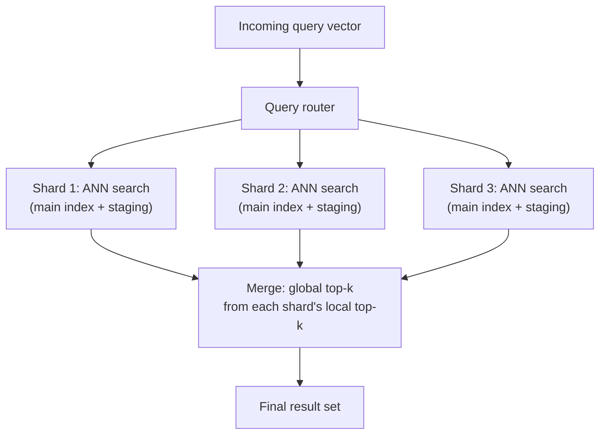

**Storage layout.** Because HNSW's graph structure and each node's full
float32 vector need to be traversed with low latency, most in-memory-first
vector databases keep the graph and vectors resident in RAM, memory-mapping
larger-than-RAM collections to disk with the operating system's page cache
absorbing repeated access to hot regions of the graph — a pattern
conceptually similar to how [PostgreSQL's shared buffers](CH11_PostgreSQL.md)
cache hot heap pages, except here the "hot" unit is a graph neighborhood
rather than a table page. IVF-PQ's compact byte-code representation is
specifically designed to shrink this memory footprint so a larger fraction
of a very large collection can stay resident without memory-mapping at all
(Section 4.4).

## 6. Design Principles

- **Match the index type to the scale and recall requirement, not to
  whichever library is easiest to try first.** HNSW for collections that fit
  affordably in RAM and need top-tier recall/latency; IVF-PQ once memory
  becomes the binding constraint (Sections 4.3-4.4).
- **Fix the similarity metric to what the embedding model expects, and treat
  it as part of the schema, not a query-time option** (Section 4.1).
- **Design chunking and metadata schema together, before choosing a vector
  database product** — chunk size and overlap, and which fields need to be
  filterable, constrain which products and index configurations are viable,
  and are far more consequential to retrieval quality than the specific
  vendor chosen.
- **Prefer pre-filtering (or physically partitioned indexes per tenant/scope)
  whenever filters are expected to be highly selective**, to avoid
  post-filtering's under-return failure mode (Section 4.5).
- **Treat recall as a measured, monitored metric, not an assumed property**
  — every ANN tunable (`ef_search`, `nprobe`, `M`, `nlist`) trades recall for
  latency/memory, and only a dedicated evaluation pipeline (Section 16) can
  tell you where a given configuration actually lands.
- **Separate the retrieval architecture from the generation architecture in
  RAG systems** — a vector database's job ends at "return the most relevant
  chunks"; prompt design, generation-quality evaluation, and hallucination
  mitigation are a distinct concern layered on top (Section 4.6).

## 7. Architecture Patterns

**Single-collection semantic search.** The simplest pattern: one embedding
model, one vector collection, straightforward top-*k* similarity queries —
appropriate for a single-domain search feature (product search, FAQ search)
with a single metadata schema and no multi-tenant isolation requirement.

**Multi-tenant isolation via metadata filtering vs. physical partitioning.**
As Section 4.5's scenario illustrated, a shared index scoped by a
`tenant_id` metadata filter is simpler to operate but risks post-filtering
under-return for small tenants and gives every tenant's queries some
contention on shared index resources; physically partitioning into one
index (or one shard set) per tenant, or per a small number of tenant tiers,
trades operational complexity (many more indexes to manage) for stronger
isolation and predictable per-tenant latency — the same physical-versus-
logical-partitioning trade-off [Sharding CH06](CH06_Sharding.md) teaches
generically, applied here to vector collections specifically.

**Hybrid RAG with re-ranking.** Production RAG systems frequently add a
re-ranking stage between the vector database's initial retrieval and the
LLM prompt assembly: the vector database returns a wider initial candidate
set (say, top 50) cheaply via ANN search, and a smaller, more expensive
cross-encoder re-ranking model re-scores just those 50 candidates against
the query with much higher precision than the vector index's coarse ANN
approximation, before the final top 5-10 are inserted into the LLM prompt —
trading a small amount of extra latency for materially better final
retrieval precision than either stage could achieve alone.

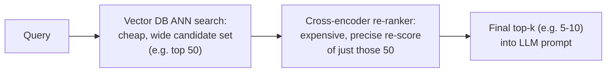

**Sharded, distributed vector index.** At scale beyond a single node's
memory or throughput capacity, collections are sharded across multiple
nodes (Section 5's scatter-gather pattern), each running its own local
HNSW or IVF-PQ index over its shard of the data, with a stateless query
router fanning queries out and merging results — recapping
[Sharding CH06](CH06_Sharding.md) and [Replication CH07](CH07_Replication.md)
generic theory for how those shards themselves are placed, replicated, and
rebalanced.

## 8. Production Architecture

This chapter surveys five representative systems without declaring any one
canonical — the right choice depends on existing infrastructure, scale, and
operational preference, not a universal ranking.

- **Pinecone** — a fully managed, proprietary vector database offered only
  as a cloud service; it abstracts index management (build, shard
  placement, scaling) entirely behind an API, trading operational control
  for near-zero infrastructure management, which suits teams that want
  vector search as a managed dependency rather than infrastructure they
  operate themselves.
- **Weaviate** — an open-source vector database (also offered as a managed
  cloud service) that layers a GraphQL/REST query interface and built-in
  support for hybrid search and multi-modal (text, image) collections on
  top of its own HNSW implementation, and can be self-hosted for teams that
  need to keep data inside their own infrastructure.
- **Milvus** (with its managed offering, Zilliz Cloud) — an open-source
  vector database explicitly designed around disaggregated storage and
  compute and Kubernetes-native horizontal scale-out, aimed at very large
  (billion-scale) collections and workloads where independently scaling
  ingestion, indexing, and query-serving capacity matters.
- **`pgvector`** — a PostgreSQL extension (recapped from
  [PostgreSQL's extension architecture](CH11_PostgreSQL.md#45-extension-architecture))
  that adds a `vector` column type plus HNSW and IVF-Flat index types
  directly inside PostgreSQL. Its principal advantage is not raw ANN
  performance at extreme scale but architectural simplicity: an application
  already running PostgreSQL for its structured data can add vector search
  without introducing a second database system, keeping transactional
  writes to structured and vector data inside the same Atomicity,
  Consistency, Isolation, Durability (ACID) transaction boundary
  ([recapped from Transactions](CH08_Transactions.md#41-atomicity-consistency-isolation-durability-acid-properties-and-their-mechanisms)).
- **Redis** (via its vector search capability, built on Redis's core
  in-memory data-structure engine, [recapped from Redis CH16](CH16_Redis.md))
  — adds vector fields and ANN indexing (HNSW or a flat/brute-force index)
  to Redis's existing hash and JSON document types, appealing to teams
  already using Redis as a caching or session-store layer who want to add
  vector search without a new system, at the cost of Redis's memory-first
  cost profile applying to vector storage as well.

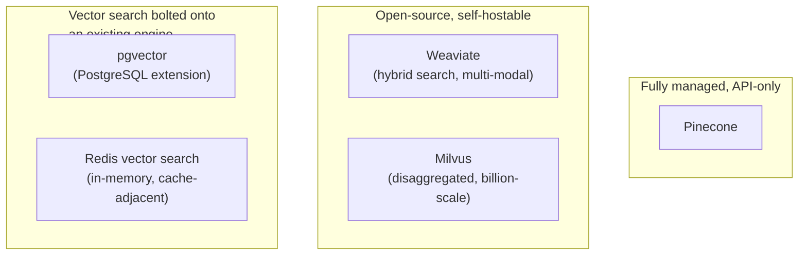

## 9. Implementation

A representative implementation workflow, independent of the specific
product chosen:

1. **Choose the embedding model first**, driven by the content type (text,
   image, multi-modal), required language coverage, and cost/latency budget
   for the embedding call itself — this decision fixes the vector dimension
   and the required similarity metric (Section 4.1) for everything
   downstream.
2. **Design the chunking strategy** for the source content, including chunk
   size, overlap, and what metadata (source, section, access-control scope,
   last-updated timestamp) travels alongside each chunk.
3. **Select an index type and its tunables** based on expected collection
   size and available memory (HNSW `M`/`ef_construction`/`ef_search`, or IVF
   `nlist`/`nprobe`/PQ code size) — Sections 4.3-4.4.
4. **Decide the filtering strategy** (pre-filter, post-filter, or physical
   partitioning) based on expected filter selectivity (Section 4.5).
5. **Build the ingestion pipeline** to embed and upsert new/changed content,
   and a retrieval pipeline (or RAG pipeline, Section 4.6) to serve queries.
6. **Establish a recall-evaluation harness** (Section 16) before tuning any
   ANN parameter for latency, so every latency-driven change can be checked
   against a measured recall regression, not just a "feels fast" impression.

## 10. Complete Code Examples

Four runnable examples accompany this chapter under
[`code/sql/vectordb-chapter/`](../code/sql/vectordb-chapter/) and
[`code/python/vectordb-chapter/`](../code/python/vectordb-chapter/):

1. [`01_pgvector_extension_usage.sql`](../code/sql/vectordb-chapter/01_pgvector_extension_usage.sql) —
   `CREATE EXTENSION vector`, a table combining structured columns with a
   `vector` column, HNSW index creation, cosine-distance nearest-neighbor
   queries, and a hybrid query combining a metadata `WHERE` clause with
   vector similarity ordering (Sections 4.1, 4.5, 8).
2. [`02_bruteforce_vs_approximate_search.py`](../code/python/vectordb-chapter/02_bruteforce_vs_approximate_search.py) —
   a from-scratch comparison of exact brute-force cosine k-NN against a
   simplified cluster-based (IVF-style) approximate search over the same
   synthetic dataset, measuring the recall-versus-latency crossover as
   collection size grows (Sections 4.2, 4.4).
3. [`03_hnsw_mini_implementation.py`](../code/python/vectordb-chapter/03_hnsw_mini_implementation.py) —
   a small, from-scratch, single-layer-plus-base-layer HNSW-style graph
   index (insertion with randomized long-range edges, greedy graph-descent
   search with a tunable beam width) to make the algorithm's mechanics in
   Section 4.3 concrete rather than only diagrammatic.
4. [`04_rag_retrieval_pipeline.py`](../code/python/vectordb-chapter/04_rag_retrieval_pipeline.py) —
   a self-contained RAG retrieval-pipeline sketch: deterministic pseudo-
   embeddings (so the example runs with no external model download or
   network access), document chunking, an in-memory vector store, top-*k*
   retrieval, and assembly of a grounded LLM prompt from the retrieved
   chunks (Section 4.6).

## 11. Performance

Vector database performance is governed almost entirely by the Section 4.2
recall-versus-latency-versus-memory trade-off, made concrete through each
index type's tunables. Query latency for HNSW scales roughly
logarithmically with collection size at a fixed `ef_search` (the layered
structure's whole purpose), while brute-force and severely under-tuned IVF
(`nprobe` too low relative to `nlist`) scale linearly or worse. Batch query
throughput benefits heavily from batching multiple query vectors into a
single call where the product supports it, amortizing fixed per-query
overhead (network round-trip, entry-point lookup) across many queries.
Embedding-generation latency is frequently the dominant cost in an
end-to-end RAG query's total latency budget, not the vector search itself —
a call to a hosted embedding API can take tens of milliseconds, comparable
to or larger than a well-tuned ANN search's own latency, so architects
should profile the full pipeline rather than assuming the vector database is
automatically the bottleneck.

## 12. Scalability

Scaling a vector database follows the same two axes as any other data
system: vertical (bigger machine, more RAM, more Graphics Processing Unit
(GPU)/Central Processing Unit (CPU) parallelism for distance computation)
and horizontal (sharding the collection across nodes, recapping
[Sharding CH06](CH06_Sharding.md) and [Partitioning CH05](CH05_Partitioning.md)
generic theory). Horizontal scale-out for vector workloads has one
distinctive wrinkle versus exact-match sharding: because ANN search is
already approximate, sharding introduces a *second* layer of approximation
on top of it — each shard's local top-*k* is itself approximate, and the
final merge across shards' approximate local results is not guaranteed to
recover the true global top-*k* even if each shard's local ANN search were
perfect, because a shard holding none of the true global top-*k* candidates
contributes nothing to the merge. In practice this compounding effect is
usually small at reasonable shard counts and is measured, not assumed, via
the same recall-evaluation harness (Section 16) used for single-node
tuning. Read-heavy workloads additionally benefit from read replicas per
shard, recapping [Replication CH07](CH07_Replication.md)'s leader-follower
theory, since ANN queries are read-only once an index segment is built.

## 13. Security

Vector databases introduce access-control considerations that go beyond
typical row/document-level permissions: because embeddings are lossy but not
fully irreversible representations of their source content, an attacker with
query access to a raw embedding vector can, under some circumstances,
attempt *embedding inversion* — reconstructing an approximation of the
original text or image from its vector alone using a trained inversion
model — meaning embeddings of sensitive content (personally identifiable
information, confidential documents) should be treated as sensitive data in
their own right, not merely as an opaque numeric artifact safe to expose
freely. Metadata-based access control (Section 4.5's pre-filtering
mechanism) is the standard mechanism for enforcing per-user or per-tenant
visibility scopes at the retrieval layer itself, ensuring a user's query
never even considers vectors outside their authorized scope rather than
relying on filtering the LLM's generated answer after the fact. Transport
and at-rest encryption follow the same general patterns already covered in
[TLS CH06](../05_Networking_and_OS/CH06_TLS.md) and are not vector-specific.

## 14. Observability

The metric unique to vector databases, absent from every other engine
covered in this book, is **recall@k against a ground-truth or brute-force
baseline**, measured continuously (or on a scheduled cadence) as the
underlying collection and query patterns drift over time, since none of the
index-health signals a relational or document database exposes (buffer-pool
hit ratio, replication lag, lock-wait time) tell you anything about whether
an ANN index is actually returning good-quality neighbors. Standard
infrastructure metrics still matter alongside it: query latency percentiles
(p50/p95/p99, since ANN latency has a longer tail than a simple key lookup
due to variable graph-traversal path length), index build/merge duration
and staging-segment size (Section 5, since a growing, un-merged staging
segment degrades both recall — if staging is brute-force-searched only up
to a cap — and latency), and memory utilization relative to the index's
theoretical footprint (a leading indicator that the index is outgrowing its
provisioned capacity before latency visibly degrades).

## 15. Failure Scenarios

- **Silent recall degradation** — an under-tuned `ef_search`/`nprobe`, an
  embedding-model version mismatch between ingestion and query time, or a
  metric mismatch (Section 4.1) all produce a system that appears healthy
  (queries return results, latency looks fine) while returning
  progressively worse-quality neighbors, detectable only through dedicated
  recall monitoring (Section 14), not through standard uptime/latency
  alerting.
- **Staging-segment growth outpacing merge capacity** — if the background
  merge process (Section 5) falls behind the write rate, an increasing
  share of the collection lives in the brute-force-searched staging area,
  degrading query latency gradually until an alert fires on a symptom
  (latency) rather than the root cause (merge backlog).
- **Post-filtering under-return** (Section 4.5) — a highly selective filter
  returns fewer than *k* results, or none, for a subset of queries whose
  scope happens to be narrow, frequently only surfacing for a specific
  customer segment or tenant rather than uniformly.
- **RAG hallucination masked as a retrieval failure, or vice versa** —
  because RAG's retrieval and generation stages are both capable of failing
  in ways that produce a plausible-but-wrong answer, diagnosing a bad RAG
  answer requires first checking *what was actually retrieved* (a retrieval
  problem, owned by this chapter) before assuming the generation model
  itself is at fault (owned by Part 16's future RAG chapter).

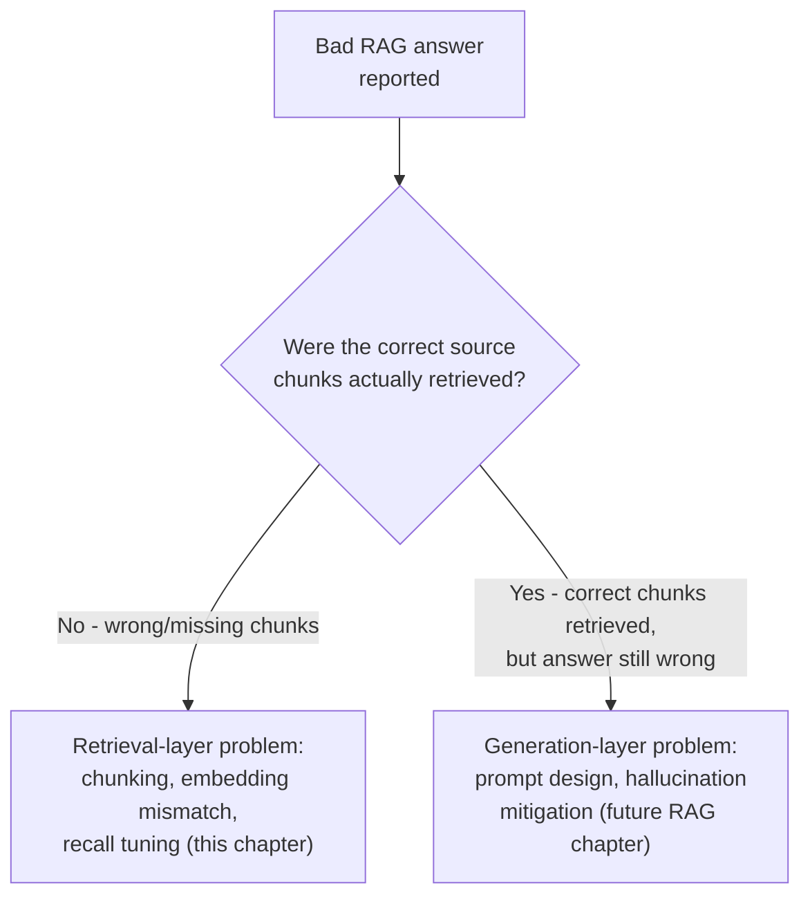

## 16. Testing

Testing a vector database deployment centers on a **recall-evaluation
harness**: a labeled or brute-force-computed set of query vectors and their
true top-*k* nearest neighbors, run against the production ANN
configuration on a schedule (and on every configuration change) to detect
recall regressions before they reach users. Load testing should specifically
exercise the recall/latency trade-off at realistic concurrency, since ANN
search's variable traversal-path latency (Section 11) behaves differently
under load than a simple key-value lookup's flat latency profile. RAG
pipelines additionally need end-to-end answer-quality evaluation (comparing
generated answers against a labeled reference set) to distinguish retrieval
regressions from generation regressions (Section 15), and chunking-strategy
changes should be re-validated against the recall harness before rollout,
since chunk boundaries directly change what the embedding model sees.

## 17. Common Mistakes

- Choosing a similarity metric that does not match the embedding model's
  training objective (Section 4.1).
- Assuming brute-force search "works fine" will continue to hold as a
  collection grows past the point where linear scan cost becomes visible
  (Section 4.2).
- Tuning `ef_search`/`nprobe` for latency alone, without a corresponding
  recall measurement (Sections 4.3-4.4, 16).
- Defaulting to post-filtering for highly selective metadata filters without
  considering pre-filtering or physical partitioning (Section 4.5).
- Treating RAG answer-quality problems as generation-only issues without
  first checking what the retrieval step actually returned (Section 15).
- Chunking documents without overlap, splitting a single fact across an
  un-retrievable chunk boundary (Section 4.6).
- Ignoring embedding-vector sensitivity and treating vectors of confidential
  content as safe to expose broadly (Section 13).

## 18. Best Practices

- Fix the similarity metric and embedding-model version as part of the
  schema, and version both explicitly so a future model upgrade is a
  deliberate re-embedding migration, not a silent mismatch.
- Build the recall-evaluation harness before tuning for latency, not after.
- Prefer pre-filtering or physical partitioning for known-selective filters.
- Use overlapping chunk windows and store enough metadata per chunk to
  reconstruct surrounding context or cite a source.
- Monitor staging-segment size/merge backlog alongside standard latency
  metrics (Section 14).
- Add a re-ranking stage (Section 7) once initial ANN retrieval precision
  is the limiting factor on RAG answer quality.

## 19. Anti-Patterns

- **"It's just a NumPy array"** — treating an in-application brute-force
  array scan as a permanent architecture rather than a prototype, ignoring
  the linear-scaling failure mode from Section 4.2 until it becomes a
  production incident.
- **Metric-mismatched index** — building an index under one distance metric
  while the embedding model expects another (Section 4.1).
- **Filter-blind ANN tuning** — tuning `ef_search`/`nprobe` purely against
  unfiltered query benchmarks, then deploying with metadata filters that
  change the effective search space's selectivity characteristics.
- **RAG without a retrieval evaluation harness** — shipping a RAG feature
  and only ever evaluating the *generated answers*, never checking whether
  the underlying retrieval step is actually returning the right chunks.

## 20. Trade-off Analysis

| Decision | Option A | Option B | Trade-off |
|---|---|---|---|
| ANN algorithm | HNSW | IVF-PQ | Best recall/latency at higher memory cost vs. lower memory at somewhat lower recall/latency (Sections 4.3-4.4) |
| Metadata filtering | Pre-filter | Post-filter | Correctness under selective filters vs. simpler implementation on any ANN index (Section 4.5) |
| Multi-tenancy | Shared index + metadata filter | Physical partition per tenant | Simpler operations vs. stronger isolation and predictable per-tenant latency (Section 7) |
| RAG retrieval | ANN-only | ANN + cross-encoder re-ranking | Lower latency vs. higher final precision (Section 7) |
| Deployment | Purpose-built vector database | Vector search bolted onto an existing engine (`pgvector`/Redis) | Best scale/feature ceiling vs. architectural simplicity and one fewer system to operate (Section 8) |

## 21. Comparison Table

| System | Deployment model | Primary ANN index | Hybrid search | Distinguishing trait |
|---|---|---|---|---|
| Pinecone | Fully managed (cloud-only) | HNSW | Yes (sparse-dense hybrid vectors) | Zero infrastructure management |
| Weaviate | Open-source, self-hostable or managed | HNSW | Yes (built-in BM25 + vector fusion) | Multi-modal collections, GraphQL/REST API |
| Milvus / Zilliz Cloud | Open-source, disaggregated storage/compute | HNSW, IVF-PQ, and others (pluggable) | Yes | Kubernetes-native scale-out for billion-vector collections |
| `pgvector` | PostgreSQL extension | HNSW, IVF-Flat | Via SQL `WHERE` + `ORDER BY` combination | Vector search inside an existing relational ACID transaction boundary |
| Redis (vector search) | Extension of Redis's in-memory engine | HNSW, flat/brute-force | Yes (combined with Redis query filters) | Reuses an already-deployed in-memory cache/store layer |

## 22. Real-World Case Study

Many enterprise "chat with your documents" products built in 2023-2024
followed a strikingly similar architecture evolution: version one shipped
with a single embedding model, a single unfiltered vector collection, and no
re-ranking, hitting acceptable demo-quality results quickly. As real usage
scaled, two recurring problems emerged, both traceable directly to this
chapter's concepts rather than to the underlying LLM: first, answer quality
degraded on documents whose key facts sat near chunk boundaries (Section
4.6's chunking failure mode), fixed by moving to overlapping chunks and
adding document-structure-aware chunking (splitting on section boundaries
rather than a fixed token count blindly); second, once collections grew past
a few million chunks, initial brute-force or minimally-tuned ANN
configurations showed measurable recall drops that users experienced as
"the bot used to find this, now it doesn't," fixed by introducing a
recall-evaluation harness (Section 16) and only then tuning `ef_search`/
`nprobe` against measured recall rather than guessed defaults. The pattern
across many of these deployments reinforces this chapter's central lesson:
RAG system quality is disproportionately a retrieval-architecture problem,
and most of the fixes that mattered were in the vector-database layer this
chapter teaches, not in prompt engineering at the generation layer.

## 23. Interview Questions

1. Why does a B-tree index not help with nearest-neighbor search over
   embedding vectors? (Section 4.2, recapping [Indexes CH03](CH03_Indexes.md))
2. Explain HNSW's layered structure and why higher layers are sparser with
   longer-range edges. (Section 4.3)
3. What is the difference between `nlist` and `nprobe` in an IVF index, and
   what does each control? (Section 4.4)
4. When would you choose cosine similarity over Euclidean distance, and why
   does the choice matter? (Section 4.1)
5. What is product quantization, and what does it trade away to achieve its
   memory savings? (Section 4.4)
6. Describe the difference between pre-filtering and post-filtering in
   hybrid search, and the specific failure mode post-filtering introduces.
   (Section 4.5)
7. In a RAG system, how would you determine whether a bad answer is a
   retrieval problem or a generation problem? (Section 15)
8. Why might an architect choose `pgvector` over a purpose-built vector
   database, and what do they give up by doing so? (Section 8)

## 24. Hands-on Exercises

1. Run [`02_bruteforce_vs_approximate_search.py`](../code/python/vectordb-chapter/02_bruteforce_vs_approximate_search.py)
   at increasing dataset sizes and plot the brute-force-versus-approximate
   latency crossover point.
2. Modify [`03_hnsw_mini_implementation.py`](../code/python/vectordb-chapter/03_hnsw_mini_implementation.py)'s
   beam width and measure the resulting recall-versus-latency trade-off
   against a brute-force ground truth over the same dataset.
3. Using [`01_pgvector_extension_usage.sql`](../code/sql/vectordb-chapter/01_pgvector_extension_usage.sql)
   as a starting point, add a metadata column and write both a post-filtered
   and a pre-filter-equivalent query, comparing result counts on a
   deliberately narrow filter.
4. Extend [`04_rag_retrieval_pipeline.py`](../code/python/vectordb-chapter/04_rag_retrieval_pipeline.py)
   with overlapping chunk windows and observe how retrieval changes for a
   fact deliberately placed near a chunk boundary.

## 25. Design Exercises

1. Design the retrieval architecture for a multi-tenant customer-support RAG
   system with tenants ranging from 10 documents to 10 million documents.
   Justify your filtering strategy (Section 4.5) and multi-tenancy pattern
   (Section 7) for each end of that range.
2. A team must choose between `pgvector` and a purpose-built vector database
   for a new product. Lay out the specific criteria (existing
   infrastructure, expected scale, transactional consistency requirements)
   that would justify each choice.
3. Design a recall-evaluation harness (Section 16) for a production vector
   database, including how you would obtain ground-truth nearest neighbors
   at a scale where brute-force computation itself is expensive.

## 26. Architecture Review Questions

1. Does the similarity metric configured on the index match what the
   embedding model actually expects, and is that documented anywhere?
2. Is there a recall-evaluation harness in place, and was it run before the
   current `ef_search`/`nprobe` configuration was chosen?
3. For any metadata-filtered query path, has the team confirmed pre-filter
   versus post-filter behavior against a deliberately narrow/selective
   filter, not just a typical one?
4. For any RAG feature, is there a way to distinguish a retrieval failure
   from a generation failure when a bad answer is reported?
5. Is embedding-vector sensitivity (Section 13) accounted for in the
   system's data-classification and access-control model?

## 27. Summary

Vector databases exist to answer a question no index structure earlier in
this part was built for: given a dense embedding vector, find the nearest
neighbors in a high-dimensional space, fast, at scale. Exact k-NN search
cannot meet that bar because of the curse of dimensionality and its linear
per-query cost (Section 4.2), which is why the field converged on
Approximate Nearest Neighbor algorithms — HNSW's layered small-world graph
for best recall/latency at moderate memory cost, and IVF with product
quantization for dramatically lower memory cost at large scale (Sections
4.3-4.4). Hybrid search layers exact metadata and keyword filtering on top
of vector similarity, with pre-filtering and post-filtering carrying
genuinely different correctness trade-offs (Section 4.5), and
Retrieval-Augmented Generation — the primary driver of this category's
current adoption — depends entirely on this retrieval layer's recall
quality to ground an LLM's answers in real, relevant content (Section 4.6).
Whether that retrieval layer lives in a purpose-built system like Pinecone,
Weaviate, or Milvus, or bolted onto an existing engine via `pgvector` or
Redis (Section 8), the underlying decisions an architect must get right —
metric choice, index-type selection, filtering strategy, and continuous
recall measurement — are the same regardless of vendor.

---

**Further reading**: [Indexes](CH03_Indexes.md) for the B-tree/hash
structures this chapter's ANN algorithms depart from; [Sharding](CH06_Sharding.md)
and [Partitioning](CH05_Partitioning.md) for the horizontal scale-out theory
recapped in Sections 5, 7, and 12; [PostgreSQL](CH11_PostgreSQL.md) for the
extension architecture `pgvector` builds on; [Redis](CH16_Redis.md) for the
in-memory engine Redis's vector search extends; [MongoDB](CH15_MongoDB.md),
[DynamoDB](CH17_DynamoDB.md), and [Cassandra](CH18_Cassandra.md) for other
NoSQL engines that have since added their own vector-search capabilities on
top of their core data models.
