# Chapter: Time Series Databases

Part: [06 — Databases and Storage](PART_OVERVIEW.md) · Status: Drafted

## 1. Introduction

A Time Series Database (TSDB) is a database purpose-built for one shape of
data: a value stamped with the time it was observed, tagged with a set of
identifying labels, and produced continuously and in enormous volume by
automated sources — servers, sensors, application code, network devices —
rather than by a human filling out a form. This is the twenty-second and
final chapter of Part 06's NoSQL subsection, and it closes the subsection
the same way every chapter since [MongoDB](CH15_MongoDB.md) has: by taking
generic, engine-agnostic theory this book has already taught in full —
horizontal partitioning ([Partitioning](CH05_Partitioning.md)), sharding
([Sharding](CH06_Sharding.md)), replication
([Replication](CH07_Replication.md)), and caching
([Caching](CH09_Caching.md)) — and showing what happens when a whole
category of database is engineered around one narrow, extremely regular
workload rather than a general-purpose one. Where
[MongoDB](CH15_MongoDB.md) relaxed schema-on-write for flexible documents,
[Redis](CH16_Redis.md) traded durability guarantees for in-memory speed,
[DynamoDB](CH17_DynamoDB.md) traded flexible query patterns for predictable
single-digit-millisecond key access at any scale, and
[Cassandra](CH18_Cassandra.md) traded joins and secondary-index efficiency
for leaderless, multi-region write availability, a Time Series Database
trades general-purpose update/delete efficiency and ad hoc relational
querying for something workload-specific writers care about far more:
sustained, extremely high-throughput appends of small, timestamped,
never-updated records, combined with the ability to compress that data by
an order of magnitude or more and to cheaply discard or coarsen it once it
ages past the resolution anyone still needs.

The shape of the workload is deceptively simple to describe and
surprisingly hard to serve well with a general-purpose engine. A single
metric — say, CPU utilization on one server — produces one new value every
scrape interval (commonly every 10-15 seconds), forever, for as long as
that server exists. Multiply that by every server, every process, every
network interface, every disk, every container, every custom application
counter an organization instruments, and a moderately sized production
fleet routinely produces millions of *distinct time series* (a time series
here means one specific metric name plus one specific combination of tag
values — "cpu.usage, host=web-01, region=us-east-1" is one series;
"cpu.usage, host=web-02, region=us-east-1" is a different one), each
appending a new point every few seconds, never updated once written, and
almost never individually deleted — instead aged out in bulk once a
retention window closes. A relational engine tuned for point lookups,
transactional updates, and normalized joins ([recapped from
Normalization](CH01_Normalization.md#third-normal-form-3nf)) can absolutely
store this data, but its general-purpose Write-Ahead Log (WAL) and B-tree
index machinery ([recapped from Indexes](CH03_Indexes.md#b-tree-index)),
built to make in-place updates and arbitrary deletes safe and efficient,
spends effort this workload never needs and misses the two compression
techniques (Sections 4.5-4.6) that a workload this regular makes possible.
This chapter is the owning chapter for the time-series data model itself,
write-optimized time-partitioned chunk storage, downsampling/rollups and
retention-driven data lifecycle, the high-cardinality problem, delta-of-
delta timestamp compression, XOR-based value compression (the Gorilla
technique), and Prometheus's specific pull-based architecture — and it
recaps rather than re-teaches the generic partitioning, replication, and
caching theory those techniques build on, flagging each recap inline with
a link back to the owning chapter, exactly as the NoSQL subsection's
opening chapter established in
[MongoDB's Section 1](CH15_MongoDB.md#1-introduction).

## 2. Historical Evolution

- **Round Robin Database (RRDtool), 1999** — Tobias Oetiker's RRDtool was
  the first widely deployed purpose-built time-series storage engine: it
  pre-allocated a fixed-size circular buffer per metric at creation time
  and forced every write to immediately downsample into consolidated
  archives at several coarser resolutions, trading the ability to ever
  store more raw history than the buffer's fixed size for a bounded, never-
  growing disk footprint — the direct ancestor of Section 4.3's rollup/
  retention idea, just with the trade-off made mandatory and irreversible
  at series-creation time rather than tunable.
- **Graphite and the Whisper storage format, 2008** — Chris Davis's
  Graphite generalized RRDtool's fixed-size, pre-declared-resolution
  circular-buffer model (its underlying "Whisper" format) into a full
  monitoring stack with a query language (`sumSeries`, `movingAverage`,
  and similar functions) layered on top, establishing the pattern of a
  dedicated time-series storage engine paired with a dedicated query
  language rather than reusing SQL.
- **OpenTSDB on HBase, 2010** — OpenTSDB was an early attempt to build a
  time-series layer on top of an existing, general-purpose wide-column
  store (HBase) rather than a bespoke storage engine, proving that
  time-series workloads could scale horizontally on distributed
  infrastructure that already existed, at the cost of every write paying
  HBase's general-purpose write path instead of a workload-specific one.
- **Borgmon and the pull-based monitoring model inside Google,
  early-to-mid 2000s** — Google's internal Borgmon system (described
  publicly years later in the *Site Reliability Engineering* book)
  established the pull-based scraping model this chapter's Section 4.7
  covers in depth: a central collector periodically fetches current metric
  values from each monitored process over HTTP, rather than each process
  pushing metrics outward — a design choice made initially for operational
  simplicity (a scrape target needs no delivery/retry logic of its own) and
  later recognized as also giving the collector a built-in, free liveness
  signal (a target that stops responding to scrapes is, by construction,
  down).
- **Prometheus, 2012 (open-sourced 2015)** — engineers at SoundCloud who
  had worked with Borgmon-style systems built Prometheus explicitly to
  bring that pull-based model, plus a purpose-built local storage engine
  and its own query language (PromQL), to the broader open-source
  community; it joined the Cloud Native Computing Foundation in 2016 as
  its second hosted project (after Kubernetes) and became the de facto
  standard metrics format and query model across the Kubernetes ecosystem.
- **InfluxDB, 2013** — InfluxDB set out to be a general-purpose,
  standalone time-series database with its own custom query language
  (InfluxQL, later Flux), targeting a broader "any time-stamped data" use
  case (IoT sensor telemetry, financial tick data, application metrics)
  rather than Prometheus's narrower operational-monitoring focus, and
  introduced the Time-Structured Merge Tree (TSM) storage engine — a
  Log-Structured Merge (LSM) tree variant (recapped from
  [Cassandra's LSM-tree coverage](CH18_Cassandra.md#45-lsm-tree-storage-engine-memtables-sstables-compaction))
  adapted specifically for time-ordered append patterns.
- **Facebook's Gorilla paper, 2015** — Facebook published "Gorilla: A
  Fast, Scalable, In-Memory Time Series Database," describing the XOR-
  based floating-point value compression scheme this chapter's Section
  4.6 teaches in depth; the paper reported roughly a 12x storage reduction
  for their production monitoring data compared to naive storage, and its
  delta-of-delta timestamp technique (Section 4.5) and XOR value technique
  were subsequently adopted, in some form, by nearly every serious TSDB
  built afterward, including both Prometheus's own storage engine and
  InfluxDB.
- **TimescaleDB, 2017** — rather than building a new storage engine from
  scratch, TimescaleDB took the opposite path: it shipped as a PostgreSQL
  extension, automatically partitioning a normal-looking table into
  time-ordered "hypertable" chunks under the hood (Section 4.9) while
  keeping the entire surface area of standard SQL, joins, and the
  PostgreSQL ecosystem (foreign keys, existing drivers, existing
  operational tooling) intact — a deliberate bet that many organizations
  would rather extend a database they already trust and operate than
  adopt an entirely new one.
- **Long-term-storage federation era, 2017-present** — as Prometheus
  adoption grew, its deliberately local-only, single-node storage model
  (Section 4.7) became a limitation for organizations wanting years of
  retention or a global query view across many Prometheus instances;
  projects such as Thanos and Cortex (both now under the CNCF) built a
  remote-write and object-storage-backed long-term-storage tier on top of
  Prometheus's remote-write protocol, a pattern this chapter's Section 4.7
  and Section 8 cover as Prometheus's federation answer rather than a
  competing storage engine.

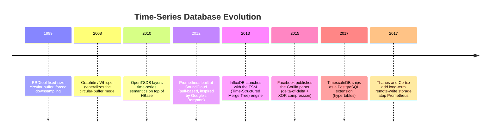

## 3. Why It Exists

A Time Series Database exists because the three things a general-purpose
OLTP engine optimizes for — safe in-place updates, arbitrary point deletes,
and flexible ad hoc joins across normalized tables — are exactly the three
things a metrics/observability/IoT-telemetry workload almost never needs,
while the two things that workload needs constantly — sustained append-only
write throughput at very high point-per-second rates, and storage-efficient
retention of a data shape that is extremely regular from one point to the
next — are not what a general-purpose engine's storage layer is built to
exploit. Consider what happens when a fleet of 10,000 servers, each
emitting 200 distinct metrics every 10 seconds, is pointed at an ordinary
relational table: that is 200,000 inserts per second, sustained, forever,
against a single ever-growing table whose B-tree indexes
([recapped from Indexes](CH03_Indexes.md#b-tree-index)) must be maintained
on every insert, whose WAL must durably record every one of those inserts
individually, and whose eventual data-lifecycle need — "delete everything
older than 90 days" — becomes a colossal, lock-contending `DELETE`
statement touching potentially billions of rows one at a time unless the
table happens to already be partitioned by time
([recapped from Partitioning](CH05_Partitioning.md#48-partition-maintenance-rolling-windows-for-time-series-retention)).
None of this is impossible for a general-purpose engine to handle — indeed,
[TimescaleDB (Section 4.9)](#49-comparative-architecture-timescaledb-as-a-postgresql-extension)
proves a general-purpose engine can be adapted to handle it very well — but
it requires deliberately opting into time-series-specific structures
(hypertables, continuous aggregates, retention policies) rather than
getting them by default, and even then a general-purpose row-oriented
storage format cannot exploit the two compression techniques this chapter
teaches (Sections 4.5-4.6) as tightly as a storage engine designed around
them from the first byte.

A second, equally important reason this category exists is that
observability and monitoring data has a distinctive value-decay curve:
a metric point from the last five minutes is enormously valuable at
one-second resolution (it is what an on-call engineer stares at during an
incident), the same point from six months ago is valuable mainly as a
coarse trend line for capacity planning, and the same point from three
years ago is valuable, if at all, only in aggregate for a year-over-year
comparison. A general-purpose engine has no opinion about this decay curve
— every row costs the same to store and query regardless of age — while a
Time Series Database's downsampling and retention machinery (Section 4.3)
is built explicitly to let an operator declare that decay curve once, as
policy, and have the engine automatically keep raw resolution only where
it still matters and progressively coarsen or discard the rest.

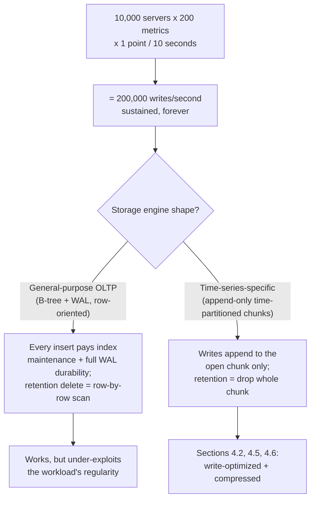

## 4. Core Concepts

**Recap boundary for this section.** Every subsection below teaches a
concept genuinely specific to Time Series Databases; none of the seven
first-principles subsections re-derive theory this book already owns
elsewhere. Where a time-series-specific mechanism is a concrete
application of already-taught generic theory, that recap is called out
inline with a link, in the same pattern MongoDB, Redis, DynamoDB, and
Cassandra established for this NoSQL subsection: horizontal partitioning
by key range ([Partitioning](CH05_Partitioning.md)) generalizes the
time-partitioned chunk in Section 4.2; the write-ahead-log durability
mechanism itself ([recapped from PostgreSQL's WAL
coverage](CH11_PostgreSQL.md#43-wal-fundamentals-durability-and-crash-recovery))
underlies most TSDB write paths (Section 5); and the cache-vs-materialized-
view distinction ([recapped from Caching](CH09_Caching.md#46-distinguishing-a-cache-from-a-materialized-view))
is directly relevant to correctly classifying what a downsampled rollup
actually is (Section 4.3) — it is a durable, engine-managed materialized
view, not an ephemeral cache, even though both exist to make a slow
computation fast to re-read.

### 4.1 The time-series data model: metric name, tags/labels, timestamp, value

**Definition.** A time series, in this chapter's sense, is uniquely
identified by the combination of a **metric name** (a human-readable
identifier for *what* is being measured, e.g. `http_requests_total` or
`cpu.usage_percent`) and a set of **tags** (also called labels — key/value
pairs identifying *which instance* of that measurement this is, e.g.
`host=web-01, region=us-east-1, status_code=500`). Every **point** within
that series is a `(timestamp, value)` pair: a moment in time and the
numeric value observed at that moment. Two points with the same metric
name but even one differing tag value belong to two *different* time
series, not the same series with an extra dimension — this single fact is
the root cause of the high-cardinality problem covered in Section 4.4.

**Mechanism.** Internally, every TSDB covered in this chapter computes some
form of a series identity from the metric name plus the full, sorted set of
tag key/value pairs — Prometheus, for instance, treats the metric name
itself as just another label (`__name__`) and then hashes the complete
sorted label set to a series identifier used to route writes and reads to
the correct in-memory/on-disk series stream. This means the storage engine
never actually stores "one row per metric" the way a naive mental model
might suggest; it stores one independent append-only stream per unique
tag combination, and a query that says "give me `cpu.usage_percent` for
`host=web-01`" is really a lookup by (metric name, exact tag subset) that
may match one series (if fully qualified) or many (if the tag filter is
partial, requiring the query engine to fan out across every matching
series and aggregate).

**Decision implications.** Choosing which attributes belong in the metric
name versus in a tag is the single most consequential modeling decision an
architect makes when adopting a TSDB, because it directly determines
series cardinality (Section 4.4) and query flexibility. Putting the HTTP
status code in the metric name (`http_requests_200_total`,
`http_requests_500_total`, ...) makes "how many total requests across all
statuses" require summing across metric names at query time, which most
TSDB query languages support poorly or not at all; putting it in a tag
(`http_requests_total{status_code="500"}`) makes both "just the 500s" and
"all statuses summed" trivial PromQL/Flux expressions, at the cost of one
more dimension in the cardinality multiplication. The general heuristic
this chapter recommends: anything you would ever want to filter by,
group by, or aggregate away independently belongs in a tag; anything that
fundamentally changes what unit or semantic the value represents belongs
in the metric name.

**Failure mode.** Modeling a naturally continuous or unbounded value as a
tag instead of a value — for example, encoding a specific latency
measurement in milliseconds directly into the metric name
(`request_duration_ms_142`) instead of storing 142 as the *value* of a
single `request_duration_ms` series — silently creates one new time
series per distinct latency ever observed, which for a busy endpoint can
mean effectively unbounded series growth from a single, otherwise
reasonable-looking metric definition; the model above is deliberately
strict about which of the four dimensions numeric measurements belong in
precisely to prevent this class of mistake.

**Scenario.** A payments service wants to track request outcomes. The
correct model is one metric, `payment_requests_total`, tagged with
`method` (`card`, `paypal`, `bank_transfer` — a small, closed set),
`status` (`success`, `declined`, `error` — also small and closed), and
`region` (a handful of deployment regions) — three bounded tags, each with
single-digit-to-low-double-digit distinct values, multiplying to a few
hundred total series, comfortably queryable and aggregatable in any
direction. The incorrect model some teams reach for instead is tagging
with `customer_id` "for debuggability," which turns the same metric into
one series per customer — Section 4.4 walks through exactly how expensive
that mistake becomes at real customer-base scale.

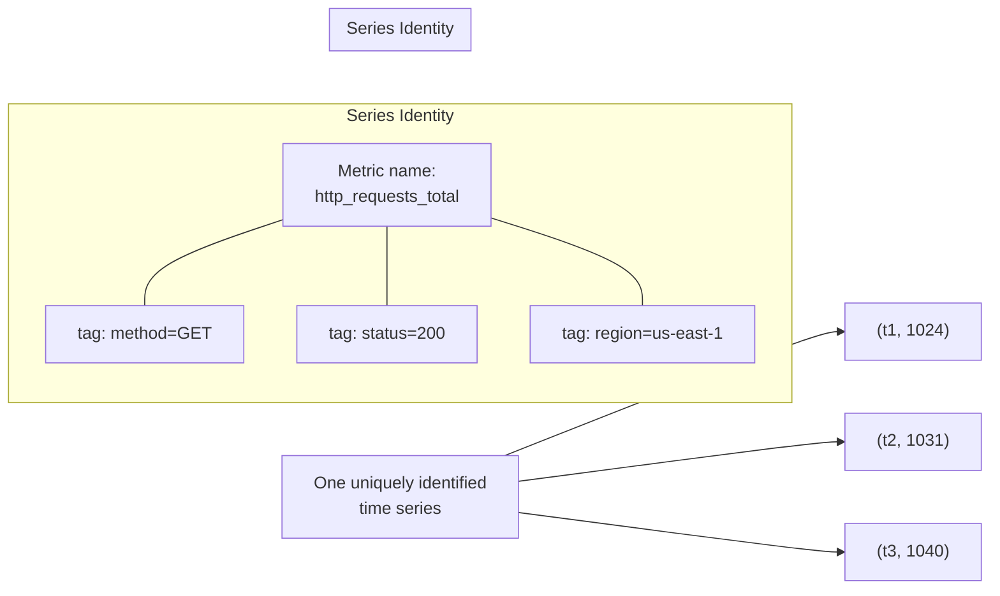

### 4.2 Write-optimized storage: append-only, time-partitioned chunks

**Definition.** Write-optimized time-series storage means every write is,
almost without exception, an append to the newest, currently open segment
of storage — a "chunk," "block," or "shard" (the exact term varies by
engine) that covers a bounded, recent time window (an hour, a few hours, a
day, depending on the engine's configuration) — rather than a random-access
update to an arbitrary existing row somewhere in a large table. Once a
chunk's time window closes, that chunk becomes **immutable**: no further
writes ever target it (barring rare out-of-order/backfill writes, handled
as a deliberate exception path, not the common case), which unlocks
aggressive, one-time compression and indexing work that would be wasted
effort on data still actively being written.

**Mechanism.** Concretely, an in-memory write buffer ("head chunk" in
Prometheus's terminology, "memtable" in InfluxDB's TSM/LSM-tree-derived
engine) accumulates incoming points for the current time window, sorted
internally by series and by timestamp within each series. Because points
for a given series always arrive in (approximately) increasing timestamp
order, the write path never needs to search for the correct insertion
point the way a general-purpose B-tree does for an arbitrary key — it
appends to the end of that series' in-memory buffer, an O(1) operation.
When the time window closes (on a timer, or when the buffer reaches a
size threshold), the engine flushes the accumulated buffer to disk as one
sequential write, applying Sections 4.5-4.6's compression at flush time,
and builds whatever index that chunk needs (typically an inverted index
from tag key/value to the set of series IDs present in that chunk) once,
against the now-frozen data, rather than maintaining a live, continuously
updated index the way an OLTP B-tree must.

**Decision implications.** This design directly trades update/delete
flexibility for write throughput and compression opportunity. An
OLTP engine's B-tree index must stay correct after every single insert,
update, or delete, forever, which means every write pays some index-
maintenance cost proportional to tree depth; a time-partitioned chunk
defers *all* indexing work for a window of data until that window closes,
batching what would otherwise be per-row index maintenance into one
per-chunk build. The corresponding cost an architect must accept: querying
data still inside the open, unindexed (or lightly indexed) head chunk is
typically slower or less feature-rich than querying a closed, fully
indexed chunk, and any operation that resembles a general-purpose UPDATE
or a targeted single-row DELETE is either unsupported or deliberately
expensive, because the storage format never anticipated needing one.

**Failure mode.** Data arriving **out of order** — a point whose timestamp
falls inside an already-closed, already-compressed, already-indexed chunk
— is the single hardest operational case this design creates. Every TSDB
covered in this chapter has some accommodation for it (Prometheus accepts
a bounded amount of out-of-order ingestion within a configurable window
before rejecting a sample as "out of bounds"; InfluxDB and TimescaleDB
handle it by reopening or rewriting the affected chunk, at real cost), but
none of them treats it as free, because accepting it undermines the very
immutability assumption that made the chunk cheap to compress and index in
the first place. A collector or forwarding pipeline with clock skew, batched
retries, or multi-region buffering can produce enough out-of-order data to
measurably degrade ingestion throughput or, past a configured tolerance,
silently drop the late points entirely.

**Scenario.** A fleet of edge IoT devices batches readings locally and
uploads them once connectivity returns, sometimes hours late and out of
strict chronological order relative to other devices' concurrent uploads.
An architect choosing a TSDB for this workload must explicitly check each
candidate engine's configured out-of-order-ingestion tolerance window
against the expected worst-case device offline duration — a TSDB
configured (or hard-limited) to only accept data within, say, one hour of
the current chunk boundary will silently reject or misfile readings from a
device that reconnects after six hours offline, unless the ingestion
pipeline is explicitly designed to route stale batches through a
backfill-specific path.

```mermaid
flowchart TD
    subgraph Open Chunk (mutable, in-memory)
        H1["Series A: append point"] --> HBuf["Write buffer<br/>(sorted by series, then time)"]
        H2["Series B: append point"] --> HBuf
        H3["Series C: append point"] --> HBuf
    end
    HBuf -->|"window closes / size threshold"| Flush["Flush: compress (4.5, 4.6)<br/>+ build index once"]
    Flush --> Closed["Closed chunk (immutable)<br/>on disk"]
    Closed --> Query["Reads: served from<br/>fully indexed, compressed data"]
    LateWrite["Late/out-of-order point<br/>targeting a closed chunk"] -.->|"exception path,<br/>bounded tolerance"| Closed
    LateWrite -.->|"past tolerance"| Reject["Rejected /<br/>routed to backfill path"]
```

### 4.3 Downsampling, rollups, and retention-policy-driven data lifecycle

**Definition.** Downsampling (also called rollup) is the process of
computing a coarser-resolution summary of a time series — for example,
one average/min/max/count per hour, computed from the underlying raw
per-10-second points — and storing that summary as its own, separate,
lower-volume series. A retention policy is a declared rule stating how
long data at a given resolution is kept before being deleted or further
downsampled; together, downsampling and retention implement a tiered data
lifecycle: recent data stays at full raw resolution, older data is
progressively coarsened, and the oldest data is dropped entirely once no
declared retention tier still wants it.

**Mechanism.** A downsampling job (whether it is TimescaleDB's continuous
aggregate, InfluxDB's continuous query, or a Prometheus recording rule
combined with a longer-retention remote-write target) reads a bounded
window of raw points, applies an aggregation function (average, min, max,
sum, count, or a specific quantile), and writes the aggregated result as a
new point in a separate, lower-cardinality-over-time series. Crucially, a
well-implemented downsampling job is **incremental**: it only recomputes
buckets whose underlying raw data has actually changed or newly arrived
since the last run, rather than reprocessing the entire history on every
execution — this is precisely the durable, engine-managed materialized
view TimescaleDB's continuous aggregates implement, distinct from an
ephemeral application-tier cache
([recapped from Caching](CH09_Caching.md#46-distinguishing-a-cache-from-a-materialized-view)):
a materialized view survives a restart and is recomputed deterministically
from source data, while a cache is disposable and exists only to avoid
recomputation, not to persist a value that could otherwise be lost.
Retention is implemented, wherever possible, as the chunk-drop mechanism
from Section 4.2 rather than a row-by-row `DELETE` — exactly the same
metadata-only reasoning [Partitioning's rolling-window
pattern](CH05_Partitioning.md#48-partition-maintenance-rolling-windows-for-time-series-retention)
already established for relational tables: dropping an entire, already-
partitioned chunk is a near-instant metadata operation, while deleting the
same volume of data row-by-row from an unpartitioned table can take hours
and generate enormous WAL/undo volume.

**Decision implications.** Every downsampling/retention policy is a
deliberate, irreversible trade of storage cost against future query
resolution: once raw 10-second-resolution data older than 30 days has been
dropped in favor of an hourly rollup, no future query can ever recover the
original per-10-second shape of that older data, even if the business
later decides it wants that detail back. Architects must therefore choose
retention tiers based on the coarsest resolution any *foreseeable* future
question could need, not just today's dashboards — a common real-world
driver is a post-incident retrospective process that, months later, wants
to examine exactly what a metric did second-by-second during an outage
that has long since aged out of raw retention, which is unrecoverable if
the retention policy was set purely for today's operational dashboard
needs.

**Failure mode.** A downsampling job that silently stops running (the
exact same "maintenance-job drift" failure mode
[recapped from Partitioning](CH05_Partitioning.md#failure-scenarios)) is
worse in a TSDB than in a relational partitioned table, because a stopped
rollup job doesn't just fail to save disk space — it produces a growing
gap in a dashboard's long-range view the moment raw data ages past its own
separate, shorter retention window: queries against the "30-day" dashboard
panel keep working using raw data for a while, then abruptly show missing
data for the range that should have been backed by the (silently
un-updated) hourly rollup instead. This failure is deceptively easy to miss
because it is invisible until someone happens to query far enough back to
notice the gap.

**Scenario.** An observability team retains raw 15-second-resolution
metrics for 7 days (enough for any incident investigation still likely to
need per-scrape granularity), a 5-minute rollup for 90 days (enough for a
quarter-over-quarter capacity trend), and a 1-hour rollup indefinitely
(cheap enough at that resolution to keep forever for year-over-year
comparisons). A dashboard panel showing "last 6 months" automatically
queries the 1-hour rollup rather than raw data, both because raw data from
that far back no longer exists and because querying an already-coarse
rollup is dramatically cheaper than the query engine re-aggregating
millions of raw points on every dashboard load.

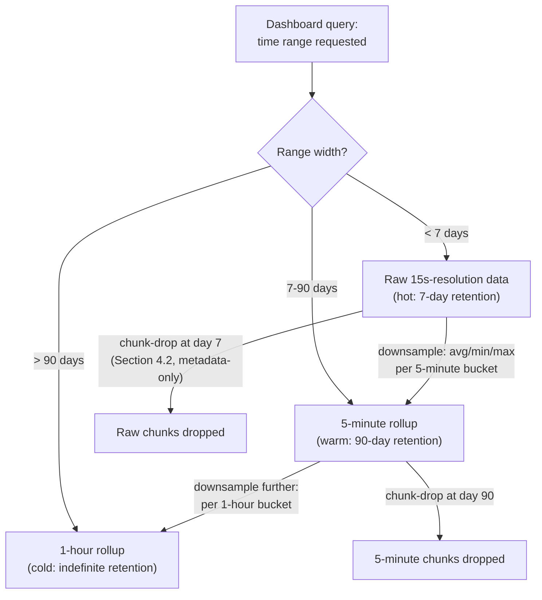

### 4.4 The high-cardinality problem: tag explosion and its query/memory cost

**Definition.** Cardinality, in this chapter's sense, is the count of
distinct time series a metric name actually expands into once every
combination of its tags' distinct values is considered. Because that count
is a **cartesian product** across tags (Section 4.1), not a sum, adding
even one tag with a large or effectively unbounded set of distinct values
— a customer ID, a request ID, a raw user-supplied string, a UUID —
multiplies the total series count by that tag's full cardinality, and the
"high-cardinality problem" is the resulting query latency, ingestion
throughput, and (especially for engines that keep an active series index
substantially in memory, like Prometheus) memory-exhaustion cost that
follows from that multiplication.

**Mechanism.** Most TSDB engines maintain an in-memory index mapping tag
key/value pairs to the set of series containing them, so that a query
filtering by `region="us-east-1"` doesn't have to scan every series to
find the matching ones. That index's size is a function of the *number of
distinct active series*, not the number of points — so a metric with a
million distinct tag combinations costs roughly a million times the
per-series index overhead of a metric with one, regardless of how
infrequently any individual series is written to or queried. Every newly
observed, never-before-seen tag combination also forces the engine to
allocate a brand-new series (a new in-memory head-chunk buffer, a new
index entry) rather than reusing existing storage, so an unbounded tag
doesn't just cost memory once — it costs a fresh allocation on every
distinct value ever seen, for the lifetime of the process.

**Decision implications.** The correct architectural response to high
cardinality is almost never "make the storage engine bigger" — it is to
restructure which attributes are tags at all. Attributes with effectively
unbounded, per-entity cardinality (customer IDs, session IDs, request IDs,
raw IP addresses, free-text fields) belong in a separate system entirely
— structured logs or a tracing system, both of which are built to index
and search exactly that kind of high-cardinality, per-request identifying
data — rather than as a metric tag, and the code example in Section 10
(`04_high_cardinality_cost_simulator.py`) demonstrates concretely how fast
the series count multiplies once one unbounded tag is added to an
otherwise well-bounded tag set.

**Failure mode.** The most common real-world trigger for this failure mode
is not a deliberate design decision but an accidental one: a library or
auto-instrumentation framework that tags every HTTP metric with the full
request path, including path parameters (`/users/42/orders/1057` instead
of the templated `/users/:id/orders/:id`), silently turns what the team
believed was a small, bounded set of endpoint tags into one new series per
distinct user/order ID combination ever observed — the resulting
cardinality explosion typically first surfaces as a sudden, unexplained
memory-usage spike or query-latency regression on the metrics backend
itself, often well after the instrumentation change that caused it, since
the growth is cumulative and only becomes visible once enough distinct
values have accumulated.

**Scenario.** An e-commerce platform's checkout service instruments
`checkout_duration_seconds` and, wanting "full visibility," tags it with
`cart_id` (a fresh UUID generated for every checkout attempt). Within
weeks, this single metric alone accounts for millions of distinct,
almost-never-repeated series, each contributing its full per-series index
and in-memory chunk overhead for a value that, once written, will almost
certainly never be queried again by its specific `cart_id` — the fix is
to drop `cart_id` as a tag entirely (it belongs in a trace or a log line,
where per-request identifiers are the expected, well-supported case) and
retain only genuinely bounded tags like `payment_method` and `region`.

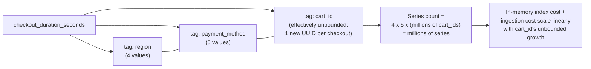

### 4.5 Delta-of-delta timestamp compression

**Definition.** Delta-of-delta encoding is a lossless compression
technique for a strictly increasing timestamp sequence that stores, for
each point after the second, not the timestamp itself and not even the
gap ("delta") since the previous timestamp, but the *change in that gap*
compared to the previous gap — the second-order difference. It exploits
one specific, extremely common regularity in monitoring data: most metric
sources are scraped or emit values on a fixed interval (every 10 seconds,
every 15 seconds, and so on), so the delta between consecutive timestamps
is nearly always exactly the same number, making the delta-of-delta value
zero the overwhelming majority of the time.

**Mechanism.** The first timestamp in a block is stored in full (64 bits
in most implementations, since there is no prior point to compare
against). The second timestamp is stored as a plain delta against the
first (Gorilla's original scheme uses 14 bits, since a first interval is
assumed to be small and positive). From the third timestamp onward, the
engine computes `delta = timestamp[i] - timestamp[i-1]`, then
`delta_of_delta = delta - previous_delta`, and encodes that
delta-of-delta value using a small set of variable-length integer
bucket sizes: a delta-of-delta of exactly zero costs a single control bit,
a small nonzero delta-of-delta (accounting for typical scrape jitter of a
few milliseconds) costs a handful of bits, and only a genuinely irregular
gap (a missed scrape, a process restart, a backfilled batch) pays the full
cost of a wide, explicitly stored value. The code example in Section 10
(`02_delta_of_delta_gorilla_encoder.py`) implements exactly this bucketing
scheme and reports the resulting compression ratio against a
representative, mostly-regular scrape interval.

**Decision implications.** This technique is why time-series-specific
storage engines can afford to store timestamps at all — a naive 8-byte
timestamp per point, multiplied across millions of series each producing
a point every few seconds, would dominate total storage cost on its own;
delta-of-delta typically collapses that cost to a small fraction of a
byte per point for a well-behaved, fixed-interval series, which is exactly
why every serious TSDB covered in this chapter (Prometheus, InfluxDB, and
TimescaleDB's own compression layer) implements some variant of it,
even though the specific bit-width buckets differ between implementations.

**Failure mode.** Delta-of-delta's compression ratio degrades, sometimes
sharply, for a series whose scrape interval is itself irregular — a metric
emitted on an event-driven basis rather than a fixed timer (for example, a
metric recorded only when a rare error occurs) produces deltas that vary
every time, so nearly every point pays the full wide-encoding cost with
none of the "mostly zero" savings a regular scrape interval provides.
Architects choosing a scrape/emission strategy for a new metric should be
aware that a fixed interval isn't just operationally simpler — it is also
what makes this specific compression technique (and, by extension, the
storage-cost assumptions the rest of this chapter's economics rely on)
actually effective.

**Scenario.** A fleet scraped every 15 seconds normally produces a
delta-of-delta stream of ({first timestamp}, {15s}, 0, 0, 0, 0, 3, 0, 0, ...
) where the lone `3` reflects one scrape that happened to land 3 seconds
late — nearly every point after the second costs a single bit, and the
occasional jitter costs only a few more, compared to 64 bits per point
under naive storage; the exact numeric compression ratio for a
representative 10-point series with one such jitter event is printed by
the Section 10 code example.

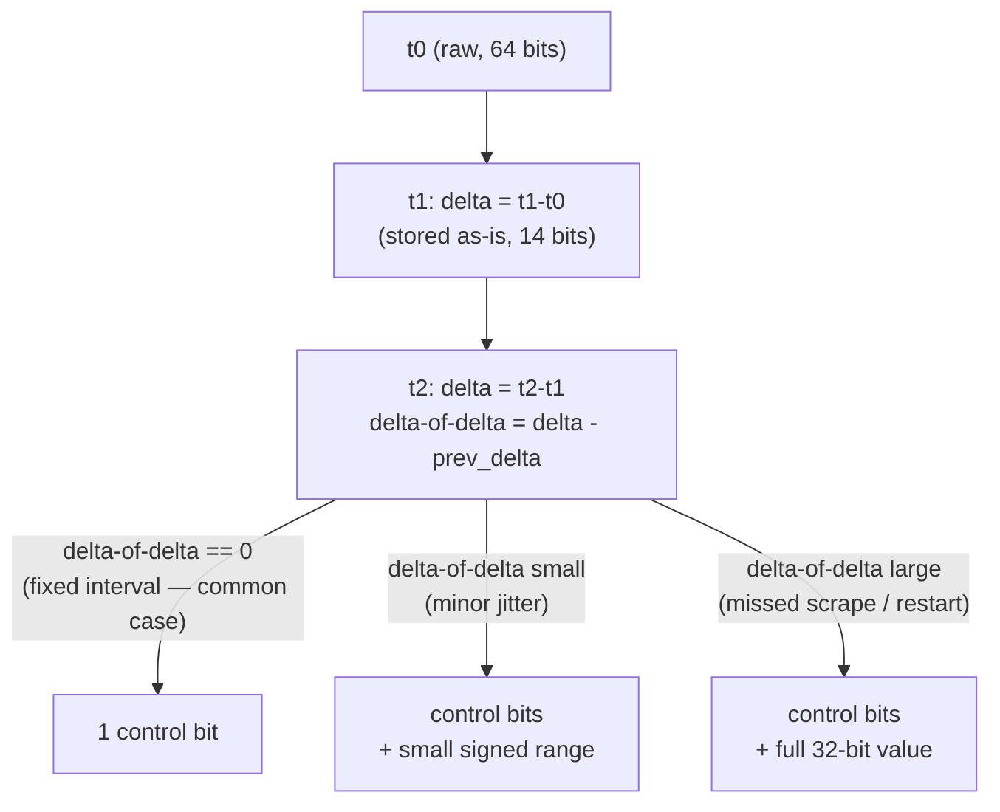

### 4.6 XOR-based value compression (the Gorilla technique)

**Definition.** XOR-based value compression is a lossless technique for
floating-point *values* (as distinct from Section 4.5's timestamp
technique) that exploits the fact that consecutive samples of most
real-world metrics are numerically close to each other, which means their
IEEE-754 bit representations, when XORed together, produce a result with
long runs of leading and trailing zero bits and only a short, meaningful
run of differing bits in the middle. Rather than storing each 64-bit
floating-point value in full, the encoder stores only that short
meaningful middle section, plus a compact description of where it sits.

**Mechanism.** For the first value in a series, the encoder stores the
full 64-bit IEEE-754 representation. For every subsequent value, it
computes `xor = bits(current_value) XOR bits(previous_value)`. If the XOR
is exactly zero (the value did not change at all between samples — common
for a flat metric between updates), the encoder stores a single control
bit meaning "identical to previous." Otherwise, it counts the number of
leading zero bits and trailing zero bits in the XOR result, computes the
"meaningful" bit span between them, and stores: a control bit, then either
a "reuse the previous block's leading/trailing-zero window" flag (cheap,
if this XOR's meaningful span fits inside the previous one) or a fresh
5-bit leading-zero-count plus 6-bit meaningful-length header (slightly
more expensive, but still far cheaper than a full 64-bit value), followed
by the meaningful bits themselves. The code example in Section 10
(`02_delta_of_delta_gorilla_encoder.py`) implements this exact
window-reuse-versus-new-window decision and reports a compression ratio
for a representative, mostly-stable metric series.

**Decision implications.** This technique's effectiveness is directly
proportional to how numerically stable a metric is from one sample to the
next: a slowly changing gauge (CPU utilization drifting a few points at a
time, a temperature sensor, a queue depth that rarely jumps wildly) yields
XOR results with very long zero runs and compresses extremely well,
consistent with the Gorilla paper's reported roughly 12x reduction for
Facebook's production monitoring data; a value that jumps unpredictably
and by a large, structurally different magnitude every sample (a
counter reset, a value switching between fundamentally different
orders of magnitude) produces XOR results with short or no zero runs and
gains little or nothing from this technique, since nearly every bit of the
representation genuinely changed.

**Failure mode.** A monotonically increasing counter reset to zero (a
process restart resetting an in-memory request counter, for instance)
produces one XOR result with essentially no shared leading/trailing zero
structure against the pre-reset value, briefly forcing a full-cost,
new-window encoding for that single point — this is an expected, bounded
cost the technique already accounts for, but a badly designed metric that
resets *frequently* (rather than only on rare process restarts) pays that
full cost repeatedly, eroding the compression ratio the technique is
chosen for in the first place.

**Scenario.** A CPU-usage-percentage series like the one in Section 10's
code example (`42.5, 42.6, 42.6, 42.4, 42.6, 55.1, 55.1, 55.0, 55.2,
42.7`) — small fluctuations around one set point, then a jump to a second
set point, then a jump back — demonstrates both the common case (small
fluctuations compress very well, since consecutive values share most of
their bit pattern) and the harder case (the two larger jumps require a
new leading/trailing-zero window each time), and the code example prints
the exact resulting compression ratio against naive 64-bit-per-value
storage.

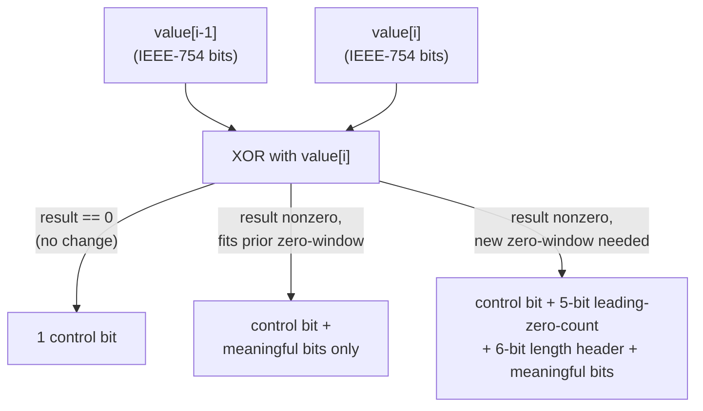

### 4.7 Prometheus's pull-based architecture and remote-write federation

**Definition.** Prometheus's architecture is defined by two closely
related design choices: it **pulls** (scrapes) current metric values from
each monitored target over HTTP on a periodic interval, rather than
requiring each target to push its metrics outward to a central collector;
and each Prometheus server's own storage is deliberately **local and
single-node**, with **remote-write** as the explicit, separate mechanism
for forwarding scraped data to a longer-term, horizontally scalable
storage tier operated by a different system entirely.

**Mechanism.** A Prometheus server is configured with a list of scrape
targets (either statically, or dynamically via a service-discovery
integration such as Kubernetes' API), and on each scrape interval (commonly
15 or 30 seconds), it issues an HTTP GET to each target's metrics
endpoint, which responds with the current value of every metric that
target currently exposes, in a simple text exposition format. Prometheus
stores every scraped value locally, applying delta-of-delta (Section 4.5)
and XOR (Section 4.6) compression at chunk-flush time within its own
local Time-Series Database (TSDB) engine (internally organized around
Section 4.2's append-only, time-partitioned chunk model). Because a
scrape target simply answers an HTTP request rather than maintaining any
outbound delivery or retry logic of its own, a target that stops
responding to scrapes is, by construction, treated as down — the
scrape-failure signal doubles as a liveness check without any separate
heartbeat mechanism. **Remote write** is a separate, optional protocol:
Prometheus can be configured to also forward every scraped sample, as it
is ingested, to one or more remote endpoints — typically a long-term
storage system such as Thanos or Cortex — decoupling "how long does this
specific Prometheus server retain data locally" (usually a relatively
short window, days to a few weeks) from "how long is this organization's
metrics history retained overall" (often months to years, in the remote
system).

**Decision implications.** Choosing pull over push means Prometheus itself
controls scrape timing and pacing (protecting the collector from an
uncoordinated stampede of pushes from thousands of targets simultaneously)
and gets liveness detection for free, at the cost of needing every scrape
target to be network-reachable *from* the Prometheus server — which is
awkward for short-lived batch jobs that may finish and disappear before
the next scheduled scrape ever fires (Prometheus's answer is a separate
"Pushgateway" component precisely for that narrow case, not a general
push-based ingestion path). Choosing local-only storage plus remote-write
federation, rather than building distributed storage directly into
Prometheus, keeps each Prometheus server's operational model simple (a
single binary, a single local disk, no cluster coordination to reason
about) while still allowing organizations that need cross-cluster
querying or multi-year retention to add that capability as a genuinely
separate, independently scaled system layered on top, rather than forcing
every Prometheus deployment — including small, single-cluster ones with
no long-term-retention need — to carry that complexity by default.

**Failure mode.** A Prometheus server's local storage is not itself highly
available or replicated: if that single server's disk is lost, all of its
locally retained history (everything not already forwarded via remote
write) is lost with it, and a common operational mistake is treating
Prometheus's local retention window as a durable long-term archive rather
than the short, "buffer against the remote-write target being briefly
unreachable" window it is designed to be. A second common failure mode is
under-provisioning scrape-interval-to-target-count ratios: because every
target is scraped on the *same* configured interval regardless of how
important or high-cardinality its metrics are, a Prometheus server whose
scrape workload grows past what it can complete within one scrape
interval falls progressively further behind, producing gaps in every
series it manages rather than degrading gracefully for only the newest or
least important targets.

**Scenario.** A platform team runs one Prometheus server per Kubernetes
cluster, each retaining 15 days of local data (enough for any single
cluster's own incident investigation and dashboards), and configures
remote write from every cluster's Prometheus server into a single, shared
Thanos-backed object-storage tier retaining 2 years of history, giving the
organization both fast, low-latency local queries for recent, per-cluster
operational work and a long-term, cross-cluster query surface for
capacity planning and historical analysis, without any single Prometheus
server needing to know about, store, or query any other cluster's data
directly.

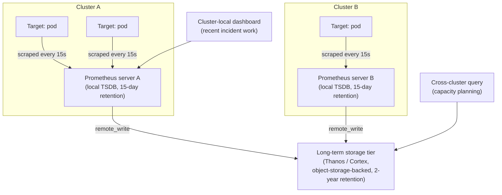

## 5. Internal Working

The end-to-end write path across the TSDB engines this chapter covers
follows a common shape, even though the exact component names differ:
a collector or scrape loop produces a batch of `(series identity,
timestamp, value)` tuples; the engine routes each tuple to its series'
in-memory write buffer (Section 4.2); once a time window closes, the
buffer is flushed to disk with Sections 4.5-4.6's compression applied and
a fresh per-chunk index built; and, in the background, independent of the
write path, a compaction/downsampling process (Section 4.3) periodically
merges or summarizes already-closed chunks. Read queries are served by a
query engine that first consults the tag index to resolve which series
match a request's filter, then reads and decompresses only the specific
chunks whose time range overlaps the query window for those series,
never scanning chunks entirely outside the requested range — the same
time-based pruning principle
([recapped from Partitioning's partition
pruning](CH05_Partitioning.md#46-partition-pruning))
already established for relational range-partitioned tables.

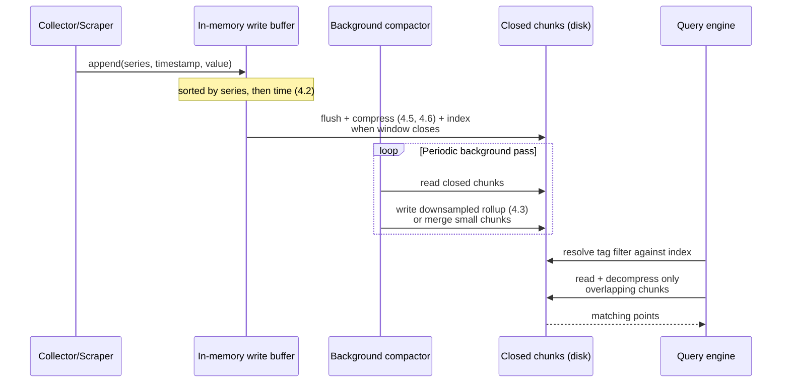

Compaction deserves its own callout because it serves two distinct
purposes that are easy to conflate: **downsampling compaction** (Section
4.3) reduces resolution to save long-term storage and speed up wide-range
queries, while **structural compaction** (common in LSM-tree-derived
engines like InfluxDB's TSM, directly analogous to
[Cassandra's own LSM-tree compaction](CH18_Cassandra.md#45-lsm-tree-storage-engine-memtables-sstables-compaction))
merges many small, recently flushed chunks into fewer, larger ones purely
to keep per-query file-open and index-lookup overhead bounded, without
changing resolution at all. An engine can and typically does run both
kinds of compaction independently and on different schedules.

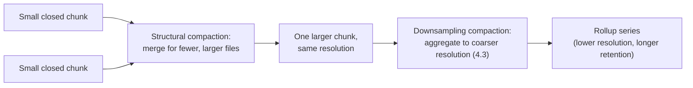

## 6. Design Principles

- **Optimize for the write path you actually have, not the write path a
  general-purpose engine assumes.** Every technique in this chapter —
  time-partitioned chunks, delta-of-delta, XOR compression — exists
  because a metrics workload's writes are overwhelmingly append-only and
  time-ordered; an architect adopting a TSDB should verify that assumption
  genuinely holds for their data before expecting these specific
  performance and storage characteristics.
- **Decide tag versus value versus metric name before writing a single
  line of instrumentation code**, not after cardinality has already
  become a production incident (Section 4.4) — the cheapest time to fix a
  cardinality mistake is before it exists.
- **Treat retention policy as a first-class, explicitly reviewed decision,
  not a default left unset.** Because downsampling is irreversible
  (Section 4.3), the retention tiers chosen at rollout time permanently
  bound what questions can ever be answered about older data.
- **Separate "how long does this specific collector/server retain data
  locally" from "how long does the organization retain metrics history
  overall"** (Section 4.7) — conflating the two either forces every
  local collector to carry unnecessary long-term storage complexity, or
  silently loses history the organization actually needed.
- **Prefer pre-aggregation at write time or query time over raw-point
  storage for anything a dashboard will render at a coarse time
  resolution** — querying an hourly rollup for a 6-month dashboard view
  is both faster and cheaper than re-aggregating millions of raw points on
  every page load.

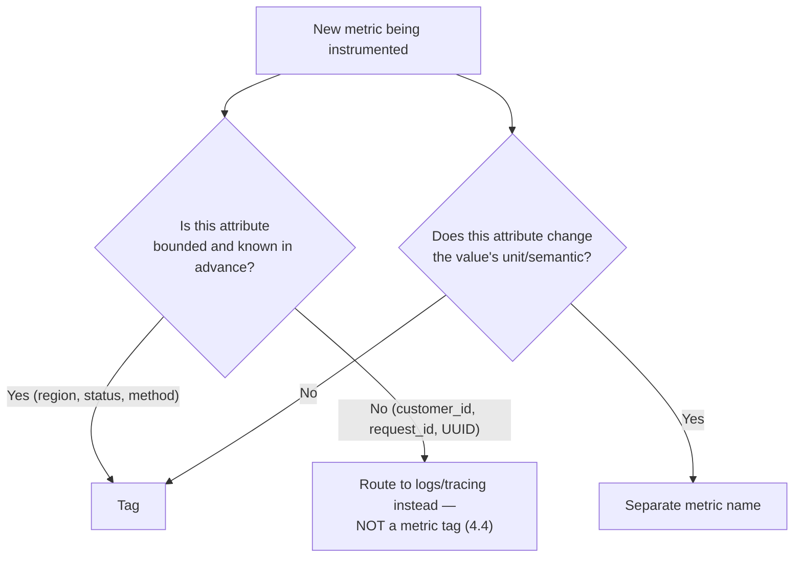

## 7. Architecture Patterns

**Push-based ingestion** (application code or an agent actively sends
metric batches to a collector, the model Graphite and InfluxDB's classic
write API both support) suits environments where scrape targets are
short-lived, ephemeral, or not reliably network-reachable from a central
collector — the exact case Prometheus's Pushgateway exists to cover as a
narrow exception rather than its default model. **Pull-based ingestion**
(Section 4.7) suits environments with a relatively stable, discoverable
set of long-lived targets, and gains free liveness detection as a side
effect. **Sidecar/agent-forwarding** (a lightweight per-host or per-pod
agent scrapes or receives local metrics and forwards them onward, batching
and buffering against transient network issues) is common in both models
as a way to decouple the instrumented application from the specific
wire protocol and endpoint the central TSDB expects. **Federation/
hierarchical aggregation** (Section 4.7's remote-write pattern, or
Prometheus's own older, now largely superseded, direct federation
endpoint) lets a higher tier query or receive already-scraped data from
multiple lower tiers, without every lower tier needing direct visibility
into every other lower tier.

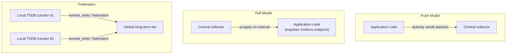

## 8. Production Architecture

A production time-series deployment typically layers three tiers: an
**ingestion tier** (scrape/collection agents, possibly a Pushgateway for
short-lived jobs, and load-balanced write endpoints for a push-based
engine), a **local/hot storage tier** (one or more TSDB instances holding
recent, full-resolution data — a single Prometheus server per cluster, or
an InfluxDB/TimescaleDB cluster sized for the current write rate), and a
**long-term/cold storage tier** (object-storage-backed, horizontally
scalable, holding downsampled and/or older raw data — Thanos/Cortex for a
Prometheus-based stack, or a TimescaleDB continuous-aggregate-plus-
compression setup for a PostgreSQL-based one). High availability at the
hot tier is typically achieved by running two independently scraping
collectors against the same targets (accepting duplicate ingestion rather
than building leader election into the collector itself, since a
duplicate scrape is far cheaper to reconcile at query time than a missed
one is to recover), while the cold tier's durability comes from the
underlying object storage's own replication, not from the TSDB software
layer.

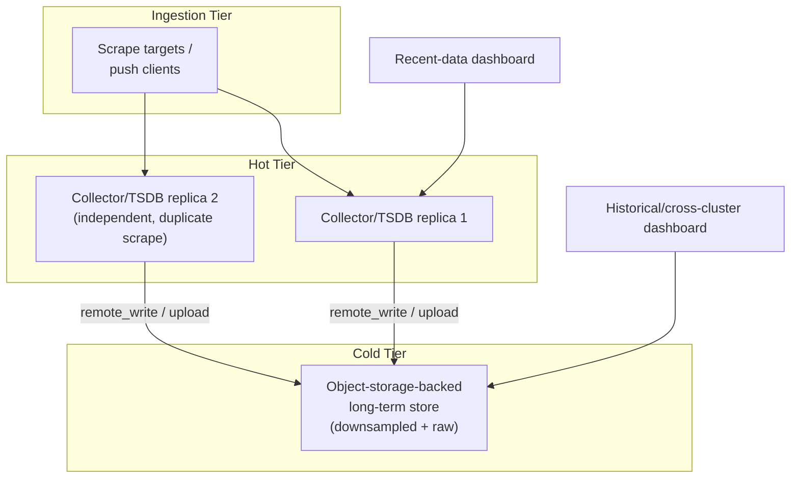

## 9. Implementation

### 4.8 (continued) Comparative survey: Prometheus, InfluxDB, TimescaleDB

Having taught the shared first-principles model (Section 4), this section
grounds it in how three representative, widely deployed systems actually
implement it, since an architect's real choice is never "time-series
concepts in the abstract" but "which specific engine, with which specific
trade-offs, for this specific workload."

**Prometheus** (Section 4.7) is purpose-built, single-purpose local
storage plus PromQL, deliberately scoped to operational monitoring: pull-
based scraping, a text exposition format, and a design philosophy that
treats "a Prometheus server can be safely rebuilt from scratch and its
local disk is not precious" as a first-class operating assumption, with
long-term durability delegated entirely to remote-write federation.

**InfluxDB** targets a broader "any time-stamped data" audience (metrics,
but also IoT telemetry, financial data, and other non-operational
time-series use cases), ships its own storage engine (the TSM,
Time-Structured Merge Tree — an LSM-tree variant, recapped from
[Cassandra's LSM-tree coverage](CH18_Cassandra.md#45-lsm-tree-storage-engine-memtables-sstables-compaction))
and its own query surface (InfluxQL and, in later versions, Flux), and
supports a push-based write API as its default ingestion model rather
than Prometheus's pull-based scrape.

**TimescaleDB** takes a fundamentally different path from both: rather
than a bespoke storage engine, it is a PostgreSQL extension that
automatically partitions a normal-looking table into time-ordered
"hypertable" chunks under the hood (directly analogous to
[Partitioning's range-partitioning mechanics](CH05_Partitioning.md#41-horizontal-partitioning-range-list-hash)),
adds continuous aggregates as its downsampling mechanism (Section 4.3),
and adds retention/compression policies as background jobs — while
keeping the entire surface area of standard SQL, joins, foreign keys, and
the existing PostgreSQL driver/tooling ecosystem fully intact. This is a
deliberate bet that many organizations already trust and operate
PostgreSQL, and would rather extend it than adopt an entirely new query
language and storage engine, at the cost of not being quite as
purpose-optimized at the storage-engine level as an engine built from a
blank slate specifically for this workload.

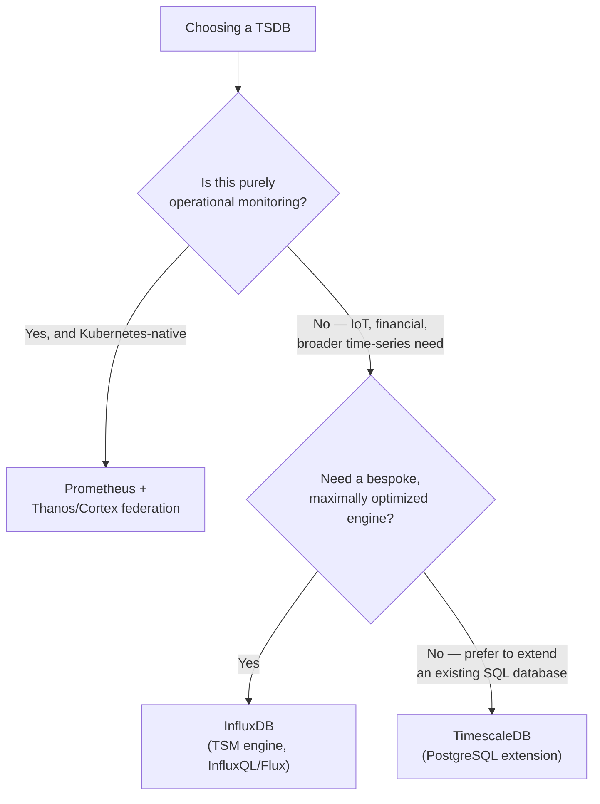

## 10. Complete Code Examples

Four runnable examples accompany this chapter, spanning SQL and Python:

1. [`code/sql/timeseries-chapter/01_timescaledb_hypertable.sql`](../code/sql/timeseries-chapter/01_timescaledb_hypertable.sql)
   — creates a TimescaleDB hypertable (time-partitioned chunks, Section
   4.2/4.9), a continuous aggregate for hourly rollups (downsampling,
   Section 4.3), a refresh policy, a retention policy (chunk-drop lifecycle,
   Section 4.3), and a native compression policy.
2. [`code/python/timeseries-chapter/02_delta_of_delta_gorilla_encoder.py`](../code/python/timeseries-chapter/02_delta_of_delta_gorilla_encoder.py)
   — a from-scratch, lossless implementation of delta-of-delta timestamp
   encoding (Section 4.5) and XOR-based value compression (Section 4.6),
   with an encode/decode round-trip proof and printed compression ratios
   against naive 64-bit-per-point storage.
3. [`code/python/timeseries-chapter/03_promql_query_examples.py`](../code/python/timeseries-chapter/03_promql_query_examples.py)
   — five annotated, representative PromQL queries (instant vector, `rate()`
   over a range vector, cardinality-collapsing aggregation, histogram
   quantile, and an alerting-style boolean expression) plus a minimal
   Prometheus HTTP API client (Section 4.7) that executes them against a
   live server if one is reachable, or prints the intended query otherwise.
4. [`code/python/timeseries-chapter/04_high_cardinality_cost_simulator.py`](../code/python/timeseries-chapter/04_high_cardinality_cost_simulator.py)
   — builds a well-bounded tag set and then an unbounded one (Section 4.4),
   printing the exact cartesian-product series-count multiplication and an
   approximated in-memory cost, at three different unbounded-tag
   cardinalities.

All four examples were executed/compiled during authoring: the Python files
ran successfully end-to-end (`python <file>.py`) and passed `py_compile`
with no syntax errors; the SQL file is annotated inline for a reader
without a live TimescaleDB instance, and its DDL/DML statements follow the
syntax documented for TimescaleDB's `create_hypertable`, continuous
aggregate, retention policy, and compression policy APIs.

## 11. Performance

Time-series query performance is dominated by two levers this chapter has
already taught the mechanism for: **chunk pruning** (Section 5) ensures a
query only reads chunks whose time range actually overlaps the requested
window, so query cost scales with the requested time range's width, not
with total retained history; and **querying the appropriate resolution
tier** (Section 4.3) ensures a wide-range query reads a coarse rollup
instead of re-aggregating millions of raw points on every execution.
Ingestion performance is dominated by how cleanly writes map onto
Section 4.2's append-only chunk model — a write pattern that is
predominantly in-order, per-series appends sustains far higher throughput
than one with frequent out-of-order or backfilled writes, which force the
exception path described in Section 4.2's failure mode. Compression
(Sections 4.5-4.6) is also a direct performance lever, not just a
storage-cost one: a smaller on-disk (and, for chunks still resident in
memory, in-RAM) footprint means more of the working set fits in the page
cache or the engine's own memory-mapped chunks, directly reducing disk I/O
on both the write-flush and read paths.

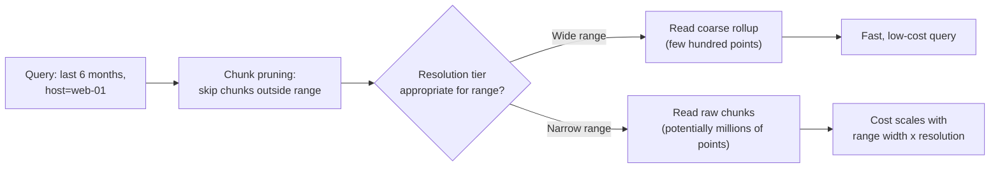

## 12. Scalability

Vertical scalability of a single TSDB node is bounded by the size of the
in-memory head chunk and tag index (Sections 4.2, 4.4) it can hold —
cardinality growth, not raw point-per-second write rate alone, is
typically the first ceiling a growing deployment hits, since the index's
memory cost scales with distinct series count rather than with write
volume. Horizontal scalability takes different shapes across the three
engines this chapter surveys: Prometheus scales horizontally by running
multiple independent, functionally sharded servers (by team, by cluster,
by workload) rather than clustering a single logical Prometheus instance,
and relies on remote-write federation (Section 4.7) for any cross-shard
query need; InfluxDB's enterprise/cloud offerings and TimescaleDB's
multi-node distributed hypertables both instead shard a single logical
database across nodes by time range and/or tag-derived hash, directly
analogous to the generic sharding theory
([recapped from Sharding](CH06_Sharding.md#41-shard-key-selection-criteria-shard-mapdirectory-routing-consistent-hashing-ring-vs-hash-mod-routing)),
choosing a partition/shard key from the time dimension, the tag dimension,
or both.

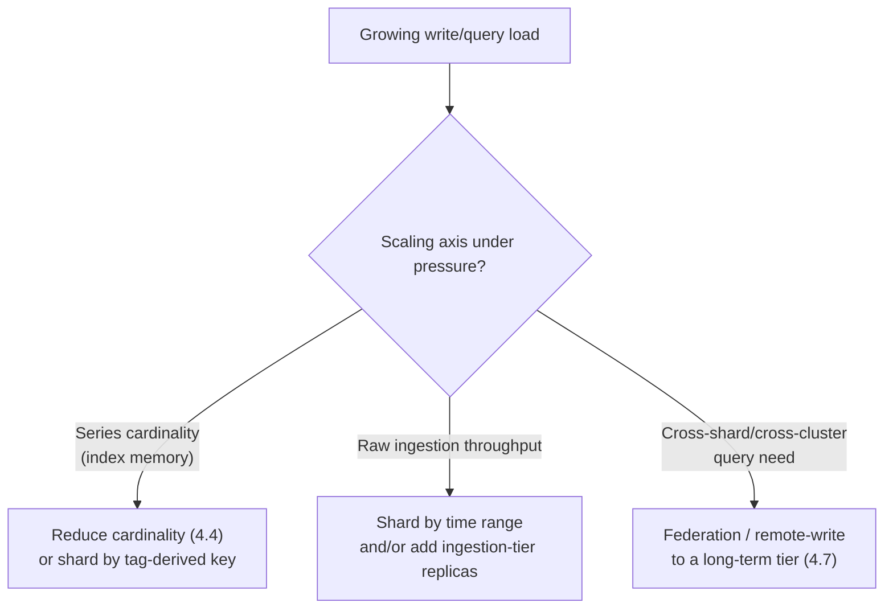

## 13. Security

Metrics endpoints are frequently under-protected relative to the
sensitivity of what they can leak: a scrape endpoint exposed without
authentication can reveal internal hostnames, service topology,
customer counts by tag, and (if cardinality mistakes from Section 4.4 have
leaked identifying tags) potentially sensitive per-entity data directly in
tag values — TLS
([recapped from TLS](05_Networking_and_OS/CH06_TLS.md)) and network-level
restriction of who can reach a scrape/query endpoint at all are the
baseline controls, and tag values should be treated as untrusted input if
they are ever derived from user-supplied data, since a malicious or
malformed tag value can itself become a cardinality-explosion attack
vector (Section 4.4) rather than merely a data-quality concern.

## 14. Observability

There is a genuine, easy-to-miss irony in monitoring the monitoring system
itself: a TSDB's own health (ingestion lag, chunk-flush latency, active
series count, query latency percentiles, and remote-write queue depth for
a Prometheus-style deployment) should be tracked as its own set of
metrics, ideally in a separate, independent instance rather than solely
within the same instance being monitored, so that an outage of the
primary monitoring stack does not also blind the team to that very
outage. Tracking active series count as a first-class signal (Section 4.4)
lets a team catch a cardinality regression from a code or instrumentation
change well before it becomes a memory-exhaustion incident.

## 15. Failure Scenarios

The three failure modes taught inline in Section 4 — out-of-order writes
past tolerance (4.2), silent downsampling-job drift (4.3), and
cardinality explosion (4.4) — account for the large majority of real
production incidents involving a TSDB. A fourth, structural failure mode
worth calling out separately: a query that requests a very wide time
range at full raw resolution (either a misconfigured dashboard or an
ad hoc investigation query that forgot to target a rollup) can force the
query engine to decompress and scan a volume of raw chunks disproportionate
to the value the query actually needs, degrading query latency for every
other concurrent query against the same TSDB instance — many production
deployments guard against this with an explicit maximum-samples-per-query
limit, deliberately rejecting a query that would otherwise be technically
valid but operationally dangerous.

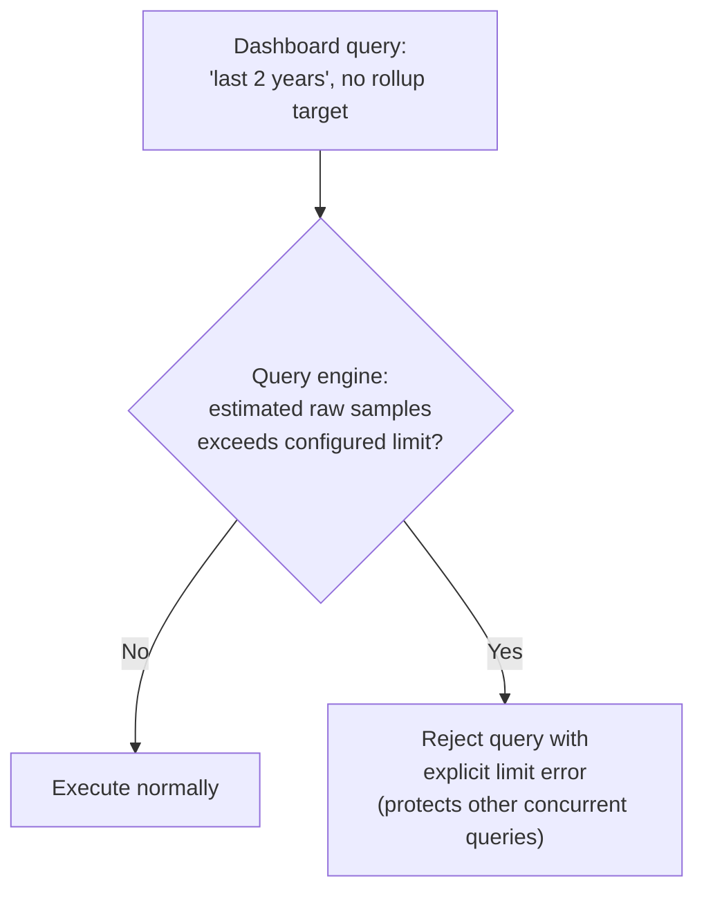

## 16. Testing

Ingestion-path tests should include a deliberate out-of-order/backfill
case (Section 4.2's failure mode) to confirm the configured tolerance
window and rejection behavior match expectations, rather than discovering
the real tolerance only during a production backfill incident. Rollup
correctness tests should compare a fresh, from-scratch aggregation over
raw data against the incrementally maintained rollup for the same window,
catching a subtle incremental-refresh bug (Section 4.3) that a purely
"does the rollup exist" smoke test would miss. Cardinality regression
tests — asserting that a given metric's distinct-series count for a
representative synthetic workload stays under an agreed ceiling — should
run in CI against any change to instrumentation code, since cardinality
mistakes (Section 4.4) are far cheaper to catch before merge than after a
production memory-exhaustion incident.

## 17. Common Mistakes

- **Tagging with an unbounded, per-entity identifier** (customer ID,
  request ID, raw UUID) — Section 4.4's most common concrete trigger.
- **Encoding a continuous value into the metric name instead of storing it
  as the value** — Section 4.1's failure mode, silently creating one
  series per distinct value ever observed.
- **Treating a Prometheus server's local retention as a durable long-term
  archive** rather than the short buffer it is designed to be, without a
  remote-write target actually configured (Section 4.7).
- **Letting a downsampling job fail silently** with no alerting on its own
  success/failure, producing an invisible dashboard gap only discovered
  when someone happens to query far enough back (Section 4.3).
- **Querying raw, full-resolution data for a wide time range** when an
  already-computed rollup exists and would answer the same question far
  more cheaply (Sections 4.3, 11).
- **Choosing a scrape/emission interval that varies unpredictably** for a
  metric that could instead be emitted on a fixed timer, discarding most
  of delta-of-delta's compression benefit for no operational gain
  (Section 4.5).

## 18. Best Practices

Decide the tag/value/metric-name modeling rule (Section 4.1) before
instrumentation code is written, and enforce it in code review or with an
automated cardinality-linting check rather than relying on discipline
alone; declare retention tiers explicitly and review them periodically
against what questions the organization has actually needed to answer
about older data, rather than leaving retention at whatever an engine's
installation default happens to be; monitor active series count and
ingestion/query latency for the TSDB itself, ideally from an independent
monitoring path (Section 14); separate local/hot retention from long-term/
cold retention explicitly (Section 8), and confirm the remote-write or
equivalent federation path is actually configured and healthy before
relying on a short local retention window; and choose a scrape/emission
interval that is fixed wherever the underlying event genuinely permits it,
to preserve delta-of-delta's compression benefit (Section 4.5).

## 19. Anti-Patterns

- **"Tag everything, just in case."** The instinct to add every available
  attribute as a tag "for debuggability" is precisely the anti-pattern
  Section 4.4 dismantles — the correct instinct is the opposite: default
  to fewer tags, and add one only when a genuine, bounded need for
  filtering/grouping by it exists.
- **Treating a TSDB as a general-purpose database** for data with real
  update/delete needs, business-transactional consistency requirements, or
  relational joins — the write-optimized, append-only, mostly-immutable
  design (Section 4.2) that makes a TSDB excel at its actual workload
  makes it a poor fit for that different one.
- **No retention policy at all** ("just keep everything forever, disk is
  cheap") — ignoring that active series count and raw-resolution history
  both compound cardinality and storage cost over time, and that query
  performance for any wide-range query degrades as unpruned, undownsampled
  history accumulates without bound.
- **Building custom, ad hoc downsampling scripts** run manually or on an
  unmonitored cron job, instead of using the engine's own incremental,
  monitored continuous-aggregate/recording-rule mechanism (Section 4.3).

## 20. Trade-off Analysis

| Dimension | Time-series-specific design | Trade-off accepted |
|---|---|---|
| Write throughput | Extremely high for in-order, append-only writes (Section 4.2) | Out-of-order/backfilled writes are an expensive exception path, not the fast path |
| Storage efficiency | Delta-of-delta + XOR compression (Sections 4.5-4.6) can approach 10x+ reduction vs. naive storage | Compression assumes regular scrape intervals and numerically stable values; irregular data compresses far less |
| Query flexibility | Excellent for time-range-bounded, tag-filtered queries and aggregation | Poor-to-absent support for arbitrary relational joins and general update/delete |
| Data lifecycle | Downsampling/retention (Section 4.3) makes long-term storage cost bounded and predictable | Irreversible — dropped raw resolution can never be recovered later |
| Cardinality tolerance | Bounded, well-modeled tag sets scale to millions of series comfortably | Unbounded tags (Section 4.4) multiply cost and can exhaust memory |

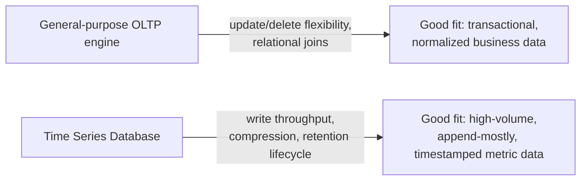

## 21. Comparison Table

| Dimension | Prometheus | InfluxDB | TimescaleDB |
|---|---|---|---|
| Ingestion model | Pull (scrape) + Pushgateway for short-lived jobs | Push (write API) | Push (standard SQL `INSERT`) |
| Storage engine | Purpose-built local TSDB (chunk-based, Section 4.2) | TSM (Time-Structured Merge Tree, LSM-tree variant) | PostgreSQL hypertables (chunked partitioning) |
| Query language | PromQL | InfluxQL / Flux | Standard SQL + TimescaleDB functions |
| Long-term storage | Delegated to remote-write federation (Thanos/Cortex) | Built-in retention policies; enterprise clustering for scale-out | Compression + retention policies within PostgreSQL |
| Best-fit use case | Kubernetes-native operational monitoring | Broad time-series workloads (IoT, financial, metrics) beyond pure ops monitoring | Teams already invested in PostgreSQL wanting SQL + joins alongside time-series data |
| Joins/relational features | None | Limited | Full PostgreSQL SQL/join support |
| Compression techniques | Delta-of-delta + XOR (Sections 4.5-4.6) internally | Delta/XOR-family encodings within TSM | Native columnar compression + Postgres-level techniques |

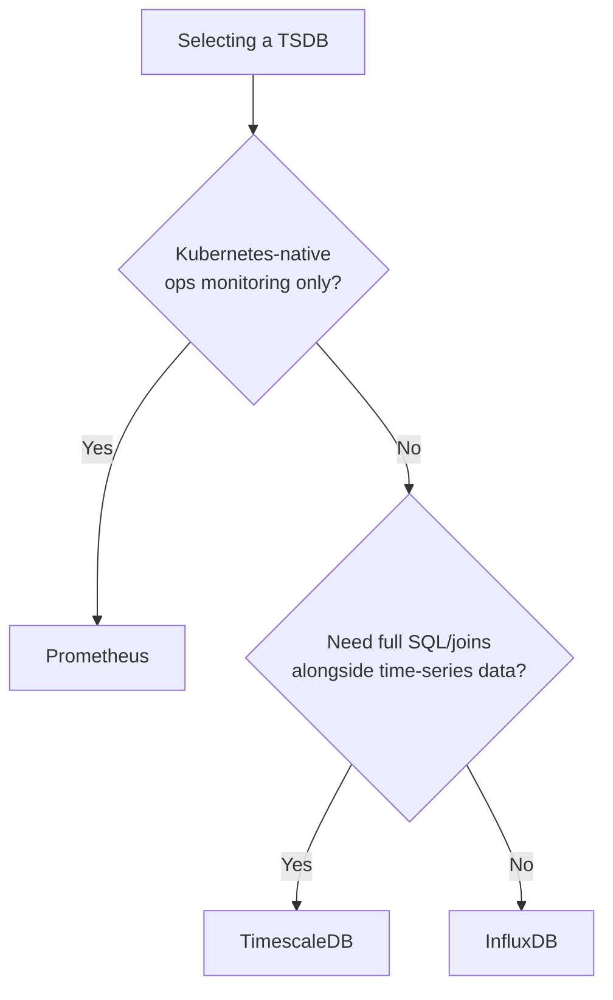

## 22. Real-World Case Study

Facebook's Gorilla system (described in the 2015 paper this chapter's
Section 4.6 is built on) was created because the company's existing
time-series storage, built on HBase, could not keep up with the volume of
monitoring data an organization at Facebook's scale produced, and because
engineers needed sub-second query latency against very recent data during
live incident response — a latency bar an HBase-backed system,
architected for durability and general-purpose access patterns rather
than this specific workload, could not reliably meet. The paper reports
that Gorilla's in-memory design, combined with delta-of-delta timestamp
compression and XOR-based value compression, reduced the storage footprint
of their monitoring data by roughly 12x compared to storing values
uncompressed, while also making recent-data queries fast enough to be
usable interactively during a live incident rather than only for
after-the-fact analysis. This result is precisely why nearly every serious
time-series engine built since 2015 — including both Prometheus's own
local storage and InfluxDB's TSM engine — incorporated some form of the
same two compression techniques, even though the paper itself was written
about an internal Facebook system that was never open-sourced in its
original form.

## 23. Interview Questions

1. What four things uniquely identify a time-series data point, and which
   of them determines series cardinality?
2. Why does a time-partitioned, append-only chunk design outperform a
   general-purpose B-tree table for metrics ingestion, and what does that
   design give up in exchange?
3. Explain delta-of-delta timestamp encoding: why is it especially
   effective for a fixed scrape interval, and what happens to its
   effectiveness when the interval is irregular?
4. Explain XOR-based value compression (Gorilla): what property of
   real-world metric values does it exploit, and when does it stop
   helping?
5. Why is series cardinality a cartesian product across tags rather than a
   sum, and what is the standard architectural fix for an unbounded tag?
6. Distinguish a downsampled rollup from an application-tier cache — why
   is a rollup a materialized view, not a cache?
7. Why does Prometheus choose a pull-based scrape model, and what
   operational property does that choice give it for free?
8. What problem does remote-write federation (e.g. Thanos/Cortex) solve
   that Prometheus's own local storage deliberately does not?
9. How does TimescaleDB's approach (a PostgreSQL extension) differ
   architecturally from Prometheus and InfluxDB, and what does that
   trade-off buy an organization already invested in PostgreSQL?
10. Why is "just keep everything forever" not a viable retention policy for
    a high-cardinality metrics deployment, even with cheap storage?

## 24. Hands-on Exercises

1. Run the Section 10 delta-of-delta/XOR encoder against a synthetic
   series you construct yourself with a deliberately irregular scrape
   interval, and compare the resulting compression ratio to the chapter's
   fixed-interval example.
2. Using the Section 10 high-cardinality simulator, compute the series
   count and approximate memory cost for a tag set you design based on a
   real or hypothetical service you know, then identify which tag (if any)
   is at genuine risk of unbounded growth.
3. Set up a local TimescaleDB instance (or use the annotated SQL example
   directly against a running PostgreSQL + TimescaleDB extension), create
   a hypertable, add a continuous aggregate, and query the rollup instead
   of the raw table for a wide time range.
4. Write three PromQL-style queries (using the Section 10 example as a
   reference) for a metric of your choosing, one instant-vector query, one
   `rate()`-based range-vector query, and one cardinality-collapsing
   aggregation.

## 25. Design Exercises

1. Design the tag schema for a metric tracking API request latency across
   a multi-tenant SaaS platform with hundreds of thousands of customers,
   explicitly deciding which attributes are tags, which belong in a
   separate logging/tracing system instead, and why.
2. Design a three-tier retention policy (hot/warm/cold) for a fleet of
   50,000 IoT sensors emitting one reading every 30 seconds, given a
   requirement to support both real-time alerting and a five-year
   regulatory audit trail at a coarser resolution.
3. Design the production topology (ingestion, hot storage, cold storage)
   for a Prometheus-based monitoring stack across 20 independent
   Kubernetes clusters, given a requirement for both per-cluster
   incident-response dashboards and an organization-wide capacity-planning
   view.

## 26. Architecture Review Questions

- Has every new metric's tag set been reviewed for unbounded cardinality
  risk before it reached production?
- Is there an explicit, documented retention policy per resolution tier,
  and has it been validated against real historical query needs (not just
  today's dashboards)?
- Is the downsampling/rollup job's own success and failure monitored
  independently, so a silent drift (Section 4.3) would be caught before a
  dashboard gap is discovered by an end user?
- Is local/hot retention explicitly separated from long-term/cold
  retention, with a genuinely configured and monitored path between them
  (Section 8)?
- For a Prometheus-based deployment, is remote-write actually configured
  and healthy, or is the team implicitly relying on local retention as a
  long-term archive?

## 27. Summary

A Time Series Database exists because timestamped, tagged, append-mostly,
high-write-volume monitoring and telemetry data has a fundamentally
different shape from the general-purpose transactional data relational
engines optimize for, and that different shape makes an entire category of
workload-specific techniques possible: time-partitioned, mostly-immutable
chunk storage that trades update/delete flexibility for write throughput
and one-time compression/indexing cost (Section 4.2); downsampling and
retention policies that implement a deliberate, irreversible data-lifecycle
trade-off between storage cost and future query resolution (Section 4.3);
and two specific, highly effective lossless compression techniques —
delta-of-delta timestamp encoding and XOR-based value encoding (Sections
4.5-4.6) — that exploit the regularity most real-world metric sources
exhibit. The single most consequential and most commonly mismanaged
decision in this whole category is series-identity modeling (Section 4.1)
and its direct consequence, the high-cardinality problem (Section 4.4):
getting the tag/value/metric-name boundary right up front is far cheaper
than recovering from an unbounded-tag production incident later.
Prometheus, InfluxDB, and TimescaleDB (Sections 4.7, 4.9, 21) represent
three genuinely different architectural bets — purpose-built local storage
plus remote-write federation, a bespoke general time-series engine, and a
PostgreSQL extension respectively — and the right choice among them
depends far more on an organization's existing operational investment and
the breadth of workload it needs to serve than on any single
feature-by-feature comparison. This chapter closes Part 06's NoSQL
subsection and, with it, Part 06 — Databases and Storage as a whole: every
chapter since [Normalization](CH01_Normalization.md) has taught either
generic, engine-agnostic database theory or one engine's concrete
realization of it, and this chapter's TSDB-specific techniques are the
last, most specialized point on that spectrum — proof that even a database
category built around one narrow workload shape still rests on the same
partitioning, replication, caching, and compression reasoning this Part
has taught from the very first chapter.
