# Chapter: Functional Requirements

Part: [07 — System Design and Distributed Systems](PART_OVERVIEW.md) · Status: Drafted

## 1. Introduction

Every system design conversation — whether it happens across a whiteboard in
a System Design Interview, in a kickoff meeting with a Product Manager (PM),
or in a Request for Comments (RFC) review — starts from the same
uncomfortable truth: nobody in the room yet agrees on exactly what the
system must *do*. A prompt like "design a URL shortener," "design a chat
system," or "build a payments ledger" is not a specification; it is an
invitation to negotiate one. **Functional requirements** are the artifact
that ends that negotiation: a scoped, testable, prioritized statement of the
system's observable behavior — what it must accept as input, what decisions
it must make, and what output or side effect it must produce — written
precisely enough that two different engineers, reading the same requirement,
would build (and test) the same behavior.

This chapter teaches functional-requirements gathering and specification as
the **entry point of the system design process** — the discipline of
converting an ambiguous business ask into a scoped technical specification
before a single component diagram gets drawn. That framing matters because
this book already has a home for a closely related but genuinely different
discipline: Part 02 ([Design Thinking and Product Management](../02_Design_Thinking_and_Product_Management/PART_OVERVIEW.md))
teaches how a product organization discovers *what the business should
build* — user research, personas, journey mapping, user stories, backlog
grooming, and the RICE/MoSCoW/Kano prioritization machinery that ranks
competing bets against each other. This chapter assumes that upstream product
process has already happened (or, in a System Design Interview, is
compressed into a single clarifying-question exchange) and teaches the
**system design discipline that starts immediately after**: taking whatever
business intent has been communicated — however precise or however
threadbare — and turning it into a requirement set an architect can actually
design against, hand to an Application Programming Interface (API) design
team, and trace all the way to a test suite. Where this chapter's scope
genuinely overlaps a concept Part 02 already owns in full (personas, the
"As a / I want / so that" user-story template, MoSCoW/Kano prioritization
mechanics), it recaps in two to three sentences and links to the owning
chapter rather than re-teaching it — per the Concept Ownership Rule in
[STYLE_GUIDE.md](../STYLE_GUIDE.md) — and spends its own teaching budget on
what genuinely has no other home in this book: the functional/non-functional
distinction as applied to system design, requirement elicitation technique
selection, writing testable and unambiguous requirements, requirement
traceability, and — because this book treats System Design Interview
practice as a first-class audience throughout this part — the specific skill
of scoping an ambiguous requirement live, under time pressure, in an
interview or a stakeholder meeting.

This chapter is also the first chapter of Part 07 — System Design and
Distributed Systems, and its output is the direct input to almost every
chapter that follows it in this part: [Non-Functional Requirements](CH02_Non_Functional_Requirements.md)
teaches the quality-attribute half of the same specification exercise,
[High-Level Design](CH03_High_Level_Design.md) and
[Low-Level Design](CH04_Low_Level_Design.md) turn a scoped functional
requirement set into component diagrams and class-level design, and every
Distributed Systems chapter in this part (CAP theorem, consensus, sharding,
Command Query Responsibility Segregation (CQRS), and the rest) assumes a
requirement set already exists that justifies *why* a given distributed-
systems technique is even necessary for the problem at hand. None of those
sibling chapters exist yet in this workspace at the time of writing — they
are treated as forward references throughout this chapter, consistent with
the pattern already established across earlier parts of this book.

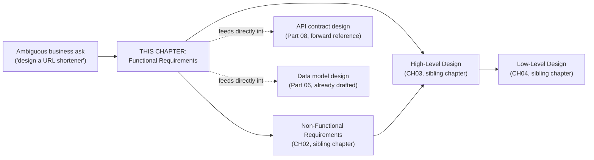

## 2. Historical Evolution

The discipline of writing down what software must do is older than the term
"software engineering" itself, and it has swung repeatedly between two
poles — exhaustive upfront specification and lightweight, conversational
capture — with the pendulum's position at any given moment shaped by
whichever failure mode the previous era's approach had just produced.

- **1970s-1980s: structured analysis and the Software Requirements
  Specification (SRS).** As software projects grew past what one team could
  hold in their heads, structured-analysis methods (data flow diagrams,
  entity-relationship modeling) formalized requirements capture into a
  document-heavy discipline, culminating in the IEEE 830 standard (first
  published 1984, later 830-1998) defining what a complete Software
  Requirements Specification document should contain: functional
  requirements, external interface requirements, performance requirements,
  design constraints, and quality attributes, each traceable to a unique
  identifier.
- **1980s-1990s: Waterfall's monolithic SRS as a fixed upfront contract.**
  In the dominant Waterfall process model of this era, the SRS was treated
  as a frozen contract signed off before implementation began; any change
  required a formal Change Control Board — the same rigid, hundreds-of-
  pages-long specification process
  [Backlog's historical evolution already describes](../02_Design_Thinking_and_Product_Management/CH22_Backlog.md)
  from the product-management side of this same failure mode. The
  mechanical cost of *changing* a signed-off SRS, more than any inherent
  virtue of upfront specification, is what made requirements so brittle in
  this era — a single ambiguous sentence discovered wrong in month nine of
  a twelve-month project was enormously expensive to fix.
- **1990s: Rapid Application Development and requirements volatility as an
  accepted reality.** As Waterfall's failure rate on large government and
  enterprise projects became well documented, methods explicitly designed
  around the assumption that requirements *would* change mid-project (Rapid
  Application Development, the Dynamic Systems Development Method)
  emerged, foreshadowing Agile's later, more radical embrace of the same
  idea.
- **2001: the Agile Manifesto and the user story.** As
  [Backlog](../02_Design_Thinking_and_Product_Management/CH22_Backlog.md)
  already covers in depth, Agile replaced the monolithic SRS with
  lightweight user-story cards — deliberately incomplete placeholders for a
  future conversation rather than a complete specification. This chapter
  recaps that shift only to establish contrast: the user-story format is
  optimized for iterative product delivery inside a single team's backlog,
  while this chapter's testable-requirement discipline (Section 4.4) is
  optimized for a different moment — the point where scope must be nailed
  down precisely enough to hand off to an API/data-model design decision
  that is comparatively expensive to reverse.
- **2009: EARS (Easy Approach to Requirements Syntax).** Alistair Mavin and
  colleagues at Rolls-Royce published EARS, a small, fixed set of sentence
  templates (Ubiquitous, Event-driven, State-driven, Unwanted-behavior,
  Optional-feature) explicitly designed to make a requirement's testability
  mechanically checkable by its grammatical shape rather than by careful
  prose review alone — the technique this chapter teaches in full in
  Section 4.4, because EARS has no other owning chapter in this book.
- **2010s: requirements-as-code and traceability tooling.** Tools such as
  IBM DOORS (originally 1990s, still widely used in regulated industries),
  Jama Connect, and, in lighter-weight organizations, structured Jira
  epics/issues linked to test-management tools, made requirement
  traceability (Section 4.5) a queryable, continuously verified property of
  a live tool rather than a document maintained by hand — critical in
  regulated domains (aerospace, medical devices, automotive functional
  safety standards such as ISO 26262) where an auditor must be able to
  prove every requirement has a corresponding design element and passing
  test.
- **Mid-2010s-present: the System Design Interview as an industry practice.**
  As large technology companies standardized a "system design" interview
  round distinct from coding and behavioral rounds, the specific skill this
  chapter's Section 4.6 teaches — scoping an intentionally ambiguous prompt
  through a short clarifying-question exchange, live, under time pressure —
  became a distinctly codified and widely practiced professional skill in
  its own right, popularized by books, courses, and mock-interview
  communities built around exactly this narrow but high-stakes moment at
  the start of a 45-minute conversation.

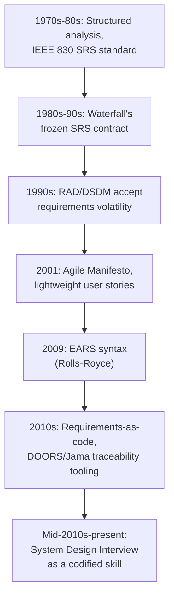

## 3. Why It Exists

Functional-requirements gathering exists to solve a problem that shows up
identically whether the "system" in question is a Fortune 500 payments
platform or a whiteboard prompt in an interview: **design effort spent
solving the wrong problem is not recoverable by better engineering later**.
A team that designs an elegant, horizontally scalable architecture for "a
URL shortener" only to discover the actual ask required per-account custom
domains and audit logging has not produced a smaller version of the right
system — it has produced the wrong system, and every subsequent hour spent
optimizing it compounds the waste. Functional requirements exist to move
that risk to the cheapest possible point in the process: before any
Architecturally Significant Requirement (ASR) — [recapped from What is
Software Architecture?](../01_Architecture_Mindset/CH01_What_is_Software_Architecture.md#architecturally-significant-requirements-asrs) —
has been locked in by a structural decision that is expensive to reverse.

A second, distinct reason this discipline exists is that "the business" and
"the engineering team" do not share a native vocabulary. A stakeholder says
"users should be able to find what they're looking for quickly"; an
engineer needs to know whether that means full-text search, faceted
filtering, or a recommendation feed, and whether "quickly" is a functional
behavior (search returns *some* result set, however slow) or a latency
budget (a non-functional requirement entirely, see the sibling Non-
Functional Requirements chapter). Functional-requirements elicitation is the
translation layer between those two vocabularies — and, done well, it
produces an artifact both sides can read and agree means the same thing.

A third reason, specific to why this book teaches it inside a System Design
discipline rather than only inside Product Management, is that a
functional requirement set is the direct input to structural decisions this
book's later chapters treat as expensive to reverse: which API endpoints
exist, what the core data model's entities and relationships look like,
where a system needs strong consistency versus eventual consistency, and
whether a single service or several are warranted. Scoping those decisions
against a requirement set that was never actually validated with a
stakeholder is how systems accumulate the specific, expensive kind of
technical debt that comes from optimizing internal structure around the
wrong external contract.

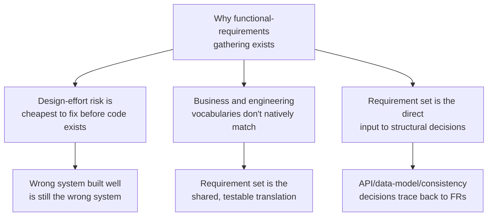

## 4. Core Concepts

This section teaches the six first-principles building blocks of
functional-requirements work: distinguishing functional from non-functional
requirements, the elicitation techniques that surface requirements in the
first place, the prioritization frameworks (recapped, not re-taught) used
to scope what gets built first, the discipline of writing a requirement so
it is actually testable, the traceability mechanism that keeps a
requirement connected to its design and test coverage over the system's
life, and the specific, high-pressure skill of scoping an ambiguous
requirement inside an interview or a live stakeholder conversation.

### 4.1 Functional vs. Non-Functional Requirements

**Definition.** A **functional requirement** specifies an observable
behavior of the system — a specific input, a specific decision the system
makes, and a specific output or state change — phrased so a tester could
verify it passed or failed without needing any additional judgment call. A
**non-functional requirement (NFR)**, by contrast, specifies a *quality
attribute* of how the system delivers its functional behavior — how fast,
how available, how secure, how much load it must sustain — rather than what
the behavior itself is.
[Quality attributes / non-functional requirements as a taxonomy are owned
by What is Software Architecture?](../01_Architecture_Mindset/CH01_What_is_Software_Architecture.md#quality-attributes--non-functional-requirements-taxonomy),
which frames the umbrella list and defers each attribute's deep technique to
its own chapter — this book's sibling
[Non-Functional Requirements chapter](CH02_Non_Functional_Requirements.md)
(forward reference, not yet drafted) is where the full per-attribute
elicitation and specification technique (availability targets, latency
budgets, throughput sizing, durability guarantees) is taught; this chapter
owns only the functional side and the mechanics of telling the two apart
under ambiguity.

**Mechanism.** The distinguishing test is not the *word* used but the
*shape of the verification*: "the system shall respond to a search query
within 200 milliseconds at the 95th percentile" is non-functional because
the pass/fail check is a measured quality of an already-defined behavior
(searching); "the system shall return search results ranked by relevance
score, ties broken by recency" is functional because it specifies the
*behavior itself* — what "search" actually does. A requirement written as
"the system should be scalable" is neither, yet, because it is not testable
in either direction — it must first be decomposed into a concrete functional
behavior (does "scalable" mean the system accepts a growing catalog of
items, a growing request rate, or both?) and a concrete non-functional
target (to what request rate, at what latency, at what cost) before it is
usable at all.

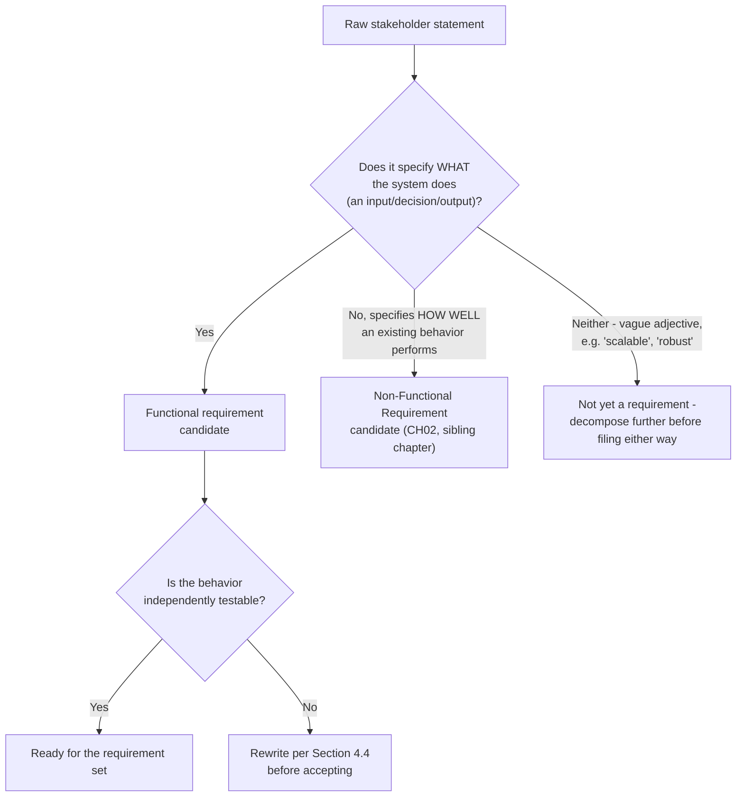

**Decision implications.** Misclassifying a requirement has a real
downstream cost: a functional requirement mistakenly treated as
non-functional (for example, "the system must support refunds" filed away
as a vague quality goal rather than a concrete behavior with edge cases —
partial refunds? refund windows? who can authorize one?) gets skipped
during functional design entirely and surfaces as a missing feature late;
a non-functional requirement mistakenly treated as functional (building a
specific caching mechanism because "fast" was interpreted as a feature to
implement rather than a latency target to hit by whatever means) can lock
in an implementation-specific decision before the actual quality target and
its trade-offs have even been discussed.

**Failure mode.** The most common real-world failure is not confusing an
obviously functional requirement with an obviously non-functional one — it
is the requirement written ambiguously enough that a reader could file it as
either, and different stakeholders quietly file it differently without ever
discovering the disagreement. "The system must handle high traffic
gracefully" is filed as an NFR (interpreted as a throughput/latency target)
by an infrastructure engineer and as an FR (interpreted as "the system must
show a friendly error page and queue requests instead of failing outright"
— an actual behavior) by a frontend engineer; both build to their own
interpretation, and the gap surfaces only during integration testing.

**Scenario.** A payments platform's requirement document states "the
system must reconcile discrepancies automatically." An architect
classifying this purely as an NFR ("automatic" sounding like an operational
quality) would never design the actual reconciliation logic; correctly
recognizing it as a functional requirement forces the decomposition
question that matters: what counts as a discrepancy, what automatic
correction actions are permitted without human approval, and what must
instead be flagged for manual review — each of which is itself a testable
functional behavior, not a quality attribute of something else.

### 4.2 Requirement Elicitation Techniques

**Definition.** Requirement elicitation is the set of techniques used to
surface functional requirements from stakeholders who often cannot state
them completely, precisely, or consistently on their own — because
stakeholders reliably know their problem better than their solution, and
because different stakeholders (business sponsor, end user, compliance
officer, downstream integrating team) hold different, sometimes
contradictory, pieces of the full picture.

**Mechanism.** Three techniques dominate system-design-stage elicitation,
each suited to a different situation:

- **Stakeholder interviews.** A structured or semi-structured one-on-one
  conversation targeting a specific stakeholder's domain knowledge. This
  chapter recaps rather than re-derives the actual interview
  craft — question wording, rapport-building, avoiding leading questions —
  because [User Interviews](../02_Design_Thinking_and_Product_Management/CH04_User_Interviews.md)
  already owns that technique in full for the product-discovery context;
  the system-design application is the same conversational skill aimed at a
  narrower question set (what must the system do, not what does the user
  feel).
- **Requirements workshops.** A facilitated group session (often called a
  "requirements workshop" or, in some organizations, a joint application
  design session) that brings multiple stakeholders together specifically
  to surface *conflicts* between their individual mental models in real
  time — a technique interviews cannot replicate, because a one-on-one
  conversation never reveals that the sales stakeholder and the compliance
  stakeholder hold mutually incompatible assumptions about the same
  feature until both are in the room being asked the same question
  together.
- **Use cases.** A structured, actor-centric technique from the Unified
  Modeling Language (UML) tradition: an actor (a role, not necessarily a
  specific person) interacts with the system through a named use case
  (e.g. "Redeem Loyalty Points") that has a defined main success scenario
  (the expected step-by-step flow) and one or more alternate/exception
  flows (what happens when a step fails or branches). Use cases are
  distinct from — and a different tool than — the "As a [persona], I want
  [capability], so that [outcome]" user-story template, whose full
  construction discipline and Given-When-Then acceptance-criteria mechanics
  are [owned by Backlog](../02_Design_Thinking_and_Product_Management/CH22_Backlog.md#41-backlog-item-taxonomy-and-mechanics),
  recapped here only to draw the boundary: a user story is a lightweight,
  intentionally incomplete placeholder sized for one backlog item and one
  team's iterative delivery, while a use case is a heavier, more complete
  artifact built to capture an entire multi-step interaction including its
  failure branches, and is far more common in system-design-stage
  elicitation precisely because it forces the alternate-flow thinking a
  single-sentence user story does not.

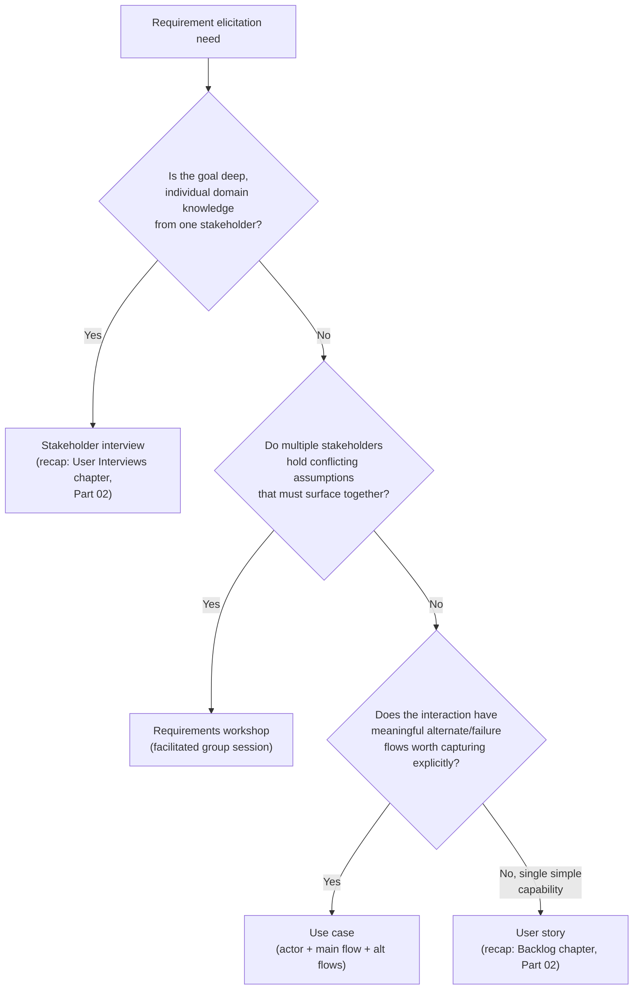

**Decision implications.** Choosing the wrong technique for the situation
wastes stakeholder time and produces an incomplete requirement set: running
only individual interviews on a feature that actually has cross-team
disagreement produces a requirement document each stakeholder privately
believes is correct and inconsistent with the others' private beliefs,
because the interview format never forced the conflict into the open;
conversely, running a full workshop to elicit a single stakeholder's narrow
domain expertise (exact regulatory wording for a disclosure requirement,
say) wastes the rest of the room's time. Use cases are the right default
whenever a requirement's failure/exception behavior is architecturally
significant — a payment authorization flow's "what happens if the
downstream bank times out" alternate flow is often more design-shaping than
its happy-path main flow.

**Failure mode.** The most common elicitation failure is not choosing the
wrong technique — it is stopping after the first technique produces *any*
answer rather than checking whether that answer is complete. A single
stakeholder interview with the product sponsor, taken as the complete
requirement set without a workshop or a use-case pass to surface
compliance/operations/support perspectives, routinely misses entire classes
of alternate-flow behavior (what happens on failure, on partial completion,
on a second identical request) that only workshops or use-case
construction reliably surface, because a single stakeholder's happy-path
mental model rarely includes them unprompted.

**Scenario.** A logistics company's product sponsor describes a new
"driver check-in" feature entirely in happy-path terms during a single
interview: driver arrives, scans a QR code, system confirms arrival.
Building a use case for the same interaction forces the alternate-flow
questions the interview never surfaced: what if the QR code is unreadable
(damaged, wrong lighting), what if the driver checks in at the wrong
location, what if two drivers scan the same code within seconds of each
other — each of which becomes its own testable functional requirement, none
of which existed in the original interview transcript.

### 4.3 Prioritization Frameworks Applied to Requirement Scoping

**Definition (recap).** Once an elicitation pass produces more candidate
requirements than a given release, sprint, or system-design scope can
reasonably include, a prioritization framework ranks them so scope
decisions are made deliberately rather than by whoever spoke last in the
room.
[MoSCoW (Must/Should/Could/Won't) and the Kano Model (Basic/Performance/
Delighter) are both owned in full — definition, mechanism, decision
implications, and failure modes — by
Prioritization](../02_Design_Thinking_and_Product_Management/CH28_Prioritization.md#moscow-prioritization-mustshouldcouldwont),
which this chapter does not re-teach; this section covers only the
distinct *application context* this chapter is responsible for: applying
those already-taught frameworks to a **freshly elicited functional
requirement set**, at the moment scope is being locked in for a design
pass, rather than to an existing backlog being groomed across sprints.

**Mechanism (applied, not re-derived).** In a system-design-scoping context,
MoSCoW is typically applied immediately after an elicitation pass and
before any design work begins: every candidate functional requirement from
Section 4.2's output is tagged Must, Should, Could, or Won't (this release),
and the "Must" set becomes the minimum scope a design is obligated to
satisfy — the [scoped requirement set artifact](../code/markdown/functional-requirements-chapter/03_scoped_requirement_set_url_shortener.md)
demonstrates this tagging directly. The Kano Model is applied more
selectively at this stage — mainly to resolve disagreements about whether a
requirement is a baseline expectation (Basic, must exist or users are
actively dissatisfied) versus a differentiator (Performance or Delighter,
worth extra design investment) — because that distinction changes how much
design rigor a requirement deserves before moving forward, independent of
whether it is also tagged Must in MoSCoW.

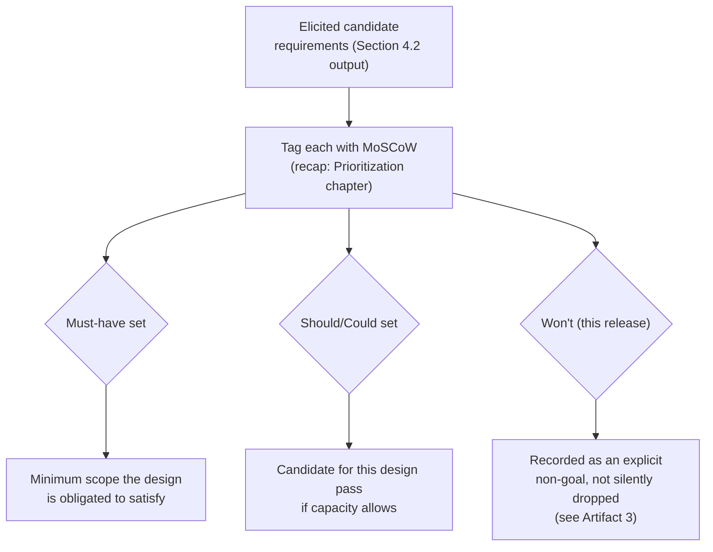

**Decision implications.** Because this application happens *before*
design rather than during backlog grooming, the stakes of a misclassified
priority are different: a requirement wrongly demoted from Must to Should
at this stage can silently change an architectural decision (a data model
that would need a different shape to support it cheaply later is designed
without it, and retrofitting it after implementation is materially more
expensive than a backlog reprioritization would ever be). Architects should
therefore treat this scoping-stage MoSCoW pass as higher-stakes than a
routine sprint-grooming pass, and should insist any "Won't" designation be
written down as an explicit non-goal (Artifact 3's NG-1 pattern) rather than
simply dropped from the document.

**Failure mode.** Applying MoSCoW without first confirming the requirement
is actually testable (Section 4.4) produces confidently prioritized
nonsense — "the system should be user-friendly" tagged "Must" is no more
actionable than the same untestable sentence tagged "Could"; prioritization
frameworks rank requirements against each other, they do not fix an
individual requirement's own ambiguity.

**Scenario.** A team scoping a new internal analytics dashboard elicits
fifteen candidate capabilities. Applying MoSCoW immediately surfaces that
"export to CSV" and "role-based access control" are both tagged Must by
different stakeholders for different reasons (compliance requires access
control; finance requires the export) — the tagging exercise itself is what
prompts the explicit conversation about whether both can realistically ship
in the same design pass, rather than each stakeholder silently assuming
their own Must-have will obviously be included.

### 4.4 Writing Testable and Unambiguous Requirements

**Definition.** A testable requirement is one for which two different,
competent engineers, given only the requirement's text, would independently
write test cases that agree on what constitutes a pass and what constitutes
a failure. An unambiguous requirement additionally has exactly one
reasonable reading — no adjective, pronoun, or scope word admits a second,
equally defensible interpretation.

**Mechanism.** The Easy Approach to Requirements Syntax (EARS) enforces
testability by restricting every requirement to one of five fixed sentence
shapes, each of which names its trigger condition explicitly rather than
leaving it implicit: **Ubiquitous** ("The system shall..." — always true,
no trigger), **Event-driven** ("When &lt;trigger&gt;, the system
shall..."), **State-driven** ("While &lt;state&gt;, the system shall..."),
**Unwanted-behavior** ("If &lt;undesired condition&gt;, then the system
shall..."), and **Optional-feature** ("Where &lt;feature is present&gt;, the
system shall..."). Because each pattern forces the trigger or condition to
be named explicitly, a requirement written in one of these five shapes
cannot silently omit the circumstance under which the behavior applies —
the single most common source of untestable prose. A parallel, complementary
discipline is maintaining an explicit **ambiguous-word blocklist**
(see [Artifact 4](../code/markdown/functional-requirements-chapter/04_ears_testable_requirements_checklist.md)
for the full list and worked before/after examples) — words like "fast,"
"user-friendly," "handle," and "as needed" that sound like requirements but
encode an unresolved decision or an unmeasurable quality rather than a
checkable behavior.

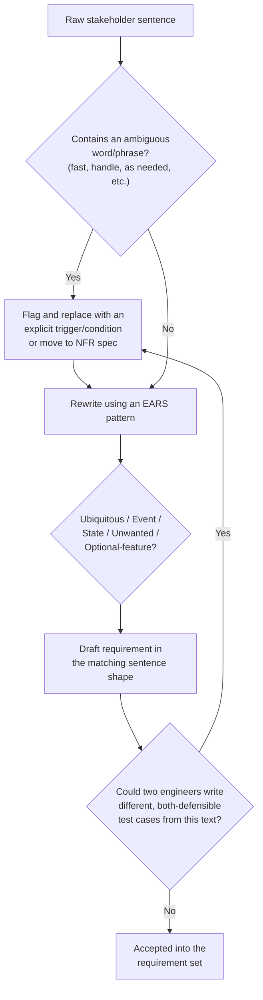

**Decision implications.** Investing in testable requirement writing pays
off precisely at the boundary between requirements-gathering and
implementation: a testable requirement converts almost mechanically into an
acceptance test (Section 16), which is exactly the property Behavior-Driven
Development's Given-When-Then format — [recapped, not re-taught, from
Backlog's Gherkin acceptance-criteria
mechanics](../02_Design_Thinking_and_Product_Management/CH22_Backlog.md#41-backlog-item-taxonomy-and-mechanics) —
depends on. An architect who skips this discipline and hands over
ambiguous prose is effectively deferring the actual scoping decision to
whichever engineer implements the feature first, an outcome no
requirements process should silently produce.

**Failure mode.** Over-applying EARS mechanically without checking for
genuine ambiguity produces syntactically well-formed but still-vague
requirements — "When the user interacts with the system, the system shall
respond appropriately" is a grammatically valid Event-driven EARS sentence
that is exactly as untestable as the prose it replaced, because "interacts"
and "appropriately" are themselves unresolved. The sentence shape is a
scaffold for precision, not a substitute for it.

**Scenario.** A team specifying a subscription-billing feature initially
writes "the system should handle failed payments gracefully." Converted to
EARS and checked against the ambiguous-word blocklist: "If a subscription
renewal payment is declined, then the system shall retry the charge up to
three times over seven days, and, if all retries fail, then the system
shall downgrade the account to the free tier and send a payment-failure
notification to the account owner" — a rewrite that surfaces at least three
previously invisible decisions (retry count, retry window, and the
downgrade behavior) that the original sentence had silently left
unresolved.

### 4.5 Requirement Traceability

**Definition.** Requirement traceability is the property that every
requirement can be traced *forward* to the design element(s) and test
case(s) that satisfy it, and every design element and test case can be
traced *backward* to the requirement that justifies its existence — usually
maintained as a Requirements Traceability Matrix (RTM), a table linking
requirement identifiers to design artifacts, code modules, and test case
identifiers.

**Mechanism.** Forward traceability answers "for this requirement, what was
actually built and tested?" — the check that catches **coverage gaps** (a
requirement nobody implemented, or implemented but never tested). Backward
traceability answers the opposite question, "for this piece of design or
code, what requirement justifies it?" — the check that catches **scope
creep** and **gold-plating** (a feature, endpoint, or database column that
exists without any corresponding elicited requirement, meaning either the
requirements document has a gap that should be back-filled, or an engineer
added scope nobody asked for). [Artifact 2](../code/markdown/functional-requirements-chapter/02_requirements_traceability_matrix.md)
demonstrates both directions concretely, including catching an
undocumented `click_count` column and an undocumented `DELETE` endpoint
against the URL-shortener requirement set from Artifact 3.

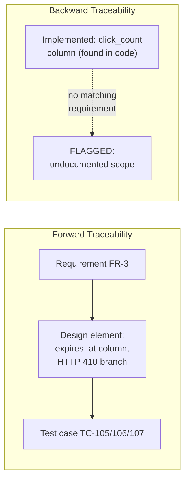

**Decision implications.** Traceability is not paperwork for its own
sake — it is the mechanism that makes two otherwise-invisible failure
classes mechanically detectable rather than dependent on someone happening
to notice: a requirement that was elicited, prioritized, and then silently
dropped during implementation (caught by forward traceability showing a
row with no design/test entry), and a capability built that expands scope
beyond what was ever agreed (caught by backward traceability showing a
design element with no requirement entry). In regulated domains, an
auditor's core question — "prove this specific requirement was actually
implemented and tested" — is answerable only if traceability was maintained
continuously, not reconstructed after the fact.

**Failure mode.** Traceability matrices decay silently when they are
maintained as a one-time deliverable rather than a living artifact updated
whenever a requirement, design decision, or test case changes — the
specific failure this chapter calls **traceability drift**: the matrix
still exists and still looks complete, but a requirement's wording changed
three sprints ago without the corresponding row being updated, so the
matrix now confidently traces a test case to a requirement that no longer
reads the way the test case assumes.

**Scenario.** A financial-services team undergoing a compliance audit is
asked to prove that a specific regulatory disclosure requirement (added
eighteen months earlier) is still correctly implemented and tested. Because
their RTM was maintained continuously rather than built once at launch,
they answer in minutes by looking up the requirement ID; a team without
one would need to manually re-derive the same proof by interviewing
whichever engineers remain from the original implementation — often not
all of them, by that point.

### 4.6 Scoping Ambiguous Requirements in an Interview Setting

**Definition.** Scoping-under-ambiguity is the specific skill of converting
an intentionally underspecified prompt ("design a URL shortener," "design a
chat system") into a concrete, agreed requirement set through a short,
efficient clarifying-question exchange — a compressed, time-boxed version
of Section 4.2's elicitation techniques, adapted for the constraints of a
System Design Interview or a short stakeholder meeting where a full
workshop is not available. [Artifact 1](../code/markdown/functional-requirements-chapter/01_requirements_elicitation_dialogue.md)
demonstrates this technique end to end against a URL-shortener prompt.

**Mechanism.** The technique follows a repeatable sequence: **(1) anchor
scope** by explicitly restating what the system does and does not cover
before any technical discussion starts; **(2) ask for order-of-magnitude
scale**, which, even though it primarily feeds non-functional sizing, also
changes which functional edge cases matter (a dedup rule that is
irrelevant at low volume becomes load-bearing at high volume); **(3) hunt
for ambiguous verbs and nouns** in the prompt itself and convert each into
an explicit Given/When/Then statement rather than silently picking an
interpretation; **(4) distinguish requirements that sound non-functional
but are actually functional behavior** (an expiration policy is a behavior,
not a quality attribute, even though "how long does it last" sounds like a
quality question); **(5) state explicit non-goals out loud**, so a
reviewer later sees a deliberate scope-cut rather than an apparent
oversight; and **(6) play the consolidated requirement set back** to the
stakeholder or interviewer before starting the technical design, catching
any misunderstanding in seconds rather than after a wasted design pass.

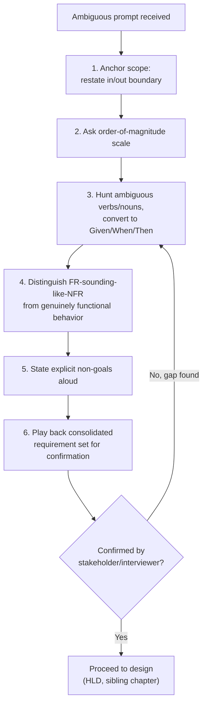

**Decision implications.** In an interview context specifically, evaluators
are typically watching *whether this sequence happens at all* as much as
its content — a candidate who begins drawing boxes immediately, without
step 1 through step 6, signals that they will make the same silent,
unstated assumptions in a real job that this section's mechanism exists to
surface early. In a real stakeholder meeting, the same discipline prevents
the far more expensive version of the same mistake: a multi-week design
effort built on an assumption nobody actually confirmed.

**Failure mode.** The most common failure is asking clarifying questions
that don't actually reduce ambiguity — questions about implementation
detail ("should I use a hash table or a database?") asked before scope
itself is settled waste the interview's or meeting's limited time budget on
a decision that depends on requirements not yet established. A second
common failure is over-scoping the clarifying phase itself: spending so
long clarifying edge cases that little time remains to actually design
anything, which is why step 5 (explicit non-goals) exists — it lets a
candidate deliberately bound the conversation rather than trying to resolve
every conceivable ambiguity before moving on.

**Scenario.** [Artifact 1](../code/markdown/functional-requirements-chapter/01_requirements_elicitation_dialogue.md)'s
worked dialogue shows this exact sequence converting "design a URL
shortener" into five testable functional requirements and one explicit
non-goal in six short conversational turns — a pattern directly reusable
for any similarly underspecified System Design Interview prompt, not just
this one example.

## 5. Internal Working

Section 4 taught each mechanism individually; this section traces how they
compose end to end, from an ambiguous business ask to a design-ready,
traceable requirement set — the same pipeline [Artifact 1 through Artifact
4](../code/markdown/functional-requirements-chapter/) demonstrate
concretely against a single running example.

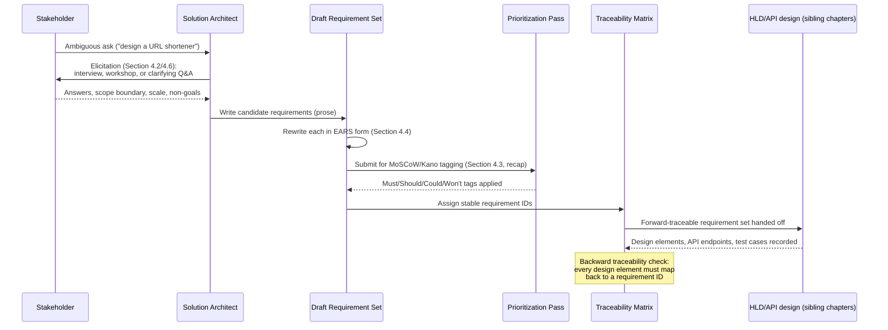

Reading this trace end to end: the process never treats elicitation,
writing, prioritization, and traceability as sequential, one-time gates —
Draft feeds Priority and receives tags back, Trace is populated
incrementally as design begins rather than only after design finishes, and
the backward-traceability check at the end is what would have caught the
`click_count` column and `DELETE /{code}` endpoint flagged in
[Artifact 2](../code/markdown/functional-requirements-chapter/02_requirements_traceability_matrix.md)
before they shipped un-reviewed.

## 6. Design Principles

- **Specify WHAT, not HOW.** A functional requirement states the observable
  behavior the system must exhibit, not the implementation mechanism that
  produces it — "the system shall deduplicate identical long URLs per
  account" is a requirement; "the system shall use a unique database index
  on `(account_id, long_url_hash)`" is a design decision that satisfies it,
  and belongs in the High-Level/Low-Level Design stage, not the
  requirement document.
- **Every requirement must be independently testable.** Section 4.4's
  discipline is not optional polish — an untestable requirement cannot be
  traced (Section 4.5), cannot be reliably prioritized (Section 4.3), and
  effectively defers its own resolution to whoever implements it first.
- **State non-goals as explicitly as goals.** An omitted capability reads,
  to a future reviewer, as an oversight; a stated non-goal reads as a
  deliberate decision — the difference materially changes how a design
  review or an audit responds to a gap later discovered.
- **Prefer progressive elaboration over premature completeness.** Not every
  requirement needs full detail before design begins — Section 4.3's
  Must-have set can proceed to design while Should/Could items are still
  being refined, provided the requirement set explicitly flags which items
  remain provisional.
- **Traceability is continuous, not a one-time deliverable.** A
  Requirements Traceability Matrix built once at project kickoff and never
  updated again is traceability theater — Section 4.5's failure mode
  (traceability drift) is the direct consequence of treating it otherwise.
- **Ambiguity resolved by assumption must be stated as an assumption.** When
  a stakeholder is unavailable to resolve an ambiguity immediately, the
  requirement should record the assumption made and by whom, rather than
  silently picking an interpretation and moving on.

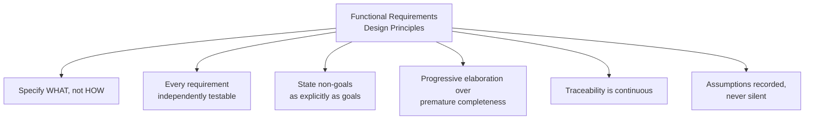

## 7. Architecture Patterns

- **Specification by example.** Pairing each requirement with a concrete,
  worked scenario (the pattern [Artifact 3](../code/markdown/functional-requirements-chapter/03_scoped_requirement_set_url_shortener.md)
  demonstrates) rather than abstract prose alone — a scenario surfaces
  ambiguity a general statement can hide, and doubles as the seed for an
  acceptance test.
- **Given-When-Then as a bridge artifact.** The same Given/When/Then
  structure Section 4.4 teaches for testable requirements is also the
  format Behavior-Driven Development frameworks (Cucumber, SpecFlow,
  pytest-bdd) execute directly as automated acceptance tests — a
  well-written functional requirement in this format is not just readable
  by a human reviewer, it is close enough to executable that many teams
  convert it into a runnable feature file with minimal rewriting, directly
  connecting Section 4.4's discipline to Section 16's testing practice.
- **Requirement-to-contract mapping.** Treating each functional requirement
  as directly traceable to one or more elements of an eventual API
  contract (an endpoint, a request/response field, a status code) or data
  model element (a table, a column, a constraint) — the exact mapping
  [Artifact 2's traceability matrix](../code/markdown/functional-requirements-chapter/02_requirements_traceability_matrix.md)
  demonstrates, and the mechanism that makes Section 4.5's traceability
  concrete rather than aspirational.
- **Living requirement documentation.** Maintaining the requirement set,
  its priority tags, and its traceability matrix inside the same tooling
  the engineering team already uses daily (a structured Jira epic and
  linked issues, a Jama Connect or DOORS project, or, for lighter-weight
  teams, a version-controlled Markdown specification reviewed via the same
  pull-request process as code) rather than a separate document that
  drifts out of sync — this pattern directly counters Section 4.5's
  traceability-drift failure mode by making the requirement set part of
  the same change-review discipline as the code that implements it.

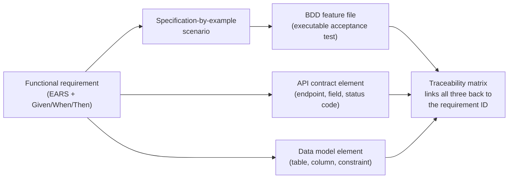

## 8. Production Architecture

In a real engineering organization, the process this chapter teaches is
almost never run by a single architect working alone against a document —
it is embedded in the organization's actual delivery tooling. A typical
production setup links a structured requirement (captured as a Jira epic
or a dedicated requirements-management tool issue) to its EARS-formatted
acceptance criteria, its MoSCoW priority tag
([recapping Prioritization's tooling
patterns](../02_Design_Thinking_and_Product_Management/CH28_Prioritization.md)),
its Architecture Decision Records where a requirement drove a structural
choice ([recapped from Architecture
Thinking](../01_Architecture_Mindset/CH03_Architecture_Thinking.md#architecture-decision-records-adrs)),
and its eventual test cases in the team's test-management system — with
bidirectional links maintained automatically wherever the tooling supports
it (a pull request referencing a Jira issue ID, a test-management tool
importing acceptance criteria directly from the linked requirement) rather
than by manual, error-prone cross-referencing. For requirements with real
architectural weight, the requirement document is typically reviewed by an
Architecture Review Board or an equivalent lightweight async review
([recapped from Role of a Solution
Architect](../01_Architecture_Mindset/CH02_Role_of_a_Solution_Architect.md#architecture-review-board-arb-governance-model))
before being marked ready for design, precisely because a requirement
signed off without that review is where an under-scoped ASR most commonly
slips through.

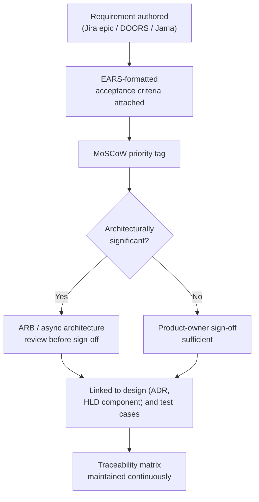

## 9. Implementation

Authoring a functional requirement set follows a consistent, repeatable
order regardless of whether the context is a multi-week enterprise project
or a 45-minute interview: **(1) intake** the raw ask verbatim, without
editing it yet; **(2) elicit** using the technique Section 4.2 (or, under
time pressure, Section 4.6) selects as the best fit; **(3) draft** each
surfaced capability as a candidate requirement in plain prose first,
resisting the urge to formalize prematurely while the scope is still
moving; **(4) rewrite** every drafted requirement into an EARS sentence
shape and check it against the ambiguous-word blocklist (Section 4.4); **(5)
prioritize** the resulting set with MoSCoW, and, where satisfaction-curve
disagreements exist, Kano (Section 4.3, recap); **(6) assign stable IDs**
and seed the traceability matrix (Section 4.5) even before design begins;
and **(7) play the consolidated set back** to the stakeholder for explicit
sign-off before any High-Level Design work starts. Skipping step 7 is the
single most common shortcut teams take under deadline pressure, and it is
also the step whose omission is cheapest to prevent and most expensive to
discover was skipped, once a design built on an unconfirmed assumption must
be reworked.

## 10. Complete Code Examples

Because this chapter's subject matter is a specification discipline rather
than a runtime system, its illustrative artifacts are structured Markdown
documents rather than executable code — the natural fit for teaching a
requirements-writing skill. All four live under
[code/markdown/functional-requirements-chapter/](../code/markdown/functional-requirements-chapter/):

1. [01_requirements_elicitation_dialogue.md](../code/markdown/functional-requirements-chapter/01_requirements_elicitation_dialogue.md) —
   a worked, turn-by-turn clarifying-question dialogue converting the
   ambiguous prompt "design a URL shortener" into a scoped requirement set,
   demonstrating Section 4.6's technique end to end.
2. [02_requirements_traceability_matrix.md](../code/markdown/functional-requirements-chapter/02_requirements_traceability_matrix.md) —
   a worked forward- and backward-traceability matrix, including two
   deliberately planted undocumented design elements it catches, demonstrating
   Section 4.5's mechanism concretely.
3. [03_scoped_requirement_set_url_shortener.md](../code/markdown/functional-requirements-chapter/03_scoped_requirement_set_url_shortener.md) —
   the final, testable, MoSCoW-tagged requirement set produced by Artifact
   1's dialogue, in full Given/When/Then EARS form.
4. [04_ears_testable_requirements_checklist.md](../code/markdown/functional-requirements-chapter/04_ears_testable_requirements_checklist.md) —
   a reusable checklist and before/after rewrite examples for Section 4.4's
   testable-requirement-writing discipline, including the ambiguous-word
   blocklist referenced throughout this chapter.

## 11. Performance

Applied to a process rather than a runtime system, "performance" here means
the speed and efficiency of the requirements-gathering process itself
without sacrificing the quality checks Section 4 establishes. The
dominant lever is **timeboxing elicitation** deliberately (Section 4.6's
six-step sequence is itself a timeboxing discipline, compressible to
minutes in an interview or expandable to a scheduled workshop for a larger
initiative) rather than treating "more clarifying questions" as
unconditionally better — every additional round of elicitation has a real
opportunity cost against the time available for design and implementation,
and a requirement set that is 95% clear after one focused round is usually
a better use of time than one pushed to 99% clear after three additional,
increasingly marginal rounds.

## 12. Scalability

Scaling this process across a large organization with many teams
introduces a different failure mode than any single team faces: without a
shared template (a common EARS-based house style, a common traceability
tool, a common definition of what counts as a "Must") each team invents its
own requirements format, and cross-team dependencies become expensive to
reconcile because two teams' requirement documents cannot even be compared
directly. The standard mitigation is a **federated requirements standard** —
a lightweight, centrally maintained template and glossary (this chapter's
EARS patterns and ambiguous-word blocklist are exactly the kind of artifact
that should be standardized centrally) that every team's requirement
documents conform to, while the actual elicitation and prioritization work
stays decentralized to the team closest to the stakeholders involved.

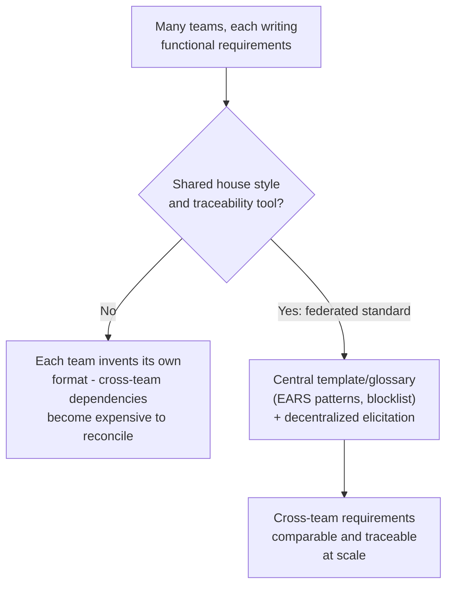

## 13. Security

Security-relevant functional requirements deserve explicit elicitation
attention because they are frequently the ones a happy-path-focused
stakeholder interview never surfaces: an **abuse-case** pass — deliberately
asking "what would a malicious or careless actor do with this capability?"
for every Must-have requirement — surfaces functional behavior a purely
positive requirements pass misses entirely (rate limiting on account
creation, validation that a redirect target is not used for open-redirect
phishing, authorization checks on who may delete another user's resource).
These abuse-case-derived requirements are still functional requirements —
concrete, testable behaviors — even though their motivation is security;
the deep security-architecture treatment of threat modeling itself is
deferred to this book's future Security part (forward reference, not yet
drafted), and this chapter's contribution is narrower: ensuring the
elicitation techniques in Section 4.2 explicitly include an abuse-case pass
rather than stopping at the legitimate-user happy path.

## 14. Observability

The requirements process itself benefits from being measured, not only the
system it describes. Useful signals include: **requirement churn rate**
(how often an already-signed-off requirement changes after design has
started — a high rate signals elicitation was rushed or a stakeholder was
missing from the original pass), **traceability coverage percentage**
(what fraction of requirements have a complete forward trace to design and
test, the metric [Artifact 2](../code/markdown/functional-requirements-chapter/02_requirements_traceability_matrix.md)'s
coverage summary computes directly), **time-to-scope** (how long elapses
from an ambiguous ask to a signed-off requirement set, tracked to catch
elicitation processes that have become organizational bottlenecks), and
**undocumented-scope count** (the number of implemented design elements
backward-traceability discovers with no corresponding requirement — a
direct measure of process leakage, not just a one-time audit finding).

## 15. Failure Scenarios

- **Skipped elicitation entirely.** A team designs directly from a single
  ambiguous sentence with no clarifying pass at all, producing a system
  that technically satisfies the literal words of the ask while missing
  behavior every stakeholder assumed was obviously included.
- **Analysis paralysis.** Elicitation never converges to a signed-off
  requirement set because every clarifying answer surfaces two more
  questions, and the team never invokes Section 4.6's explicit-non-goal
  escape hatch to deliberately bound the scope.
- **Silent scope creep during implementation.** An engineer adds a
  capability that seems obviously useful (the `click_count` column and
  `DELETE` endpoint flagged in Artifact 2) without a corresponding
  requirement, discovered only when backward traceability is finally run —
  if it is run at all.
- **Requirement rot.** A signed-off requirement set is never revisited as
  the system evolves; six months later, the traceability matrix still
  claims full coverage even though several requirements no longer describe
  the system's actual behavior, because nobody updated the document when
  the behavior changed for unrelated reasons.

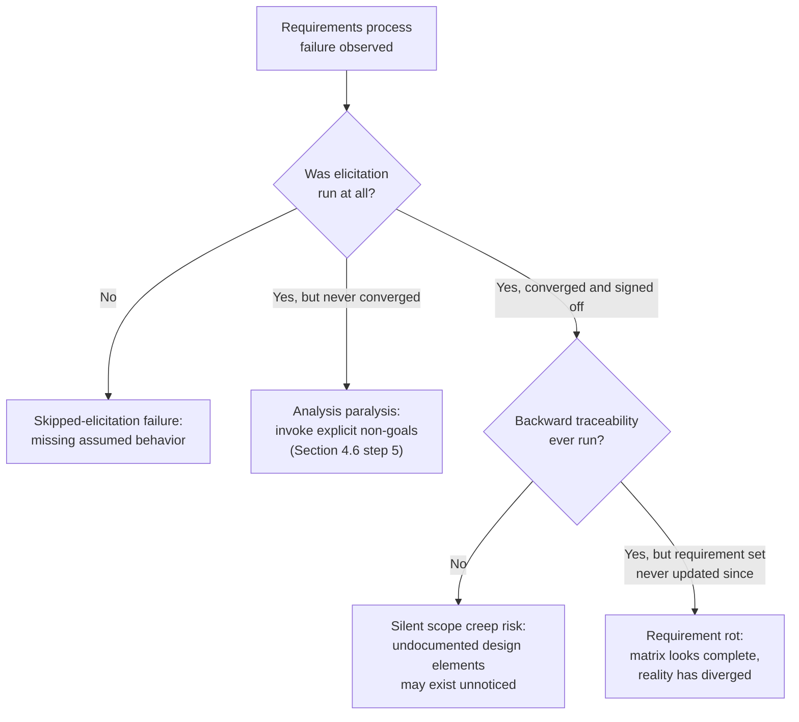

## 16. Testing

A testable functional requirement (Section 4.4) converts almost directly
into an acceptance test: the Given/When/Then structure this chapter teaches
is the same structure Behavior-Driven Development tooling executes, and the
Gherkin-formatted acceptance criteria [Backlog already teaches for user
stories](../02_Design_Thinking_and_Product_Management/CH22_Backlog.md#41-backlog-item-taxonomy-and-mechanics)
is a close sibling format — recapped here only to note that this chapter's
system-design-level requirements typically produce a smaller number of
more architecturally significant acceptance tests (one per FR, often
covering multiple alternate flows from a use case) rather than the finer-
grained, per-story acceptance tests a backlog item generates. The
traceability matrix (Section 4.5) is the mechanism that proves every
requirement actually has at least one corresponding test case, and that no
test case exists without a requirement justifying it — the same
bidirectional check applied to the test suite specifically rather than to
design artifacts in general.

## 17. Common Mistakes

- Treating the first draft of a requirement as final without checking it
  against the ambiguous-word blocklist (Section 4.4).
- Conflating a user story's lightweight, intentionally incomplete format
  with the more complete specification this chapter's system-design context
  requires — [these serve different purposes and are owned by different
  chapters](../02_Design_Thinking_and_Product_Management/CH22_Backlog.md),
  not interchangeable defaults.
- Skipping the "play it back" confirmation step (Section 4.6, step 6)
  because the requirement set "seems obviously right" to the person who
  drafted it.
- Building a traceability matrix once at kickoff and never updating it
  again (Section 4.5's traceability-drift failure mode).
- Re-deriving MoSCoW or Kano's mechanics from scratch in a requirements
  document instead of recapping and linking to
  [Prioritization](../02_Design_Thinking_and_Product_Management/CH28_Prioritization.md) —
  a mistake this chapter itself deliberately avoids and calls out explicitly
  as a pattern to follow.
- Eliciting only the happy path and never running an explicit abuse-case
  pass (Section 13).

## 18. Best Practices

- Default to EARS sentence shapes for every functional requirement, and
  treat any sentence that resists being written in one of the five
  patterns as a signal the underlying idea is not yet resolved.
- Maintain the ambiguous-word blocklist as a living, team-specific document
  that grows every time a new ambiguous phrase causes a real
  misunderstanding.
- Seed the traceability matrix at requirement-authoring time, not after
  design — Section 4.5's forward/backward check works best as a continuous
  discipline, not a retrospective audit.
- Always state explicit non-goals alongside goals, using the same
  visibility (the same document, the same review) rather than relegating
  them to a separate, easily forgotten note.
- Run an explicit abuse-case elicitation pass for every Must-have
  requirement before considering the requirement set complete.
- Recap and link, never re-teach, a concept genuinely owned by another
  chapter (Personas, user stories, MoSCoW/Kano) — both to respect this
  book's Concept Ownership Rule and, in a real organization, to avoid a
  requirements document silently drifting out of sync with whichever
  chapter or team actually owns the authoritative version of that concept.

## 19. Anti-Patterns

- **Gold-plating.** Implementing capability beyond what any requirement
  specifies, discovered (if ever) only by backward traceability — the
  `click_count` column in Artifact 2 is a worked example of exactly this
  anti-pattern.
- **Requirement-by-committee paralysis.** Attempting to achieve unanimous
  agreement from every stakeholder on every requirement's exact wording
  before proceeding, rather than using MoSCoW/Kano (Section 4.3, recap) to
  make a deliberate, documented priority call and moving forward.
- **The frozen SRS reborn.** Treating a signed-off requirement document as
  immutable once design begins, refusing to revisit it even when design
  work surfaces a genuine gap or contradiction — the same rigidity Section
  2's historical account already identifies as Waterfall's core failure,
  reappearing inside an otherwise Agile process whenever a team stops
  treating the requirement document as a living artifact.
- **Ambiguity laundering.** Rewriting a vague requirement into a
  grammatically valid EARS sentence shape without actually resolving the
  underlying ambiguity (Section 4.4's failure mode) — producing a document
  that *looks* rigorous without being so.

## 20. Trade-off Analysis

The central trade-off in this discipline is elicitation depth versus
delivery speed: a fully worked, workshop-driven, use-case-complete
requirement set with a live traceability matrix maximizes confidence that
the right system gets built, at the cost of calendar time and stakeholder
attention that a smaller, time-boxed effort would not spend. The right
point on this trade-off is not fixed — it should scale with the
requirement's Architecturally Significant weight (recapped from
[What is Software Architecture?](../01_Architecture_Mindset/CH01_What_is_Software_Architecture.md#architecturally-significant-requirements-asrs)):
a requirement that will shape a hard-to-reverse structural decision
(recapped as a "one-way door" from [Architecture
Thinking](../01_Architecture_Mindset/CH03_Architecture_Thinking.md#reversible-vs-irreversible-decisions-one-way-door--two-way-door))
justifies a full workshop and use-case pass; a requirement that is cheap to
change later justifies only a lightweight interview or even a single
clarifying question.

| Approach | Confidence in correctness | Time cost | Best suited for |
|---|---|---|---|
| Single clarifying-question exchange (Section 4.6) | Lower, but sufficient for reversible scope | Minutes | System Design Interview; small, easily reversible features |
| Stakeholder interview (Section 4.2) | Moderate, single-perspective | Hours | One dominant domain expert, narrow feature |
| Requirements workshop (Section 4.2) | High, cross-stakeholder conflicts surfaced | Days (scheduling + session) | Cross-team features, disputed scope |
| Use-case construction (Section 4.2) | High for alternate/failure-flow coverage | Hours to days per use case | Complex, multi-actor, failure-sensitive interactions |
| Full IEEE-830-style SRS (Section 2, historical) | Very high, exhaustive | Weeks | Regulated, safety-critical, or contractually fixed-scope domains |

## 21. Comparison Table

| Technique | Strength | Weakness | Typical Use Case |
|---|---|---|---|
| Stakeholder interview | Deep single-perspective detail | Misses cross-stakeholder conflict | Narrow domain-expert knowledge capture |
| Requirements workshop | Surfaces conflicting assumptions live | Expensive to schedule, harder to facilitate well | Cross-team or disputed-scope features |
| Use case (UML) | Forces alternate/failure-flow thinking | Heavier artifact than a user story | Complex, multi-step, failure-sensitive interactions |
| User story (recap, owned by Backlog) | Lightweight, fast, iteration-friendly | Intentionally incomplete, weak on failure flows | Backlog-sized, single-team increments |
| Interview-style clarifying Q&A (Section 4.6) | Extremely fast, works under hard time pressure | Lower completeness ceiling | System Design Interviews; quick scope checks |

## 22. Real-World Case Study

**Healthcare.gov's 2013 launch (United States federal insurance
marketplace).** The U.S. Government Accountability Office (GAO)'s public
post-mortem (GAO-14-694) documents a launch failure whose root causes were,
in large part, exactly the functional-requirements failures this chapter
teaches how to avoid, not purely an infrastructure-capacity problem as
early press coverage assumed. According to the GAO's findings: requirements
for the federal marketplace's core eligibility and enrollment functionality
continued changing significantly through the summer of 2013, mere weeks
before the October 1 launch, because policy decisions that functional
requirements depended on were still being finalized upstream — a direct
instance of this chapter's Section 6 principle ("prefer progressive
elaboration over premature completeness") being violated in the opposite
direction: not too little elaboration, but requirements locked in so late
that no meaningful design, implementation, or testing runway remained once
they stabilized. The GAO report further documents that the prime
integration contractor lacked visibility into how individual system
components' requirements related to the overall system's requirements — a
traceability failure at organizational scale (Section 4.5), not a
requirement-writing failure at the sentence level — meaning even the
requirements that *were* stable were never fully traceable to the
components meant to satisfy them across the many contractors involved.
Combined with severely compressed testing time (a direct consequence of
late-arriving requirements, Section 16), the system launched with
capacity and integration failures that a requirements process applying
this chapter's disciplines — locking Must-have scope earlier, maintaining
cross-contractor traceability continuously, and treating requirement churn
rate (Section 14) as a leading risk indicator rather than discovering the
problem only at launch — would have surfaced as an escalatable risk months
earlier rather than as a public failure on launch day.

## 23. Interview Questions

1. How would you distinguish a functional requirement from a non-functional
   requirement when a stakeholder's sentence could plausibly be read as
   either?
2. Walk through the clarifying questions you would ask for an ambiguous
   prompt like "design a URL shortener," and explain why you asked each one
   in that order.
3. What is the difference between a use case and a user story, and when
   would you choose one over the other during system-design-stage
   elicitation?
4. Why is a Requirements Traceability Matrix bidirectional, and what
   failure does each direction catch that the other direction does not?
5. Rewrite the requirement "the system should handle errors gracefully"
   using an EARS sentence pattern, and explain what ambiguity your rewrite
   resolved.
6. When would you apply MoSCoW to a freshly elicited requirement set rather
   than deferring prioritization to backlog grooming?
7. Describe a real or hypothetical scenario where skipping an abuse-case
   elicitation pass produced a security gap that a purely happy-path
   requirements pass missed.
8. How do you decide how much elicitation depth (a single clarifying
   question versus a full workshop) a given requirement deserves?

## 24. Hands-on Exercises

1. Take the ambiguous prompt "design a ride-sharing app" and produce your
   own six-turn clarifying dialogue in the style of
   [Artifact 1](../code/markdown/functional-requirements-chapter/01_requirements_elicitation_dialogue.md),
   ending with a consolidated, testable requirement set.
2. Rewrite five deliberately vague requirement sentences (write your own,
   or reuse the "before" examples in
   [Artifact 4](../code/markdown/functional-requirements-chapter/04_ears_testable_requirements_checklist.md))
   into EARS sentence patterns, and identify which ambiguous word or phrase
   each rewrite resolved.
3. Build a use case (actor, main success scenario, at least two alternate
   flows) for a "return a purchased item" interaction in an e-commerce
   system.
4. Construct a Requirements Traceability Matrix for a small feature you
   have worked on recently, and run the backward-traceability check against
   its actual current codebase — report any undocumented design elements
   you find.

## 25. Design Exercises

1. Given the prompt "design a parking garage reservation system," produce a
   complete, MoSCoW-tagged, EARS-formatted requirement set, including at
   least two explicit non-goals and one abuse-case-derived requirement.
2. For a requirement set of your choosing, design the Requirements
   Traceability Matrix schema you would use in a real Jira/Confluence-based
   organization, including which fields are mandatory for an entry to count
   as "traced."
3. Take a real ambiguous feature request from your own current or past
   work and produce the six-step clarifying sequence (Section 4.6) you
   would have run, retroactively, and identify what you would have caught
   earlier had you run it before implementation began.

## 26. Architecture Review Questions

- Does every requirement in this document specify an observable behavior
  rather than an implementation detail or an unmeasurable quality
  adjective?
- Is every requirement written in a form (EARS or an equivalent
  Given/When/Then structure) that two engineers could independently and
  identically test?
- Are explicit non-goals recorded alongside goals, with the same
  visibility?
- Does a Requirements Traceability Matrix exist, and does it demonstrate
  both forward coverage (every requirement has a design/test entry) and
  backward coverage (every design/test element has a requirement entry)?
- For every requirement tagged Must, has an abuse-case pass been run
  against it?
- Where this document overlaps a concept another chapter or team owns
  (personas, user-story format, prioritization mechanics), does it recap
  and link rather than re-derive?

## 27. Summary

Functional-requirements gathering is the discipline that turns an
ambiguous business ask into a scoped, testable, traceable technical
specification — the entry point of the system design process this entire
part of the book builds on. This chapter distinguished functional from
non-functional requirements (Section 4.1), taught the elicitation
techniques (stakeholder interviews, workshops, use cases) that surface
requirements from stakeholders who rarely state them completely on their
own (Section 4.2), recapped rather than re-derived the MoSCoW and Kano
prioritization mechanics already owned in full by
[Prioritization](../02_Design_Thinking_and_Product_Management/CH28_Prioritization.md)
while teaching their distinct application at the requirements-scoping stage
(Section 4.3), taught the EARS-based discipline for writing a requirement
so it is genuinely testable and unambiguous (Section 4.4), taught
requirement traceability as a bidirectional, continuously maintained
mechanism rather than a one-time deliverable (Section 4.5), and taught the
specific, high-pressure skill of scoping an ambiguous requirement live, in
an interview or a stakeholder meeting (Section 4.6). Every downstream
chapter in this part — Non-Functional Requirements, High-Level Design,
Low-Level Design, and the full Distributed Systems subsection — depends on
this chapter's output: a requirement set precise enough to design against,
prioritized enough to scope realistically, and traceable enough to prove,
later, that what was built is actually what was asked for.

## Further Reading

- [Non-Functional Requirements](CH02_Non_Functional_Requirements.md) — the
  quality-attribute half of this same specification exercise (forward
  reference, not yet drafted).
- [High-Level Design](CH03_High_Level_Design.md) and
  [Low-Level Design](CH04_Low_Level_Design.md) — the design stages this
  chapter's output feeds directly (forward references, not yet drafted).
- [Prioritization](../02_Design_Thinking_and_Product_Management/CH28_Prioritization.md) —
  full MoSCoW/Kano/RICE mechanics recapped in Section 4.3.
- [Backlog](../02_Design_Thinking_and_Product_Management/CH22_Backlog.md) —
  full user-story format and Gherkin acceptance-criteria mechanics recapped
  in Sections 4.2 and 16.
- [User Interviews](../02_Design_Thinking_and_Product_Management/CH04_User_Interviews.md) —
  full interview-craft technique recapped in Section 4.2.
- [What is Software Architecture?](../01_Architecture_Mindset/CH01_What_is_Software_Architecture.md) —
  Architecturally Significant Requirements and the quality-attribute
  taxonomy recapped in Sections 4.1 and 20.
- [Architecture Thinking](../01_Architecture_Mindset/CH03_Architecture_Thinking.md) —
  Architecture Decision Records and the reversible/irreversible decision
  heuristic recapped in Sections 8 and 20.
