# Chapter: Non-Functional Requirements

Part: [07 — System Design and Distributed Systems](PART_OVERVIEW.md) · Status: Drafted

## 1. Introduction

A functional requirement says what a system must *do*: "a user can transfer
money between two accounts," "a customer can search for a product by name."
A Non-Functional Requirement (NFR) says how well the system must do it, and
under what conditions it is still considered to be working at all: how many
transfers per second it must sustain, how long a search may take before it
is unacceptable, how many nines of uptime the business is willing to pay
for, and how much data loss is tolerable if a data center disappears
mid-write. Functional requirements answer "what"; NFRs answer "how good,
how fast, how often, how safely, and at what cost" — and in practice, NFRs
are what actually determine a system's architecture. Two systems can
implement the identical feature set and yet require completely different
designs because one must serve 50 requests/second with a 2-second latency
budget and the other must serve 500,000 requests/second with a 50-millisecond
budget. This chapter is the owning chapter for defining, measuring, and
trading off the specific quality attributes that recur across virtually
every system-design conversation: Availability, Reliability, Scalability,
Elasticity, Latency, Throughput, Durability, Security (as a brief NFR
framing only — the deep mechanics belong to Part 13), and Cost.

This chapter builds directly on a concept this book has already introduced
at an umbrella level:
[quality attributes / non-functional requirements as a taxonomy](../01_Architecture_Mindset/CH01_What_is_Software_Architecture.md#quality-attributes-non-functional-requirements),
owned by
[What is Software Architecture?](../01_Architecture_Mindset/CH01_What_is_Software_Architecture.md),
which introduced the *category* of quality attributes and explicitly
deferred per-attribute deep technique to later parts of the book —
Performance, System Design, Security, and Observability. This chapter is
that deferred "System Design" home for the general-purpose quality
attributes (Availability, Reliability, Scalability, Elasticity, Latency,
Throughput, Durability, and Cost); Security's deep mechanics remain owned by
the future Part 13 (not yet drafted), and this chapter deliberately stops at
a brief framing entry point for it (Section 4.6). Likewise, Service Level
Agreement (SLA), Service Level Objective (SLO), and Service Level Indicator
(SLI) framing is established here as the *measurement vocabulary* NFRs are
expressed in, while the future Part 12 — Observability (specifically its
not-yet-drafted SLO and SLI chapters) will own the deeper operational
mechanics of monitoring, alerting, and error-budget policy built on top of
these definitions. This chapter is also the first of Part 07's Distributed
Systems subsection to be drafted; its 18 sibling chapters — Functional
Requirements, High-Level Design (HLD), Low-Level Design (LLD), CAP Theorem,
PACELC, Consensus, Leader Election, Gossip Protocols, Replication,
Partitioning, Distributed Transactions, Saga Pattern, Command Query
Responsibility Segregation (CQRS), Event Sourcing, Idempotency, Exactly-Once
Processing, Ordering Guarantees, and Deduplication — do not exist in the
workspace yet. Where this chapter needs to mention one of those concepts
to explain *why* an NFR trade-off exists, it does so in 1-2 sentences with
a forward-reference link, and explicitly does not teach that concept's
mechanics — that teaching is reserved for the dedicated chapter later in
this same part.

## 2. Historical Evolution

- **Mainframe-era Service Level Agreements (1960s-1980s)** — the vocabulary
  of "Service Level Agreement" originated in enterprise IT outsourcing
  contracts, where a customer paid a vendor to operate a mainframe and the
  contract specified uptime and response-time commitments in legal, not
  engineering, language. Availability was measured coarsely (business-hours
  uptime, monthly batch-job completion) because systems were not yet
  continuously interactive at global scale.
- **The rise of "five nines" telecom culture (1980s-1990s)** — telephone
  switching systems set the cultural bar of "99.999% availability" (roughly
  5 minutes of downtime per year), a standard inherited by early internet
  infrastructure vendors marketing themselves against that expectation, even
  though the underlying failure modes of a packet-switched internet service
  are very different from a circuit-switched phone network.
- **Dot-com scaling failures (late 1990s-early 2000s)** — as consumer web
  traffic grew faster than most single-database architectures could absorb,
  outages during peak events (product launches, holiday shopping) made
  throughput and latency *user-visible* business metrics for the first
  time, not just internal engineering concerns — a slow or down site
  directly cost revenue in a way a batch mainframe job's delay rarely had.
- **Google's Site Reliability Engineering (SRE) discipline (internal from
  the mid-2000s, publicly documented in the 2016 SRE book)** — formalized
  SLO/SLI/error-budget vocabulary as an internal engineering discipline
  rather than a legal contract term, explicitly separating what a customer
  is promised (SLA) from the internal target engineering steers toward
  (SLO) and the measured signal that target is graded against (SLI) —
  vocabulary this chapter adopts and Section 4.1 defines precisely.
  Google's SRE model is the direct intellectual ancestor of the SLO/SLI
  chapters planned for the future Part 12 — Observability.
- **Cloud elasticity and pay-as-you-go pricing (Amazon Web Services (AWS)
  launch, 2006 onward)** — Infrastructure-as-a-Service made *elastic*
  capacity (Section 4.3) a purchasable, automatable property rather than a
  multi-month hardware-procurement exercise, fundamentally changing the
  cost-vs-redundancy trade-off calculus this chapter's Section 4.7 and 4.8
  depend on: over-provisioning for a rare peak stopped being an unavoidable
  sunk capital cost and became an elastic, largely avoidable operating cost.
- **Percentile-based latency reporting becomes standard practice (2000s
  onward, popularized heavily by Amazon's internal engineering culture and
  later widely echoed across the industry)** — average latency was
  recognized as actively misleading for user-facing systems (a single very
  slow outlier can be masked by thousands of fast requests in an average,
  yet that slow outlier is exactly the experience some real users had); the
  shift to p50/p95/p99 percentile reporting (Section 4.4) reframed "how
  fast is the system" as a distribution question, not a single-number
  question.
- **Chaos engineering and reliability-as-continuous-practice (Netflix's
  Chaos Monkey, first released 2011)** — reliability stopped being treated
  as a static property verified once before launch and became something
  actively, continuously tested in production by deliberately injecting
  failure, on the theory that a failure mode nobody has rehearsed is a
  failure mode nobody is actually prepared for.
- **The current era: NFRs as first-class system-design-interview
  vocabulary** — over the last decade, "clarify the non-functional
  requirements first" became a standard, almost ritualized opening move in
  large-scale system-design interviews (Section 9), precisely because
  interviewers use the candidate's NFR-gathering discipline as a proxy for
  real-world architectural judgment before a single component is drawn.

## 3. Why It Exists

Non-Functional Requirements exist because "does it work" and "is it good
enough" are different questions, and a system that satisfies the first while
failing the second is, from a business and user perspective, still broken.
A payments API that correctly moves money between accounts but takes 30
seconds to respond under moderate load has not failed its functional
specification, yet no reasonable business would ship it, because a
transactional API's usability is inseparable from its latency. NFRs give
architects a vocabulary to make that judgment explicit, quantifiable, and
negotiable *before* the system is built, rather than discovering the gap
between "technically works" and "actually usable" only after a production
incident. They also exist because every NFR competes with every other NFR
and with cost for a finite engineering and infrastructure budget — an
architecture that maximizes availability without limit, or minimizes
latency without limit, is always technically possible and always
economically absurd; NFRs are the mechanism by which a team agrees, in
advance and in numbers, on where the acceptable trade-off line sits (Section
4.8). Without an explicit NFR, every downstream design decision defaults to
an unstated assumption, and unstated assumptions are the most common root
cause of a system that "works" in a demo and collapses the first time real
traffic, real failure, or real cost pressure arrives.

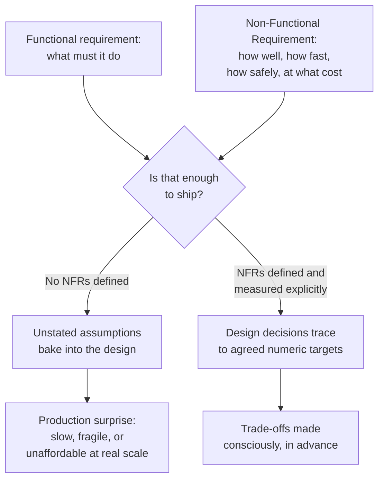

## 4. Core Concepts

### 4.1 Availability, and the SLA/SLO/SLI Framing

**Definition.** Availability is the proportion of time a system is capable
of successfully serving requests, typically expressed as a percentage over
a defined measurement window (a month or a year is standard). It is usually
written as a string of nines because the interesting information lives in
how many nines follow the decimal point, not in the percentage itself,
which rounds to "100%" for every value an architect actually cares about
distinguishing between.

| Availability | Downtime/year | Downtime/month | Downtime/day |
|---|---|---|---|
| 99% ("two nines") | 3.65 days | 7.3 hours | 14.4 minutes |
| 99.9% ("three nines") | 8.76 hours | 43.2 minutes | 86.4 seconds |
| 99.95% | 4.38 hours | 21.6 minutes | 43.2 seconds |
| 99.99% ("four nines") | 52.6 minutes | 4.32 minutes | 8.64 seconds |
| 99.999% ("five nines") | 5.26 minutes | 25.9 seconds | 0.864 seconds |

**Mechanism.** Availability is measured, not asserted: an SLI is the actual
measured signal (for example, the ratio of successful HTTP responses within
a latency budget, over total requests, over a rolling window); an SLO is
the internal target the engineering organization steers toward (for
example, "99.95% of requests succeed within 300 ms, measured monthly"); and
an SLA is the external, often contractual, commitment made to a customer,
which is normally set *looser* than the internal SLO so that the
engineering org has margin to absorb normal operational variance before it
ever breaches a customer-facing promise. The gap between an SLO and its
looser external SLA is deliberate slack, not an oversight. An **error
budget** falls directly out of this framing: if the SLO is 99.95% over 30
days, the system is allowed 21.6 minutes of budgeted "badness" (errors,
timeouts, excess latency beyond the SLI's threshold) that month before the
SLO is breached; that budget is a resource the organization can consciously
spend on shipping riskier changes faster, and which forces a slowdown
(freeze risky deploys, prioritize reliability work) once it is exhausted.
This SLA/SLO/SLI/error-budget vocabulary is established here as the
measurement language NFRs are expressed in; the future Part 12 —
Observability (its not-yet-drafted SLO and SLI chapters) will own the
deeper operational mechanics — burn-rate alerting, multi-window
alert design, and error-budget policy automation — built on top of these
definitions, and should recap this section rather than re-deriving the
core vocabulary.

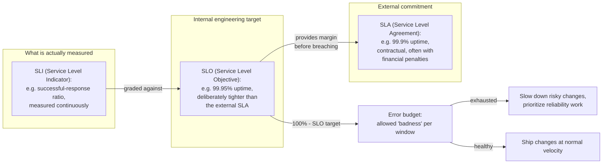

**Decision implications.** Availability targets should never be chosen as
an aspirational round number ("we want five nines") without first pricing
what that target costs in redundancy (Section 4.7-4.8) and without
confirming the business actually needs it — an internal analytics dashboard
used by 12 employees rarely justifies the same nines budget as a payments
API. The right process is to work backward from the *business* impact of
an outage (revenue lost per minute, contractual penalty, safety
consequence) to a target, not forward from an arbitrary marketing number.

**Failure mode.** The most common availability failure mode is not the
literal outage — it is measuring the wrong SLI, so a system can be
"available" by an internal metric (the process is up, responding to a
liveness probe) while functionally unusable to real users (every real
request times out or 500s downstream). A liveness check that only verifies
"the process accepts a TCP connection" without exercising the actual
request path silently produces a falsely healthy availability number.

**Scenario.** An e-commerce checkout API targets 99.95% monthly
availability (~21.6 minutes of budgeted downtime). A database failover
event that previously required 90 seconds of unavailability, if it happens
twice in a month, consumes 3 minutes of the 21.6-minute budget — leaving
18.6 minutes for every other incident that month. This framing turns "how
much unplanned downtime can we tolerate this release cycle" into an actual
number the team can plan risky deploys around, rather than a vague feeling.

### 4.2 Reliability

**Definition.** Reliability is the probability that a system performs its
intended function correctly, without failure, over a specified period of
time and under specified conditions. It is distinct from availability: a
system can be "up" (accepting connections, availability-wise healthy) while
silently returning wrong answers, corrupting data, or dropping a fraction of
requests — none of which an availability metric alone detects, because
availability only asks "did it respond," not "was the response correct and
complete."

**Mechanism.** Reliability is typically operationalized through Mean Time
Between Failures (MTBF) — the average time a system runs correctly before
a failure occurs — and Mean Time To Recovery (MTTR) — the average time
taken to restore correct operation after a failure. Both matter together:
a system with a long MTBF but a catastrophic MTTR (rare failures that take
days to recover from) can have worse real-world reliability than a system
that fails more often but recovers in seconds through automated retry,
failover, or self-healing. Redundancy (running multiple independent copies
of a component so one copy's failure does not stop the system) is the
primary mechanism for improving reliability; achieving redundancy correctly
across multiple machines is itself the subject of the future Distributed
Systems subsection's dedicated
[Replication](CH10_Replication.md) and
[Consensus](CH07_Consensus.md) chapters (not yet drafted) — this chapter
only establishes *why* reliability motivates redundancy as an NFR, not how
consensus-based replication achieves it byte-for-byte.

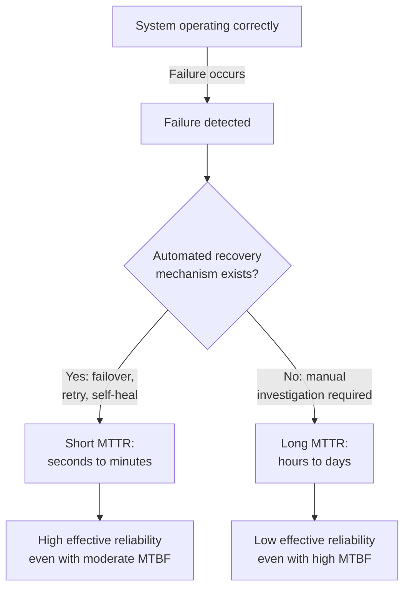

**Decision implications.** Investing in a shorter MTTR is frequently
cheaper and more impactful than investing in a longer MTBF, because
eliminating the *last* rare failure mode in a complex distributed system
has steeply diminishing returns, while automating detection and recovery
(health checks, automatic failover, circuit breakers) pays off across every
failure mode, known and unknown alike.

**Failure mode.** Silent data corruption is reliability's worst failure
mode precisely because it produces no alarm: the system remains available,
requests keep succeeding, and the defect is only discovered later — often
by a downstream consumer, an auditor, or a customer complaint — by which
point the incorrect data may have already propagated through caches,
replicas, and dependent systems.

**Scenario.** A recommendation engine that returns stale (but
plausible-looking) results due to a broken data pipeline is "available"
under every conventional availability SLI, yet has failed its reliability
requirement — the business impact (bad recommendations quietly eroding
engagement) may take weeks to surface in metrics, far longer than an
availability dashboard's real-time red/green signal would suggest anything
is wrong.

### 4.3 Scalability vs. Elasticity

**Definition.** Scalability is a system's capacity to handle increased load
by adding resources — more machines (horizontal scaling) or more powerful
machines (vertical scaling) — without a proportional degradation in
performance. Elasticity is the *automatic and rapid* adjustment of
provisioned capacity, in both directions, to track actual demand in near
real time. Scalability is about the theoretical ceiling and the shape of
the cost curve as load grows; elasticity is about how quickly and
automatically the system moves along that curve as load changes, including
shrinking back down when demand falls.

**Mechanism.** A scalable architecture typically achieves horizontal
scaling by keeping application-tier components stateless (so any instance
can serve any request) and pushing state into a data tier that itself
scales via
[partitioning](../06_Databases_and_Storage/CH05_Partitioning.md) and
[sharding](../06_Databases_and_Storage/CH06_Sharding.md) (recapped, not
re-taught, here — those chapters own single-node and cross-node key-based
splitting mechanics; the future Distributed Systems subsection's
[Partitioning](CH11_Partitioning.md) chapter will extend that theory to a
fully distributed-systems framing). Elasticity is built on top of a
scalable architecture using auto-scaling policies driven by observed
metrics (CPU utilization, queue depth, request latency) that add or remove
capacity within minutes, typically enabled by cloud Infrastructure-as-a-
Service capacity being provisionable programmatically rather than through a
manual procurement cycle.

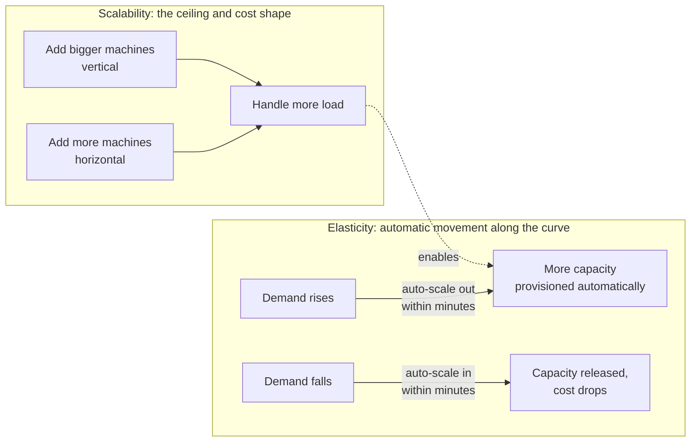

**Decision implications.** A system can be highly scalable (its
architecture can theoretically absorb 100x load by adding machines) yet not
elastic at all (capacity is provisioned once, manually, for peak, and never
shrinks) — this is a common and expensive anti-pattern: paying for
peak-sized infrastructure every hour of every day when real load only
reaches that peak for a few hours a week. Conversely, a system can be
elastic within a narrow range but not scalable beyond it, if a component
(a single-writer database, a global lock, a synchronous cross-service call
chain) imposes a hard ceiling no amount of auto-scaling can cross.

**Failure mode.** Auto-scaling based on the wrong signal is elasticity's
most common failure: scaling on CPU utilization alone misses I/O-bound or
memory-bound bottlenecks entirely, so the auto-scaler adds instances that
never relieve the actual constraint, quietly burning cost without
restoring healthy latency. Scale-out that is too slow relative to a traffic
spike's actual growth rate is a second common failure: if the spike arrives
faster than new capacity can come online and pass health checks, the
system degrades or falls over before elasticity ever helps.

**Scenario.** A tax-filing service experiences a predictable, extreme
traffic spike in the days immediately before a national filing deadline —
often 20-50x average daily load — followed by months of comparatively low
traffic. A scalable-but-not-elastic design would require provisioning for
the deadline spike year-round, a large ongoing cost; an elastic design
scales out automatically in the days before the deadline and scales back in
afterward, capturing the same peak-handling capability at a fraction of the
annual cost.

### 4.4 Latency (Percentiles) vs. Throughput

**Definition.** Latency is the time taken to complete a single operation,
from the client's perspective, end to end. Throughput is the rate at which
a system completes operations, typically measured in requests/second or
Queries Per Second (QPS). They describe different axes of "speed" and are
frequently in tension with each other (Section 4.8): a system can be tuned
to maximize throughput (batching many requests together for efficiency) at
the cost of any individual request's latency, or tuned to minimize latency
(processing each request immediately, in isolation) at the cost of the
total throughput the same hardware could otherwise sustain.

**Mechanism.** Latency should never be reported as a single average, because
an average is dominated by the bulk of fast requests and can completely
hide a meaningful population of slow outliers that some fraction of real
users actually experienced. The standard practice is percentile reporting:
p50 (median — half of requests were faster, half slower), p95 (95% of
requests were at least this fast; the slowest 5% were slower), and p99
(the slowest 1% of requests). A system with a p50 of 40 ms and a p99 of
2,000 ms is telling a very different story than its average alone (which
might look like a reassuring 60 ms) would suggest — 1% of users are having
a materially worse experience, and at sufficient scale, 1% of requests is
still a very large absolute number of unhappy users.

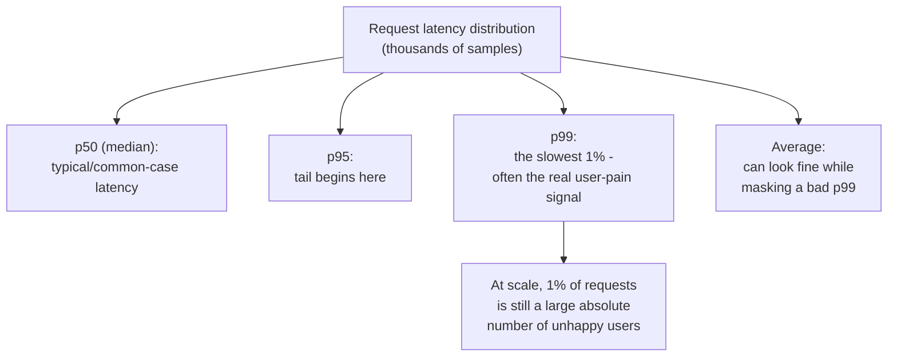

Throughput and latency connect through **Little's Law**, a queueing-theory
result stating that the average number of requests concurrently "in the
system" equals the arrival rate (throughput) multiplied by the average time
each spends in the system (latency):

$$
L = \lambda \times W
$$

where $L$ is the average number of concurrent in-flight requests, $\lambda$
is the arrival rate (throughput), and $W$ is the average time in the
system (latency). This single relationship explains why pushing throughput
higher without adding capacity inevitably increases either concurrency
(more requests queued simultaneously) or latency (each request waits
longer) — there is no way to hold both throughput and latency fixed while
also holding concurrency fixed, if load increases and capacity does not.

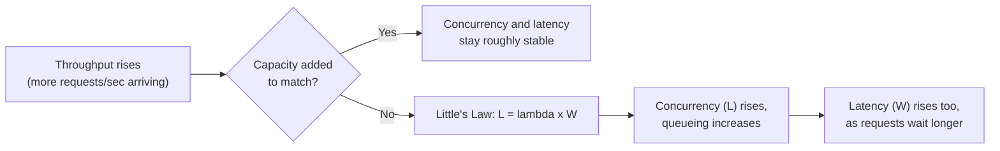

**Decision implications.** Which percentile matters depends entirely on the
system's purpose: a real-time bidding system with a 100 ms hard deadline
cares almost exclusively about its p99 (a single slow bid is simply
discarded, worthless, regardless of how fast the median request was), while
a nightly batch-reporting job cares about total throughput and barely at
all about any single record's individual latency. Choosing the wrong
percentile to optimize is a common, expensive mistake: teams that only
watch p50 dashboards can ship a change that quietly doubles p99 while the
p50 graph looks unchanged and reassuring.

**Failure mode.** "Averaging away" the tail is the classic latency failure
mode described above. A second, related failure mode is testing throughput
under conditions that do not reproduce real concurrency and queueing
behavior (for example, a load test that opens one connection at a time
sequentially) — such a test can report a throughput number that has no
relationship to what the system actually sustains under real, concurrent
production traffic.

**Scenario.** An API gateway reports an average latency of 45 ms across a
million daily requests, which looks healthy. Its p99, however, is 3.2
seconds, driven by requests that happen to hit a specific downstream
dependency's occasional slow query. At 1 million requests/day, that "tiny"
1% tail is 10,000 requests/day experiencing a 3.2-second wait — plausibly
the entire population of users who abandon the page and file a support
ticket, even though the dashboard's headline average number never moved.

### 4.5 Durability

**Definition.** Durability is the guarantee that once data has been
acknowledged as committed, it will not be lost, even in the face of
subsequent hardware failure, power loss, or software crash. Unlike
availability (can the system respond right now) durability is specifically
about data surviving over time, independent of whether the system serving
it happens to be reachable at any given moment.

**Mechanism.** Durability is typically expressed as a probability of
annual data loss (a cloud object-storage provider advertising "eleven
nines of durability," 99.999999999%, is stating an *extremely* low expected
annual loss rate across an enormous number of stored objects, not a
guarantee that zero bytes will ever be lost anywhere, ever). The primary
mechanisms that produce durability are: writing to a Write-Ahead Log (WAL)
before acknowledging a write as committed (recapped from
[Transactions'](../06_Databases_and_Storage/CH08_Transactions.md) Atomicity,
Consistency, Isolation, Durability (ACID) treatment, which owns WAL-based
durability mechanics in full), replicating the data to multiple independent
failure domains so a single disk, machine, or data center failure does not
destroy the only copy (recapped from
[Replication](../06_Databases_and_Storage/CH07_Replication.md)), and
forcing data to non-volatile storage (`fsync`, recapped from
[File Systems'](../05_Networking_and_OS/CH26_File_Systems.md) `fsync()`
durability-forcing boundary) rather than trusting an in-memory or
volatile-cache acknowledgment. Replicating data across $N$ independent
failure domains, each with an independent annual failure probability $p$,
drives the probability that *all* copies are lost simultaneously down
toward $p^N$ — the multiplicative effect that makes even a handful of
replicas turn a merely-good single-disk durability number into an
extraordinarily strong one, provided the failure domains are genuinely
independent (the same power feed, network switch, or rack does not count
as independent).

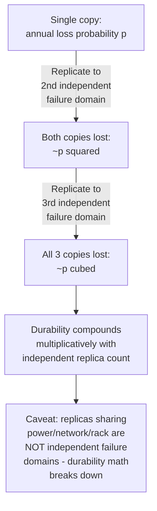

**Decision implications.** Durability and availability are frequently
conflated but must be reasoned about separately: a system can guarantee
strong durability (data, once committed, will never be lost) while being
briefly unavailable during a failover, and conversely a system that
acknowledges writes to a single volatile in-memory buffer before
replicating can appear highly available while carrying real durability
risk on every unreplicated write. The choice of synchronous versus
asynchronous replication (recapped from
[Replication's](../06_Databases_and_Storage/CH07_Replication.md) sync/async/
semi-sync trade-off) is precisely a durability-versus-write-latency trade-
off: synchronous replication to a second failure domain before
acknowledging a write raises durability at the direct cost of added write
latency.

**Failure mode.** The most dangerous durability failure mode is an
application or driver that acknowledges a write to the caller before the
underlying storage layer has actually forced it past a volatile cache —
the caller believes the data is safe, proceeds accordingly (perhaps telling
a user "your order is confirmed"), and only discovers otherwise when a
crash reveals the write never actually reached durable storage.

**Scenario.** A financial ledger service must guarantee zero data loss on
any acknowledged transaction. It synchronously replicates every write to a
second availability zone before returning success to the caller, accepting
several additional milliseconds of write latency per transaction as the
explicit, deliberate cost of that durability guarantee — a textbook
instance of Section 4.8's durability-versus-latency trade-off, made
consciously rather than discovered accidentally during an incident.

### 4.6 Security (Brief NFR Framing)

**Definition, scoped narrowly for this chapter.** Security, as a
Non-Functional Requirement, is the property that a system protects the
confidentiality, integrity, and availability of its data and functionality
against unauthorized access or manipulation. This chapter treats Security
purely as one of the nine quality attributes an architect must weigh
alongside the others introduced above — it is an entry point, not a
teaching chapter for security mechanics. The full depth of authentication,
authorization, encryption, threat modeling, and the Open Worldwide
Application Security Project (OWASP) Top 10 vulnerability classes is owned
by the future Part 13 — Security (confirmed via that part's
`PART_OVERVIEW.md`, currently "Not Started" in full: OWASP Top 10,
Authentication, Authorization, Role-Based Access Control (RBAC),
Attribute-Based Access Control (ABAC), OAuth, OpenID Connect (OIDC), Zero
Trust, Secrets Management, Encryption, Public Key Infrastructure (PKI),
Threat Modeling, Secure Software Development Lifecycle (SDLC), Container
Security, Supply Chain Security, and Software Bill of Materials (SBOM)).

**Why it belongs in this list at all.** Security earns its place alongside
Availability, Latency, and Cost because it is genuinely a trade-off
partner with each of them, not merely an independent add-on: encrypting
data in transit (recapped from
[TLS](../05_Networking_and_OS/CH06_TLS.md)) adds measurable latency on
every connection; strict authorization checks (a future Part 13 topic) add
processing time to every request; defense-in-depth redundancy overlaps
with — and sometimes competes for the same budget as — availability
redundancy. An architect who treats security as something bolted on after
the NFR conversation, rather than as one of the NFRs being negotiated from
the start, routinely ships a design that has to be expensively retrofitted
once a security review catches the gap.

**Decision implications (framing-level only).** At the requirements stage,
the architecturally significant security questions are: what data
classification does this system handle (public, internal, confidential,
regulated), what compliance regime applies (a healthcare system's Health
Insurance Portability and Accountability Act (HIPAA) obligations, a payment
system's Payment Card Industry Data Security Standard (PCI DSS)
obligations), and what is the acceptable trade-off between security
friction and usability/latency. Answering these shapes the rest of the
design (Section 13 revisits security architecturally at the production
level) even before Part 13's mechanics are invoked.

**Failure mode.** Treating security as a checklist applied at the end of a
design, rather than an NFR gathered at the start alongside availability
and latency targets, is the framing-level failure mode this section flags —
the deep failure modes of specific security mechanisms (broken
authentication, injection, misconfigured access control) belong to Part
13's future chapters.

**Scenario.** A system-design interview candidate who states "we'll add
security later" after spending twenty minutes on availability and
scalability targets has, in the interviewer's eyes, treated security as an
afterthought rather than a co-equal NFR gathered at the same time as the
others — Section 9 revisits this as a specific interview pitfall.

### 4.7 Cost as a First-Class NFR

**Definition.** Cost is the total ongoing (and often up-front) expenditure
required to build, operate, and scale a system, and it behaves exactly
like any other NFR: it can be measured, targeted, and traded off against
the others, rather than treated as an afterthought that is only examined
once a system is already in production and the bill arrives.

**Mechanism.** Cost accrues from several largely independent levers an
architect can pull, each of which interacts directly with the NFRs already
covered: redundancy (more replicas raise durability and availability at a
roughly linear-or-worse cost multiplier), over-provisioning for peak
(elasticity, Section 4.3, exists specifically to avoid paying peak-capacity
cost around the clock), data egress and cross-region transfer (a
multi-region design chosen for availability or latency reasons has a
concrete, recurring network-transfer cost line item), and the
operational/engineering cost of complexity itself (a more elaborate
architecture chosen to hit an aggressive availability or latency target
also costs more in the ongoing engineering time required to operate,
debug, and evolve it safely).

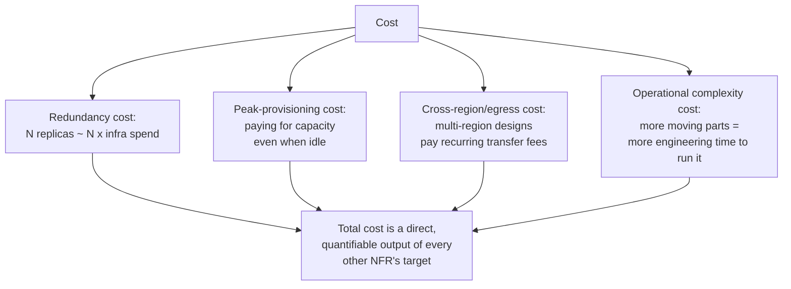

**Decision implications.** The most useful discipline is expressing every
other NFR target *with* its cost consequence attached, rather than in
isolation: "99.99% availability costs roughly 3x the infrastructure spend
of 99.9%, because it requires an active-active multi-region topology
instead of a single-region deployment with periodic backups" is a
decision a business stakeholder can actually weigh; "we should target
99.99% availability" alone, with no attached cost, is not.

**Failure mode.** Optimizing every other NFR in isolation, one at a time,
without ever pricing the combined result, is cost's characteristic failure
mode — a design that independently maximizes availability, minimizes
latency, and maximizes durability, each considered on its own merits, can
easily arrive at a total cost the business never actually agreed to pay,
discovered only when the invoice arrives.

**Scenario.** A startup's early-stage product targets 99.9% availability
(acceptable for its stage and audience) rather than 99.99%, explicitly to
avoid the cost of a second active region before the business has validated
it needs one — a deliberate, cost-driven NFR choice rather than an
oversight, revisited once traffic and revenue justify the higher spend.

### 4.8 NFR Trade-off Analysis

**Definition.** NFR trade-off analysis is the discipline of explicitly
identifying which quality attributes are in tension for a given system,
and choosing a deliberate point on that trade-off spectrum rather than
allowing the point to be chosen implicitly by whichever component happens
to get built first.

**Mechanism — the recurring trade-off pairs.** A handful of tensions
recur across nearly every system-design conversation:

- **Consistency vs. Availability.** Under a network partition, a
  distributed system must choose between returning a possibly-stale answer
  (favoring availability) or refusing to answer at all until consistency
  can be guaranteed (favoring consistency) — this is the essential shape of
  the CAP theorem, whose full formal treatment (including the more nuanced
  PACELC extension that also accounts for the latency-consistency trade-off
  *absent* a partition) is owned by the future
  [CAP Theorem](CH05_CAP_Theorem.md) and
  [PACELC](CH06_PACELC.md) chapters later in this same part; this chapter
  only establishes that the tension exists and that it is precisely an
  instance of the availability-vs-reliability-of-answer trade-off already
  introduced in Sections 4.1-4.2.
- **Latency vs. Throughput.** As Section 4.4 derived via Little's Law,
  batching requests together raises throughput (more work completed per
  unit of overhead) at the direct cost of each individual request's
  latency (it must wait to be batched); processing each request
  immediately minimizes its own latency at the cost of the total
  throughput the same hardware could otherwise sustain.
- **Cost vs. Redundancy (and therefore Availability/Durability).** Every
  additional replica purchased for availability or durability (Sections
  4.1-4.2, 4.5) is a direct, quantifiable cost line item (Section 4.7) —
  there is no redundancy that is free.
- **Strong Consistency vs. Latency.** Requiring every read to reflect the
  most recent write (strong consistency) generally requires a coordination
  round-trip — to a single leader, or across a quorum of replicas via a
  consensus protocol (recapped forward from the future
  [Consensus](CH07_Consensus.md) chapter) — that a weaker, eventually-
  consistent read can skip entirely, trading correctness recency for speed.
- **Security vs. Usability/Latency.** As Section 4.6 noted, every added
  security control (encryption, authorization checks, multi-factor
  verification) adds processing time and user friction that a less secure
  design would not incur.

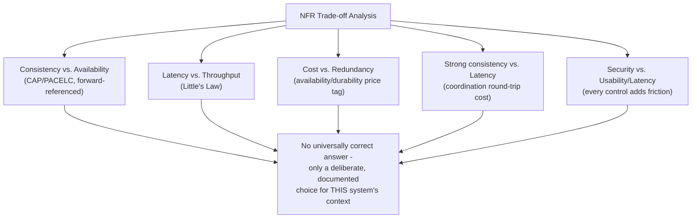

**Decision implications.** The output of trade-off analysis should be a
short, explicit statement per tension — "for this system, we favor
availability over strict consistency during a partition, because a
stale product-catalog read is a better user experience than a hard error,
and we favor p99 latency over maximum throughput, because this is a
synchronous user-facing path, not a batch pipeline" — recorded as an
Architecture Decision Record (recapped from
[Architecture Thinking's](../01_Architecture_Mindset/CH03_Architecture_Thinking.md#architecture-decision-records-adrs)
Architecture Decision Record (ADR) template) so the reasoning survives
past the individual who made the call.

**Failure mode.** The default failure mode is never actually deciding: each
component of a system independently makes its own local trade-off (one
service favors consistency, another favors availability, a third
optimizes throughput at the expense of tail latency) with no coordinating
NFR decision at the system level, producing an architecture whose overall
behavior under stress is an accident of implementation order rather than a
designed outcome.

**Scenario.** A shopping-cart service and its inventory-count service
disagree, unstated, on the consistency-vs-availability trade-off: the cart
favors availability (always let the user add an item, resolve conflicts
later) while inventory favors consistency (never oversell a
limited-stock item). Left implicit, this mismatch produces a real,
recurring production bug — customers can add an item to their cart that
sells out moments later — that an explicit, written trade-off decision
would have surfaced and addressed (a reservation/hold pattern, or an
explicit "not guaranteed until checkout" messaging decision) before
launch, rather than after customer complaints.

### 4.9 Back-of-the-Envelope Capacity Estimation

**Definition.** Back-of-the-envelope capacity estimation is the discipline
of deriving approximate, order-of-magnitude figures for traffic (QPS),
storage, and bandwidth from a small set of stated business assumptions,
early enough in a design process to reveal which NFR is actually the
binding constraint before any component is built. It is deliberately
approximate — the goal is identifying the right order of magnitude and the
dominant bottleneck dimension, not a precise number a finance team could
audit.

**Mechanism — the standard pipeline.** Three estimation passes, each
feeding the next, cover the great majority of system-design capacity
questions:

1. **Traffic estimation.** Start from a business-level number (Daily
   Active Users, transactions/day, uploads/day), convert to
   average-per-second by dividing by the number of seconds in the
   measurement window (86,400 for a day), then apply a peak-to-average
   multiplier (commonly 2x-5x, justified by the specific traffic pattern —
   a viral social feed spikes harder than a business-hours utility API) to
   get the peak QPS the system must actually be provisioned to sustain,
   since provisioning for the average alone guarantees failure during
   every real spike.
2. **Storage estimation.** Multiply the per-record (or per-file) size by
   the expected volume over the required retention period, then apply a
   replication factor (recapped from
   [Replication](../06_Databases_and_Storage/CH07_Replication.md), commonly
   3x for durability and read-scaling) and an index/overhead factor
   (commonly 20%-30%) to reach a provisioned-storage figure.
3. **Bandwidth estimation.** Multiply peak QPS by average payload size to
   reach a peak bytes/second figure, then convert to bits/second (the unit
   network capacity is normally quoted in) by multiplying by 8 — this
   number reveals whether network egress, rather than compute or storage,
   is the system's actual binding constraint (frequently true for
   media-heavy systems, rarely true for text-metadata-heavy ones).

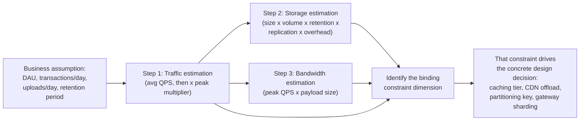

**Decision implications.** The entire value of this exercise is
identifying which dimension actually constrains the design, because that
answer changes the architecture: a read-QPS-bound system needs a caching
tier in front of its datastore (recapped from
[Caching](../06_Databases_and_Storage/CH09_Caching.md)); a storage-bound
system with a large cold-data tail needs tiering (recapped from
[Partitioning's storage-tiering pattern](../06_Databases_and_Storage/CH05_Partitioning.md#partition-maintenancerolling-window-pattern-local-vs-global-indexes-composite-sub-partitioning-storage-tiering));
a bandwidth-bound media system needs CDN offload (recapped from
[CDN](../05_Networking_and_OS/CH09_CDN.md)); a concurrent-connection-bound
real-time system needs a sharded connection-gateway tier (recapped from
[Sockets'](../05_Networking_and_OS/CH16_Sockets.md) file-descriptor/
connection-limit ceiling). Section 10 works through four fully worked
examples applying this exact three-step pipeline.

**Failure mode.** Skipping straight to an assumed architecture ("we'll use
a message queue and a NoSQL database") without ever running these three
estimation passes is the most common failure — a design chosen by
familiarity or fashion rather than by the system's actual measured
bottleneck routinely over-engineers the dimension that was never the
constraint while under-engineering the one that was.

**Failure mode (second, subtler).** Stopping at the naive request count
without modeling amplification — fan-out from a single write to many
reads, or replication multiplying a single logical write into several
physical ones — understates the true bottleneck, sometimes by two orders
of magnitude, as Worked Example 2 (Section 10) demonstrates concretely for
a social-feed fan-out.

**Scenario.** An interview candidate asked to "design a ride-sharing
dispatch system" who spends the first five minutes deriving that peak
concurrent-active-rides is the binding capacity dimension (not raw API
request count) — because dispatch requires continuously matching a bounded
set of live drivers against live riders within a geographic cell, a
fundamentally different capacity shape than a stateless CRUD API — has
demonstrated exactly the judgment this section teaches, and has set up the
rest of the design (geo-sharded matching service, not a generic REST CRUD
layer) on a sound quantitative foundation.

## 5. Internal Working

Internally, a production system's NFR posture is the sum of many small,
composable mechanisms rather than one single knob: availability comes from
health checks feeding automatic failover (recapped forward from the
future
[Leader Election](CH08_Leader_Election.md) chapter, which will teach how a
replacement leader is chosen automatically once a failure is detected);
durability comes from the write-path forcing data through a WAL and
replicating it to independent failure domains before acknowledging success
(Section 4.5); latency comes from a request's actual measured path through
load balancer, cache, application tier, and datastore, each hop
contributing its own distribution of delay that compounds into the
end-to-end percentile a client observes; and cost is the running total of
every provisioned unit across every one of those tiers. The diagram below
traces a single request through a typical production system's tiers,
annotating which NFR each tier's design choice is primarily serving —
useful because it makes visible that no single component "owns" an NFR;
each NFR is an emergent property of choices made at every layer.

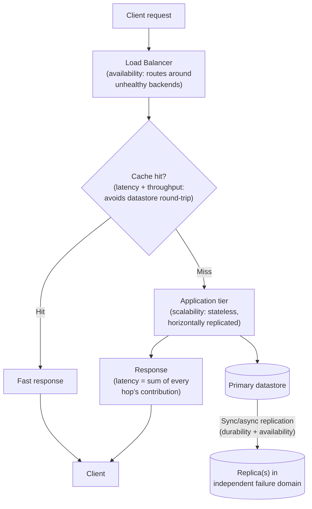

The measurement layer that turns this internal behavior into the SLI
numbers Section 4.1 defined runs orthogonally to the request path itself:
every hop above should emit latency and error-rate telemetry, aggregated
centrally into the percentile distributions (Section 4.4) and
availability ratios that feed the SLO/error-budget calculation. This
chapter does not teach that telemetry pipeline's mechanics — that
observability infrastructure is the future Part 12's domain — but the
internal-working point stands regardless of which observability stack
implements it: **an NFR is only real if it is measured**, and the
measurement instrumentation is therefore as much a part of "internal
working" as the request-serving path itself.

## 6. Design Principles

- **State NFRs as numbers with a measurement window, never as adjectives.**
  "Highly available" and "fast" are not requirements; "99.95% availability
  measured monthly" and "p99 latency under 200 ms" are.
- **Derive every target from business impact, not from an aspirational
  round number.** Work backward from the cost of missing the target
  (lost revenue, safety risk, contractual penalty, user churn), not forward
  from "five nines sounds impressive."
- **Every NFR target must carry its cost consequence explicitly.** A
  target proposed without its cost is an incomplete proposal (Section 4.7).
- **Prefer the cheapest mechanism that satisfies the actual target, not the
  most impressive one.** A single-region deployment with a tested backup/
  restore process may satisfy a legitimate 99.9% target far more cheaply
  than an active-active multi-region topology that would only be needed
  for 99.99%+.
- **Make every trade-off decision explicit and written down.** Section
  4.8's shopping-cart/inventory example exists precisely because an
  unstated, implicit trade-off decision is indistinguishable from a bug
  until it causes a production incident.
- **Measure before optimizing.** An NFR target that cannot currently be
  measured (no SLI exists for it) cannot be meaningfully claimed to be met,
  regardless of how the system "feels" in practice.

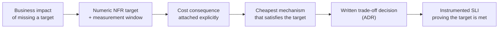

## 7. Architecture Patterns

Several recurring architecture patterns exist specifically to satisfy one
or more of the NFRs above, and recognizing which NFR a pattern serves is
more useful than memorizing the pattern in isolation:

- **Active-passive redundancy** (a standby replica that takes over only on
  failure) serves availability and durability at a lower steady-state cost
  than active-active, at the price of a brief failover gap and wasted
  passive-replica capacity during normal operation — recapped from
  [Replication's](../06_Databases_and_Storage/CH07_Replication.md)
  leader/follower topology.
- **Active-active redundancy** (multiple replicas simultaneously serving
  live traffic) serves availability, throughput, and often latency
  (serving from the geographically nearest active replica) at a
  meaningfully higher cost and coordination complexity — the
  consistency-management cost this pattern incurs is exactly Section
  4.8's consistency-vs-availability tension made concrete.
- **Read replicas plus a caching tier** serve latency and throughput on the
  read path specifically, leaving the write path's durability/consistency
  posture unchanged — a common, cheap first lever before reaching for full
  active-active redundancy.
- **Auto-scaling groups** serve elasticity and cost jointly, by tracking
  demand rather than provisioning for a static peak.
- **Circuit breakers and bulkheads** (recapped forward — full resilience-
  pattern mechanics are a natural companion topic to this chapter but are
  not taught here in depth) serve reliability by containing a single
  failing dependency's blast radius rather than letting it cascade.
- **CQRS-style read-model duplication** (recapped from
  [Denormalization's](../06_Databases_and_Storage/CH02_Denormalization.md#precomputed-aggregatesrollups-read-model-duplication-cqrs-style)
  precomputed-aggregate treatment; the future
  [CQRS](CH14_CQRS.md) chapter later in this same part will own the full
  pattern's architecture) serves scalability and latency by letting the
  read and write paths scale and optimize independently, at the cost of
  read-after-write consistency lag between the two models.

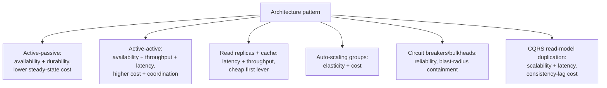

## 8. Production Architecture

A production system's NFR posture is realized concretely as a layered
topology: a globally distributed edge/CDN tier absorbing static and
cacheable traffic close to the user (serving latency and, indirectly,
cost by reducing origin load); a load-balanced, auto-scaled, stateless
application tier (serving scalability, elasticity, and — through health-
check-driven routing — availability); a data tier combining a primary
datastore, replicas across independent failure domains, and a caching
layer (serving durability, availability, and read latency/throughput
jointly); and an observability pipeline continuously computing the SLIs
that Section 4.1's SLO/error-budget framework depends on. Each of these
tiers is independently scaled and independently monitored precisely
because each serves a different, sometimes competing, NFR — collapsing
them into a single monolithic tier would make the trade-offs in Section
4.8 impossible to reason about or tune independently.

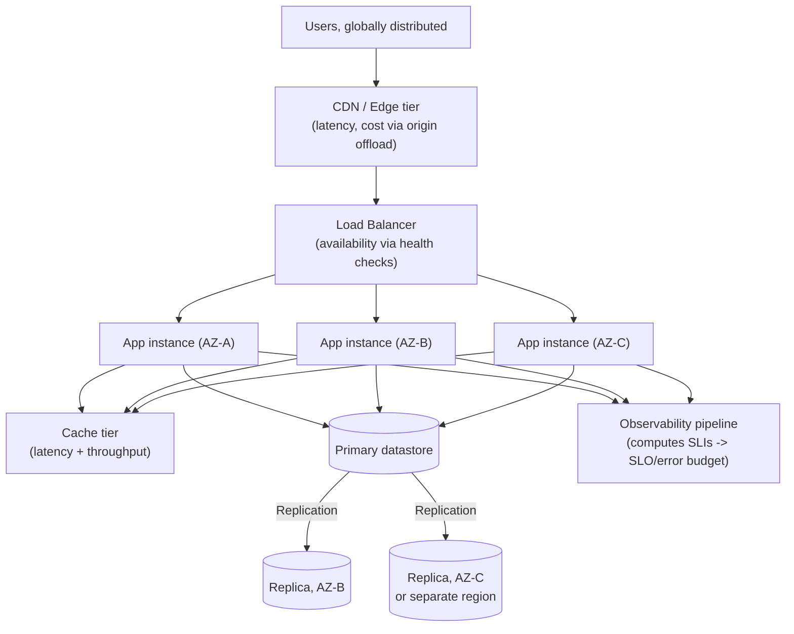

## 9. Implementation

Implementing NFRs begins, deliberately, before any code is written: an
NFR-gathering conversation with stakeholders that produces a short,
numbered list, each entry stating the attribute, the target number, the
measurement window, and the accepted trade-off. In a system-design
interview specifically, this conversation is expected to happen in the
first several minutes, before any component diagram is drawn, because an
interviewer treats the quality (and completeness) of NFR-gathering as a
direct proxy for real-world architectural maturity — a candidate who
jumps straight to drawing boxes without asking "how many users, what
availability target, what's the read/write ratio, is strong consistency
required anywhere" is treated as having skipped the step that actually
determines whether the subsequent design is defensible.

A practical NFR-gathering checklist, ordered the way it is typically
elicited in an interview or a real requirements-gathering session:

1. **Scale**: total users, Daily Active Users, requests/day or QPS.
2. **Read/write ratio**: overwhelmingly read-heavy systems (Section 4.9's
   URL-shortener example) need different emphasis than write-heavy ones.
3. **Availability target**: expressed as nines, with the accepted
   downtime/month this implies (Section 4.1's table).
4. **Latency budget**: which percentile matters, and the numeric target
   for it (Section 4.4).
5. **Consistency requirement**: does any part of the system require
   strong consistency (inventory counts, financial balances), or is
   eventual consistency acceptable everywhere (Section 4.8's
   consistency-vs-availability tension)?
6. **Durability requirement**: is any data loss ever acceptable, and if
   so, how much (Section 4.5)?
7. **Growth/retention**: how long must data be kept, and what is the
   expected growth rate — the direct inputs to Section 4.9's storage
   estimation.
8. **Cost constraint**: is there an explicit budget ceiling, or is cost a
   secondary optimization after the other targets are met (Section 4.7)?

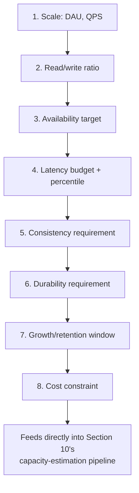

Once gathered, these numbers become the direct inputs to Section 4.9's
three-step capacity-estimation pipeline (traffic, storage, bandwidth),
which in turn identifies the binding constraint dimension that should
receive the design's primary engineering attention — this NFR-to-
capacity-to-design chain is the quantitative bridge from a business
requirement to a concrete architecture decision that this chapter exists
to teach.

## 10. Complete Code Examples

The following worked examples live under
[code/markdown/nfr-chapter/](../code/markdown/nfr-chapter/) as Markdown
artifacts (this chapter's subject matter is a quantitative estimation
methodology, not a runnable software component, so the "code" examples are
fully worked numeric derivations rather than executable source files):

1. [01_url_shortener_capacity_estimation.md](../code/markdown/nfr-chapter/01_url_shortener_capacity_estimation.md) —
   a read-heavy system (100:1 read:write ratio) where the three-step
   pipeline (Section 4.9) reveals read QPS, not storage or bandwidth, as
   the binding constraint, driving a caching-tier design decision.
2. [02_twitter_like_feed_capacity_estimation.md](../code/markdown/nfr-chapter/02_twitter_like_feed_capacity_estimation.md) —
   a fan-out-heavy system where naive post-count QPS badly understates the
   true write-amplification bottleneck once follower fan-out is modeled,
   and where media storage dominates text storage by roughly two orders of
   magnitude.
3. [03_chat_messaging_capacity_estimation.md](../code/markdown/nfr-chapter/03_chat_messaging_capacity_estimation.md) —
   a persistent-connection system where **concurrent connection count**,
   not QPS, is the first capacity dimension to estimate, forcing a
   sharded connection-gateway architecture.
4. [04_video_streaming_capacity_estimation.md](../code/markdown/nfr-chapter/04_video_streaming_capacity_estimation.md) —
   a bandwidth-bound system (3+ Tbps peak delivered bandwidth) where the
   data-plane (video bytes) and control-plane (session/heartbeat QPS)
   capacity questions must be estimated and sized separately.

Each example follows the identical three-step methodology from Section
4.9 (traffic, then storage, then bandwidth), deliberately, so the pattern
itself — not a memorized number for any one system — is the transferable
skill.

## 11. Performance

Performance-tuning work should always be scoped to the percentile that
actually matters for the system's purpose (Section 4.4) — chasing a
better p50 on a system whose real business risk lives in its p99 tail is
wasted engineering effort. The single highest-leverage performance lever
available to most systems is reducing the number of sequential network
hops on the critical path (recapped from
[Reverse Proxy's](../05_Networking_and_OS/CH11_Reverse_Proxy.md) routing
and
[Caching's](../06_Databases_and_Storage/CH09_Caching.md) read-path
short-circuiting), since each additional synchronous hop adds its own
latency distribution to the compounding end-to-end percentile, and a tail
event at any single hop can dominate the whole request's tail.

## 12. Scalability

Scalability work should be driven directly by Section 4.9's identified
binding constraint, not by generic best practice applied uniformly: a
read-QPS-bound system scales primarily via caching and read replicas; a
storage-bound system scales primarily via partitioning/sharding and
tiering; a connection-bound real-time system scales primarily via
gateway-tier sharding by connection; a fan-out-bound system scales
primarily by bounding or batching amplification (for example, treating
very-high-follower-count accounts differently, as Section 10's Example 2
does). Applying the wrong scaling lever to the wrong bottleneck is a
common, expensive mistake — adding application-tier replicas does nothing
for a system whose actual constraint is a single-writer database.

## 13. Security

At the production-architecture level (extending Section 4.6's brief
framing), the security-relevant NFR decisions an architect makes before
Part 13's deep mechanics are even invoked include: what data classification
requires encryption at rest and in transit by default (recapped from
[TLS](../05_Networking_and_OS/CH06_TLS.md)), what the acceptable
authentication/authorization latency budget is (an NFR trade-off between
security and Section 4.4's latency target), and what redundancy/isolation
boundary a security incident in one tenant or one service must not be
allowed to cross (a design constraint that interacts directly with
Section 7's redundancy patterns). Full authentication mechanics, RBAC/ABAC
authorization models, Zero Trust network architecture, and the OWASP Top
10 vulnerability taxonomy are recapped-and-linked here only in outline, and
are owned entirely by the future Part 13 — Security, which this chapter
explicitly does not attempt to substitute for.

## 14. Observability

An NFR that cannot be observed cannot be claimed to be met (Section 5's
closing point). The minimum observability surface any production system
needs to validate its stated NFRs is: a latency histogram per critical
endpoint (feeding the p50/p95/p99 percentiles Section 4.4 defined), a
success/error ratio per endpoint (feeding the availability SLI of Section
4.1), a replication-lag and replica-health signal (feeding durability and
reliability confidence), and a cost-per-request or cost-per-unit-traffic
metric (closing the loop back to Section 4.7). This chapter establishes
*what* must be measured and *why* (the SLA/SLO/SLI vocabulary of Section
4.1); the future Part 12 — Observability (its dedicated SLO and SLI
chapters specifically) owns the deeper mechanics of how that measurement
pipeline is built, alerted on, and operated — this section should be
recapped, not re-derived, once those chapters exist.

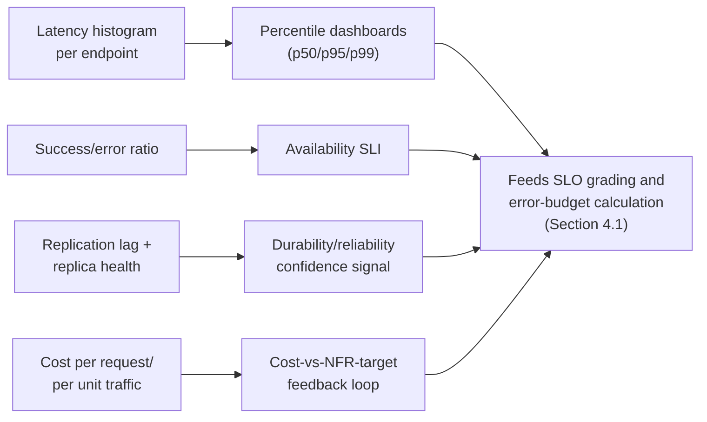

## 15. Failure Scenarios

- **Cascading failure from an unbounded retry storm.** A downstream
  dependency slows down; every upstream caller retries aggressively
  without backoff, multiplying load on the already-struggling dependency
  and turning a partial slowdown into a full outage — a reliability
  failure (Section 4.2) that also destroys the availability SLO (Section
  4.1) for the entire request chain, not just the originally slow
  component.
- **Thundering herd on cache expiry.** A hot cache key expires and
  thousands of concurrent requests simultaneously miss the cache and hit
  the datastore at once, spiking load far beyond the datastore's normal
  provisioned capacity — a direct consequence of not modeling this
  specific concurrency pattern during Section 4.9's capacity estimation.
- **Silent durability loss from an unflushed write buffer.** As Section
  4.5's failure mode described, an acknowledgment sent before data is
  actually forced to durable storage creates a durability gap invisible
  to every availability metric, surfaced only when a crash exposes it.
- **Split-brain during a network partition.** Two halves of a partitioned
  cluster each believe they are the authoritative leader and accept
  conflicting writes — the concrete, damaging failure mode that motivates
  Section 4.8's consistency-vs-availability trade-off and the future
  [Leader Election](CH08_Leader_Election.md) and
  [Consensus](CH07_Consensus.md) chapters' fencing/quorum mechanics.
- **Cost runaway from unbounded auto-scaling.** An elastic system (Section
  4.3) scaling out in response to a traffic spike that is itself caused by
  a bug (an infinite retry loop, a scraping bot) can scale cost
  proportionally with the bug rather than with legitimate demand, unless
  an explicit cost ceiling or rate limit is layered on top of the
  auto-scaling policy.

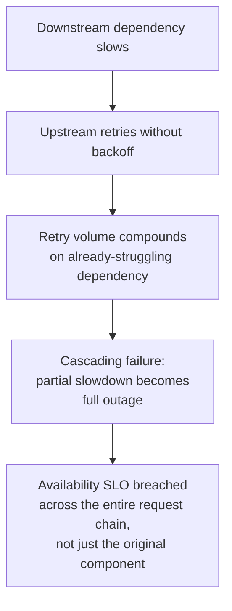

## 16. Testing

NFRs must be tested deliberately, not assumed to hold because the system
"passed" functional tests: load testing validates throughput and latency
percentiles under realistic, concurrent (not sequential) traffic shapes,
matched as closely as possible to the peak-multiplier assumptions used in
Section 4.9's capacity estimate; chaos testing (recapped from Netflix's
Chaos Monkey lineage, Section 2) deliberately injects the failure modes
Section 15 described, to validate that reliability and availability
mechanisms (failover, retries with backoff, circuit breakers) actually
engage correctly rather than only in theory; and durability testing
deliberately simulates a failure-domain loss (killing a replica, a disk,
an availability zone) and verifies the remaining copies are sufficient and
correctly promoted, rather than trusting the replication topology's design
on paper alone.

## 17. Common Mistakes

- Stating NFR targets as adjectives ("fast," "highly available") instead
  of numbers with an explicit measurement window (Section 6).
- Optimizing average latency while never checking p95/p99, silently
  shipping a regression that only the tail experiences (Section 4.4).
- Skipping the capacity-estimation pipeline entirely and choosing an
  architecture by familiarity or fashion rather than by measured
  bottleneck (Section 4.9's first failure mode).
- Modeling raw request count without modeling fan-out/replication
  amplification, understating the true bottleneck by an order of
  magnitude or more (Section 4.9's second failure mode, Section 10's
  Example 2).
- Storing large media/binary payloads inline in the primary operational
  datastore instead of routing them to object storage and a CDN (Section
  10's Example 2 anti-pattern).
- Treating security as an afterthought bolted on after every other NFR
  target has already been set (Section 4.6's failure mode).
- Choosing an availability target without pricing its cost consequence,
  then being surprised by the resulting infrastructure bill (Section 4.7).
- Confusing availability with reliability — assuming a system that
  "responds" is therefore correct, when it may be silently returning
  wrong or stale data (Section 4.2).

## 18. Best Practices

- Gather NFRs explicitly and first, before any component diagram, using
  the checklist in Section 9.
- Express every target as a number, a measurement window, and its
  accepted trade-off, recorded as an ADR.
- Run all three steps of Section 4.9's capacity-estimation pipeline
  (traffic, storage, bandwidth) before committing to an architecture, and
  identify the binding constraint dimension explicitly.
- Report latency as percentiles (p50/p95/p99 at minimum), never only as
  an average.
- Attach a cost estimate to every proposed availability, durability, or
  redundancy target.
- Instrument the SLIs a target depends on before claiming the target is
  met (Section 14).
- Revisit NFR targets periodically as scale and business context change
  — a startup's appropriate 99.9% target is not necessarily the
  appropriate target once the same system serves ten times the users
  three years later.

## 19. Anti-Patterns

- **"Five nines by default."** Setting an aggressive availability target
  as a default posture without pricing its cost or confirming the business
  actually needs it (Section 4.7's failure mode).
- **Average-only latency dashboards.** Reporting and alerting purely on
  average latency, structurally blind to the tail that Section 4.4
  explains actually drives user pain at scale.
- **Architecture-by-fashion.** Selecting a message queue, a particular
  NoSQL database, or a microservices decomposition because it is
  currently popular, without having run the capacity-estimation exercise
  that would justify (or rule out) that choice for this specific system's
  actual bottleneck.
- **Security-as-checklist-at-the-end.** Treating Section 4.6's brief
  entry-point framing as license to defer all security thinking to a
  late-stage review, rather than gathering it as a co-equal NFR from the
  start.
- **Implicit, uncoordinated per-component trade-offs.** Section 4.8's
  shopping-cart/inventory mismatch scenario — different parts of the same
  system independently resolving the consistency-vs-availability tension
  differently, with no explicit, system-level decision reconciling them.

## 20. Trade-off Analysis

| Trade-off | Favoring Side A | Favoring Side B | Typical resolution |
|---|---|---|---|
| Consistency vs. Availability | Strong consistency (never a stale/wrong answer) | Availability (always answer, possibly stale) | Depends per-subsystem — financial balances favor A, product catalogs favor B (Section 4.8) |
| Latency vs. Throughput | Low per-request latency | High aggregate throughput via batching | User-facing synchronous paths favor A; batch/analytics pipelines favor B |
| Cost vs. Redundancy | Minimize spend | Maximize availability/durability | Priced explicitly per Section 4.7, resolved against actual business impact of an outage |
| Durability vs. Write Latency | Synchronous replication (safer, slower writes) | Asynchronous replication (faster writes, small loss window) | Financial/ledger systems favor A; high-throughput analytics ingestion often favors B |
| Security vs. Usability/Latency | Stronger controls, more friction | Fewer controls, faster/simpler UX | Regulated/sensitive data favors A; low-risk, high-conversion-sensitive flows lean toward balancing B without abandoning baseline controls |

## 21. Comparison Table

| Attribute | Primary question it answers | Typical unit of measure | Primary lever to improve it |
|---|---|---|---|
| Availability | Is the system up and responding right now? | % uptime ("nines") over a window | Redundancy + automatic failover |
| Reliability | Is the system's behavior correct over time? | MTBF / MTTR | Redundancy + automated detection/recovery |
| Scalability | Can it handle more load by adding resources? | Max sustainable QPS/throughput at a given cost | Horizontal partitioning, statelessness |
| Elasticity | How fast does capacity track demand automatically? | Scale-out/scale-in time | Auto-scaling policies |
| Latency | How long does one operation take? | Milliseconds, at p50/p95/p99 | Fewer sequential hops, caching, proximity |
| Throughput | How many operations complete per unit time? | Requests/sec, QPS | Batching, horizontal scale-out |
| Durability | Will committed data survive over time? | Annual loss probability ("nines") | Replication across independent failure domains, WAL/`fsync` |
| Security (framing only) | Is data/functionality protected from unauthorized access? | Owned in depth by Part 13 | Owned in depth by Part 13 |
| Cost | What does achieving the above actually cost? | $/unit traffic, $/month | Right-sizing every other lever to the actual target, not beyond it |

## 22. Real-World Case Study

In October 2018, GitHub experienced a 24-hour-plus incident triggered by a
brief network partition between its primary and secondary MySQL database
clusters (recapped from
[Replication's](../06_Databases_and_Storage/CH07_Replication.md) real-world
case study, which covers the failover-mechanics detail; this chapter's
lens is the NFR framing, not the replication mechanics). The partition
caused an automated failover system, per its own consistency-preferring
design, to promote a secondary cluster in one facility while write traffic
from application servers continued flowing toward the original primary in
another — precisely the split-brain failure scenario Section 15
describes. The organization's stated availability SLA was directly
breached for over a day, but the deeper NFR lesson is in the *trade-off*
GitHub made explicitly afterward: rather than simply reducing failover
automation speed, GitHub's public postmortem described re-examining the
specific consistency-versus-availability trade-off (Section 4.8) their
orchestration tooling had encoded, tightening the conditions under which
an automatic failover was permitted to proceed without human confirmation,
accepting a longer manual-verification window (a reliability/MTTR cost) in
exchange for eliminating an entire class of automated split-brain risk (a
durability and consistency gain) — a textbook instance of consciously
re-drawing an NFR trade-off line after a production incident revealed the
old line was in the wrong place, rather than treating the incident as a
one-off bug to patch.

## 23. Interview Questions

1. Explain the difference between availability and reliability with a
   concrete example where a system could satisfy one and clearly violate
   the other.
2. Walk through the SLA/SLO/SLI relationship and explain why an internal
   SLO is typically set tighter than the external SLA.
3. Why is reporting only average latency dangerous for a user-facing
   system? What would you report instead, and why?
4. Derive, using Little's Law, why increasing throughput without adding
   capacity necessarily increases either concurrency or latency.
5. Distinguish scalability from elasticity with an example of a system
   that is one but not the other.
6. How would you estimate the peak QPS for a system given only its Daily
   Active User count and an assumed per-user daily action count? What
   additional factor is essential and why?
7. Explain why durability and availability must be reasoned about
   separately, with an example where a system is durable but briefly
   unavailable, and vice versa.
8. Walk through a scenario where the consistency-vs-availability trade-off
   would reasonably be resolved differently for two different subsystems
   within the same overall product.
9. Why does cost belong in the same conversation as availability and
   latency, rather than being treated as an implementation detail decided
   afterward?
10. What questions would you ask in the first five minutes of a
    system-design interview, and why does the order in which you ask them
    matter?

## 24. Hands-on Exercises

1. Pick a real product you use daily. Estimate its DAU, derive average and
   peak QPS using an assumed peak multiplier, and justify your chosen
   multiplier.
2. For the same product, estimate 5-year storage growth including a
   replication factor, and identify whether storage or bandwidth is more
   likely to be the binding constraint.
3. Write an SLO statement (target, measurement window, and error budget
   in absolute minutes) for a service you operate or have used, and
   justify the specific number chosen against a plausible business impact.
4. Take one of the four worked examples in Section 10 and re-derive its
   numbers under a different assumption (for example, double the DAU or
   halve the peak multiplier), and explain how the resulting bottleneck
   dimension changes or stays the same.

## 25. Design Exercises

1. Design the NFR targets (not the full architecture) for a hospital
   patient-monitoring alert system, explicitly ranking availability,
   latency, and durability against each other and justifying the ranking
   against real patient-safety consequences.
2. Given a hypothetical 10x traffic increase over the next 12 months for
   an existing e-commerce checkout service, produce an updated
   capacity-estimation pipeline (traffic, storage, bandwidth) and identify
   which NFR target (if any) should change as a result.
3. Design the consistency-vs-availability trade-off resolution (Section
   4.8) for three subsystems of a single ride-sharing app: driver-location
   updates, fare calculation, and trip-history records — justify why each
   subsystem may reasonably land on a different point of the trade-off
   spectrum.

## 26. Architecture Review Questions

1. For every NFR target claimed in this design, is there a corresponding
   instrumented SLI proving it is actually being met (Section 14)?
2. Is every availability/durability/redundancy target accompanied by an
   explicit cost figure (Section 4.7)?
3. Does the capacity-estimation pipeline (Section 4.9) account for
   fan-out/amplification, not just raw request count (Section 10, Example
   2)?
4. Is latency reported and alerted on at p95/p99, not only as an average
   (Section 4.4)?
5. For every consistency-vs-availability decision embedded in this design,
   is it written down and deliberate (an ADR), or implicit and
   accidental (Section 4.8's failure mode)?
6. Has security been gathered as a co-equal NFR from the start, rather
   than deferred to a late-stage checklist (Section 4.6/19)?

## 27. Summary

Non-Functional Requirements are the vocabulary an architect uses to make
"how good is good enough" an explicit, numeric, and negotiable decision
rather than an unstated assumption discovered only in production.
Availability is measured through the SLA/SLO/SLI framework and expressed
in nines; reliability is distinct from availability and concerns whether
the system's behavior is *correct*, not merely *responsive*; scalability
describes a system's ceiling while elasticity describes how automatically
it tracks demand within that ceiling; latency must be reported as
percentiles, not averages, and trades directly against throughput through
Little's Law; durability is a probability of data survival, compounding
multiplicatively across independent replicas; security earns a place in
this list as a genuine trade-off partner even though its deep mechanics
belong to the future Part 13; and cost is the quantifiable price tag every
other target carries, never an afterthought. Back-of-the-envelope capacity
estimation — traffic, then storage, then bandwidth — is the quantitative
bridge that turns these abstract quality attributes into a concrete,
defensible architecture decision, and correctly identifying the binding
constraint dimension is the single highest-leverage output of that
exercise. The Distributed Systems subsection that follows in this same
part — CAP Theorem, PACELC, Consensus, Leader Election, Gossip Protocols,
Replication, Partitioning, Distributed Transactions, Saga Pattern, CQRS,
Event Sourcing, Idempotency, Exactly-Once Processing, Ordering Guarantees,
and Deduplication — will each return to one or more of the trade-offs
introduced here and teach the specific distributed-systems mechanism that
implements or resolves it in full.
