# Chapter: High-Level Design (HLD)

Part: [07 — System Design and Distributed Systems](PART_OVERVIEW.md) · Status: Drafted

## 1. Introduction

High-Level Design (HLD) is the discipline of producing an architecture-level
blueprint of a system — its major components, their responsibilities, the
data that flows between them, and the technology choices that satisfy the
system's requirements — before a single line of implementation code is
written. It is the bridge between "what the system must do" (Functional
Requirements, taught in this book's
[Functional Requirements](CH01_Functional_Requirements.md)) and "how well it
must do it" (Non-Functional Requirements, taught in
[Non-Functional Requirements](CH02_Non_Functional_Requirements.md)) on one
side, and Low-Level Design (LLD) — the object/class/module-level design
covered in a later chapter of this part — on the other. HLD answers
questions such as: what are the moving pieces of this system, and where are
their boundaries? What does each piece own, and what does it explicitly not
own? How does data move between them, and where is it stored? What contract
does each piece expose to the others? Where will this design break first
under load, and what happens when a dependency fails?

This chapter teaches HLD as both a set of notations (the C4 model and the
subset of the Unified Modeling Language (UML) that HLD conventionally uses)
and a repeatable workflow (a sequence of concrete steps that takes a set of
requirements and produces a defensible architecture-level blueprint). Both
halves matter: a beautiful diagram produced without a disciplined workflow
behind it is decoration, and a disciplined workflow that never produces a
communicable artifact fails the moment it needs to survive a design review,
onboard a new engineer, or outlive the person who designed it. The chapter
assumes the reader has already internalized this book's foundational
architecture vocabulary — the distinction between architecture, design, and
code, and concepts like coupling/cohesion and Architecturally Significant
Requirements (ASRs), both owned by
[What is Software Architecture?](../01_Architecture_Mindset/CH01_What_is_Software_Architecture.md)
— and builds the HLD-specific layer on top of that foundation.

A short scope note up front, because this chapter sits at a natural seam
with two other parts of the book. The C4 model and the UML diagram types
this chapter teaches (deployment, component, sequence) are, per this book's
concept-ownership registry, ultimately destined to have their own dedicated,
notation-focused chapters in the not-yet-drafted Part 18 — Architecture
Documentation. Because those chapters do not exist yet, this chapter takes
first ownership of teaching C4 and the relevant UML diagram types *as they
are applied inside the HLD workflow* — reading and drawing them correctly,
choosing the right diagram for the right question, and using them as
thinking tools, not just as final artifacts. When Part 18 is eventually
drafted, it is expected to absorb the deeper notation-only mechanics (for
example, the full UML specification's exhaustive diagram catalog, or
Structurizr-specific tooling internals) while this chapter's C4/UML content
narrows to a recap and link, per the reconciliation note in this chapter's
concept-proposal staging file. Architecture Decision Records (ADRs), by
contrast, already have a full owning chapter —
[Architecture Thinking](../01_Architecture_Mindset/CH03_Architecture_Thinking.md)
Section 10 — so this chapter recaps ADRs rather than re-teaching them, using
them only in the narrow role of "the artifact that records why an HLD
decision was made."

## 2. Historical Evolution

- **Structured design and the Big Design Up Front (BDUF) era
  (1970s-1980s)** — early software engineering, following Royce's 1970
  waterfall description and structured-design methodologies (Yourdon,
  Constantine), treated system design as a single, largely complete,
  up-front phase using data-flow diagrams and structure charts, produced
  entirely before coding began.
- **The UML unification (mid-to-late 1990s)** — Grady Booch, James
  Rumbaugh, and Ivar Jacobson merged their competing object-oriented
  notations (Booch, OMT, and OOSE) into the Unified Modeling Language,
  standardized by the Object Management Group (OMG) in 1997. UML became the
  dominant vocabulary for both high-level and low-level design diagrams for
  roughly two decades, including the deployment, component, and sequence
  diagram types this chapter teaches.
- **UML's diagram-catalog sprawl and the Rational Unified Process (RUP)
  critique (2000s)** — UML 2.0 (2005) grew to 13 diagram types. In practice,
  most teams used only a handful (class, sequence, component, deployment)
  and abandoned the rest; heavyweight Rational-Rose-style round-trip
  modeling tools fell out of favor as agile methods prioritized working
  software over comprehensive documentation.
- **Agile's lightweight-architecture backlash (2001-2010)** — the Agile
  Manifesto's preference for "working software over comprehensive
  documentation" led many teams to drop architecture diagrams almost
  entirely, producing a documentation gap: systems with no artifact anyone
  could use to onboard a new engineer or reason about a cross-service
  incident.
- **The C4 model (Simon Brown, ~2011)** — created explicitly to fill that
  gap with a notation lightweight enough for agile teams to actually
  maintain: four hierarchical zoom levels (Context, Containers, Components,
  Code), each answering a different audience's question, deliberately
  smaller in vocabulary than full UML.
- **Diagram-as-code tooling (2015-present)** — PlantUML, Structurizr
  (Simon Brown's own tool, purpose-built for C4), and later Mermaid (this
  book's diagramming standard, per [STYLE_GUIDE.md](../STYLE_GUIDE.md))
  turned architecture diagrams from static images maintained by hand into
  version-controlled text that renders as a diagram — letting a diagram
  live in the same pull request as the code change it describes, and be
  reviewed with the same rigor.
- **Microservices-era HLD (2015-present)** — as systems decomposed into many
  independently deployable services, the HLD workflow's emphasis shifted
  from "one big diagram of everything" toward "a Context diagram of the
  whole system plus a Container diagram per bounded area," because a single
  diagram with hundreds of services stops being readable — a direct
  motivation for the C4 model's explicit multi-level structure.

## 3. Why It Exists

HLD exists because the cost of changing a decision rises sharply the later
it is discovered, and because a system's major structural decisions —
which pieces exist, how they talk to each other, where data lives — are
disproportionately expensive to reverse once code, infrastructure, and team
boundaries have grown around them. Committing to those decisions on a
whiteboard or in a diagram-as-code file costs an afternoon of discussion;
discovering the same decision was wrong after eighteen months of production
traffic costs a migration project. HLD is the deliberate practice of making
those structural decisions visible and reviewable *before* that cost curve
steepens.

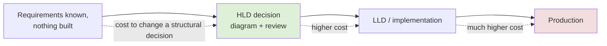

Beyond cost curves, HLD exists to serve three concrete purposes that no
individual line of code can serve on its own:

1. **A shared mental model across a team.** Without an explicit diagram and
   an explicit statement of each component's boundary, every engineer on a
   team carries a slightly different private mental model of the system —
   and those private models silently diverge the moment two engineers make
   incompatible assumptions about who owns what.
2. **A forcing function for surfacing unknowns.** The act of drawing a data
   flow from one component to another, and asking "what happens if this
   arrow fails," routinely surfaces single points of failure and unhandled
   edge cases that remain invisible until someone is forced to draw the
   arrow explicitly.
3. **A durable artifact that outlives any one person's memory.** Code shows
   *what* a system does; it rarely shows *why* it is shaped the way it is.
   HLD diagrams, paired with the Architecture Decision Records recapped in
   Section 4.14, are the artifact a new engineer — or the original
   architect eighteen months later — can consult to reconstruct both the
   shape and the reasoning behind it.

## 4. Core Concepts

### 4.0 Prerequisites recap: Functional and Non-Functional Requirements as HLD inputs

HLD does not start from a blank page. It consumes two inputs this book
teaches as their own dedicated chapters in this same part:
[Functional Requirements](CH01_Functional_Requirements.md) (what the system
must do — the capabilities, user-facing behaviors, and business rules an
HLD's components must collectively implement) and
[Non-Functional Requirements](CH02_Non_Functional_Requirements.md) (how well
it must do it — availability, reliability, scalability, latency, throughput,
durability, security, and cost targets that shape *which* architecture
satisfies the functional requirements acceptably). This chapter recaps them
only to the depth needed to show where they feed the HLD workflow (Sections
4.9-4.13): functional requirements drive component identification and
boundary definition, and non-functional requirements drive storage choice,
bottleneck analysis, and the trade-offs recorded in Architecture Decision
Records. A reader should treat those two chapters' full content as a given
here rather than expect this chapter to re-derive requirement-gathering
technique.

### 4.1 The C4 Model — Level 1: System Context

**Definition.** The System Context diagram is the outermost, coarsest C4
level: it shows the system being designed as a single box, the people who
use it, and the other systems it depends on or is depended on by — with
zero internal structure shown.

**Mechanism.** A Context diagram has exactly three kinds of elements:
people (actors, drawn as a person icon or simple box), the system in
question (one box, regardless of how many services actually implement it),
and external systems (other boxes the system integrates with, owned and
operated outside this design). Relationships are drawn as simple, labeled
arrows describing the nature of the interaction in plain language ("Places
orders using," "Sends email via"), not as any kind of protocol detail.

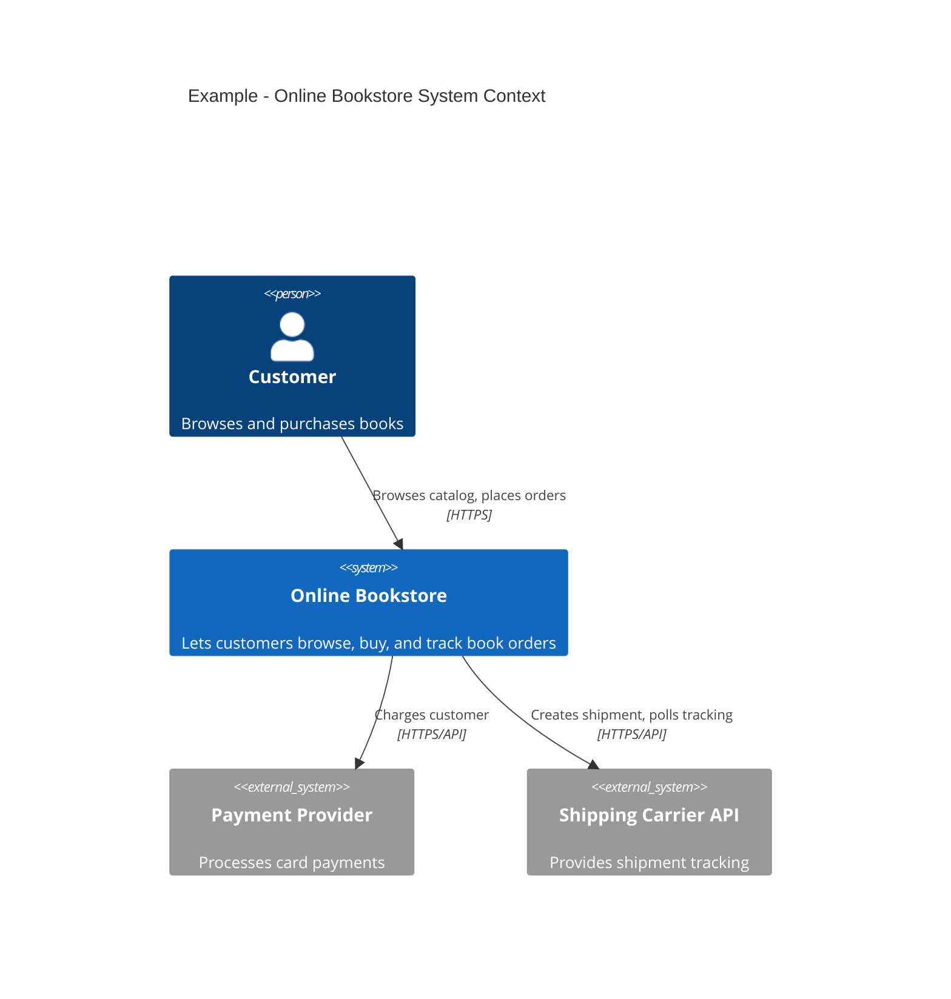

**Decision implications.** A Context diagram is the correct artifact when
the audience is non-technical stakeholders, a new team member on day one,
or an architecture review board scoping what is and is not in the system's
boundary. It intentionally omits technology choices and internal structure
because those details would obscure the one question this level exists to
answer: *what is this system, and who/what does it talk to?*

**Common failure mode.** Drawing internal services on a Context diagram
("the API service," "the database") defeats its purpose — it stops being
a one-glance system-boundary summary and becomes an unreadable hybrid of two
different zoom levels. If a reviewer feels the need to add internal boxes to
a Context diagram, that need is a signal to draw a separate Container
diagram (Section 4.2) instead, not to keep piling detail into this one.

**Scenario.** A new engineer joins the online bookstore team. Before
touching any code, they are handed the Context diagram above. In thirty
seconds they know the system integrates with an external payment provider
and an external shipping carrier, and that customers are the only human
actor — enough to ask informed questions in their first design discussion
without having read a single file of source code.

### 4.2 The C4 Model — Level 2: Containers

**Definition.** The Container diagram zooms into the single box from the
Context diagram and shows the separately deployable/runnable units that
together implement the system — web applications, Application Programming
Interface (API) services, databases, message brokers, mobile apps — each
one a "container" in C4's sense (an independently deployable/runnable
process or datastore, unrelated to the OS/Docker meaning of "container").

**Mechanism.** Each box on a Container diagram states three things: its
name, its technology choice (for example, "Spring Boot," "PostgreSQL,"
"Kafka"), and a one-line responsibility. Arrows between containers are
labeled with both the nature of the interaction and, where useful, the
protocol (for example, "Reads/writes, JDBC" or "Publishes events, Kafka").

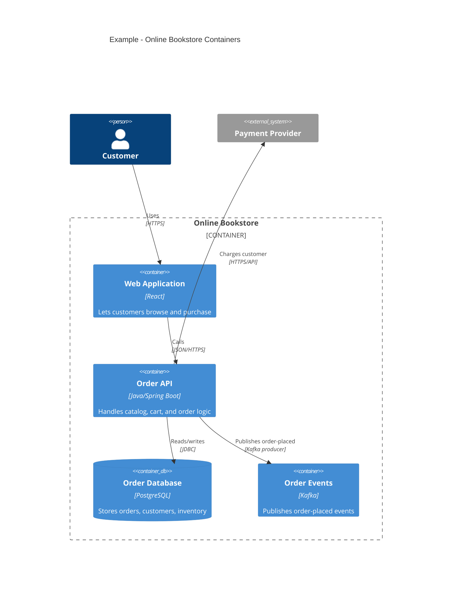

**Decision implications.** The Container diagram is where the first real
architectural decisions become visible: how many separately deployable
services exist, what each one is built with, and how they communicate
(synchronous request/response versus asynchronous events). It is the
primary artifact for a design review with the engineering team building the
system, because it is detailed enough to argue about ("should the Order API
own inventory, or should that be a separate service?") without descending
to class-level detail no reviewer needs yet.

**Common failure mode.** Letting a Container diagram grow to represent an
entire microservices estate of fifty services in one picture. Past roughly
a dozen containers, the diagram stops being legible; the correct response
(matching the historical note in Section 2 about microservices-era HLD) is
to draw one Container diagram per bounded, cohesive subsystem and let the
Context diagram be the single picture that shows how those subsystems relate
to each other and the outside world.

**Scenario.** During a design review, an architect proposes combining the
Order API and a planned Inventory Service into a single container to reduce
operational overhead. Because the Container diagram makes the proposed
merge's blast radius visible immediately — one runtime failure now
threatens both order-placement and inventory-availability code paths — a
reviewer flags the coupling risk in the same meeting, before any code
exists.

### 4.3 The C4 Model — Level 3: Components

**Definition.** The Component diagram zooms into a single container from
the previous level and shows the major logical groupings of code inside
it — controllers, services, repositories, or similarly named units,
depending on the codebase's own vocabulary — and how they collaborate to
implement that container's responsibility.

**Mechanism.** Component diagrams stay at the level of "logical grouping of
related code," not individual classes; a component might correspond to a
single class, a package, or a small cluster of related classes, chosen
based on what groupings are actually meaningful for a reader trying to
understand this one container's internal structure.

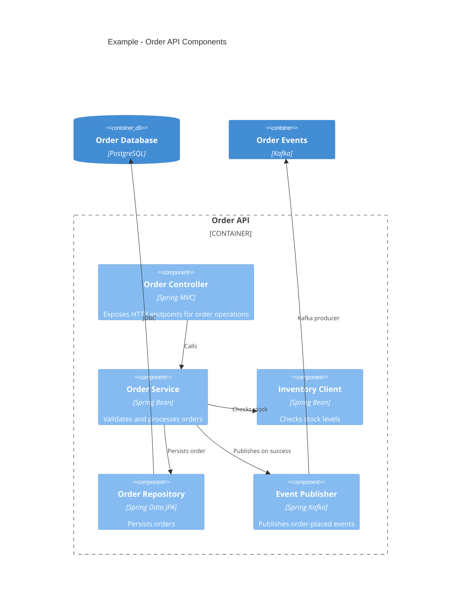

**Decision implications.** This level exists for the team that owns and
will actually implement this one container. It is the right artifact for
handing off to the engineers who will write the Order API's code, and the
right input to a Low-Level Design session (this part's future LLD chapter)
where those components become concrete classes and interfaces.

**Common failure mode.** Producing Component diagrams for every container in
a system up front, before any team is close to implementing them. C4's own
guidance, echoed by most practitioners, is that Component diagrams are the
level most likely to go stale fastest, because internal code structure
changes far more often than container or context boundaries — so they are
usually generated closer to (or even after) implementation, not drawn
speculatively months in advance.

**Scenario.** The team implementing the Order API uses the Component diagram
above as the starting skeleton for their first sprint's class layout,
translating "Inventory Client" and "Event Publisher" directly into concrete
interfaces before writing any business logic — the diagram becomes the
seed for the LLD, not a document filed away and forgotten.

### 4.4 The C4 Model — Level 4: Code

**Definition.** The Code diagram is C4's innermost level: a traditional
UML class diagram (or equivalent) showing the actual classes, interfaces,
and their relationships inside a single component.

**Mechanism.** Unlike the three levels above it, C4's own creator explicitly
recommends this level be *generated from the code itself* using IDE or
static-analysis tooling, rather than hand-drawn, precisely because
hand-maintained class diagrams drift out of sync with the code within
weeks.

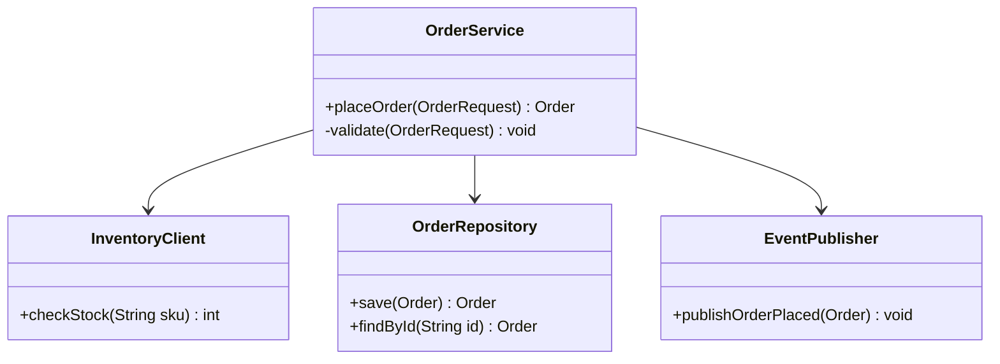

**Decision implications.** Most teams practicing HLD do not draw this level
at all in their design documentation; it is included in the C4 model for
completeness and for the rare case (a particularly intricate algorithm, a
tricky class hierarchy) where a hand-drawn or generated class diagram
genuinely helps communicate a design decision at implementation time. Full
class-diagram notation and its use inside Low-Level Design is this part's
future LLD chapter's responsibility, not this HLD chapter's — HLD stops at
the boundary between "components and their responsibilities" (Level 3) and
"which classes implement each component" (Level 4).

**Common failure mode.** Treating Level 4 as mandatory for every HLD
deliverable. Doing so both wastes effort (as explained above, this level
rots fastest and is best auto-generated) and blurs the HLD/LLD boundary this
book deliberately keeps distinct.

**Scenario.** An architect reviewing a proposed design asks to see "the
class diagram" for a particularly complex piece of state-machine logic
inside the Order Service. The team generates one from the actual code using
their IDE's UML export feature for that one review, rather than maintaining
a hand-drawn Level 4 diagram for the whole system on an ongoing basis.

### 4.5 Distinguishing C4 Components from UML Components

A subtlety that trips up practitioners moving between the two notations:
C4's "Component" (Section 4.3) and UML's "Component" (used in a UML
Component diagram) are not the same concept, despite the shared name. A C4
component is a logical grouping of related code inside one container,
described informally with a name, a technology, and a responsibility. A UML
component, in the strict UML 2.x specification, is a more formal
architectural unit with explicit provided/required interfaces, typically
used to describe reusable, replaceable software units at a coarser grain
than C4's containers. In practice, most HLD work in industry uses C4's
lighter-weight component notion rather than strict UML component notation,
and this book follows that convention — the UML diagram types this chapter
actually teaches for HLD (Section 4.6) are deployment and sequence
diagrams, where UML's notation remains the de facto standard even among
teams that otherwise use C4 for context/container/component-level thinking.

### 4.6 UML in HLD — Deployment Diagrams

**Definition.** A UML deployment diagram shows the physical or virtual
infrastructure a system runs on — nodes (servers, availability zones,
regions, managed-service instances) and the artifacts (containers, in the
C4 sense, or processes) deployed onto each node — and the network paths
between nodes.

**Mechanism.** Nodes are drawn as boxes (conventionally 3D "box" icons in
strict UML, though flowchart-style boxes/subgraphs are common and acceptable
in day-to-day practice, including throughout this book), nested to show
containment (a region contains availability zones, which contain server
nodes), with artifacts placed inside the node that hosts them and
connectors showing network communication paths.

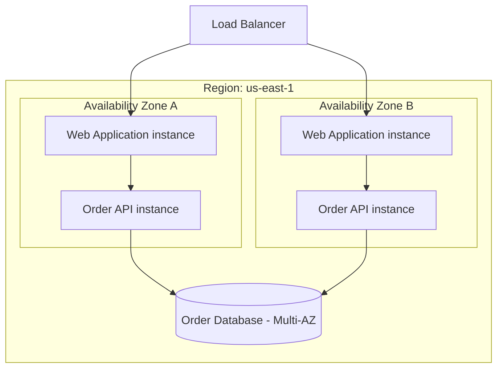

**Decision implications.** A deployment diagram is the artifact that makes
availability decisions concrete and checkable: it is the diagram a reviewer
uses to verify that a design's claimed resilience (for example, "tolerates
an Availability Zone failure") is actually reflected in where things are
physically placed, rather than taken on faith from prose. It is also the
natural place to show where network/trust boundaries fall, feeding directly
into Section 13's security discussion.

**Common failure mode.** Producing a Container diagram (Section 4.2) and
calling it a deployment diagram, or vice versa. A Container diagram answers
"what are the runnable pieces and how do they talk to each other logically";
a deployment diagram answers "where, physically, does each piece actually
run, and what does that placement imply about failure independence." A
system can have one Container diagram and several different deployment
diagrams (for example, one per environment: staging, production-single-
region, production-multi-region).

**Scenario.** During an architecture review, a proposed design's prose claims
"the system tolerates a single Availability Zone outage." The deployment
diagram reveals that both the Order API instances and the database's
writable primary are placed in the same Availability Zone — the diagram
disproves the prose claim before it reaches production, exactly the kind of
gap Section 15 (Failure Scenarios) later teaches architects to hunt for
deliberately.

### 4.7 UML in HLD — Component Diagrams (recap, contrasted with C4)

**Definition.** A UML component diagram formally documents a component's
provided interfaces (what it exposes to others) and required interfaces
(what it depends on), using the "lollipop" (provided) and "socket"
(required) notation in strict UML, or — as most teams do in practice, and
as this chapter's C4 Component diagrams already demonstrate — simplified
boxes and labeled arrows conveying the same provided/required relationship
without the formal lollipop/socket glyphs.

**Mechanism, decision implications, and failure mode.** Because Section 4.3
already teaches component-level thinking in depth using C4's notation
(which most HLD practice in industry has converged on), this subsection
exists specifically to recap the strict-UML alternative rather than
re-teach component-level modeling twice: the concrete choice between "C4
Component diagram" and "strict UML component diagram" comes down to whether
a team needs the formal interface-contract rigor UML provides (common in
regulated or safety-critical domains, or where a component is genuinely a
swappable, third-party-replaceable unit) versus the lighter-weight,
faster-to-produce informal notation C4 offers for the common case. This
book's own HLD practice, and the worked example in Section 10, uses C4's
Component notation for exactly that reason. Full strict-UML component
notation — the lollipop/socket glyphs and formal interface realization — is
left to Part 18 (Architecture Documentation) once that part exists to teach
UML's complete notation catalog.

### 4.8 UML in HLD — Sequence Diagrams for Cross-Service Flows

**Definition.** A UML sequence diagram shows a set of participants
(services, actors, stores) arranged left-to-right, with time flowing
top-to-bottom, and labeled arrows showing the exact order in which messages
pass between participants for one specific scenario or flow.

**Mechanism.** Solid arrows with filled heads represent synchronous calls
that block waiting for a response; dashed arrows represent responses;
`alt`/`else` blocks represent conditional branches (for example, a cache hit
versus a cache miss); optional activation bars show when a participant is
actively processing versus idle.

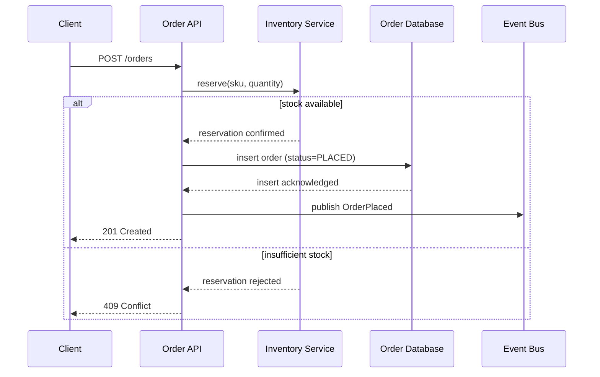

**Decision implications.** Sequence diagrams are the correct HLD artifact
whenever a design decision hinges on *ordering* — which service calls which
other first, whether a call is synchronous or asynchronous, and what
happens on each branch of a failure or conditional path. Context and
Container diagrams show *what exists and how it connects*; sequence diagrams
show *what happens, in what order, for one specific request*. A HLD is
under-specified if it has containers and arrows but no sequence diagram for
its most important or most failure-prone cross-service flow, because the
container diagram alone cannot answer "what happens if the Inventory Service
times out mid-call."

**Common failure mode.** Drawing a sequence diagram for every possible flow
in a large system, producing dozens of near-duplicate diagrams that become
a maintenance burden with little incremental insight. The operational
heuristic most teams apply successfully: draw a sequence diagram for the
system's *critical path* flows (the ones with the tightest latency budgets,
or the ones a Service Level Agreement depends on) and for any flow whose
failure-handling behavior is non-obvious from the container diagram alone;
skip sequence diagrams for straightforward create/read/update/delete
(CRUD) flows that need no special explanation.

**Scenario.** A design review surfaces a disagreement about what happens if
the Inventory Service times out during order placement. Drawing the
sequence diagram forces the team to add an explicit `else` branch (and, in
a follow-up revision, a timeout-specific branch with a compensating action)
that had previously only existed as an unstated assumption in one
engineer's head — precisely the kind of implicit-assumption surfacing
Section 3 described as one of HLD's core purposes.

### 4.9 The HLD Workflow — Component and Service Identification

**Definition.** Component identification is the first workflow step: taking
a set of functional requirements and identifying the coarse-grained pieces
(services, stores, queues) that will collectively implement them, at
Container-diagram granularity, before worrying about internal structure.

**Mechanism.** A reliable, repeatable technique is to extract the verbs and
nouns from the functional requirements (as demonstrated in the worked
example's Step 1) and group related verb/noun pairs into candidate
components — each becoming a candidate box on a first-draft Container
diagram. A second useful lens is to identify natural "seams" where different
parts of the system change for different reasons or at different
rates — user-facing request handling changes far more often than a stable
identifier-generation algorithm, which is itself a signal they belong in
separate components.

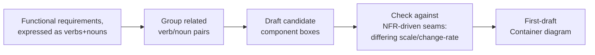

**Decision implications.** Getting this step wrong compounds through every
later step: a component drawn too coarsely (one giant "Backend" box) defers
every real design decision to implementation time, while a component drawn
too finely (a separate service per database table) manufactures needless
network calls and operational overhead before there is any evidence the
split is warranted. The right granularity is the one where each candidate
component has a single, statable reason to exist and a single, statable
reason to change.

**Common failure mode.** "Component identification by org chart" — drawing
boxes that mirror the current team structure rather than the system's
actual natural seams. This inverts Conway's Law (full treatment owned by
[What is Software Architecture?](../01_Architecture_Mindset/CH01_What_is_Software_Architecture.md))
instead of using it deliberately: a team should decide the target
architecture first and then consider whether reorganizing teams to match it
(the Inverse Conway Maneuver) is worthwhile, not let an accidental team
boundary silently dictate a technical boundary that has no independent
justification.

**Scenario.** The worked example in Section 10 walks through exactly this
step for a URL shortener: reading "a user submits a long URL and receives a
short URL" and "visiting the short URL redirects the browser" as two
distinct verb/noun pairs is what motivates splitting a Shortening Service
from a Redirect Service, rather than building one monolithic "Link Service."

### 4.10 The HLD Workflow — Boundary and Responsibility Definition

**Definition.** Once candidate components exist, boundary and
responsibility definition is the step of stating, explicitly and in
writing, what each component owns and — equally important — what it does
*not* own, so that no responsibility silently falls into a gap between two
components or is accidentally claimed by two components at once.

**Mechanism.** The most effective practical tool is a two-column table (as
demonstrated in the worked example's Step 2): for each component, one column
lists what it owns and the other explicitly lists adjacent responsibilities
it deliberately does *not* own, each with a one-line rationale. Writing the
"does not own" column is what catches gaps and overlaps that a "owns" column
alone would miss, because it forces an explicit statement of where a
responsibility landed instead of leaving it implicit.

**Decision implications.** This step directly determines a system's
coupling and cohesion (full concept ownership:
[What is Software Architecture?](../01_Architecture_Mindset/CH01_What_is_Software_Architecture.md)):
a clean boundary keeps each component highly cohesive internally and loosely
coupled to its neighbors, while a fuzzy boundary produces components that
must change in lockstep even though they were drawn as separate boxes — the
worst of both worlds, incurring the operational cost of a distributed system
without the independent-deployability benefit that justified the split.

**Common failure mode.** Two components each assuming the other owns
input validation, error retries, or idempotency handling for a shared
operation, discovered only in production when a malformed request or a
duplicate retry passes silently through the gap between them. Writing the
"does not own" column explicitly during HLD, rather than deferring the
question to implementation time, is the concrete practice that prevents
this.

**Scenario.** During boundary definition for the worked example's Redirect
Service, an engineer initially assumes analytics aggregation belongs to
whichever service handles the redirect. Writing "Analytics Pipeline: does
NOT own anything on the synchronous redirect path" into the table (Step 2)
forces an explicit decision — analytics is asynchronous and decoupled — that
directly protects the redirect path's p99 latency Non-Functional Requirement.

### 4.11 The HLD Workflow — Data Flow and Storage-Choice Mapping

**Definition.** Data-flow and storage-choice mapping is the step of tracing,
for each major operation, exactly which data moves between which
components, and choosing — with an explicit, statable rationale — which
storage technology holds that data at rest.

**Mechanism.** The reliable technique is drawing one sequence diagram per
significant operation (Section 4.8) and, alongside it, asking three storage
questions for any data that needs to persist: what is the read/write ratio,
what consistency guarantee does the operation need (strong versus
eventual), and what access pattern dominates (point lookup by key, range
scan, full-text search, graph traversal)? The answers to those three
questions — not familiarity or default habit — should drive the storage
choice, whether that lands on a relational database, a key-value store, a
cache, or a specialized engine (this book's Databases and Storage part
teaches the full menu of options and their internals in depth).

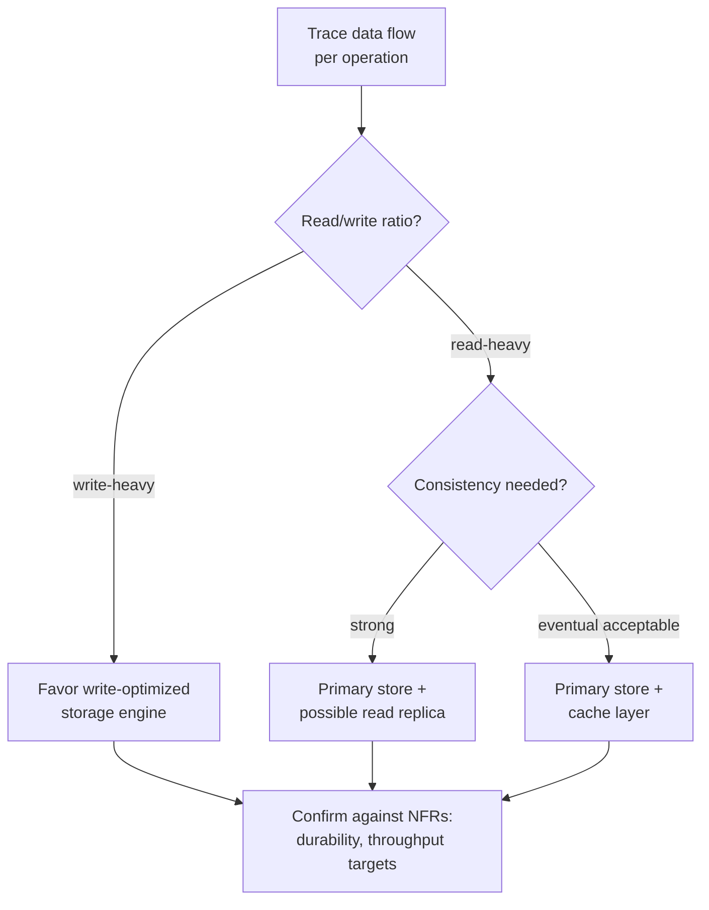

**Decision implications.** Storage choices made at this stage are among the
most expensive to reverse later, because migrating a live system's system
of record to a different storage engine typically requires a
dual-write/backfill/cutover migration under production load — exactly the
kind of "one-way door" decision the Architecture Thinking chapter's
reversibility heuristic (full ownership:
[Architecture Thinking](../01_Architecture_Mindset/CH03_Architecture_Thinking.md))
flags as warranting extra rigor before committing.

**Common failure mode.** Choosing a storage technology based on team
familiarity or organizational default ("we always use PostgreSQL") without
tracing the actual read/write ratio and access pattern first. This produces
systems that later need an emergency cache layer bolted on to compensate
for a storage choice that was never actually validated against the real
workload shape — visible in the worked example, where tracing the 100:1 to
1000:1 read/write ratio is exactly what motivates adding a cache in front of
the key-value store rather than accepting default single-store performance.

**Scenario.** The worked example's Step 3 traces the shorten (write) and
redirect (read) flows separately and discovers their read/write ratio and
latency requirements differ so sharply that a single storage choice cannot
serve both well — directly motivating the cache-plus-key-value-store split
recorded in that step.

### 4.12 The HLD Workflow — API and Contract Definition Between Components

**Definition.** API/contract definition is the step of writing down, in a
form independent of any one component's implementation language, exactly
what each component exposes to its neighbors: the requests it accepts, the
responses and error codes it returns, and — for asynchronous
collaboration — the event shapes and delivery-semantics guarantees
(at-least-once, at-most-once, exactly-once) it makes.

**Mechanism.** Contracts are written down explicitly (as in the worked
example's Step 4) rather than left as an inference from a service's actual
code, because an explicit contract is what lets two components be built by
different teams, tested independently against the contract rather than
against each other's live implementation, and evolved without requiring a
synchronized release across every consumer.

**Decision implications.** The choice between a synchronous request/response
contract (a REST or gRPC call, where the caller blocks for a response) and
an asynchronous event contract (a message published to a queue or topic,
where the caller does not wait) is itself one of the most consequential
decisions HLD makes, because it determines whether a downstream component's
slowness or unavailability propagates immediately as caller-visible latency
or failure (synchronous) or is absorbed and only affects eventual
consistency (asynchronous) — directly shaping the failure-mode analysis in
Section 4.13 and Section 15.

**Common failure mode.** Leaving a contract implicit — "the two teams talked
it over and agreed" with nothing written down — which reliably produces
drift the moment either team makes an independent change, discovered only
by a runtime failure in integration or production rather than by a contract
test or a design review.

**Scenario.** The worked example's internal contract between the Redirect
Service and the Analytics Pipeline explicitly states "at-least-once,
consumer must de-duplicate" — a one-line statement that, because it was
written down during HLD rather than assumed, correctly shapes the Analytics
Pipeline's implementation to treat duplicate click events as an expected,
handled case rather than a surprising production bug.

### 4.13 The HLD Workflow — Bottleneck and Single-Point-of-Failure (SPOF) Identification

**Definition.** Bottleneck and SPOF identification is the step of
deliberately interrogating a draft HLD — every component, every store, every
network hop — with two questions: "what happens to the rest of the system
if this one thing becomes slow?" (bottleneck) and "what happens to the rest
of the system if this one thing disappears entirely?" (SPOF).

**Mechanism.** A practical technique is walking the Container diagram
arrow-by-arrow and box-by-box, and for each one, explicitly writing the
answer to both questions into a table (as demonstrated in the worked
example's Step 5), rather than trusting that failure modes will be "obvious"
from looking at the diagram. Anything with only one instance, one region,
or one unpartitioned resource is a SPOF candidate by definition; anything
whose throughput is bounded by a single node's capacity, rather than
scaling by adding more nodes, is a bottleneck candidate.

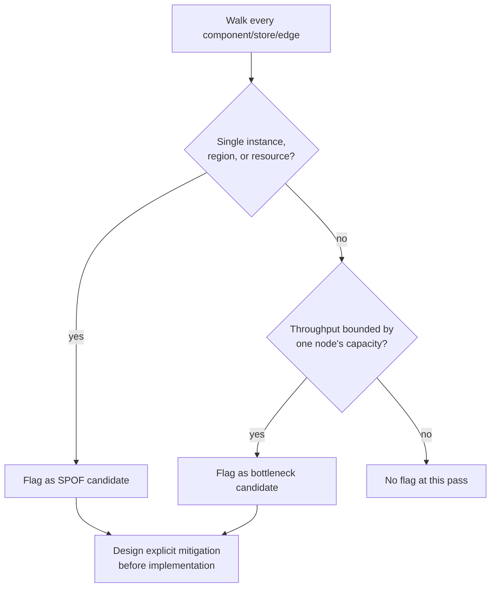

**Decision implications.** This step is where a Non-Functional Requirement
like "tolerates a single data-center failure" gets translated from prose
into a concrete design commitment — for example, multi-region replication —
that a later deployment diagram (Section 4.6) and Section 15 (Failure
Scenarios) can then verify was actually honored. Deferring this analysis to
after implementation means discovering the SPOF during an actual production
incident instead of during a design review, at vastly higher cost per the
cost curve in Section 3.

**Common failure mode.** Treating "we'll add redundancy later if it becomes
a problem" as an acceptable answer during HLD for a component whose
single-instance failure would violate an already-stated availability
requirement. This confuses *premature optimization* (adding redundancy for
a load level the system will never see) with *deferred correctness*
(ignoring a failure mode the requirements already say must not happen) —
the two are not the same decision, and HLD should resolve the second kind
explicitly even when it defers the first kind.

**Scenario.** Walking the worked example's Container diagram surfaces that
a single ID Generator instance is both a SPOF (its failure would make
shortening impossible) and a bottleneck (its single-node write throughput
caps the whole write path); the fix — partitioning ID generation across
multiple instances using a scheme like Snowflake-style IDs — is committed at
HLD time rather than discovered as a production incident after launch.

### 4.14 Communicating HLD to Stakeholders

**Definition.** Communicating an HLD is the deliberate practice of packaging
the diagrams and decisions produced by Sections 4.1-4.13 into artifacts that
different audiences — engineers, architects on a review board, product
stakeholders, on-call responders eighteen months later — can each actually
consume for their own purpose, rather than leaving the design's rationale
locked inside the mind of whoever produced it.

**Mechanism — Architecture Decision Records (recap).** Architecture
Decision Records (ADRs) are the artifact that captures *why* a specific
structural decision was made — the alternatives considered, the trade-offs
weighed, and the decision reached — as a short, permanent, version-controlled
document sitting alongside the diagrams it explains. Their full template,
worked example, and review checklist are owned by
[Architecture Thinking](../01_Architecture_Mindset/CH03_Architecture_Thinking.md)
Section 10; this chapter's role is narrower — showing where an ADR fits into
the HLD workflow (recorded immediately after a Section 4.9-4.13 decision is
reached, before it is forgotten or its rationale becomes folklore) and
demonstrating one in the worked example (Section 10's ADR-002 excerpt on
base62-encoded IDs versus a hashed long URL).

**Mechanism — diagram-as-documentation discipline.** The second half of
communicating HLD is a discipline, not a single artifact: diagrams (C4 and
UML, per Sections 4.1-4.8) are written as text (Mermaid, PlantUML, or
Structurizr's own domain-specific language) and version-controlled in the
same repository as the code and the ADRs they describe, so a diagram change
goes through the same pull-request review as any other change and cannot
silently drift out of sync with the system it claims to describe — the same
diagram-as-code practice this book's own [STYLE_GUIDE.md](../STYLE_GUIDE.md)
follows for every chapter's inline Mermaid diagrams.

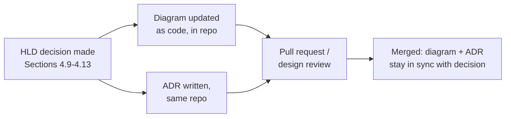

**Decision implications.** Choosing which artifact to show which audience
matters as much as producing the artifacts at all: a Context diagram and a
one-paragraph summary suit a product stakeholder; a Container diagram plus
the relevant sequence diagrams and ADRs suit an architecture review board;
the full Container-plus-Component-plus-deployment set suits the engineering
team about to implement the design. Handing every audience the same maximal
artifact set either overwhelms non-technical stakeholders or wastes
engineers' time restating context they already have.

**Common failure mode.** "Diagram rot" — a diagram drawn once during initial
design, exported as a static image, pasted into a wiki page, and never
touched again as the system evolves, until it actively misleads anyone who
trusts it. The diagram-as-code discipline above is the direct structural
countermeasure: a diagram that must be updated in the same pull request as
the code it describes is far less likely to silently drift, because
reviewers can (and should) reject a pull request that changes a container's
responsibility without updating the diagram that documents it.

**Scenario.** Eighteen months after the URL shortener's initial design, an
on-call engineer investigating an incident finds the Container diagram
(Section 4.2) still accurately describes the system, because every
subsequent architectural change was required to update it in the same pull
request — and finds ADR-002 (Section 10) explaining exactly why short codes
are base62-encoded IDs rather than hashes, answering a question that would
otherwise have taken an hour of archaeology through old commit messages and
chat history.

## 5. Internal Working

The HLD workflow taught in Sections 4.9-4.14 is not a strict one-pass
pipeline; in practice it is iterative, with each step capable of forcing a
revision to an earlier one. The diagram below shows the full internal
working of an HLD effort, including the feedback loops that make it
realistic rather than aspirational:

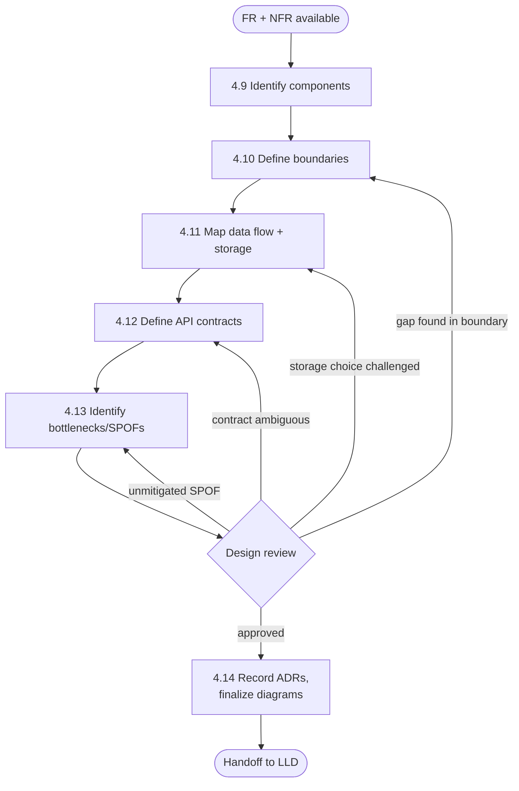

A design review (the diamond above) is where most of an HLD's value is
actually realized: a diagram produced in isolation, without a second set of
eyes deliberately looking for boundary gaps, unjustified storage choices,
ambiguous contracts, or unmitigated single points of failure, captures far
fewer of the benefits described in Section 3. Effective reviews are
structured around the same five workflow steps as a checklist (Section 26
of this chapter provides a ready-to-use version), rather than an unstructured
"does this look right?" discussion, precisely because an unstructured review
tends to catch only whatever issue happens to catch a reviewer's eye rather
than systematically covering every step.

## 6. Design Principles

- **Separation of concerns at the container boundary.** Each container
  (Section 4.2) should have one clear reason to exist and one clear reason
  to change — the same coupling/cohesion principle owned by
  [What is Software Architecture?](../01_Architecture_Mindset/CH01_What_is_Software_Architecture.md),
  applied specifically at HLD's container granularity.
- **Design for failure, not just for the happy path.** Every sequence
  diagram (Section 4.8) drawn during HLD should include at least one
  non-happy-path branch; a design that only shows success paths has not yet
  finished its bottleneck/SPOF analysis (Section 4.13).
- **Prefer explicit contracts over implicit agreements.** Section 4.12's
  API/contract definition step exists precisely because implicit agreements
  between teams are the single most common source of integration failures
  discovered only in production.
- **Match diagram granularity to audience and decision, not habit.**
  Sections 4.1-4.4 exist as separate levels specifically so a team can
  produce only the granularity a given audience or decision actually needs,
  rather than defaulting to "draw everything at maximum detail."
- **Treat reversibility as a first-class design variable.** The storage and
  contract decisions in Sections 4.11-4.12 should be explicitly classified
  using the reversible-versus-irreversible ("one-way door" versus "two-way
  door") heuristic owned by
  [Architecture Thinking](../01_Architecture_Mindset/CH03_Architecture_Thinking.md),
  applying more design rigor to the harder-to-reverse ones.

## 7. Architecture Patterns

HLD is where a team commits to a coarse architectural style — for example,
a layered monolith, a microservices decomposition, or an event-driven
architecture built around asynchronous messaging — before descending into
the Container- and Component-level detail that fills in that style's
specifics. This book's [Architecture Patterns](../17_Architecture_Patterns/PART_OVERVIEW.md)
part is the owning treatment of each pattern's full internal mechanics,
trade-offs, and when to choose one over another; this chapter's role is
narrower — showing that the pattern choice is itself an HLD-stage decision,
made during component identification (Section 4.9) and recorded as an ADR
(Section 4.14), and that the worked example in Section 10 makes one such
choice explicit (a set of small, purpose-built services connected partly
synchronously and partly through an asynchronous event, rather than a single
monolithic service) with the reasoning shown inline in Steps 1-2 rather than
left implicit.

## 8. Production Architecture

A production-grade HLD deliverable is not a single diagram but a small,
consistent set of artifacts, version-controlled together. For a
production-representative example — an e-commerce order-placement
subsystem — the expected artifact set looks like this:

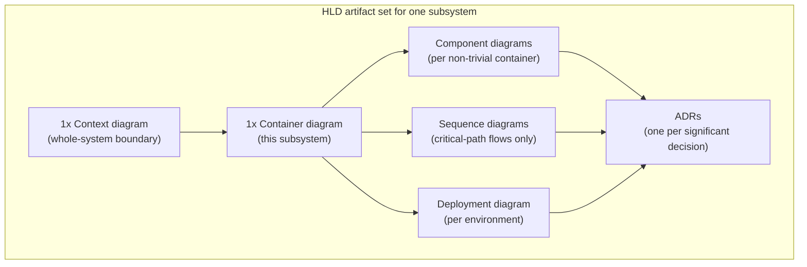

This is exactly the artifact set the worked example in Section 10 produces
for the URL shortener: a Context diagram, a Container diagram, one Component
diagram (for the Redirect Service, the most latency-critical container), two
sequence diagrams (shorten and redirect — the system's two critical-path
flows), one deployment diagram, and an ADR excerpt. A production HLD
deliverable that is missing any one of these categories has left a
communication gap for whichever audience that category was meant to serve.

## 9. Implementation

In practice, HLD artifacts are produced with diagram-as-code tooling rather
than freehand drawing tools, for the version-control and pull-request-review
reasons covered in Section 4.14:

- **Mermaid** (this book's own standard, per
  [STYLE_GUIDE.md](../STYLE_GUIDE.md)) — supports C4-style diagrams natively
  via the `C4Context`, `C4Container`, and `C4Component` diagram types (used
  throughout this chapter and the worked example) as well as `flowchart` and
  `sequenceDiagram` for deployment and cross-service-flow diagrams; renders
  natively in GitHub, most Markdown viewers, and this book's own PDF build
  pipeline (`scripts/build-book.ps1`).
- **Structurizr** (Simon Brown's own tool) — a Domain-Specific Language
  (DSL) purpose-built around the C4 model, capable of generating all four
  C4 levels from a single underlying model so that Context, Container, and
  Component diagrams stay mutually consistent by construction rather than by
  manual discipline.
- **PlantUML** — a broader text-to-diagram tool supporting full UML notation
  (including strict-UML component diagrams with lollipop/socket notation,
  Section 4.7), commonly used where a team needs UML diagram types beyond
  what Mermaid's C4 support covers.
- **draw.io / Lucidchart** — freehand diagramming tools still common for
  quick whiteboard-style exploration early in a design discussion, before a
  design has stabilized enough to commit to diagram-as-code; most teams
  migrate a diagram from a freehand tool to diagram-as-code once it is ready
  to be reviewed and version-controlled per Section 4.14's discipline.

The practical workflow this book recommends: sketch freely (whiteboard or
draw.io) during initial exploration, then commit the settled design as
Mermaid (or Structurizr/PlantUML) text in the same repository as the code
and ADRs it describes, exactly as this chapter's own diagrams and the
worked example under `code/markdown/hld-chapter/` are structured.

## 10. Complete Code Examples

The complete, fully worked HLD walkthrough for this chapter — designing a
URL shortener end-to-end through every step of Sections 4.9-4.14, producing
the full C4 diagram set, both UML diagram types this chapter teaches, and an
ADR excerpt — lives as a standalone Markdown artifact rather than being
embedded inline, per this book's code-example convention of keeping runnable
or extensively worked examples under `code/<language>/` and linking to them:

- [URL Shortener HLD Walkthrough](../code/markdown/hld-chapter/01_url_shortener_hld_walkthrough.md)

That artifact should be read as this chapter's primary applied example: it
demonstrates component identification, boundary definition, data-flow and
storage-choice mapping, API/contract definition, and bottleneck/SPOF
identification in sequence, on a single concrete system, and cross-links
each of its steps back to the Section 4 subsection that teaches it.

## 11. Performance

HLD's contribution to a system's eventual performance is almost entirely
about *setting a latency budget and distributing it across the design*, not
about micro-optimizing any single component (that is Low-Level Design's and
this book's Performance Engineering part's job). Concretely: if a
Non-Functional Requirement states a redirect must complete in under 100ms
at p99 (as in the worked example), that budget must be allocated across
every hop in the relevant sequence diagram (Section 4.8) — network time to
the API Gateway, cache lookup time, and network time back — during HLD,
because discovering post-implementation that the sum of each hop's realistic
latency already exceeds the budget is a far more expensive fix than
re-architecting the flow (for example, adding the cache layer the worked
example commits to) before any code exists.

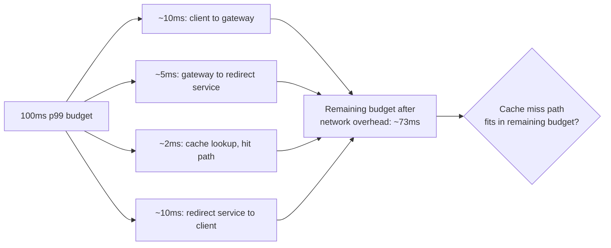

## 12. Scalability

HLD is where a system's scaling seams — the boundaries along which
additional capacity can be added by adding more instances rather than
bigger instances — are chosen. The Container diagram (Section 4.2) directly
exposes these seams: each container is, by definition, an independently
scalable unit, and the bottleneck-identification step (Section 4.13) is
where an architect verifies that no seam has been accidentally undermined by
a shared, unpartitioned resource (a single ID Generator instance, in the
worked example, before partitioning it). Choosing horizontal scale-out
(more instances of a stateless container, as with the Redirect Service) over
vertical scale-up (a bigger single instance) is itself an HLD-stage decision
that should be recorded as an ADR when the choice is non-obvious, because it
has direct cost and complexity implications explored further in this book's
System Design and Distributed Systems part.

## 13. Security

HLD is where trust boundaries — the lines across which data crosses from a
less-trusted to a more-trusted context — become visible on a deployment
diagram (Section 4.6): the boundary between a public internet client and
the API Gateway, and the boundary between the application tier and the data
tier, are exactly the lines a threat model (owned by this book's future
Security part) needs as its starting input. This chapter's HLD-stage
responsibility is narrower and mechanical: make sure every trust-boundary
crossing is an explicit arrow on a diagram, with its protocol labeled (as
Section 4.2's and Section 4.6's diagrams do throughout this chapter),
because an undocumented data flow across a trust boundary cannot be
threat-modeled at all. Full authentication/authorization mechanics, TLS
specifics, and the OWASP-class vulnerability taxonomy are owned by this
book's dedicated Security part and the already-drafted
[TLS](../05_Networking_and_OS/CH06_TLS.md) chapter, both recapped here only
at the level needed to place them correctly on an HLD deployment diagram.

## 14. Observability

An HLD deliverable should specify, for each container, what must be
observable once the system is running — not the concrete metrics/logging/
tracing implementation, which is owned by this book's future Observability
part, but the *boundary decisions* observability depends on: which
cross-service calls need a propagated trace context (every arrow on a
sequence diagram, Section 4.8, is a candidate), and which Service Level
Indicators (SLIs) map to which container (typically one SLI per
Non-Functional Requirement the container is responsible for satisfying, per
Section 4.0's recap). Deferring this identification to implementation time
routinely produces systems where the one metric an incident responder
actually needs was never instrumented, because no one had explicitly
connected "redirect p99 latency" to "the Redirect Service container" during
design.

## 15. Failure Scenarios

Section 4.13's bottleneck/SPOF identification step is where failure
scenarios are first enumerated, but HLD's job is to enumerate them, not
necessarily to fully mitigate every one before implementation begins — that
judgment call, and the deeper mechanics of cascading failure, blast-radius
containment, and graceful degradation, belong to this book's future Failure
Scenarios/resilience-pattern treatment. What HLD must produce is an explicit
table (as in the worked example's Step 5) pairing every candidate failure
with either a committed mitigation or a deliberate, documented decision to
accept the risk — the latter recorded as an ADR (Section 4.14) so the
acceptance is a visible decision rather than a silent gap discovered during
an actual incident.

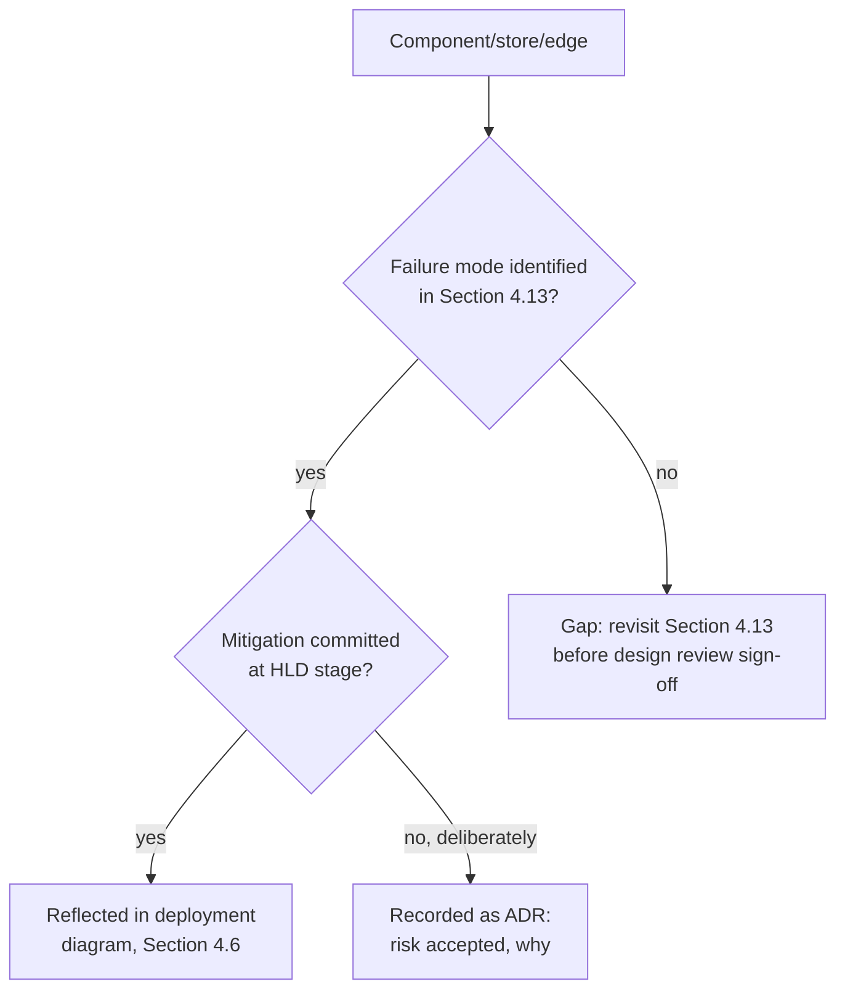

## 16. Testing

An HLD is validated primarily through structured design review (Section 5's
review loop) rather than automated testing, but two testing-adjacent
practices extend directly from it: contract tests, derived mechanically
from the API/contract definitions in Section 4.12, verify at build time that
each component actually honors the contract its neighbors depend on; and a
load-test plan, derived from the latency budget in Section 11 and the
scaling seams in Section 12, gives an implementation team a concrete target
to validate against once the system is built, rather than an untested
assumption that the HLD's performance reasoning held up in practice. Neither
practice replaces implementation-level unit/integration testing (this book's
dedicated Testing chapters); both exist specifically to close the loop
between an HLD's stated assumptions and the system that is eventually built
from them.

## 17. Common Mistakes

- **Big Design Up Front (BDUF) relapse** — attempting to fully specify every
  Component-level (Section 4.3) and Code-level (Section 4.4) detail before
  any implementation begins, reintroducing the exact waterfall-era failure
  mode Section 2's historical evolution shows the industry has already
  moved away from.
- **Skipping the bottleneck/SPOF pass** — treating Sections 4.9-4.12 as the
  entire workflow and omitting Section 4.13 entirely, producing a design
  that looks complete but has never actually been interrogated for failure
  modes.
- **Diagram rot** — producing diagrams once and never updating them as the
  system evolves, the failure mode Section 4.14 addresses directly with the
  diagram-as-code discipline.
- **Confusing C4 levels** — mixing Context-level and Container-level detail
  on one diagram (Section 4.1's failure mode), making the diagram unusable
  for the one audience it was meant to serve.
- **Undocumented implicit contracts** — Section 4.12's failure mode,
  producing integration bugs discovered in production instead of in design
  review or contract testing.
- **No sequence diagram for the critical path** — leaving the system's most
  latency-sensitive or failure-prone flow undocumented at the ordering
  level, the specific gap Section 4.8 exists to close.

## 18. Best Practices

- Draw a Context diagram (Section 4.1) even for systems with only one
  external dependency — the discipline of stating the boundary explicitly
  is worth more than the diagram's apparent simplicity suggests.
- Keep Container diagrams (Section 4.2) to roughly a dozen boxes or fewer;
  split into multiple diagrams by bounded subsystem once a system exceeds
  that, per Section 4.2's common-failure-mode guidance.
- Generate Code-level (Section 4.4) diagrams from actual code rather than
  hand-maintaining them, and consider skipping this level entirely for most
  components.
- Write an ADR (Section 4.14) at the moment a Section 4.9-4.13 decision is
  made, not retroactively — retroactive ADRs reliably omit the alternatives
  that were actually considered and rejected.
- Run every draft HLD through the structured review checklist in Section 26
  before considering it final.

## 19. Anti-Patterns

- **The God Component** — one container that has accumulated
  responsibilities across multiple unrelated functional areas because
  boundary definition (Section 4.10) was skipped or done superficially,
  reintroducing monolith-style coupling inside what looks, on the diagram,
  like a decomposed system.
- **The Distributed Monolith** — a system split into many containers whose
  components are so tightly coupled through implicit contracts (Section
  4.12's failure mode) that they must still be deployed together, paying
  the operational cost of a distributed system without gaining independent
  deployability.
- **Resume-Driven Architecture** — choosing an architecture pattern
  (Section 7) or a storage technology (Section 4.11) because it is
  fashionable or resume-enhancing rather than because the traced data flow
  and NFRs actually justify it.
- **Diagram-as-Afterthought** — producing HLD diagrams only after the system
  is already built, as retroactive documentation, which inverts HLD's actual
  purpose (a forcing function used *before* implementation, per Section 3)
  and tends to produce diagrams that flatter the existing implementation
  rather than honestly surface its actual gaps.

## 20. Trade-off Analysis

Most HLD decisions are genuine trade-offs rather than unambiguous rights and
wrongs, and this book's Architecture Tradeoff Analysis Method (ATAM), owned
in full by
[Architecture Thinking](../01_Architecture_Mindset/CH03_Architecture_Thinking.md),
is the recommended structured technique for evaluating them: state the
quality-attribute scenario (for example, "redirect p99 latency stays under
100ms even during a cache-node failure"), identify the architectural
decisions that affect it (cache topology, replication strategy), and
evaluate each candidate decision's sensitivity points and trade-off points
against that scenario. This chapter's own worked example implicitly performs
several such trade-offs — most visibly in the ADR excerpt (Section 10)
choosing collision-free ID-based encoding over hash-based encoding at the
cost of exposing approximate creation order.

## 21. Comparison Table

| Notation/Approach | Best for | Weakest for | Typical audience |
|---|---|---|---|
| C4 Context diagram | System-boundary communication, non-technical stakeholders | Internal structure, ordering of operations | Anyone new to the system, product stakeholders |
| C4 Container diagram | Cross-team/cross-service structural decisions | Class-level or line-level detail | Engineering team, architecture review board |
| C4 Component diagram | Internal structure of one container | Whole-system view; goes stale fastest | Team implementing that one container |
| C4 Code diagram / UML class diagram | Complex class hierarchies, generated from code | Almost everything else at HLD stage | Implementer of one tricky component |
| UML deployment diagram | Physical placement, availability/failure-domain verification | Logical responsibility/ownership | Site Reliability Engineering (SRE)/operations, security review |
| UML sequence diagram | Cross-service ordering, conditional/failure branches | Whole-system structure | Engineering team, incident responders |
| Full strict-UML notation (Part 18, forward reference) | Regulated/safety-critical domains needing formal interface contracts | Speed of iteration for typical HLD work | Specialized/regulatory audiences |
| Freehand whiteboard/draw.io | Early-stage exploration before a design settles | Version control, review discipline | The design team itself, in the moment |

## 22. Real-World Case Study

Public engineering blogs from large-scale systems routinely publish exactly
the kind of Container-and-deployment-level diagrams this chapter teaches,
because the same forces (cross-team communication, onboarding, incident
response) that motivate HLD inside a single team motivate it at
organizational scale. A representative, widely cited pattern is the
evolution many high-traffic social and media platforms have publicly
described: an initial single-service (monolithic) HLD, adequate while a
system's read/write ratio and traffic volume were modest, followed by a
deliberate re-architecture once a specific bottleneck was identified through
exactly the kind of analysis Section 4.13 teaches — a single database
handling both the write path and an increasingly read-heavy feed-serving
path, until the read path was split into its own dedicated, cache-backed
service, mirroring this chapter's own worked example's read/write split
almost exactly. The consistent lesson across these public case studies is
not that any one architecture is universally correct, but that the HLD
workflow's data-flow and bottleneck analysis (Sections 4.11 and 4.13),
applied honestly against the *actual* traffic shape rather than an assumed
one, is what correctly predicts where a re-architecture will eventually be
needed — and that teams which had current, honest diagrams (Section 4.14)
were able to reason about and execute that re-architecture far faster than
teams starting from stale or absent documentation.

## 23. Interview Questions

1. What is the difference between a C4 Context diagram and a C4 Container
   diagram, and what question does each answer?
2. Why does the C4 model recommend generating the Code-level diagram from
   source rather than hand-drawing it?
3. When would you choose a UML deployment diagram over a Container diagram,
   given that both can show "boxes and arrows"?
4. Walk through how you would identify candidate components from a set of
   functional requirements for a system you have not seen before.
5. What is the difference between a bottleneck and a single point of
   failure (SPOF), and can a component be one without being the other?
6. Why should an explicit "does not own" column be part of a
   responsibility-boundary table, rather than just listing what each
   component owns?
7. What is the trade-off between a synchronous request/response contract and
   an asynchronous event contract between two components?
8. How does an Architecture Decision Record (ADR) differ from a design
   diagram, and why do you need both?
9. Describe a scenario where drawing a sequence diagram during HLD would
   have caught a bug before implementation.
10. What is "diagram rot," and what concrete practice prevents it?

## 24. Hands-on Exercises

1. Take a system you have worked on (or a well-known public product) and
   draw its C4 Context diagram from memory, listing every external system
   and actor you can recall.
2. For the same system, draft a Container diagram and identify at least one
   boundary you are genuinely unsure about — write the "does not own" side
   of a responsibility table for it.
3. Draw a sequence diagram for that system's single most latency-sensitive
   user-facing flow, including at least one failure or conditional branch.
4. Walk your own draft Container diagram through Section 4.13's
   bottleneck/SPOF checklist and list every candidate you find.
5. Write a one-paragraph Architecture Decision Record for the most
   consequential storage choice in your draft design.

## 25. Design Exercises

1. Design the HLD for a ride-sharing dispatch system: produce a Context
   diagram, a Container diagram, at least one Component diagram, one
   sequence diagram for the "rider requests a ride, a driver is matched and
   confirmed" flow, and a bottleneck/SPOF table. State your assumed
   functional and non-functional requirements explicitly before you start.
2. Design the HLD for a collaborative document-editing system (for example,
   a Google-Docs-style product), focusing specifically on the data-flow and
   storage-choice mapping (Section 4.11) for concurrent-edit conflict
   resolution.
3. Take the worked URL-shortener example in Section 10 and redesign it under
   a changed non-functional requirement: the system must now support 10x the
   stated redirect volume with the same latency budget. Show which
   components and storage choices change, and why.
4. Design a deployment diagram (Section 4.6) for a system that must tolerate
   an entire cloud-region failure, not just an availability-zone failure,
   and explain what changes relative to the worked example's deployment
   diagram.

## 26. Architecture Review Questions

Use this checklist, structured around Sections 4.9-4.14, when reviewing any
HLD before it is considered final:

- [ ] Does a Context diagram exist, and does it show every external system
  and actor the design actually depends on?
- [ ] Does every container on the Container diagram have a single, statable
  reason to exist and a single, statable reason to change?
- [ ] Does a responsibility table exist with an explicit "does not own"
  column for every component, and were any gaps or overlaps found and
  resolved?
- [ ] For every piece of persisted data, is there a stated read/write ratio,
  consistency requirement, and access pattern justifying its storage
  choice?
- [ ] Is every cross-component interaction — synchronous and
  asynchronous — documented as an explicit, versioned contract?
- [ ] Has every component, store, and network edge been walked through the
  bottleneck/SPOF checklist, with either a mitigation or an explicit,
  ADR-recorded risk acceptance?
- [ ] Does a sequence diagram exist for the system's critical-path flow(s),
  including at least one non-happy-path branch?
- [ ] Does a deployment diagram exist that a reviewer can use to verify any
  stated availability claim (for example, "tolerates a single Availability
  Zone failure") against actual physical placement?
- [ ] Are diagrams and Architecture Decision Records committed as
  version-controlled text in the same repository as the code they describe?
- [ ] Has this HLD been checked against the Concept Ownership Rule for any
  cross-cutting concept it touches, to avoid re-teaching what another
  chapter already owns?

## 27. Summary

High-Level Design (HLD) is the discipline of producing an
architecture-level blueprint — using the C4 model's four zoom levels
(Context, Containers, Components, Code) and the subset of UML most relevant
to HLD (deployment and sequence diagrams) — before implementation begins,
through a repeatable workflow: identify components, define their boundaries
and responsibilities, map data flow and storage choices, define explicit
contracts between them, and deliberately hunt for bottlenecks and single
points of failure. Every one of those steps exists to surface a decision, an
assumption, or a failure mode while it is still cheap to change, per the
cost curve in Section 3, and the resulting diagrams and Architecture
Decision Records — version-controlled as text alongside the code they
describe — are what let that reasoning survive past the moment it was first
produced. This chapter consumed the Functional and Non-Functional
Requirements taught in this part's CH01 and CH02 as its inputs, and hands
its own output — a reviewed set of components, contracts, and diagrams —
forward as the input to this part's future Low-Level Design (LLD) chapter,
which descends from "what components exist and what do they own" to "what
classes and modules implement each one."
