# Chapter: Low-Level Design (LLD)

Part: [07 — System Design and Distributed Systems](PART_OVERVIEW.md) · Status: Drafted

## 1. Introduction

Low-Level Design (LLD) is the discipline of translating a system's
high-level architecture into concrete, implementable class- and
module-level structures: which objects exist, what data and behavior each
one owns, how they collaborate, and what invariants each collaboration must
never violate. Where [High-Level Design (HLD)](CH03_High_Level_Design.md)
answers "what services/components exist and how do they talk to each
other over the network," LLD answers the next-narrower question: "inside
one of those services, what classes exist, what are their responsibilities,
and how do they compose into working, testable, extensible code?" This
chapter assumes [Functional Requirements](CH01_Functional_Requirements.md)
and [Non-Functional Requirements](CH02_Non_Functional_Requirements.md) have
already shaped what the system must do and under what quality constraints,
and that [High-Level Design](CH03_High_Level_Design.md) has already drawn
the service/component boundaries; LLD is the step that makes a single
component's internal design concrete enough that two engineers can split
the work and produce compatible, coherent code without constant
re-negotiation.

LLD sits at a specific granularity on the architecture-to-code spectrum:
broader than a single function's implementation, narrower than a
deployment topology. It is also the most interview-tested layer of system
design — "design a parking lot," "design an elevator system," "design a
rate limiter as a class hierarchy" — precisely because it exercises the
skills that separate someone who can describe a system from someone who
can actually build one that survives requirement changes: correctly
identifying responsibilities (Object-Oriented Programming (OOP)
principles, Section 4.1-4.2), applying the five SOLID principles so the
design tolerates change (Section 4.3-4.7), recognizing recurring
structural problems that already have well-tested solutions (Gang-of-Four
(GoF) design patterns, Section 4.8-4.12), modeling a rich business domain
so that invariants live in the domain model rather than scattered across
services (Domain-Driven Design (DDD) tactical patterns, Section
4.13-4.16), and — increasingly, as systems become more event-driven —
designing how objects and modules communicate through events rather than
only direct method calls (Event Modeling, Section 4.17).

This chapter is the *owning* chapter for OOP principles as applied to LLD,
all five SOLID principles, a representative set of GoF design patterns
(Factory Method, Strategy, Observer, Decorator, Singleton), DDD's tactical
(code-level) patterns, and class/module-level Event Modeling. It explicitly
does **not** own strategic DDD (bounded contexts, context mapping) or
system-level architecture patterns such as microservices-as-topology or
event-driven architecture as a system-wide integration style — those are
recapped in 2-3 sentences here and forward-referenced to a future **Part
17 — Architecture Patterns** (`17_Architecture_Patterns/PART_OVERVIEW.md`,
not yet drafted at the time this chapter was authored). It also does not
teach the full mechanics of Command Query Responsibility Segregation
(CQRS) or Event Sourcing — those have their own dedicated, not-yet-drafted
chapters later in this same Part 07 (see [PART_OVERVIEW.md](PART_OVERVIEW.md));
Section 4.17 mentions Event Modeling's relationship to them only as a
forward reference.

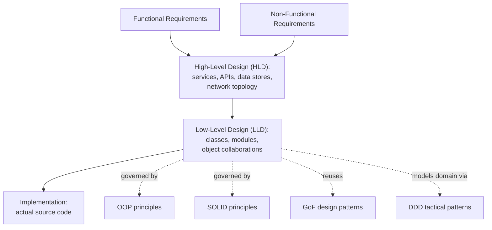

## 2. Historical Evolution

- **Structured design predates OOP (1960s-1970s).** Early "low-level
  design" meant flowcharting procedures and data structures under
  structured-programming discipline (Dijkstra's "Go To Statement
  Considered Harmful," 1968) — design was procedural, not object-oriented,
  and the unit of decomposition was the function, not the class.
- **Object-oriented languages formalize the class as the unit of design
  (1970s-1980s).** Simula (1967) introduced the class/object concept;
  Smalltalk (1972-1980) made message-passing between objects a first-class
  paradigm; C++ (1985) and later Java (1995) brought OOP into mainstream
  industrial software, making "design the classes" a distinct activity
  from "design the algorithm."
- **The Gang of Four catalog names recurring structure (1994).** Erich
  Gamma, Richard Helm, Ralph Johnson, and John Vlissides published *Design
  Patterns: Elements of Reusable Object-Oriented Software*, cataloging 23
  patterns that recur across unrelated domains whenever the same
  structural forces are present. This gave object-oriented LLD a shared
  vocabulary — saying "this is a Strategy" communicates an entire
  structure and its trade-offs in two words.
- **SOLID is named and popularized (2000s).** Robert C. Martin had taught
  these five principles individually through the 1990s; Michael Feathers
  later coined the SOLID acronym, and Martin's *Agile Software Development:
  Principles, Patterns, and Practices* (2002) and subsequent writing
  cemented SOLID as the standard vocabulary for "what makes an
  object-oriented design good" independent of any specific pattern.
- **Domain-Driven Design formalizes rich domain modeling (2003).** Eric
  Evans's *Domain-Driven Design: Tackling Complexity in the Heart of
  Software* distinguished a rich domain model (entities, value objects,
  aggregates enforcing their own invariants) from the then-dominant
  "anemic domain model" pattern of data-only objects manipulated by
  external service classes, and separately introduced strategic patterns
  (bounded contexts) for large-system decomposition — this chapter owns
  only the tactical (class-level) half of that book.
- **Test-Driven Development and refactoring reshape how LLD is produced
  (1999-2004).** Kent Beck's *Test-Driven Development: By Example* and
  Martin Fowler's *Refactoring: Improving the Design of Existing Code*
  shifted LLD from a big-upfront-design activity into an incremental one:
  design emerges and is continuously corrected through small, safe,
  test-covered transformations rather than being fully specified before
  any code is written.
- **Interview-driven LLD practice (2010s-present).** As "design a
  <system>" interviews (parking lot, elevator, tic-tac-toe, rate limiter,
  splitwise) became a standard hiring bar at large technology companies,
  a distinct practice tradition emerged around demonstrating SOLID/GoF/DDD
  reasoning live, on a whiteboard, in 30-45 minutes — a constrained
  variant of real LLD that this chapter's interview questions (Section 23)
  and exercises (Sections 24-25) draw on directly.
- **Event-driven and event-sourced systems push LLD toward event modeling
  (2010s-present).** As systems increasingly communicate through events
  rather than only synchronous calls, LLD absorbed a new concern: shaping
  the events themselves and the objects that react to them as first-class
  design artifacts (Section 4.17), a discipline popularized under the name
  "Event Modeling" by Adam Dymitruk around 2019 as a complement to (not a
  replacement for) DDD's tactical patterns.

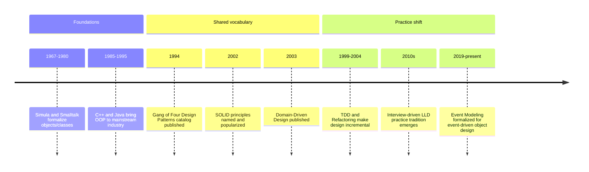

## 3. Why It Exists

LLD exists because a correct high-level architecture does not guarantee a
maintainable implementation — two teams can agree on the same set of
services, the same APIs, and the same data stores (HLD, [Chapter
3](CH03_High_Level_Design.md)) and still produce wildly different code:
one version where adding a new payment method touches a dozen unrelated
classes, and another where it means writing one new class that implements
an existing interface. The difference between those two outcomes is
entirely decided at the LLD layer, not the HLD layer. Three concrete forces
make LLD its own discipline rather than something "code itself" naturally
converges on:

1. **Change is the dominant cost driver of software, not initial writing.**
   Most of a system's lifetime cost is spent modifying existing code to
   satisfy new or changed requirements, not writing it the first time.
   SOLID (Section 4.3-4.7) and the GoF patterns (Section 4.8-4.12) exist
   specifically to make common categories of change cheap and localized
   instead of requiring edits scattered across the codebase.
2. **Business logic complexity needs a home.** Without a deliberate place
   for domain rules to live, they leak into whichever layer happens to
   run first — controllers, database triggers, front-end validation — and
   become duplicated, inconsistent, and untestable. DDD's tactical
   patterns (Section 4.13-4.16) exist to give business invariants one
   canonical, enforced home: the aggregate.
3. **Recurring structural problems deserve reusable, named solutions.**
   Without a shared vocabulary, every team re-derives (and often
   re-invents poorly) the same solutions to "I need to swap an algorithm
   at runtime" (Strategy) or "I need exactly one instance of this" or "I
   need to notify several unrelated listeners of an event" (Observer).
   The GoF catalog exists so architects can communicate structure in one
   word instead of a paragraph, and so the trade-offs of each structure
   are already documented rather than discovered the hard way.

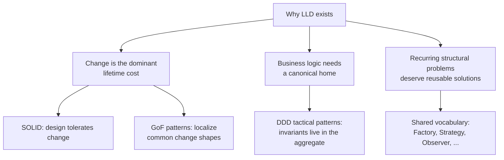

## 4. Core Concepts

### 4.1 Encapsulation and Abstraction

**Definition.** *Encapsulation* is bundling an object's data together with
the operations that are allowed to touch that data, and hiding the data
behind those operations so nothing outside the object can put it into an
invalid state directly. *Abstraction* is exposing only the essential
behavior a caller needs (an interface, a contract) while hiding the
concrete mechanism that implements it. The two are related but distinct:
encapsulation protects an object's internal state; abstraction protects a
caller from needing to know an object's internal *type* at all.

**Mechanism.** Encapsulation is implemented at the language level through
access modifiers (`private` fields, methods that are the only sanctioned
mutation path) combined with validation inside those methods — a
`BankAccount` class that keeps `balance` `private` and only allows it to
change through a `withdraw(amount)` method that checks
`amount <= balance` makes an invalid negative balance structurally
unreachable from outside the class, rather than merely discouraged by
convention. Abstraction is implemented through interfaces/abstract classes:
a caller holding a `PaymentGateway` reference can call `charge(amount)`
without knowing or caring whether the concrete implementation is
`StripeGateway` or `PaypalGateway` — the concrete type is an implementation
detail the abstraction hides.

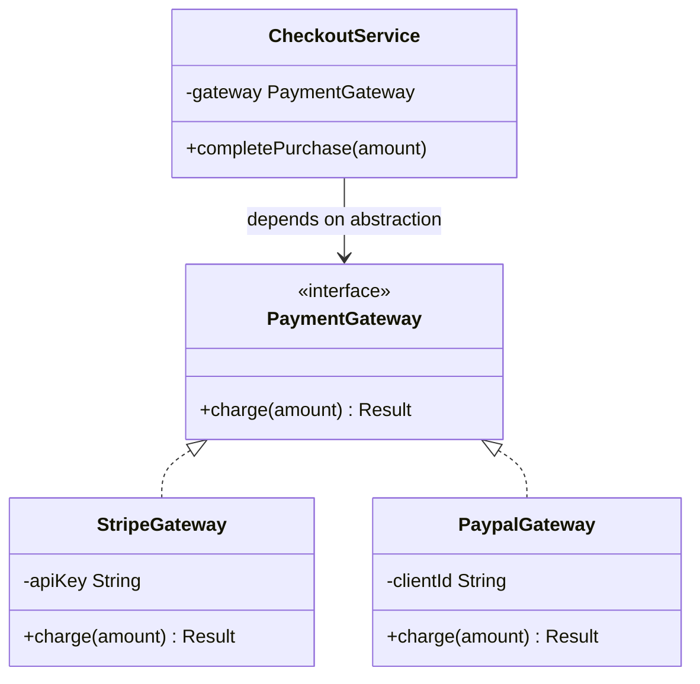

**Decision implications.** Encapsulation is the mechanism that makes an
invariant (Section 4.14) actually enforceable rather than merely
documented — if every field is `public`, "balance must never go negative"
is a comment, not a guarantee. Abstraction is the mechanism that makes
Section 4.4's Open/Closed Principle and Section 4.7's Dependency Inversion
Principle possible at all: without an interface to program against, there
is nothing for a new implementation to plug into without editing existing
call sites.

**Failure mode.** The *anemic domain model* anti-pattern (a term DDD uses
pejoratively) results from insufficient encapsulation: classes become bags
of public getters/setters with no behavior, and all the actual logic
(including invariant checks) migrates into external "service" classes that
operate on the bag's fields directly — at that point nothing prevents any
caller anywhere in the codebase from setting the object into an invalid
state, because the object never enforced anything itself.

**Scenario.** A `User` class with `public String email` lets any code in
the codebase assign `user.email = "not-an-email"` directly; encapsulating
`email` behind a `changeEmail(newEmail)` method that validates format
before assignment moves that validation from "hopefully every caller
remembers to check" to "structurally guaranteed by the class itself."

### 4.2 Inheritance vs. Composition

**Definition.** *Inheritance* lets a subclass acquire a superclass's fields
and methods and optionally override behavior ("is-a" relationship).
*Composition* builds a class's behavior by holding references to other
objects and delegating to them ("has-a"/"uses-a" relationship) rather than
extending them. Both are legitimate code-reuse mechanisms; LLD's job is
choosing the right one for a given relationship, not defaulting to
inheritance because it is the more familiar syntax.

**Mechanism.** Inheritance couples a subclass to its superclass's
implementation at compile time — a subclass automatically changes
behavior if the superclass's method implementation changes, even if the
subclass's own code is untouched, because it shares that implementation.
Composition instead couples a class only to an interface it holds a
reference to, and that reference can be swapped (including at runtime,
which is exactly the mechanism Strategy in Section 4.9 formalizes).
The classic illustration is a naive `Bird` hierarchy: `class Penguin
extends Bird` inherits a `fly()` method that makes no sense for a
penguin, forcing an awkward override that throws an exception or does
nothing — the inheritance relationship claimed "is-a Bird" implies more
shared behavior than is actually true for every subtype.

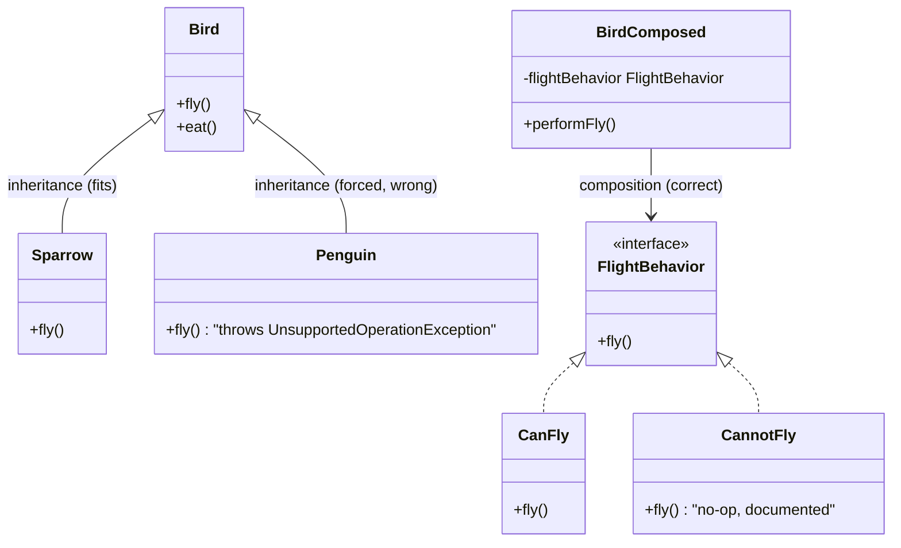

**Decision implications.** Prefer composition when the relationship is
"behaves like" rather than a true taxonomic "is-a" that holds for every
member of the category without exception, when the behavior needs to
change at runtime (Strategy, Section 4.9), or when a class would need to
inherit from more than one source of behavior (most mainstream
object-oriented languages support only single inheritance of
implementation). Prefer genuine inheritance when a strict is-a
relationship holds for the subtype's entire lifetime and the Liskov
Substitution Principle (Section 4.5) is satisfiable without exceptions or
overridden methods that narrow the contract.

**Failure mode.** *Inheritance explosion*: modeling every combination of
independent variations (e.g. `Beverage` × `Size` × `Milk type`) as a
subclass produces a combinatorial number of classes, most of them
differing by only one dimension — this is precisely the shape the
Decorator pattern (Section 4.11) and composition-in-general solve by
making each variation an independently composable unit instead of a fixed
subclass.

**Scenario.** A reporting system initially models `PdfReport extends
Report` and `CsvReport extends Report`; when a requirement arrives for
"any report, optionally compressed, optionally encrypted," a
naively-continued inheritance approach would need
`CompressedEncryptedPdfReport`, `CompressedPdfReport`, and so on for every
combination — composition (wrapping a `Report` in a `CompressingReport`
and/or `EncryptingReport`, the same shape as Decorator) instead lets each
of those two concerns be added independently in any combination without
new classes per combination.

### 4.3 SOLID — Single Responsibility Principle (SRP)

**Definition.** A class should have exactly one reason to change — one
axis of responsibility whose requirements evolve together. "Responsibility"
here means "a reason to change driven by one actor or business concern,"
not literally "does exactly one thing" in the narrowest possible sense.

**Mechanism.** SRP is violated when a single class mixes concerns that
change for unrelated reasons — Section 10's `BadOrderReportService`
(see [01_SolidViolationAndRefactor.java](../code/java/lld-chapter/01_SolidViolationAndRefactor.java))
mixes report formatting, persistence, and customer notification in one
class: a change to how invoices are worded, a change to which database is
used, and a change to which notification channel is preferred are three
unrelated reasons to modify that same class, and each risks breaking the
other two concerns' tests. Splitting the class along those three axes (a
formatter, a repository, a notifier) means each concern's own reason to
change touches exactly one class.

**Decision implications.** SRP is a heuristic about *cohesion of change*,
not a mandate to make every class tiny — a class with five methods that
all change together for the same business reason already satisfies SRP; a
class with two methods that change for genuinely unrelated reasons
violates it. The practical test: "name the actor or business concern that
would request a change to this class"; if there are two unrelated answers,
split it.

**Failure mode.** The *god class* anti-pattern (Section 19) is SRP taken
to its worst extreme: one class accretes so many unrelated
responsibilities that no single engineer can safely modify it without
risking regressions in concerns they don't even know the class handles.

**Scenario.** See Section 10 example 1 for the full before/after code.

### 4.4 SOLID — Open/Closed Principle (OCP)

**Definition.** Software entities should be open for extension but closed
for modification: it should be possible to add new behavior without
editing existing, already-tested code.

**Mechanism.** OCP is achieved by depending on an abstraction (an
interface) and adding new behavior as a new implementation of that
interface, rather than adding a new branch to an existing conditional.
Section 10's `BadOrderReportService.generateAndSendReport` violates OCP
because adding a new report type means editing its `if/else` chain; the
refactored version's `ReportFormatter` interface satisfies OCP because a
new report type is a new class implementing `ReportFormatter`, with zero
lines of existing code touched.

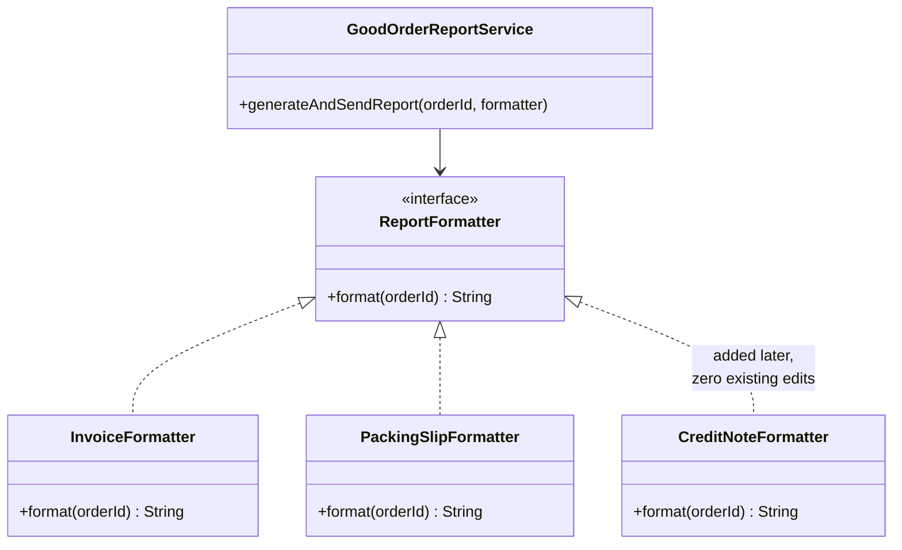

**Decision implications.** OCP and the Strategy pattern (Section 4.9) are
closely related: Strategy is frequently *the* mechanism that satisfies
OCP for "swap an algorithm" style extension points. OCP is not free —
every extension point is an abstraction that adds a layer of indirection,
so applying OCP to every conditional in a codebase (rather than to
conditionals that are known or strongly suspected to grow new cases) trades
simplicity for speculative flexibility that may never be used.

**Failure mode.** Applying OCP prematurely to a genuinely fixed, two-case
condition (e.g. a boolean flag that will never grow a third state) adds an
interface and two classes for no real extensibility benefit — a case of
over-engineering (Section 19) that makes the code harder to read for no
future payoff.

**Scenario.** See Section 10 example 1.

### 4.5 SOLID — Liskov Substitution Principle (LSP)

**Definition.** If `S` is a subtype of `T`, objects of type `T` in a
program should be replaceable with objects of type `S` without altering
the correctness of that program — a subtype must honor its supertype's
contract, not just its method signatures.

**Mechanism.** LSP is violated when a subclass overrides a method in a way
that strengthens preconditions (demands more than the base type promised)
or weakens postconditions (delivers less than the base type promised), or
throws an exception the base type's contract never advertised. The classic
example: `Rectangle` with `setWidth`/`setHeight`, and `Square extends
Rectangle` that overrides both setters to keep width and height equal —
any code that holds a `Rectangle` reference and calls
`rect.setWidth(5); rect.setHeight(10);` expecting an area of 50 silently
gets an area of 100 if the actual object is a `Square`, breaking every
caller's reasonable assumption about `Rectangle`'s contract.

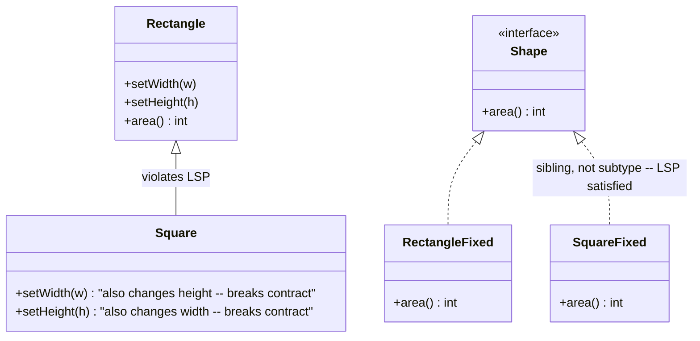

**Decision implications.** LSP is the formal justification behind Section
4.2's inheritance-vs-composition guidance: if a subtype cannot honor every
behavioral promise the supertype makes (not just the method signature),
it should not be modeled as that supertype at all — sibling
implementations of a shared, narrower interface (as in the fixed diagram
above) are usually the correct fix.

**Failure mode.** A subclass method that throws
`UnsupportedOperationException` for an operation the base class's callers
assume always succeeds (the `Penguin.fly()` case from Section 4.2) is an
immediate LSP red flag — it means the inheritance relationship claimed
more shared contract than actually holds.

**Scenario.** A payments codebase models `RefundableOrder extends Order`
where every `Order` subtype's `refund()` is assumed by existing code to
always succeed; a `GiftCardOrder` that overrides `refund()` to throw
because gift cards are non-refundable silently breaks every caller that
loops over a list of `Order` and calls `refund()` unconditionally —
correctly modeling refundability as a capability interface a type either
implements or doesn't (rather than an inherited method every subtype must
support) avoids the violation entirely.

### 4.6 SOLID — Interface Segregation Principle (ISP)

**Definition.** No client should be forced to depend on methods it does
not use — prefer several small, client-specific interfaces over one large,
general-purpose interface.

**Mechanism.** ISP is violated when a single "fat" interface bundles
methods serving unrelated client needs, forcing every implementer to
provide (or stub out with an exception) methods it has no real
implementation for. A `Worker` interface with both `work()` and `eat()`
forces a `RobotWorker` implementation to provide a nonsensical `eat()`
method (often throwing, which is also an LSP violation, Section 4.5) —
splitting it into a `Workable` interface and a separate `Eatable`
interface lets `RobotWorker` implement only `Workable`.

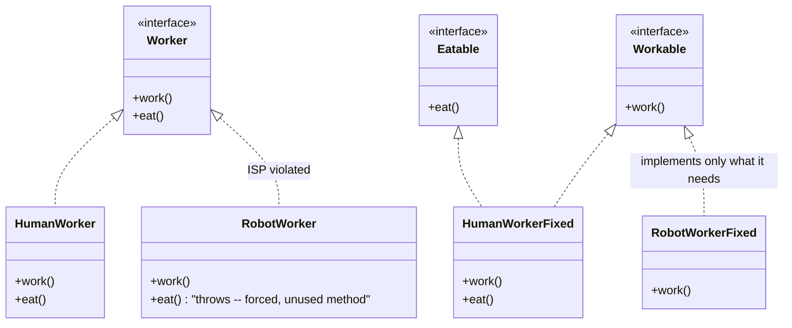

**Decision implications.** ISP and SRP (Section 4.3) are complementary but
distinct: SRP is about a *class's* reasons to change; ISP is about an
*interface's* obligations on its implementers. A well-factored interface
often falls naturally out of correctly-applied SRP on the abstraction
itself, not just the concrete class.

**Failure mode.** A fat "god interface" forces every new implementer to
either implement methods irrelevant to it (often as unsupported-operation
stubs, an LSP violation) or forces existing callers to depend on an entire
interface when they only ever call one of its ten methods, making it
impossible to swap in a narrower, purpose-built implementation.

**Scenario.** A `Repository<T>` interface exposing `save`, `findById`,
`deleteAll`, `runMigration`, and `exportToCsv` forces a read-only reporting
service that only ever calls `findById` to depend on (and provide a
compile target for) mutation and migration methods it will never call —
splitting into a narrow `ReadOnlyRepository<T>` the reporting service can
depend on, with a separate `WritableRepository<T>` for services that
actually mutate data, removes that unnecessary coupling.

### 4.7 SOLID — Dependency Inversion Principle (DIP)

**Definition.** High-level modules should not depend on low-level
modules; both should depend on abstractions. Abstractions should not
depend on details; details should depend on abstractions.

**Mechanism.** Without DIP, a high-level policy class (e.g.
`CheckoutService`) directly instantiates and calls a low-level
implementation detail (e.g. `new StripeGateway()`), coupling the policy to
one specific vendor and making it untestable without a real network call.
With DIP, `CheckoutService` depends only on a `PaymentGateway` interface
(Section 4.1's abstraction), and the concrete implementation is supplied
from outside — typically via constructor injection, as Section 10's
`GoodOrderReportService(ReportRepository, ReportNotifier)` constructor
demonstrates. "Inversion" refers to the direction of the dependency arrow:
without DIP it points from high-level policy down to low-level detail;
with DIP both point *toward* the abstraction instead, and the low-level
module implements an interface the high-level module owns the contract
for.

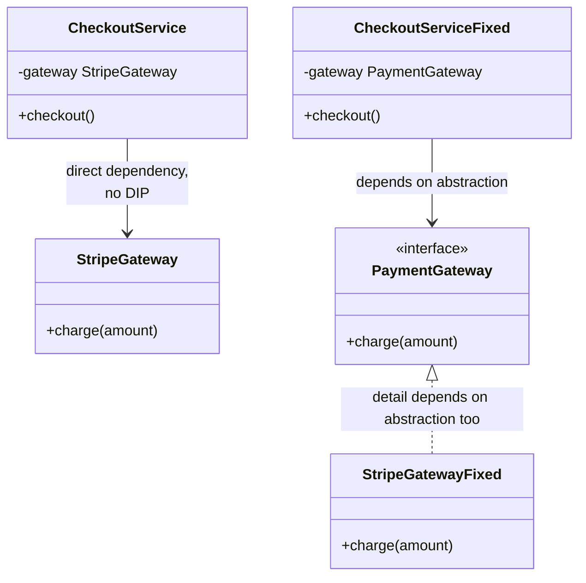

**Decision implications.** DIP is what makes unit testing a high-level
class possible without a real database, network call, or third-party
service: a test can supply a fake/mock implementation of the interface
instead. It is also the principle that lets an architecture swap an
infrastructure detail (a different payment provider, a different
database) without touching business logic, which is the same seam
Dependency Injection frameworks (Spring, NestJS) automate at scale.

**Failure mode.** "New is glue" — sprinkling `new ConcreteClass()` calls
for infrastructure/collaborator objects throughout business-logic classes
recreates tight coupling even in a codebase that otherwise has plenty of
interfaces defined, because the high-level class still decides, and is
compiled against, the concrete type.

**Scenario.** See Section 10 example 1's `GoodOrderReportService`, which
depends only on `ReportRepository` and `ReportNotifier` interfaces and can
be unit-tested with in-memory fakes instead of a real database and a real
email service.

### 4.8 GoF Creational Pattern — Factory Method

**Definition.** Factory Method defines a method whose job is to construct
and return an object, letting callers ask for "a beverage of type X"
without knowing or depending on the concrete class being instantiated.

**Mechanism.** Instead of scattering `new Espresso()` / `new
FilterCoffee()` calls throughout calling code (which would need editing
every time a call site needs a new type, and which couples every call site
to every concrete class), a single factory method centralizes the mapping
from a type identifier to a concrete constructor call — see
[04_FactoryDecoratorSingletonCoffeeShop.java](../code/java/lld-chapter/04_FactoryDecoratorSingletonCoffeeShop.java)'s
`BeverageFactory.create(type)`.

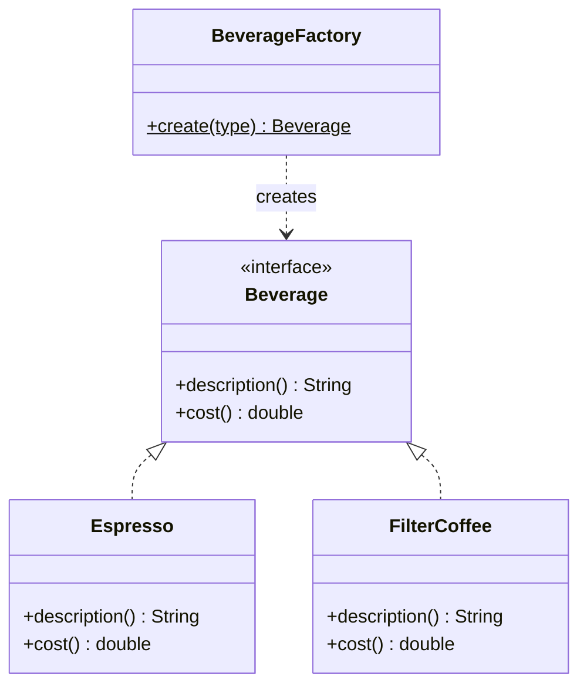

**Decision implications.** Factory Method is worth introducing once
construction logic is nontrivial (choosing among several concrete types,
or requiring setup steps beyond a bare constructor call) or once multiple,
scattered call sites would otherwise need to know about every concrete
type; for a single call site constructing a single, unchanging concrete
type, a factory is unnecessary indirection.

**Failure mode.** A factory method that itself becomes a giant
`switch`/`if-else` ladder over an ever-growing list of types reintroduces
the exact OCP violation (Section 4.4) it was meant to avoid at call sites —
in that case, a registry-based factory (mapping type identifiers to
constructor references, populated at startup) or shifting to an
Abstract Factory when whole *families* of related objects need to be
constructed together are the usual next steps.

**Scenario.** See Section 10 example 4.

### 4.9 GoF Behavioral Pattern — Strategy

**Definition.** Strategy defines a family of interchangeable algorithms,
each implementing a common interface, so the algorithm used by a context
object can be selected or swapped independently of the code that uses it.

**Mechanism.** A context class (e.g. `Checkout`) holds a reference to a
strategy interface (e.g. `DiscountStrategy`) rather than implementing the
algorithm itself; each concrete strategy (`NoDiscount`,
`PercentageOffDiscount`, `FlatAmountOffDiscount`) implements the same
method signature, and the context delegates to whichever strategy it
currently holds — see
[02_StrategyPatternDiscountPricing.java](../code/java/lld-chapter/02_StrategyPatternDiscountPricing.java).

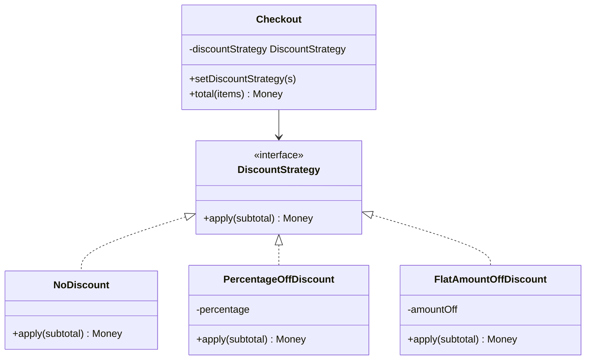

**Decision implications.** Strategy is frequently *the* concrete mechanism
that satisfies OCP (Section 4.4) for "swap an algorithm" extension points,
and is the pattern of choice whenever a conditional exists purely to pick
among interchangeable algorithms rather than to branch on genuinely
different object identities or lifecycles.

**Failure mode.** Introducing Strategy for a single, permanently fixed
algorithm with no plausible variant adds an interface and a class for
zero real flexibility payoff — the same over-engineering risk noted for
OCP in Section 4.4.

**Scenario.** See Section 10 example 2.

### 4.10 GoF Behavioral Pattern — Observer

**Definition.** Observer defines a one-to-many dependency between a
subject and its observers, so that when the subject's state changes, all
registered observers are notified automatically, without the subject
knowing anything concrete about who its observers are.

**Mechanism.** The subject (`Order`) maintains a list of a common
`OrderStatusObserver` interface and calls each registered observer's
notification method whenever its own state changes; observers
(`CustomerSmsNotifier`, `WarehousePickFeed`, `AnalyticsSink`) subscribe and
unsubscribe independently, and the subject's code never changes to add a
new observer type — see
[03_ObserverPatternOrderNotifications.java](../code/java/lld-chapter/03_ObserverPatternOrderNotifications.java).

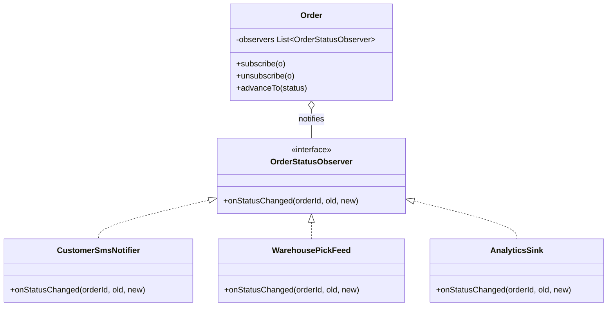

**Decision implications.** Observer decouples "something happened" from
"here is everything that must react," which is also the direct
class/module-level ancestor of the publish/subscribe messaging patterns
used at the system level (message queues, event buses) — the in-process
Observer pattern here and a distributed pub/sub system solve the same
structural problem at different scales, a distinction worth stating
explicitly rather than conflating.

**Failure mode.** Synchronous Observer notification means a slow or
failing observer (e.g. one that makes a blocking network call) can stall
or break the entire subject's state transition unless the subject
explicitly isolates observer failures (catching exceptions per-observer)
or dispatches notifications asynchronously — an unguarded Observer
implementation silently couples the subject's reliability to its least
reliable observer.

**Scenario.** See Section 10 example 3.

### 4.11 GoF Structural Pattern — Decorator

**Definition.** Decorator attaches additional behavior to an individual
object dynamically, by wrapping it in another object that implements the
same interface, without affecting other instances of the same class and
without subclassing every possible combination of behavior.

**Mechanism.** A `Beverage` interface is implemented both by concrete base
beverages (`Espresso`, `FilterCoffee`) and by decorators
(`MilkDecorator`, `ExtraShotDecorator`) that each wrap another `Beverage`
and delegate to it, adding their own contribution to `description()`/
`cost()` before or after delegating — because a decorator implements the
same interface it wraps, decorators can be stacked in any combination and
any order, directly solving Section 4.2's inheritance-explosion failure
mode — see
[04_FactoryDecoratorSingletonCoffeeShop.java](../code/java/lld-chapter/04_FactoryDecoratorSingletonCoffeeShop.java).

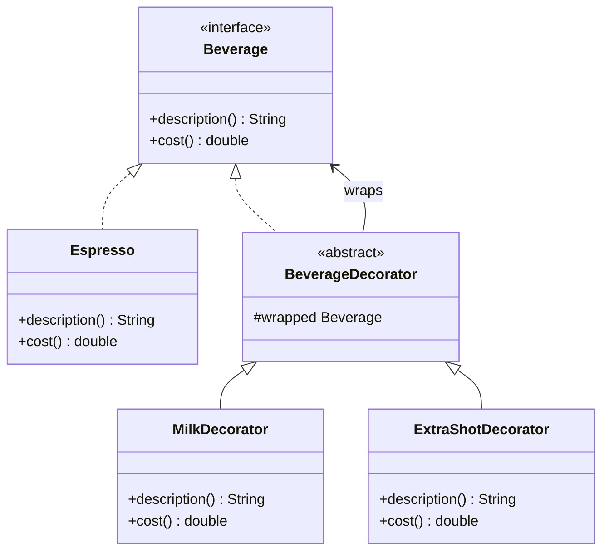

**Decision implications.** Decorator trades subclass explosion for a
"wrapper chain" of objects at runtime — each add-on becomes an independent,
composable unit instead of a fixed point in a class hierarchy, at the cost
of the caller needing to assemble the chain itself (`new
ExtraShotDecorator(new MilkDecorator(espresso))`), which a Factory Method
or Builder is often paired with to hide that assembly complexity.

**Failure mode.** Deeply nested decorator chains become hard to
debug/read (a stack trace through ten layers of delegation to find where a
value actually changed), and decorators that need to *see* or reorder
each other's contributions (rather than simply delegate-and-add) break the
pattern's core assumption that each layer is independent and
order-commutative in effect if not in output text.

**Scenario.** See Section 10 example 4.

### 4.12 GoF Creational Pattern — Singleton (and Its Common Misuse)

**Definition.** Singleton restricts a class to exactly one instance for
the lifetime of the process, and provides a single, well-known global
access point to that instance.

**Mechanism.** The class hides its constructor (`private`) and exposes a
static accessor (`getInstance()`) that lazily creates the one permitted
instance on first access and returns that same instance on every
subsequent call — see
[04_FactoryDecoratorSingletonCoffeeShop.java](../code/java/lld-chapter/04_FactoryDecoratorSingletonCoffeeShop.java)'s
`CashRegister`, which uses the initialization-on-demand holder idiom (a
static nested class whose static field is only initialized the first time
it is referenced) to get thread-safe lazy initialization without
synchronizing every call to `getInstance()`.

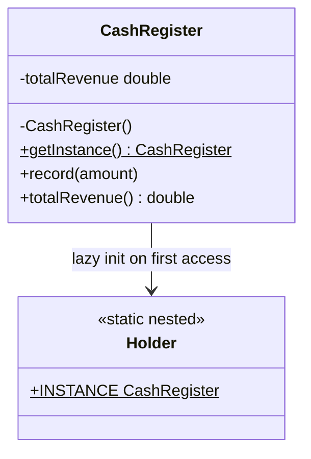

**Decision implications.** Singleton is legitimately appropriate for
things that are genuinely single per process by the domain's own nature —
a hardware register, a single connection pool manager, a logging facility
— not merely for "I only happen to need one right now."

**Failure mode.** Singleton is one of the most over-used and
mis-applied GoF patterns in practice: it is frequently reached for as a
convenient global-variable substitute, which (a) makes unit testing hard
because the single instance persists state across tests unless
deliberately reset, (b) violates DIP (Section 4.7) because callers depend
directly on the concrete `getInstance()` call rather than an injected
abstraction, and (c) hides a class's true dependencies from its
constructor signature, making the object graph harder to reason about.
The common fix is to make the "only one instance" *lifecycle* decision at
the composition root (e.g. a Dependency Injection container configuring a
collaborator as a single shared instance) while the class itself remains
an ordinary, injectable, constructor-testable class — getting the same
one-instance guarantee without hard-coding it into the class itself.

**Scenario.** See Section 10 example 4; contrast with the DIP-satisfying
constructor-injected collaborators in Section 10 example 1, which achieve
effectively-single-instance behavior in practice (one repository instance
wired up at startup) without paying Singleton's testability and coupling
costs.

### 4.13 DDD Tactical Patterns — Entity and Value Object

**Definition.** An *Entity* is a domain object defined by a persistent
identity that continues to matter even as its attributes change over time
(two orders with identical line items are still different orders if their
IDs differ). A *Value Object* is a domain object defined entirely by its
attributes, with no identity of its own — two value objects with the same
attribute values are interchangeable and, in a well-designed model,
immutable.

**Mechanism.** [05_DDDOrderAggregate.java](../code/java/lld-chapter/05_DDDOrderAggregate.java)'s
`Money` class is a Value Object: equality is structural (`amount` and
`currency` compared, not object identity), it is immutable (every
operation like `add`/`multiply` returns a new `Money` instead of mutating
`this`), and it validates its own invariant (non-negative amount) in its
constructor so an invalid `Money` can never exist. `OrderLine` is an
Entity with respect to identity inside the aggregate (identified by
`sku` within the order) but is not independently reachable from outside
the `Order` aggregate root (Section 4.14) — external code never holds a
bare `OrderLine` reference.

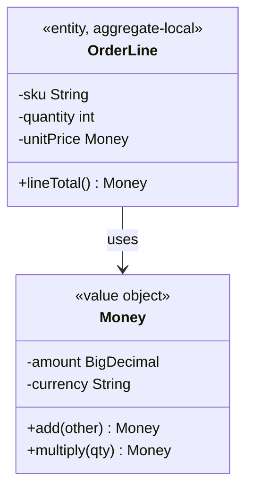

**Decision implications.** Modeling something as a Value Object instead of
an Entity removes an entire class of bugs (accidental shared mutable
state, needing to track identity for something that never needed it) and
makes equality/comparison trivially correct by construction; the
architect's test is "does this thing need to be tracked/changed over time
as *the same one*, or is it just a description of a quantity/attribute
set?" — money amounts, addresses, and date ranges are almost always value
objects; customers, orders, and accounts are almost always entities.

**Failure mode.** Modeling a Value Object as a mutable Entity (giving
`Money` a setter and identity) opens the door to the exact kind of
uncontrolled shared-mutable-state bug encapsulation (Section 4.1) exists
to prevent — two parts of the code holding the "same" `Money` reference
can now see each other's mutations unexpectedly.

**Scenario.** See Section 10 example 5.

### 4.14 DDD Tactical Patterns — Aggregate and Aggregate Root

**Definition.** An *Aggregate* is a cluster of associated objects (entities
and value objects) treated as a single unit for the purpose of data
changes, with one designated *Aggregate Root* acting as the only object
external code is allowed to reference or hold — every invariant that must
hold across the whole cluster is enforced by the root, never by external
code reaching into the cluster's internals directly.

**Mechanism.**
[05_DDDOrderAggregate.java](../code/java/lld-chapter/05_DDDOrderAggregate.java)'s
`Order` class is the aggregate root for the `Order`/`OrderLine` cluster:
external code calls `order.addLine(...)` or `order.place()`, never
constructs or mutates an `OrderLine` directly, and every method on the
root checks the invariants that must hold for the whole aggregate before
allowing a state change — `place()` refuses to succeed on an order with
zero lines, and `addLine()` refuses once the order is no longer a draft.
Because every mutation is funneled through the root, the root can enforce
an invariant *atomically*, in one place, rather than hoping every caller
remembers to check it independently.

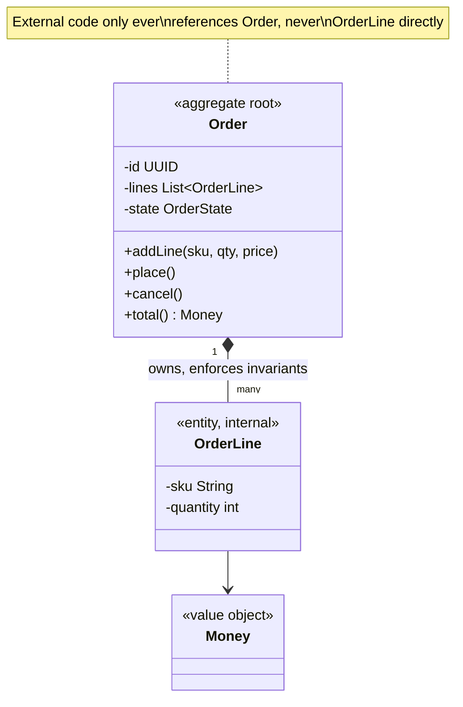

**Decision implications.** Aggregate boundaries are also *transaction*
boundaries in most DDD implementations: a single aggregate should be
saved/loaded as one atomic unit, and cross-aggregate consistency (e.g.
"this order's total must match the customer's running balance") is
handled through eventual consistency via domain events (Section 4.16) or
an application-layer process, not through a single database transaction
spanning two aggregate roots — designing aggregates too large (spanning
what should be separate transactional boundaries) creates unnecessary
lock contention, while designing them too small pushes invariants that
genuinely need atomicity out into fragile, easy-to-forget
application-layer coordination.

**Failure mode.** Letting external code hold a reference to an internal
entity (e.g. returning a mutable `List<OrderLine>` directly from `Order`)
breaks the aggregate boundary entirely — a caller can then mutate an
`OrderLine`'s quantity without going through `Order`'s invariant checks,
silently reintroducing exactly the uncontrolled-state problem aggregates
exist to prevent.

**Scenario.** See Section 10 example 5, including the demonstrated
`IllegalStateException` when code attempts to add a line to an
already-placed order — the invariant is enforced by the aggregate root
itself, not by a caller remembering to check `order.state()` first.

### 4.15 DDD Tactical Patterns — Repository

**Definition.** A Repository provides a collection-like interface (`save`,
`findById`, and similar) for retrieving and persisting whole aggregates,
so application code can work with aggregates as if they were held in an
in-memory collection, without knowing or caring what storage technology
sits underneath.

**Mechanism.**
[05_DDDOrderAggregate.java](../code/java/lld-chapter/05_DDDOrderAggregate.java)'s
`OrderRepository` interface exposes `save(Order)` and
`findById(UUID)`; `InMemoryOrderRepository` is one implementation (used
for the example and typically for fast unit tests), and a production
system would supply a second implementation backed by a real database —
the application layer's code depends only on the `OrderRepository`
interface, another direct application of DIP (Section 4.7).

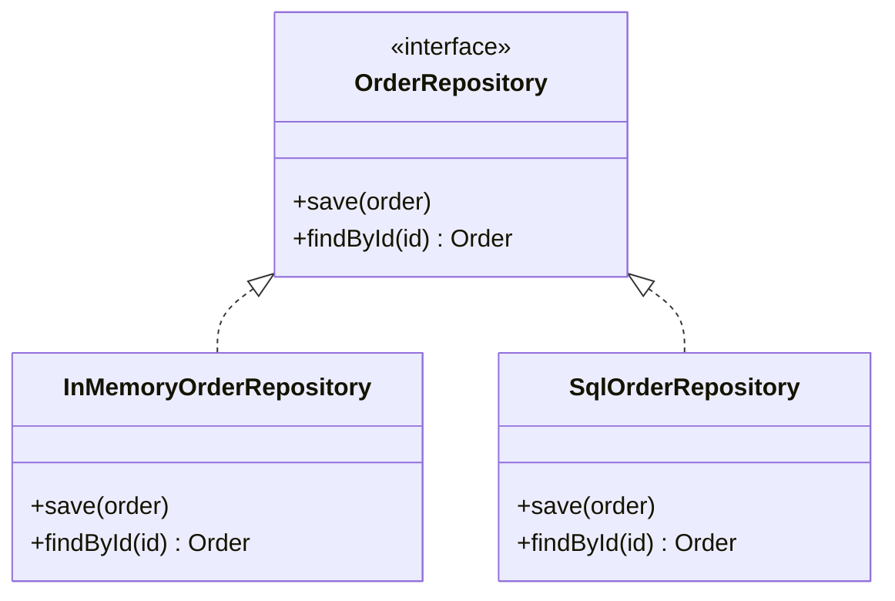

**Decision implications.** A Repository is always scoped to exactly one
aggregate type (an `OrderRepository`, never an `OrderLineRepository`,
because `OrderLine` is not independently reachable per Section 4.14) —
this constraint is a direct consequence of the aggregate boundary, not an
independent rule, and is the fastest way to catch an aggregate boundary
that was drawn incorrectly.

**Failure mode.** A "generic repository" (`Repository<T>` used for every
entity in the system, including internal, non-root entities) tends to
leak aggregate internals and re-invites the same broken-boundary failure
mode Section 4.14 describes, because it implicitly treats every entity as
independently loadable/saveable regardless of aggregate membership.

**Scenario.** See Section 10 example 5.

### 4.16 DDD Tactical Patterns — Domain Events

**Definition.** A Domain Event is an immutable record of something
domain-significant that already happened, named in the past tense
(`OrderPlaced`, not `PlaceOrder`), raised by an aggregate when its state
changes in a way other parts of the system need to react to.

**Mechanism.**
[05_DDDOrderAggregate.java](../code/java/lld-chapter/05_DDDOrderAggregate.java)'s
`Order.place()` and `Order.cancel()` methods append an `OrderPlaced` or
`OrderCancelled` event to an internal `pendingEvents` list rather than
calling out to other services directly from inside the aggregate (which
would couple the domain model to infrastructure concerns and violate
DIP); the application layer calls `drainEvents()` after a successful save
and publishes the events to whatever needs them (the Observer pattern,
Section 4.10, is frequently the in-process mechanism used to fan a
published event out to multiple handlers).

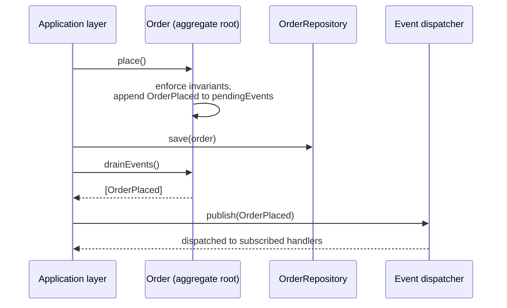

**Decision implications.** Raising domain events from inside the
aggregate, but *publishing* them from the application layer only after a
successful save, keeps the aggregate's own persistence transaction
separate from whatever side effects (notifications, downstream service
calls) the event triggers — this ordering avoids publishing an event for
a state change that was later rolled back.

**Failure mode.** Publishing a domain event synchronously from inside the
aggregate method itself (rather than deferring to the application layer)
couples the domain model directly to messaging/notification
infrastructure and risks announcing an event for a change that has not
actually been durably persisted yet if the save fails afterward.

**Scenario.** See Section 10 example 5's `drainEvents()` call after
`repository.save(order)`.

### 4.17 Event Modeling at the Class/Module Level

**Definition.** Event Modeling is a design technique for shaping a
system's behavior around a timeline of domain events and the
commands/read-models that produce and consume them, applied here strictly
at the class/module level: designing what events an aggregate raises
(Section 4.16), what data each event carries, and which in-process
handlers (Observer subscribers, Section 4.10) react to each one, so that
event-driven object collaboration is designed deliberately rather than
accreting ad hoc.

**Mechanism.** At the class/module level, event modeling means treating
each domain event as a first-class artifact with its own name, its own
immutable payload, and an explicit map of which handlers subscribe to it
— exactly the shape
[05_DDDOrderAggregate.java](../code/java/lld-chapter/05_DDDOrderAggregate.java)'s
`OrderPlaced`/`OrderCancelled` events and
[03_ObserverPatternOrderNotifications.java](../code/java/lld-chapter/03_ObserverPatternOrderNotifications.java)'s
subscriber list demonstrate together: before writing the aggregate's
methods, an event-modeling pass asks "what events does placing an order
produce, what data must each one carry for its known consumers, and what
triggers each transition" and lays that out (often literally as a
left-to-right timeline of command → event → read-model swimlanes) before
implementation begins.

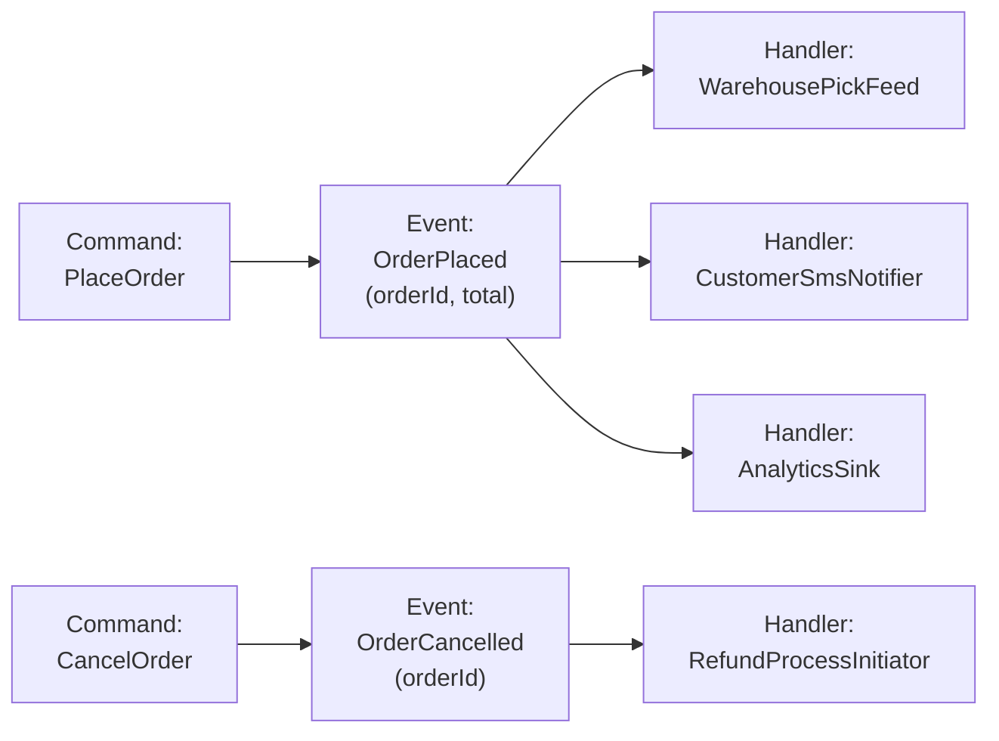

**Decision implications.** This chapter deliberately stops event modeling
at the class/module boundary: designing *which events an aggregate raises
and who reacts to them in-process* is this chapter's scope. Once those
events need to flow between separately-deployed services, be replayed to
reconstruct state, or drive a segregated read model at a system-wide
scale, that is the domain of CQRS and Event Sourcing as system-level
patterns, which have their own dedicated, not-yet-drafted chapters later
in this Part 07 (see [PART_OVERVIEW.md](PART_OVERVIEW.md)) — this chapter
does not teach the log-structured event store, replay/rehydration
mechanics, or read/write-model-separation infrastructure those chapters
own; it only teaches shaping the events and handlers themselves as
class/module-level design artifacts. Similarly, event-driven architecture
as a system-wide integration style (services communicating exclusively
through a shared event bus/broker) is a system-level pattern, recapped
here in this one sentence and forward-referenced to the future **Part 17
— Architecture Patterns**.

**Failure mode.** Treating an in-process domain event's payload as an
afterthought (passing only an ID and expecting every handler to re-fetch
full state) forces every handler to re-query the aggregate, creating
tight coupling to its current shape and repeated reads for what should
have been a single, complete, immutable fact — event modeling's discipline
of designing the payload deliberately (Section 4.16's `OrderPlaced`
carrying both `orderId` and `total`) avoids this.

**Scenario.** A handler added later (say, a fraud-check subscriber that
needs the order total to flag unusually large orders) can subscribe to
the existing `OrderPlaced` event and read `event.total` directly, with no
change to the aggregate or to any other existing handler — a direct,
concrete illustration of Section 4.4's Open/Closed Principle applied to
event-driven collaboration specifically.

## 5. Internal Working

Sections 4.3-4.17 introduced each principle and pattern individually; this
section traces how they compose for one representative scenario — placing
an order — end to end, showing SOLID, GoF, and DDD working together as one
coherent design rather than a list of independent techniques.

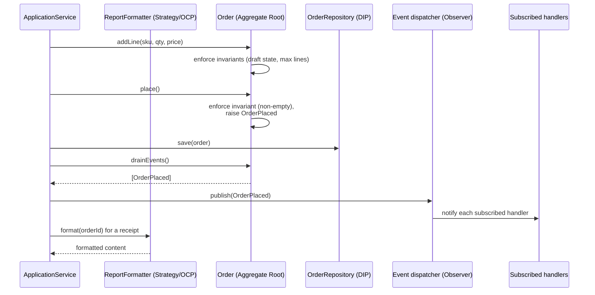

Reading this trace end-to-end: the `ApplicationService` (a thin
orchestration layer, not itself carrying business rules) depends only on
interfaces — `OrderRepository` (DIP, Section 4.7) and `ReportFormatter`
(Strategy/OCP, Sections 4.4/4.9) — never on concrete implementations; the
`Order` aggregate root (Section 4.14) enforces every invariant itself
before any state change is allowed, funneling all mutation through methods
it controls rather than exposing its internal `OrderLine` collection
directly; the events it raises (Section 4.16) are drained and published
only after the aggregate is durably saved, and fan out to independently
subscribed handlers (Observer, Section 4.10) that the aggregate itself has
no knowledge of. No class in this trace has more than one reason to change
(SRP, Section 4.3), and every extension point a new requirement is likely
to touch (a new report type, a new event handler, a new discount
algorithm) is a new class implementing an existing interface, not an edit
to an existing one.

## 6. Design Principles

- **Depend on abstractions at every seam that might vary.** Payment
  providers, notification channels, persistence technology, and
  pluggable algorithms should all sit behind an interface the business
  logic depends on (DIP, Section 4.7) — this is the single principle that
  makes the rest of SOLID, and most GoF patterns, actually possible to
  apply.
- **Give every invariant exactly one enforcement point.** An aggregate
  root (Section 4.14) is that enforcement point for domain invariants;
  scattering the same check across multiple call sites guarantees it will
  eventually be missed in one of them.
- **Choose composition over inheritance by default; reserve inheritance
  for genuine, exception-free is-a relationships.** Section 4.2 and the
  Liskov Substitution Principle (Section 4.5) both point the same
  direction: composition is the safer default.
- **Name design patterns explicitly in code and review, not just in
  intent.** Calling a class "the Strategy for discount calculation" in a
  comment or design doc communicates its entire trade-off profile to any
  reader who knows the GoF vocabulary, far faster than re-deriving the
  same reasoning from scratch.
- **Model events as first-class, immutable facts with deliberate
  payloads.** Section 4.17's event-modeling discipline prevents both
  under-specified events (forcing re-fetches) and premature coupling to a
  system-wide event-sourcing/CQRS mechanism this chapter does not own.

```mermaid
flowchart TD
    A[LLD Design Principles] --> B[Depend on abstractions<br/>at every varying seam]
    A --> C[One enforcement point<br/>per invariant]
    A --> D[Composition by default;<br/>inheritance only for true is-a]
    A --> E[Name patterns explicitly<br/>in code/review]
    A --> F[Model events as deliberate,<br/>immutable facts]
```

## 7. Architecture Patterns

- **Layered application with a rich domain core.** A thin application/
  orchestration layer (coordinating repositories, event publication, and
  formatters) sits above a rich domain layer (aggregates enforcing their
  own invariants), which sits above a persistence layer accessed only
  through repository interfaces — the domain layer never depends outward
  on either of the other two.
- **Constructor-injected collaborators wired at a composition root.**
  Rather than scattering `new ConcreteClass()` calls or reaching for
  Singleton (Section 4.12) for shared collaborators, a single
  composition root (an application's startup/bootstrap code, or a
  Dependency Injection framework) constructs the object graph once and
  injects interfaces throughout.
- **Strategy-backed pluggable business rules.** Discount calculation, tax
  calculation, shipping-cost calculation, and similar rules that vary by
  region/tenant/plan are modeled as Strategy implementations selected by
  configuration or context, not as branching logic embedded in a service
  class.
- **Domain events as the seam between the domain core and side effects.**
  Notifications, downstream service calls, and cross-aggregate
  consistency are triggered by domain events published after a successful
  save, keeping the aggregate itself free of infrastructure dependencies
  — the same seam Section 4.17 flags as the natural hand-off point to a
  system-level event-driven architecture (forward-referenced to Part 17)
  or to CQRS/Event Sourcing (forward-referenced to this Part's dedicated
  chapters) once events must cross service boundaries.

```mermaid
flowchart TB
    subgraph App["Application Layer"]
        Svc[ApplicationService]
    end
    subgraph Domain["Domain Layer"]
        Agg["Order (Aggregate Root)"]
        Strat["DiscountStrategy"]
    end
    subgraph Infra["Infrastructure Layer"]
        Repo["OrderRepository impl"]
        Bus["Event dispatcher"]
    end
    Svc --> Agg
    Svc --> Strat
    Svc --> Repo
    Svc --> Bus
    Agg -.raises events.-> Bus
```

## 8. Production Architecture

In a production service, the LLD concepts in Section 4 show up as concrete
package/module boundaries: a `domain` package containing aggregates,
entities, value objects, and domain events with zero framework
dependencies (no database annotations, no Hypertext Transfer Protocol
(HTTP) framework imports) so the domain model can be unit-tested in
milliseconds without any infrastructure; an `application` package
containing thin orchestration services that depend only on domain-owned
repository/event-publisher interfaces; and an `infrastructure` package
containing the concrete repository implementations, message-bus adapters,
and third-party client wrappers that satisfy those interfaces — commonly
called a hexagonal/ports-and-adapters arrangement at the module level.
Production teams typically enforce this boundary with build-time module
dependency rules (e.g. a linter or module-system rule that fails the build
if `domain` imports anything from `infrastructure`), because without an
automated check, a "just this once" direct database call from inside an
aggregate method reintroduces exactly the coupling DIP (Section 4.7) was
meant to prevent, and does so silently until the next time someone tries
to unit-test that aggregate in isolation.

```mermaid
flowchart TD
    A["domain package:<br/>aggregates, entities, value objects,<br/>domain events -- zero framework deps"] --> B["application package:<br/>orchestration services,<br/>depends only on domain-owned interfaces"]
    B --> C["infrastructure package:<br/>repository impls, message-bus adapters,<br/>third-party clients"]
    D["Build-time module rule:<br/>domain must not import infrastructure"] -.enforces.-> A
```

## 9. Implementation

Implementing an LLD design in this style follows a consistent order:
identify the aggregate(s) and their invariants first (Section 4.14),
model each aggregate's entities and value objects (Section 4.13) with
validation in their constructors so an invalid instance is
unconstructible, define the repository interface each aggregate needs
(Section 4.15) before choosing any concrete persistence technology, define
the domain events the aggregate must raise and who will plausibly
subscribe to them (Sections 4.16-4.17), and only then reach for GoF
patterns (Sections 4.8-4.12) at the specific seams where SOLID's OCP/DIP
(Sections 4.4/4.7) call for one — introducing a pattern before the seam
that needs it exists is how over-engineering (Section 19) creeps into an
otherwise disciplined design.

## 10. Complete Code Examples

The following runnable examples live under
[code/java/lld-chapter/](../code/java/lld-chapter/):

1. [01_SolidViolationAndRefactor.java](../code/java/lld-chapter/01_SolidViolationAndRefactor.java) —
   a Single Responsibility Principle and Open/Closed Principle violation
   (`BadOrderReportService`, mixing formatting/persistence/notification
   with an `if/else` report-type ladder) followed by a refactor that
   applies SRP, OCP, and Dependency Inversion Principle together
   (Sections 4.3, 4.4, 4.7).
2. [02_StrategyPatternDiscountPricing.java](../code/java/lld-chapter/02_StrategyPatternDiscountPricing.java) —
   a `Checkout` context swapping `DiscountStrategy` implementations at
   runtime without branching on discount type (Section 4.9).
3. [03_ObserverPatternOrderNotifications.java](../code/java/lld-chapter/03_ObserverPatternOrderNotifications.java) —
   an `Order` subject notifying an arbitrary, independently-managed list
   of `OrderStatusObserver` subscribers on every state transition (Section
   4.10).
4. [04_FactoryDecoratorSingletonCoffeeShop.java](../code/java/lld-chapter/04_FactoryDecoratorSingletonCoffeeShop.java) —
   a `BeverageFactory` (Factory Method), stackable `MilkDecorator`/
   `ExtraShotDecorator` wrappers (Decorator), and a thread-safe
   `CashRegister` (Singleton, including its common misuse caveat) combined
   in one worked example (Sections 4.8, 4.11, 4.12).
5. [05_DDDOrderAggregate.java](../code/java/lld-chapter/05_DDDOrderAggregate.java) —
   a full DDD tactical-pattern example: an immutable `Money` value object,
   an aggregate-internal `OrderLine` entity, an `Order` aggregate root
   enforcing its own invariants (non-empty before placement, no edits
   after placement), an `OrderRepository` interface with an in-memory
   implementation, and `OrderPlaced`/`OrderCancelled` domain events
   (Sections 4.13-4.16).

## 11. Performance

LLD's performance impact is mostly indirect: a well-factored design (small,
single-responsibility classes; interfaces at genuine variation points) adds
a small, usually negligible amount of indirection (an extra virtual method
call through an interface) in exchange for testability and change
tolerance, and modern Just-In-Time (JIT) compilers routinely inline small,
monomorphic interface calls so the cost rarely shows up in practice.
The more consequential performance risk is *pattern misuse at scale*: a
Decorator chain (Section 4.11) nested dozens of layers deep, or an
Observer (Section 4.10) with hundreds of synchronous subscribers on a
hot path, can introduce measurable latency that a profiler (not
speculation) should confirm before "simplify this decorator chain" or
"make these notifications asynchronous" becomes a real optimization target
rather than a premature one.

## 12. Scalability

LLD choices affect a team's ability to scale *development*, not just
runtime throughput: a codebase where SOLID is consistently applied lets
multiple engineers add new report types, discount strategies, or event
handlers in parallel, each touching only new files, with a low risk of
merge conflicts or regressions in unrelated code — the opposite of a god
class (Section 19) that becomes a serialization point for every team that
needs to touch it. At the runtime level, well-bounded aggregates (Section
4.14) with correctly-scoped transaction boundaries scale more easily under
concurrent load than an accidentally too-large aggregate that serializes
unrelated writes behind the same lock/transaction.

## 13. Security

Encapsulation (Section 4.1) is a direct security control, not only a
maintainability one: an aggregate that enforces every invariant on every
mutation path closes off the class of bugs where a caller bypasses
validation by mutating state directly (e.g. setting a negative `Money`
amount, or an order quantity of zero) — this is the same "validate at the
boundary, never trust the caller" principle the rest of the book applies
at the network/API boundary, applied here at the object boundary instead.
Dependency Inversion (Section 4.7) also has a security-relevant benefit:
because business logic depends only on interfaces, credentials and
provider-specific configuration for a payment gateway or notification
channel live entirely in the infrastructure layer (Section 8), never
imported into or visible from the domain layer's code, reducing the
surface area that must be reviewed for secret handling.

## 14. Observability

Domain events (Section 4.16) double as a natural observability seam: every
`OrderPlaced`/`OrderCancelled` event is already a structured, named,
timestamped fact about the domain, and logging or emitting a metric
alongside each published event (rather than instrumenting scattered
service-layer code separately) gives an architect a business-level audit
trail "for free" as a side effect of the design, not an afterthought bolted
on later. Aggregates that raise well-named events make it possible to
answer "how many orders were cancelled in the last hour, and why" directly
from the event stream, without reverse-engineering intent from raw
database row changes.

```mermaid
flowchart LR
    A[Order aggregate] -- raises --> B["OrderPlaced /<br/>OrderCancelled events"]
    B --> C[Application-level logger:<br/>structured audit trail]
    B --> D[Metrics: counts by event type]
    B --> E[Downstream handlers:<br/>notifications, warehouse, fraud]
```

## 15. Failure Scenarios

- **Invariant bypass via a leaked internal reference.** Returning a
  mutable internal collection (e.g. `Order`'s line items) directly from
  an aggregate root lets external code mutate it without going through
  any invariant check — the fix is returning an unmodifiable view/copy,
  never the live internal collection.
- **God class emerging from unchecked SRP violations.** A class that
  starts with one responsibility accretes more over successive feature
  additions because splitting it "later" keeps being deferred — the fix
  is treating "name this class's single reason to change" as a standing
  code-review question, not a one-time design step.
- **Singleton state leaking across test runs.** A Singleton (Section
  4.12) holding mutable state persists that state between unit tests
  unless explicitly reset, producing test-order-dependent failures that
  are notoriously hard to diagnose.
- **Silent LSP violation via an overridden method that narrows the
  contract.** A subclass override that throws where the base class's
  documented contract promises success breaks any polymorphic caller that
  was written against the base type's contract, often not discovered
  until the specific subclass reaches that code path in production.

## 16. Testing

The domain layer's independence from infrastructure (Section 8) is what
makes it fast to test in the first place: because
[05_DDDOrderAggregate.java](../code/java/lld-chapter/05_DDDOrderAggregate.java)'s
`Order` aggregate has zero dependency on a real database, its invariants
(rejecting an empty-line placement, rejecting edits after placement,
rejecting a negative `Money`) can each be asserted directly against a
plain object in microseconds, with no test database, container, or mock
framework required — a strong signal, when absent, that DIP (Section 4.7)
has been violated somewhere in the design. GoF patterns each have their
own natural test shape: a Strategy (Section 4.9) is tested by asserting
each concrete strategy's output independently, then asserting the context
delegates to whichever strategy is currently set; an Observer (Section
4.10) is tested by registering a test spy/fake observer and asserting it
receives the expected notification exactly once per state transition,
without needing any real notification channel (SMS/email) to exist.
Testing an aggregate's invariants should specifically include the
negative cases — attempting the operation the invariant forbids — not
only the happy path, because the entire point of an invariant is the
behavior when it is violated.

```mermaid
flowchart TD
    A[Aggregate unit test] --> B["Happy path: valid state<br/>transition succeeds"]
    A --> C["Invariant test: forbidden<br/>transition throws/rejects"]
    A --> D["No database, no mocks --<br/>plain object construction"]
    E[Strategy unit test] --> F[Assert each concrete<br/>strategy's output independently]
    E --> G[Assert context delegates<br/>to the currently-set strategy]
```

## 17. Common Mistakes

- Reaching for inheritance as the default code-reuse mechanism instead of
  evaluating composition first (Section 4.2).
- Treating SOLID as a checklist to apply uniformly everywhere rather than
  as heuristics applied at genuine variation points, producing needless
  interfaces for things that will never have a second implementation.
- Letting an aggregate's repository (Section 4.15) leak internal entities
  through methods like `getOrderLines()` that return live, mutable
  references.
- Using Singleton (Section 4.12) as a substitute for proper dependency
  injection, rather than as a deliberate choice for a genuinely
  process-singular resource.
- Conflating this chapter's class/module-level event modeling (Section
  4.17) with the full CQRS/Event Sourcing mechanics owned by this Part's
  dedicated future chapters, and consequently under- or over-building
  event infrastructure relative to what the actual scale requires.

## 18. Best Practices

- Identify aggregate boundaries and their invariants before writing any
  persistence or Application Programming Interface (API) code (Section
  9's implementation order).
- Depend on interfaces at every seam expected to vary or need substituting
  in tests (DIP, Section 4.7), and wire concrete implementations at a
  single composition root.
- Name GoF patterns explicitly in class names and code review comments
  ("this is the Strategy for X") so the design's intent is legible to the
  next engineer without re-derivation.
- Keep the domain layer free of framework/infrastructure imports (Section
  8) and enforce that boundary with an automated build-time check, not
  only code-review discipline.
- Design domain events with complete, deliberate payloads (Section 4.17)
  so new subscribers can be added without requiring a change to the event
  itself or a round-trip re-fetch of aggregate state.

## 19. Anti-Patterns

- **God class.** One class accretes many unrelated responsibilities
  (Section 4.3's SRP failure mode taken to its extreme), becoming a
  bottleneck for every team that needs to change any part of it.
- **Anemic domain model.** Domain objects reduced to public
  getters/setters with all logic (including invariant checks) living in
  external service classes (Section 4.1's failure mode) — the opposite of
  the rich, invariant-enforcing aggregates Section 4.14 teaches.
- **Inheritance explosion.** Modeling every combination of independent
  variations as a separate subclass instead of composing independent
  concerns (Section 4.2's failure mode).
- **Singleton-as-global-variable.** Using Singleton (Section 4.12) purely
  as a way to avoid passing a dependency explicitly, rather than for a
  genuinely process-singular resource.
- **Pattern-for-pattern's-sake over-engineering.** Introducing a Factory,
  Strategy, or Decorator at a seam with no plausible variation, adding
  indirection with no corresponding flexibility payoff (Sections
  4.4/4.8/4.9's over-engineering failure notes).

## 20. Trade-off Analysis

| Decision | Option A | Option B | Trade-off |
|---|---|---|---|
| Code reuse mechanism | Inheritance | Composition | Inheritance: less boilerplate for a true, exception-free is-a; Composition: more flexible, avoids LSP risk and inheritance explosion, slightly more boilerplate |
| Algorithm selection | Conditional branching | Strategy pattern | Branching: simpler for 2 fixed cases; Strategy: satisfies OCP, adds an interface + classes, worth it once cases are expected to grow |
| Shared instance management | Singleton | Dependency-injected, composition-root-managed single instance | Singleton: simplest syntax, hardest to test/mock; DI-managed: same one-instance guarantee, fully testable, requires a DI setup |
| Event publication timing | Publish from inside the aggregate method | Publish from the application layer after save | Inside-aggregate: simpler call path, risks announcing unsaved changes; After-save: correct ordering, adds one extra step in the application layer |
| Aggregate granularity | Large aggregate spanning many entities | Small, tightly-scoped aggregate per invariant cluster | Large: fewer round trips for related data, more lock contention; Small: better concurrency, requires eventual consistency across aggregates via events |

```mermaid
flowchart TD
    A[LLD Trade-off Themes] --> B["Reuse: inheritance<br/>vs. composition"]
    A --> C["Extension seam:<br/>branching vs. Strategy"]
    A --> D["Shared instance:<br/>Singleton vs. DI-managed"]
    A --> E["Event timing:<br/>inside-aggregate vs. after-save"]
    A --> F["Aggregate size:<br/>large vs. small"]
```

## 21. Comparison Table

| Pattern/Principle | Category | Primary Problem Solved | Common Misuse |
|---|---|---|---|
| Factory Method | GoF Creational | Centralize construction logic behind one seam | Growing into an unmanageable `switch` ladder |
| Strategy | GoF Behavioral | Swap an algorithm at runtime without branching | Introducing it for a permanently fixed, single algorithm |
| Observer | GoF Behavioral | Notify many unrelated subscribers of a state change | Synchronous notification stalling on a slow subscriber |
| Decorator | GoF Structural | Add behavior without subclass explosion | Deeply nested chains that are hard to read/debug |
| Singleton | GoF Creational | Guarantee exactly one instance of a genuinely singular resource | Used as a global-variable substitute, hurting testability |
| Aggregate/Aggregate Root | DDD Tactical | One enforced boundary for a cluster's invariants | Drawing the boundary too large (lock contention) or too small (broken invariants) |
| Repository | DDD Tactical | Collection-like persistence abstraction per aggregate | Made generic across every entity, leaking aggregate internals |

## 22. Real-World Case Study

**A mid-sized e-commerce platform's checkout-service refactor.** A
checkout service began as a single `CheckoutController` class that
validated cart contents, computed discounts through a long `if/else`
chain keyed on promotion type, saved the order via direct Structured Query
Language (SQL) calls embedded in the controller, and sent a confirmation
email inline — a textbook SRP/OCP violation (Sections 4.3-4.4) that made
every new promotion type a risky edit to the same method. The team
refactored incrementally: first extracting an `Order` aggregate (Section
4.14) that owned its own line-item and total-calculation invariants, then
replacing the discount `if/else` chain with `DiscountStrategy`
implementations (Section 4.9) selected by a small strategy-resolution
lookup instead of inline branching, then introducing an `OrderRepository`
interface (Section 4.15) so the controller no longer issued SQL directly,
and finally replacing the inline confirmation email call with an
`OrderPlaced` domain event (Section 4.16) consumed by an independent
notification handler. Each step was a localized, independently-shippable
change precisely because SOLID's DIP (Section 4.7) meant every new seam
was introduced behind an interface the existing code already depended on
in spirit, even before the interface literally existed — this ordering
(aggregate first, then Strategy, then Repository, then events) mirrors
Section 9's recommended implementation sequence exactly, and the team
reported that promotion types added after the refactor took a fraction of
the review time and produced zero regressions in unrelated checkout
behavior, compared to the pre-refactor baseline.

```mermaid
flowchart TD
    A["Before: one CheckoutController,<br/>if/else discounts, inline SQL, inline email"] --> B["Step 1: extract Order aggregate<br/>(Section 4.14)"]
    B --> C["Step 2: replace if/else with<br/>DiscountStrategy (Section 4.9)"]
    C --> D["Step 3: introduce OrderRepository<br/>interface (Section 4.15)"]
    D --> E["Step 4: replace inline email with<br/>OrderPlaced domain event (Section 4.16)"]
    E --> F["After: new promotion types added<br/>as new classes, zero edits to existing code"]
```

## 23. Interview Questions

1. Explain the difference between encapsulation and abstraction with a
   concrete example of each, and explain why an object can have one
   without the other.
2. Walk through why a naive `Square extends Rectangle` hierarchy violates
   the Liskov Substitution Principle, and describe the fix.
3. Design a class hierarchy for a parking lot's fee calculation that
   supports adding a new vehicle-type pricing rule without modifying
   existing pricing classes — name which SOLID principle and which GoF
   pattern you are applying.
4. What is the difference between an Entity and a Value Object in DDD,
   and give an example of each from a ride-sharing domain.
5. Why must every mutation of an aggregate's internal entities go through
   the aggregate root, and what concretely breaks if that rule is
   violated?
6. Compare Strategy and Factory Method: both involve an interface and
   multiple implementations — what different problem does each solve?
7. What is wrong with using Singleton as the default way to share a
   service instance across a codebase, and what would you do instead?
8. Design the events an `Order` aggregate should raise for a food-delivery
   app, and specify what data each event should carry so a new subscriber
   never needs to re-fetch aggregate state.
9. Explain the difference between this chapter's class/module-level event
   modeling and system-level Event Sourcing — why does designing an
   aggregate's events not, by itself, mean the system uses Event
   Sourcing?
10. A code reviewer flags a class as a "god class." What specific
    questions would you ask to confirm or refute that, and how would you
    begin splitting it if confirmed?

## 24. Hands-on Exercises

1. Run [01_SolidViolationAndRefactor.java](../code/java/lld-chapter/01_SolidViolationAndRefactor.java)
   and add a third report type (e.g. a credit note) to the "after" design
   without modifying any existing class — confirm it compiles and runs
   with zero edits to `GoodOrderReportService`.
2. Run [02_StrategyPatternDiscountPricing.java](../code/java/lld-chapter/02_StrategyPatternDiscountPricing.java)
   and add a new `BuyOneGetOneDiscount` strategy, then swap it into
   `Checkout` at runtime alongside the existing strategies.
3. Run [03_ObserverPatternOrderNotifications.java](../code/java/lld-chapter/03_ObserverPatternOrderNotifications.java)
   and add a new `FraudCheckObserver` that logs a warning when
   `newStatus == PAID` and the order total (you will need to extend the
   event payload) exceeds a threshold.
4. Run [04_FactoryDecoratorSingletonCoffeeShop.java](../code/java/lld-chapter/04_FactoryDecoratorSingletonCoffeeShop.java),
   add a `WhippedCreamDecorator`, and stack it with the existing
   decorators in at least two different orders — confirm the resulting
   cost is order-independent (commutative) while the description text
   reflects the stacking order.
5. Run [05_DDDOrderAggregate.java](../code/java/lld-chapter/05_DDDOrderAggregate.java),
   attempt to construct a `Money` with a negative amount, and confirm the
   constructor rejects it — then attempt to call `place()` on an order
   with zero lines and confirm the aggregate rejects that too.

## 25. Design Exercises

1. Design the class/module structure for a library-book-lending system:
   identify the aggregate(s) and their invariants (e.g. a member cannot
   borrow more than N books, a book cannot be borrowed if already
   checked out), the entities and value objects involved, and the
   repository interface(s) needed.
2. Design a rate limiter as a class hierarchy supporting at least two
   interchangeable algorithms (e.g. token bucket and sliding window)
   selectable without the calling code branching on algorithm type —
   name the GoF pattern you are applying and justify the choice.
3. Design the domain events an `Elevator` module should raise (e.g.
   `FloorRequested`, `DoorsOpened`) and specify which independent
   subscribers (a display panel, a maintenance-logging service, a
   safety-interlock check) would react to each, following Section 4.17's
   event-modeling discipline.
4. A team's `Order` class currently exposes `public List<OrderLine>
   getLines()` returning the live internal list. Identify every way this
   breaks the aggregate boundary (Section 4.14) and redesign the
   accessor so external code can read line items without being able to
   mutate them.
5. Design a notification system (SMS, email, push) as a set of
   interchangeable strategies plus an Observer-based dispatch mechanism,
   and justify why a Singleton is or is not the correct way to manage the
   dispatcher's single shared instance.

## 26. Architecture Review Questions

1. For every aggregate in this design, is there exactly one root class
   through which all mutations flow, with no internal entity
   independently reachable from outside?
2. For every conditional that branches on a "type" field, has the team
   evaluated whether Strategy or Factory Method would satisfy the Open/
   Closed Principle better than adding another branch?
3. Does business logic depend on concrete infrastructure classes anywhere
   (a payment provider, a specific database client) instead of an
   interface, and if so, is that a deliberate, reviewed exception?
4. For every Singleton in the codebase, is the "exactly one instance"
   requirement a genuine domain constraint, or could it be replaced by a
   composition-root-managed single instance without losing anything?
5. Are domain events published only after their triggering aggregate's
   state change has been durably persisted, and does every event carry
   enough data for its known subscribers to avoid a re-fetch?
6. Has the team confirmed this design's event modeling stays at the
   class/module level, or has it silently grown into an undocumented,
   ad hoc Event Sourcing/CQRS implementation that should instead be
   designed deliberately against this Part's dedicated future chapters?

## 27. Summary

Low-Level Design is the discipline that turns an agreed-upon high-level
architecture ([HLD, Chapter 3](CH03_High_Level_Design.md)) into classes and
modules that tolerate change instead of fighting it. Encapsulation and
abstraction (Section 4.1) make invariants enforceable and implementation
details swappable; the composition-over-inheritance judgment (Section 4.2)
and the Liskov Substitution Principle (Section 4.5) together prevent
inheritance from claiming more shared contract than a subtype can actually
honor; the remaining four SOLID principles (Sections 4.3-4.4, 4.6-4.7) give
concrete, checkable criteria for whether a design will absorb new
requirements as new code or as edits to existing, already-tested code. The
representative GoF patterns this chapter covers — Factory Method,
Strategy, Observer, Decorator, and Singleton (Sections 4.8-4.12) — are
named, reusable solutions to structural problems SOLID's principles predict
will recur, each with a documented trade-off and a documented common
misuse, most notably Singleton's frequent, testability-harming misuse as a
global-variable substitute. DDD's tactical patterns (Sections 4.13-4.16)
give business logic and its invariants a canonical, enforced home — the
aggregate root — rather than letting them leak into anemic data objects
and external service classes, and class/module-level event modeling
(Section 4.17) extends that discipline to event-driven object
collaboration specifically, while deliberately stopping short of the
system-level CQRS, Event Sourcing, and event-driven-architecture concerns
this Part's future chapters and the future Part 17 own. An architect
reviewing any component's LLD should be able to point to each class's
single reason to change, each invariant's single enforcement point, each
variation point's chosen pattern and its justification, and each domain
event's complete, deliberate payload — and should treat the absence of any
one of those as a specific, nameable design debt rather than a vague
sense that "the code could be cleaner."

## Further Reading

- [Functional Requirements](CH01_Functional_Requirements.md) and
  [Non-Functional Requirements](CH02_Non_Functional_Requirements.md) —
  the inputs that shape which classes and invariants an LLD actually needs
  to support.
- [High-Level Design (HLD)](CH03_High_Level_Design.md) — the
  service/component-level design this chapter's class/module-level design
  implements inside a single component.
- This Part's future **Distributed Systems — CQRS (Command Query
  Responsibility Segregation)** and **Distributed Systems — Event
  Sourcing** chapters (see [PART_OVERVIEW.md](PART_OVERVIEW.md), not yet
  drafted) — the system-level mechanics this chapter's Section 4.17
  deliberately does not teach.
- A future **Part 17 — Architecture Patterns**
  (`17_Architecture_Patterns/PART_OVERVIEW.md`, not yet drafted) — the
  likely owner of strategic DDD (bounded contexts, context mapping) and
  system-level patterns such as microservices and event-driven
  architecture as a system topology, both recapped only in this chapter.
- [Java Architecture](../03_Software_Engineering_Foundations/CH01_Java_Architecture.md) —
  language-level mechanics (classloading, the module system) underlying
  the Java examples in Section 10, not re-taught here.
