# Chapter: The CAP Theorem

Part: [07 — System Design and Distributed Systems](PART_OVERVIEW.md) · Status: Drafted

## 1. Introduction

Every distributed system that stores state on more than one machine will,
sooner or later, have a network problem: a switch fails, a fiber link gets
backhoed, a cross-region link saturates, a garbage-collection pause makes a
healthy node look dead to its peers. When that happens, the system's
designers made a decision — usually without realizing they were making it —
about what the system does next. Does it keep answering requests, possibly
with stale or conflicting data? Or does it refuse to answer at all, on any
node that cannot currently prove its data is current, until the network
heals? There is no third option that avoids this choice. The CAP theorem is
the formal statement of exactly why that is true, and it is one of the
handful of results in distributed systems that every engineer who designs
multi-node systems needs to understand precisely, not approximately —
because the popular one-line summary of CAP ("Consistency, Availability,
Partition tolerance: pick two") is subtly and consequentially wrong, and
that wrongness leads architects to defend indefensible designs ("we have
all three, we just tuned it really well") instead of making the real
trade-off explicit.

This chapter is the canonical, book-wide home for the full formal treatment
of the CAP theorem: Eric Brewer's original 2000 conjecture, Seth Gilbert
and Nancy Lynch's 2002 proof, precise definitions of Consistency (C),
Availability (A), and Partition tolerance (P) as CAP specifically uses those
words (which are *not* the same as ACID's "C" or the everyday "strong vs.
eventual consistency" spectrum), the proof sketch for why a real partition
forces a binary choice between C and A, the "2 of 3" fallacy that the
popular mnemonic invites, worked CP-vs-AP system examples, and CAP's actual
role in day-to-day system-design decision-making. Two chapters elsewhere in
this book already forward-reference this chapter rather than re-deriving
any of this: [Non-Functional Requirements](CH02_Non_Functional_Requirements.md#48-nfr-trade-off-analysis)
introduces the Consistency-vs-Availability tension as one of several NFR
trade-off pairs and explicitly defers the formal treatment here, and
[Replication](../06_Databases_and_Storage/CH07_Replication.md#49-the-consistency-spectrum-this-chapters-mechanisms-sit-on)
frames its own synchronous/asynchronous/quorum replication choices as a
*concrete database-level implementation* of this same underlying trade-off
— a 2-3 sentence recap, not a re-derivation, correctly deferring to this
chapter for the theorem itself. This chapter, in turn, recaps Replication's
mechanisms only briefly (Section 4.4 and Section 5) and does not re-teach
leader/follower topology, WAL shipping, or quorum arithmetic — that
teaching belongs to Replication. This chapter's sibling,
[PACELC](CH06_PACELC.md) (not yet drafted at the time of this writing),
extends the analysis this chapter builds from a two-variable theorem
(C and A, conditioned on P) into a four-variable one that also accounts for
the latency-consistency trade-off that exists even when the network is
perfectly healthy — this chapter deliberately stops at CAP's original scope
and does not pre-empt that extension.

## 2. Historical Evolution

- **Pre-2000: an unnamed, folk-knowledge tension.** Distributed database
  researchers and practitioners had long observed, informally, that
  replicated systems seemed to force a choice between "always answers" and
  "always correct," but no one had stated this as a provable theorem with
  precise definitions — it circulated as engineering lore, expressed
  differently by different teams, with no shared vocabulary to reason about
  it precisely.
- **2000 — Eric Brewer's PODC keynote conjecture.** At the ACM Symposium on
  Principles of Distributed Computing (PODC), Brewer, drawing on his
  experience building large-scale web infrastructure at Inktomi, presented
  what he called a conjecture (not yet a proof): that a distributed system
  can provide at most two of Consistency, Availability, and Partition
  tolerance at the same time. This talk is the origin of both the name
  "CAP theorem" and the "pick two" framing that would later prove to be an
  oversimplification, though Brewer's own later writing (2012) explicitly
  clarified the nuance the community had flattened out of his original
  point.
- **2002 — Gilbert and Lynch's formal proof.** Seth Gilbert and Nancy Lynch,
  Massachusetts Institute of Technology (MIT) researchers, published *"Brewer's
  Conjecture and the Feasibility of Consistent, Available, Partition-
  Tolerant Web Services,"* giving Brewer's conjecture a rigorous proof under
  an asynchronous network model with precise, formal definitions of
  consistency (atomic/linearizable), availability (every request to a
  non-failing node must receive a response), and partition tolerance (the
  network is allowed to drop arbitrarily many messages between two sets of
  nodes). This is the paper this chapter's Section 4.2 proof sketch is
  based on, and it converted CAP from an industry conjecture into a proven
  theorem with a specific, bounded scope of applicability.
- **2000s — the NoSQL movement's CAP-as-marketing era.** As Dynamo (Amazon,
  2007), Cassandra, Riak, and other "AP" datastores emerged as an explicit
  reaction against single-leader relational databases, CAP became a
  marketing shorthand — "we are an AP system" or "we chose availability" —
  that was often accurate at the level of default configuration but glossed
  over the fact that most of these systems exposed *tunable* consistency
  (Section 4.4), making the CP/AP label a spectrum position, not a fixed
  identity.
- **2010 — Daniel Abadi's PACELC critique and extension.** Abadi published
  *"Problems with CAP, and Yahoo's little known NoSQL system"* arguing that
  CAP, by construction, only describes behavior *during* a partition, and
  is silent about the equally real latency-vs-consistency trade-off that
  exists during normal, partition-free operation — the gap this book's
  sibling [PACELC](CH06_PACELC.md) chapter owns in full.
- **2012 — Brewer's own retrospective, "CAP Twelve Years Later."** Brewer
  published a piece explicitly correcting the "pick two" oversimplification
  the community had converged on, clarifying that partition tolerance is
  not something a system can opt out of the way it can opt out of strong
  consistency, and that the real, actionable choice is what a system does
  *during* a partition — precisely the framing Section 3 and Section 4.3 of
  this chapter build from.
- **2010s-present — CAP as an interview and architecture-review staple.**
  CAP entered the standard system-design-interview and architecture-review
  vocabulary, for better and worse: for better, because it gives a shared
  name to a real and unavoidable trade-off; for worse, because it is
  frequently invoked as a slogan ("that violates CAP") without the
  precision this chapter argues is necessary to use it correctly.

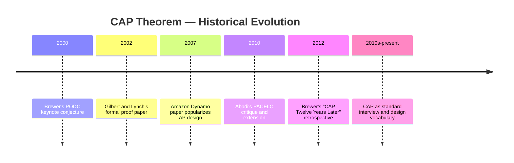

## 3. Why It Exists

CAP exists to answer a question that single-node systems never had to ask:
what should a system do when its own parts cannot talk to each other? A
single-node relational database never faces this question — if the machine
is up, every read sees every previously committed write, by definition,
because there is only one copy of the data and one place transactions are
serialized. The moment a system's data lives on more than one machine
(for durability, for read scaling, for geographic proximity to users), a
new failure mode becomes possible that a single-node system structurally
cannot have: the machines can disagree, because the network between them
can fail while each individual machine keeps working perfectly. CAP exists
to name and formalize the choice a system's designers must make about what
happens in exactly that moment — not to *cause* the trade-off, which is a
physical reality of distributed computing (the speed of light and
unreliable networks are not implementation details a clever protocol can
optimize away), but to give it a shared vocabulary precise enough that two
engineers reasoning about the same system's behavior during a partition
converge on the same answer instead of talking past each other. Without
CAP's vocabulary, "the database should be consistent and available" reads
as an uncontroversial, achievable goal; with it, the same sentence is
immediately recognizable as underspecified, because it does not say what
happens *during a partition*, which is the only moment the three
properties actually compete.

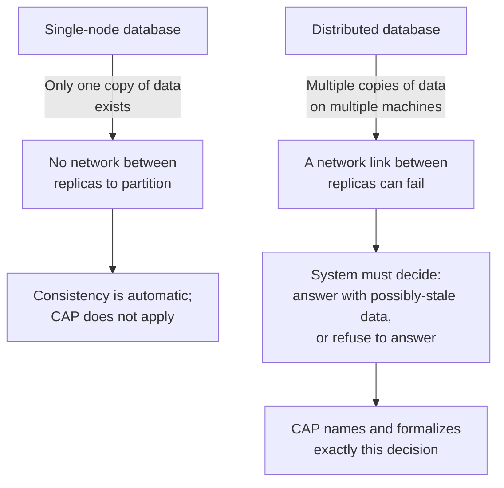

## 4. Core Concepts

### 4.1 Precise definitions: Consistency, Availability, and Partition tolerance

**Definition.** CAP's three letters each have a specific, narrower meaning
than their English words suggest, and conflating them with adjacent,
similarly-named concepts is the single most common source of CAP
confusion.

- **Consistency (CAP's C) is atomic/linearizable consistency**: every read
  returns either the most recent write's value or an error — never a
  stale value, and never two different-but-simultaneously-valid answers
  from two different nodes. Formally, all operations appear to take effect
  atomically at some single point in time, in an order consistent with
  the real-time order they were issued, as if there were only one copy of
  the data being accessed one operation at a time. This is a much stronger
  guarantee than ACID's "C." ACID's Consistency means a transaction moves
  the database from one *valid* state to another *valid* state with
  respect to declared invariants (foreign keys, unique constraints, check
  constraints) — it says nothing about whether two replicas agree with
  each other, and a single-node ACID-compliant database trivially
  satisfies ACID's C without any notion of replicas at all. CAP's C is
  also a much stronger guarantee than the everyday "eventual consistency"
  used in casual engineering conversation, which only promises that
  replicas *will* converge to the same value *eventually*, given no new
  writes, with no bound on how stale an intervening read might be. CAP's C
  is the strongest point on that everyday consistency spectrum
  (linearizability), not a separate axis from it.
- **Availability (CAP's A) means every request to a non-failed node
  receives a non-error response** — not necessarily a *fast* response, and
  not necessarily a *fresh* response, just *some* substantive response,
  eventually, from any node that is itself still running. A node that is
  reachable but returns "503 Service Unavailable" or times out because it
  is waiting to hear from an unreachable peer before it will answer at all
  is, in CAP's formal sense, *not* available for that request, even though
  the machine itself has not crashed.
- **Partition tolerance (CAP's P) means the system continues to operate
  (in some form) despite an arbitrary number of messages being dropped or
  delayed between two sets of nodes** — i.e., the network is allowed to
  fail arbitrarily, and the system as a whole does not simply halt or
  crash the instant that happens. Critically, "partition tolerance" does
  not describe a *choice* a system makes the way "consistency" or
  "availability" describe a choice — every distributed system that spans
  more than one machine either tolerates the possibility of a partition
  (defines *some* behavior for that case, even if that behavior is "stop
  answering") or it does not exist as a distributed system at all, because
  networks fail regardless of what any single piece of software wants.

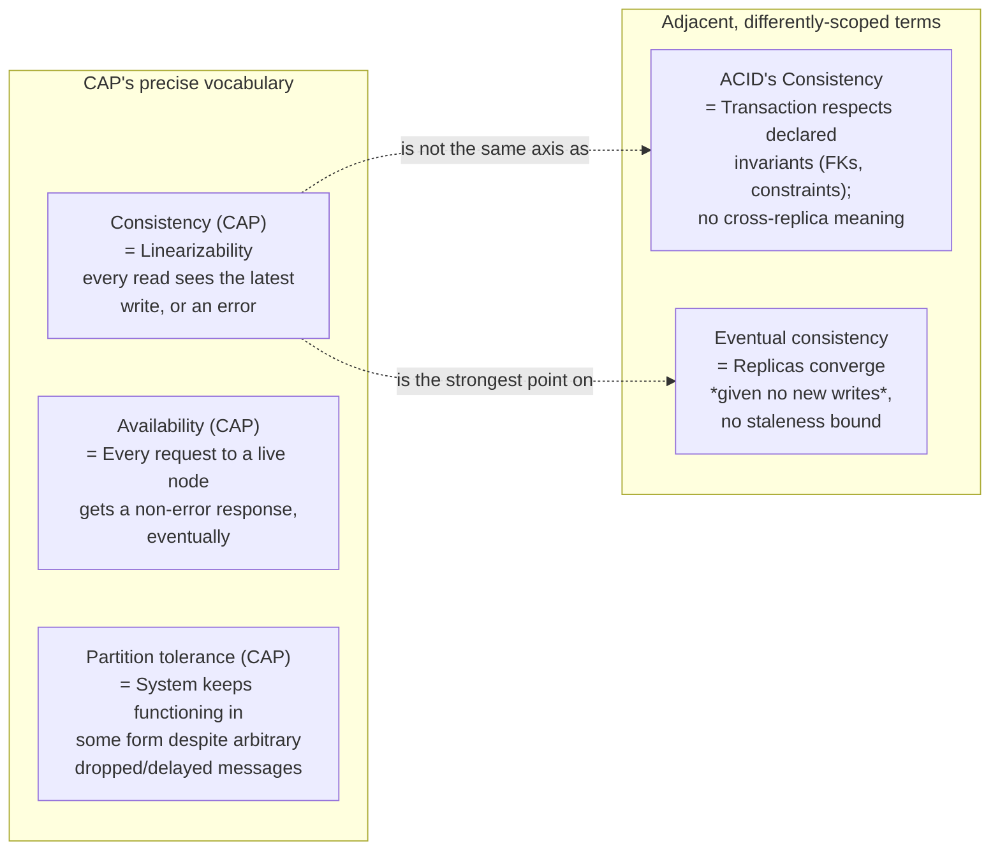

**Mechanism — why these definitions are chosen this precisely.** Gilbert and
Lynch's proof needs definitions precise enough to reason about
mathematically, and "consistency" and "availability" as used in ordinary
engineering conversation are too loose for a proof — "the database should
be consistent" could mean five different things depending on who says it.
By pinning consistency to linearizability specifically (single, real-time-
ordered, atomic history) and availability to "every live node responds to
every request," the proof in Section 4.2 becomes a precise, checkable
argument rather than an appeal to intuition.

**Decision implications.** When someone says "our system is consistent,"
the practically useful follow-up question is always "consistent in which
sense — CAP's linearizable sense, ACID's invariant sense, or the eventual-
consistency sense?" — because a system can be all three, some combination,
or none, and architecture decisions (Section 6, Section 20) hinge on which
one is actually meant.

**Common failure mode.** Treating "the database is ACID-compliant" as
implying "the database is CAP-consistent" is a specific, recurring error:
a single-node PostgreSQL instance is fully ACID-compliant and, trivially
(because it has no replicas to disagree with), CAP-consistent too — but
the moment that same PostgreSQL instance gets an asynchronous read
replica (recapped from [Replication](../06_Databases_and_Storage/CH07_Replication.md#42-asynchronous-replication)),
the *cluster* stops being CAP-consistent (a replica read can return stale
data) even though every individual node, and every individual transaction
on the leader, remains fully ACID-compliant. ACID and CAP-C are answering
different questions and neither implies the other once more than one node
is involved.

**Scenario.** An engineer proposes "let's just make the system consistent
*and* available, we'll add more redundant network paths so partitions
basically never happen." This conflates *reducing the frequency* of
partitions (a genuinely useful, orthogonal engineering effort — more
redundant links, better hardware, multi-homing) with *eliminating the
CAP trade-off* (impossible, per Section 4.2) — the trade-off still exists
for the partitions that do occur, however rare engineering effort makes
them, and the system's designers must still have decided, in advance,
what a node does the next time a partition happens, however statistically
rare that next time is.

### 4.2 The proof sketch: why you cannot have all three during a partition

**Definition.** The proof sketch shows that if a network partition occurs
— splitting a distributed system's nodes into (at least) two groups that
cannot exchange any messages — then any system that continues to accept
both reads and writes on both sides of the partition (i.e., remains
available on both sides) cannot also guarantee linearizable consistency,
because a linearizable read on one side of the partition would have to
reflect a write that just happened on the other side, and that write's
effect physically cannot cross a partition that, by definition, is
dropping every message between the two sides.

**Mechanism — the two-node argument.** Consider the simplest possible case:
two nodes, N1 and N2, each holding a replica of the same data item, with a
network link between them that a partition has just severed.

1. A client writes value `v2` to N1. N1 accepts the write (it is a live,
   reachable node) and would normally forward that write to N2 to keep the
   replicas in sync — but the partition drops that forwarding message, so
   N2 never learns about `v2`.
2. A different client, unable to reach N1 (perhaps it is routed to N2 by a
   load balancer, or N1's data center is the side that is cut off from this
   client), sends a read request to N2.
3. N2 must now make a choice, and this choice is the entire theorem in
   miniature: it can respond with the *old* value `v1` it still has locally
   (satisfying availability — it answered — but violating linearizable
   consistency, because a linearizable history must reflect the write from
   step 1 that has already externally completed), or it can refuse to
   respond at all until it can confirm with N1 that it has the latest value
   (satisfying consistency by never returning a stale answer, but violating
   availability, because N2 is live and reachable yet is not answering).
4. There is no third behavior available to N2. It cannot invent the value
   `v2` without having received it (that would be a guess, not a read of
   the actual latest write, and could be wrong). It cannot ask N1 for the
   value, because the partition has, by definition, dropped exactly that
   kind of message. Every possible action N2 can take falls into one of
   the two buckets above.

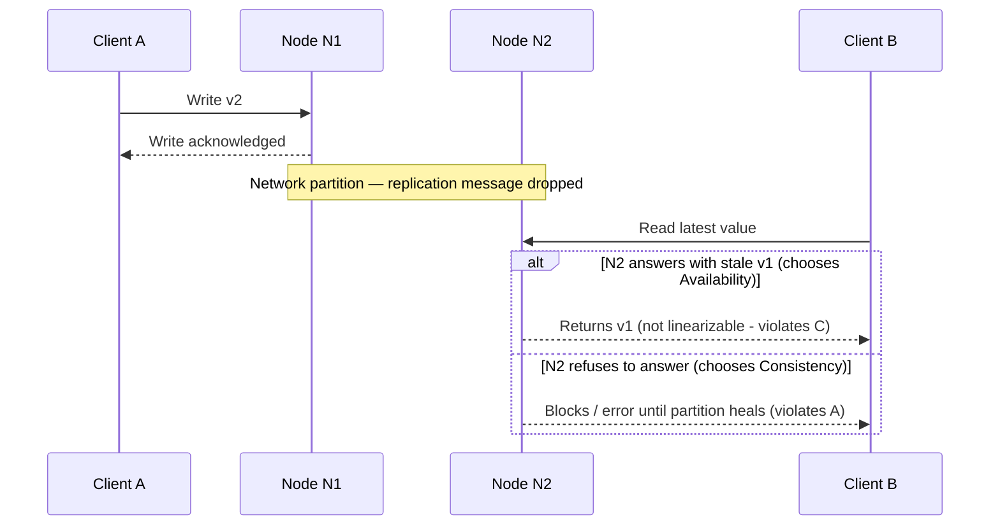

**Decision implications.** The proof is symmetric and does not depend on
which specific consensus protocol, replication strategy, or database
engine is in use — it is a statement about *any* system with more than one
node and a network between them, which is why CAP is not a database-
specific result the way, say, MongoDB's write-concern levels are; it
applies equally to a relational cluster, a key-value store, a message
queue, or a distributed cache. Any of these must make the same N2-style
choice the instant a partition occurs.

**Common failure mode.** People often try to "solve" CAP by adding more
replicas, faster networks, or a smarter consensus algorithm, expecting
that enough engineering effort makes the choice in step 3 go away. It
does not — better engineering reduces *how often* a partition happens and
*how long* it lasts (both worthwhile), but it cannot change what a node
must do the moment a partition is actually in effect, because the proof
above does not depend on partition *frequency*, only on partition
*existence* for however brief a window.

**Scenario.** A payment-processing service's on-call engineer, during a
cross-region network incident, watches the system refuse writes on the
minority side of the partition rather than risk a double-spend. This is
the CP choice from the proof playing out live: the system's designers
decided, at design time, that N2's "refuse to answer" branch was the
correct default for a ledger write, accepting temporary unavailability in
the region that lost quorum rather than any risk of a linearizability
violation on money.

### 4.3 The "2 of 3" fallacy, explained precisely

**Definition.** The popular mnemonic "Consistency, Availability, Partition
tolerance — pick two" (often rendered as picking any two of {CA, CP, AP})
is the single most repeated, and most misleading, summary of CAP, because
it implies partition tolerance is an optional design choice on the same
footing as consistency or availability — something a system can simply
decline, the way it might decline strong consistency in favor of a faster
eventual-consistency design. It is not: partition tolerance is not
something *software* opts into or out of, because the network itself
decides whether a partition happens, independent of what the software
would prefer.

**Mechanism — why "CA" (choosing consistency and availability, and
declining partition tolerance) is not a real, deployable option for a
distributed system.** A theoretical "CA" system is only correct in a world
where a network partition between its nodes never happens — but any system
with more than one node, connected by any real network (even two racks in
the same data center, let alone cross-region links), *will* eventually
experience a dropped or delayed message, whether from a switch failure, a
NIC firmware bug, a garbage-collection pause that looks like unavailability
to a peer, or a misconfigured firewall rule. A single-node system trivially
achieves "CA" (it is both linearizable and always available, because there
is nothing to partition from), but that is a degenerate case outside CAP's
actual scope (Section 4.1's framing requires more than one node for the
theorem to even apply) — it is not a genuine three-way choice a multi-node
system's architect can make and expect to hold under real-world network
conditions.

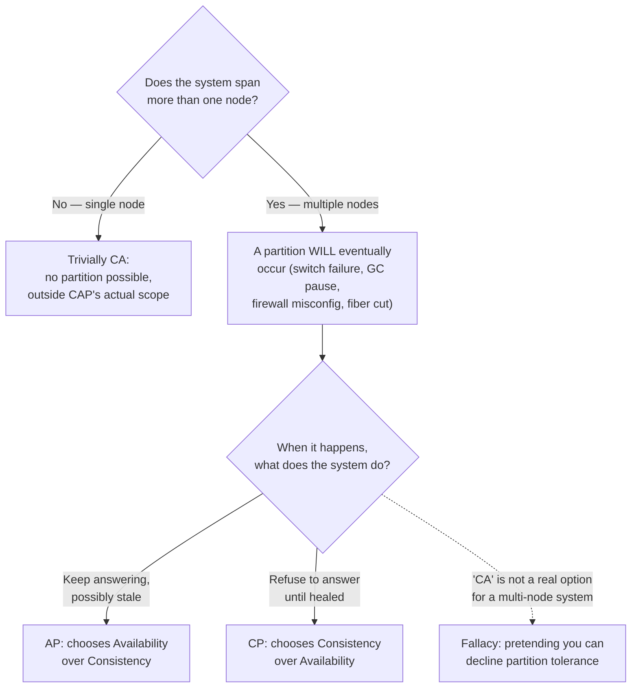

**Decision implications.** The precise, correct restatement of CAP is:
*for any distributed system with more than one node, once a partition is
actually occurring, the system must choose between Consistency and
Availability for the duration of that partition* — the real decision is
not "which two of three" but "C or A, during a partition, given that P is
not optional." This reframing (owed to Brewer's own 2012 retrospective,
Section 2) is what this chapter uses throughout, and it is the version
worth memorizing instead of the "pick two" mnemonic.

**Common failure mode.** Vendors and teams sometimes market a system as
"CA" to imply it has *solved* the trade-off rather than *deferred* it —
in practice, a system labeled "CA" almost always means one of: (a) it is
effectively single-node or single-writer with no meaningful partition
scenario in its deployed topology, (b) it has quietly chosen CP or AP and
is calling it "CA" for marketing reasons, or (c) it will, in fact, fail
in an unspecified way during a real partition because its designers never
made the choice explicit, which is worse than choosing either C or A on
purpose.

**Scenario.** An architecture review challenges a proposal that claims its
new service is "fully consistent and fully available, with no trade-off,"
by asking a single, precise question: "when the two data centers this
service replicates across cannot reach each other, what does a write to
the unreachable side do?" There is no answer to that question that avoids
choosing C or A — forcing the answer out into the open is the practical
antidote to the "2 of 3" fallacy.

### 4.4 CP systems vs. AP systems: concrete examples and real trade-offs

**Definition.** A CP system is one whose designers chose Consistency over
Availability for the case where a partition is in effect: nodes on the
minority side of a partition (the side that cannot reach a quorum of the
rest of the cluster) stop accepting writes, and often stop accepting
reads too, until the partition heals. An AP system is one whose designers
chose Availability over Consistency for that same case: every reachable
node keeps accepting reads and writes during the partition, and the system
defers reconciling any conflicting writes until after the partition heals.

**Mechanism — how each family actually enforces its choice.**

- **CP systems** typically use a consensus protocol (recapped forward from
  the future [Consensus](CH07_Consensus.md) chapter — Raft and Paxos are
  the canonical examples) that requires a *majority quorum* of nodes to
  agree before any write is considered committed. If a partition splits a
  5-node cluster into a 3-node majority side and a 2-node minority side,
  the 3-node side can still reach quorum (3 out of 5) and continues to
  accept writes; the 2-node side cannot reach quorum (2 out of 5) and
  therefore refuses writes — and, in a strict CP configuration, refuses
  reads too, because a read on the minority side cannot be proven to
  reflect the latest committed state. **ZooKeeper**, **etcd**, and
  **Consul** (all Raft- or ZAB-based) are canonical CP systems: a
  configuration-management or service-discovery use case generally cannot
  tolerate two different nodes disagreeing about who currently holds a
  lock or which node is the current leader, so these systems are built to
  sacrifice availability rather than ever return two conflicting answers.
  **MongoDB** with `writeConcern: majority` and default read behavior is
  also a CP-leaning configuration for the same reason: replica-set
  elections require a majority, and writes not acknowledged by a majority
  are not considered durable.
- **AP systems** typically use a leaderless, quorum-*optional* replication
  model where any reachable replica can accept a write immediately (often
  with only `W=1` acknowledgment, recapped from
  [Replication](../06_Databases_and_Storage/CH07_Replication.md#43-quorum-based-replication-dynamo-style)),
  and reconcile any conflicting versions later using techniques like
  last-write-wins, vector clocks, or Conflict-free Replicated Data Types
  (CRDTs). **Cassandra** with consistency level `ONE` (or even `ANY`,
  which accepts a write via hinted handoff to any reachable node even if
  the actual owning replica is down) is a canonical AP configuration:
  every node keeps serving during a partition, and conflicting writes are
  resolved by timestamp on read. **DynamoDB** (and the original Dynamo
  paper it derives from) defaults to eventually-consistent reads for the
  same reason — availability during a partition, with the option to pay
  extra latency for a strongly-consistent read when the caller
  specifically needs it. A distributed cache like **Riak** in its default
  configuration is likewise AP: it will keep serving from whichever
  replicas remain reachable rather than block on a quorum.

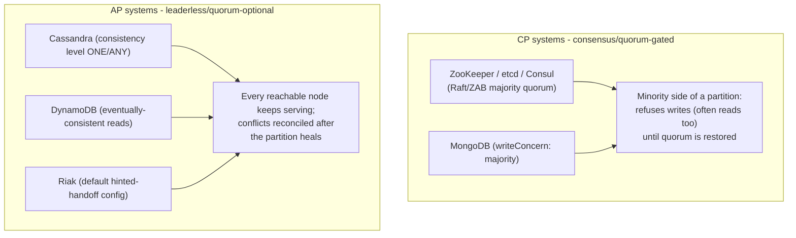

**Decision implications.** The choice is a per-dataset, per-use-case
decision, not a single global label for an entire company's
infrastructure — the same organization legitimately runs etcd (CP, for
service discovery and distributed locks, where two nodes disagreeing about
a lock holder is a correctness bug) alongside Cassandra (AP, for a
high-write-volume event-ingestion pipeline where a few seconds of
eventual consistency on a counter is invisible to any user). Section 20
and Section 21 return to this per-system decision framing in more depth.

**Common failure mode.** Choosing a system's CP/AP posture by reputation
("Cassandra is the AP one, so we'll use it for our order ledger") rather
than by the actual consistency requirement of the specific data being
stored is a frequent, costly mistake — an order ledger is exactly the kind
of data (like the payment example in Section 4.2's scenario) that usually
needs CP guarantees, regardless of how well AP systems perform at scale
for other use cases within the same product.

**Scenario.** A social-media feed-ranking service stores "like counts" in
an AP-configured Cassandra cluster (a slightly stale like count is
invisible to users and self-corrects within seconds) while the same
company's billing service stores account balances in a CP-configured
PostgreSQL cluster with synchronous replication (a stale balance read
could authorize a transaction the account cannot actually cover) — the
same company, two entirely different, and both correct, CAP choices.

### 4.5 CAP in practice: partition frequency reality and the reconcile-after pattern

**Definition.** "CAP in practice" is the operational reality that
partitions are not a constant, always-in-effect condition — most
distributed systems spend the overwhelming majority of their runtime in
normal, partition-free operation, where every node can reach every other
node and the CP-vs-AP choice is invisible because there is no conflict to
resolve. The CAP trade-off only becomes observable during the
comparatively rare windows when a partition is actually in effect — but
"rare" is not "never," and a system's behavior during those windows is
exactly what its CP/AP design decision determines.

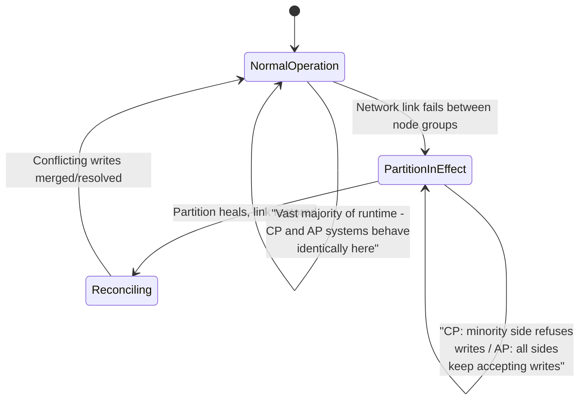

**Mechanism — the "consistency during partition, then reconcile" pattern.**
Many production systems do not pick a pure CP or pure AP posture for their
*entire* runtime; instead they run in a fully consistent mode during
normal operation (every write goes through a single leader or a full
quorum, and reads are linearizable or close to it) and only fall back to
an explicitly degraded, availability-favoring mode *during* a detected
partition — accepting locally-durable writes that are queued for
reconciliation once the partition heals, rather than blocking entirely.
This is distinct from a system being "AP all the time": the system's
default, partition-free behavior is fully consistent, and only the
partition-triggered fallback trades consistency for availability, with an
explicit reconciliation step (merge, last-write-wins, or manual review for
irreconcilable conflicts) once connectivity is restored. Multi-region
active-active database topologies with conflict resolution (recapped from
[Replication's multi-leader conflict resolution](../06_Databases_and_Storage/CH07_Replication.md#42-multi-leader-replication-and-conflict-resolution))
are the most common real-world instance of this pattern.

**Decision implications.** Because most systems spend most of their time
outside a partition, the CP-vs-AP decision should be made based on what
matters during the rare partition window, not based on average-case
performance during normal operation — a system that is imperceptibly
slower during 99.9% of its runtime because it is CP-configured, but never
double-charges a customer during the 0.1% of runtime when a partition
occurs, is very often the correct trade for financial data, while the
opposite trade is correct for data where a brief availability gap is more
costly to the business than a moment of staleness.

**Common failure mode.** Under-investing in monitoring and testing for the
partition case specifically, because it is rare, is a common and expensive
mistake — the CP/AP decision only matters during the partition, so a
system that has never actually been exercised under a real or simulated
partition (Section 16's chaos-engineering and Jepsen-style testing) has an
unverified, and frequently wrong, assumption baked into its design.

**Scenario.** A ride-sharing platform's driver-location service runs
fully consistent (every location update goes to a single regional leader)
during normal operation, but during a detected cross-region network
partition, falls back to accepting location updates locally per-region and
reconciling the two regions' driver rosters once the link is restored —
briefly risking a driver appearing in two regions' dispatch pools rather
than making the entire region's dispatch system unavailable, a deliberate
choice that Section 15 revisits as a full failure-scenario walkthrough.

## 5. Internal Working

Zooming into how a real consensus-based CP system and a real leaderless AP
system each mechanically enforce their CAP choice at the moment a partition
occurs. In a Raft-based CP system (recapped forward from the future
[Consensus](CH07_Consensus.md) chapter), every write must be replicated to
and acknowledged by a majority of the cluster's nodes before the leader
considers it committed and reports success to the client. When a partition
splits the cluster, the side holding a majority of nodes can still commit
writes normally (it can still form a quorum among itself); the side
holding a minority cannot form a quorum, so any leader stranded on that
side (or any follower that briefly believes it should be leader) is
mechanically prevented from committing new writes — not by explicit
"if partitioned, refuse" application logic, but as a direct structural
consequence of the majority-quorum commit rule already being enforced
during normal operation. This is why CP systems can implement Section
4.4's behavior with no special-cased partition-detection code at all: the
same quorum rule that provides consistency during normal operation
*automatically* produces the correct availability sacrifice during a
partition, because quorum arithmetic (recapped from
[Replication's W+R>N rule](../06_Databases_and_Storage/CH07_Replication.md#43-quorum-based-replication-dynamo-style))
simply cannot be satisfied on the minority side.

In a Dynamo-style AP system, by contrast, a write only needs to be
acknowledged by `W` replicas out of `N`, where `W` is often set to `1` (or
uses "sloppy quorum," recapped from Replication, accepting a write via
hinted handoff on any reachable node rather than strictly the assigned
owner). During a partition, this low bar for acknowledgment means nodes on
*both* sides of the partition can independently accept writes to the same
key, producing two divergent version histories. The system tags each
write with a vector clock or a similar causality-tracking mechanism so
that, once the partition heals, a background "read repair" or anti-entropy
process (recapped from Replication) can detect the divergence and either
merge the values (if a CRDT-friendly data type), apply last-write-wins (if
the application accepts that data-loss risk), or surface the conflict to
the application/client to resolve (Dynamo's original design explicitly
punts unresolvable conflicts to the client application, on the theory that
only the application knows the correct business-level merge rule for its
own data).

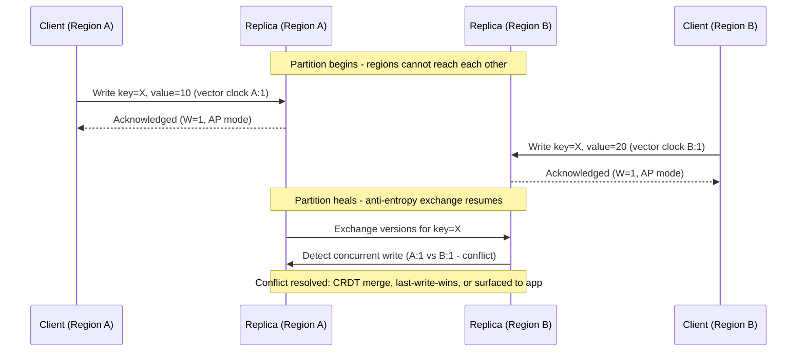

## 6. Design Principles

- **Make the CP/AP choice explicit, in writing, per dataset — never leave
  it implicit in default configuration.** An Architecture Decision Record
  (recapped from
  [Architecture Thinking](../01_Architecture_Mindset/CH03_Architecture_Thinking.md#architecture-decision-records-adrs))
  stating "this service's write path is CP because a stale or lost write
  here is a financial-correctness bug; this service's read-cache path is
  AP because staleness is invisible to the user" turns an implicit,
  accidental default into a deliberate, reviewable decision.
- **Prefer the least surprising failure mode for the business, not the
  least surprising failure mode for the engineer.** A CP system that
  returns a clear, immediate error during a partition is easier for an
  engineer to reason about than an AP system that silently serves stale
  data — but the business impact of "checkout is briefly down" versus
  "product description is briefly stale" is what should actually drive the
  choice, not engineering convenience.
- **Design the reconciliation path before the partition happens, not
  during the incident.** If a system chooses AP for some data, decide the
  conflict-resolution rule (last-write-wins, CRDT merge, or manual review
  queue) at design time; inventing a reconciliation strategy live, during
  an active incident, under time pressure, produces worse outcomes than
  even a mediocre pre-agreed rule.
- **Different data within the same system can, and usually should, sit at
  different points on the CP/AP spectrum.** Section 4.4's e-commerce
  example (CP ledger, AP product catalog) is the norm for any
  non-trivial system, not a special case — a single global CP-or-AP label
  for an entire application is itself a design smell.

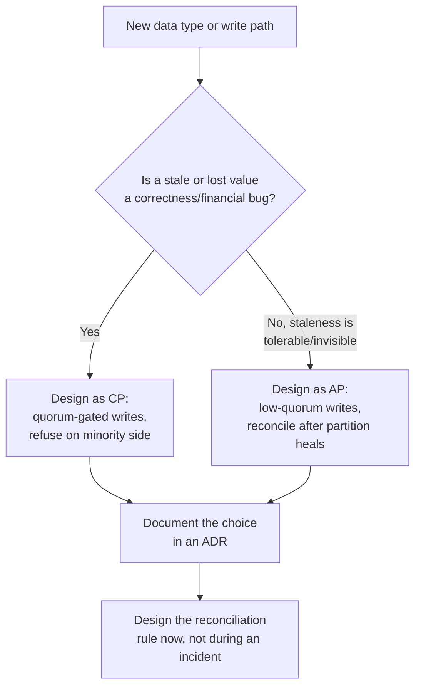

## 7. Architecture Patterns

- **Single-leader consensus pattern (CP).** A Raft- or Paxos-backed cluster
  (etcd, ZooKeeper, Consul, or a Raft-based database like CockroachDB) where
  every write is committed only after a majority quorum acknowledges it.
  Used for configuration, service discovery, distributed locks, and
  leader-election metadata (recapped forward from the future
  [Leader Election](CH08_Leader_Election.md) chapter) — any use case where
  two nodes disagreeing is worse than one node being briefly unreachable.
- **Leaderless quorum pattern (tunable, AP-leaning by default).** A
  Dynamo-style ring (Cassandra, DynamoDB, Riak) where any replica can
  accept a write, with per-request tunable `N`/`W`/`R` (recapped from
  Replication) letting callers dial toward more consistency (higher `W`
  and `R`) or more availability (lower `W` and `R`) on a per-operation
  basis rather than a fixed cluster-wide setting.
- **Partition-aware degraded-mode pattern.** A system that runs fully
  consistent by default but has an explicit, tested fallback mode
  triggered by partition detection (missed heartbeats past a threshold,
  recapped from
  [Replication's failover mechanics](../06_Databases_and_Storage/CH07_Replication.md#48-failover-mechanics-and-split-brain-risk))
  that switches specific write paths to a locally-durable, queue-and-
  reconcile mode for the duration of the partition, then automatically (or
  with an operator gate) reconciles once the partition heals — this is
  Section 4.5's "consistency during partition, then reconcile" pattern
  made into a named, reusable architecture pattern.
- **CQRS-style split posture (recapped forward).** Command Query
  Responsibility Segregation (recapped forward from the future
  [CQRS](CH13_CQRS.md) chapter) naturally lends itself to a split CAP
  posture: the write (command) side often runs CP (a single authoritative
  source of truth for state changes), while the read (query) side runs AP
  (denormalized, eventually-consistent read models optimized for query
  patterns) — this chapter only notes the CAP-shaped seam between the two
  sides; CQRS's own mechanics belong to that future chapter.

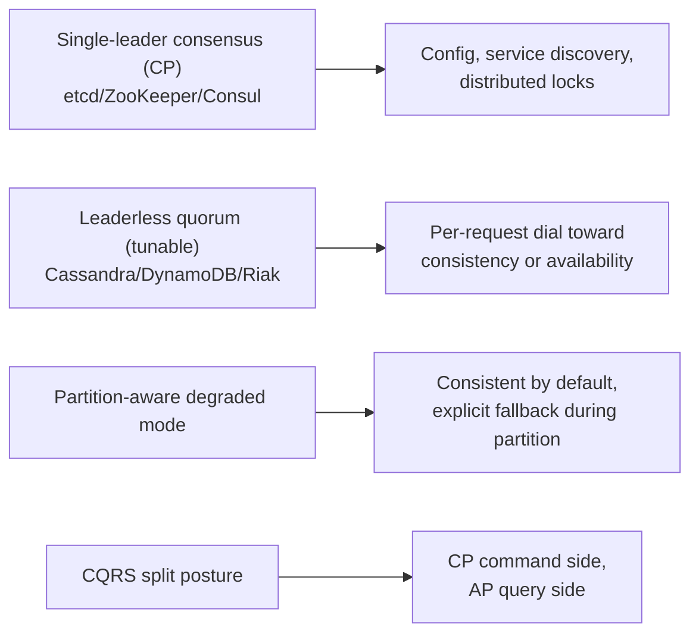

## 8. Production Architecture

A production multi-region order-processing system illustrates how CAP
choices compose across a single architecture rather than being a single,
system-wide label. The order-write path (accept order, reserve inventory,
charge payment) runs through a single-region-leader, quorum-committed
datastore — CP, because a lost or duplicated charge is unacceptable. The
product-catalog read path is served from a globally-replicated,
eventually-consistent cache — AP, because a few seconds of staleness on a
product description or price display (bounded by a short cache Time To
Live, or TTL) is invisible to the shopper and self-heals quickly. The
shopping-cart service sits in between: it favors availability (a shopper
should never see a hard error adding an item to a cart) but reconciles
any conflicting cart states (e.g., the same session briefly served by two
regions during a partition) via a last-write-wins merge keyed on item
quantity, accepting the small risk of a slightly wrong cart over ever
blocking the "add to cart" action.

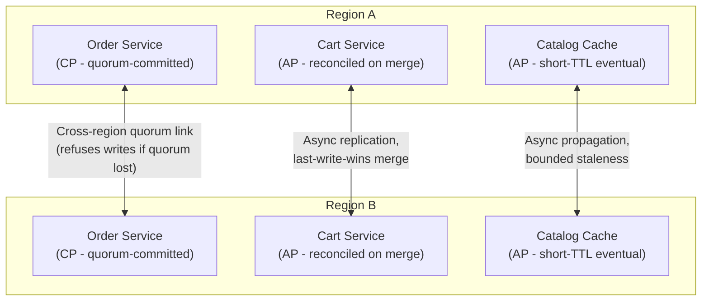

## 9. Implementation

Implementing a deliberate CAP posture is primarily a configuration and
client-behavior decision layered on top of whichever datastore a team has
already chosen, not a from-scratch protocol implementation in most
production systems — most mainstream datastores expose the CP/AP dial
directly:

1. **Choose the quorum parameters explicitly, rather than accepting silent
   defaults.** A Dynamo-style store's `N` (replica count), `W` (write
   quorum), and `R` (read quorum) should be set per access pattern: `W=1,
   R=1` favors availability and latency; `W=majority, R=majority` (with
   `W+R>N`, recapped from Replication) favors consistency at the cost of
   latency and availability during a partition.
2. **Set an explicit timeout and retry policy for the CP path's refusal
   case.** A CP system does not fail silently during a partition — it
   returns an error or times out — and the calling application must decide
   whether to retry, queue locally, or surface the failure to the end
   user, rather than let an unhandled exception propagate.
3. **Implement (or select a datastore that implements) a concrete conflict-
   resolution function for the AP path**, matched to the data's actual
   merge semantics: numeric counters often merge via CRDT counters; "set
   of items" data (like a shopping cart) often merges via a union or
   last-write-wins on a per-item basis; free-text fields with no sensible
   automatic merge are often surfaced to a human or the original writer
   for manual resolution.
4. **Instrument partition detection and duration** (Section 14) so the
   degraded-mode pattern from Section 6/7 has a concrete trigger and the
   post-incident reconciliation has an accurate window to reconcile
   against.

## 10. Complete Code Examples

Three worked, runnable-shape examples under
`code/markdown/cap-theorem-chapter/`, illustrating a CP configuration, an
AP configuration, and the quorum arithmetic that mechanically produces
each posture:

1. [01_cp_system_configuration.md](../code/markdown/cap-theorem-chapter/01_cp_system_configuration.md) —
   etcd and MongoDB configuration excerpts showing majority-quorum commit
   settings, election timeouts, and what each system does on the minority
   side of a partition.
2. [02_ap_system_configuration.md](../code/markdown/cap-theorem-chapter/02_ap_system_configuration.md) —
   Cassandra and DynamoDB configuration/API-call excerpts showing tunable
   consistency levels, hinted handoff, and eventually-consistent versus
   strongly-consistent read calls on the same table.
3. [03_quorum_simulation.md](../code/markdown/cap-theorem-chapter/03_quorum_simulation.md) —
   a small Python simulation that models a 5-node cluster, injects a
   partition, and shows the majority side continuing to commit writes
   while the minority side is mechanically blocked by the `W+R>N` quorum
   check, printing out the exact moment each side's behavior diverges.

## 11. Performance

A CP posture's consistency guarantee is paid for in latency during normal
operation, not only during a partition: every write must wait for a
majority quorum's round-trip acknowledgment (recapped from
[Replication's synchronous replication latency cost](../06_Databases_and_Storage/CH07_Replication.md#41-synchronous-replication)),
which, across multiple availability zones or regions, can add tens to
low-hundreds of milliseconds per write compared to a single-node
acknowledgment. An AP posture's low-quorum writes (`W=1`) return as soon
as the closest reachable replica acknowledges, trading that latency
headroom for the possibility of a client later reading a stale or
conflicting value. This is precisely the everyday, partition-free-latency
side of the trade-off that this book's sibling
[PACELC](CH06_PACELC.md) chapter formalizes in full; this chapter notes
only that the performance cost of a CP posture is not confined to rare
partition windows — a majority-quorum system pays a latency tax on every
single write, all the time, as the price of the consistency guarantee it
needs to be ready to enforce the instant a partition does occur.

## 12. Scalability

CP systems' majority-quorum requirement caps how far a single write path
can scale horizontally by adding more replicas: each additional replica
adds another vote a quorum must collect, which *increases* the latency and
coordination cost of every write rather than reducing it, unlike read
scaling (where more replicas straightforwardly add read capacity). This is
why CP systems like etcd and ZooKeeper are typically deployed with a small,
fixed odd number of nodes (3, 5, or 7) rather than scaled the way a
read-heavy cache is scaled — beyond a handful of nodes, the coordination
overhead of a larger quorum outweighs any benefit. AP systems scale write
throughput far more linearly, because each additional node can accept
writes for its own subset of the key space (recapped from
[Partitioning](../06_Databases_and_Storage/CH05_Partitioning.md)) largely
independently of every other node's write path, with reconciliation as a
background cost rather than a per-write blocking cost — a major reason
Dynamo-style AP designs became the default choice for very-high-write-
volume, horizontally-scaled workloads (event ingestion, telemetry, session
state) where a large node count is the whole point.

## 13. Security

CAP's choice interacts with security primarily through the availability
side: a system that has chosen strict CP behavior can be pushed into a
self-inflicted denial-of-service condition by an attacker who deliberately
induces network partitions or quorum loss (for example, flooding
inter-node links to simulate a partition), causing the system to refuse
legitimate traffic exactly as its CP design intends it to during a real
partition — the correctness guarantee and the availability risk are two
sides of the same designed behavior. Encryption of inter-node replication
and consensus traffic (recapped from [TLS](../05_Networking_and_OS/CH06_TLS.md))
and authentication between cluster members (so an attacker cannot forge
quorum votes or replication messages) are the security-specific controls
relevant here; the deeper mechanics of both remain owned by their
respective chapters and by the future Part 15 (Security), not re-taught
in this chapter.

## 14. Observability

Detecting a partition, rather than merely reacting to one, is the
prerequisite for both Section 6's degraded-mode pattern and Section 15's
failure-scenario handling. Key signals to monitor: inter-node heartbeat
miss rate and quorum-membership changes (a CP system's consensus log
directly exposes leader elections and quorum-loss events); per-region or
per-availability-zone write-latency percentiles (a sudden latency spike
isolated to cross-region writes is an early partition signal, often
visible before an explicit quorum-loss alert fires); and, for AP systems,
the size and age of the pending-reconciliation/anti-entropy queue (a
growing backlog of unresolved conflicting versions is the direct,
measurable cost of time spent in AP-favoring degraded mode, and should
have its own alert threshold rather than being discovered only when a
customer reports a stale read).

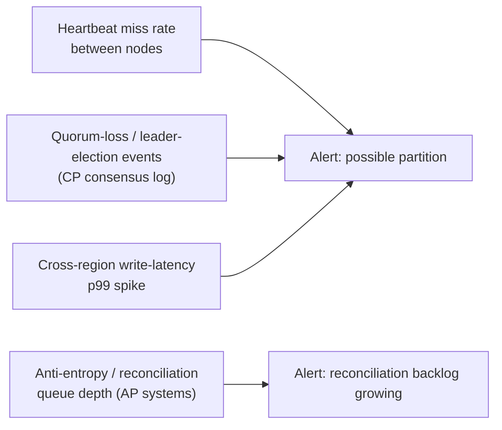

## 15. Failure Scenarios

Walking through a concrete cross-region network partition end to end, for
a system that has chosen the CP posture for its order-write path:

1. **Normal operation.** All three regions' order-service nodes
   participate in a single Raft group; every write is committed after a
   majority (2 of 3 regions) acknowledges it; latency is a few tens of
   milliseconds above single-region baseline.
2. **Partition begins.** The link between Region C and the other two
   regions is severed by a submarine-cable fault. Region A and Region B can
   still reach each other and, together, still hold a majority (2 of 3).
3. **Majority side continues.** Orders placed against Region A or Region B
   continue to commit normally, because a 2-node quorum out of 3 is still
   achievable without Region C.
4. **Minority side degrades.** Region C's order-service node can no longer
   reach a majority; any write request routed to Region C is refused (or
   times out) rather than committed locally — Region C's application tier
   surfaces a clear, retryable error to any client routed there, and
   ideally, upstream routing/load-balancing detects this and redirects
   traffic away from Region C toward A or B for the duration of the
   partition.
5. **Partition heals.** The submarine-cable fault is repaired; Region C
   rejoins the Raft group, catches up on the committed log entries it
   missed, and resumes normal participation — no reconciliation step is
   needed on the CP path specifically because Region C never accepted any
   conflicting writes to reconcile; it simply replays the log it missed.

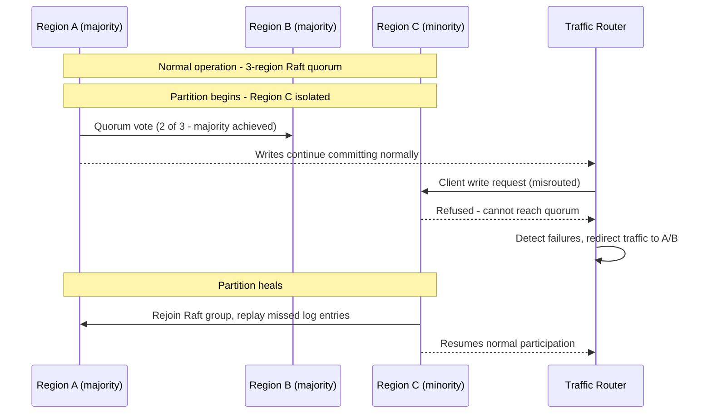

**Contrast with an AP-posture failure scenario**: had the order-write path
instead been AP-configured, Region C would have kept accepting writes
locally during the partition, and step 5 would additionally require a
reconciliation pass — detecting any order placed in Region C that
conflicts with inventory already reserved by Regions A/B for the same item,
and resolving that conflict (likely by honoring whichever region's
reservation happened first, and apologizing to the other customer) — the
exact operational cost the CP choice in this scenario was designed to
avoid for order/payment data specifically.

## 16. Testing

Verifying a system's actual CAP posture requires deliberately inducing the
condition the system's design claims to handle, not simply trusting the
configuration file, because a misconfigured quorum setting (an off-by-one
in `W+R>N` arithmetic, or a consensus timeout tuned too aggressively) can
silently produce the opposite behavior from what the team believes they
built. **Jepsen**, a widely used distributed-systems testing framework
built by Kyle Kingsbury, is the industry-standard tool for this: it
injects real network partitions (via `iptables` rules or similar) between
a real cluster's nodes while running a workload against it, then checks
whether the resulting history of operations is actually linearizable
(for a system claiming CP) or whether conflicting writes are actually
detected and reconciled correctly (for a system claiming AP) — Jepsen's
published test reports have found real, previously undetected CAP-related
bugs in numerous widely deployed databases, underscoring that a database's
marketing claim about its consistency model is not a substitute for
testing it under an actual partition. Beyond Jepsen-style adversarial
testing, chaos-engineering practices (recapped forward — full mechanics
belong to a future resilience-testing chapter) that periodically and
safely inject real partitions into a staging (or even production, with
guardrails) environment validate that the degraded-mode pattern from
Section 6/7 actually triggers correctly and that the reconciliation logic
from Section 9 actually resolves conflicts the way its authors intended,
rather than only being exercised for the first time during a real
incident.

## 17. Common Mistakes

- **Reciting "pick two of three" as if CA were a real option** (Section
  4.3) — leads to designs that quietly assume partitions won't happen
  rather than deciding what happens when they do.
- **Treating CAP's "C" as the same thing as ACID's "C," or as the same
  thing as "we use strong consistency somewhere in this system"** (Section
  4.1) — leads to false confidence that a system is CAP-consistent because
  it is ACID-compliant on a single node.
- **Assuming CAP is a system-wide, single label rather than a per-dataset
  decision** (Section 4.4, Section 6) — leads to either over-engineering
  low-stakes data with expensive CP guarantees, or under-protecting
  high-stakes data with an AP default chosen for unrelated performance
  reasons.
- **Never testing the partition case because it is rare** (Section 16) —
  leads to a design's CAP posture being untested and frequently wrong by
  the time a real partition occurs.
- **Confusing CAP with PACELC and assuming there is no trade-off outside a
  partition** — CAP is silent about normal-operation latency-vs-
  consistency behavior; assuming a CP system is "free" when no partition
  is happening ignores the latency cost documented in Section 11, which
  the future [PACELC](CH06_PACELC.md) chapter formalizes.

## 18. Best Practices

- Write down, per dataset or write path, an explicit CP-or-AP decision and
  the business reason for it, as an ADR (Section 6).
- Choose quorum parameters (`N`/`W`/`R`, election timeouts) deliberately
  and document the arithmetic, rather than accepting a datastore's factory
  default without reviewing what that default actually implies during a
  partition.
- Pre-design the conflict-resolution rule for every AP-posture data type
  before it is needed in an incident (Section 6, Section 9).
- Instrument partition detection explicitly (Section 14) rather than
  relying on customer-reported staleness or an on-call engineer noticing
  elevated error rates by chance.
- Test the actual partition behavior with Jepsen-style adversarial testing
  or chaos engineering (Section 16), on a recurring basis, not once at
  launch.

## 19. Anti-Patterns

- **Marketing a system as "CA."** As Section 4.3 established, this is
  either a single-node degenerate case mislabeled as a multi-node
  guarantee, or a CP/AP choice made silently and left undocumented.
- **Blocking indefinitely on a CP path with no timeout or fallback
  messaging to the end user.** A CP refusal should be a fast, clear error
  or a bounded-time retry, not an indefinite hang that looks like the
  whole application has crashed.
- **Reconciling AP conflicts with an undocumented, ad hoc rule improvised
  during an incident.** This produces inconsistent outcomes across
  different conflicts of the same type and is difficult to audit after
  the fact.
- **Scaling a CP system's replica count the same way an AP system's is
  scaled**, ignoring Section 12's quorum-coordination cost, and being
  surprised when adding nodes to a Raft cluster *slows down* writes
  instead of speeding them up.

## 20. Trade-off Analysis

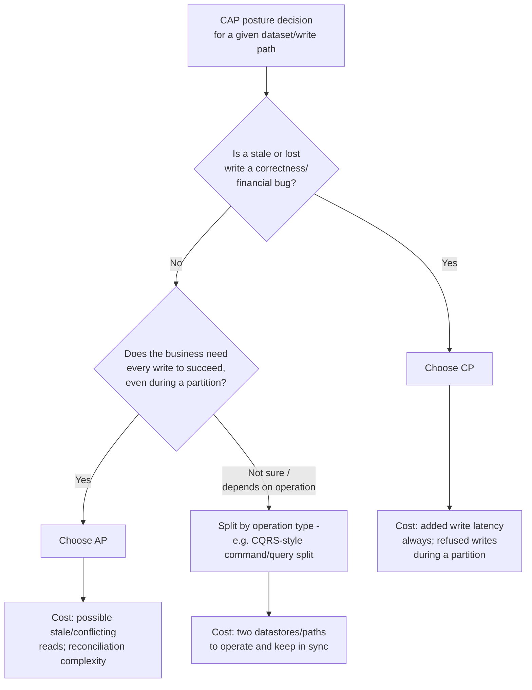

| Dimension | Favors CP | Favors AP |
|---|---|---|
| Data criticality | Financial, inventory, locks/leases | Product descriptions, like counts, session hints |
| Acceptable staleness | None — must reflect latest write | Seconds to minutes is invisible/self-healing |
| Acceptable unavailability | Brief refusal during partition is acceptable | Any refusal is worse than serving stale data |
| Write volume/scale target | Moderate, coordination-tolerant | Very high, horizontally distributed |
| Conflict-resolution appetite | None — prefers refusing over guessing | Willing to define and run a merge rule |

## 21. Comparison Table

| System | Default posture | Consistency mechanism | Availability trade-off during partition | Tunable? |
|---|---|---|---|---|
| etcd | CP | Raft majority quorum | Minority side refuses reads/writes | Limited (mostly fixed CP) |
| ZooKeeper | CP | ZAB (Zookeeper Atomic Broadcast) majority quorum | Minority side (no quorum) stops serving | Limited (mostly fixed CP) |
| Consul | CP (for KV/locks) | Raft majority quorum | Minority side refuses writes | Limited |
| MongoDB | CP-leaning (configurable) | Replica-set election + write concern | Depends on `writeConcern`/`readConcern` | Yes, per-operation |
| Cassandra | AP-leaning (tunable) | Leaderless replication, gossip | Every reachable node keeps serving | Yes, per-query consistency level |
| DynamoDB | AP by default | Leaderless, Dynamo-style quorum | Eventually-consistent reads always succeed | Yes, strongly-consistent reads available at extra latency/cost |
| Riak | AP | Leaderless, hinted handoff, vector clocks | Every reachable node keeps serving | Yes, per-bucket/per-operation |

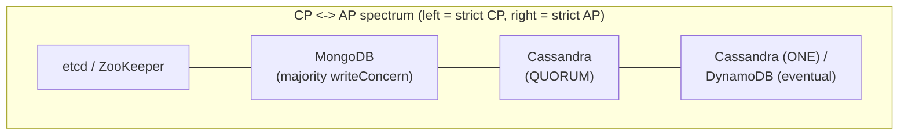

## 22. Real-World Case Study

**GitHub's October 2018 database-partition incident.** A network-partition
event between GitHub's East Coast primary data center and its West Coast
secondary data center lasted approximately 43 seconds — brief by most
measures — but was long enough for GitHub's MySQL cluster's automated
failover system to promote a new primary in the West Coast facility while
the original East Coast primary was still processing writes locally,
producing two simultaneously-active primaries (a split-brain condition,
recapped from
[Replication's split-brain mechanics](../06_Databases_and_Storage/CH07_Replication.md#48-failover-mechanics-and-split-brain-risk)).
Both primaries accepted writes during the window before the partition was
fully detected and one side was fenced, meaning data written to each
primary during that window was, by definition, not linearizable across the
cluster — an unintentional, incident-driven AP-like behavior in a system
whose normal design intent was CP (single-primary, orchestrated failover).
Reconciling the divergent histories required over a day of careful,
manual data-consistency restoration work before GitHub fully restored
normal service, because automated reconciliation rules had not been
designed for a split-brain window this system was not supposed to enter in
the first place. GitHub's own public incident writeup explicitly frames
the lesson as an orchestration and fencing gap (the failover system did
not correctly fence the original primary before promoting a new one) —
directly illustrating Section 4.2's proof in a real, publicly documented
production system, and underscoring Section 15's and Section 16's point
that a system's intended CP posture is only as good as testing that
verifies it actually holds during a real, even brief, partition.

## 23. Interview Questions

1. State CAP theorem precisely — not the "pick two" mnemonic — and explain
   why "CA" is not a real option for a genuinely distributed system.
2. Walk through Gilbert and Lynch's proof sketch for why a partition forces
   a choice between C and A.
3. How does CAP's "C" (linearizability) differ from ACID's "C" and from
   "eventual consistency"?
4. Give a real example of a CP system and a real example of an AP system,
   and explain the mechanism each uses to enforce its choice.
5. Why do CP systems (like Raft-based clusters) typically stay small (3, 5,
   7 nodes) rather than scale like a read replica pool?
6. What is the "consistency during partition, then reconcile" pattern, and
   when would you choose it over a strict CP or strict AP posture?
7. How does PACELC extend CAP, and what gap in CAP does it address?
8. What testing approach would you use to verify a system's claimed CAP
   posture actually holds under a real partition?
9. Design a system where two different write paths within the same
   application deliberately have different CAP postures, and justify each.
10. Why is "our system is both fully consistent and fully available" a red
    flag in an architecture review, and what single follow-up question
    exposes the issue?

## 24. Hands-on Exercises

1. Using the quorum simulation from
   [Section 10's example 3](../code/markdown/cap-theorem-chapter/03_quorum_simulation.md),
   change the cluster size and the injected partition split, and observe
   at what point the minority side stops being able to commit writes.
2. Stand up a 3-node etcd cluster locally, use `iptables` (or a container
   network policy) to partition one node away from the other two, and
   observe etcd's behavior on each side using `etcdctl`.
3. Configure a local Cassandra node with consistency level `ONE` for writes
   and `ALL` for reads on the same table, perform concurrent writes from
   two "clients," and observe the read failure this consistency-level
   mismatch produces.
4. Read a public Jepsen report for a database of your choice and summarize,
   in your own words, what CAP-related guarantee it tested and whether the
   database passed.

## 25. Design Exercises

1. For a ride-sharing platform, classify each of the following as CP or AP
   and justify your answer: driver GPS location updates, fare calculation
   and payment capture, driver-rating aggregation, and the "surge pricing"
   multiplier currently shown to riders.
2. Design the reconciliation rule for a shopping-cart service that runs AP
   across two regions — specify exactly what happens when the same cart
   receives conflicting concurrent updates in each region during a
   partition.
3. A logging/telemetry ingestion pipeline needs to accept writes even
   during a regional network incident. Design its CAP posture and explain
   what, if anything, is an acceptable data-loss or data-duplication risk
   given typical telemetry use cases.

## 26. Architecture Review Questions

1. For each major datastore or write path in this system, has an explicit
   CP-or-AP decision been documented, with a business justification, or is
   the current behavior just whatever the datastore's default happens to
   be?
2. What does this system's minority-side node actually do during a
   partition — refuse, serve stale data, or something undefined that has
   never been tested?
3. If any part of this system is AP, is there a concrete, already-agreed
   conflict-resolution rule for every data type that can diverge, or would
   the team be improvising one during a live incident?
4. Has this system's claimed CAP posture ever been verified under an
   actual injected partition (Jepsen-style test, chaos-engineering drill),
   or only asserted from the datastore's marketing documentation?
5. Are there places in this system where the CP/AP posture should differ
   by data type but currently does not (a single blanket configuration
   applied to everything)?

## 27. Summary

The CAP theorem, precisely stated, says that any distributed system with
more than one node cannot simultaneously guarantee linearizable
consistency and universal availability once a network partition is
actually occurring — and because partition tolerance is not a feature any
real system can decline (networks fail regardless of preference), the
practically meaningful choice is Consistency or Availability, during a
partition, not "pick two of three." CAP's "C" means linearizability
specifically, a stronger and different guarantee than ACID's transactional
consistency or the everyday eventual-consistency spectrum; conflating the
three is the root of most CAP confusion. CP systems (etcd, ZooKeeper,
Consul, quorum-configured MongoDB) sacrifice availability on the minority
side of a partition to guarantee every read reflects the latest write; AP
systems (Cassandra at low consistency levels, DynamoDB's default reads,
Riak) sacrifice that guarantee to keep every reachable node serving,
reconciling divergent versions after the partition heals. Because most
systems spend the overwhelming majority of their runtime with no partition
in effect, the CAP decision should be judged by what it does during the
rare window it actually matters, not by its normal-operation convenience —
and because different data within the same system legitimately warrants
different CP/AP postures, the right unit of decision is the dataset or
write path, documented explicitly as an Architecture Decision Record, not
a single label slapped on an entire application. This chapter's sibling,
[PACELC](CH06_PACELC.md), extends this same reasoning to the
latency-vs-consistency trade-off that exists even when no partition is
happening at all — the natural next chapter for anyone who has internalized
CAP's scope and now wants to reason about the other 99.9% of a system's
runtime.
