# Chapter: PACELC

Part: [07 — System Design and Distributed Systems](PART_OVERVIEW.md) · Status: Drafted

## 1. Introduction

The CAP theorem — recapped in full by this part's sibling chapter,
[CAP Theorem](CH05_CAP_Theorem.md), which is the owning chapter for the
formal Consistency (C), Availability (A), and Partition tolerance (P)
definitions, Brewer's original conjecture, Gilbert and Lynch's 2002 proof,
and the two-out-of-three framing — answers a narrow question: *when the
network partitions, what do you give up?* That is an important question,
but it is also a rare one. A well-run multi-region deployment might see a
partition-triggering network event a handful of times a year. Every single
one of those systems, however, makes a consistency-versus-latency trade-off
on **every single read and write it ever serves**, whether or not a
partition is happening. CAP is silent about that far more common decision,
which is precisely why an architect who only knows CAP cannot fully explain
why Amazon's DynamoDB, Google's Spanner, and a stock PostgreSQL primary with
synchronous replication behave so differently under normal, non-partitioned
operation, even though all three could be described as "CP" or "AP" during
a partition.

Daniel Abadi's 2010 paper, "Consistency Tradeoffs in Modern Distributed
Database System Design," closed that gap by proposing PACELC — pronounced
"pass-elk" — a superset formula that reads: **if there is a Partition (P),
the system must choose between Availability (A) and Consistency (C);
Else (E), even when the system is running normally with no partition, it
must still choose between Latency (L) and Consistency (C)**. The "Else"
branch is the contribution this chapter exists to teach in full
first-principles depth: it names the trade-off every replicated system
makes during the 99.9%+ of its operational lifetime when there is no
partition at all, and it explains *why* that trade-off exists at all (the
speed of light and cross-node coordination cost, not network failure).
This chapter builds directly on two chapters this book has already
introduced: it recaps (does not re-derive) the C/A/P definitions from
[CAP Theorem](CH05_CAP_Theorem.md), and it recaps (does not re-teach) the
mechanics of synchronous versus asynchronous replication and read/write
quorums from Part 06's
[Replication](../06_Databases_and_Storage/CH07_Replication.md) chapter —
this chapter's job is to show how the PACELC formula gives those mechanics
a decision *framework*, classify real systems along all four PACELC
quadrants, and connect the formula to the concrete configuration knobs an
architect actually turns.

## 2. Historical Evolution

- **Brewer's CAP conjecture (2000) and Gilbert/Lynch's proof (2002)** —
  recapped in full by [CAP Theorem](CH05_CAP_Theorem.md); the short version
  relevant here is that CAP became the dominant mental model for
  distributed-data trade-offs for most of the 2000s, and its "pick two of
  three" framing was widely (and, Abadi argued, misleadingly) treated as a
  complete decision framework.
- **The NoSQL boom and its CAP-only vocabulary (mid-to-late 2000s)** —
  Amazon's Dynamo paper (2007) and the wave of Dynamo-inspired stores that
  followed (Cassandra, Riak, Voldemort) were routinely marketed and
  discussed purely in CAP terms ("we are an AP system"), even though their
  authors had clearly also made deliberate latency-versus-consistency
  choices in the non-partitioned steady state — those choices simply had
  no name yet.
- **Daniel Abadi's PACELC paper (2010)** — published in *IEEE Computer*,
  Abadi's core observation was that CAP's exclusive focus on the partition
  case makes it "incomplete" as a design framework, because it says nothing
  about the overwhelming majority of a system's operating time. He proposed
  the PACELC acronym specifically to force the Else-branch trade-off into
  the same sentence as the partition trade-off, so that no system's design
  discussion could omit it.
- **Industry vendor documentation slowly adopts PACELC framing
  (2012 onward)** — as multi-region cloud databases matured, vendor
  architecture guides (e.g. Azure Cosmos DB's consistency-level
  documentation, Cassandra's tunable-consistency guides) began explicitly
  describing their default trade-offs in terms recognizable as the
  Else-branch, even when they did not cite Abadi's paper by name — the
  formula had become part of the working vocabulary of distributed
  database design without every practitioner tracing it to its source.
- **Google Spanner's TrueTime-based external consistency (2012 paper,
  public Cloud Spanner product 2017)** — Spanner deliberately chose the
  PC/EC quadrant (Section 4.3) at global scale by engineering away most of
  the latency penalty with tightly bounded clock uncertainty (TrueTime)
  rather than by accepting weaker consistency, demonstrating that the
  Else-branch trade-off is a *design decision with engineering leverage*,
  not an immutable law of physics an architect must simply accept.
- **Present day: PACELC as a standard system-design-interview and
  architecture-review vocabulary term** — alongside CAP, "where does this
  system sit on PACELC" is now a routine question in senior
  system-design interviews and internal architecture reviews (Section 23),
  precisely because it forces a candidate to reason about the common case,
  not only the rare failure case.

## 3. Why It Exists

PACELC exists to correct a specific, well-documented failure mode of
CAP-only reasoning: treating "the system is CP" or "the system is AP" as if
that single label fully describes the system's behavior. It does not. A
system's CAP classification describes one bit of information — its choice
under partition — and says literally nothing about what it does the rest of
the time. Two systems can both correctly claim to be "CP" during a
partition and yet feel completely different to a caller under normal load:
one might route every read through a single leader with strict
linearizability and pay a network round trip's worth of latency for it
every single time, while the other might only enforce that strict ordering
during the rare partition window and otherwise serve reads from the nearest
replica with a small staleness window. CAP cannot distinguish these two
systems; PACELC's Else-branch can, and does, in one formula.

The deeper reason this distinction matters is a matter of raw operating
time. A geographically distributed system might experience a genuine
network partition for a few minutes a year in a well-engineered
environment — inter-region backbone links are heavily redundant, and modern
cloud providers invest enormous effort in reducing partition frequency.
Contrast that with the fact that **every single request** the system ever
serves is subject to the Else-branch trade-off, because the underlying
physical cause of that trade-off — the finite speed of light and the cost
of coordinating multiple physical nodes before acknowledging a write or
serving a read — is always present, partition or no partition. If an
architect only asks "what happens during a partition," they have reasoned
about roughly 0.001% of the system's actual operating time and left the
other 99.999% unexamined. PACELC exists to close exactly that gap: it makes
the far more common trade-off a first-class, named part of the same
decision framework, rather than an unlabeled implementation detail buried
inside a database's configuration file.

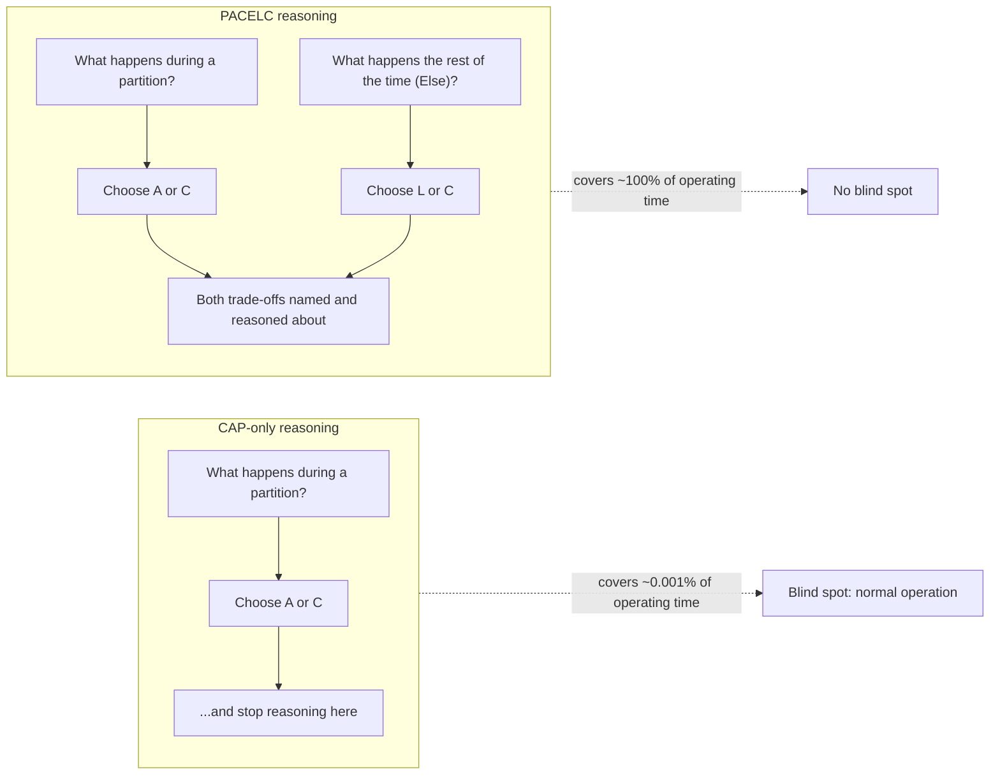

## 4. Core Concepts

### 4.1 The PACELC formula and why it extends CAP

**Definition.** PACELC is read as a single conditional statement:

> **If** there is a **P**artition, the system must trade off **A**vailability
> against **C**onsistency. **E**lse (when there is no partition), the system
> must trade off **L**atency against **C**onsistency.

Formally: `if (Partition) then (A or C) else (L or C)`. A system's full
PACELC classification is written as a four-letter code combining its
partition-branch choice and its Else-branch choice: **PA/EL**, **PC/EC**,
**PA/EC**, or **PC/EL** (Section 4.3 works through all four). CAP theorem
(recapped, not re-derived here — full teaching in
[CAP Theorem](CH05_CAP_Theorem.md)) only supplies the letters before the
slash; PACELC's real contribution is the letters after it.

**Mechanism — why the two branches are independent choices.** The
partition branch and the Else branch are not the same trade-off wearing two
names; they are triggered by two different physical realities, and a
system can (and often does) make a *different* choice on each side of the
slash:

- The **partition branch** is triggered by a network failure: some subset
  of nodes cannot communicate with another subset for some duration. The
  system must decide whether to keep serving requests on both sides (favor
  Availability, accept the risk of divergent state) or refuse to serve
  requests on the minority/isolated side until connectivity is restored
  (favor Consistency, accept reduced Availability). This is CAP's question,
  and it is fundamentally about *failure handling*.
- The **Else branch** is triggered by ordinary, healthy operation: a
  client's write needs to be durable on more than one node before it is
  safe to lose a single machine, and a client's read needs to reflect the
  most recent acknowledged write if the system promises strong consistency.
  Achieving either of those properties across physically separate nodes
  costs *time* — a network round trip to get an acknowledgment from a
  remote replica before responding to the client, or a round trip to
  confirm a read is not stale. The system must decide whether to pay that
  round-trip cost on every operation (favor Consistency, accept higher
  Latency) or skip it and respond immediately from the nearest available
  copy (favor Latency, accept a staleness window). This is fundamentally
  about *coordination cost under normal operation*, not failure handling.

Because the two branches answer different questions, a system's answer to
one does not determine its answer to the other. A system that chooses
Consistency during a partition (refuses writes on the minority side) can
still choose Latency in the Else branch (serve reads from a nearby replica
with a small staleness window when there is no partition) — this is
precisely the PC/EL quadrant explored in Section 4.3, and it is a real,
if less common, combination.

**Decision implications.** The practical use of the formula is as a
checklist an architect runs through explicitly rather than implicitly:
first ask "what should this system do if a partition happens" (CAP's
question), then separately ask "what should this system do on every
ordinary day when nothing is wrong" (PACELC's added question). Skipping the
second question is the single most common way a team is surprised by a
distributed system's behavior in production — not because a rare partition
occurred, but because the steady-state latency-versus-staleness trade-off
was never made explicit and a downstream team assumed strict consistency
that was never actually being paid for.

**Common failure mode.** Teams describe a system purely by its CAP letter
("it's AP, so it's eventually consistent") and stop reasoning. This
conflates two independent facts: being "AP" only says what happens during a
partition; it says nothing about the staleness window the system exhibits
the rest of the time, which could be single-digit milliseconds (a
well-tuned quorum system with fast inter-node links) or many seconds
(cross-region asynchronous replication with a slow batch cycle). Two
systems can both be "AP" and differ by four orders of magnitude in typical
staleness — a difference PACELC's Else branch names and CAP cannot.

**Scenario.** A payments team is choosing a datastore for an account-ledger
service and a separate team is choosing one for a product-catalog service.
Both teams initially ask "CP or AP?" and both land on "CP, we can't afford
inconsistency." But the ledger team also needs to ask the Else-branch
question: on a normal day, with no partition, is every balance read
required to reflect the very latest write, even if that costs an extra
40 ms of coordination latency on a hot payment path serving thousands of
requests per second? For the ledger, the answer is yes — money cannot be
allowed to be read stale by even milliseconds' worth of a race condition,
so they accept EC (Else, Consistency) and pay the latency. The catalog
team, on reflection, realizes their "CP" instinct was really about not
losing data (durability), not about every product-page read needing to be
millisecond-fresh — a few hundred milliseconds of staleness on a price
update is commercially invisible, so they choose EL (Else, Latency) for
reads while still using a durable, partition-safe write path. Both are "C"
under CAP's original framing on the partition axis alone; they now make
opposite, and correct, Else-branch decisions.

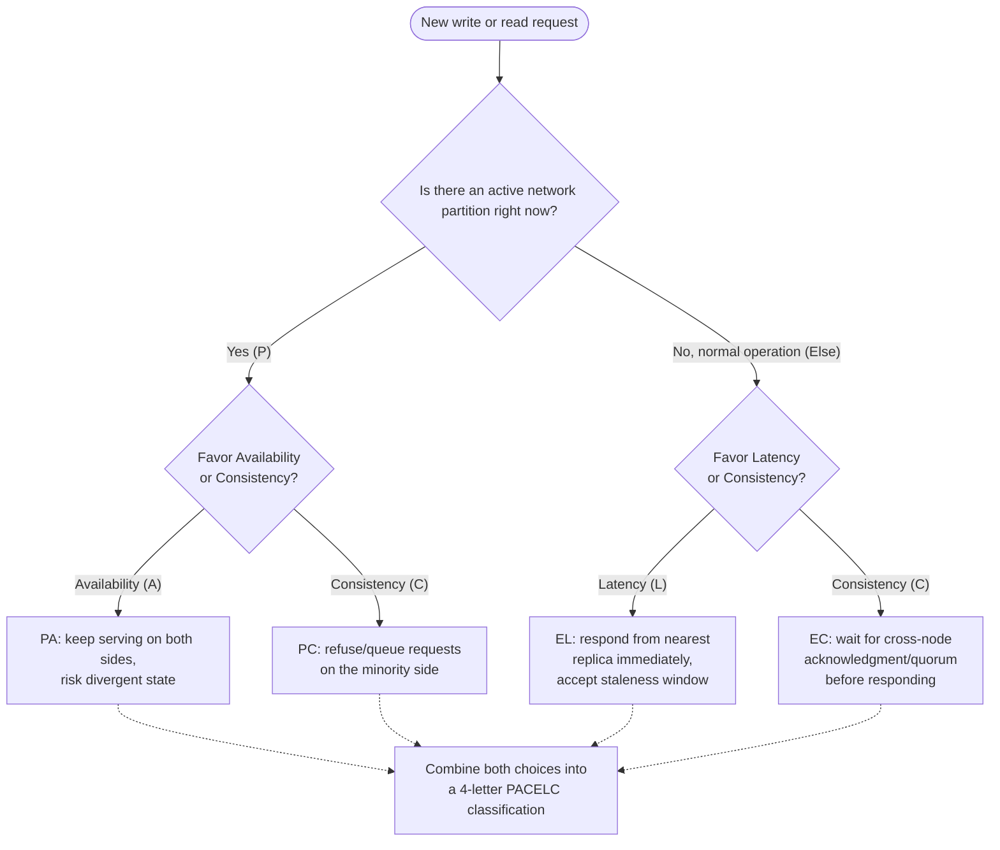

### 4.2 The Else-branch: the latency-versus-consistency trade-off during normal operation

**Definition.** The Else-branch trade-off is the choice a replicated system
makes, continuously and on every operation, between two properties that
cannot both be maximized simultaneously once data lives on more than one
physical node: **Latency** — how quickly the system can respond to a
client — and **Consistency** — how strongly the system guarantees that a
read reflects the most recent acknowledged write. "Else" specifically means
"in the absence of a partition" — this is not a rare edge case, it is the
system's default, ongoing operating mode.

**Mechanism — where the cost actually comes from.** The trade-off is not
an arbitrary policy choice a vendor bolted on; it is a direct consequence
of two unavoidable physical facts once you replicate data across more than
one machine (recapping, not re-deriving, the synchronous/asynchronous
replication mechanics already fully taught in
[Replication](../06_Databases_and_Storage/CH07_Replication.md) Sections 4.1
and 4.7-4.8):

1. **The speed of light imposes a floor on cross-node round-trip time.**
   Two nodes in the same data center can round-trip in well under a
   millisecond; two nodes in different continents cannot round-trip in
   under roughly 60-150 ms no matter how good the network engineering is,
   because that number is bounded by the physical distance the signal must
   travel through fiber. Any operation that requires waiting for a
   confirmation from a remote node inherits that floor.
2. **Coordinating multiple independent nodes to agree before responding
   costs at least one extra round trip beyond talking to a single node.**
   Whether that coordination takes the form of waiting for a synchronous
   replica's acknowledgment, waiting for a quorum of `W` nodes to
   acknowledge a write, or performing a read-repair pass before answering a
   read, the pattern is the same: consistency guarantees are purchased with
   time, because they require *more than one machine to confirm the same
   fact* before the system will vouch for it to the caller.

A system therefore has exactly two ways to reduce the latency a caller
experiences: reduce the number of round trips required before responding
(favor Latency, accept that the responding node's view might not yet
reflect a write that is still in flight to other replicas), or accept the
extra round trip and always give a caller the most current cross-node
agreement (favor Consistency, accept that the caller waits longer). There
is no third option that eliminates the trade-off entirely for a system that
is both replicated and reachable at all — it can only be shifted (e.g. by
reducing physical distance between the coordinating nodes, as Spanner's
TrueTime approach does at high engineering cost, discussed in Section 4.3's
PC/EC entry) or made configurable per operation (Section 4.4).

**Decision implications.** Because this trade-off is continuous rather
than triggered by a rare event, it should be sized against the *typical*
request, not the worst case. A system serving a payments API with a
99th-percentile latency budget of 200 ms and low request volume can often
afford to pay for a cross-region quorum acknowledgment on every write; a
system serving a real-time bidding API with a latency budget measured in
single-digit milliseconds cannot afford that on the hot path at any
consistency cost, and must instead architect around asynchronous
propagation with compensating logic for the rare inconsistency it
introduces.

**Common failure mode.** A team enables "strong consistency" mode on a
multi-region database by default, without measuring the added latency,
because the word "consistency" sounds unconditionally safer than
"eventual." The result is a global P99 latency regression that only
surfaces once the feature reaches users in a region far from the
consistency-coordinating node — and because the root cause is a
configuration default rather than a code bug, it is often diagnosed far
later than a functional regression would be, since nothing in the system
is "wrong," it is simply paying a coordination cost nobody consciously
budgeted for.

**Scenario.** A social feed service replicates "like counts" across three
regions. Engineering initially configures strong read consistency
(every "like count" read must reflect the latest write from any region)
to avoid a support ticket about a like count that briefly looked wrong.
After launch, P95 read latency in the farthest region jumps from 8 ms to
140 ms, and the product team discovers the actual user-visible cost — a
noticeably sluggish feed — is far worse than the cosmetic cost the strong
consistency was protecting against. They switch like-count reads to the
Latency side of the Else branch (serve from the local regional replica,
accept a sub-second staleness window) while keeping the write path
durable, and P95 read latency returns to single digits with no measurable
increase in user complaints about count accuracy.

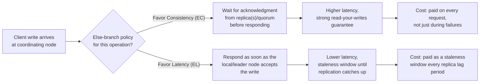

### 4.3 Classifying real systems along all four PACELC quadrants

**Definition.** Combining the partition-branch letter (A or C) with the
Else-branch letter (L or C) yields exactly four possible PACELC
classifications: **PA/EL**, **PC/EC**, **PA/EC**, and **PC/EL**. Every
distributed data system that replicates across more than one node can be
placed in one of these four quadrants, though the placement can be a
per-operation or per-configuration choice rather than a single fixed label
for the whole system (Section 4.4).

**Mechanism — the quadrant grid.**

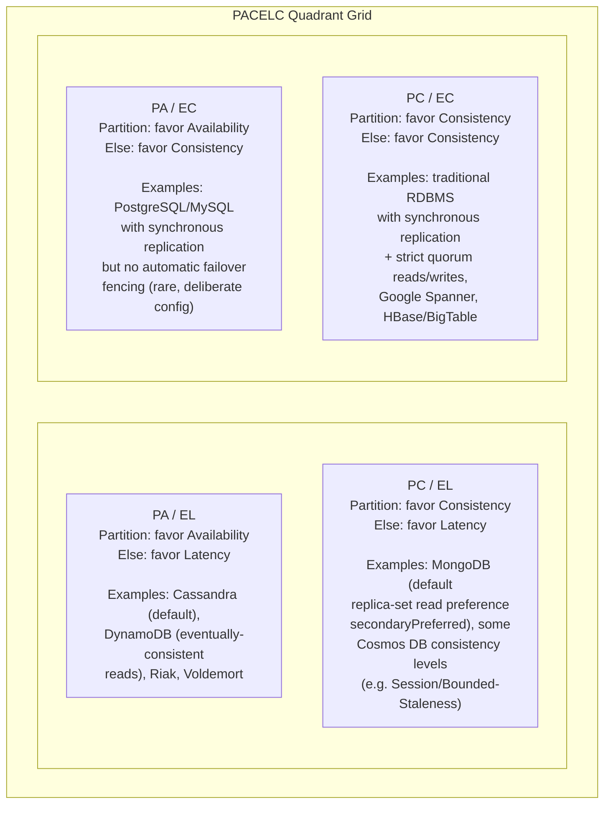

Reading the grid: the top row favors Latency on the Else branch (systems
optimized for fast, everyday operation, accepting some staleness), and the
bottom row favors Consistency on the Else branch (systems that pay a
coordination cost on every operation, not just during a partition). The
left column favors Availability during a partition; the right column favors
Consistency during a partition.

**PA/EL — Availability under partition, Latency in normal operation.**
This is the classic "Dynamo-style" quadrant. **Apache Cassandra** in its
common default configuration (e.g. `ONE` or `LOCAL_QUORUM` consistency
level for both reads and writes, recapped from
[Cassandra](../06_Databases_and_Storage/CH18_Cassandra.md), which owns the
full named-consistency-level teaching) keeps serving reads and writes on
both sides of a partition using leaderless, quorum-optional replication,
and on a normal day it answers most requests from whichever replica is
fastest to reply rather than waiting for every replica to agree — favoring
low latency and accepting that a read might occasionally return
slightly-stale data. **DynamoDB**'s default "eventually consistent read"
mode (recapped from
[DynamoDB](../06_Databases_and_Storage/CH17_DynamoDB.md) Section 4.6) is the
same shape: it is priced and latency-optimized to answer from any
available replica, favoring L on the Else branch, and favoring A when a
partition occurs by continuing to accept writes via sloppy quorum and
hinted handoff rather than refusing them.

**PC/EC — Consistency under partition, Consistency in normal operation.**
This is the quadrant most people mean when they informally say "a strongly
consistent database." A traditional single-primary Relational Database
Management System (RDBMS) configured with fully **synchronous replication**
and **strict-majority read/write quorums** (both mechanics recapped, fully
taught in [Replication](../06_Databases_and_Storage/CH07_Replication.md)
Sections 4.1 and 4.7) refuses to acknowledge a write until it is durable on
enough replicas to survive a single node failure — that is the Else-branch
Consistency cost, paid on every write regardless of whether a partition is
happening — and separately refuses to serve writes on a minority partition
during a network split, which is the partition-branch Consistency cost.
**Google Spanner** is the most sophisticated real-world PC/EC system: it
achieves global strict-serializability (external consistency) by using
TrueTime, a globally synchronized clock with a tightly bounded uncertainty
interval, to know when it is safe to commit a distributed transaction
without waiting for an unbounded coordination round trip — Spanner does not
escape the Else-branch cost, it *engineers the cost down* to a bounded
"commit-wait" interval rather than eliminating it, which is precisely why
Spanner is a famous case study rather than a routine default: achieving
PC/EC at low latency requires atypical, expensive infrastructure
investment (dedicated atomic clocks and GPS receivers in every data
center) most organizations cannot replicate.

**PA/EC — Availability under partition, Consistency in normal operation.**
This is the least common real-world combination, because it is somewhat
internally inconsistent as a design philosophy: a system built to keep
serving during a partition (accepting the risk of divergence) but that
otherwise insists on paying full coordination cost for every read/write
when nothing is wrong. It does occur in practice as a deliberate,
narrower configuration rather than a whole system's default identity — for
example, a synchronously replicated RDBMS pair deployed *without* automatic
STONITH/fencing on failover (recapped from
[Replication](../06_Databases_and_Storage/CH07_Replication.md) Section 4.8's
split-brain/fencing-token teaching): under normal operation every write
waits for the synchronous replica's acknowledgment (EC), but if the primary
becomes unreachable, an operator or automation without strict fencing might
promote the replica and keep serving (favoring A over strict C during the
partition) even though the original primary might still be alive and
accepting writes from a stranded client — a dangerous, usually accidental
rather than deliberate PA/EC posture that Section 15 revisits as a failure
scenario.

**PC/EL — Consistency under partition, Latency in normal operation.**
This quadrant is real and increasingly common in tunable multi-region
databases that expose an explicit, named "not the strongest, not the
weakest" middle option. **MongoDB**'s replica-set default read preference
(`primary`) combined with a `w:majority` write concern is closer to PC/EC,
but a common deliberate re-configuration reading from `secondaryPreferred`
under a `readConcern` weaker than `linearizable` shifts the same deployment
into PC/EL — writes still require majority acknowledgment (favoring
consistency broadly) but reads are served from whichever secondary is
closest, favoring L on the read side (recapped from
[MongoDB](../06_Databases_and_Storage/CH15_MongoDB.md) Section 4.7's
read/write concern teaching). **Azure Cosmos DB**'s **Session** and
**Bounded Staleness** consistency levels are purpose-built PC/EL products:
they guarantee strong properties during a partition failover (Cosmos DB
documents that Strong and Bounded Staleness both maintain their consistency
guarantee even through a regional failover) while explicitly trading a
small amount of staleness for materially lower read latency during normal,
healthy operation — Cosmos DB's own documentation frames this exact
trade-off as a first-class, user-selectable dial, which is itself evidence
that PACELC's framing has become embedded directly into commercial product
design, not just academic classification.

**Decision implications.** Do not treat a system's marketing label ("we are
AP," "we are strongly consistent") as sufficient information for an
architecture decision — always ask both halves of the formula
independently, because the Else-branch answer is frequently the one that
actually determines whether the system will meet a latency Service Level
Objective (SLO), while the partition-branch answer only determines
behavior during a rare event that a well-designed system may see only a
few times a year.

**Common failure mode.** Assuming a system's quadrant is a fixed, permanent
property of the *product* rather than of the *configuration in use*.
Cassandra can be pushed toward PC/EC behavior by using `QUORUM`/`QUORUM`
consistency levels on both reads and writes; MongoDB can be pushed toward
PA/EL-adjacent behavior with looser write concerns. Section 4.4 covers
exactly how these knobs move a deployment between quadrants.

**Scenario.** An architecture review asks "is our order-processing
datastore CP or AP?" and the team answers "CP, it's PostgreSQL with
synchronous replication." A more useful review asks the full PACELC
question: "under partition, do we favor A or C, and during normal
operation, do we favor L or C, and are those two answers actually the ones
we want for *this specific workload*?" That second framing is what
surfaces, in this chapter's classification worked examples (Section 10),
that a genuinely latency-sensitive read path bolted onto a PC/EC datastore
without any read-replica offload is quietly paying a synchronous
coordination cost on every single read that the workload's actual
consistency requirement never demanded.

### 4.4 Mapping PACELC to concrete replication and consistency-level configuration decisions

**Definition.** PACELC is a classification framework, not a control panel
by itself — but every quadrant in Section 4.3 corresponds to a small,
identifiable set of concrete configuration knobs that an architect actually
turns on a real system: replication mode (synchronous vs. asynchronous,
fully taught in
[Replication](../06_Databases_and_Storage/CH07_Replication.md) Section 4.1),
read/write quorum sizing (the `N`/`W`/`R` model, fully taught in the same
chapter's Section 4.7), and named consistency-level settings exposed by
specific products (recapped per-product in Section 4.3). This subsection
maps the formula to those knobs directly.

**Mechanism — the knob-to-quadrant mapping.**

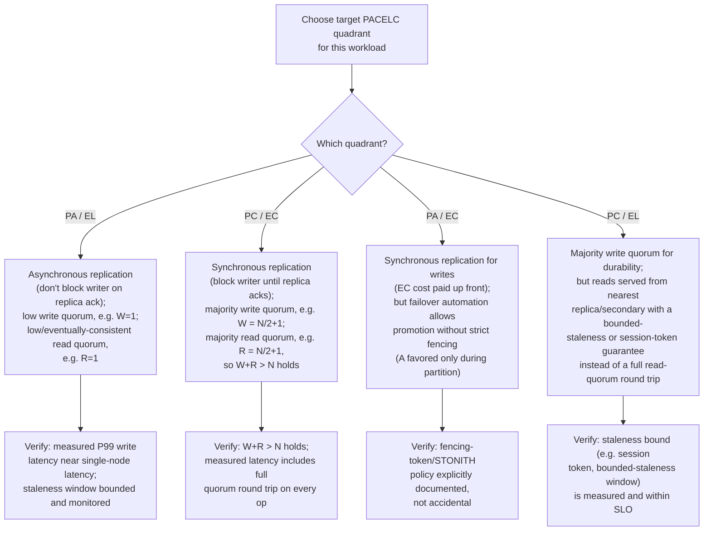

**Concrete replication-mode mapping.** Synchronous replication — the
writer blocks until at least one designated replica acknowledges the write
before returning success to the client, recapped from
[Replication](../06_Databases_and_Storage/CH07_Replication.md) Section 4.1 —
is the mechanism that produces an EC (Else, Consistency) outcome, because
it directly spends a network round trip on every write to guarantee
durability across nodes before answering the caller. Asynchronous
replication — the writer returns success as soon as the local/leader node
accepts the write, and propagates to replicas in the background — is the
mechanism that produces an EL (Else, Latency) outcome, at the cost of a
window during which a replica (and any read served from it) can be behind
the leader. Semi-synchronous replication (wait for acknowledgment from at
least one replica, but not all) is a tunable middle point some systems
expose specifically to let an operator dial the Else-branch trade-off
continuously rather than as a binary choice.

**Concrete quorum-sizing mapping.** For a system with `N` total replicas,
`W` replicas required to acknowledge a write, and `R` replicas consulted on
a read (the quorum model recapped from
[Replication](../06_Databases_and_Storage/CH07_Replication.md) Section 4.7,
which owns the full `W+R>N` correctness-overlap proof): setting `W` and `R`
to strict majorities so that `W + R > N` mathematically guarantees every
read quorum overlaps every write quorum on at least one replica pushes a
system toward the EC side of the Else branch, because both operations must
now wait on multiple nodes. Setting `W=1` and/or `R=1` — accepting an
acknowledgment or answer from a single replica without waiting for
agreement across a quorum — pushes the same system toward the EL side,
because either the write or the read (or both) can complete after talking
to only the single fastest available node. This is exactly the lever
Cassandra exposes as its per-query consistency level, and it is why the
*same* Cassandra cluster can be operated as PA/EL for one table's traffic
(`ONE`/`ONE`) and closer to PC/EC for another table's traffic
(`QUORUM`/`QUORUM`) without changing any code, only configuration —
underscoring that PACELC classification is frequently a per-workload
configuration decision, not a single fixed label for an entire deployed
system.

**Decision implications.** Because the replication-mode and quorum-sizing
knobs are independently tunable, an architect should choose them by
starting from the target PACELC quadrant for a *specific workload's*
latency and consistency requirements (per Sections 4.2-4.3), not by
copying a database's factory default. A single multi-tenant cluster
frequently should not have one PACELC posture for every table it hosts.

**Common failure mode.** Turning a knob without verifying the *other*
knob it depends on. A common, dangerous mistake is setting a low write
quorum (`W=1`, favoring EL) while leaving the read quorum at a strict
majority (`R` large), on the mistaken belief this yields "fast writes,
still-consistent reads" — but if `W + R` does not exceed `N`, the
mathematical guarantee that a read quorum overlaps a write quorum no
longer holds, and reads can silently miss the most recent write regardless
of how large `R` is, producing consistency violations that only appear
under specific node-failure timing and are notoriously difficult to
reproduce in testing (Section 16 revisits this as a required test case).

**Scenario.** A team migrating a session-token validation service off a
single-node cache to a three-node Cassandra cluster (`N=3`) initially
copies a peer team's `ONE`/`ONE` configuration (PA/EL) because "that's what
worked for the catalog service." Session tokens, however, must never be
validated against stale data — a revoked token read as still-valid is a
security defect, not a cosmetic staleness issue. The architecture review
catches the mismatch (Section 26) and the team instead configures
`QUORUM`/`QUORUM` (`W=2`, `R=2`, satisfying `W+R=4 > N=3`) specifically for
the token table, accepting the added ~1-2 ms of intra-data-center
coordination latency in exchange for a correctness guarantee the workload
actually requires — while leaving the catalog service's own tables at
`ONE`/`ONE` on the very same physical cluster, demonstrating that PACELC
posture is a per-workload configuration decision layered on top of shared
infrastructure, not a single property of "the cluster."

## 5. Internal Working

Internally, a system's Else-branch behavior is implemented as a specific
acknowledgment-waiting policy inserted into the write (and sometimes read)
path, and it composes directly with the replication pipeline already fully
taught in
[Replication](../06_Databases_and_Storage/CH07_Replication.md) Sections 4.1
and 5. The sequence below shows the same logical write request taking two
different internal paths depending on whether the coordinating node is
configured to favor Latency or Consistency on the Else branch — the
request, the client, and the eventual physical replication mechanism are
identical; only the point at which the coordinator is willing to respond to
the caller differs.

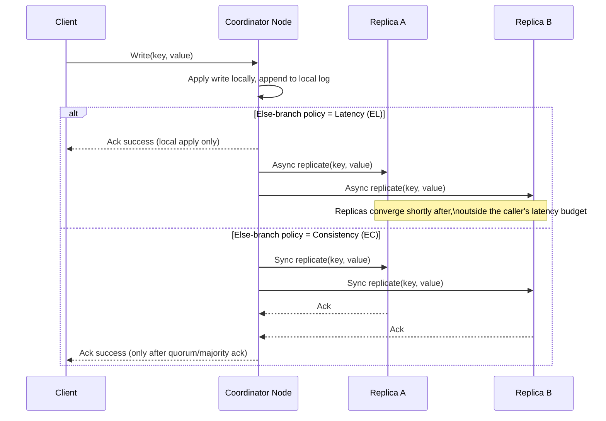

Internally, the "Else-branch policy" is not usually a single global
boolean; it is evaluated per operation from a request-scoped consistency
parameter (Cassandra's per-query `CL`, DynamoDB's per-request
`ConsistentRead` flag, MongoDB's per-operation `writeConcern`/
`readConcern`), which the coordinator reads before deciding how many
downstream acknowledgments to wait for. This is the internal mechanism that
makes the per-workload configurability described in Section 4.4 possible
without redeploying the cluster: the branching happens inside the
coordinator's request-handling code path, keyed off metadata attached to
each individual request. When a partition is simultaneously in effect, the
same coordinator additionally consults its partition-branch policy (fully
taught in [CAP Theorem](CH05_CAP_Theorem.md) Section 5) to decide whether it
is even willing to attempt to reach the quorum size the Else-branch policy
requested — if the required replicas are unreachable, an EC-configured
system operating during a partition must now also apply its A-vs-C
partition policy (refuse the write, or degrade), which is exactly the point
at which the two branches of the formula interact operationally, even
though they are conceptually independent decisions.

## 6. Design Principles

- **Name both branches explicitly, every time.** Never describe a system's
  consistency posture with only a CAP letter; always state its Else-branch
  choice in the same sentence, because the Else-branch choice is what a
  latency-sensitive caller will actually feel on every request.
- **Choose the quadrant per workload, not per cluster.** As shown in
  Section 4.4, a single physical deployment can and often should host
  multiple PACELC postures simultaneously, matched to each table's or
  operation's actual consistency requirement rather than a single
  cluster-wide default.
- **Prefer engineering the coordination cost down over silently skipping
  it.** Spanner's TrueTime approach (Section 4.3) demonstrates the
  principle: if a workload genuinely requires PC/EC-level guarantees at
  low latency, the correct response is to invest in reducing the physical
  or algorithmic coordination cost (tighter clock synchronization, closer
  physical placement of quorum members, a faster consensus algorithm), not
  to quietly relax the consistency requirement without stakeholder
  sign-off.
- **Treat the Else-branch staleness window as a measured, monitored
  quantity, not an assumption.** If a system favors Latency on the Else
  branch, the resulting staleness window must be an explicit, observed
  metric (Section 14), not a hand-waved "it's eventually consistent, it'll
  be fine."
- **Verify quorum overlap arithmetic whenever quorum sizes are tuned.**
  The `W + R > N` correctness condition (recapped from
  [Replication](../06_Databases_and_Storage/CH07_Replication.md)) must be
  checked explicitly any time either `W` or `R` is changed independently —
  it is easy to break silently, as Section 4.4's common-failure-mode
  scenario shows.
- **Fencing must be deliberate, not incidental, whenever Availability is
  favored during a partition.** The PA/EC quadrant's accidental,
  no-fencing failure mode (Section 4.3) shows that favoring A during a
  partition without a correct fencing mechanism can silently produce
  correctness violations even in a system whose Else-branch behavior is
  fully consistent.

## 7. Architecture Patterns

- **Tiered consistency by data class.** A single service classifies its
  data into tiers (e.g. "financial ledger," "user profile," "activity
  feed") and assigns each tier its own PACELC quadrant and concrete
  configuration, rather than picking one posture for the whole service —
  directly operationalizing Section 4.4's per-workload principle at the
  architecture-pattern level.
- **Read-your-writes via sticky routing or session tokens.** A pattern
  that lets a system sit in the PA/EL or PC/EL quadrant for most traffic
  while still giving an individual client a strong-consistency-like
  experience for its *own* writes: route a client's subsequent reads to
  the same replica/region that served its write (sticky routing), or embed
  a version/session token in the write response and require subsequent
  reads from that client to wait until the target replica has caught up to
  at least that token (this is the mechanism behind Cosmos DB's Session
  consistency level referenced in Section 4.3).
- **Bounded-staleness as a middle-ground contract.** Instead of a binary
  strong-vs-eventual choice, a system publishes an explicit staleness
  bound (e.g. "reads never lag writes by more than K versions or T
  seconds, whichever is reached first") as a first-class Service Level
  Indicator (SLI), giving callers a concrete number to design against
  instead of an unquantified "eventually."
- **Hedged/speculative reads.** To reduce Else-branch latency without
  fully abandoning consistency, a coordinator can send a read request to
  more than one replica simultaneously and accept the first response,
  optionally validating agreement across the responses that do arrive
  before an internal deadline — trading some redundant work for a lower
  tail latency than waiting for a fixed quorum sequentially.
- **CQRS-based Else-branch separation.** Command Query Responsibility
  Segregation (CQRS) — the concept itself is owned by this part's future
  sibling chapter, Distributed Systems — CQRS, and is only recapped here at
  the level needed to connect it to PACELC — lets a system route writes
  through a strongly consistent path while serving reads from a
  latency-optimized, separately materialized read model, effectively
  giving the write path an EC-leaning posture and the read path an
  EL-leaning posture within a single logical service.

## 8. Production Architecture

A production multi-region deployment typically expresses its PACELC
posture as a concrete topology decision: where the quorum/consensus members
live relative to where traffic originates, and how far a "local" read or
write has to travel before it can be acknowledged.

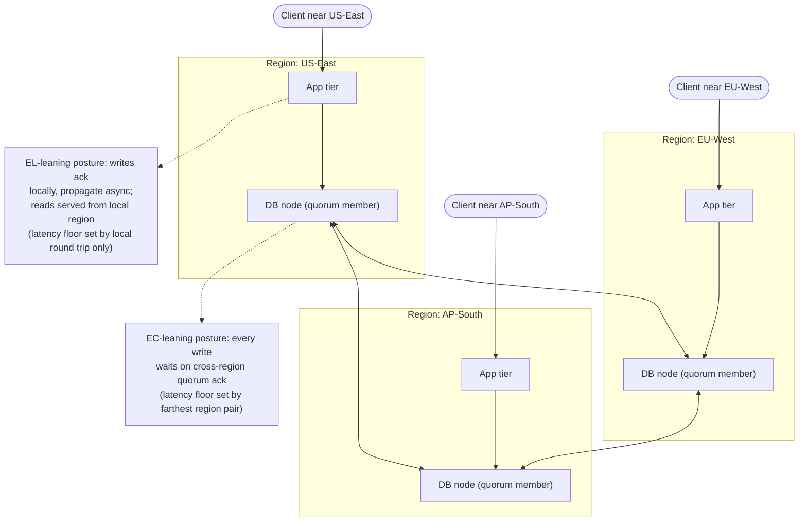

In an EC-leaning production topology, every write's latency floor is set
by the round-trip time to the *farthest* quorum member required to reach
`W`, which for a 3-region deployment is typically the cross-continental
leg (100+ ms). In an EL-leaning topology, a request's latency floor is set
by the *local* region's internal round trip (often under 5 ms), with
cross-region propagation happening off the client's critical path.
Production architectures frequently combine both within the same fleet: a
smaller, dedicated quorum-based cluster or table set for EC-required data
(ledgers, inventory counts, session/authorization tokens) alongside a
larger, latency-optimized, asynchronously replicated store for EL-tolerant
data (catalog content, activity feeds, denormalized read models) — the
tiered-consistency-by-data-class pattern from Section 7 realized as an
actual deployment topology rather than only a configuration flag on a
single cluster.

## 9. Implementation

Implementing a deliberate PACELC posture is primarily a configuration and
verification exercise on top of infrastructure already covered by
[Replication](../06_Databases_and_Storage/CH07_Replication.md), rather than
custom distributed-systems code in the common case. The implementation
checklist an architect and implementing team should work through:

1. **Classify each data entity/table by its actual consistency
   requirement**, not by convenience or by copying a peer team's default —
   ask explicitly "what breaks, in concrete business terms, if this read
   is stale by X milliseconds/seconds?"
2. **Select the target PACELC quadrant per entity** using Section 4.3's
   classification and Section 4.4's knob mapping.
3. **Configure the concrete replication mode and quorum sizes** for each
   entity/table, verifying the `W + R > N` correctness condition
   explicitly whenever quorum sizes diverge from full synchronous
   replication.
4. **Instrument the resulting staleness window and latency** as monitored
   metrics (Section 14), not assumptions — an EL-leaning choice is only
   safe if the staleness window it actually produces is measured and
   confirmed to be within the business's tolerance.
5. **Document the decision as an Architecture Decision Record (ADR)**
   (recapped, fully owned by
   [Architecture Thinking](../01_Architecture_Mindset/CH03_Architecture_Thinking.md)
   Section 10) so the trade-off and its reasoning survive team turnover,
   rather than living only as an unexplained configuration value.
6. **Add the required failure-scenario and quorum-arithmetic tests**
   (Section 16) before considering the implementation complete.

Section 10's worked artifacts provide concrete, product-level
configuration examples realizing this checklist across several real
systems.

## 10. Complete Code Examples

Three worked artifacts, kept as Markdown walkthroughs (following the
`code/markdown/<chapter>-chapter/` convention already used by this part's
[Non-Functional Requirements](../code/markdown/nfr-chapter/) and
[High-Level Design](../code/markdown/hld-chapter/) chapters) rather than a
single runnable script, because the content is a reasoning/classification
and configuration exercise rather than executable business logic:

1. [PACELC Quadrant Classification of Five Real Systems](../code/markdown/pacelc-chapter/01_pacelc_quadrant_classification.md) —
   a worked classification of DynamoDB, Cassandra, MongoDB, a
   synchronously replicated PostgreSQL primary/standby pair, and Azure
   Cosmos DB, each placed in its PACELC quadrant with explicit reasoning
   for both the partition-branch and Else-branch choice.
2. [Replication and Consistency-Level Configuration Worksheet](../code/markdown/pacelc-chapter/02_replication_config_decision_worksheet.md) —
   a decision worksheet mapping a target PACELC quadrant to the concrete
   configuration values (`synchronous_commit`, Cassandra consistency
   levels, DynamoDB `ConsistentRead`, MongoDB `writeConcern`/
   `readConcern`) that realize it on four real products.
3. [Migrating a Session-Token Store from PA/EL to PC/EC](../code/markdown/pacelc-chapter/03_pacelc_migration_case_study.md) —
   a worked before/after case study (expanding Section 4.4's session-token
   scenario) showing the exact configuration diff, the quorum-arithmetic
   verification, and the measured latency/consistency trade-off of moving
   one workload across quadrants on an already-running cluster.

## 11. Performance

The Else-branch choice is, in measurable terms, almost entirely a latency
decision, so PACELC classification should be validated with real
percentile latency measurements, not architectural intent alone. An
EC-leaning configuration's write latency floor is bounded below by the
round-trip time to the slowest required quorum member (recapped from
[Replication](../06_Databases_and_Storage/CH07_Replication.md) Section 4.1's
synchronous-replication latency-floor teaching); an EL-leaning
configuration's write latency floor is bounded below only by the local
node's own processing time. Percentile reporting matters more than average
reporting here (recapped from
[Non-Functional Requirements](CH02_Non_Functional_Requirements.md)
Section 4.4's p50/p95/p99 teaching) because the *tail* of an EC
configuration's latency distribution is dominated by whichever quorum
member is having a slow moment (garbage collection pause, transient network
jitter, a co-located noisy-neighbor process), and that tail is exactly what
a downstream SLO is usually written against.

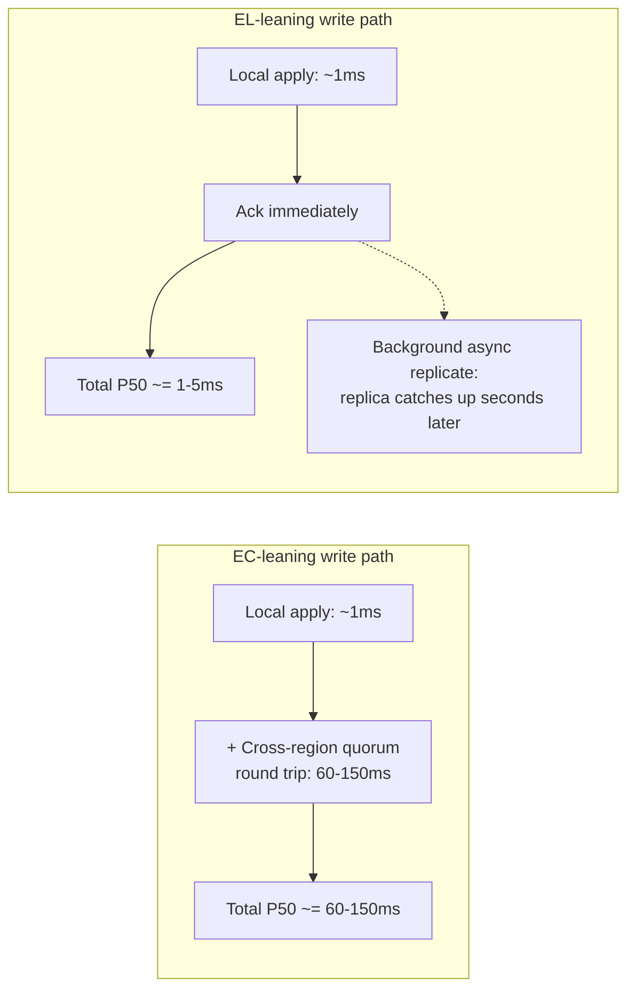

## 12. Scalability

Favoring Latency on the Else branch generally scales read throughput more
easily than favoring Consistency, because EL reads can be served from any
replica local to the requesting region without contending on a shared
quorum path — adding more read replicas linearly increases available read
capacity. EC reads and writes scale less linearly, because every operation
that must reach a quorum contends on the same fixed set of quorum-eligible
nodes; adding more nodes to an EC-configured cluster increases durability
and fault tolerance but does not by itself reduce the coordination latency
floor, and past a certain point (recapped from
[Replication](../06_Databases_and_Storage/CH07_Replication.md) Section 4.7's
`N` sizing discussion) can even increase the probability that the slowest
required acknowledgment in a quorum is slow, worsening tail latency rather
than improving throughput. This is a direct scalability argument for the
tiered-consistency-by-data-class pattern (Section 7): let the
high-read-volume, latency-sensitive tier scale via cheap read-replica
fan-out (EL), and keep the smaller, quorum-bound tier reserved only for the
data that genuinely requires it.

## 13. Security

PACELC's Else-branch choice has a direct, easily overlooked security
implication: a stale read is not only a user-experience concern, it can be
a security defect for consistency-sensitive authorization data. Section
4.4's session-token scenario is the canonical example — a revoked API
token or a downgraded permission that is still readable as "valid" from a
stale replica for even a short staleness window is an authorization bypass
during that window, not merely a cosmetic inconsistency. Any workload
enforcing authentication, authorization, entitlement, or rate-limit state
must be explicitly evaluated against its Else-branch staleness window as
part of a security review, and should generally default toward EC (or a
tightly bounded EL with a token/version-based read-your-writes guarantee,
per Section 7's sticky-routing pattern) rather than an unbounded eventual
staleness window. TLS in transit between quorum members (recapped, fully
owned by [TLS](../05_Networking_and_OS/CH06_TLS.md)) protects the
replication traffic itself from tampering/eavesdropping but does not
address this staleness-as-authorization-bypass risk at all — the two are
independent security properties and must both be verified.

## 14. Observability

The Else-branch trade-off is only safely operated if both of its outputs
are directly monitored: the latency it is buying, and the staleness it is
spending to buy that latency.

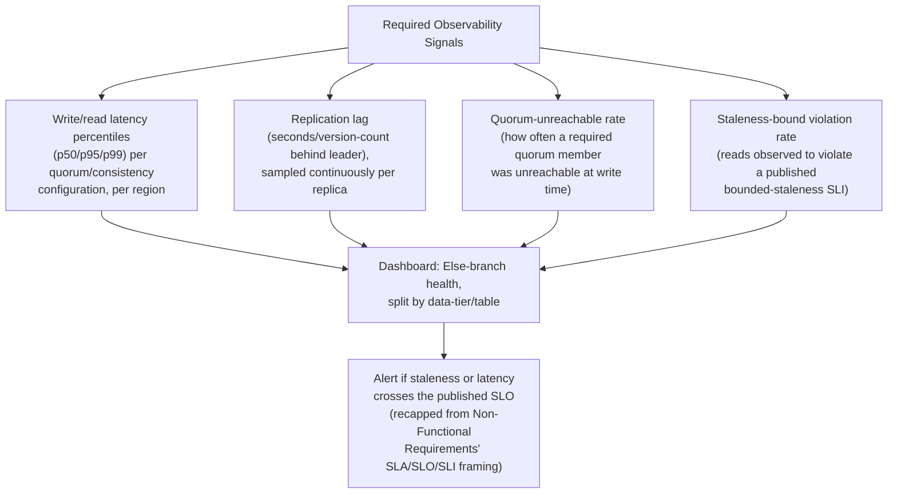

Replication lag (recapped, fully taught in
[Replication](../06_Databases_and_Storage/CH07_Replication.md) Section 4.2)
is the single most important Else-branch health metric for any
EL-leaning deployment: it is the direct, measurable size of the staleness
window a caller might observe, and it is the number that should be
compared against a published bounded-staleness SLI (Section 7), not left
as an unmonitored internal detail.

## 15. Failure Scenarios

- **Silent PA/EC drift into split-brain.** Section 4.3's accidental
  PA/EC scenario: an EC-configured synchronous pair loses fencing
  discipline during a failover, both the old primary and a promoted
  replica accept writes briefly, and the two diverge — a failure mode
  that is entirely about the *partition*-branch policy being wrong, not
  the Else-branch policy, illustrating that the two branches must both be
  deliberately engineered, not just one.
- **Quorum-overlap arithmetic silently broken by an uncoordinated
  configuration change.** Section 4.4's `W+R>N` failure mode: an operator
  lowers `W` to reduce write latency without re-checking `R`, breaking the
  read-after-write guarantee for every table sharing that setting, with no
  immediate error — only a slow trickle of hard-to-reproduce
  stale-read reports.
- **Unbounded staleness during extended replica lag.** An EL-leaning
  deployment's staleness window is normally small (milliseconds to low
  seconds) but can grow unboundedly if a replica falls badly behind (e.g.
  due to a sustained write-burst or a slow disk), and if the staleness
  bound is not actually monitored and enforced (Section 14), a caller can
  silently receive data that is minutes or hours stale with no signal that
  anything is wrong.
- **Latency cliff when a quorum member becomes slow but not unreachable.**
  An EC-configured system's latency is bounded by its *slowest required*
  acknowledgment, not its average; a single quorum member experiencing a
  garbage-collection pause or disk contention (without actually failing
  health checks) can silently drag the whole cluster's write P99 latency
  up, even though every node reports healthy — the failure is a
  performance failure, not an availability failure, and standard
  health-check-based alerting frequently misses it entirely.

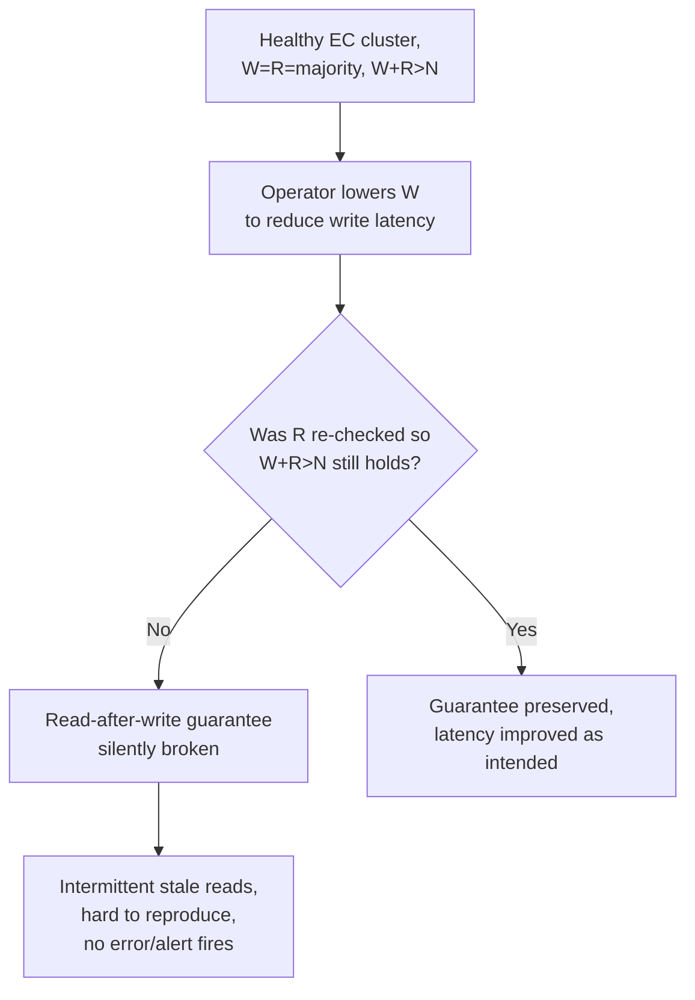

## 16. Testing

- **Quorum-arithmetic regression test.** Any change to `N`, `W`, or `R`
  must be accompanied by an automated check that `W + R > N` still holds
  for every table/keyspace where read-after-write consistency is required
  — this should fail a deployment/CI gate, not rely on manual review.
- **Induced-lag staleness test.** Deliberately introduce artificial
  replication lag (e.g. pausing a replica's apply thread) in a staging
  environment and verify that reads served from that replica either
  (a) correctly reflect the expected staleness bound and no worse, or
  (b) correctly route away from the lagging replica if a bounded-staleness
  SLI is supposed to be enforced automatically.
- **Fencing/failover correctness test.** Simulate a primary-unreachable
  event and verify that at most one node ever accepts writes as primary at
  any instant (recapped from
  [Replication](../06_Databases_and_Storage/CH07_Replication.md) Section
  4.8's fencing-token test pattern) — this is the test that catches the
  accidental PA/EC drift failure mode from Section 15.
- **Latency-under-slow-quorum-member test.** Inject artificial latency
  (not an outage) into a single quorum member and verify the resulting P99
  write latency matches the expected "slowest required acknowledgment"
  model, and that alerting fires on the latency regression even though no
  node fails a health check.
- **Cross-table consistency-policy isolation test.** In a shared cluster
  hosting multiple PACELC-quadrant configurations (Section 4.4's
  per-workload principle), verify that a configuration change to one
  table/keyspace's consistency level cannot inadvertently affect another
  table's guarantees.

## 17. Common Mistakes

- Describing a system only by its CAP letter and never stating its
  Else-branch choice, leaving the most-frequently-experienced trade-off
  undocumented.
- Assuming a database's factory-default consistency level is
  appropriate for every table/workload it will ever host, instead of
  classifying per Section 4.4's checklist.
- Changing `W` or `R` independently without re-verifying `W + R > N`.
- Treating "eventually consistent" as synonymous with "the staleness
  window is negligible" without ever measuring it (Section 14).
- Favoring Availability during a partition without a correct, tested
  fencing mechanism, accidentally producing the PA/EC split-brain failure
  mode from Section 15.
- Applying a single, uniform PACELC posture across an entire multi-tenant
  cluster instead of tiering by data class (Section 7).
- Conflating the Else-branch consistency cost (paid on every operation)
  with the partition-branch cost (paid only during a rare event), and
  therefore under-investing in monitoring the far more consequential
  everyday cost.

## 18. Best Practices

- State a system's full four-letter PACELC classification (e.g. "PA/EL")
  explicitly in its architecture documentation and ADRs, not just its CAP
  letter.
- Classify data by consistency requirement at the table/entity level, and
  document the resulting quadrant and configuration per entity (Section
  4.4's checklist).
- Publish a concrete, numeric bounded-staleness SLI for any EL-leaning
  data path, and alert on violations (Section 14).
- Verify `W + R > N` with an automated check whenever quorum sizes change.
- Prefer engineering the coordination cost down (closer quorum placement,
  faster consensus, tighter clock synchronization) over silently relaxing
  a genuinely required consistency guarantee.
- Test failover/fencing behavior explicitly, not just steady-state
  behavior, whenever a system favors Availability during a partition.
- Revisit PACELC classification whenever a workload's traffic pattern or
  business consistency requirement materially changes — the correct
  quadrant for a workload today is not guaranteed to remain correct as
  scale or requirements shift.

## 19. Anti-Patterns

- **"CAP-only" documentation.** Recording only a system's partition-branch
  letter in an architecture document, with no mention of its Else-branch
  behavior — the single most common anti-pattern this chapter exists to
  correct.
- **Cargo-culting a peer team's consistency configuration** without
  re-deriving whether it fits the new workload's actual requirement
  (Section 4.4's session-token scenario).
- **Turning quorum knobs independently** without checking the `W+R>N`
  overlap condition, silently breaking read-after-write guarantees.
- **Treating strong consistency as a costless default "safety" setting**
  without measuring or budgeting for its latency cost, then discovering
  the regression only after a user-visible complaint (Section 4.2's
  like-count scenario).
- **Uniform, cluster-wide consistency policy** applied to every table
  regardless of its actual requirement, wasting either latency budget
  (over-consistent) or correctness margin (under-consistent) on data that
  did not need that posture.
- **Availability-favoring failover automation with no fencing**, producing
  the accidental split-brain PA/EC drift failure mode.

## 20. Trade-off Analysis

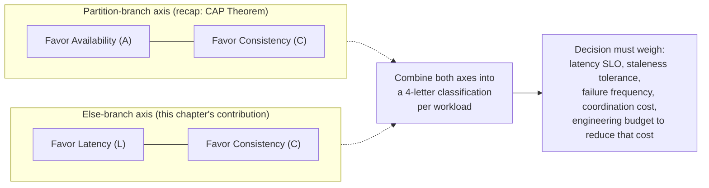

The Else-branch trade-off cannot be resolved by a universal "best" answer;
it must be weighed per workload against four inputs: the workload's actual
latency SLO, its actual staleness tolerance in concrete business terms
(not a vague preference for "consistency"), the workload's expected
exposure to partition events (largely a function of deployment topology,
recapped from [CAP Theorem](CH05_CAP_Theorem.md)), and the organization's
willingness to invest engineering effort in reducing the coordination cost
itself (as Spanner's TrueTime investment demonstrates is possible, at a
price) rather than simply accepting whichever side of the trade-off is
cheaper to implement today.

## 21. Comparison Table

| System / Configuration | Partition branch | Else branch | PACELC quadrant | Primary mechanism |
|---|---|---|---|---|
| Cassandra (`ONE`/`ONE`, default-leaning) | Favor Availability (sloppy quorum, hinted handoff) | Favor Latency (single-replica ack/read) | PA/EL | Leaderless, tunable consistency level |
| DynamoDB (eventually consistent reads, default) | Favor Availability (managed partition handling) | Favor Latency (nearest-replica read) | PA/EL | Managed leaderless replication |
| Traditional RDBMS, synchronous replication + majority quorum | Favor Consistency (refuse minority-side writes) | Favor Consistency (wait for quorum ack) | PC/EC | Synchronous log shipping + quorum |
| Google Spanner | Favor Consistency (external consistency preserved) | Favor Consistency, latency bounded via TrueTime | PC/EC (engineered low-latency variant) | TrueTime-bounded commit-wait + Paxos groups |
| RDBMS pair, synchronous replication, no automatic fencing (accidental) | Favor Availability (unfenced promotion) | Favor Consistency (sync ack under normal ops) | PA/EC (usually unintentional) | Synchronous replication without STONITH |
| MongoDB (`w:majority`, `readPreference: secondaryPreferred`) | Favor Consistency (majority write ack) | Favor Latency (nearest-secondary read) | PC/EL | Majority write concern + secondary reads |
| Azure Cosmos DB (Session / Bounded Staleness) | Favor Consistency (guarantee preserved through failover) | Favor Latency (bounded, tunable staleness) | PC/EL | Named, product-level tunable consistency levels |

## 22. Real-World Case Study

**GitHub's October 2018 MySQL/Orchestrator incident** (recapped from a more
detailed mechanical treatment already given by
[Replication](../06_Databases_and_Storage/CH07_Replication.md) and by this
part's [Non-Functional Requirements](CH02_Non_Functional_Requirements.md)
chapter's NFR/trade-off framing) is also directly readable through a
PACELC lens: GitHub's MySQL topology was operating with an Else-branch
posture that favored Latency for most read traffic (asynchronous
replicas), with the durability/consistency guarantee resting on the
assumption that failover automation would correctly identify and fence a
truly-unreachable primary before promoting a replica. A network-partition
event caused the failover system to promote a replica while the original
primary was still reachable by some clients — the exact PA/EC-drift
failure mode described in Section 15, produced not by a bad Else-branch
configuration choice but by a partition-branch fencing gap interacting
with an otherwise-reasonable Else-branch latency choice. The incident is a
concrete demonstration of Section 6's design principle that the two
branches, while conceptually independent, must both be engineered
correctly — a system can have an entirely sound Else-branch latency
optimization and still suffer a severe correctness incident purely from an
under-engineered partition-branch fencing mechanism. GitHub's public
post-incident writeup describes hours of manual data reconciliation to
resolve the divergent writes accepted by both the stale primary and the
prematurely promoted replica during the split-brain window, underscoring
that the *combination* of both branches' behavior, not either one in
isolation, determines a system's real-world blast radius when something
goes wrong.

## 23. Interview Questions

1. State the PACELC formula precisely, including what "Else" refers to,
   and explain in one sentence why it is considered an extension of CAP
   rather than a restatement of it.
2. Why does Abadi describe CAP alone as an "incomplete" decision
   framework? Frame your answer around operating-time proportion, not
   just terminology.
3. Give one real, concrete example each of a PA/EL system and a PC/EC
   system, and explain the specific mechanism (replication mode, quorum
   sizing) that produces each classification.
4. Explain why PA/EC is the least common quadrant, and describe a
   realistic scenario in which a system ends up there unintentionally.
5. A system uses `N=5`, `W=2`, `R=2`. Is the `W+R>N` correctness condition
   satisfied? What consistency guarantee, if any, does this configuration
   provide, and what Else-branch letter does it correspond to?
6. Explain how Google Spanner achieves a PC/EC-like classification without
   suffering the full latency penalty a naive PC/EC implementation would
   incur, and what that approach costs in exchange.
7. Why can a single physical database cluster simultaneously host
   PA/EL-configured tables and PC/EC-configured tables? What mechanism
   makes this possible?
8. Describe a monitoring signal you would add specifically to detect an
   Else-branch-related problem (as opposed to a partition-branch-related
   problem), and explain what it measures.
9. Why is stale-read risk on an authorization/session-token table a
   security concern rather than only a user-experience concern? Which
   PACELC quadrant would you recommend for that data class, and why?
10. Walk through how you would decide, for a brand-new workload, which of
    the four PACELC quadrants it should target — what inputs do you need
    before you can answer that question?

## 24. Hands-on Exercises

1. Using a locally run 3-node Cassandra (or a comparable Dynamo-style
   store) cluster, configure a keyspace at `ONE`/`ONE` consistency and
   measure P50/P99 write and read latency under a synthetic load
   generator; then reconfigure the same keyspace to `QUORUM`/`QUORUM` and
   re-measure. Record the latency delta and explain it in terms of this
   chapter's Section 4.2 mechanism.
2. Deliberately break the `W+R>N` overlap condition in a test cluster
   (e.g. `N=3`, `W=1`, `R=1`) and construct a concrete sequence of
   operations that demonstrates a stale read reaching a client despite a
   more recent write having already been acknowledged.
3. Configure a MongoDB replica set with `w:majority` write concern and
   `readPreference: secondaryPreferred`, then measure the observed
   staleness window between a write and a subsequent secondary read under
   artificially induced replication lag.
4. Write a one-page classification memo (using this chapter's Section 10
   worked-example format as a template) placing a datastore you use at
   work into its PACELC quadrant, citing the specific configuration
   values that justify each half of the classification.

## 25. Design Exercises

1. Design the datastore configuration for a ride-sharing platform's
   "driver current location" data (very latency-sensitive, staleness of a
   few seconds is tolerable) versus its "fare/payment ledger" data
   (staleness is not tolerable at all). Specify the PACELC quadrant, the
   concrete replication mode, and quorum sizes for each, and justify why
   they differ even though both live in the same overall system.
2. A global chat application needs message delivery to feel instantaneous
   (Else-branch Latency-favoring) but must never lose a message once the
   sender sees a delivery confirmation (durability). Design a
   configuration that reconciles both requirements, referencing the
   semi-synchronous replication middle-ground mentioned in Section 4.4.
3. Propose a monitoring dashboard (metrics, not implementation) that would
   let an on-call engineer distinguish, at 2 a.m., between "the cluster is
   slow because of a slow quorum member" (Section 15's latency-cliff
   failure mode) and "the cluster is slow because of a genuine network
   partition" (CAP's failure mode) within one minute of paging.
4. Your organization currently runs a single-quadrant (PC/EC) cluster for
   all workloads and is under pressure to reduce P99 write latency for a
   new feature. Design a migration plan that introduces a second,
   EL-leaning tier for the new feature's data without destabilizing the
   existing PC/EC-dependent workloads sharing the same infrastructure.

## 26. Architecture Review Questions

- For each datastore in this system, what is its full four-letter PACELC
  classification, and is that classification documented anywhere other
  than in the reviewer's own inference from the configuration file?
- For any table/entity favoring Latency on the Else branch, what is the
  measured (not assumed) staleness window, and is it within a published
  SLO?
- Has the `W + R > N` condition been explicitly verified for every
  quorum-based table where read-after-write consistency is claimed?
- Is there any table whose PACELC posture was copied from another
  team/service without re-justifying it against this specific workload's
  actual consistency requirement?
- For any workload favoring Availability during a partition, is there a
  tested, correct fencing mechanism preventing the accidental PA/EC
  split-brain drift described in Section 15?
- Is authorization/session/entitlement data specifically reviewed against
  its Else-branch staleness window, given the security implication
  described in Section 13?
- If a genuinely low-latency, strongly consistent quadrant is required
  (PC/EC at low latency), has the organization considered — and
  explicitly rejected or accepted — the engineering investment a Spanner-
  style approach would require, rather than silently defaulting to a
  higher-latency implementation?

## 27. Summary

CAP theorem answers what a system does during the rare event of a network
partition; PACELC extends that answer with the question that matters far
more often — what the same system does every single day it is healthy.
Daniel Abadi's formula, `if (Partition) then (A or C) else (L or C)`, names
that everyday trade-off explicitly: Latency versus Consistency, driven by
the unavoidable physical cost of coordinating more than one node before
responding to a caller. Every real distributed data system can be placed
in one of four quadrants — PA/EL, PC/EC, PA/EC, or PC/EL — by combining its
partition-branch and Else-branch answers, and that placement maps directly
to concrete, tunable configuration: synchronous versus asynchronous
replication, and read/write quorum sizing, both recapped from Part 06's
[Replication](../06_Databases_and_Storage/CH07_Replication.md) chapter.
Because the two branches are independently chosen and often independently
configurable per workload on the very same physical cluster, the discipline
this chapter teaches is to classify data by its actual consistency
requirement, choose and document a quadrant per data class rather than per
cluster, verify the quorum-overlap arithmetic whenever it changes, and
monitor the resulting staleness and latency as first-class, alertable
signals — not to memorize a single four-letter label and consider the
system's consistency story finished.

## Further Reading

- [CAP Theorem](CH05_CAP_Theorem.md) — full C/A/P definitions, Brewer's
  conjecture, and the Gilbert-Lynch proof this chapter's partition branch
  recaps.
- [Replication](../06_Databases_and_Storage/CH07_Replication.md) — full
  synchronous/asynchronous replication and `N`/`W`/`R` quorum mechanics
  this chapter's Else branch and Section 4.4 recap and build on.
- [Non-Functional Requirements](CH02_Non_Functional_Requirements.md) — SLA/
  SLO/SLI vocabulary and percentile-latency framing recapped in Sections
  11 and 14.
- [Cassandra](../06_Databases_and_Storage/CH18_Cassandra.md),
  [DynamoDB](../06_Databases_and_Storage/CH17_DynamoDB.md),
  [MongoDB](../06_Databases_and_Storage/CH15_MongoDB.md) — engine-specific
  realizations of the PACELC quadrants classified in Section 4.3.
- [Architecture Thinking](../01_Architecture_Mindset/CH03_Architecture_Thinking.md) —
  Architecture Decision Record (ADR) template used in Section 9's
  implementation checklist.
