# Chapter: Consensus

Part: [07 — System Design and Distributed Systems](PART_OVERVIEW.md) · Status: Drafted

## 1. Introduction

Every distributed system eventually asks the same question in disguise: when
multiple machines each hold their own copy of "the truth," and any one of
them can crash, slow down, or get cut off by a network partition, how do they
ever agree on a single value? Which node is the leader? Which write happened
first? Did the transaction commit or not? These are all instances of one
formal problem — **distributed consensus**: getting a set of nodes, any
subset of which may fail, to agree on a single value or decision, in a way
that every non-faulty node eventually learns the same agreed value and no two
non-faulty nodes ever learn different values. It sounds almost trivially easy
to state and is one of the most subtle, most re-derived-from-first-principles
problems in all of computer science, because the failure model is
adversarial: nodes crash mid-message, networks delay or duplicate or drop
packets, and — critically — no node can ever be *certain* whether a silent
peer has crashed or is merely slow. That last sentence is not a minor
implementation detail; it is the entire reason consensus is hard, and it is
formalized by a 1985 impossibility result — the **Fischer-Lynch-Paterson
(FLP) impossibility result** — that this chapter opens with, because
understanding *why* consensus cannot be solved perfectly is the only way to
understand why every real consensus protocol looks the way it does.

This chapter is the canonical, formal owner of distributed consensus theory
for the entire book: the FLP impossibility result and its practical
implications, the **Paxos** family of algorithms (Basic Paxos and Multi-Paxos)
with its proposer/acceptor/learner roles and prepare/promise/accept/accepted
message flow, the **Raft** algorithm (explicitly designed for
understandability, with leader election, log replication, and a formal safety
argument built on the Log Matching Property and the Election Restriction),
and **Byzantine Fault Tolerance (BFT)** consensus — a strictly harder problem
in which faulty nodes may behave arbitrarily or maliciously rather than
merely crashing, covered here through Practical Byzantine Fault Tolerance
(PBFT) and its most visible modern application, blockchain consensus (Proof
of Work (PoW) and Proof of Stake (PoS)).

Several already-drafted chapters in [Part 06 — Databases and
Storage](../06_Databases_and_Storage/PART_OVERVIEW.md) mention consensus by
name because their underlying database engines use it internally, but by
design they stopped short of teaching the mechanics in full, deferring to
this chapter, which did not exist at the time they were written:
[MongoDB](../06_Databases_and_Storage/CH15_MongoDB.md) recaps replica-set
elections generically as a leader/follower mechanism; [Cassandra
](../06_Databases_and_Storage/CH18_Cassandra.md) recaps its Lightweight
Transactions as "a Paxos-based compare-and-set mechanism" without deriving
Paxos itself; and [Neo4j](../06_Databases_and_Storage/CH19_Neo4j.md) is the
most explicit forward reference of the three, stating outright that its
Causal Clustering uses "Raft-based consensus" while recapping only
Replication's generic leader/follower theory and explicitly flagging (in its
own staging notes) that a future dedicated consensus chapter should own
Raft's actual mechanics. This chapter is that dedicated chapter, and it is
written so that all three of those engine chapters can, at a future edit
pass, shrink their consensus mentions to a 2-3 sentence recap that links
here — see the concept-ownership note in this chapter's staging file for the
specifics.

This chapter recaps rather than re-teaches several concepts already owned
elsewhere: general leader/follower and quorum-based replication theory
(owned by [Replication](../06_Databases_and_Storage/CH07_Replication.md)),
the CAP theorem and PACELC framing (owned by this same part's future,
not-yet-drafted CH05_CAP_Theorem.md and CH06_PACELC.md — Consensus and CAP
are closely related but distinct: CAP is about what a system *gives up*
under a network partition, consensus is about *how* nodes agree on a value
at all, including during normal, non-partitioned operation), and dedicated
leader-election algorithms outside the consensus context, such as the Bully
and Ring algorithms (owned by this same part's future, not-yet-drafted
CH08_Leader_Election.md — that chapter's job is to contrast consensus-based
leader election, taught in depth here as part of Raft, against simpler
crash-only election algorithms that do not provide the same total-order
agreement guarantee). Where this chapter needs those concepts to explain a
trade-off, it recaps in 2-3 sentences and links forward or backward rather
than re-deriving them.

## 2. Historical Evolution

- **1978–1982 — the problem is named and formalized.** Leslie Lamport's
  "Time, Clocks, and the Ordering of Events in a Distributed System" (1978)
  established the logical-clock and happens-before machinery that later
  consensus proofs depend on, while the general problem of agreement despite
  faulty processes was crystallized by Lamport, Shostak, and Pease's 1982
  paper "The Byzantine Generals Problem," which gave the field both its name
  for the arbitrary-failure variant and its first rigorous impossibility
  results for how many faulty generals a system of *n* generals can tolerate.
- **1985 — FLP impossibility.** Michael Fischer, Nancy Lynch, and Michael
  Paterson published "Impossibility of Distributed Consensus with One Faulty
  Process," proving that no deterministic consensus protocol can guarantee
  both safety and termination in a fully asynchronous network if even one
  process may fail — a result so foundational that this chapter's Section 4.1
  is built entirely around it. FLP did not say consensus is useless; it said
  every real protocol must make an explicit trade-off around this
  impossibility, and that trade-off is the story of everything that follows.
- **1989 (circulated), 1998 (published) — Paxos.** Leslie Lamport wrote "The
  Part-Time Parliament," describing what became known as Paxos, using an
  allegorical ancient Greek legislature to explain a protocol that
  circumvents FLP by sacrificing guaranteed termination (it may not make
  progress under sufficiently bad timing) while preserving safety absolutely.
  The paper's playful framing became notorious for making a genuinely
  difficult protocol *harder* to parse than the underlying algorithm
  actually was — a criticism Lamport later addressed with a more direct 2001
  paper, "Paxos Made Simple," and one that motivated Raft's design a decade
  later.
- **2006 — Paxos goes mainstream in production.** Google's Chubby lock
  service, described in Mike Burrows's 2006 paper, was one of the first
  widely cited production systems built on a full Paxos implementation,
  demonstrating that Paxos-based consensus could underpin real,
  high-availability infrastructure (Chubby itself backs the Google File
  System's and Bigtable's coordination needs) — but also documented, in the
  same paper, how much non-obvious engineering (snapshotting, membership
  changes, client leases) sits on top of "textbook" Paxos to make it
  operable.
- **2007 — ZooKeeper and Zab.** Apache ZooKeeper introduced the Zookeeper
  Atomic Broadcast (Zab) protocol, a Paxos-like but purpose-built total-order
  broadcast protocol, becoming the de facto consensus-backed coordination
  service for a generation of distributed systems (Kafka's original
  controller election, HBase, and many others) before Raft-based
  alternatives matured.
- **2014 — Raft.** Diego Ongaro and John Ousterhout published "In Search of
  an Understandable Consensus Algorithm," explicitly starting from the
  premise that Paxos's difficulty was itself a design flaw worth solving.
  Raft is provably equivalent in fault tolerance to Multi-Paxos but
  decomposes the problem into three independently understandable
  sub-problems — leader election, log replication, and safety — and was
  validated with a user study showing students understood Raft measurably
  better than Paxos from the same amount of teaching time. This chapter's
  Section 4.4-4.6 treats that same decomposition as the primary teaching
  vehicle for the algorithm.
- **2014 onward — Raft eats the industry.** etcd (the coordination store
  behind Kubernetes), HashiCorp Consul, CockroachDB, TiKV, and MongoDB's
  replica-set election protocol (as of MongoDB 3.2+) all adopted Raft or a
  Raft-derived protocol, largely displacing new Paxos adoption for
  greenfield systems — not because Paxos was proven inferior, but because
  Raft's understandability directly reduced the engineering risk of a buggy
  consensus implementation, which is exactly the trade-off Section 4.6 of
  this chapter examines in depth.
- **1999 — PBFT makes Byzantine consensus practical.** Miguel Castro and
  Barbara Liskov's "Practical Byzantine Fault Tolerance" showed that
  Byzantine consensus — tolerating nodes that lie, not just crash — could
  run with practical (not merely theoretical) performance, using a
  three-phase protocol (pre-prepare, prepare, commit) among a fixed,
  known set of replicas, laying the direct intellectual groundwork for
  every permissioned-blockchain BFT protocol that followed.
- **2008-2009 — Bitcoin reframes Byzantine consensus for open, anonymous
  networks.** Satoshi Nakamoto's Bitcoin white paper solved a variant PBFT
  could not: reaching agreement among an open set of anonymous,
  unauthenticated participants, any of whom could be Byzantine, using Proof
  of Work as an economically expensive "right to propose the next block"
  rather than a fixed voting quorum — trading PBFT's low latency and strict
  finality for permissionless openness and only probabilistic finality.
- **2020 onward — Proof of Stake goes mainstream.** Ethereum's "The Merge"
  (September 2022, preceded by years of Proof-of-Stake testnets from 2020)
  replaced energy-intensive Proof-of-Work block proposal with
  economically-staked validator committees running a BFT-style finality
  gadget, converging blockchain consensus back toward the PBFT-style
  quorum-voting lineage this chapter's Section 4.7 traces it from.

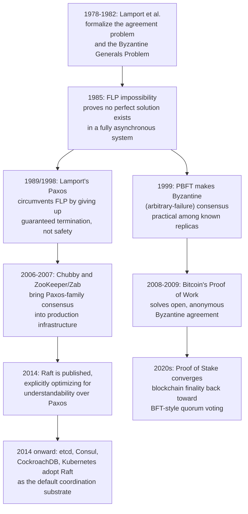

## 3. Why It Exists

Consensus exists because a distributed system that cannot agree on anything
is not one system — it is a loose collection of independently-opinionated
machines pretending to be one, and that pretense collapses the first time
two of them disagree about something that matters: which node may accept
writes, whether a transaction committed, or which value a configuration key
holds. Without a formal consensus protocol, every one of those questions
degenerates into ad hoc, timing-dependent guessing, and guessing is exactly
what produces the failure mode every distributed system architect fears
most — **split-brain**, where two disconnected halves of a cluster each
believe *they* are the legitimate leader and both accept conflicting writes,
silently corrupting data in a way that is often only discovered long after
the fact, and is rarely fully repairable. Consensus exists to make the
question "who is in charge, and what did we all agree happened" answerable
with a mathematically provable guarantee — not a heuristic, not a "usually
works," but a proof that as long as a majority of nodes are up and can
communicate, the agreed value is unique and durable, even while individual
nodes crash and restart around it.

The reason this needs to be a distinct chapter from Replication, rather than
a subsection of it, is that replication and consensus solve adjacent but
different problems: replication theory (already taught in depth by
[Replication](../06_Databases_and_Storage/CH07_Replication.md)) is
principally about *propagating data* from one place to many and about the
read/write availability-versus-consistency trade-offs that follow from
*how many* replicas must acknowledge a write. Consensus is about how the
replicas themselves agree on a single, totally-ordered sequence of decisions
in the first place — including, most critically, agreeing on *who is
currently the leader* that gets to decide replication order at all. A system
can replicate data with no consensus whatsoever (many leaderless,
eventually-consistent systems do exactly this, accepting the risk of
conflicting writes in exchange for availability) — but any system that wants
a single, unambiguous leader, or a single agreed log of operations, needs a
consensus protocol underneath it, whether that protocol is named explicitly
in the architecture diagram or quietly embedded inside a database engine's
replica-set election code.

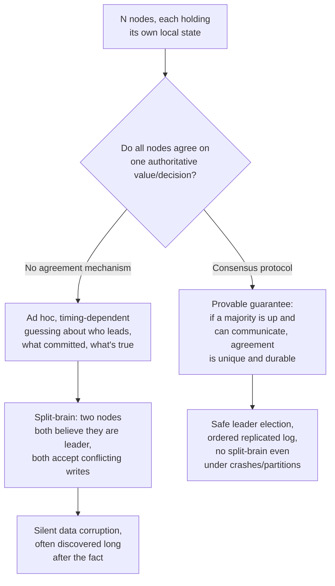

## 4. Core Concepts

### 4.1 The Consensus Problem and the FLP Impossibility Result

**Definition.** Formally, a consensus protocol among *n* processes, each of
which proposes a value, must satisfy three properties:

- **Agreement (safety)** — no two non-faulty processes ever decide on
  different values.
- **Validity (non-triviality)** — the value decided must have actually been
  proposed by some process (a protocol that always "decides" the constant 0
  trivially satisfies Agreement and is useless — Validity rules that out).
- **Termination (liveness)** — every non-faulty process eventually decides
  some value; the protocol is not permitted to run forever without deciding.

**Mechanism.** The FLP impossibility result (Fischer, Lynch, and Paterson,
1985) proves that in a **fully asynchronous** message-passing system — one
in which there is no upper bound on message delay or relative process
speed — no deterministic consensus protocol can simultaneously guarantee
Agreement, Validity, and Termination if even a single process may crash.
The proof's core insight is not about extreme or contrived scenarios; it is
about a single, structural ambiguity that every asynchronous protocol must
live with: **a node cannot distinguish "the peer I'm waiting on has
crashed" from "the peer is merely slow, and its message is still in
flight."** Because a fully asynchronous system provides no timeout that is
guaranteed to be safe (any timeout, however long, could in theory still be
too short for a legitimately-alive-but-slow node), any protocol that decides
a value based on "peer X has not responded, so I'll proceed without it" can
be forced, by a sufficiently adversarial (but still fully legal,
non-Byzantine) message-delivery schedule, into a state where it must either
violate Agreement (two sides decide differently) or never terminate at all.
The proof constructs exactly this scheduling adversary and shows it can
always find a way to keep the protocol undecided indefinitely, for any
proposed deterministic protocol.

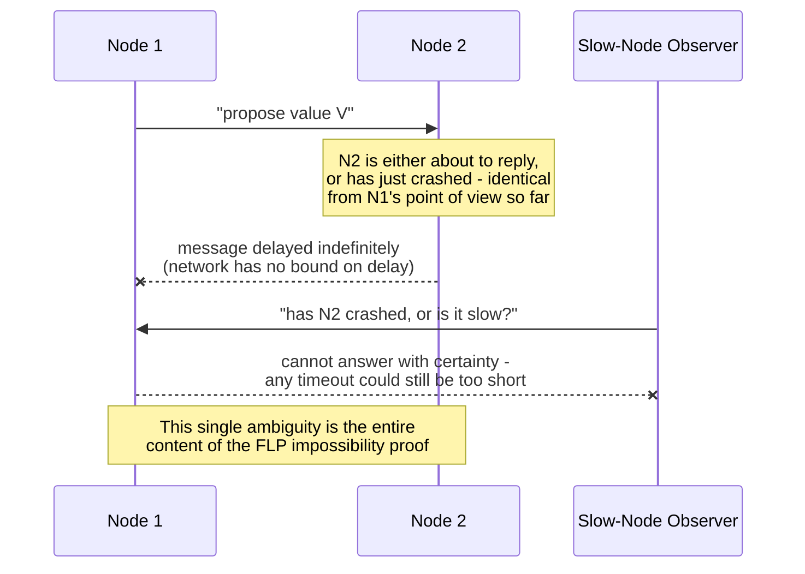

**Decision implications.** FLP does not mean consensus is impossible in
practice — clearly it is not, since Paxos, Raft, and every production
coordination service built on them work every day. What FLP means is that
**no real protocol can honestly promise all three properties (Agreement,
Validity, Termination) unconditionally** in a model that is genuinely fully
asynchronous. Every practical consensus protocol therefore makes a
deliberate, explicit escape from strict asynchrony, almost always by
weakening Termination rather than Agreement, because Agreement (safety) is
the property a distributed system can never afford to compromise (a
temporarily unavailable system is annoying; a permanently, silently
corrupted one is often unrecoverable). The two dominant escape strategies,
both used by the protocols in this chapter, are:

1. **Partial synchrony assumptions** — assume the network behaves
   asynchronously only for some bounded (but unknown in advance) period,
   after which message delivery becomes timely enough that a
   sufficiently-long timeout is, in practice, safe. Raft and Paxos both rely
   on this: they use randomized election timeouts (Section 4.4) as a
   practical, if theoretically imperfect, way to distinguish "leader is
   probably dead" from "leader is probably just slow," and they accept that
   in a sufficiently pathological network, progress can stall (Termination
   is weakened) — but Agreement is never sacrificed even in that stall.
2. **Randomization** — some consensus protocols (not the primary focus of
   this chapter, but worth naming, e.g. Ben-Or's algorithm) use randomized
   decisions to guarantee termination with probability 1 rather than with
   certainty, sidestepping FLP's fully-deterministic precondition instead of
   its asynchrony precondition.

**Common failure mode.** A frequent architectural mistake is treating a
consensus protocol's liveness (the ability to keep making progress) as
equally strong as its safety guarantee. Engineers sometimes conclude
"Raft/Paxos guarantees consensus" without the qualifier "as long as a
majority of nodes can communicate" — and are then surprised when a
network partition, a slow disk fsync, or a garbage-collection pause on a
majority of nodes causes the *entire cluster* to stop accepting new
decisions, even though no data has been corrupted. That stall is not a bug;
it is FLP's Termination trade-off working exactly as designed — the system
correctly chose unavailability over an unsafe guess.

**Scenario.** A 5-node etcd cluster backing a Kubernetes control plane
experiences a network partition that isolates 2 nodes (including the
current leader) from the other 3. The 3-node majority side detects the
leader is unreachable, times out, elects a new leader among itself, and
continues serving reads and writes — correctly, because 3 out of 5 is a
majority. The isolated 2-node minority side (including the old leader) can
no longer commit new entries, because it cannot reach a majority — it
correctly refuses to accept new writes rather than risk a second,
conflicting leader existing simultaneously. When the partition heals, the
old leader discovers a higher term number from the new leader (Section 4.4)
and steps down, re-synchronizing its log. No data was lost or corrupted;
availability was correctly sacrificed on the minority side for exactly as
long as the partition lasted.

### 4.2 Basic Paxos: Proposers, Acceptors, Learners, and the Two-Phase Protocol

**Definition.** Basic Paxos is a protocol for getting a set of processes to
agree on a **single value**, tolerating up to *f* crash failures out of
*2f + 1* participants (i.e., it requires only a simple majority to make
progress). It defines three logical roles a physical process can play,
often combined on the same machine: a **Proposer**, which suggests a value
and drives the protocol forward; an **Acceptor**, which votes on proposals
and is the source of the protocol's safety guarantee; and a **Learner**,
which simply finds out what value was ultimately chosen, without
participating in the voting itself.

**Mechanism.** Basic Paxos runs in two phases, each itself split into a
request and a response half, for four message types total:

1. **Phase 1a — Prepare.** A Proposer that wants to get a value accepted
   first picks a **proposal number** *n* that is unique and, critically,
   higher than any proposal number it has used before (typically
   constructed as a monotonically increasing counter combined with the
   proposer's own unique ID, e.g. `(counter, proposer_id)`, so that two
   different proposers never pick the same number). It sends a
   **Prepare(n)** request to a majority of Acceptors — not to propose a
   value yet, only to ask "will you promise to ignore any future proposal
   numbered lower than n?"
2. **Phase 1b — Promise.** An Acceptor that receives Prepare(n) checks it
   against the highest proposal number it has already promised to honor. If
   n is higher than anything it has seen, the Acceptor replies with a
   **Promise**, containing two things: a promise never again to accept
   any proposal numbered lower than n, and — if the Acceptor has *already
   accepted* some value in an earlier round — the highest-numbered value it
   has accepted so far, so the new Proposer can learn about it. If n is not
   higher than something the Acceptor already promised, the Acceptor simply
   ignores the request (or, in some implementations, replies with a
   rejection carrying the higher number it already promised, purely as an
   optimization to let the Proposer back off faster).
3. **Phase 2a — Accept.** If the Proposer receives Promises from a
   **majority** of Acceptors, it moves to Phase 2. Here is the single most
   important safety rule in the entire protocol: if any of those Promise
   responses contained an already-accepted value, the Proposer **must**
   use the highest-numbered such value it was told about — it is not free to
   propose its own original value anymore. Only if none of the Promises
   carried a previously-accepted value may the Proposer use its own value.
   It then sends **Accept(n, v)** to the same majority.
4. **Phase 2b — Accepted.** An Acceptor that receives Accept(n, v) accepts
   it — updating its own record of "the highest-numbered value I have
   accepted" — unless it has, in the meantime, promised a higher proposal
   number to some other Proposer, in which case it ignores the request. Once
   a **majority** of Acceptors have accepted the same (n, v), the value v is
   **chosen** — permanently, irrevocably. Learners find this out either by
   each Acceptor broadcasting its Accepted message to all Learners, or
   (more commonly in real implementations) via a single distinguished
   Learner that then disseminates the result.

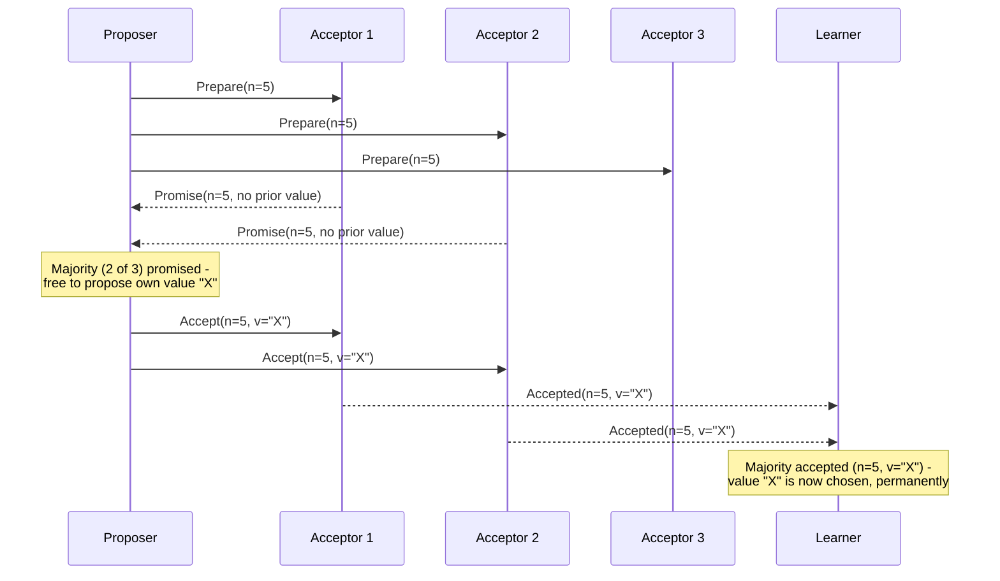

**Why two phases, not one.** A single-phase protocol — Proposers simply
broadcasting their value and Acceptors accepting the first one they see —
cannot be made safe, because two Proposers can race, each getting accepted
by a different, non-overlapping set of Acceptors, with no majority for
either value and no way to recover a single agreed answer. Phase 1
(Prepare/Promise) exists purely to let a Proposer **discover, before
committing to a value, whether some earlier proposal might already have been
chosen** — because if it had been, that value's Acceptors would reveal it in
their Promise response, forcing the new Proposer to adopt it rather than
silently overwrite it with a different value. This is exactly what
guarantees Agreement even when multiple Proposers compete concurrently:
whichever Proposer's Accept message reaches a majority *first* effectively
"poisons" any later Proposer's ability to choose a different value, because
that later Proposer's own Prepare phase will surface the already-accepted
value from at least one overlapping Acceptor (any two majorities out of the
same set of Acceptors must overlap in at least one Acceptor — this
majority-quorum-intersection property is the mathematical heart of Paxos's
safety proof).

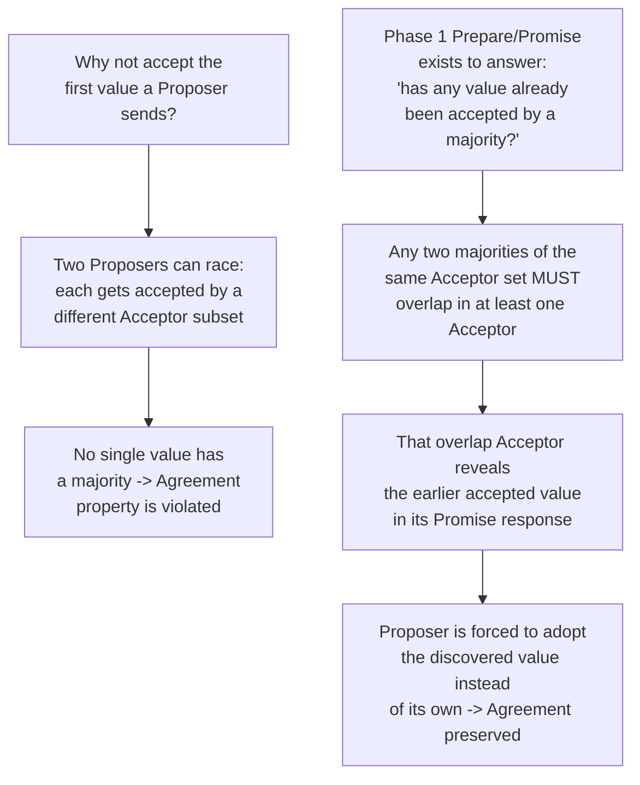

**Decision implications.** Basic Paxos guarantees Agreement (safety) under
any pattern of message delay, reordering, or duplication, and under any
number of crashed Acceptors as long as a majority remains reachable — but it
explicitly does *not* guarantee Termination in every execution, consistent
with FLP (Section 4.1): if two Proposers keep issuing higher and higher
Prepare requests faster than either can complete a full round, the protocol
can livelock indefinitely without ever choosing a value, even though safety
is never violated. Choosing Basic Paxos (or accepting it as the hidden
engine inside a coordination service) is the right call when the operational
priority is an airtight, formally-proven safety guarantee for a single
agreed decision, and the team is willing to invest in the substantial
engineering required to make a "textbook" description into an operable
system — as Google's Chubby paper documented, that gap is large.

**Common failure mode: the dueling-proposers livelock.** If Proposer A sends
Prepare(5), gets promises, and is about to send Accept(5, "X") — but
Proposer B, running concurrently, sends Prepare(6) first, every Acceptor
that already promised n=5 will now also promise n=6 (since 6 > 5), and will
subsequently *reject* Proposer A's Accept(5, "X") because 5 is now lower than
the highest promise (6) they've made. If Proposer A then retries with an
even higher proposal number, say 7, it can symmetrically invalidate
Proposer B's in-flight Accept(6, ...) — and this can continue indefinitely
if the two Proposers' timing keeps interleaving unluckily. This is precisely
Basic Paxos's Termination weakness manifesting in practice, and it is the
single most common reason production Paxos deployments introduce a
**distinguished proposer** (a stable leader) as an optimization — which is
exactly what Multi-Paxos (Section 4.3) formalizes.

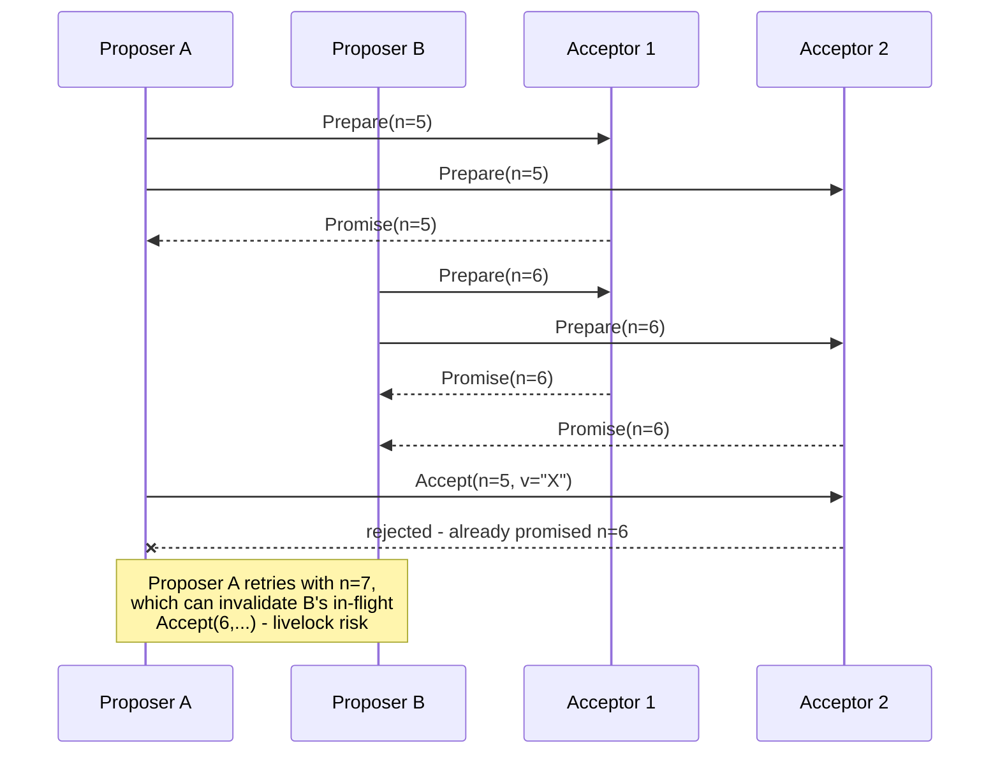

**Scenario.** A distributed lock service uses Basic Paxos to agree on which
client currently holds a named lock. Two application servers simultaneously
attempt to acquire the same lock during a brief period of elevated network
jitter; their Paxos rounds interleave exactly as in the livelock diagram
above, causing both acquisition attempts to retry two or three times before
one finally wins a full round uncontested. The lock is still granted
correctly to exactly one client (Agreement holds), but acquisition latency
briefly spikes from single-digit milliseconds to tens of milliseconds — an
operationally visible, if harmless, symptom of exactly the Termination
weakness Section 4.1 predicts.

### 4.3 Multi-Paxos: The Practical, Steady-State Optimization

**Definition.** Multi-Paxos is not a different algorithm from Basic Paxos so
much as a standard *optimization* applied to it for the realistic case of
agreeing on a **sequence** of values (a replicated log of operations) rather
than a single one-off value — which is what virtually every real consensus
deployment actually needs (a database's replicated write-ahead log, a
coordination service's sequence of configuration changes, and so on).

**Mechanism.** The key observation is that Phase 1 (Prepare/Promise) does
not actually depend on the *value* being proposed — it only establishes
"I am now the proposer whose proposals should be honored going forward,"
which is exactly the definition of a **stable leader**. Multi-Paxos
therefore runs Phase 1 **once**, electing a leader for an extended period
(often called a "master lease" or "leadership term"), and then, for every
subsequent log entry the leader wants to append, skips straight to Phase 2
(Accept/Accepted) using the already-established proposal number — cutting
the message round-trips per decided value from four to two in the common
case, as long as the leader remains stable and uncontested.

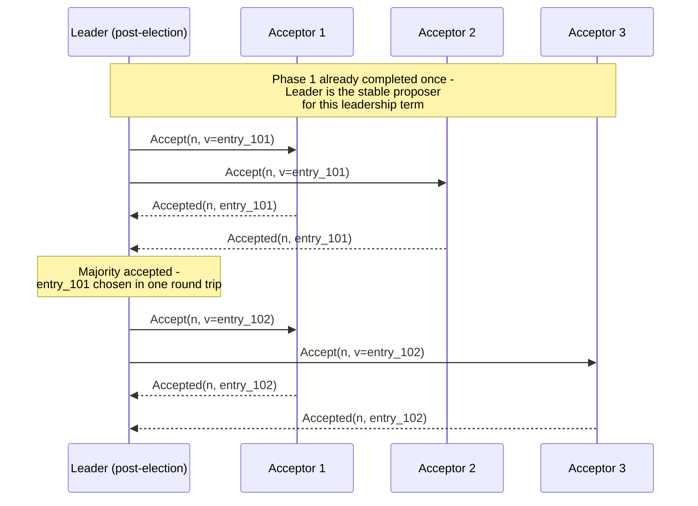

**Decision implications.** Multi-Paxos trades a small amount of additional
complexity (leader-lease management, detecting and recovering from a dead
leader, handling log gaps if the leader crashes mid-sequence) for a large
latency win in the common case, which is why essentially every production
Paxos-family system (Chubby, Zab/ZooKeeper's underlying protocol) is really
"Multi-Paxos with a specific set of leader-management engineering choices,"
not textbook Basic Paxos run once per value. This is also the conceptual
bridge to Raft: Raft's designers observed that once you commit to always
having a stable leader (as any practical Paxos deployment does), you can
restructure the *entire* protocol description around "there is a leader, and
here is exactly what it and only it is allowed to do" rather than
describing a leaderless protocol and only later revealing that a leader
optimization is nearly always layered on top — which is precisely the
clarity gap Section 4.6 examines.

**Common failure mode.** A common Multi-Paxos implementation bug is failing
to correctly handle **log holes** — gaps in the sequence of decided values
that appear when a leader crashes after starting Phase 2 for entry N+2 but
before entry N+1 was ever decided. A naive implementation that lets Learners
apply entries out of order, or that does not re-run a full Prepare phase to
safely re-discover or re-propose the missing entry N+1, can violate the
ordering guarantee the entire replicated log exists to provide.

**Scenario.** A configuration-management service built on Multi-Paxos elects
a leader that serves 50,000 configuration-change proposals per second at
sub-millisecond added latency during stable operation. When that leader is
terminated by an orchestrator during a routine node replacement, a new
leader election (a fresh Phase 1 round) adds a brief, single-digit-millisecond
pause to the next configuration change, after which steady-state,
single-round-trip Phase 2 operation resumes — the exact latency profile
Multi-Paxos is designed to produce.

### 4.4 Raft: Leader Election

**Definition.** Raft achieves the same fault-tolerance guarantee as
Multi-Paxos (tolerating up to *f* crash failures out of *2f + 1* nodes) but
is built, from its first design decision onward, around a single explicit
premise: at any given time, exactly one node in the cluster is the
**Leader**, every other node is a **Follower**, and only the Leader ever
originates new log entries — Followers are purely reactive. A node
temporarily becomes a **Candidate** only during the process of trying to
become the new Leader.

**Mechanism.** Time in Raft is divided into **terms** — monotonically
increasing integers, each term containing at most one successfully-elected
Leader (though some terms may have no Leader at all, if an election fails to
produce a majority winner, e.g. due to a split vote). Every node stores the
highest term number it has ever observed and includes it in every message it
sends; any node that observes a **term higher than its own** immediately
recognizes it is out of date, reverts to Follower state, and adopts the
higher term — this single rule is what allows a stale former Leader to be
safely demoted the moment it rejoins after a partition heals.

Leader election works as follows: every Follower maintains an
**election timeout** — a randomized duration (a canonical range is
150-300ms) after which, if it has not heard a valid **heartbeat**
(an empty AppendEntries RPC, Section 4.5) from a current Leader, it assumes
the Leader has failed. On timeout, the Follower:

1. Increments its current term.
2. Transitions to Candidate state.
3. Votes for itself.
4. Sends a **RequestVote** Remote Procedure Call (RPC) to every other node
   in the cluster, in parallel.

Each node grants at most one vote per term, on a strict first-come,
first-served basis, and — critically for safety — only grants a vote if the
Candidate's log is **at least as up-to-date** as its own (the Election
Restriction, detailed further in Section 4.5). A Candidate that receives
votes from a **majority** of the cluster (including its own self-vote)
immediately becomes the new Leader for that term and begins sending
heartbeats to establish authority and suppress further elections. If a
Candidate instead hears from another node claiming to be Leader for a term
greater than or equal to its own, it recognizes that node as legitimate and
reverts to Follower. If neither happens before its own election timeout
expires again, it starts a **new election** with an incremented term — the
randomization of each node's timeout is what makes it statistically
unlikely for two Candidates to keep re-splitting the vote indefinitely,
since after a split vote, each Candidate independently re-randomizes its
next timeout, and whichever one happens to time out first and start
requesting votes again typically wins outright before the others even
notice a new term has started.

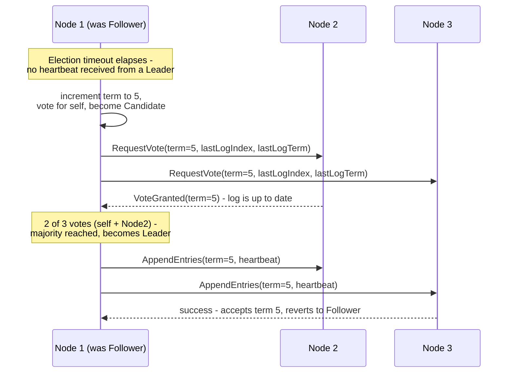

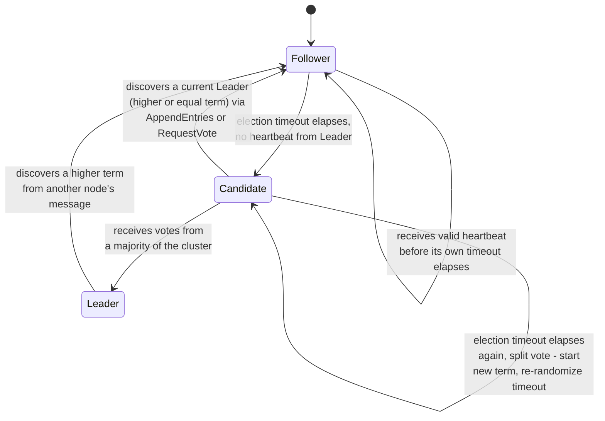

**Decision implications.** Randomized election timeouts are the single
mechanism that makes leader election both safe (it only ever elects a
Leader with majority agreement, so Agreement is never at risk) and,
practically, live (it makes indefinite split-vote livelock statistically
implausible without requiring any global synchronization to avoid it). The
150-300ms canonical range is not arbitrary: it is chosen to be an order of
magnitude larger than typical intra-datacenter network round-trip time
(so heartbeats reliably arrive before a timeout under normal conditions),
while remaining short enough that a real leader failure is detected and a
new leader elected within a few hundred milliseconds — directly trading
detection latency against the risk of spurious elections caused by transient
network jitter.

**Common failure mode.** Setting the election timeout too close to the
network's typical round-trip latency causes **spurious elections** —
Followers time out and start new elections even though the Leader is still
healthy, simply because a heartbeat was marginally delayed, generating
unnecessary term increments and brief availability blips. Conversely, an
election timeout set too high slows real failure detection, extending the
window during which the cluster has no functioning Leader after an actual
crash. A more insidious failure mode is deploying Raft across
high-latency wide-area links (e.g. cross-region) with a timeout tuned for
intra-datacenter latency, which causes chronic, ongoing spurious elections —
a well-known operational trap for teams that lift a Raft-based system from a
single region into a multi-region topology without re-tuning timeouts.

**Scenario.** A 5-node Raft cluster's Leader is running on a host that
experiences a multi-second garbage-collection pause. Every Follower's
election timeout (independently randomized between 150-300ms) expires
during the pause; the Follower with the shortest randomized timeout starts
an election first, typically wins a majority before any other Follower's
timeout even expires, and becomes the new Leader — client-visible
unavailability during this failover is therefore usually just one election
timeout's worth of delay (low hundreds of milliseconds), not the full length
of the original Leader's pause, because the moment the paused Leader
recovers and observes a higher term from the new Leader's heartbeat, it
immediately steps down rather than trying to contest an already-settled
election.

### 4.5 Raft: Log Replication, Commit Rules, and Safety

**Definition.** Once elected, a Raft Leader is the sole originator of new
entries in the cluster's replicated log — an ordered sequence of commands,
each tagged with the term in which it was created and its index (position)
in the log. Log replication is the mechanism by which the Leader propagates
its log to Followers and determines when an entry is safely **committed**
(i.e., guaranteed to survive any future leader change).

**Mechanism.** When a client submits a command, the Leader appends it to its
own log as a new entry and, in parallel, sends an **AppendEntries** RPC to
every Follower, containing the new entry (or entries, if several are
batched) along with the index and term of the entry immediately preceding
it. A Follower accepts the new entries only if its own log already contains
an entry at that preceding index with a matching term (the **Log Matching
Property** — if two logs contain an entry with the same index and term,
Raft guarantees every entry up to that point is identical in both logs);
if the Follower's log does not match at that point, it rejects the
AppendEntries, and the Leader responds by decrementing the index it tries
next time and retrying, effectively walking backward until it finds the
point where the two logs agree, then overwriting everything after that
point on the Follower with its own log — this is how Raft repairs a
Follower whose log has fallen behind or diverged.

An entry is **committed** the moment the Leader has confirmed it is stored
by a **majority** of the cluster (itself included) — at that point the
Leader applies it to its own state machine and responds to the client, and
in subsequent AppendEntries RPCs it informs Followers of the new commit
index so they, too, can apply it to their own state machines. Critically,
Raft's commit rule includes one further restriction beyond "replicated to a
majority": **a Leader may only commit an entry from its own current term
directly by counting replicas.** An entry from a previous term that happens
to be replicated on a majority is committed only *indirectly*, as a
byproduct of a later entry from the current term being committed on top of
it — never by directly counting replication of the old-term entry alone.

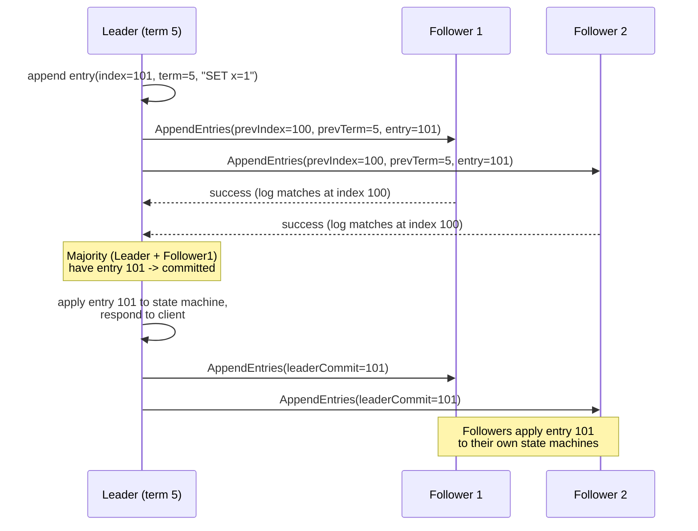

**Why the current-term-only commit restriction exists (safety deep dive).**
Without this restriction, a subtle safety violation becomes possible: a
Leader from an earlier term could replicate an entry to a majority, crash
before committing it, and a new Leader could later overwrite that entry with
a different one (because the old entry was never formally committed) — yet
if a *different* new Leader had, in a different timeline, gone on to
directly count that old-term entry's majority-replication as sufficient to
commit it, two different values could end up committed at the same log
index across different possible histories, violating Agreement. Diego
Ongaro's Raft dissertation walks through this exact scenario in detail; the
practical rule that resolves it — never commit an old-term entry by direct
counting, only ever as a side effect of committing a current-term entry on
top of it — is one of the more subtle points in the whole protocol, and is
precisely the kind of correctness-critical detail this book's Concept
Ownership Rule exists to teach once, fully, rather than have every
Raft-using database chapter re-derive imperfectly.

**The Election Restriction (tying leader election to log safety).** Section
4.4 mentioned that a Candidate can only win a vote if its log is "at least
as up-to-date" as the voter's own log; the precise rule is: comparing the
term of each node's last log entry first (a higher last-entry term wins
outright), and only if those terms are equal, comparing log length (the
longer log wins). This restriction guarantees that **a Leader always has
every entry that has been committed by any previous Leader** in its log
before it is even elected — because any committed entry was, by definition,
replicated to a majority, and any future election also requires a majority
of votes, so the two majorities must overlap in at least one node that has
the committed entry, and that node will refuse to vote for any Candidate
whose log does not also contain it (or a term-equivalent-or-later entry).
This is the same majority-quorum-intersection argument that underlies
Paxos's safety (Section 4.2) — expressed through Raft's specific,
understandability-optimized vocabulary of terms and log indices rather than
Paxos's abstract proposal numbers.

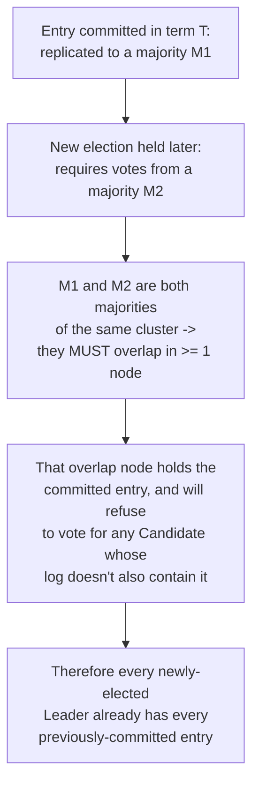

**Decision implications.** The Log Matching Property plus the Election
Restriction together give Raft a strong, provable guarantee called
**Leader Completeness**: once an entry is committed, every future Leader is
guaranteed to have it. This is what lets client-facing code treat a
"committed" acknowledgment as durable in the same sense a single-node
database's fsync'd write is durable — the entry will survive any number of
subsequent leader changes.

**Common failure mode.** A common implementation bug is applying an entry to
the state machine as soon as it is *replicated*, rather than waiting until
it is formally *committed* per the majority-plus-current-term rule above —
this can expose a client to a value that a subsequent leader election later
overwrites, a direct Agreement violation from the client's point of view
even though the underlying Raft library itself is correct.

**Scenario.** A 5-node Raft-backed configuration store's Leader appends
entry 200 and successfully replicates it to 2 Followers (3 of 5 total, a
majority) before its process is killed. A new election elects one of those
2 Followers (which has entry 200 in its log, satisfying the Election
Restriction) as the new Leader. The new Leader, per the current-term-only
commit rule, cannot directly declare entry 200 committed on the strength of
the old term's replication alone — but the moment it appends and replicates
its own first entry (index 201, new term) to a majority, entry 200 becomes
committed as a byproduct, and both entries are now durable across any future
leader change.

### 4.6 Raft vs. Paxos: Understandability vs. Flexibility

**Definition.** Raft and Multi-Paxos are provably equivalent in the
fault-tolerance guarantee they offer (tolerating *f* failures out of
*2f + 1* nodes, with identical Agreement and majority-quorum-intersection
safety arguments) — the difference between them is not "which one is more
correct," but a genuine design trade-off between **understandability and
operability** on one side and **algorithmic flexibility** on the other.

**Mechanism of the trade-off.** Paxos, in its original formulation, is
deliberately leaderless and symmetric — any node can act as a Proposer at
any time, which makes the base protocol more flexible (it directly
generalizes to more exotic configurations, such as flexible/asymmetric
quorum systems where read-quorums and write-quorums are sized differently
to trade read versus write latency) but pushes almost all of the practically
necessary complexity — stable-leader optimization (Multi-Paxos, Section
4.3), reconfiguration, snapshotting — into an unspecified, ad hoc layer that
every implementation must design for itself, largely independently,
producing famously divergent and hard-to-compare production systems (Google
Chubby's Paxos, ZooKeeper's Zab, and various in-house variants all made
different, incompatible engineering choices here). Raft instead makes
"there is exactly one Leader at a time" a **first-class part of the
protocol's core definition**, not an optional optimization layered on
afterward — which is precisely why Raft's paper can specify leader election,
log replication, and membership changes as concretely and completely as it
does; there is far less "figure this part out yourself" surface area left
for an implementer to get subtly wrong.

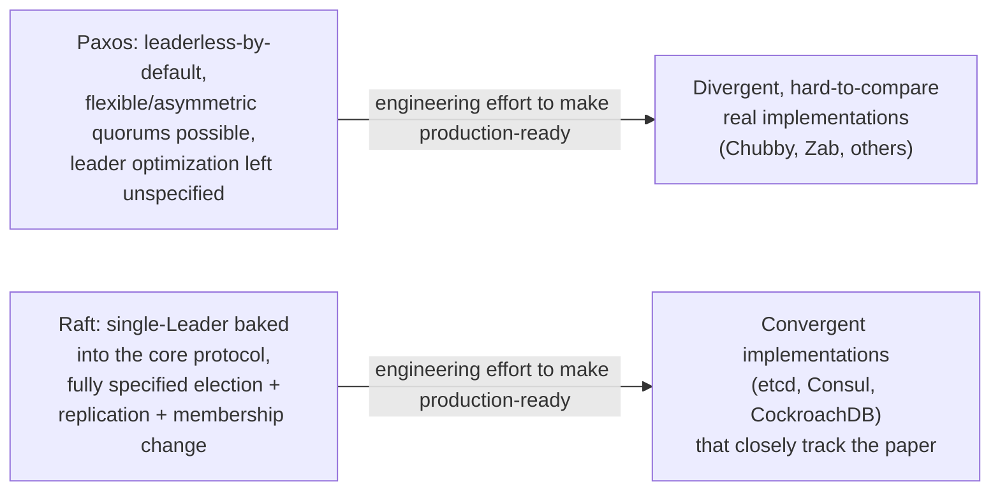

**Decision implications.** For the overwhelming majority of production
use cases — a replicated log backing a database, a configuration store, a
coordination service — the flexibility Paxos preserves (asymmetric quorums,
leaderless operation) is rarely exercised in practice, because nearly every
real deployment ends up wanting a stable leader anyway for latency reasons
(Section 4.3), which makes Raft's explicit, fully-specified leader-centric
design a strictly lower-risk engineering choice with no meaningful loss of
real-world capability. This is the direct, well-documented reason new
greenfield systems built after 2014 (etcd, Consul, CockroachDB, TiKV)
overwhelmingly chose Raft over Paxos, while systems whose core consensus
layer predates 2014 (Chubby, ZooKeeper) continue running their existing
Paxos-family implementations rather than justifying a risky rewrite of
already-proven, battle-tested code. Choosing Paxos over Raft today is
usually justified only when a system genuinely needs Paxos's more flexible
quorum configurations (for example, deliberately asymmetric read/write
quorum sizing for a workload with a strongly skewed read:write ratio), or
when integrating with an existing Paxos-based ecosystem where protocol
compatibility matters more than implementation simplicity.

**Common failure mode.** Treating "Raft is easier to understand" as
"Raft is easier to implement correctly without expert review" — Raft's
paper reduces conceptual difficulty dramatically compared to Paxos, but a
production-grade implementation still requires careful handling of
membership changes, log compaction/snapshotting, and client interaction
semantics (linearizable reads, in particular, are not automatic just because
Raft elected a leader) — teams that under-invest in these "beyond the core
algorithm" concerns still ship subtly incorrect consensus layers, just with
a different, more approachable starting point than Paxos.

**Scenario.** A platform team evaluating whether to build a new
configuration-coordination service in-house versus adopt etcd chooses etcd
specifically because Raft's fully-specified membership-change protocol
(covered by etcd's already-hardened implementation) removes an entire class
of subtle bugs the team would otherwise have had to solve themselves had
they built on a bespoke Paxos variant — precisely the "convergent,
battle-tested implementation" advantage the diagram above illustrates.

### 4.7 Byzantine Fault Tolerance: PBFT and Blockchain Consensus

**Definition.** Every protocol covered so far (Paxos, Raft) assumes the
**crash-fault** model: a faulty node simply stops responding — it never
sends a message that lies about its own state, forges another node's
identity, or deliberately sends conflicting messages to different peers to
sow disagreement. **Byzantine Fault Tolerance (BFT)** is the strictly harder
problem of reaching consensus when up to *f* nodes may be **Byzantine** —
behaving in an arbitrary, and possibly actively malicious or adversarial,
way, including lying, colluding, and sending different (even
mutually-contradictory) messages to different peers in the same round. The
name comes directly from Lamport, Shostak, and Pease's 1982 "Byzantine
Generals Problem" framing (Section 2): a set of generals surrounding a city
must agree on a single battle plan (attack or retreat), communicating only
by messenger, when some generals may be traitors actively trying to cause
the loyal generals to reach different decisions.

**Mechanism — why BFT needs more nodes and more rounds.** Crash-fault
protocols like Raft and Paxos need only *2f + 1* nodes to tolerate *f*
failures, because a crashed node simply contributes nothing, and any two
majorities out of *2f + 1* nodes still overlap in at least one honest node
(Section 4.2/4.5). Byzantine fault tolerance needs **3f + 1** nodes to
tolerate *f* Byzantine nodes, because a Byzantine node can actively lie
about what it heard from others, not merely stay silent — the extra
tolerance margin exists specifically so that, even if the *f* Byzantine
nodes conspire to make two different honest-node subsets believe
contradictory things, there are still enough remaining honest nodes to
out-vote the lie in every possible sub-scenario. Practical Byzantine Fault
Tolerance (PBFT), introduced by Castro and Liskov in 1999, formalizes this
into a concrete three-phase protocol among a fixed, known set of *3f + 1*
replicas, one of which is the **primary** for the current view (a
Raft-Leader-like role, but re-derived independently for the Byzantine
setting) :

1. **Pre-prepare** — the primary assigns a sequence number to a client
   request and broadcasts a Pre-prepare message to all replicas.
2. **Prepare** — every replica that accepts the Pre-prepare broadcasts a
   Prepare message to every other replica; a replica moves forward only
   once it has collected **2f matching Prepare messages** (plus its own),
   guaranteeing that a large enough set of replicas agree on the same
   sequence number for the same request within the same view — this is the
   phase that defends against a Byzantine primary trying to assign
   conflicting sequence numbers to different replicas.
3. **Commit** — once "prepared," every replica broadcasts a Commit message;
   a replica finally executes the request once it has collected **2f + 1
   matching Commit messages** (including its own), guaranteeing enough
   overlap across any two replicas' quorums that the same request executes
   in the same order everywhere, even across a subsequent view change (a
   Byzantine-tolerant equivalent of Raft's leader re-election).

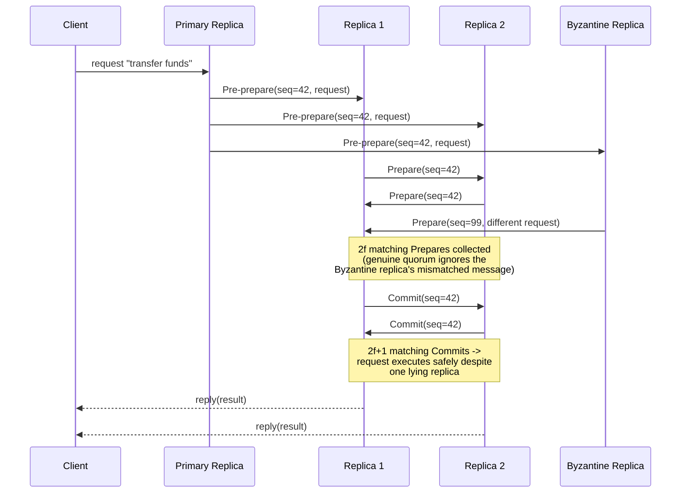

**Blockchain consensus as an application (brief).** Blockchain systems face
an even harder variant of Byzantine consensus than PBFT was designed for:
PBFT assumes a fixed, known set of *3f + 1* identified replicas, while
public blockchains need consensus among an **open, anonymous, and
constantly changing** set of participants, where anyone can join and
identities cannot be trusted or even counted in advance (a single attacker
could otherwise trivially create thousands of fake identities — a **Sybil
attack** — to overwhelm any fixed-quorum voting scheme). Two dominant
answers exist:

- **Proof of Work (PoW)** (Bitcoin's original mechanism) replaces "voting by
  identity" with "voting by expended computational work": participants
  (miners) compete to solve a deliberately expensive cryptographic puzzle,
  and whichever miner solves it first earns the right to propose the next
  block; the probability of proposing a block is proportional to a
  participant's share of total network computing power, making a Sybil
  attack economically self-defeating (creating more identities does not
  create more computing power). Agreement is only ever **probabilistic** —
  a block is considered "final" only after enough subsequent blocks have
  been built on top of it that reversing it would require redoing an
  economically infeasible amount of work (the "longest chain" rule),
  trading PBFT's strict, immediate finality for permissionless openness.
- **Proof of Stake (PoS)** (used by Ethereum since "The Merge," 2022)
  replaces computational work with **economically staked capital**:
  participants (validators) lock up a stake of the network's native
  currency, and the right (and later, the responsibility) to propose and
  attest to blocks is allocated proportionally to stake, with provably
  dishonest behavior punished by forfeiting ("slashing") a portion of that
  stake. Modern PoS systems typically layer a PBFT-style voting/finality
  gadget (requiring roughly two-thirds of staked weight to agree) on top of
  block proposal, converging back toward the same quorum-intersection
  safety argument this chapter has now derived three times (Paxos, Raft,
  PBFT) — just re-expressed in terms of staked economic weight rather than
  a fixed count of identified replicas.

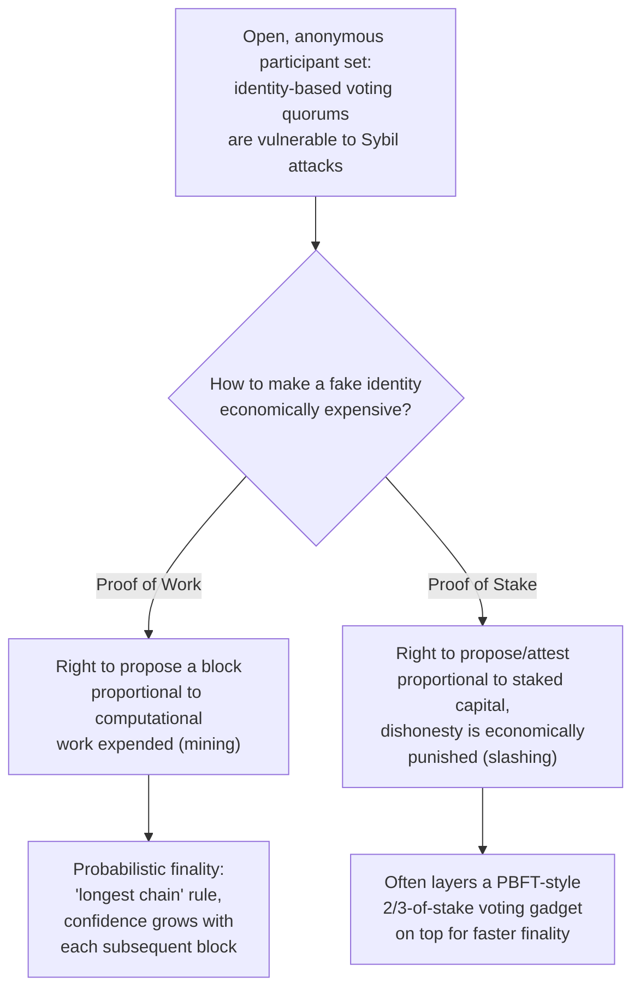

**Decision implications.** Byzantine fault tolerance is far more expensive
than crash-fault tolerance — more replicas required for the same *f*, more
message rounds per decision, and (for PoW specifically) enormous energy
expenditure as the cost of Sybil resistance — so it should be reserved for
settings where the trust assumption genuinely cannot be "nodes only crash,
never lie": cross-organizational systems where participants have
conflicting financial incentives to cheat (blockchains, financial
settlement networks), safety-critical systems tolerating hardware faults
that could corrupt output rather than simply halt it (some aerospace and
avionics consensus systems), or any system integrating untrusted
third-party nodes. Within a single organization's own data centers, where an
operator can reasonably assume its own hardware and software, while
certainly capable of crashing, is not actively adversarial, crash-fault
protocols (Raft, Paxos) are the correct, far cheaper choice — which is
exactly why every database and coordination service covered elsewhere in
this book (MongoDB, Cassandra, Neo4j, etcd, ZooKeeper) uses a crash-fault
protocol, not a Byzantine one.

**Common failure mode.** Applying a crash-fault protocol (Raft, Paxos)
in a setting that actually has Byzantine risk — for example, running
consensus across untrusted, independently-operated nodes each controlled by
a different company with a conflicting financial interest — silently
under-protects the system, because Raft/Paxos provide zero safety guarantee
against a node that deliberately sends different Accept/AppendEntries
content to different peers; the majority-quorum-intersection argument that
makes them safe assumes every non-faulty node reports state honestly, an
assumption that simply does not hold once "faulty" includes "actively
lying."

**Scenario.** A consortium of five independent banks builds a shared ledger
for interbank settlement, where each bank operates its own node and each
bank has a plausible financial incentive to report a self-favoring, false
transaction history if it could get away with it. The consortium correctly
rejects a Raft-based design (which would let any single dishonest bank's
node corrupt the shared ledger's history with a doctored AppendEntries
message) in favor of a PBFT-style protocol requiring *3f + 1* participating
banks and explicit tolerance for up to *f* dishonest banks — a direct,
real-world instance of the crash-fault-vs-Byzantine-fault decision this
section formalizes.

## 5. Internal Working

This section goes one level deeper than Section 4's per-concept mechanics,
examining the two structural invariants that make Paxos and Raft's safety
proofs actually work, and how a real implementation represents an
Acceptor's/Follower's persistent state to survive a crash-and-restart.

**The quorum-intersection invariant, generalized.** Every safety argument in
this chapter — Basic Paxos's Agreement, Multi-Paxos's log consistency,
Raft's Leader Completeness, even PBFT's Byzantine-tolerant agreement —
reduces to the same underlying combinatorial fact: **any two quorums drawn
from the same participant set, each larger than half the set (or, for PBFT,
each requiring more than two-thirds), must share at least one common
member.** This is not a coincidence across three independently-invented
protocols; it is the single load-bearing mathematical idea that makes
majority-based (or supermajority-based) consensus possible at all, and every
protocol-specific mechanism this chapter has taught — Promise messages
revealing prior values, the Election Restriction, PBFT's Prepare-quorum
step — exists specifically to *exploit* that guaranteed overlap to prevent
two different values from ever being finalized independently.

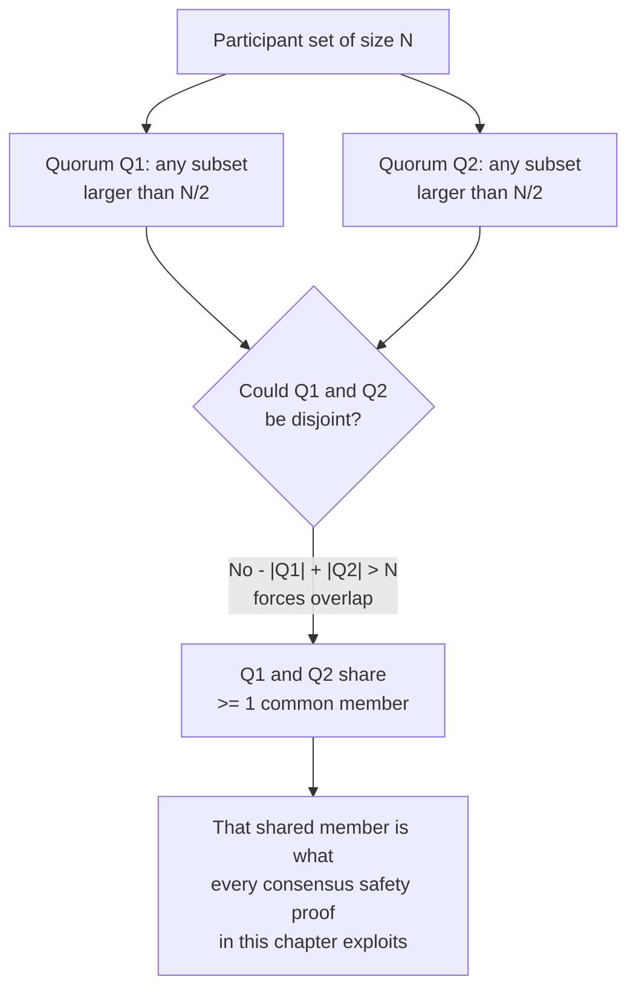

**Persistent state and crash recovery.** A real Acceptor (Paxos) or node
(Raft) must durably persist a small amount of state to stable storage
(fsync'd to disk) **before** replying to certain messages, precisely because
a crash-and-restart must not be allowed to "forget" a promise or vote it
already made — forgetting would reopen exactly the safety hole Section 4.2's
Prepare/Promise phase exists to close. Concretely:

- A Paxos Acceptor must persist the highest proposal number it has promised,
  and the highest-numbered value (if any) it has accepted, before sending
  its Promise or Accepted response.
- A Raft node must persist its current term, the candidate (if any) it
  voted for in that term, and its log entries, before responding to a
  RequestVote or AppendEntries RPC.

A node that crashes and restarts without this durable state (for example, a
buggy implementation that only keeps it in memory) can be tricked into
voting twice in the same term after a restart, directly violating the
"at most one vote per term" rule that Section 4.4's safety argument depends
on — this is one of the most common, subtle bugs found during real-world
Raft/Paxos implementation code review, and one of the strongest reasons this
book recommends adopting a mature, widely-used consensus library (Sections 8
and 17) rather than hand-rolling a new implementation for a production
system.

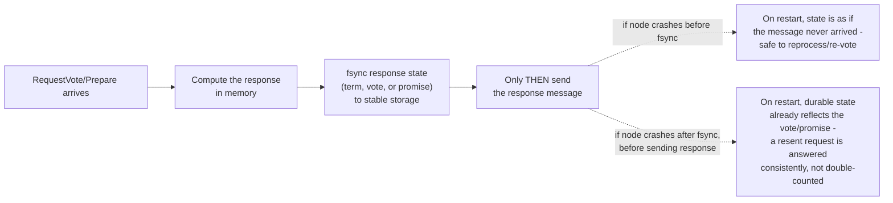

## 6. Design Principles

- **Prefer the weaker guarantee you actually need.** Do not reach for
  Byzantine fault tolerance when crash-fault tolerance (Raft/Paxos) is
  sufficient for the trust model — the extra replicas, message rounds, and
  (for PoW) energy cost of BFT are a real, ongoing operational tax that
  should only be paid when the trust assumption genuinely requires it
  (Section 4.7).
- **Safety is non-negotiable; liveness is the dial you're allowed to turn.**
  Every protocol in this chapter is designed around the principle that
  Agreement must never be sacrificed, while Termination/availability is the
  property that is explicitly, deliberately allowed to degrade under
  sufficiently adverse conditions (Section 4.1) — any consensus-adjacent
  design decision (timeout tuning, quorum sizing) should be evaluated
  against which side of that trade-off it is really moving.
- **A stable leader is not optional in practice — design for it explicitly.**
  Section 4.3 showed that even Paxos, despite being described as leaderless,
  is deployed with a de facto stable leader almost universally in
  production. Raft's explicit design choice to make this a first-class part
  of the protocol (Section 4.6) reflects a broader principle: don't leave
  a "we'll figure out the leader optimization later" gap in a distributed
  system's design — plan for how leadership is established, detected as
  lost, and re-established from the start.
- **Odd-numbered cluster sizes, chosen deliberately.** Consensus clusters
  should almost always use an odd number of nodes (3, 5, 7) — an even-sized
  cluster (e.g. 4 nodes) provides no additional fault tolerance over the
  next-smaller odd size (3 nodes both still tolerate only 1 failure) while
  adding an extra node's worth of replication cost and, in some partition
  patterns, an increased risk of an exact-tie split vote.
- **Durability before response, always.** Section 5's persistent-state
  discussion generalizes into a design principle: any consensus
  participant's response to a protocol message must be preceded by durably
  persisting whatever state that response depends on — an in-memory-only
  implementation is not merely slower to recover, it is unsafe.

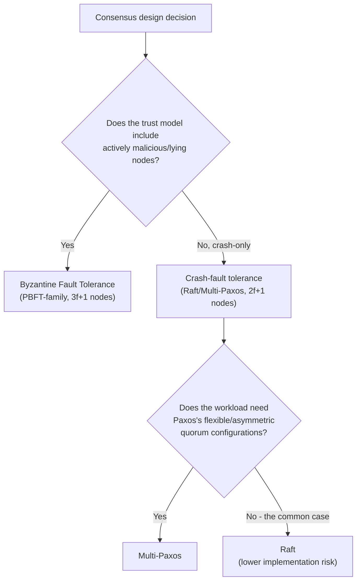

## 7. Architecture Patterns

The dominant architecture pattern built on top of everything Section 4
taught is the **Replicated State Machine (RSM)**: a consensus protocol
(Raft or Multi-Paxos) agrees on a totally-ordered, replicated **log** of
commands, and every node independently applies that same log, in the same
order, to its own local, otherwise-arbitrary state machine (a key-value
store, a lock table, a configuration map) — because every node starts from
the same initial state and applies the same operations in the same order,
every node's resulting state is guaranteed identical, without the state
machine's own logic needing to know anything about consensus at all. This
pattern is the reusable architectural building block that every consensus-
backed system in this book (etcd's key-value store, ZooKeeper's znode tree,
a database's replicated write-ahead log) is really an instance of.

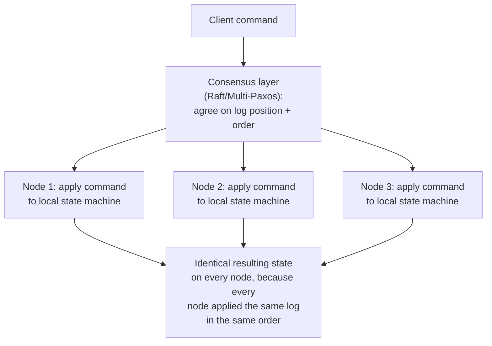

A closely related pattern is **leader-forwarding**: since only the Leader
may originate new log entries (Raft) or hold the active leadership lease
(Multi-Paxos), client requests that happen to reach a Follower are
transparently forwarded to the current Leader (or the client is redirected
with the Leader's identity, a common alternative that avoids an extra
network hop inside the cluster). This pattern is what lets client-facing
code treat the cluster as a single logical endpoint despite consensus's
single-writer requirement underneath.

## 8. Production Architecture

In production, teams almost never hand-roll a consensus protocol from this
chapter's pseudocode-level description; they either adopt a battle-tested
consensus **library** (`etcd/raft` in Go, `hashicorp/raft`, the Raft
implementation inside CockroachDB/TiKV) embedded directly into their own
service, or they depend on an already-running **coordination service**
(etcd, ZooKeeper, Consul) that exposes a simpler key-value or
configuration-watch Application Programming Interface (API) on top of an
internally-hidden consensus layer. Kubernetes is the most widely deployed
real-world example: its entire control plane's source of truth is etcd, and
etcd's Raft-based consensus layer is what gives Kubernetes the guarantee
that, even as API-server replicas and nodes crash and restart continuously,
the cluster's desired-state configuration is never lost or seen
inconsistently by two different controllers.

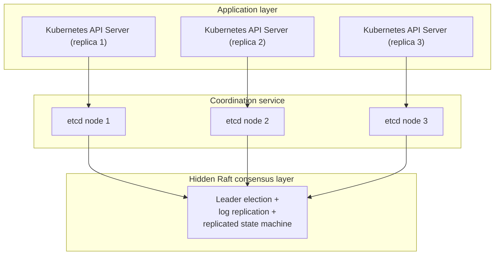

A recurring production concern is **cluster reconfiguration** — adding or
removing nodes from a running consensus cluster without ever having two
disjoint quorums active simultaneously (which would break the
quorum-intersection guarantee Section 5 derived). Raft's paper specifies a
**joint consensus** approach (transitioning through a configuration that
requires majorities from *both* the old and new membership sets
simultaneously before finalizing the new set alone); most production
systems instead use the simpler, restricted **single-server-change**
approach (add or remove exactly one node at a time), because it provably
cannot create two disjoint majorities as long as changes are serialized one
at a time, and it is dramatically simpler to implement correctly.

## 9. Implementation

Implementing (or correctly operating) a consensus-backed component in
practice means making a small number of concrete, consequential decisions:

1. **Cluster size** — pick an odd number (3 is the common default for most
   services; 5 for higher fault tolerance in larger deployments) per the
   Design Principles in Section 6.
2. **Election/heartbeat timeout tuning** — set the election timeout an order
   of magnitude above expected network round-trip time (Section 4.4),
   re-tuned explicitly for wide-area deployments.
3. **Read-path consistency choice** — a naive implementation that always
   routes reads through the Leader and the full log-replication path is
   simple but adds unnecessary latency; most mature implementations offer
   a faster **leader lease read** (the Leader serves a read directly from
   its own state machine, safe only as long as it can prove — via a
   lease or a fresh heartbeat round — that it is still the legitimate
   Leader) as an optimization, at the cost of additional implementation
   complexity.
4. **Snapshotting/log compaction** — an unbounded, ever-growing replicated
   log is not operationally viable; production systems periodically
   snapshot the state machine and truncate the log before that point,
   which then requires a separate mechanism (Raft's InstallSnapshot RPC) for
   bringing a far-behind or newly-joined node up to date without replaying
   the entire historical log.
5. **Client interaction semantics** — ensuring at-most-once or
   exactly-once command application despite client retries after a
   leadership change (this chapter deliberately does not re-teach that
   concern in full; see this same part's future, not-yet-drafted
   CH16_Idempotency.md and CH17_Exactly-Once_Processing.md for the general
   idempotency/exactly-once techniques this concern is an instance of).

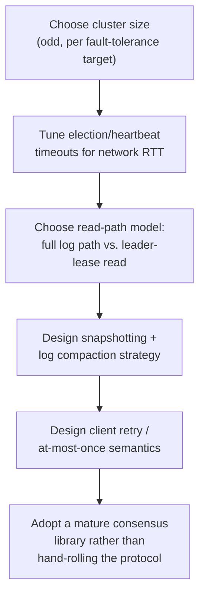

## 10. Complete Code Examples

The four runnable examples below live under
[`code/python/consensus-chapter/`](../code/python/consensus-chapter/) and
are deliberately self-contained, in-process simulations — they model the
message-passing behavior of each protocol directly in Python rather than
requiring a real network or a production consensus library, so a reader can
run them immediately to see the mechanics from Sections 4.2, 4.4, 4.5, and
4.7 actually execute:

1. [`01_raft_leader_election_simulator.py`](../code/python/consensus-chapter/01_raft_leader_election_simulator.py) —
   a discrete-event simulation of Raft leader election among several
   simulated nodes, with randomized election timeouts, term increments,
   RequestVote handling (including the Election Restriction), and a
   deliberately injected 3-candidate split-vote scenario (with per-voter
   message-arrival ordering, modeling the asynchronous-delivery race that
   causes a real split vote) to show re-randomization resolving it in the
   next term.
2. [`02_raft_log_replication_simulator.py`](../code/python/consensus-chapter/02_raft_log_replication_simulator.py) —
   builds on the elected Leader to simulate AppendEntries-based log
   replication, majority-based commit-index advancement, the
   current-term-only commit restriction from Section 4.5, and recovery of a
   Follower whose log has diverged.
3. [`03_basic_paxos_flow.py`](../code/python/consensus-chapter/03_basic_paxos_flow.py) —
   a direct pseudocode-to-code translation of Basic Paxos's
   Prepare/Promise/Accept/Accepted phases (Section 4.2), including a
   reproduction of the dueling-proposers livelock scenario and the rule
   that a Proposer must adopt an already-accepted value revealed by a
   Promise response.
4. [`04_pbft_quorum_demo.py`](../code/python/consensus-chapter/04_pbft_quorum_demo.py) —
   a simplified 4-replica (f=1) PBFT-style Prepare/Commit quorum-counting
   demo (Section 4.7), showing that a single Byzantine replica sending a
   mismatched message cannot prevent the honest replicas from reaching
   the required 2f/2f+1 quorums, and cannot trick them into executing a
   different request.

Each script prints an annotated, step-by-step trace of the protocol events
so the message flow can be read directly alongside this chapter's sequence
diagrams.

## 11. Performance

Consensus's dominant performance cost is **network round-trips per decided
value**, not central processing unit (CPU) work — Basic Paxos needs two
round-trips (Prepare/Promise, then Accept/Accepted) per value in the worst
case, Multi-Paxos and steady-state Raft need only one (a single
Accept/AppendEntries round-trip once a stable leader exists), and PBFT needs
effectively two-and-a-half round-trips (Pre-prepare, Prepare, Commit) due to
its stronger Byzantine-tolerant quorum requirements. In practice, the
dominant real-world lever for throughput is **batching**: a Leader
accumulates multiple client commands and replicates them as a single
AppendEntries/Accept message rather than one round-trip per command,
amortizing network overhead across many decisions — this single technique
is responsible for the difference between a naive implementation
sustaining perhaps a few thousand decisions per second and a well-tuned one
sustaining tens of thousands. Latency is dominated by the slowest node in
the majority a Leader must wait for, not the average node — a single slow
disk fsync or a single congested network link on an otherwise-fast node can
set the effective commit latency for the entire cluster, which is why
production deployments monitor per-node replication lag as closely as
overall cluster health.

## 12. Scalability

Consensus protocols do not scale by adding more voting members — quite the
opposite: every additional voting node increases the number of round-trips
a Leader must wait for and the number of messages it must send per
decision, so cluster size is chosen for fault tolerance (Section 6), not for
throughput scaling. The standard architectural answer to "we need more
consensus throughput than one cluster can provide" is **partitioning the
consensus domain itself** — running many independent consensus
groups (often called "shards" or "Raft groups"), each responsible for a
disjoint subset of the overall keyspace, so that overall system throughput
scales roughly linearly with the number of independent groups, at the cost
of losing any single, global total order across groups (a trade-off this
chapter recaps rather than re-derives, since it is the same reasoning
[Partitioning](../06_Databases_and_Storage/CH05_Partitioning.md) and
[Sharding](../06_Databases_and_Storage/CH06_Sharding.md) already teach in
depth for the data-partitioning case generally — CockroachDB and TiKV are
both concrete production examples of exactly this "many independent Raft
groups, one per key range" architecture).

## 13. Security

Consensus protocols assume message authenticity as a baseline prerequisite —
Raft/Paxos's crash-fault safety proofs implicitly assume an attacker cannot
forge a message claiming to be from a legitimate peer; in practice this
requires Transport Layer Security (TLS) mutual authentication between
cluster members (recapped, not re-taught, from
[TLS](../05_Networking_and_OS/CH06_TLS.md)) to prevent a network-level
attacker from injecting forged RequestVote or AppendEntries messages, which
could otherwise trivially trigger spurious elections or corrupt the
replicated log despite every node individually behaving honestly. A
distinct concern is protecting the consensus cluster's **membership**
itself — an attacker who can add an unauthorized node to a Raft cluster
gains a vote in every future election and quorum decision, so cluster
membership changes (Section 8) must themselves be authenticated and
authorized operations, not open network requests. Byzantine fault tolerance
(Section 4.7) exists precisely to extend security guarantees to the case
where the *node's own software or operator*, not just the network, cannot be
fully trusted — a materially stronger and more expensive guarantee that
should only be adopted when the threat model genuinely requires it.

## 14. Observability

The single most useful observability signal for any consensus-backed system
is **current term and leader identity over time** — a healthy cluster shows
a stable term number and a stable, unchanging leader for long stretches;
a term number that increments frequently is a direct, quantifiable signal
of the leadership churn described in Section 4.4's common failure mode
(usually a mistuned election timeout or genuine, repeated leader crashes),
and should be alerted on directly rather than discovered only once client-
visible latency degrades. Beyond leader stability, the metrics that matter
most are: **per-follower replication lag** (the gap between the Leader's
last log index and each Follower's, which directly predicts how much work
a Follower would need to catch up after becoming Leader, and which node's
slowness is currently setting the cluster's effective commit latency, per
Section 11); **commit latency** (wall-clock time from a client request being
accepted by the Leader to it being formally committed, the client-visible
cost of the quorum round-trip); and **quorum health** (how many voting
members are currently reachable, so an operator can see a cluster
degrading from "healthy majority" toward "one more failure away from total
unavailability" before it actually happens). Production consensus libraries
and coordination services (etcd, ZooKeeper, Consul) all expose these as
first-class metrics precisely because the failure modes in Sections 4.1 and
15 are, by design, silent from the application's point of view until a
dashboard or alert surfaces them — a stalled cluster fails closed (refusing
new writes) rather than failing loudly with an exception a developer would
otherwise notice immediately.

```mermaid
flowchart TD
    A["Consensus cluster metrics"] --> B["Term number over time:<br/>flat = healthy,<br/>frequent increments = churn"]
    A --> C["Per-follower replication lag:<br/>predicts failover catch-up cost<br/>and current commit-latency floor"]
    A --> D["Commit latency:<br/>client-visible cost of the<br/>quorum round trip"]
    A --> E["Quorum health:<br/>how many voting members away<br/>from total unavailability"]
    B --> F["Alert BEFORE client-visible<br/>latency/availability degrades,<br/>not after"]
    C --> F
    D --> F
    E --> F
```

## 15. Failure Scenarios

- **Network partition, minority side.** Covered in Section 4.1's scenario —
  the minority-side partition correctly stalls (loses Termination
  temporarily) rather than risking a second, conflicting leader.
- **Network partition, majority side.** The majority side continues
  operating normally; this is the expected, correct, and by far most common
  outcome of a partition in a properly-sized cluster.
- **Leader crash mid-replication.** Section 4.5's scenario — an entry
  replicated to a majority but not yet formally committed is safely
  recovered (or safely never committed) by the Election Restriction and the
  current-term-only commit rule; no acknowledged client write is ever lost.
- **Clock/timing pathology causing repeated spurious elections.** Section
  4.4's failure mode — an election timeout mistuned for the actual network's
  round-trip latency causes chronic, unnecessary leadership churn, degrading
  throughput even though safety is never at risk.
- **Byzantine node actively lying (BFT-specific).** Section 4.7's scenario —
  handled correctly by PBFT's 2f/2f+1 quorum thresholds as long as the
  actual number of Byzantine nodes does not exceed the protocol's assumed
  *f*; if more than *f* nodes are simultaneously Byzantine, no BFT protocol
  in this chapter (or any known BFT protocol) can guarantee safety.
- **Simultaneous failure of more than a minority.** If more than *f* nodes
  out of *2f + 1* (crash-fault) fail simultaneously, the cluster correctly
  and unavoidably stops making progress — this is not a bug to be patched
  around; it is the mathematically necessary boundary of what majority-based
  consensus can tolerate, and it is why fault-tolerance requirements (how
  many simultaneous failures must be survived) must be decided explicitly
  as a Non-Functional Requirement (recapped, not re-taught, from
  [Non-Functional Requirements](CH02_Non_Functional_Requirements.md))
  before choosing a cluster size.

```mermaid
flowchart TD
    A["Failure scenario"] --> B{"How many nodes affected,<br/>relative to cluster's<br/>fault-tolerance threshold f?"}
    B -->|"<= f, crash-only"| C["Consensus continues correctly;<br/>remaining majority elects/retains<br/>a leader and keeps deciding"]
    B -->|"> f, crash-only"| D["Cluster correctly stalls -<br/>no unsafe guess is made;<br/>availability lost, safety preserved"]
    B -->|"<= f, Byzantine (BFT protocol)"| E["PBFT-style quorums (2f/2f+1)<br/>correctly outvote the lie"]
    B -->|"> f, Byzantine"| F["No known BFT protocol can<br/>guarantee safety - threat model<br/>assumption has been violated"]
```

## 16. Testing

Consensus implementations are notoriously difficult to test with ordinary
unit tests, because the bugs that matter are almost always **timing- and
interleaving-dependent** — the dueling-proposers livelock (Section 4.2), a
missed persistent-state fsync (Section 5), or a subtle current-term-commit
violation (Section 4.5) rarely show up in a straight-line, single-threaded
test. The two dominant, industry-standard testing techniques are:

- **Jepsen-style fault injection** — running the real, deployed system
  under a test harness that deliberately introduces network partitions,
  clock skew, process pauses, and message reordering, then checking the
  observed history of client operations against a linearizability checker
  to detect any Agreement violation. Jepsen's published analyses of
  real-world consensus-backed databases have repeatedly found production
  bugs exactly in the categories this chapter's failure-mode call-outs
  describe.
- **Formal/model-based verification and deterministic simulation testing** —
  exhaustively (or randomly, at very high iteration counts) exploring
  possible message interleavings and node-failure timings in a simulated,
  single-process environment where the entire distributed system's clock
  and network are mocked and fully controlled, letting a test suite
  reproduce a rare, one-in-a-million interleaving deterministically and
  repeatedly rather than hoping to get lucky on a real network. TigerBeetle
  and FoundationDB are well-known production systems built around this
  discipline specifically because of how much confidence it gives in
  consensus-adjacent correctness.

## 17. Common Mistakes

- **Deploying an even-sized cluster** (Section 6) under the mistaken belief
  that "more nodes is always safer," without realizing it adds cost without
  adding fault tolerance versus the next-smaller odd size.
- **Applying a replicated entry to the state machine before it is formally
  committed**, exposing clients to a value a future leader can still
  overwrite (Section 4.5's common failure mode).
- **Skipping the durable-fsync-before-response step** for perceived
  performance reasons, silently reopening the safety hole Section 5
  describes.
- **Tuning election timeouts using intra-datacenter assumptions in a
  multi-region deployment**, causing chronic spurious elections
  (Section 4.4).
- **Treating "we use Raft/Paxos" as a substitute for stating an explicit
  fault-tolerance Non-Functional Requirement** — cluster sizing decisions
  (3 vs. 5 vs. 7 nodes) should trace to a stated number of simultaneous
  failures the system must survive, not be picked arbitrarily.
- **Reaching for Byzantine Fault Tolerance inside a single trusted
  organization's infrastructure**, paying BFT's substantial extra cost
  (Section 4.7) for a threat model (actively malicious internal nodes) that
  usually does not apply.
- **Hand-rolling a new consensus implementation for a production system**
  rather than adopting a mature, widely-deployed library — this chapter's
  Section 9 and Section 15 both point at the same underlying reason: the
  bugs that matter are subtle, timing-dependent, and expensive to discover
  without dedicated fault-injection infrastructure that most product teams
  do not have the budget to build from scratch.

## 18. Best Practices

- Choose cluster size directly from a stated fault-tolerance requirement
  (Section 14), and default to odd sizes.
- Adopt a mature, widely-used consensus library or coordination service
  (Section 8) rather than implementing the protocol from scratch, except
  when building or contributing to that library itself is the explicit
  goal.
- Tune election/heartbeat timeouts against measured, real network
  round-trip time for the actual deployment topology, and re-validate after
  any topology change (single-region to multi-region, for example).
- Use leader-lease reads (Section 9) where read latency matters, but verify
  the specific library's lease implementation actually provides the safety
  guarantee it claims before relying on it.
- Design and test membership-change operations explicitly (Section 8),
  preferring the simpler single-server-change approach unless joint
  consensus's stronger guarantees are specifically required.
- Validate correctness with fault-injection or deterministic-simulation
  testing (Section 15), not only conventional unit tests.

## 19. Anti-Patterns

- **The "consensus-free leader election" anti-pattern** — using a simple
  heartbeat-and-timeout mechanism without a proper quorum-based voting
  protocol to decide leadership (for example, a naive
  "whoever's lock file timestamp is newest wins" scheme) — this provides no
  Agreement guarantee at all and is exactly the kind of ad hoc guessing
  Section 3 describes as the split-brain-producing alternative to real
  consensus.
- **Single-node "consensus" clusters in production** — running a
  1-node Raft/Paxos cluster because it is cheaper, then being surprised
  that it provides zero fault tolerance (any single crash halts the system
  entirely, since a majority of 1 is 1).
- **Ignoring log compaction until the log is already unmanageably large** —
  deferring snapshotting design (Section 9) until disk usage or
  new-node-catch-up time has already become an operational emergency.
- **Using distributed consensus where a single, well-monitored database
  transaction would suffice** — reaching for a full multi-node consensus
  protocol to solve a coordination problem that a single authoritative
  data store with proper transactional guarantees (recapped, not
  re-taught, from
  [Transactions](../06_Databases_and_Storage/CH08_Transactions.md)) could
  solve far more simply and cheaply.

## 20. Trade-off Analysis

| Trade-off axis | Favors Raft/Paxos (crash-fault) | Favors PBFT-family (Byzantine-fault) |
|---|---|---|
| Trust model | Nodes may crash but never lie (single trusted operator/organization) | Nodes may actively lie or collude (cross-organizational, untrusted participants) |
| Cluster size for the same *f* | 2f + 1 | 3f + 1 |
| Message rounds per decision (steady state) | 1 (Multi-Paxos/Raft with stable leader) | ~2.5 (Pre-prepare, Prepare, Commit) |
| Operational cost | Lower — standard fsync + majority network round-trips | Higher — extra replicas, extra rounds, (for PoW) extra energy |
| Typical use case | Databases, coordination services, internal infrastructure | Financial consortiums, public blockchains, cross-org untrusted systems |

| Trade-off axis | Favors Basic/Multi-Paxos | Favors Raft |
|---|---|---|
| Understandability / implementation risk | Lower priority in original design; substantial "figure it out yourself" surface area | Explicitly optimized; leader election, replication, and membership change fully specified |
| Quorum flexibility | Supports asymmetric/flexible quorums natively | Majority-only by design |
| Real-world adoption for new (post-2014) systems | Rare for greenfield systems | Dominant (etcd, Consul, CockroachDB, TiKV) |
| Continued use in legacy systems | Common (Chubby, ZooKeeper/Zab) — rewrite risk outweighs benefit | N/A (postdates these systems) |

## 21. Comparison Table

| Protocol | Failure model tolerated | Nodes needed for *f* faults | Guarantees Agreement even during a stall? | Primary modern production examples |
|---|---|---|---|---|
| Basic Paxos | Crash-only | 2f + 1 | Yes | Rare in pure textbook form; underlies Multi-Paxos deployments |
| Multi-Paxos | Crash-only | 2f + 1 | Yes | Google Chubby, ZooKeeper/Zab (Paxos-family) |
| Raft | Crash-only | 2f + 1 | Yes | etcd/Kubernetes, HashiCorp Consul, CockroachDB, TiKV, MongoDB replica-set elections |
| PBFT | Byzantine (crash or arbitrary/malicious) | 3f + 1 | Yes | Permissioned/consortium blockchains, some financial settlement networks |
| Proof of Work (blockchain) | Byzantine, open/anonymous participant set | No fixed count — probability-proportional to computing power | Only probabilistically (longest-chain rule) | Bitcoin and PoW-based cryptocurrencies |
| Proof of Stake (blockchain) | Byzantine, open/anonymous participant set | No fixed count — probability-proportional to staked capital | Yes, once a finality gadget confirms (often PBFT-style, ~2/3 of stake) | Ethereum (post-Merge), most modern PoS chains |

## 22. Real-World Case Study

In October 2020, Cloudflare experienced a major outage traced back to its
internal use of etcd (Raft-based consensus) for propagating configuration
changes across its global network. A change to how a particular piece of
routing configuration was structured caused an unexpectedly large
configuration object to be written to etcd; that write, combined with
existing resource limits on etcd's Raft log entry size and replication
behavior, triggered a cascading failure in which etcd instances across
Cloudflare's global network began consuming excessive CPU trying to process
and repeatedly re-propagate the oversized configuration, ultimately
degrading etcd's own Raft leader election and replication enough to disrupt
the configuration-propagation service that a large fraction of Cloudflare's
edge network depended on — a striking real-world illustration of two of this
chapter's themes at once: first, that a Raft-based coordination layer's
correctness guarantees (Agreement, Leader Completeness) say nothing about
its *operational* robustness to pathological input sizes or resource
exhaustion, and second, that when a Raft cluster's own internal
election/heartbeat behavior is disrupted by resource pressure, the failure
mode is exactly what Section 4.4's common-failure-mode discussion predicts —
degraded leader stability and chronic re-elections — cascading outward into
every downstream system that depends on that consensus layer's
availability, even though no data was ever lost or corrupted (Agreement was
never violated; only Termination/availability was, precisely as FLP-aware
design should have anticipated as a possible, if regrettable, outcome under
sufficiently adverse conditions). Cloudflare's own postmortem led directly
to size limits and stricter input validation on writes into their
etcd-backed configuration path — a direct, production example of Section
16's "state your fault-tolerance and resource assumptions explicitly" and
Section 6's "liveness is the dial you're allowed to turn, but you should
still actively defend it" principles.

## 23. Interview Questions

1. State the three properties a consensus protocol must satisfy (Agreement,
   Validity, Termination), and explain in your own words why the FLP
   impossibility result shows no deterministic protocol can guarantee all
   three in a fully asynchronous system with even one faulty process.
2. Walk through Basic Paxos's four message types (Prepare, Promise, Accept,
   Accepted) and explain specifically why the protocol needs two phases
   rather than one.
3. Explain the dueling-proposers livelock scenario in Basic Paxos, and
   explain how Multi-Paxos's stable-leader optimization reduces (without
   eliminating) this risk.
4. Describe Raft's leader election process, including the role of
   randomized election timeouts and the Election Restriction, and explain
   why the Election Restriction is necessary for safety.
5. Explain Raft's rule that a Leader may only directly commit entries from
   its own current term, and describe the safety violation that rule
   prevents.
6. Compare Raft and Multi-Paxos: what guarantee do they provide identically,
   and what is the actual difference between them?
7. Explain why Byzantine Fault Tolerance requires 3f + 1 nodes to tolerate
   *f* faults, versus 2f + 1 for crash-fault tolerance.
8. Contrast Proof of Work and Proof of Stake as answers to the same
   underlying problem (open, anonymous Byzantine consensus), including the
   finality guarantee each provides.
9. A candidate proposes running a 4-node Raft cluster "for extra safety."
   Explain why this does not improve fault tolerance over a 3-node cluster
   and what it does cost.
10. Explain the quorum-intersection invariant that underlies the safety
    proof of Paxos, Raft, and PBFT alike.

## 24. Hands-on Exercises

1. Run [`01_raft_leader_election_simulator.py`](../code/python/consensus-chapter/01_raft_leader_election_simulator.py)
   and identify, in the printed trace, the exact moment a split vote occurs
   and how re-randomized timeouts resolve it in a subsequent term.
2. Modify [`02_raft_log_replication_simulator.py`](../code/python/consensus-chapter/02_raft_log_replication_simulator.py)
   to simulate a Follower that has fallen two entries behind, and trace how
   the Leader's AppendEntries backtracking repairs it.
3. Modify [`03_basic_paxos_flow.py`](../code/python/consensus-chapter/03_basic_paxos_flow.py)
   to introduce a third, later Proposer with an even higher proposal number
   mid-livelock, and observe how the already-accepted-value rule forces it
   to adopt a prior value instead of overwriting it.
4. In [`04_pbft_quorum_demo.py`](../code/python/consensus-chapter/04_pbft_quorum_demo.py),
   increase the number of simultaneously Byzantine replicas beyond the
   protocol's assumed *f* and observe (and explain) the resulting safety
   violation.

## 25. Design Exercises

1. Design the cluster-sizing and consensus-protocol choice for a
   configuration-management service that must survive the simultaneous
   loss of an entire availability zone, in a topology with 3 availability
   zones — justify the node count and placement, referencing Section 6's
   design principles.
2. A team wants sub-10ms failover detection for a Raft-based service
   deployed within a single data center. Propose an election-timeout range
   and justify it against Section 4.4's guidance, including the risk of
   spurious elections.
3. A financial consortium of 7 independent banks needs a shared ledger
   where any bank might act dishonestly. Design the consensus approach
   (protocol family, node/quorum sizing) and justify the choice against
   Section 4.7 and Section 19's trade-off table.
4. Propose a scaling strategy for a system that has outgrown a single
   Raft group's throughput ceiling, referencing Section 12's
   partitioning-the-consensus-domain approach, and identify what global
   guarantee is lost by that approach.

## 26. Architecture Review Questions

1. Is the cluster size explicitly justified by a stated fault-tolerance
   Non-Functional Requirement, and is it odd-numbered?
2. Are election/heartbeat timeouts tuned against the actual deployment
   topology's measured network latency, including any cross-region links?
3. Does the system correctly distinguish "committed" (majority-persisted,
   durable) from merely "replicated" before applying an entry to a client-
   visible state machine?
4. Is cluster membership change protected by the same authentication and
   authorization controls as any other privileged operation, not left as an
   open network request?
5. Has the team explicitly evaluated whether the trust model requires
   Byzantine Fault Tolerance, or whether crash-fault tolerance (Raft/Paxos)
   is sufficient — and is that reasoning documented?
6. Is there a tested, exercised path for log compaction/snapshotting and for
   bringing a far-behind or newly-joined node up to date?
7. Has the design been validated under simulated network partitions and
   node failures (Jepsen-style or deterministic-simulation testing), not
   only happy-path unit tests?

## 27. Summary

Distributed consensus solves one problem — getting a set of unreliable nodes
to agree on a single value or decision despite failures — and every protocol
in this chapter is a different, carefully engineered answer to the
constraint the FLP impossibility result proves is unavoidable: no
deterministic protocol can guarantee Agreement, Validity, and Termination
all at once in a fully asynchronous system with even one faulty process.
Basic Paxos answers that constraint by never sacrificing Agreement, using a
two-phase Prepare/Promise-then-Accept/Accepted protocol whose safety rests
on the guaranteed overlap between any two majority quorums, at the cost of
only probabilistic, sometimes-livelocked Termination. Multi-Paxos and Raft
both recognize that a stable leader turns that same guarantee into a
one-round-trip steady-state protocol; Raft further makes that leader-centric
design a first-class, fully-specified part of the protocol itself, trading
none of Paxos's fault tolerance for a substantial, well-documented reduction
in implementation risk — which is exactly why it has become the default
choice for nearly every consensus-backed system built since 2014. Byzantine
Fault Tolerance generalizes the same quorum-intersection idea to a strictly
harder threat model — nodes that may lie, not just crash — at the cost of a
larger *3f + 1* quorum requirement and more message rounds, with PBFT as the
foundational practical protocol and blockchain's Proof of Work and Proof of
Stake as its most visible, if structurally distinct, modern application to
open, anonymous participant sets. Every database, coordination service, and
distributed system elsewhere in this book that mentions "leader election,"
"replicated log," or "quorum" by name is, underneath, an application of one
of the exact protocols this chapter derived from first principles.

## Further Reading

- [Replication](../06_Databases_and_Storage/CH07_Replication.md) — general
  leader/follower and quorum-based replication theory this chapter builds on
  but does not re-teach.
- [MongoDB](../06_Databases_and_Storage/CH15_MongoDB.md),
  [Cassandra](../06_Databases_and_Storage/CH18_Cassandra.md), and
  [Neo4j](../06_Databases_and_Storage/CH19_Neo4j.md) — production database
  engines whose replica-set elections, Lightweight Transactions, and Causal
  Clustering respectively are concrete engine-specific applications of the
  Raft and Paxos theory taught here.
- [Non-Functional Requirements](CH02_Non_Functional_Requirements.md) — the
  fault-tolerance and availability vocabulary (SLA/SLO/SLI) that motivates
  cluster-sizing decisions in Section 6.
- CH05_CAP_Theorem.md and CH06_PACELC.md (this same part, not yet drafted) —
  the closely related but distinct question of what a system gives up under
  a network partition.
- CH08_Leader_Election.md (this same part, not yet drafted) — simpler,
  non-consensus leader-election algorithms (Bully, Ring) contrasted against
  the consensus-based election taught in Section 4.4.
