# Chapter: Leader Election

Part: [07 — System Design and Distributed Systems](PART_OVERVIEW.md) · Status: Drafted

## 1. Introduction

Many distributed problems become dramatically simpler the instant a group
of nodes agrees on a single node to be "in charge" of some specific
decision or operation. Instead of every node in a cluster independently
deciding who should process the next write, resolve a conflict, or run a
scheduled job, the group elects one node — the **leader** — to make that
class of decision on everyone's behalf, while the rest act as followers who
defer to it. Leader election is the general distributed-systems problem of
selecting that single node, detecting when it has failed or become
unreachable, and safely replacing it, all without any single point of
control existing before the election even runs and without any node being
able to unilaterally appoint itself.

This chapter treats leader election as its own first-class,
general-purpose primitive — a tool an architect reaches for whenever a
system needs exactly one active decision-maker for some scope of work —
rather than as a footnote inside any single algorithm that happens to use
it. That framing matters because leader election shows up in far more
places than any one protocol: a database's primary/replica topology
(recapped from
[Replication](../06_Databases_and_Storage/CH07_Replication.md), which
already introduced failover and split-brain risk in the context of a
specific database engine's primary election), a Kafka partition's
in-sync-replica leadership, a Kubernetes controller-manager's
active-instance selection, a distributed cron scheduler ensuring a
scheduled job runs exactly once instead of once per replica, and a
message-queue consumer group's partition-assignment coordinator, all
solve *the same underlying problem* with different concrete mechanisms.

**A critical scope boundary for this chapter.** This part's sibling
chapter, [Consensus](CH07_Consensus.md) (being drafted in this same
batch), owns the full, first-principles teaching of the Raft consensus
algorithm — its randomized election timeouts, term numbers, vote-request
Remote Procedure Calls (RPCs), and the safety arguments that make Raft's
specific leader-election sub-protocol correct. This chapter does **not**
re-derive that mechanism. Section 4.4 recaps Raft's leader election in a
few paragraphs, purely as one concrete, consensus-based implementation of
the general problem this chapter teaches, and links to
[Consensus](CH07_Consensus.md) for the full mechanics. What this chapter
teaches in first-principles depth instead are the concerns Raft's internal
mechanism does not itself resolve: the classic pre-consensus algorithms
that established the problem (Bully, Ring), how real production systems
implement leader election using an external coordination service
(Apache ZooKeeper, `etcd`, HashiCorp Consul) rather than embedding a
consensus protocol directly into the application, and — critically — the
split-brain and fencing-token problem, which is a concern that belongs to
the *system using* a leader-election result, not to the election mechanism
itself. Raft can tell a cluster "node B is now the leader for term 7" with
total correctness and still not prevent node A, if node A is merely paused
rather than actually dead, from continuing to act as leader and corrupting
shared state after it has been demoted — fencing that zombie leader out is
this chapter's problem to solve, not Raft's.

Finally, leader election is not a separate category of problem from
consensus — it is a **specific application** of the general consensus
problem. "Who is the leader" is a value that every correct node in the
cluster must agree on, exactly the same shape of problem as "what is the
next committed log entry" or "did this transaction commit or abort."
Section 4.6 makes this relationship explicit: any correct consensus
algorithm can be used to elect a leader, and in fact most leader-election
mechanisms used in production (Raft via `etcd`, Zab via ZooKeeper) *are*
general consensus protocols, applied to the specific question of leader
identity.

## 2. Historical Evolution

- **The Bully algorithm (Garcia-Molina, 1982).** Hector Garcia-Molina's
  paper "Elections in a Distributed Computing System" formalized one of
  the first practical leader-election algorithms for a fully-connected
  network of processes, each with a unique, comparable identifier. It
  assumes messages are reliable and processes fail by simply stopping
  (a fail-stop model), and it elects the process with the numerically
  highest identifier — a deliberately simple, easy-to-reason-about
  election rule that traded message efficiency for conceptual simplicity.
- **The Ring algorithm / Chang-Roberts algorithm (1979, refined
  through the 1980s).** Ernest Chang and Rosemary Roberts published an
  election algorithm for processes arranged in a logical unidirectional
  ring, using strictly fewer messages in the average case than Bully's
  all-to-all broadcast pattern, at the cost of higher latency per
  election round (a message must traverse the ring rather than being
  broadcast directly).
- **Distributed locking and consensus theory matures (1980s-1990s).**
  Leslie Lamport's Paxos work (1989, published 1998) and the broader
  distributed-systems consensus literature established the deeper
  theoretical foundation — that leader election is inseparable from
  consensus, and that any correct leader election in an asynchronous
  network with even one faulty process is subject to the Fischer-Lynch-
  Paterson (FLP) impossibility result's fundamental limits (recapped from
  the future [Consensus](CH07_Consensus.md) chapter, which owns FLP's full
  treatment).
- **Google Chubby (published 2006).** Google's internal lock service,
  described in Mike Burrows' paper "The Chubby Lock Service for
  Loosely-Coupled Distributed Systems," was one of the first widely
  documented production systems to expose leader election as a *service*
  — applications didn't implement Bully or Ring themselves; they asked
  Chubby to hand them a lock, and Chubby (itself built on the Paxos
  consensus algorithm) handled the underlying election. This pattern —
  delegate leader election to a purpose-built coordination service rather
  than reimplementing it per application — became the dominant production
  approach and directly inspired Apache ZooKeeper.
- **Apache ZooKeeper (Yahoo, open-sourced 2007-2008).** ZooKeeper
  popularized Chubby's coordination-service pattern in the open-source
  ecosystem, exposing ephemeral and sequential znodes as primitives that
  applications could compose into a leader-election recipe (Section 4.4)
  without needing to understand ZooKeeper's own internal Zab consensus
  protocol. ZooKeeper became the default leader-election and configuration
  backbone for Kafka, Hadoop, HBase, and dozens of other early-2010s
  distributed systems.
- **Raft (Ongaro and Ousterhout, 2014).** Raft was explicitly designed as
  a more understandable alternative to Paxos, and its leader-election
  sub-protocol (randomized election timeouts, term numbers, majority vote)
  became the mechanism most new distributed systems reach for when they
  need to embed consensus and leader election directly into their own
  process, rather than depending on an external coordination service.
  `etcd` (built for Kubernetes, first released 2013) and HashiCorp Consul
  both adopted Raft as their internal consensus engine, then exposed
  higher-level leader-election primitives (leases and sessions,
  respectively, Section 4.4) on top of it for applications to use without
  touching Raft directly.
- **The cloud-native era's shift toward "leader election as a Kubernetes
  primitive" (2016 onward).** Kubernetes' own `client-go` leader-election
  package, built on `etcd` (or the Kubernetes API server's `Lease` objects
  more generally), turned leader election into a near-default operational
  pattern for any controller or operator that must run multiple replicas
  for availability but must have only one of them actively reconciling
  state at a time — the same active-standby shape Bully and Chubby solved
  decades earlier, now a checkbox in a deployment manifest.
- **Fencing tokens enter mainstream practice (documented prominently by
  Martin Kleppmann, 2016).** As leader-election-backed distributed locks
  became common building blocks (not just for database primaries, but for
  general mutual exclusion across a fleet of workers), practitioners
  increasingly hit the "paused-not-dead" zombie-leader failure mode this
  chapter's Section 4.5 covers, popularizing the fencing-token pattern as
  the standard fix, cataloged in Section 22's real-world case study.

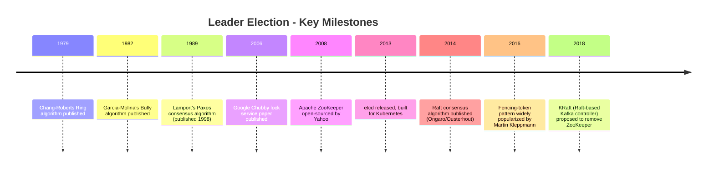

## 3. Why It Exists

Some operations are only safe, or only efficient, if exactly one node
performs them at a time. Two nodes independently deciding to run the same
scheduled billing job produces duplicate charges; two nodes independently
accepting writes to the same database partition produces conflicting,
irreconcilable data; two nodes independently reassigning a message queue's
partitions to consumers produces double-processing or dropped messages.
Leader election exists to make "exactly one active decision-maker" an
architectural guarantee the rest of the system can build on, rather than
an accident of timing that happens to hold most of the time until a
network hiccup breaks it.

The alternative — a fully leaderless design where every node independently
decides and conflicts are resolved after the fact (recapped from
[Cassandra's](../06_Databases_and_Storage/CH18_Cassandra.md) leaderless,
quorum-based write model) — is a legitimate and sometimes preferable
design, but it is a *different* trade-off, not a strictly better one: it
sacrifices the simplicity of "ask the leader, get a definitive answer" in
exchange for availability during partitions and the engineering cost of
building conflict resolution (last-writer-wins, Conflict-Free Replicated
Data Types (CRDTs), read-repair) into every operation that would otherwise
have been trivially serialized by a single leader. Leader election exists
precisely for the large class of problems where that conflict-resolution
cost is not worth paying — where a brief unavailability while a new leader
is chosen is preferable to ever accepting two conflicting answers.

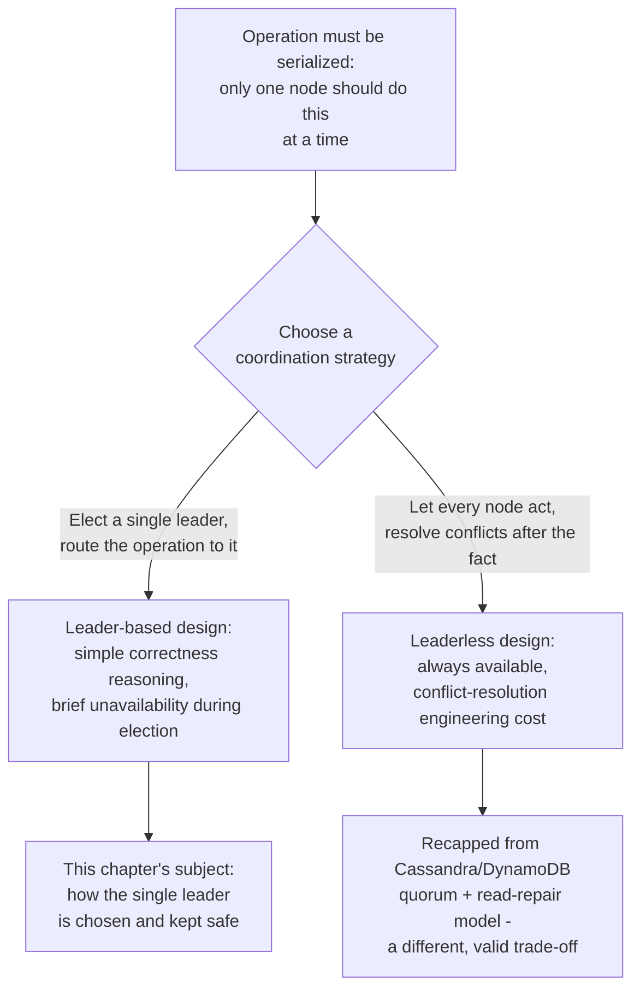

## 4. Core Concepts

### 4.1 Why Distributed Systems Need a Leader

**Definition.** A leader, in the distributed-systems sense used throughout
this chapter, is a single node within a defined group that has been
granted the authority to make a specific class of decision — accepting
writes, assigning work, breaking ties — on behalf of the whole group,
for as long as the group continues to recognize it as the leader. The
group's followers do not make that class of decision themselves; they
forward requests to the leader and accept the leader's decisions as
authoritative.

**Mechanism.** A leader-based system is built from three cooperating
parts: an **election mechanism** that selects the leader (this chapter's
core subject — Bully, Ring, or a coordination-service recipe, Sections
4.2-4.4), a **failure-detection mechanism** that determines when the
current leader is no longer fit to serve (typically a heartbeat or lease
that must be periodically renewed, and whose absence past a timeout
triggers a new election), and a **routing mechanism** that ensures
followers (and clients) direct the serialized operation to whichever node
currently holds leadership, rather than to an arbitrary node. All three
parts must work together correctly: an election mechanism that is
individually correct but paired with a failure detector that is too eager
(declaring the leader dead when it is merely slow) produces unnecessary,
disruptive re-elections; a failure detector that is too conservative
(waiting too long to declare a genuinely dead leader dead) produces
unnecessary unavailability while the group waits.

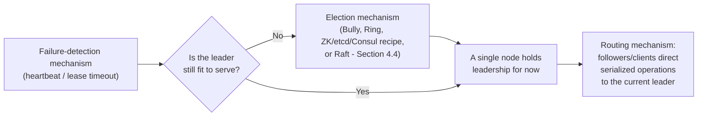

**Decision implications.** Choosing a leader-based design commits an
architect to accepting a brief unavailability window during every
election (Section 15) in exchange for a much simpler correctness story for
every operation the leader serializes — most teams find this an easy
trade to accept for operations where correctness matters more than
100%-of-the-time availability (a database primary, a job scheduler), and
a harder trade to accept for operations where availability matters more
(a shopping cart, recapped from
[NFRs'](CH02_Non_Functional_Requirements.md#48-nfr-trade-off-analysis)
consistency-vs-availability framing).

**Failure mode.** The most consequential failure mode is not "no leader
exists" (which is at least visibly broken and safe) but rather **more
than one node simultaneously believing it is the leader** — split-brain,
covered in full depth in Section 4.5 — because a system designed assuming
exactly one leader typically has no defense built into its core logic
against two leaders acting concurrently; the defense has to be added
deliberately.

**Scenario.** A distributed job scheduler runs three replicas for
availability, but only one replica may actually trigger the nightly
billing run — triggering it twice would double-charge every customer.
Leader election gives exactly one replica, at any given time, the
authority to fire that job, while the other two stay idle-but-ready to
take over the instant the active replica fails, without any of the three
needing to coordinate on every single job trigger decision individually.

### 4.2 The Bully Algorithm

**Definition.** The Bully algorithm elects the process with the
numerically highest unique identifier among all currently reachable
processes as the leader, using a "bullying" pattern of messages: any
process that notices the leader is unreachable challenges every
higher-numbered process directly, and whichever higher-numbered process
survives that challenge takes over the election, recursively, until the
single highest surviving process declares itself leader and announces it
to everyone.

**Mechanism.** The protocol runs in three message types. When a process
$P$ detects the current leader is unreachable, it sends an `ELECTION`
message to every process with a higher ID than its own. If any of those
higher-ID processes is alive, it responds with an `OK` message (telling
$P$ "stand down, I will take it from here") and starts its own election
using the same rule against IDs higher than *its* own. If a process
receives no `OK` response from any higher-ID process — because none of
them are currently alive/reachable — it concludes it is the
highest-surviving ID and declares itself leader by broadcasting a
`COORDINATOR` message to every other process, including lower-ID ones
that never directly participated in that round.

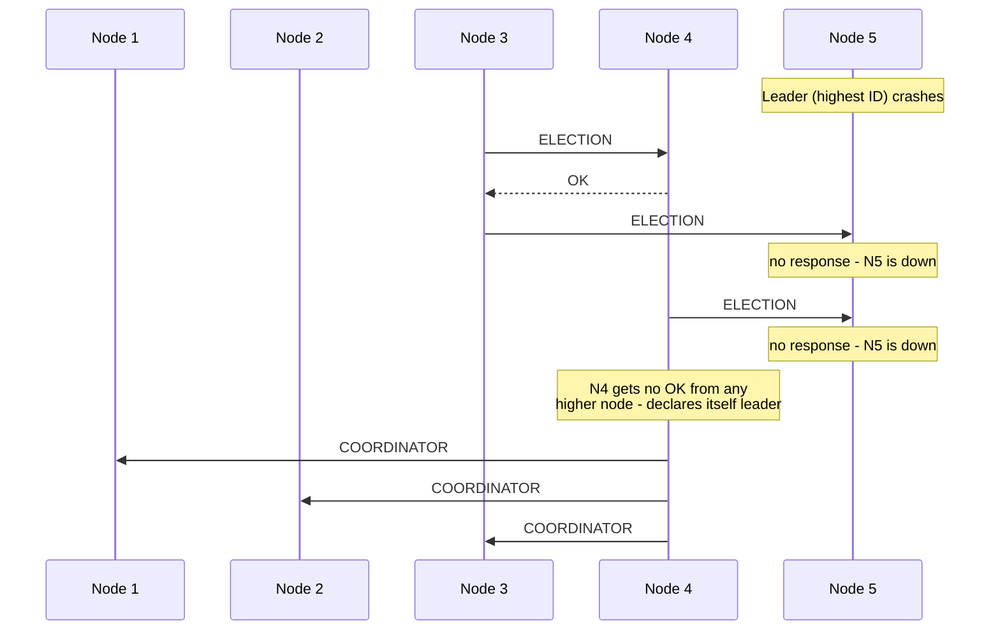

The message-complexity cost of this simple rule is real: in the worst
case (the lowest-ID process detects the failure), Bully requires
$O(n^2)$ messages, because each of the up to $n-1$ higher-numbered
processes it challenges may itself challenge every process higher than
it, cascading. The full worked simulation, including the exact message
count for a 5-node cluster across two consecutive elections, is
[01_bully_algorithm_simulation.py](../code/python/leader-election-chapter/01_bully_algorithm_simulation.py)
in Section 10.

**Decision implications.** Bully is attractive specifically for its
conceptual simplicity — a reader can trace the entire protocol by hand on
paper in a few minutes — which made it a durable teaching tool and a
reasonable choice for small, low-churn clusters where the $O(n^2)$
worst-case message cost is genuinely negligible. It is a poor choice for
large or high-churn clusters (many nodes, frequent failures/rejoins)
precisely because that message cost scales quadratically with cluster
size, and because Bully's original formulation assumes fully-connected,
reliable point-to-point messaging, an assumption that gets more expensive
to provide as the cluster grows.

**Failure mode.** Bully's original formulation is vulnerable to a subtle
race during network partial-partition scenarios: if messages are
reordered or delayed rather than cleanly lost, two different processes
can each believe, at slightly different moments, that they are the
current highest-surviving ID and each broadcast a `COORDINATOR` message —
producing a brief, self-correcting split-brain window that resolves only
once the last (highest-ID) `COORDINATOR` message is delivered and
processed by everyone. This is a narrower version of the general
split-brain problem Section 4.5 covers, specific to Bully's
assumption of reliable, non-reordered delivery.

**Scenario.** A 5-node monitoring cluster (IDs 1-5) uses Bully to elect
which node owns writing consolidated alerts to a shared dashboard. When
node 5 (the current leader) crashes, node 3 is the first to notice
(perhaps because it was the one polling node 5's heartbeat most
frequently) and starts an election; the protocol correctly converges on
node 4 as the new leader, as shown in the diagram above, without every
node needing to independently detect the failure at exactly the same
instant.

### 4.3 The Ring Algorithm

**Definition.** The Ring algorithm (formalized by Chang and Roberts)
elects the process with the highest identifier among processes logically
arranged in a single unidirectional ring, by circulating an election
message around the ring exactly enough times for every process to compare
identifiers, rather than Bully's direct all-to-all challenge pattern.

**Mechanism.** A process that detects the leader is unreachable sends an
`ELECTION` message, carrying its own ID as the current candidate, to its
single logical successor in the ring. Each process that receives an
`ELECTION` message compares the carried candidate ID to its own: if the
carried ID is larger, it forwards the message unchanged (a stronger
candidate is still in the running); if the carried ID is smaller, it
replaces the carried ID with its own before forwarding (it out-ranks the
current candidate and takes over as the value being carried around the
ring). Because the ring is finite, the highest ID present is guaranteed
to eventually receive an `ELECTION` message carrying its own ID back — at
that point it recognizes it has "won," and circulates one further
`COORDINATOR` message around the ring so every process learns the result.

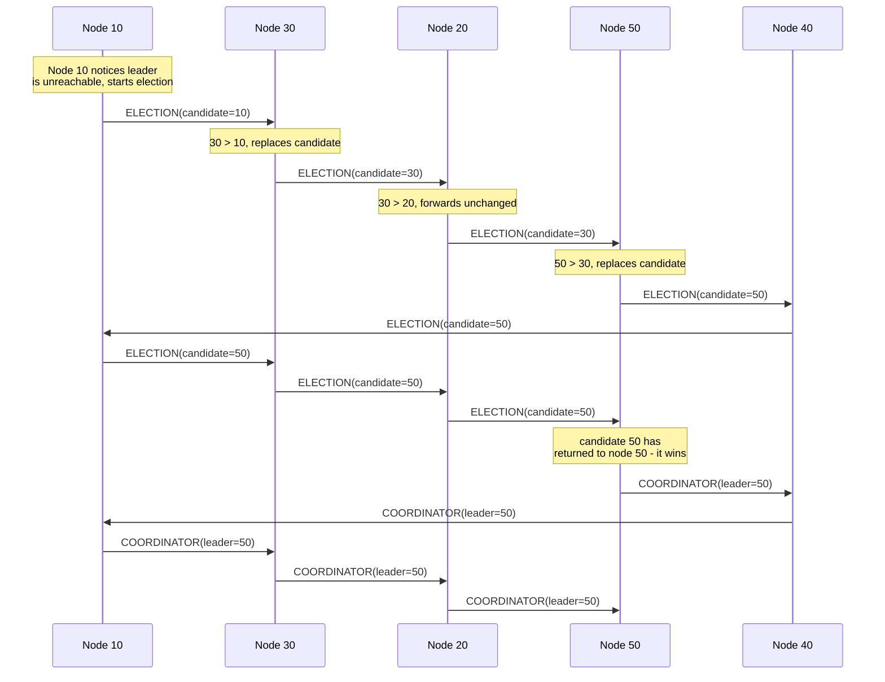

Ring uses at most $2n$ messages per election in the worst case — the
election message circulates at most once fully around the ring ($n$
hops), and the confirming `COORDINATOR` message circulates once more
($n$ hops) — a strictly better asymptotic message bound than Bully's
$O(n^2)$, at the direct cost of higher worst-case *latency*, since a
message must physically traverse up to the full ring rather than being
broadcast in parallel to every higher-ID node at once. The full worked
simulation — including the exact hop count for the same topology across
two consecutive elections — is
[02_ring_algorithm_election.py](../code/python/leader-election-chapter/02_ring_algorithm_election.py)
in Section 10.

**Decision implications.** Ring is the better asymptotic choice than
Bully for larger clusters purely on message-count grounds, but it
requires maintaining a consistent, agreed-upon successor ordering across
every node — a logical ring topology that itself must be kept correct as
nodes join and leave, which is nontrivial additional bookkeeping that
Bully's fully-connected assumption avoids. In practice, neither Bully nor
Ring is used directly in most modern production systems (Section 4.4);
their lasting value is pedagogical — they make the *shape* of the leader-
election problem (challenge/defer, or circulate/compare) concrete and
easy to reason about before encountering the more opaque
consensus-protocol-based mechanisms production systems actually run.

**Failure mode.** Ring's correctness depends on the ring itself remaining
intact and correctly ordered; if two processes disagree about who their
successor is (for example, during a topology change that has not
finished propagating to every node), the election message can be
misrouted or dropped entirely, leaving the election to time out and retry
rather than complete cleanly on the first attempt — a failure mode Bully
does not share, since Bully does not depend on any particular topology
beyond full connectivity.

**Scenario.** A 5-node cluster with widely spaced numeric IDs (10, 20,
30, 40, 50) arranged in ring order 10→30→20→50→40→10 elects node 50 on
the first pass, using 13 total message hops (9 for the election phase, 4
more folded into the confirming coordinator phase in this particular
topology) as shown in the diagram; when node 50 later crashes and node
20 notices first, the protocol converges on node 40 using fewer total
hops for the smaller remaining ring, exactly the trade-off the code
example in Section 10 measures directly.

### 4.4 Coordination-Service-Based Election

**Definition.** Rather than implementing an election algorithm like
Bully or Ring directly inside an application, most production systems
delegate leader election to a purpose-built external **coordination
service** — Apache ZooKeeper, `etcd`, or HashiCorp Consul are the three
most widely used — which itself runs a consensus protocol internally
(Zab for ZooKeeper, Raft for both `etcd` and Consul) and exposes a much
simpler, higher-level primitive (an ephemeral node, a lease, or a
session) that application code composes into an election recipe without
ever touching the underlying consensus mechanics directly.

**Mechanism — ZooKeeper's ephemeral sequential znode recipe.** ZooKeeper
exposes a hierarchical namespace of nodes ("znodes") with two relevant
properties an application can request when creating one: **ephemeral**
(the znode is automatically deleted the instant the creating client's
session expires — from a clean disconnect, a crash, or a timeout past
the session's negotiated Time-To-Live (TTL)) and **sequential** (the
znode's name is suffixed with a monotonically increasing counter,
guaranteed unique and ordered across all clients creating children of the
same parent, even under concurrent creation). The standard election
recipe built from these two primitives is: every candidate creates an
ephemeral, sequential child under a shared election path; each candidate
then lists the current children, sorts them by sequence number, and
checks whether *its own* znode has the lowest sequence number. If so, it
is the leader. If not, it sets a watch — specifically on the znode with
the next-lower sequence number (its immediate predecessor), not on every
other znode — and waits. Because the predecessor's ephemeral znode will
be deleted automatically if that candidate crashes or its session
expires, exactly one watch fires per leadership change, waking up exactly
the one candidate now positioned to re-check whether it has become the
new lowest-sequence znode. Watching only the immediate predecessor,
rather than the entire children list or the current leader directly, is
the specific design choice that avoids the "herd effect": if every
follower watched the leader directly, every single follower would be
woken up and would re-list the entire children set on every leadership
change, which becomes an expensive, synchronized burst of load on the
ensemble exactly when the ensemble is already busy handling a failover.

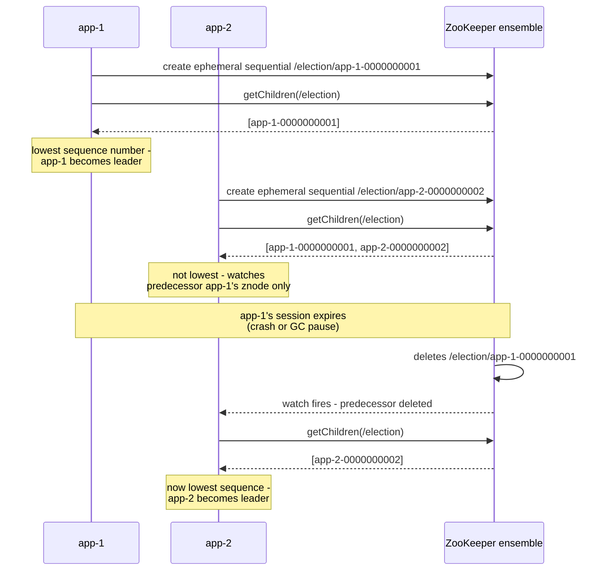

A runnable, deterministic simulation of exactly this recipe — including
proof that only the direct successor is ever notified, not every other
candidate — is
[03_zk_style_ephemeral_sequential_election.py](../code/python/leader-election-chapter/03_zk_style_ephemeral_sequential_election.py)
in Section 10.

**Mechanism — `etcd`'s lease-based election.** `etcd` (built on the Raft
consensus algorithm) exposes a lower-level primitive than ZooKeeper's
znode tree: a **lease** is a TTL that a client must periodically renew
(via a keep-alive heartbeat) or the lease — and everything attached to
it — expires automatically. `etcd`'s election recipe attaches a
candidate's leadership claim (a key under an election prefix) to a lease:
as long as the candidate keeps renewing its lease on schedule, its claim
remains valid; the moment it stops (crash, GC pause long enough to miss
several renewal intervals, network partition), `etcd` expires the lease
and deletes the attached key, exactly mirroring ZooKeeper's ephemeral-node
expiry but expressed as an explicit, separately-managed TTL object rather
than being implicit in the client's session. `etcd`'s official `clientv3`
library ships a higher-level `concurrency.Election` helper built directly
on this lease primitive specifically so application authors do not need
to hand-roll the compare-and-swap and watch logic themselves — a strong
signal, echoed by Consul's equivalent Application Programming Interface
(API), that hand-rolling Bully or Ring is no longer how any of these
platforms expect leader election to actually be implemented in 2020s
production code.

**Mechanism — Consul's session-based election.** HashiCorp Consul (also
Raft-based internally) exposes a **session** abstraction that is
conceptually close to `etcd`'s lease but ties directly into Consul's key/
value store's locking semantics: a client creates a session (with a TTL
and configurable failure-detection behavior), then attempts to acquire a
lock on a specific key by writing to it "in the context of" that session.
Only one session can hold the lock on a given key at a time; if the
session is invalidated (TTL expiry, explicit destroy, or the owning
node/agent being marked unhealthy by Consul's own health-check gossip
layer, recapped forward from the future
[Gossip Protocols](CH09_Gossip_Protocols.md) chapter), Consul releases the
lock automatically, and the next candidate blocking on that key acquires
it. Consul's distinguishing design choice, relative to ZooKeeper and
`etcd`, is folding health-check status directly into session validity —
a session can be invalidated not just by a missed TTL renewal but by
Consul's own independent judgment that the owning node has become
unhealthy, giving operators an additional, more nuanced failure signal
than a bare heartbeat timeout alone.

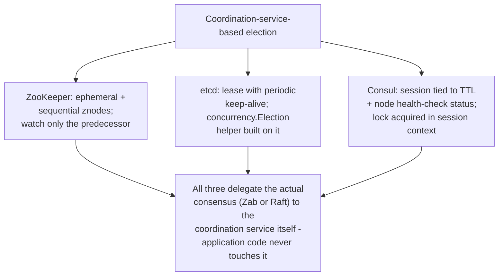

**Mechanism — Raft's own leader election (recapped, not re-taught).** For
completeness, it is worth naming explicitly where Raft's own internal
leader-election sub-protocol fits into this picture, since `etcd` and
Consul both run it underneath the lease/session recipes above: Raft
elects its leader using randomized election timeouts (each follower
waits a randomized interval before assuming the leader has failed, which
reduces the odds of two followers starting a competing election
simultaneously), term numbers (a strictly increasing counter that
disambiguates which of possibly several election attempts is the current
one), and majority-vote `RequestVote` RPCs (a candidate must win votes
from a majority of the cluster to become leader, which is precisely what
makes Raft's leader election a specific application of consensus, per
Section 4.6). The full mechanics — including why randomization is
necessary, how split votes are resolved, and Raft's safety proof — belong
entirely to
[Consensus](CH07_Consensus.md#raft-leader-election); this chapter treats
Raft's leader election purely as one more concrete implementation
alongside Bully, Ring, and the coordination-service recipes above, not as
a mechanism to re-derive here.

**Decision implications.** Delegating election to a coordination service
is, in nearly all production contexts, the correct default choice over
hand-implementing Bully, Ring, or even Raft directly: the coordination
service has already solved the hard consensus-correctness problem, has
been battle-tested at scale by many independent users, and reduces the
application's own responsibility to a small, well-understood client-side
recipe (create-ephemeral-and-watch-predecessor, or acquire-lease-and-
renew). The remaining decision is *which* coordination service to adopt,
which is often driven more by what is already operationally present in
the environment (a Kubernetes cluster already runs `etcd`; a HashiCorp-
centric infrastructure stack already runs Consul) than by a from-scratch
feature comparison, though ZooKeeper's older, more mature ecosystem of
recipes remains a defensible reason to choose it directly, especially for
systems (Kafka's older releases, Hadoop, HBase) already built around it.

**Failure mode.** A coordination service becoming unavailable itself
(because it is under-provisioned, network-partitioned from the
application tier, or overloaded by an unrelated workload sharing the same
ensemble) removes the application's ability to detect leader failures or
run new elections at all — a coordination-service outage does not merely
fail to *elect* a new leader, it can also fail to *demote* a stuck
zombie leader's ephemeral claim promptly if the ensemble itself cannot
reach quorum internally, compounding the split-brain risk Section 4.5
covers rather than helping avoid it.

**Scenario.** A fleet of ten identical worker processes needs exactly one
of them to poll an upstream vendor API and fan the results out internally
(polling from all ten would trip the vendor's rate limit). Each worker,
on startup, runs the ZooKeeper ephemeral-sequential recipe above; whichever
worker happens to create the lowest-sequence znode becomes the active
poller, and if it crashes, the worker watching its predecessor znode is
promoted within one ZooKeeper session-timeout interval, with the other
eight workers never being woken up or involved in that failover at all.

### 4.5 Split-Brain and Fencing Tokens

**Definition.** Split-brain is the failure state in which two (or more)
nodes each believe, simultaneously, that they are the current leader, and
each acts on that belief — typically by accepting writes or performing
some other action meant to be serialized through a single leader — with
no coordination between them. A **fencing token** is a monotonically
increasing number, issued by the coordination service every time it
grants leadership to a node, that the leader must attach to every
privileged operation it performs against shared storage or shared state;
the receiving side rejects any operation whose token is not strictly
greater than the highest token it has already accepted, which prevents a
demoted-but-still-running old leader from causing damage even though the
election mechanism itself has already correctly moved on.

**Mechanism — how a leader that is not actually dead still causes
damage.** Every leader-election mechanism this chapter has covered —
Bully, Ring, ZooKeeper's ephemeral znodes, `etcd`'s leases, Consul's
sessions, and Raft's term-based voting — detects leader failure through
*absence of communication* (a missed heartbeat, an expired lease, an
unrenewed session) rather than through any direct proof that the old
leader has actually stopped running. This distinction matters enormously:
a node experiencing a long stop-the-world pause — a Java garbage-collection
pause, a hypervisor migrating the virtual machine to different physical
hardware, a thread starved by a noisy neighbor, or simply a slow disk
blocking a heartbeat thread — is, from the coordination service's point
of view, indistinguishable from a genuinely crashed node: both simply stop
sending heartbeats. The coordination service, correctly following its own
timeout rules, expires the paused node's session/lease and promotes a new
leader. The problem is that the paused node's *process* has not
necessarily stopped — its memory, its open network connections, its
in-flight assumption that it is still the leader are all still intact,
frozen mid-execution rather than destroyed. When the pause ends, that
process resumes exactly where it left off, with no idea any time has
passed or that it has been demoted, and can proceed to send a write to
shared storage believing itself still authoritative.

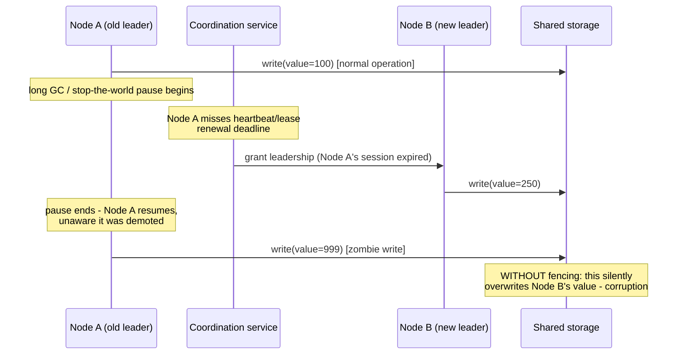

**Mechanism — the fencing-token fix.** The insight that resolves this
failure mode is that trying to force a paused process to stop is
fundamentally unreliable — there is no general way, in an asynchronous
distributed system, to guarantee a remote process observes "you have been
demoted" before it takes its next action, because that guarantee would
require exactly the kind of synchronous coordination the pause itself is
preventing. The fix instead moves the defense to the *receiving* side: the
coordination service issues a strictly increasing fencing token every time
it grants leadership (token 100 to Node A, token 101 to Node B, and so
on), the leader is required to attach its current token to every write it
sends to shared storage, and the storage service itself — not the
election mechanism, not the leader — rejects any write whose token is not
strictly greater than the highest token it has already accepted. Node A's
zombie write, carrying token 100, arrives after Node B's write carrying
token 101 has already been accepted; the storage service rejects Node A's
write outright, regardless of whether Node A's network connection to
storage is otherwise perfectly healthy. The defense does not require
detecting or stopping the zombie process at all — it requires the shared
resource itself to enforce token monotonicity on every write, which is a
tractable, purely local check the storage side can always make. A full,
runnable demonstration of exactly this rejection — including the exact
sequence of grants, writes, and the rejected zombie write — is
[04_fencing_token_demo.py](../code/python/leader-election-chapter/04_fencing_token_demo.py)
in Section 10.

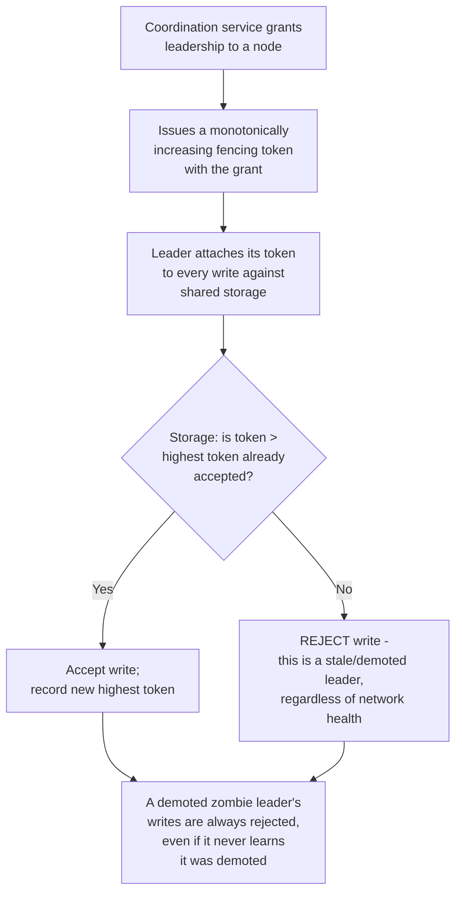

**Decision implications.** Fencing tokens are a responsibility of the
*system consuming* a leader-election result, not something any of the
election mechanisms above (Bully, Ring, ZooKeeper, `etcd`, Consul, or even
Raft itself) provide automatically — a team adopting `etcd`-based
leader election gets a correct answer to "who is the leader," full stop;
whether that answer is safe to *act on* against shared storage without a
zombie-write risk is a separate design decision the team must make
explicitly, by choosing (or building) a storage layer that enforces
token monotonicity. Systems that skip this step are not wrong until the
specific pause-long-enough-to-expire-a-lease scenario actually happens in
production — which is precisely why the risk is so often underestimated
during initial design and only discovered during a real incident (Section
22).

**Failure mode.** The most damaging version of this failure mode is
silent, not loud: a rejected zombie write, correctly fenced off, produces
an error the zombie leader can log and alert on; but a system that never
implemented fencing at all produces no error whatsoever — the zombie
write simply succeeds, silently overwriting or corrupting whatever the
legitimate new leader had already committed, and the resulting data
corruption is often only discovered much later, by a downstream consumer
or an audit, exactly mirroring
[NFRs'](CH02_Non_Functional_Requirements.md#42-reliability) point that
silent failures are reliability's worst failure mode because they produce
no alarm.

**Scenario.** A distributed lock service grants a worker exclusive access
to process a batch job file, backed by a lease-based election recipe
(Section 4.4). Worker A acquires the lease, begins processing, then enters
a 40-second GC pause. The coordination service's 30-second lease timeout
expires; Worker B acquires the lease and begins reprocessing the same
file from scratch (a reasonable, correct response to what looks like
Worker A's crash). When Worker A's GC pause ends, it attempts to write its
processing result to the shared output store. Without a fencing token,
this write can silently interleave with or overwrite Worker B's
in-progress or completed result, producing a corrupted or duplicated
output with no error raised anywhere; with a fencing token attached to
Worker A's stale lease and enforced by the output store, that same write
is cleanly rejected, and Worker A can detect the rejection and abort
safely instead.

### 4.6 Leader Election as a Specific Application of Consensus

**Definition.** Consensus, in the general distributed-systems sense
(fully derived in the future [Consensus](CH07_Consensus.md) chapter), is
the problem of getting a set of nodes to agree on a single value, despite
some nodes potentially failing or messages being delayed, such that every
correct node that decides on a value decides on the *same* value. Leader
election is not a separate problem sitting alongside consensus — it is a
consensus problem where the "value" being agreed upon happens to be "the
identity of the current leader," making every leader-election mechanism
this chapter has covered a specific instance of the general consensus
problem, applied to that one particular question.

**Mechanism — why this framing is not just semantic.** The correctness
properties any leader-election mechanism must satisfy are exactly the
correctness properties consensus itself requires: **agreement** (every
correct node that believes it knows the current leader must believe the
same thing — two nodes must never durably disagree about who the leader
is, which is precisely what split-brain, Section 4.5, violates when it
occurs), and **termination** (the election must eventually complete and
produce a decided leader, assuming the network and enough nodes cooperate
long enough — an election that can stall forever is not a useful
election). Bully and Ring satisfy these properties under their stated
assumptions (fail-stop failures, reliable non-reordered messaging) but
do not extend cleanly to the harsher assumptions real networks impose
(message loss, reordering, arbitrary delay, network partitions that
temporarily split the cluster into groups that can each internally
communicate but not with each other) — which is exactly why production
systems moved to Paxos- and Raft-based consensus protocols (recapped from
[Consensus](CH07_Consensus.md)), which were explicitly designed to remain
correct under those harsher, more realistic network assumptions, and
happen to solve the general "agree on a value" problem in a way that
directly yields a correct leader-election result as one particular
instance.

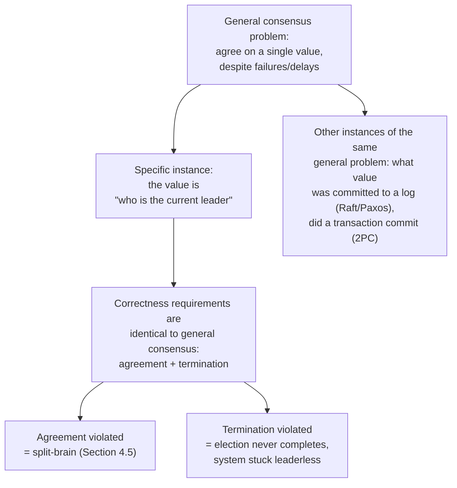

**Decision implications.** Understanding leader election as "consensus
applied to one specific value" explains why hand-rolled election
algorithms that ignore consensus theory (a naive "whichever node responds
fastest wins" scheme, for example) are so reliably broken under real
network conditions — they are unknowingly attempting to solve a problem
that has known impossibility results (FLP, recapped from
[Consensus](CH07_Consensus.md#the-flp-impossibility-result)) and known
correct solutions (Paxos, Raft, Zab) without benefiting from either. It
also explains why the FLP impossibility result — that no fully
asynchronous consensus protocol can guarantee both safety and
termination if even one process can fail — applies just as much to
leader election as to any other consensus application, which is why every
practical leader-election mechanism (including Raft's randomized
timeouts) relies on some partial-synchrony assumption (bounded, if
unknown, message delay) to guarantee termination in practice, rather than
achieving a theoretically pure asynchronous guarantee that provably
cannot exist.

**Failure mode.** Treating leader election as an isolated, ad hoc
engineering problem rather than recognizing it as a consensus instance
is itself a failure mode: teams that build a custom "pick the leader"
mechanism without grounding it in consensus theory frequently rediscover,
the hard way and in production, failure modes (split votes, split-brain,
elections that never terminate under partition) that decades of consensus
research already characterized and solved.

**Scenario.** A team evaluating whether to hand-roll a leader-election
scheme for a new internal service, versus adopting `etcd`'s existing
`concurrency.Election` helper, benefits directly from this framing: since
`etcd`'s helper is built on Raft — a proven, formally analyzed consensus
protocol — adopting it inherits decades of consensus-correctness research
for free, whereas hand-rolling an equivalent guarantee from scratch would
require the team to either reinvent (and re-prove) a consensus protocol
themselves or accept an unstated, likely-incorrect set of assumptions
about network behavior.

## 5. Internal Working

Internally, a production leader-election deployment is the composition of
three concurrently running processes on every candidate node: a
**heartbeat/renewal loop** that periodically proves liveness to the
coordination service (renewing a lease, refreshing a session, or, for
Raft-embedded systems, sending `AppendEntries` heartbeats as the current
leader), a **watch/notification handler** that reacts to a change in
leadership state (the predecessor znode's deletion, a lease-expiry
notification, a new term number observed), and an **application-level
leadership callback** that the hosting application registers to actually
start or stop doing leader-only work (begin accepting writes, begin
polling an upstream API, begin scheduling jobs) the instant the
coordination layer reports a change. The critical internal-working detail
many implementations get wrong is the ordering guarantee between the
second and third of these: an application must fully stop its leader-only
work *before* — or, more precisely, must be prepared for its leader-only
work to be fenced off by Section 4.5's token mechanism even if it does
not stop promptly — rather than assuming a graceful "you have been
demoted" callback will always fire in time, precisely because that
assumption is exactly what a stop-the-world pause breaks.

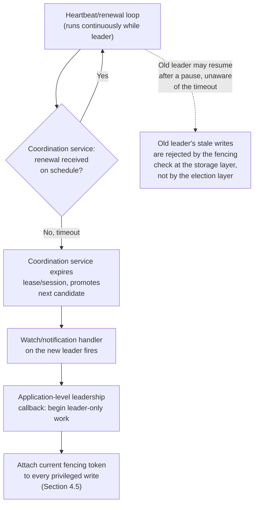

## 6. Design Principles

- **Never assume the old leader is dead just because it stopped
  communicating.** Section 4.5's core lesson: absence of heartbeat proves
  absence of communication, not absence of execution. Design the system
  assuming a demoted leader may still be running and may still attempt
  privileged operations.
- **Push the safety guarantee to the resource being protected, not to the
  election mechanism.** Fencing tokens work because the storage layer,
  not the coordination service, makes the final accept/reject decision on
  every write — the one place that can reliably enforce it.
- **Prefer an existing coordination service over hand-rolling Bully,
  Ring, or a custom consensus protocol.** Section 4.4's decision
  implications apply directly: ZooKeeper, `etcd`, and Consul have already
  solved the hard correctness problem and are operationally
  battle-tested; reimplementing that correctness from scratch is rarely
  worth the risk for an application-level concern.
- **Design the failure-detection timeout deliberately, as a trade-off,
  not a default.** A short timeout produces faster failover but more
  false-positive elections (a merely-slow leader treated as dead); a long
  timeout produces fewer false positives but longer unavailability during
  a genuine failure — this is a direct instance of
  [NFRs'](CH02_Non_Functional_Requirements.md#42-reliability) MTTR
  reasoning applied specifically to leader failover.
- **Watch only what you need to, not everything.** ZooKeeper's
  predecessor-only watch pattern (Section 4.4) generalizes: any
  notification-fan-out design should scale with the number of state
  changes that actually affect a given watcher, not with the total size
  of the cluster.
- **Make leadership loss observable, not just internally handled.**
  Section 14 revisits this: an application that silently continues
  leader-only work after losing leadership, with no external signal, is
  exactly the failure mode Section 4.5 describes — observability is part
  of the defense, not an optional add-on.

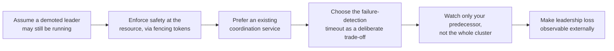

## 7. Architecture Patterns

- **Active-standby with a coordination service.** The most common
  production shape: $N$ replicas of a service run simultaneously, one is
  elected leader via ZooKeeper/`etcd`/Consul (Section 4.4), and the
  remaining $N-1$ sit idle, ready to take over. This pattern directly
  underlies Kubernetes controller-manager and scheduler high-availability
  deployments, and Kafka's older ZooKeeper-based controller election.
- **Per-partition leader election.** Rather than one leader for an
  entire system, some architectures elect a leader independently *per
  shard or partition* — Kafka elects a leader per topic-partition from
  among its in-sync replica set, so the system as a whole has many
  concurrent leaders, each responsible for a narrow, disjoint slice of
  the data (recapped from
  [Sharding's](../06_Databases_and_Storage/CH06_Sharding.md) partition-
  key model). This pattern trades a single global bottleneck for many
  smaller, independently electable leaders, improving overall
  parallelism at the cost of more elections happening concurrently across
  the system.
- **Embedded consensus (no external coordination service).** Systems
  that embed Raft or a similar protocol directly (`etcd` itself, Consul
  itself, CockroachDB, Kafka's newer KRaft mode) do not delegate election
  to a separate service at all — the nodes forming the data plane *are*
  the consensus group, and leader election happens as an internal Raft
  sub-protocol (Section 4.4's recap) rather than a client-observed
  external recipe. This removes an external dependency but requires the
  system itself to correctly implement consensus, a substantially higher
  engineering bar than consuming an existing coordination service.
- **Leaderless with post-hoc conflict resolution.** As Section 3
  introduced, some systems deliberately avoid leader election entirely,
  accepting concurrent writes from any replica and resolving conflicts
  afterward (recapped from
  [Cassandra's](../06_Databases_and_Storage/CH18_Cassandra.md) quorum
  writes and
  [DynamoDB's](../06_Databases_and_Storage/CH17_DynamoDB.md) vector-clock
  conflict resolution) — not a leader-election pattern at all, but worth
  naming as the alternative an architect is implicitly rejecting by
  choosing any of the leader-based patterns above.

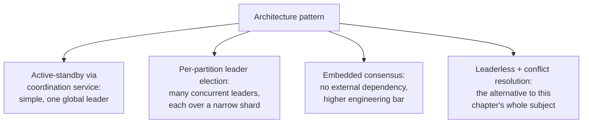

## 8. Production Architecture

A representative production deployment combines several of Section 7's
patterns at once, at different layers: a Kubernetes control plane itself
uses embedded Raft (via `etcd`) for its own consensus, while the
controllers and operators running *on top of* that control plane use the
active-standby-via-coordination-service pattern (Kubernetes'
`client-go` leader-election library, backed by that same `etcd`, exposed
through `Lease` objects in the Kubernetes API) to ensure only one replica
of each controller actively reconciles state, even though every replica
runs continuously for fast failover. Meanwhile, a Kafka cluster running
alongside that same Kubernetes deployment elects its per-partition leaders
(Section 7's per-partition pattern) either via ZooKeeper (older
deployments) or via its own embedded KRaft consensus group (newer
deployments, itself an instance of the embedded-consensus pattern) —
illustrating that a single production environment routinely runs multiple
different leader-election mechanisms simultaneously, each chosen for the
specific layer and workload it serves, rather than one universal
mechanism for the whole system.

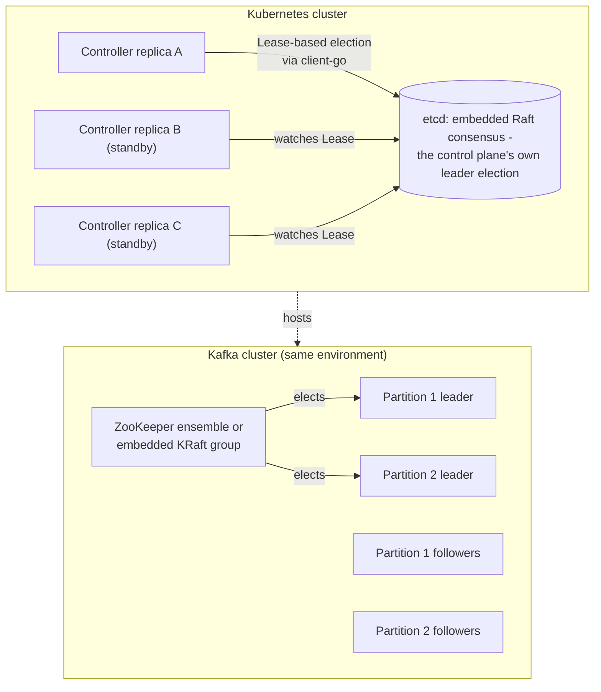

## 9. Implementation

Implementing leader election in application code, in nearly every modern
production context, means consuming a client library built on top of one
of Section 4.4's coordination services rather than implementing an
election algorithm by hand. The typical implementation shape, regardless
of which coordination service is chosen, follows the same sequence: (1)
connect to the coordination service and create a session/lease with an
appropriate TTL; (2) attempt to acquire leadership (create the ephemeral
sequential znode, acquire the lease-backed key, or acquire the
session-backed lock); (3) register a callback that fires when leadership
is granted, and a separate callback that fires when leadership is lost
(either explicitly, via a clean release, or implicitly, via session/lease
expiry); (4) inside the "leadership granted" callback, start performing
leader-only work, and critically, retrieve and retain the current fencing
token so every privileged write can carry it (Section 4.5); (5) inside
the "leadership lost" callback, stop performing leader-only work as
promptly as possible, while accepting that a stop-the-world pause can
prevent this callback from ever running promptly — which is exactly why
step (4)'s fencing token, not this callback, is the actual safety
mechanism, and this callback is best understood as a performance/cleanliness
optimization (stop wasted work sooner) rather than the correctness
boundary itself.

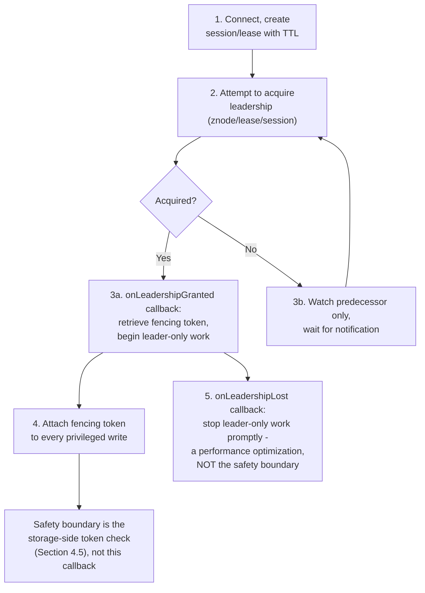

## 10. Complete Code Examples

The following runnable Python examples live under
[code/python/leader-election-chapter/](../code/python/leader-election-chapter/)
and were each executed end to end to confirm correct behavior before this
chapter was finalized:

1. [01_bully_algorithm_simulation.py](../code/python/leader-election-chapter/01_bully_algorithm_simulation.py) —
   an in-process, deterministic simulation of the Bully algorithm (Section
   4.2) across a 5-node cluster, running two consecutive elections (the
   initial election and the re-election after the leader crashes) and
   printing the full `ELECTION`/`OK`/`COORDINATOR` message trace, along
   with the total message count, matching the sequence diagram above
   exactly.
2. [02_ring_algorithm_election.py](../code/python/leader-election-chapter/02_ring_algorithm_election.py) —
   the equivalent simulation for the Ring/Chang-Roberts algorithm (Section
   4.3) over the same conceptual cluster, arranged in explicit ring order,
   printing the candidate-ID replacement decisions at each hop and the
   total hop count, directly demonstrating the message-count-versus-
   latency trade-off described in Section 4.3's decision implications.
3. [03_zk_style_ephemeral_sequential_election.py](../code/python/leader-election-chapter/03_zk_style_ephemeral_sequential_election.py) —
   a from-scratch, in-memory model of ZooKeeper's ephemeral sequential
   znode election recipe (Section 4.4), including a simulated session
   expiry that proves only the crashed leader's immediate successor
   receives a watch notification, while the remaining candidates receive
   none — the herd-avoidance property the recipe exists to provide.
4. [04_fencing_token_demo.py](../code/python/leader-election-chapter/04_fencing_token_demo.py) —
   a self-contained demonstration of the split-brain/fencing-token
   mechanism (Section 4.5): a coordination service grants leadership (and
   an incrementing fencing token) to Node A, then to Node B after
   simulating Node A's pause-induced expiry, and a fenced shared-storage
   service accepts Node B's write while cleanly rejecting Node A's later,
   stale-token zombie write — proving the exact failure mode and its fix
   in executable form.

## 11. Performance

The dominant performance concern in leader election is not steady-state
overhead (a correctly tuned heartbeat/renewal loop costs a negligible,
constant trickle of small messages) but **election latency** — how long
the system is without a usable leader while a new one is chosen. Election
latency is the sum of failure-detection time (the heartbeat/lease timeout
interval, Section 6's deliberate trade-off) plus the election protocol's
own running time (Bully's cascading challenge rounds, Ring's ring
traversal, or a coordination service's internal consensus round). Bully
and Ring's worst-case message counts (Sections 4.2-4.3) translate directly
into worst-case election latency under real network conditions, which is
precisely why production systems favor coordination services whose
internal consensus rounds are both well-optimized and already running
continuously in the background (a Raft leader election typically
completes in tens to low-hundreds of milliseconds once a timeout fires,
not the multiple round-trip cascades Bully's worst case implies).

## 12. Scalability

Leader election's scalability concern is distinct from a typical
throughput-scalability concern: it is about how election *cost* — message
volume, coordination-service load, and the blast radius of the
herd-effect anti-pattern (Section 4.4) — scales with the number of
candidates and the frequency of leadership changes, not about scaling the
leader's own workload. Section 7's per-partition pattern is the primary
scalability lever available: rather than one leader (and one potential
single point of contention) for an entire system, partitioning the
leadership responsibility itself (Kafka's per-partition leaders) lets the
system scale its total serialized-write capacity roughly linearly with
partition count, at the cost of managing many concurrent elections rather
than one.

## 13. Security

Every coordination service in Section 4.4 is, functionally, a shared
control-plane dependency that grants a powerful capability — the ability
to become, and remain, the authoritative leader for some scope of work —
making it a high-value target that must be secured deliberately: mutual
Transport Layer Security (mTLS, recapped from
[TLS](../05_Networking_and_OS/CH06_TLS.md)) between application clients
and the coordination-service ensemble prevents an unauthorized process
from impersonating a legitimate candidate or observing election traffic,
and access-control lists on the election namespace/prefix (ZooKeeper
Access Control Lists (ACLs), `etcd` role-based access, Consul ACL
policies) prevent an unauthorized client from writing directly into the
election path and disrupting or hijacking the result. A second,
leader-election-specific security concern is fencing-token integrity: if
an attacker can forge or replay a fencing token, the entire Section 4.5
defense collapses, so the storage layer enforcing token monotonicity must
authenticate the token's source (typically by having the coordination
service itself, not the client, be the sole issuer of tokens, and by
requiring the storage layer to validate the token against the
coordination service's own record rather than trusting a self-reported
value from the client).

## 14. Observability

The minimum observability surface for a leader-election deployment
mirrors [NFRs'](CH02_Non_Functional_Requirements.md#14-observability)
general principle that an unmeasured guarantee is not a real guarantee:
leadership-change events (which node became leader, when, and why —
timeout, clean handoff, or explicit demotion) should be logged and
counted as a rate metric, since an abnormally high rate of leadership
churn ("flapping") is itself a symptom worth alerting on, typically
indicating an overly aggressive failure-detection timeout (Section 6) or
network instability between candidates and the coordination service.
Fencing-token rejection events (Section 4.5) should be logged and alerted
on individually and immediately, since every occurrence is direct,
concrete evidence that a zombie-leader scenario actually happened in
production, not merely a theoretical risk — a metric this important
should never be buried in general application logs where it can go
unnoticed.

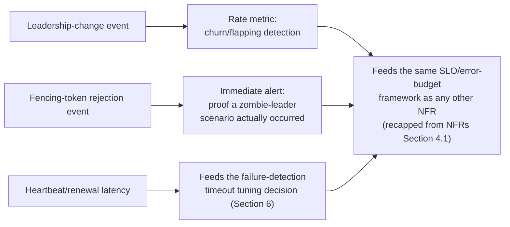

## 15. Failure Scenarios

- **Split-brain from a stop-the-world pause (Section 4.5's core
  scenario).** A GC pause, hypervisor live-migration stall, or disk
  stall long enough to miss a heartbeat/lease renewal causes a
  perfectly-healthy-but-paused leader to be demoted while still capable
  of resuming and acting, unless fencing tokens are enforced at the
  storage layer.
- **Network partition producing two independently-quorate halves.** If a
  cluster is split by a partition such that each half can internally
  reach a majority among *itself* (only possible with a misconfigured
  odd/even cluster sizing, or a partition that also happens to isolate
  the coordination-service ensemble asymmetrically), each half can
  independently elect its own leader — a rarer but more severe version of
  split-brain than the single-paused-node case, because both sides are
  fully healthy internally and neither has any local signal that
  anything is wrong.
- **Election storms from an overly aggressive timeout.** A
  failure-detection timeout tuned too short relative to real network
  jitter causes healthy leaders to be repeatedly, incorrectly treated as
  failed, triggering an unstable cycle of elections that never lets any
  leader accumulate enough stable time to do useful work — the
  coordination-service equivalent of a retry storm.
- **Herd effect from watching the wrong thing.** A naive implementation
  that has every follower watch the current leader directly, rather than
  Section 4.4's predecessor-only pattern, causes every follower to wake
  up and re-query the full candidate list on every single leadership
  change, multiplying coordination-service load exactly when the ensemble
  is already busy handling the failover itself.
- **Coordination-service unavailability stalling every election
  simultaneously.** Because most production systems delegate election to
  a shared coordination service (Section 4.4), an outage or overload of
  that service does not just prevent new elections for one workload — it
  can simultaneously stall failover for every workload that depends on
  the same ensemble, a systemic blast-radius risk worth weighing when
  deciding how many independent workloads should share one coordination
  ensemble.

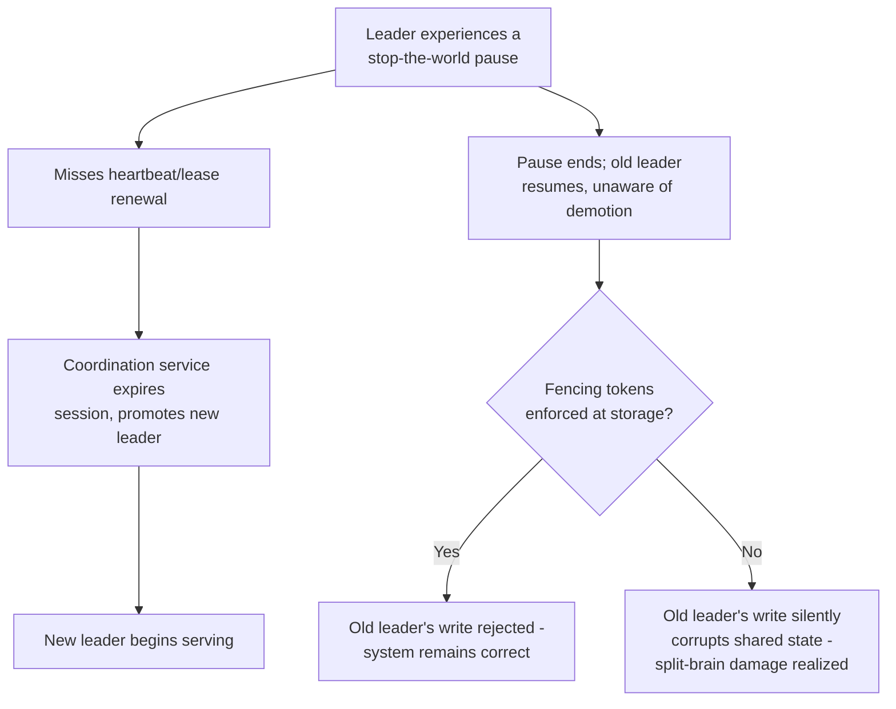

## 16. Testing

Leader election must be tested by deliberately inducing the exact failure
modes Section 15 catalogs, not merely by verifying the happy path where
one leader is elected and nothing ever fails: chaos testing (recapped from
[NFRs'](CH02_Non_Functional_Requirements.md#16-testing) Chaos-Monkey
lineage) should include explicitly killing the current leader process and
measuring election latency against the target set in Section 11;
simulating a stop-the-world pause (suspending the leader's process with
`SIGSTOP` and resuming it later, a widely used technique for exactly this
purpose) to verify the fencing-token defense actually rejects the
resumed leader's stale writes rather than merely asserting it should in
theory; and simulating a network partition between candidates and the
coordination-service ensemble to verify the system degrades to "no leader,
unavailable" rather than to "two leaders, corrupting shared state" — the
correct, safe failure mode Section 4.6's agreement property demands.

## 17. Common Mistakes

- Assuming a leader that stops responding to heartbeats has necessarily
  stopped running, and skipping fencing tokens as a result (Section 4.5).
- Hand-rolling Bully or Ring (or a custom ad hoc scheme) in a production
  system instead of adopting an existing, battle-tested coordination
  service (Section 4.4's decision implications).
- Having every follower watch the current leader directly instead of
  watching only their immediate predecessor, causing an unnecessary herd
  effect on every leadership change (Section 15).
- Treating the "leadership lost" application callback as the safety
  boundary, rather than understanding it as a performance optimization
  layered on top of the true safety boundary (Section 4.5's storage-side
  fencing check).
- Tuning the failure-detection timeout without treating it as an explicit
  trade-off, producing either election storms (too short) or unnecessarily
  long unavailability (too long) (Section 6).
- Forgetting that fencing-token enforcement lives in the resource being
  protected, not in the election mechanism, and therefore never
  implementing it at all in a new shared-storage integration.
- Sharing one coordination-service ensemble across many unrelated,
  high-criticality workloads without weighing the blast-radius risk of a
  single ensemble outage stalling every workload's failover at once
  (Section 15).

## 18. Best Practices

- Default to an existing coordination service (ZooKeeper, `etcd`, Consul)
  rather than implementing Bully, Ring, or a custom protocol, unless a
  concrete, specific reason rules all three out.
- Always implement fencing tokens (or an equivalent monotonic-guard
  mechanism) at the resource layer whenever a leader-election result
  gates a privileged write to shared state.
- Watch only the minimal state needed to react to a leadership change —
  the immediate predecessor, not the whole candidate list or the leader
  directly.
- Choose the failure-detection timeout deliberately, informed by measured
  real-world heartbeat jitter, and revisit it if election-storm or
  slow-failover symptoms appear in production.
- Instrument leadership-change events and fencing-token rejections as
  first-class, individually alertable metrics, not buried log lines.
- Test the stop-the-world-pause scenario explicitly (`SIGSTOP`/`SIGCONT`
  or equivalent), not just the simpler process-kill scenario, since they
  exercise genuinely different failure paths.

## 19. Anti-Patterns

- **"Heartbeat absence means dead."** Building any privileged-write path
  on the unstated assumption that a demoted leader has necessarily
  stopped executing, rather than defending against the pause-not-dead
  case explicitly (Section 4.5).
- **Watching everything instead of your predecessor.** The herd-effect
  anti-pattern (Section 15) — notification fan-out that scales with
  cluster size instead of with actual affected-watcher count.
- **Hand-rolled consensus.** Reinventing a bespoke election protocol from
  first principles for a routine application need, rather than adopting
  a proven coordination service, and unknowingly re-encountering
  decades-old, already-solved failure modes (Section 4.6's failure
  mode).
- **One election mechanism, one giant blast radius.** Routing every
  unrelated workload's leader election through a single, shared,
  under-capacity coordination-service ensemble, so that ensemble's outage
  becomes a system-wide incident rather than a contained one.
- **Silent zombie writes.** Skipping fencing-token enforcement and
  discovering the resulting data corruption only via a downstream audit,
  rather than via an immediate, loud rejection at write time.

## 20. Trade-off Analysis

| Trade-off | Favoring Side A | Favoring Side B | Typical resolution |
|---|---|---|---|
| Hand-rolled algorithm (Bully/Ring) vs. coordination service | Full control, no external dependency, pedagogical clarity | Proven correctness, operational maturity, less code to maintain | Nearly always B in production; A retained mainly for teaching (Sections 4.2-4.3) |
| Short vs. long failure-detection timeout | Fast failover, less unavailability | Fewer false-positive elections, more stability | Tuned against measured real-world heartbeat jitter, not a default guess (Section 6) |
| Global single leader vs. per-partition leaders | Simpler mental model, one serialization point | Higher aggregate throughput, smaller blast radius per leader | Per-partition favored once a single leader becomes the throughput bottleneck (Section 12) |
| Embedded consensus vs. external coordination service | No external dependency to operate | Lower engineering bar, reuse of a battle-tested implementation | External coordination service favored unless the system is itself a foundational consensus-based platform (Section 7) |
| Fencing enforced vs. skipped | Simpler storage layer, less code | Correctness under the pause-not-dead failure mode | Enforced, always, whenever a leader-election result gates a privileged shared-state write (Section 4.5) |

## 21. Comparison Table

| Mechanism | Message complexity | Requires | Production adoption today | Primary weakness |
|---|---|---|---|---|
| Bully algorithm | $O(n^2)$ worst case | Fully connected, fail-stop, reliable messaging | Rare (mainly pedagogical) | Quadratic message cost at scale |
| Ring / Chang-Roberts algorithm | $O(n)$ per election | A maintained, correctly-ordered logical ring | Rare (mainly pedagogical) | Requires correct ring topology upkeep |
| ZooKeeper ephemeral sequential znodes | $O(1)$ notifications per change (predecessor-watch) | A running ZooKeeper ensemble (Zab consensus) | Common (Kafka legacy, Hadoop, HBase) | Ensemble is a shared dependency and operational burden |
| `etcd` lease-based election | $O(1)$ notifications, lease renewal overhead | A running `etcd` cluster (Raft consensus) | Very common (Kubernetes-native systems) | Requires disciplined lease-renewal tuning |
| Consul session-based election | $O(1)$ notifications, session/TTL overhead | A running Consul cluster (Raft consensus) | Common (HashiCorp-centric infrastructure) | Health-check coupling adds another failure signal to reason about |
| Raft's internal leader election | Randomized-timeout majority vote, recapped from [Consensus](CH07_Consensus.md) | An embedded Raft consensus group | Very common (etcd, Consul, CockroachDB, Kafka KRaft) | Full mechanics owned by the sibling Consensus chapter, not re-taught here |

## 22. Real-World Case Study

Martin Kleppmann's widely cited 2016 analysis, "How to do distributed
locking," documents precisely the pause-not-dead failure mode Section 4.5
describes, using a real, reproducible scenario built around a
distributed-lock service protecting writes to a shared file store. In
Kleppmann's example, Client 1 acquires a lease-backed lock, begins
writing to a shared storage service, and then experiences a long
garbage-collection pause — long enough that the lock service's lease
expires and grants the lock to Client 2, which proceeds to write safely.
When Client 1's pause ends, it resumes exactly where it left off,
believing it still holds the lock, and issues its own write to the same
shared storage — a write that, without a fencing token, can arrive at the
storage service *after* Client 2's write and silently corrupt or overwrite
it, with neither client ever seeing an error. Kleppmann's analysis was
directly aimed at popular lock implementations of the era (including an
early version of the Redlock algorithm built on Redis) that provided a
correct-looking mutual-exclusion guarantee at the lock-service level while
leaving exactly this gap unaddressed at the resource being protected —
and his proposed fix is precisely the fencing-token pattern this chapter
teaches in Section 4.5: attach a monotonically increasing token to the
lock grant, require every write to carry it, and have the storage service
itself reject any write whose token is not the highest seen. The lasting
lesson from this widely referenced analysis is not "distributed locks are
broken" but the narrower and more actionable point this chapter has made
throughout: a leader-election (or lock-election) mechanism can be
perfectly correct at answering "who holds the lock right now" while the
system built on top of it remains unsafe, unless the resource being
protected independently enforces the fencing guarantee itself.

## 23. Interview Questions

1. Walk through the Bully algorithm's message flow for a 5-node cluster
   when the current leader crashes, including the exact `ELECTION`/`OK`/
   `COORDINATOR` sequence and the resulting message count.
2. Compare the Bully and Ring algorithms' message complexity and explain
   the latency-versus-message-count trade-off between them.
3. Explain ZooKeeper's ephemeral sequential znode election recipe and,
   specifically, why a candidate watches only its immediate predecessor
   rather than the entire candidate list or the current leader directly.
4. What is a split-brain scenario, and why can a perfectly correct
   leader-election mechanism still permit one to occur?
5. Explain what a fencing token is, where it must be enforced, and why
   enforcing it at the election mechanism itself would not be sufficient.
6. Why is leader election considered a specific instance of the general
   consensus problem, rather than a separate problem?
7. A candidate proposes hand-rolling a custom leader-election scheme for
   a new internal service instead of using `etcd` or ZooKeeper. What
   would you ask them to justify that choice?
8. Describe the pause-not-dead failure mode concretely (GC pause, VM
   migration stall) and explain why no heartbeat-based failure detector
   can fully distinguish it from a genuine crash.
9. How would you tune a failure-detection timeout for a leader-election
   deployment, and what symptoms would tell you the timeout is
   miscalibrated in either direction?
10. Contrast a leader-based design with a leaderless, quorum-based design
    (as used by Cassandra or DynamoDB) and explain when each is the
    better architectural choice.

## 24. Hands-on Exercises

1. Run [01_bully_algorithm_simulation.py](../code/python/leader-election-chapter/01_bully_algorithm_simulation.py)
   and [02_ring_algorithm_election.py](../code/python/leader-election-chapter/02_ring_algorithm_election.py)
   against the same 5-node cluster and topology, then modify each script
   to run against a 10-node cluster; measure and compare the total
   message/hop count each algorithm requires as cluster size grows, and
   confirm the $O(n^2)$-versus-$O(n)$ asymptotic difference empirically.
2. Extend [03_zk_style_ephemeral_sequential_election.py](../code/python/leader-election-chapter/03_zk_style_ephemeral_sequential_election.py)
   to simulate three consecutive leader crashes in sequence, and verify,
   by instrumenting the watch-callback invocation count, that each
   failover wakes up exactly one candidate rather than notifying every
   remaining candidate each time.
3. Modify [04_fencing_token_demo.py](../code/python/leader-election-chapter/04_fencing_token_demo.py)
   to remove the fencing-token check from `FencedStorage.write()`
   entirely, re-run it, and observe the silent data corruption that
   results — then restore the check and confirm the zombie write is
   rejected again, directly experiencing the before/after contrast
   Section 4.5 describes.
4. If you have access to a real ZooKeeper, `etcd`, or Consul instance
   (a single-node local instance is sufficient), implement the
   ephemeral-sequential (or lease/session) election recipe against the
   real service using its official client library, and kill the elected
   leader process to measure real end-to-end election latency, comparing
   it against the in-memory simulation's instantaneous behavior.

## 25. Design Exercises

1. Design a leader-election strategy for a fleet of 20 identical worker
   processes that must ensure exactly one worker polls a rate-limited
   third-party API at any time. Specify which coordination service you
   would choose, the exact election recipe, the failure-detection
   timeout you would pick and why, and how you would prevent a
   zombie-worker double-poll after a pause.
2. Design the failover architecture for a payments-processing service
   where a leader accepts and serializes debit/credit operations against
   a shared ledger. Explicitly address: which election mechanism you
   would use, how fencing tokens would be enforced at the ledger-write
   boundary, and what observability signals you would alert on to detect
   a zombie-leader incident within seconds rather than discovering it via
   a later audit.
3. A system currently uses per-partition Kafka-style leader election
   across 200 partitions, all coordinated through a single ZooKeeper
   ensemble. The ensemble has recently become a capacity bottleneck
   during large-scale failover events (many partitions re-electing
   leaders simultaneously after a broker crash). Propose an architectural
   change to reduce this blast radius, and justify the trade-offs of your
   proposal against Section 7's architecture patterns.
4. Design a test plan (informed by Section 16) that would give your team
   confidence that a newly built leader-election-backed service correctly
   handles both a clean leader crash and a stop-the-world-pause scenario,
   specifying the exact fault-injection techniques you would use for
   each.

## 26. Architecture Review Questions

1. Which coordination service (or embedded consensus mechanism) does this
   design use for leader election, and is that choice justified against
   what is already operationally present in this environment?
2. Does every privileged operation gated by leadership carry a fencing
   token, and is that token validated at the resource being protected,
   not merely trusted from the client?
3. What is the configured failure-detection timeout, and is there
   evidence (measured heartbeat jitter, prior incident history) that this
   value was chosen deliberately rather than left at a library default?
4. What does a watcher/follower actually watch — the immediate
   predecessor only, or the full candidate list/leader directly — and
   what is the expected notification fan-out on a leadership change at
   current and projected cluster size?
5. Are leadership-change events and fencing-token rejections both
   individually observable (metrics/alerts), or would a zombie-leader
   incident currently be discovered only via a downstream data-integrity
   issue?
6. If this workload shares a coordination-service ensemble with other
   workloads, has the blast radius of that ensemble's own outage been
   explicitly assessed against this workload's own availability target?

## 27. Summary

Leader election solves a narrow but recurring problem: giving a
distributed system exactly one active decision-maker for some scope of
work, chosen automatically, detected as failed automatically, and replaced
automatically, without ever requiring a human in the loop for the common
case. The Bully and Ring algorithms (Sections 4.2-4.3) established the
foundational shape of the problem — challenge-and-defer, or
circulate-and-compare — using simple, fully-specified rules that remain
valuable teaching tools even though production systems have largely moved
past them in favor of purpose-built coordination services (ZooKeeper's
ephemeral sequential znodes, `etcd`'s leases, Consul's sessions, Section
4.4), each of which delegates the underlying hard consensus problem to a
proven, independently operated ensemble rather than requiring every
application to re-solve it. Raft's own leader-election sub-protocol,
covered in full by the sibling [Consensus](CH07_Consensus.md) chapter, is
simply one more concrete implementation of the same general problem, not
a fundamentally different one. The concern this chapter has spent the
most weight on — split-brain and fencing tokens (Section 4.5) — is
precisely the part of the problem that no election mechanism, however
correct, solves on its own: absence of heartbeat can never fully
distinguish a dead node from a merely paused one, so the safety guarantee
a leader-based system actually depends on must live at the resource being
protected, not at the election layer. And finally, leader election is not
a peer of consensus but an instance of it (Section 4.6) — every
correctness property a leader-election mechanism must satisfy is exactly
the agreement-and-termination property general consensus theory already
defines, which is precisely why the field's decades of consensus research
apply directly, and why adopting a proven consensus-based coordination
service is almost always the right default over reinventing the wheel.

**Further reading / cross-references:**
[Consensus](CH07_Consensus.md) (Raft's full mechanics, FLP impossibility),
[Replication](../06_Databases_and_Storage/CH07_Replication.md)
(database-specific primary election and failover),
[Gossip Protocols](CH09_Gossip_Protocols.md) (failure detection at scale,
recapped in Section 4.4's Consul discussion),
[CAP Theorem](CH05_CAP_Theorem.md) and [PACELC](CH06_PACELC.md)
(the consistency-vs-availability tension a leader-based design resolves
in favor of consistency during a partition),
[Non-Functional Requirements](CH02_Non_Functional_Requirements.md)
(availability, reliability, and MTTR framing applied throughout this
chapter).
