# Chapter: Gossip Protocols

Part: [07 — System Design and Distributed Systems](PART_OVERVIEW.md) · Status: Drafted

## 1. Introduction

Every distributed system eventually needs to answer a deceptively mundane
question: how does information — "node 7 just joined," "node 3 looks dead,"
"the cluster's routing table just changed" — reach every other node in a
cluster of hundreds or thousands of machines, without a central coordinator
that would itself become a bottleneck and a single point of failure? A naive
answer — have one node broadcast directly to every other node — works for a
handful of machines and collapses immediately at scale: the broadcasting
node's outbound bandwidth becomes the ceiling on how fast information can
spread, and if that node is unreachable even briefly, the information never
spreads at all. **Gossip protocols** (also called **epidemic protocols**)
solve this problem the way an actual epidemic, or an actual rumor in a large
office, spreads: no single node ever talks to more than a handful of peers,
information propagates peer-to-peer in rounds, and yet — because of the
same exponential/multiplicative mathematics that makes real epidemics and
real rumors spread frighteningly fast — the *entire* cluster converges on
the same information in a number of rounds that grows only *logarithmically*
with cluster size, not linearly.

This chapter is the canonical, first-principles owner of gossip-protocol
theory for the entire book: the core epidemic dissemination mechanism and
its convergence mathematics, the push/pull/push-pull variants, the
anti-entropy-versus-rumor-mongering distinction, the **Scalable
Weakly-consistent Infection-style Process group Membership (SWIM)** protocol
for cluster membership and failure detection (including its suspicion
mechanism and indirect-probing technique), and the **Phi Accrual failure
detector**, which replaces a naive binary "is this node alive or dead"
heartbeat threshold with an adaptive, continuously-valued suspicion level. A
sibling chapter already exists in [Part 06 — Databases and
Storage](../06_Databases_and_Storage/PART_OVERVIEW.md):
[Cassandra](../06_Databases_and_Storage/CH18_Cassandra.md) mentions "gossip"
and "Phi Accrual failure detection" by name as part of its own
ring-membership mechanics, but by design it stopped short of deriving either
mechanism from first principles, because this chapter did not exist at the
time Cassandra's chapter was written. This chapter is that dedicated
chapter, written so that Cassandra's chapter can, at a future edit pass,
shrink its gossip/Phi Accrual mentions to a 2-3 sentence recap that links
here — see this chapter's staging file
([review/concept-proposals/gossip-protocols.md](../review/concept-proposals/gossip-protocols.md))
for the specific arbitration note.

Gossip protocols matter to an architect for a reason that goes beyond any
one algorithm: they are the standard answer whenever a system needs
**eventual, probabilistic, decentralized** information dissemination —
membership lists, failure detection, configuration propagation, routing
table updates — at a scale where a centralized coordinator (a single
"membership server," a single heartbeat-collector) would itself become the
bottleneck or the single point of failure the rest of the architecture is
trying to eliminate. Apache Cassandra, Amazon DynamoDB's underlying Dynamo
design, HashiCorp's Serf/Consul, Akka Cluster, and Redis Cluster's
gossip-based failure detection all independently arrived at some variant of
the mechanisms taught in this chapter, because the underlying problem —
"disseminate state across a large, unreliable, coordinator-free cluster" —
is the same problem every one of them faces.

This chapter recaps rather than re-teaches several concepts already owned
elsewhere: the formal treatment of consensus (Agreement/Validity/Termination,
Paxos, Raft — owned by [Consensus](CH07_Consensus.md), and explicitly
contrasted against gossip's much weaker eventual-convergence guarantee in
Section 3 below), the general leader-election problem including the Bully
and Ring algorithms (owned by [Leader Election](CH08_Leader_Election.md) —
gossip solves *membership dissemination*, a different problem from *electing
a single leader*, and Section 4.4 draws that boundary explicitly), the CAP
theorem's formal C/A/P definitions and the PACELC formula (owned by
[CAP Theorem](CH05_CAP_Theorem.md) and [PACELC](CH06_PACELC.md) — gossip is
a mechanism that implements the AP/EL side of those trade-offs, not a
separate theory of consistency), quorum-based leader/follower replication
(owned by [Replication](../06_Databases_and_Storage/CH07_Replication.md)),
and User Datagram Protocol (UDP)/socket-level transport mechanics (owned by
[Sockets](../05_Networking_and_OS/CH16_Sockets.md)). Where this chapter
needs those concepts to explain a trade-off, it recaps in 2-3 sentences and
links rather than re-deriving them.

## 2. Historical Evolution

- **1987 — the epidemic analogy is formalized.** Alan Demers and colleagues
  at Xerox PARC published "Epidemic Algorithms for Replicated Database
  Maintenance," the paper that coined the term "epidemic algorithm" and
  first applied rigorous mathematical epidemiology (the same
  susceptible/infected/removed models used to study real disease outbreaks)
  to the problem of database replica reconciliation across an
  unreliable, weakly-connected network. This paper introduced anti-entropy,
  rumor-mongering, and the push/pull/push-pull vocabulary this chapter's
  Section 4 teaches, and its convergence proofs are still the mathematical
  foundation every later gossip protocol cites.
- **Early-to-mid 1990s — gossip as a general distributed-systems primitive.**
  Research through the 1990s generalized the Xerox PARC database-specific
  technique into a general-purpose primitive for disseminating any kind of
  state — cluster membership, aggregated statistics, routing information —
  across large, dynamic, failure-prone networks, decoupling the "how
  information spreads" mechanism from the "what information is being
  spread" application.
- **1998 — Amazon's antecedent work and the Bimodal Multicast paper.** Ken
  Birman, Mark Hayden, and colleagues published "Bimodal Multicast," which
  combined gossip-based anti-entropy with a best-effort reliable multicast
  layer, demonstrating that gossip could provide much stronger delivery
  guarantees ("almost all nodes get the message almost all the time," a
  bimodal — rather than a smoothly degrading — delivery-probability curve)
  than a naive best-effort broadcast, while still avoiding any single point
  of failure.
- **2002 — SWIM.** Abhinandan Das, Indranil Gupta, and Ashish Motivala
  published "SWIM: Scalable Weakly-consistent Infection-style Process Group
  Membership Protocol," directly naming and solving the specific weakness of
  naive heartbeat-based failure detection at scale: a fully-connected
  all-to-all heartbeat scheme imposes O(n²) network load as cluster size n
  grows, and a slow (not actually dead) node under load can trigger a wave
  of false-positive failure declarations across the entire cluster
  simultaneously. SWIM's core contributions — a constant-load, randomized
  direct-probing failure-detection mechanism decoupled from an
  infection-style (gossip) dissemination mechanism, an **indirect probing**
  step to distinguish "target is dead" from "the direct path to target is
  congested," and a **suspicion** intermediate state between "alive" and
  "confirmed dead" — are this chapter's Section 4.4.
- **2007 — Amazon's Dynamo paper.** Amazon's "Dynamo: Amazon's Highly
  Available Key-value Store" paper (recapped, not re-taught, from
  [Replication](../06_Databases_and_Storage/CH07_Replication.md) and
  [DynamoDB](../06_Databases_and_Storage/CH17_DynamoDB.md)) popularized
  gossip-based membership dissemination as a core building block of a
  production, Internet-scale, leaderless key-value store, cementing gossip
  as a standard tool in the distributed-systems architect's vocabulary
  rather than a purely academic technique.
- **2008 — the Phi Accrual failure detector.** Naohiro Hayashibara,
  Xavier Défago, Rami Yared, and Takuya Katayama published "The Phi Accrual
  Failure Detector," directly addressing the brittleness of any single
  fixed heartbeat-timeout threshold: too short a timeout produces false
  positives under transient network jitter or garbage-collection pauses,
  too long a timeout delays genuine failure detection. Their solution — a
  continuously-valued, adaptive **suspicion level** (phi) computed from the
  statistical distribution of recent heartbeat inter-arrival times — is this
  chapter's Section 4.5, and it is the failure-detection mechanism Apache
  Cassandra adopted directly, citing this exact paper.
- **2008–2014 — gossip becomes an ecosystem-standard building block.**
  Apache Cassandra (2008, open-sourced 2009) adopted gossip for ring
  membership and Phi Accrual for failure detection directly from the papers
  above; HashiCorp's Serf (2013, later folded into Consul) implemented a
  SWIM-derived protocol explicitly, publishing "Lifeguard" refinements to
  SWIM's suspicion timing years later; Akka Cluster adopted a gossip-based
  Cluster Membership Service using a vector-clock-based convergence
  mechanism. By the mid-2010s, "the system uses gossip for membership" had
  become a recognizable, reusable architectural pattern rather than a
  bespoke design choice re-derived by each new system.

## 3. Why It Exists

Gossip protocols exist because the two most obvious alternatives to
"how does information reach every node in a large cluster" both fail badly
at scale, and gossip is the mechanism that avoids both failure modes
simultaneously.

**Alternative 1 — a centralized coordinator/broadcaster.** A single node
(or a small, fixed set of nodes) holds the authoritative membership list or
state, and every other node either polls it or receives pushed updates from
it directly. This is simple to reason about and trivially consistent, but
it reintroduces exactly the single-point-of-failure and single-bottleneck
problem that large-scale distributed systems are usually trying to
eliminate in the first place: the coordinator's network bandwidth and CPU
become the ceiling on how many nodes the cluster can support, and if the
coordinator itself becomes unreachable, the entire cluster loses the
ability to learn about membership changes at all, precisely at the moment
(a network problem) when that information matters most.

**Alternative 2 — naive all-to-all direct communication.** Every node
directly heartbeats or broadcasts to every other node. This has no single
point of failure, but its message volume grows as O(n²) with cluster size
n — a 10-node cluster needs roughly 90 directed heartbeat pairs, a
1,000-node cluster needs roughly 999,000 — which makes it operationally
unworkable well before cluster sizes reach the thousands-of-nodes scale
common in modern cloud deployments. Worse, all-to-all schemes tend to
produce **correlated false positives**: a single overloaded node that
becomes briefly slow to respond can simultaneously trigger a failure
suspicion from every other node in the cluster at once, because every node
was independently timing out on the same slow peer at roughly the same
moment, turning one transient hiccup into a cluster-wide membership storm.

Gossip protocols solve both problems with one structural idea: **each node
communicates with only a small, bounded number of randomly chosen peers per
round (typically 1 to k, where k is a small constant independent of cluster
size), not with a fixed coordinator and not with every other node.** This
bounds each individual node's message load to a small constant regardless of
overall cluster size — the mechanism that makes O(n²) all-to-all become
O(n) or better in aggregate message volume — while the *randomness* of peer
selection is precisely what produces the epidemic-style exponential spread
that lets information reach the whole cluster in only O(log n) rounds
(Section 4.1 derives this mathematically). No node is ever a coordinator;
every node is, at every moment, both a source and a recipient of gossip, so
there is no single point of failure to eliminate the whole mechanism, and
the loss of any one node (or even a substantial fraction of nodes
simultaneously) merely slows convergence slightly rather than halting it —
a graceful-degradation property neither alternative above provides.

It is important to be precise about what gossip *gives up* to achieve this.
Gossip is fundamentally a **probabilistic, eventually-consistent**
mechanism, not a strongly-consistent one: at any given instant, different
nodes in the cluster may hold genuinely different views of membership or
state, and the protocol's guarantee is only that, absent continuous churn,
those views will converge given enough rounds — never that they are
identical right now. This is a deliberate and necessary trade-off, not an
oversight: [CAP Theorem](CH05_CAP_Theorem.md) and [PACELC](CH06_PACELC.md)
(recapped, not re-taught, here) already establish that a system cannot have
both strong consistency and full availability under a network partition;
gossip is the concrete mechanism that implements the **AP** (Available,
Partition-tolerant) and **EL** (Else-branch favors Latency) corner of that
trade-off space for the specific problem of membership and failure-status
dissemination. This is also precisely why gossip is *not* a substitute for
[Consensus](CH07_Consensus.md): Raft and Paxos exist to get every node to
agree on a single, totally-ordered value with a strong safety guarantee
(no two nodes ever disagree, even transiently) at the cost of requiring a
majority quorum and tolerating reduced availability during a partition;
gossip exists to disseminate loosely-consistent, best-effort information
to as many nodes as possible, as fast as possible, without ever requiring a
quorum or blocking on anyone's availability. A well-designed distributed
system frequently uses *both*: gossip to discover and track cluster
membership cheaply at scale, and consensus (or a coordination service built
on it) for the much smaller set of decisions that genuinely require strong,
linearizable agreement — Cassandra's architecture is a direct example
(gossip for ring membership, Paxos-based Lightweight Transactions only for
the specific compare-and-set operations that need it).

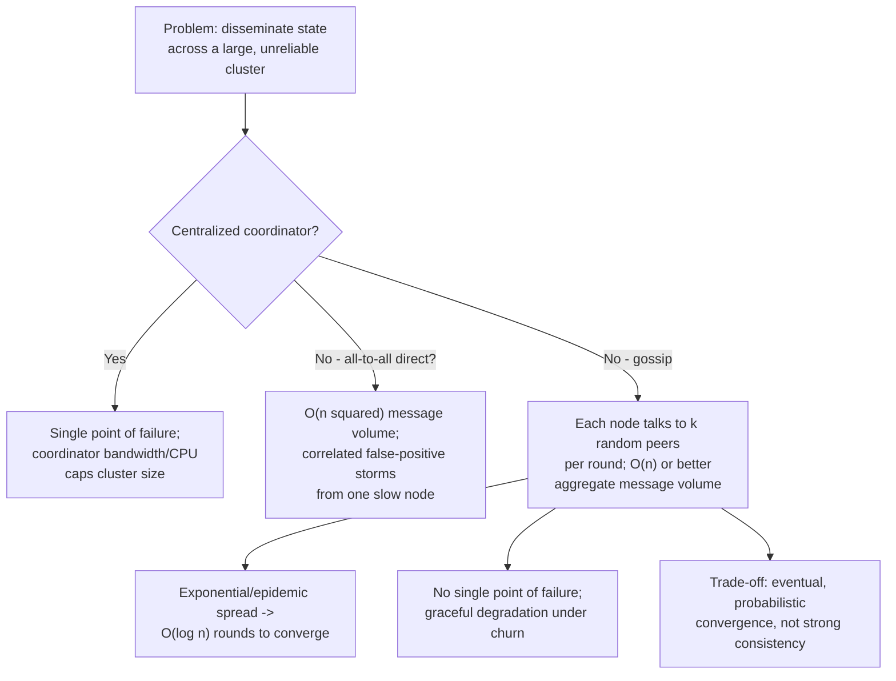

## 4. Core Concepts

### 4.1 The Gossip/Epidemic Dissemination Mechanism and Convergence Properties

**Definition.** Gossip (epidemic) dissemination is a peer-to-peer
information-spreading mechanism in which, on a fixed schedule ("once per
gossip round," typically every few hundred milliseconds to a few seconds),
each node in the cluster independently selects one or a small, fixed number
k of other nodes uniformly at random from its current membership view, and
exchanges state with each selected peer. Any node that has just received a
piece of new information (a new membership entry, an updated failure
status, a configuration change) begins gossiping *that* information onward
in the very next round it participates in, exactly the way a person who
just heard a rumor repeats it to the next few people they happen to talk to.

**Mechanism.** The core loop is deceptively simple, and its power comes
entirely from repetition and randomness rather than any single clever step:

1. Each node maintains a local, in-memory view of cluster state — a
   membership list, a set of recently-updated key/value pairs, or whatever
   the application layer is gossiping about — annotated with a version
   number, timestamp, or vector-clock-style marker per entry so that two
   nodes comparing state can determine which of them holds the more recent
   version of each entry (this is the same "logical clock" idea recapped,
   not re-taught, from consensus's Lamport-clock lineage in
   [Consensus](CH07_Consensus.md#2-historical-evolution)).
2. Once per gossip round, each node picks k peers uniformly at random from
   its current view of cluster membership (k is a small constant, commonly
   1 to 3, chosen independently of cluster size — this is the structural
   choice that keeps per-node message load flat as the cluster grows).
3. The node exchanges state with each chosen peer, using one of the
   push/pull/push-pull variants taught in Section 4.2, merging whichever
   entries the exchange reveals to be newer into its own local view.
4. Repeat every round, indefinitely, for as long as the node is a member of
   the cluster.

**Convergence properties — why this is exponential, not linear.** The
critical insight, directly inherited from mathematical epidemiology, is
that the number of nodes that have received a given piece of information
does not grow linearly round-over-round; it grows **multiplicatively**,
because every node that already has the information becomes an additional
independent source spreading it further in the very next round. If exactly
one node originates a new piece of information in round 0, and every node
that knows it gossips to k=1 new random peer per round, then (assuming no
redundant re-contacts, an idealized simplification Section 15 revisits) the
number of informed nodes can, in the best case, roughly double each round:
1, 2, 4, 8, 16, and so on. Reaching all n nodes in a cluster this way takes
on the order of log₂(n) rounds — a cluster of 1,000 nodes converges in
roughly 10 rounds, a cluster of 1,000,000 nodes in roughly 20 rounds — a
dramatically more favorable scaling curve than the linear O(n) rounds a
naive round-robin broadcast would require. This is precisely the
mathematical property epidemiologists call the epidemic threshold and the
basic reproduction number: as long as each already-informed node
"infects" at least one new node per round on average, the informed
population grows exponentially until it saturates the whole cluster, in
the same way a contagious disease with a reproduction number greater than 1
spreads through a population far faster than any linear intuition would
suggest.

```mermaid
sequenceDiagram
    participant N1 as Node 1 (originator)
    participant N2 as Node 2
    participant N3 as Node 3
    participant N4 as Node 4
    participant N5 as Node 5
    N1->>N2: Round 1: gossip new state
    N1->>N2: (Node 1 and Node 2 now informed)
    N2->>N3: Round 2: gossip new state
    N1->>N4: Round 2: gossip new state (parallel)
    N3->>N5: Round 3: gossip new state
    N4->>N3: Round 3: gossip new state (parallel; redundant, N3 already informed)
    Note over N1,N5: By round 3, all 5 nodes are informed - exponential spread from 1 originator
```

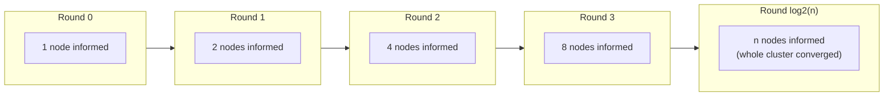

**Decision implications.** Gossip's O(log n) convergence-round count, paired
with each node's flat, cluster-size-independent per-round message load, is
precisely what makes it the standard choice whenever a system needs
membership or state dissemination that must keep working as cluster size
grows into the hundreds or thousands of nodes — the same property that
makes centralized or all-to-all schemes operationally infeasible at that
scale. The trade-off an architect explicitly accepts in return is
**convergence latency**: information is not instantly visible everywhere
the way a single centralized write would be; it takes some number of
rounds (log n, each round taking however long the gossip interval is
configured to be) before every node has genuinely converged, and during
that window different nodes can legitimately disagree about the current
state. Systems that gossip membership and failure status accept this
trade-off deliberately, because the alternative (blocking on a
strongly-consistent quorum for every membership update) does not scale to
the cluster sizes gossip is designed for.

**Common failure mode.** A cluster experiencing continuous, rapid churn —
nodes joining and leaving faster than the gossip convergence interval — can
enter a state where the cluster's collective view of membership never
actually stabilizes; different nodes are perpetually a few rounds behind
different other nodes' latest picture, and no single global snapshot of
"current membership" is ever truly accurate at any instant. This is not a
bug in the protocol; it is the direct, expected consequence of choosing an
eventually-consistent mechanism under sustained churn, and it is why gossip
intervals and suspicion timeouts (Section 4.4) must be tuned relative to
the expected churn rate of the specific deployment, not left at a
one-size-fits-all default.

**Scenario.** A 500-node Cassandra ring adds 50 new nodes during a planned
capacity expansion. Each existing node gossips with 1-3 random peers roughly
once per second; within about 9-10 rounds (roughly 10 seconds), every
existing node's local view has converged to include all 50 new nodes,
without any single node having had to individually contact all 550 peers,
and without any centralized "membership service" having had to broadcast the
update to the entire ring itself.

### 4.2 Push, Pull, and Push-Pull Variants

**Definition.** The gossip loop in Section 4.1 leaves one detail
unspecified: when node A contacts node B during a gossip round, who sends
state to whom? The three named variants — **push**, **pull**, and
**push-pull** — answer that question, and the choice materially affects how
quickly new information propagates and how much bandwidth the protocol
consumes.

**Mechanism.**

- **Push gossip.** The node that already has new information proactively
  sends ("pushes") it to the randomly chosen peer, without first checking
  whether the peer already has it. This is simple and fast to originate a
  single new piece of information (the originator can start pushing
  immediately), but it wastes bandwidth once most of the cluster is already
  informed, because a node has no way to know in advance that its randomly
  chosen peer already has the information — most push exchanges late in a
  gossip round's lifecycle end up being redundant.
- **Pull gossip.** The randomly chosen node instead asks ("pulls") its peer
  "what do you know that I don't?" — the peer being contacted is the one
  that requests the update, rather than the one holding new information
  proactively sending it. Pull is more efficient once the cluster is mostly
  converged (a node with genuinely stale state will actively seek out
  updates rather than waiting to be randomly selected by an informed peer),
  but it is slower to get a *brand-new* piece of information moving in the
  first place, because nodes that don't yet know a new update exists have
  no way to know they should specifically pull it.
- **Push-pull gossip.** Both directions happen in the same exchange: when A
  contacts B, both A and B send each other their current state (or, more
  efficiently, a compact digest/version-vector summary first, followed by
  only the actual missing entries), and each merges in whatever the other
  had that it didn't. Push-pull combines push's fast initial spread with
  pull's efficient late-stage convergence, and empirically converges in
  roughly half the rounds of pure push or pure pull for the same message
  cost per round — this is why most production gossip implementations
  (Cassandra, Serf/Consul's SWIM implementation) use push-pull rather than
  either pure variant.

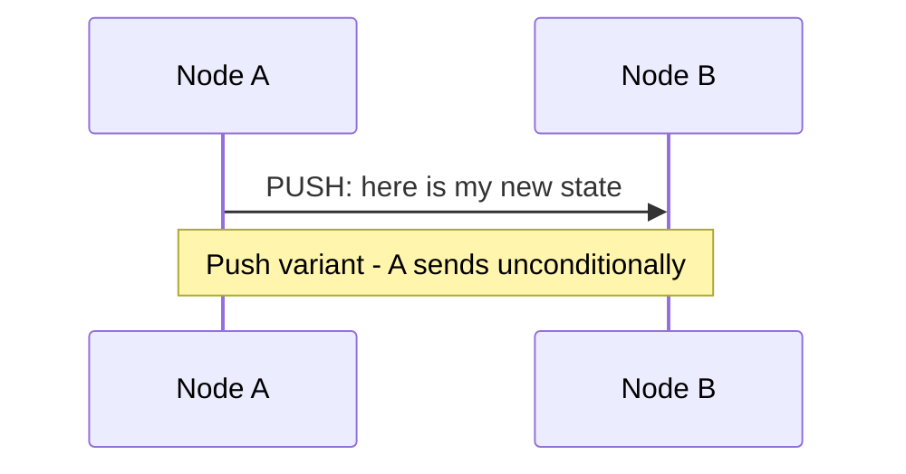

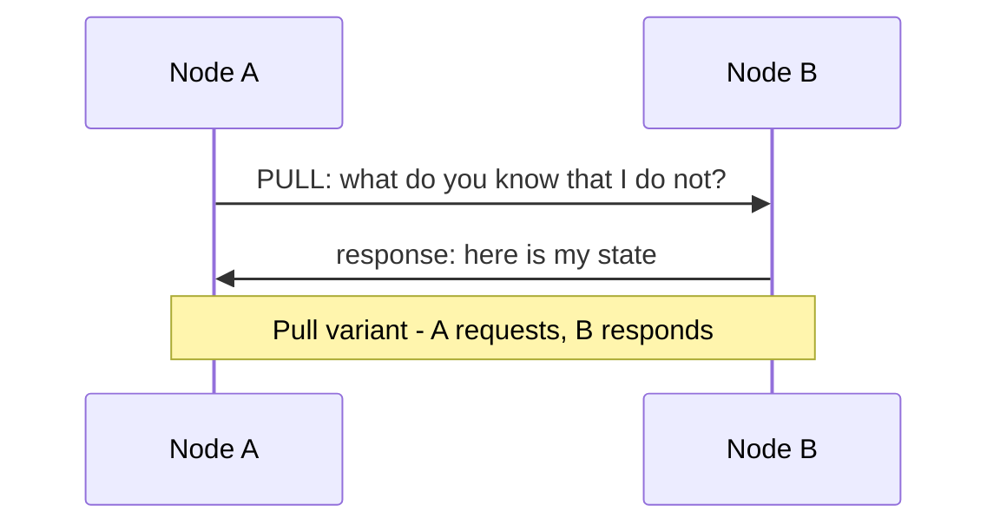

```mermaid
sequenceDiagram
    participant A as Node A
    participant B as Node B
    A->>B: digest of A&#39;s state (versions only)
    B->>A: digest of B&#39;s state (versions only)
    A->>B: full entries B is missing
    B->>A: full entries A is missing
    Note over A,B: Push-pull variant - both directions merge in one exchange
```

**Decision implications.** Pure push is attractive only when a system
mostly needs to disseminate a small number of genuinely new events quickly
and rarely needs to reconcile long-standing divergence (a narrow "rumor" use
case, Section 4.3). Pure pull is attractive when a system's dominant concern
is background reconciliation of state that has drifted apart over a long
period, rather than fast propagation of brand-new events (the classic
"anti-entropy" use case, also Section 4.3). Push-pull is the default choice
for general-purpose membership and failure-status gossip precisely because
production systems need *both* properties simultaneously — fast spread of a
newly-detected failure and steady background reconciliation of any state
that has drifted — and its bandwidth cost, while higher per-exchange than
either pure variant, is still bounded by the same small constant k per node
per round, so it does not change the O(log n) convergence-round math, only
the constant factor.

**Common failure mode.** Naively implementing push-pull by exchanging full
state on every gossip round (rather than a compact digest first, followed
by only the missing entries) scales the per-exchange bandwidth cost with
the total size of the state being gossiped, not just the size of what
changed — for a large membership list or a large key/value dataset, this
can make gossip itself a meaningful source of network load, defeating part
of the reason gossip was chosen in the first place. Production
implementations always exchange a compact digest (version numbers or a
Merkle-tree-style summary) first and only transfer full entry contents for
the specific entries the digest comparison reveals to be missing or stale.

**Scenario.** A newly-provisioned node joins a 200-node cluster and has an
essentially empty local state. Using push-pull, its very first gossip
exchange with any existing peer pulls in a meaningful fraction of the
cluster's current membership view immediately (the pull half of the
exchange), while any change the new node itself needs to announce (its own
arrival) propagates outward via the push half of that same exchange and
subsequent rounds — one mechanism handling both directions of the
bootstrap problem simultaneously.

### 4.3 Anti-Entropy vs. Rumor-Mongering Dissemination Styles

**Definition.** Beyond the push/pull/push-pull mechanics of a single
exchange, gossip protocols differ in *how long* a node keeps gossiping about
a given piece of information, which is a separate axis usually described
with two named styles: **anti-entropy** and **rumor-mongering** (sometimes
called "complex epidemics").

**Mechanism.**

- **Anti-entropy.** Every node periodically gossips its *entire* current
  state (or a compact digest of it) with a randomly chosen peer,
  indefinitely, forever, regardless of whether anything has actually
  changed recently. The goal is not fast propagation of any single new
  event; it is continuously driving down "entropy" — the amount of
  divergence between any two nodes' views — toward zero over time, as a
  standing background process. Anti-entropy is the mechanism the original
  1987 Xerox PARC paper was built around, targeting database replica
  reconciliation, and it guarantees that *any* divergence, no matter how it
  arose (a missed update, a network partition that has since healed, a
  node that was offline for an extended period), will eventually be
  reconciled, because every node keeps comparing its full state against
  random peers forever.
- **Rumor-mongering.** A node that learns a specific new piece of
  information ("a rumor") gossips *that specific item* actively and
  preferentially for a limited number of rounds, then probabilistically
  loses interest in continuing to spread it — typically once it has
  contacted several peers in a row who already knew the rumor, on the
  theory that the rumor has likely already saturated the cluster and
  further gossiping about it is a waste of bandwidth. Rumor-mongering is
  much cheaper than anti-entropy for propagating specific, discrete events
  (a single node-down notification, a single configuration change) because
  it does not require continuously re-exchanging the entire dataset
  forever, but it sacrifices anti-entropy's absolute guarantee: there is a
  small, non-zero probability that a rumor "dies out" (every currently
  "hot" carrier of it happens to only contact peers who already know it,
  in the same round, purely by bad luck) before reaching every node,
  leaving a residual minority that never receives it through the rumor
  mechanism at all.

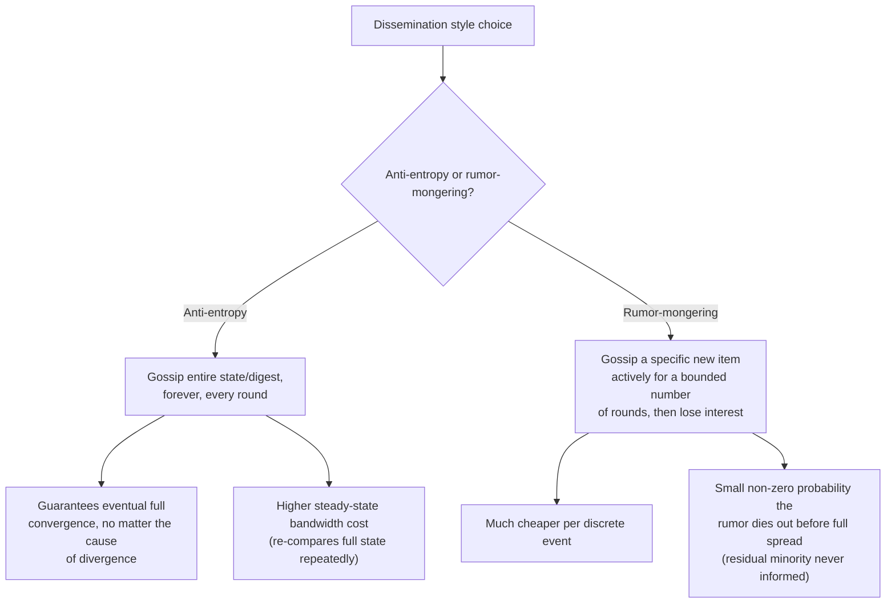

**Decision implications.** Production systems almost never choose one style
exclusively; they layer both, because they solve different problems.
Rumor-mongering is the fast path for propagating discrete, time-sensitive
events (a node just failed, a node just joined) with low bandwidth cost.
Anti-entropy runs continuously in the background as a safety net,
periodically comparing full state (or Merkle-tree digests of it, an
optimization that lets two nodes find *which* ranges of data differ without
transferring the whole dataset) between random peers, catching and
correcting the rare residual divergence rumor-mongering's probabilistic
die-out leaves behind, and also catching entirely separate sources of
divergence (a node that missed updates while partitioned, corrupted local
state) that no rumor ever specifically targeted in the first place.
Cassandra's own architecture is a direct real-world instance of this
layering: gossip (rumor-mongering-style) for fast ring-membership and
failure-status propagation, plus a separate, explicit **anti-entropy
repair** process (recapped, not re-taught, from
[Cassandra](../06_Databases_and_Storage/CH18_Cassandra.md), which owns the
Merkle-tree repair mechanics as an engine-specific implementation) for
reconciling actual row-level data divergence between replicas.

**Common failure mode.** Relying on rumor-mongering alone, with no periodic
anti-entropy safety net, means that any node that misses a rumor (through
a partition, a crash-restart during the rumor's brief propagation window,
or simple bad luck in random peer selection) has no other mechanism that
will ever correct it — the divergence becomes permanent and silent unless
something else (an operator, an unrelated read-repair path) happens to
notice it.

**Scenario.** A node in a 300-node cluster is network-partitioned away from
the rest for exactly the two or three gossip rounds during which a
different node's failure-and-recovery event is actively being
rumor-mongered. By the time the partition heals, the rumor has already
"died out" cluster-wide (every other node lost interest, having already
converged). The partitioned node's periodic anti-entropy exchange with a
random peer afterward is what actually catches and corrects its stale
membership view — the rumor mechanism alone would have left it permanently
out of date.

### 4.4 SWIM: Scalable Weakly-Consistent Infection-Style Process Group Membership

**Definition.** SWIM is a protocol, published in 2002, that solves cluster
**membership maintenance and failure detection** specifically, by
deliberately separating two concerns that naive heartbeat schemes conflate:
(1) *detecting* that a specific peer appears unreachable, using a
constant-load, randomized direct-probing mechanism, independent of overall
cluster size; and (2) *disseminating* that a peer's status has changed,
using the infection-style (gossip) mechanism from Sections 4.1-4.3, rather
than a separate heartbeat broadcast to every other node.

**Mechanism — why naive heartbeats fail at scale.** The obvious alternative
to SWIM is: every node periodically sends a heartbeat directly to every
other node, and any node that stops receiving a peer's heartbeat within some
fixed timeout declares that peer dead. This has two structural problems
SWIM's paper names explicitly. First, the message volume is O(n²) — as
Section 3 already established, this becomes operationally infeasible well
before cluster sizes reach the thousands-of-nodes scale gossip is meant to
support. Second, and more subtly damaging, a single node that becomes
briefly slow (under a garbage-collection pause, CPU contention, or a
transient network hiccup) can cause *every other node in the cluster* to
independently time out on it at roughly the same moment, because every
other node was independently, directly waiting on heartbeats from exactly
that one node — turning one transient hiccup into a simultaneous,
cluster-wide false-positive failure storm, precisely the correlated-failure
problem naive all-to-all schemes suffer from generally.

SWIM's actual per-round protocol, per node, works as follows:

1. **Direct probing.** Each node, once per protocol period, picks one
   random member from its membership list and sends it a direct `PING`
   message, expecting an `ACK` back within a short timeout.
2. **Indirect probing (the key innovation).** If the direct `PING` does not
   receive an `ACK` within the timeout, the probing node does **not**
   immediately declare the target dead. Instead, it asks k other random
   members (typically 3-4) to each independently send their *own* direct
   `PING` to the same suspected-unreachable target on its behalf, and
   report back whether *they* got an `ACK`. This is SWIM's central insight:
   a direct-path timeout might mean the target genuinely crashed, but it
   might equally mean only the specific network path between the original
   prober and the target is congested or briefly partitioned, while the
   target is perfectly healthy and reachable from other members. Indirect
   probing distinguishes these two cases without ever requiring a full
   all-to-all heartbeat mesh.
3. **Suspicion, not immediate death.** If *none* of the direct probe and
   the indirect probes receive an `ACK` within the protocol's timeout, the
   probing node does not unilaterally declare the target dead either — it
   marks the target **`SUSPECT`** in its own local membership state and
   gossips that suspicion onward (using the infection-style dissemination
   from Section 4.1) rather than a flat "dead" declaration. Any node
   (including the suspected node itself, if it is actually alive and
   merely was unreachable along that one path) that subsequently manages to
   directly reach the suspected node and receive an `ACK` from it gossips a
   **refutation** — "no, I have direct proof this node is alive" — which
   overrides the suspicion. Only if a node remains in the `SUSPECT` state,
   with no refutation received, for a further configurable timeout, does
   any node finally gossip a **`CONFIRM` (dead)** status, which then
   propagates via the normal infection-style dissemination mechanism to the
   rest of the cluster.

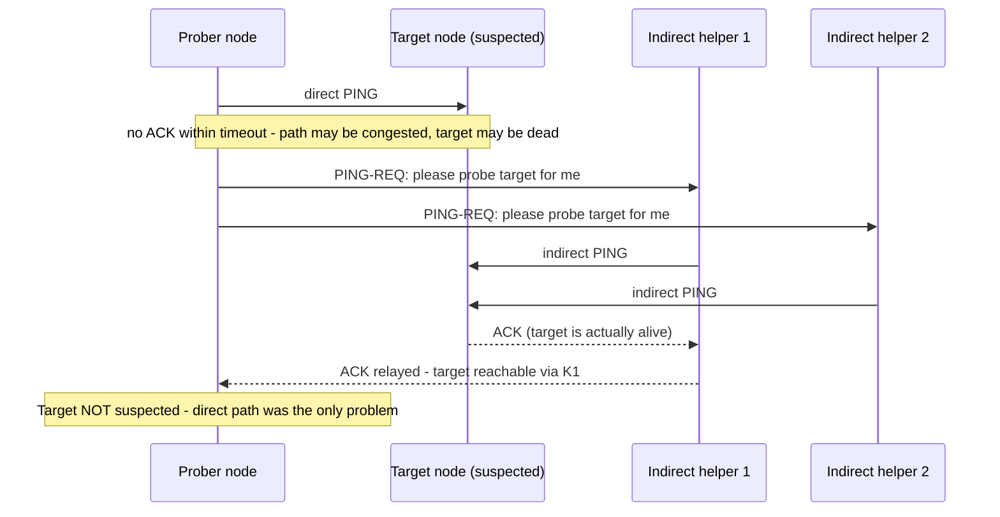

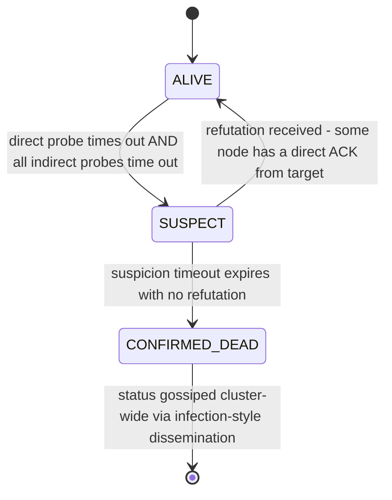

**Why this improves on naive heartbeat-based detection.** SWIM's constant
per-node probing load (each node originates exactly one direct probe per
protocol period, regardless of cluster size) keeps aggregate message volume
at O(n) rather than O(n²), directly solving the scalability problem. Its
indirect-probing step directly solves the correlated-false-positive
problem: a single congested network path no longer causes a spurious
failure declaration, because the protocol explicitly checks whether *other*
nodes can reach the target before concluding anything is wrong with the
target itself, rather than assuming a single node's inability to reach the
target implies the target is unreachable from everyone. Its suspicion
intermediate state further reduces false positives from transient,
genuinely-brief unresponsiveness (a garbage-collection pause, a momentary
CPU spike) by giving the target a further window to prove it is alive
before the cluster commits to treating it as dead, while still bounding how
long a genuinely dead node can linger in an ambiguous state before the rest
of the cluster acts on its failure.

**Decision implications.** SWIM (or a close derivative — HashiCorp's Serf
and Consul's membership layer, and Akka Cluster's failure detector, are
both SWIM-family protocols with their own refinements) is the standard
choice whenever a system needs decentralized membership and failure
detection at a scale where O(n²) all-to-all heartbeating is not viable, and
where the application can tolerate the inherent latency of the
suspect-then-confirm pipeline (a genuinely dead node is not instantly known
to be dead; it passes through a bounded, but non-zero, suspicion window
first) in exchange for dramatically fewer false positives than a naive
fixed-timeout scheme would produce.

**Common failure mode.** A cluster whose suspicion timeout is tuned too
aggressively (too short) for its actual network jitter and
garbage-collection-pause characteristics still produces false-positive
`CONFIRMED_DEAD` declarations, just delayed slightly compared to a naive
scheme rather than eliminated — SWIM reduces, but does not by itself
guarantee zero, false positives; the suspicion-timeout tuning still matters
and must be set relative to the deployment's actual observed tail-latency
and pause-time distribution, which is precisely the problem the Phi Accrual
detector in Section 4.5 was designed to make adaptive rather than a fixed
manual constant.

**Scenario.** In a 400-node cluster, node 217 experiences a 2-second
garbage-collection pause under load. A single peer's direct `PING` to it
times out during that window and marks it `SUSPECT`, gossiping that
suspicion onward. Before the confirm-timeout elapses, node 217 finishes its
garbage-collection pause, responds to a subsequent probe from a different
peer with a normal `ACK`, and that peer gossips a refutation. The cluster
never declares node 217 dead, and no rebalancing or failover work is
wastefully triggered — exactly the outcome a naive single-heartbeat-timeout
scheme, lacking both indirect probing and a suspicion intermediate state,
would have failed to achieve.

### 4.5 Phi Accrual Failure Detection: Adaptive, Probabilistic Suspicion

**Definition.** The Phi Accrual failure detector, published in 2008,
replaces a fixed heartbeat timeout with a **continuously-valued,
statistically-derived suspicion level**, conventionally called **phi**
(φ), computed fresh each time a node evaluates whether a peer might have
failed, rather than a single binary alive/dead decision triggered the
instant a fixed timer expires.

**Mechanism.** The detector maintains, for each monitored peer, a sliding
window of the most recent heartbeat **inter-arrival times** — the gaps
between consecutive received heartbeats, not the heartbeats' absolute
timestamps. From this window, it estimates the statistical distribution
(commonly modeled as a normal, or occasionally an exponential, distribution
depending on the implementation) of how long the gap between heartbeats
*normally* is for that specific peer under current, real network
conditions — not a single hand-tuned constant applied uniformly to every
peer regardless of its actual observed jitter. When a new evaluation is
needed (either on a fixed schedule or on demand, whenever some other
component asks "is this peer alive?"), the detector computes how long it
has been since the *last* heartbeat actually arrived, and expresses that
elapsed time as a probability, using the estimated distribution: phi is
defined so that phi = 1 corresponds to roughly a 10% chance the next
heartbeat is simply running late by normal variance, phi = 2 to roughly a
1% chance, phi = 3 to roughly a 0.1% chance, and so on — each additional
unit of phi represents an order-of-magnitude decrease in the probability
that the observed silence is still consistent with normal, healthy jitter.
Rather than returning a binary verdict, the detector exposes this
continuously-valued phi number to the calling application, which then
applies its own threshold (commonly somewhere around phi = 8-12 in
production Cassandra deployments) appropriate to how aggressively that
specific application wants to react to suspected failure.

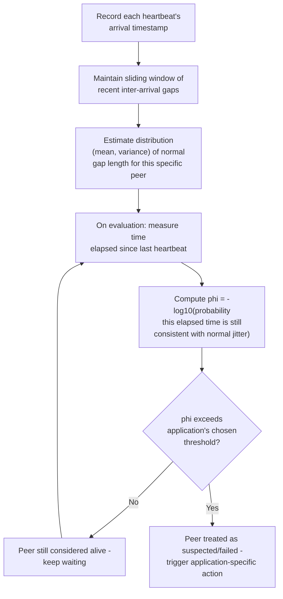

**Why this improves on a fixed threshold.** A fixed heartbeat timeout must
be chosen as a single compromise value that is simultaneously short enough
to detect genuine failures reasonably promptly and long enough to tolerate
the network's actual worst-case jitter without triggering false positives —
a compromise that is fundamentally impossible to get right for a
heterogeneous, real-world network where different peers, different times
of day, and different load conditions all produce genuinely different
normal jitter characteristics. A peer on a congested link with naturally
high, but stable, jitter needs a longer threshold than a peer on a
low-latency, stable local link; a single global constant either produces
false positives for the first peer or unnecessarily slow detection for the
second. Phi Accrual sidesteps the compromise entirely by deriving each
peer's "normal" behavior from its own recent, actual history, and by
exposing a continuously-valued suspicion level rather than a single
timeout-triggered binary flip — a caller can, for example, react
differently at phi = 5 (log a warning, perhaps reduce traffic routed to the
peer) than at phi = 12 (treat as confirmed failed, remove from the active
routing set), building in graduated responses a binary detector cannot
express at all.

**Decision implications.** Phi Accrual (or an equivalent adaptive
statistical detector) is the right choice whenever a system's peers have
genuinely heterogeneous or time-varying network/latency characteristics —
which is the normal case for any cloud-deployed, multi-availability-zone,
or geographically-distributed cluster — and where the cost of a false
positive (an unnecessary failover, an unnecessary rebalance) is high enough
to justify the additional bookkeeping of maintaining a per-peer
inter-arrival-time distribution, versus a simpler fixed-timeout scheme's
lower implementation complexity but worse false-positive/detection-latency
trade-off curve. It composes naturally with SWIM's suspicion mechanism
(Section 4.4): SWIM's binary `SUSPECT` transition can itself be driven by a
Phi Accrual threshold crossing rather than a single fixed timer, combining
SWIM's constant-load probing structure with Phi Accrual's adaptive
threshold — this is precisely the combination Cassandra's ring-membership
layer implements.

**Common failure mode.** A Phi Accrual detector's estimate is only as good
as its recent history window; a peer that has been consistently, unusually
slow for an extended period (not failed, just genuinely and persistently
slower than the rest of the cluster — an under-provisioned node, one
running on degraded hardware) will have its own "normal" distribution
widened to match that persistent slowness, meaning phi rises more slowly
for it than for a healthy peer under the same absolute delay, which can
mask a genuine failure of that specific chronically-slow node for longer
than it would take to detect the same absolute delay on a normally-fast
peer. This is a known, accepted trade-off of adapting per-peer rather than
using one cluster-wide threshold, not a bug, and it is why production
deployments still pair Phi Accrual with an absolute maximum silence
ceiling as a backstop.

**Scenario.** A Cassandra node in a cross-region deployment normally
receives gossip heartbeats from a specific cross-region peer with higher,
but stable, inter-arrival variance than its same-region peers (WAN latency
is simply higher and jitters more than LAN latency). A fixed 1-second
timeout tuned for the same-region peers would produce constant false
suspicion of the cross-region peer; Phi Accrual instead learns that peer's
own wider-but-stable normal distribution and only raises phi meaningfully
when that peer's silence genuinely exceeds *its own* historical norm by a
statistically significant margin, avoiding the false positives a
one-size-fits-all timeout would generate.

## 5. Internal Working

Putting Sections 4.1-4.5 together, a production gossip-based membership
layer's internal event loop, running independently and continuously on
every node, looks like the following composite cycle: each protocol period,
a node (1) originates one direct SWIM probe to a random peer, falling back
to indirect probing through k helper peers if the direct probe times out;
(2) updates its local suspicion state (or Phi Accrual phi value) for every
peer based on observed heartbeat/probe timing; (3) separately, and on its
own schedule, performs a push-pull gossip exchange with one or more
different randomly chosen peers, exchanging membership-state digests and
merging in whatever the digest comparison reveals to be missing or newer,
including any recent `SUSPECT`/`CONFIRMED_DEAD`/refutation status changes
that need to spread via infection-style dissemination; and (4) exposes its
current merged view of cluster membership and failure status to whatever
application-layer component (a request router, a partition-ownership
calculator, a load balancer) needs to consume it.

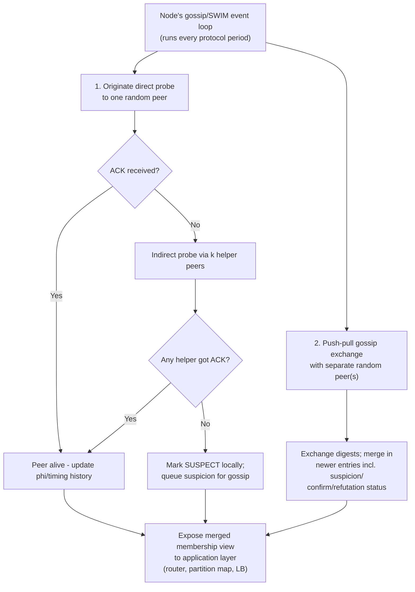

Two subtleties matter for correctly implementing this loop. First, the
probing cycle (steps 1-2) and the gossip-dissemination cycle (steps 3-4) are
conceptually and operationally separate mechanisms with separate schedules
and separate random peer selections, even though a single implementation
often bundles their network messages together for efficiency (SWIM's own
paper explicitly piggybacks membership-update gossip onto the same `PING`/
`ACK`/`PING-REQ` messages the failure-detection probing already sends,
avoiding a second round of network round-trips purely to disseminate
status changes). Second, every node's local membership view is, at every
instant, a partial, possibly-stale snapshot rather than a globally
synchronized truth — the entire design accepts eventual convergence
(Section 4.1) rather than instantaneous consistency, which is precisely why
gossip-based systems must be paired with an application layer (a
quorum-based read/write path, a versioned/conflict-resolved data model)
that tolerates operating against a temporarily-inconsistent membership view
rather than assuming perfect, instant agreement.

## 6. Design Principles

- **Bound per-node work to a small constant, independent of cluster size.**
  Every design choice in this chapter — k random peers per round, a
  constant number of indirect-probe helpers, a fixed-size sliding window
  for Phi Accrual's history — exists to keep each individual node's
  workload flat as the cluster scales from tens to thousands of nodes; any
  gossip-protocol design that lets per-node work grow with cluster size has
  reintroduced the exact scalability problem gossip exists to solve.
- **Prefer probabilistic, decentralized decisions over any single
  authoritative source.** No single node's opinion about another node's
  liveness should ever be treated as final without corroboration
  (indirect probing, suspicion timeouts, refutation) — a design that lets
  one node's direct observation unilaterally and immediately declare a peer
  dead reintroduces the correlated-false-positive problem SWIM was
  specifically designed to eliminate.
- **Separate detection from dissemination.** Treat "is this peer
  reachable" (a local, per-node measurement problem, addressed by direct
  and indirect probing and Phi Accrual) as a distinct concern from "how
  does that status reach the rest of the cluster" (a propagation problem,
  addressed by push/pull/push-pull infection-style gossip) — conflating the
  two, as naive all-to-all heartbeating does, is what produces both the
  O(n²) message-volume problem and the correlated-false-positive problem
  simultaneously.
- **Adapt thresholds to observed conditions rather than hand-tuning global
  constants.** Phi Accrual's entire design principle is that a single,
  globally-applied timeout cannot be simultaneously correct for
  heterogeneous peers and network paths; wherever practical, prefer
  detectors that learn a peer-specific or path-specific "normal" from
  recent history over a single manually chosen constant.
- **Layer a slow, thorough safety net under a fast, lossy primary
  mechanism.** Rumor-mongering's fast-but-imperfect propagation should
  always be paired with periodic anti-entropy reconciliation as a
  backstop (Section 4.3) — accepting an efficient mechanism's small
  probability of failure is only safe if a slower, more thorough mechanism
  eventually catches whatever the fast mechanism missed.

## 7. Architecture Patterns

Three recurring architectural patterns build directly on this chapter's
mechanisms:

**Pattern 1 — gossip-based membership as cluster infrastructure, decoupled
from application logic.** Rather than every application component
independently re-implementing failure detection, a single gossip/SWIM layer
runs cluster-wide and exposes a shared, continuously-updated membership view
(with per-peer phi values or alive/suspect/dead status) that every other
component — a partition-ownership calculator, a request router, a
capacity-rebalancing job — simply consumes as an input. This is the pattern
Cassandra, Consul, and Akka Cluster all use: gossip is a foundational,
general-purpose infrastructure layer, not a bespoke mechanism reinvented per
feature.

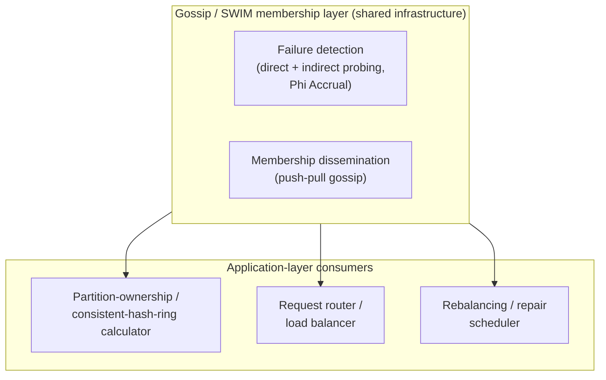

**Pattern 2 — hierarchical/hybrid gossip for very large clusters.** At
extreme scale (tens of thousands of nodes and beyond, common in large
public-cloud fleets rather than typical application clusters), even O(log
n) convergence rounds and O(n) aggregate message volume can be reduced
further by organizing nodes into a coarse hierarchy (racks, availability
zones, regions) and gossiping preferentially within a local group most of
the time, with a smaller number of designated nodes gossiping across
group boundaries less frequently — trading a small amount of additional
convergence latency for a further reduction in cross-region network traffic,
which matters when cross-region bandwidth is materially more expensive or
constrained than intra-region bandwidth.

**Pattern 3 — gossip for coordinator-free failure detection feeding a
consensus-backed control plane.** A system can use gossip purely for the
*cheap, scalable, best-effort* part of the problem (which of thousands of
worker nodes currently appears alive) while reserving
[Consensus](CH07_Consensus.md)-backed strong agreement (recapped, not
re-taught, here) for the much smaller set of decisions that genuinely need
it (electing a single active controller, committing a small number of
critical configuration changes) — the two mechanisms operate at different
layers and different scales within the same system rather than competing
for the same job.

## 8. Production Architecture

In production, gossip-based membership rarely runs as a bespoke,
hand-rolled component; teams either build directly on a database or
coordination system that already embeds it (Cassandra's and Amazon
DynamoDB-family systems' internal gossip layers, both accessed only through
the database's own client Application Programming Interface (API), never
directly), or adopt a dedicated membership/gossip library (HashiCorp's
`memberlist`, the open-source Go library underlying Serf and Consul, is the
most widely reused example, embedded directly into many other open-source
projects that need decentralized membership without wanting to re-derive
SWIM themselves).

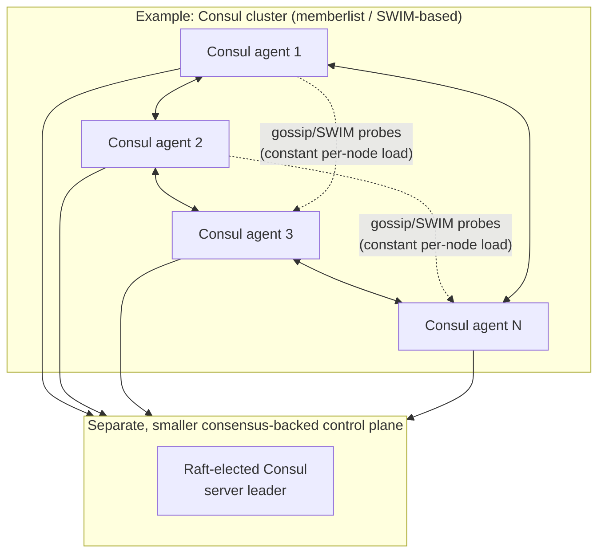

A recurring production concern is **gossip fan-out and interval tuning**
relative to cluster size and expected churn rate: too small a k (peers
contacted per round) or too long a gossip interval slows convergence
(Section 4.1's log n round-count assumes a specific, deliberately chosen k
and interval), while too large a k or too short an interval increases
per-node bandwidth and CPU cost unnecessarily for clusters that do not
actually need the faster convergence it buys. Production deployments size
these parameters against measured, expected node-count and churn-rate
targets rather than leaving library defaults untouched, and re-measure
whenever cluster size grows by an order of magnitude.

## 9. Implementation

Implementing (or correctly configuring) a gossip/SWIM/Phi-Accrual layer in
practice involves a small number of concrete, consequential decisions:

1. **Fan-out (k) and gossip/probe interval** — chosen relative to expected
   cluster size and churn rate (Section 8); most production defaults sit
   around k = 1-3 peers per round with sub-second-to-few-second intervals.
2. **Dissemination style mix** — rumor-mongering for fast propagation of
   discrete membership/status changes, layered with a periodic (typically
   much slower, e.g. minutes-to-hours) full anti-entropy pass as a
   correctness safety net (Section 4.3).
3. **Suspicion and confirm timeouts (SWIM)** — tuned against the
   deployment's actual observed network round-trip-time and jitter
   distribution, not a single library default copied across environments
   with materially different network characteristics.
4. **Phi Accrual threshold and history-window size** — the threshold an
   application applies to the continuously-valued phi output, and how many
   recent inter-arrival samples the sliding window retains (a larger window
   smooths out noise but adapts more slowly to a genuine, sustained change
   in a peer's normal behavior).
5. **Piggybacking membership updates onto probe messages** — an
   implementation efficiency (not a correctness requirement) that avoids a
   second round of network round-trips purely to disseminate status
   changes, by attaching gossip payload to the same `PING`/`ACK`/`PING-REQ`
   messages the failure-detection probing already sends (Section 5).

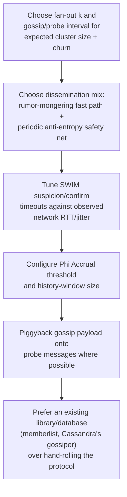

## 10. Complete Code Examples

The four runnable examples below live under
[`code/python/gossip-protocols-chapter/`](../code/python/gossip-protocols-chapter/)
and are deliberately self-contained, in-process simulations — they model
the message-passing behavior of each mechanism directly in Python rather
than requiring a real network, so a reader can run them immediately to see
the mechanics from Sections 4.1-4.5 actually execute and measure:

1. [`01_gossip_round_simulator.py`](../code/python/gossip-protocols-chapter/01_gossip_round_simulator.py) —
   a discrete-round simulation of push, pull, and push-pull gossip across a
   configurable number of simulated nodes, measuring and printing the
   number of rounds each variant takes to reach full cluster convergence
   from a single originating node, directly demonstrating Section 4.1's
   O(log n) convergence-round claim and Section 4.2's push-vs-pull-vs-
   push-pull round-count comparison across several cluster sizes.
2. [`02_swim_membership_protocol.py`](../code/python/gossip-protocols-chapter/02_swim_membership_protocol.py) —
   a simulation of SWIM's direct-probe/indirect-probe/suspicion pipeline
   (Section 4.4) among several simulated nodes, including a deliberately
   injected scenario where one node's direct network path to another is
   "congested" (simulated packet loss on that one path only) while indirect
   probing through helper peers correctly proves the target is still alive,
   and a second scenario where a node genuinely goes silent on all paths and
   is correctly walked through `SUSPECT` to `CONFIRMED_DEAD`.
3. [`03_phi_accrual_failure_detector.py`](../code/python/gossip-protocols-chapter/03_phi_accrual_failure_detector.py) —
   a from-scratch implementation of the Phi Accrual failure detector
   (Section 4.5): it records simulated heartbeat inter-arrival times for a
   peer, estimates a running mean/variance, computes phi against a
   normal-distribution tail-probability model, and prints how phi rises
   over an injected silence gap, contrasted directly against what a naive
   fixed-timeout detector would have concluded at the same elapsed times.
4. [`04_anti_entropy_vs_rumor_mongering.py`](../code/python/gossip-protocols-chapter/04_anti_entropy_vs_rumor_mongering.py) —
   a comparison simulation (Section 4.3) that measures total messages sent
   and rounds-to-full-convergence for rumor-mongering (with a configurable
   probability of an individual node losing interest after redundant
   contacts, including a run where the rumor is deliberately made to die
   out before reaching every node) versus anti-entropy (continuous full-state
   exchange every round), over the same simulated cluster.

Each script prints an annotated, step-by-step or round-by-round trace of
protocol events so the message flow can be read directly alongside this
chapter's sequence and flowchart diagrams.

## 11. Performance

Gossip's dominant performance characteristic is the trade-off between
**convergence latency** (how many rounds, and therefore how much wall-clock
time, until the whole cluster has a given piece of information) and
**aggregate message volume** (how much total network traffic the protocol
consumes cluster-wide). Both are governed by the same handful of tunable
parameters: fan-out k, gossip/protobe interval length, and — for
SWIM specifically — the number of indirect-probe helpers per suspected
timeout. Increasing k or shortening the interval reduces convergence
latency (fewer rounds needed, and each round takes less wall-clock time)
at the direct cost of proportionally higher aggregate bandwidth and CPU
consumption cluster-wide; the O(log n) convergence-round result from
Section 4.1 describes how the *round count* scales with cluster size for a
fixed k, not how wall-clock convergence time scales, which also depends
directly on the chosen interval length. In practice, production systems
tune these parameters empirically against a target convergence-latency
service level objective (SLO) (recapped, not re-taught, from
[Non-Functional Requirements](CH02_Non_Functional_Requirements.md)) for
their specific expected cluster size and churn rate, rather than assuming a
single universal default is correct for every deployment scale.

## 12. Scalability

Gossip protocols are, by design, one of the few distributed-systems
mechanisms whose per-node cost is structurally independent of overall
cluster size — the entire point of choosing a fixed, small fan-out k
(Section 4.1) rather than an all-to-all or centralized scheme is that
adding more nodes to the cluster does not increase any individual existing
node's message load; it only slightly increases the number of rounds
needed for full convergence (logarithmically, per Section 4.1's math), and
SWIM's indirect-probing helper count similarly stays a small, fixed
constant regardless of overall cluster size. This is precisely why gossip
is the standard membership/failure-detection mechanism for clusters that
must scale into the thousands of nodes, where any O(n²) or centralized
alternative becomes operationally infeasible well before that scale is
reached — the same scalability argument Section 3 already made in
contrasting gossip against its two naive alternatives.

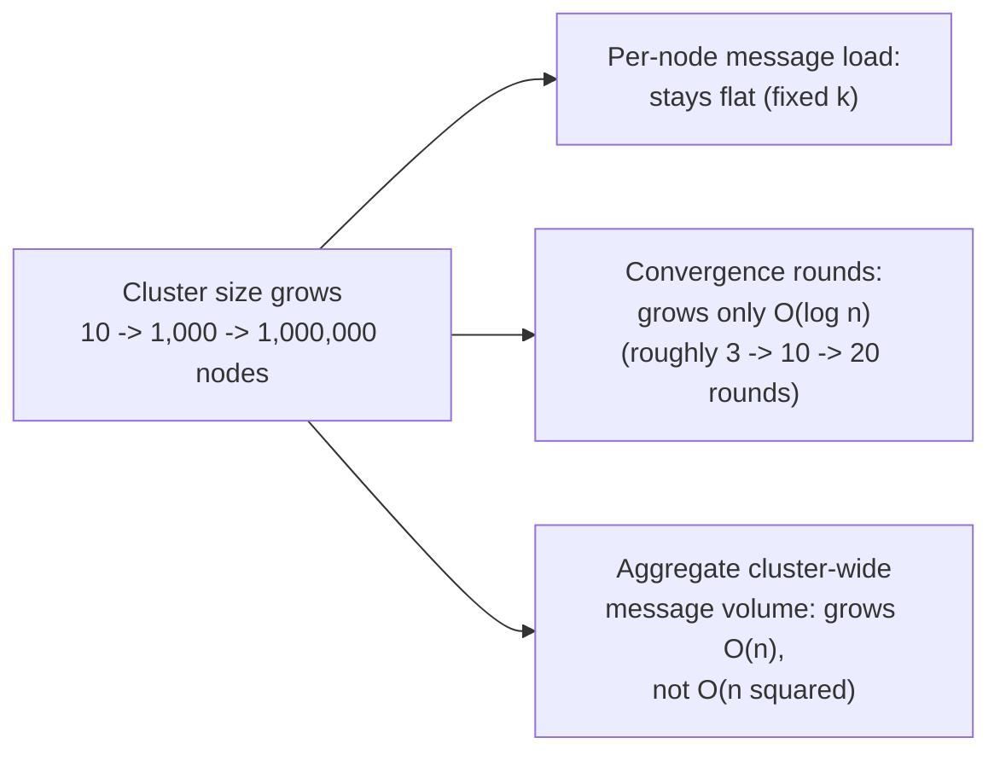

## 13. Security

Gossip protocols assume, as a baseline prerequisite, that the nodes
participating in the cluster are legitimate, authenticated members —
neither the epidemic dissemination mechanism nor SWIM's probing pipeline
inherently authenticates the peers it exchanges state with, which means a
production deployment must add Transport Layer Security (TLS) mutual
authentication between cluster members (recapped, not re-taught, from
[TLS](../05_Networking_and_OS/CH06_TLS.md)) to prevent a network-level
attacker from injecting forged `PING`/`ACK` messages or forged gossip
payloads that could otherwise inject false membership entries, falsely
mark legitimate nodes as `SUSPECT`/`CONFIRMED_DEAD`, or falsely advertise a
malicious node's own presence into the cluster's shared membership view. A
distinct, gossip-specific concern is **join authorization**: because any
node that successfully establishes a gossip exchange with even a single
existing cluster member can, via the normal infection-style dissemination
mechanism, have its presence propagate to the entire cluster within the
usual O(log n) rounds, join requests must themselves be authenticated and
authorized at the point of first contact, not implicitly trusted merely
because a gossip exchange succeeded — an unauthenticated gossip layer would
let a single compromised or malicious node "gossip its way" into a cluster
membership view just as efficiently as it disseminates any legitimate
update.

## 14. Observability

The most useful observability signals for a gossip/SWIM-based membership
layer are: **convergence latency** (measured directly, e.g. by injecting a
synthetic marker update and timing how long it takes to be observed
cluster-wide, rather than only trusting the theoretical O(log n) estimate);
**suspicion churn rate** (how often nodes transition into `SUSPECT` and back
to `ALIVE` via refutation, which is a direct, quantifiable signal of
network jitter or garbage-collection-pause pressure, analogous to
[Consensus](CH07_Consensus.md)'s term-number-churn signal for leadership
instability — a healthy cluster shows a low, stable suspicion-churn rate,
and a rising rate should be alerted on before it produces genuine
false-positive failovers); **per-peer phi-value distribution** (for systems
using Phi Accrual, tracking the distribution of current phi values across
all monitored peers surfaces which specific peers are trending toward
suspicion before they actually cross the application's threshold); and
**aggregate gossip message volume and bandwidth** (to catch a
misconfigured fan-out or interval, or a full-state-exchange
implementation bug, consuming more bandwidth than the deployment's chosen
parameters should produce, per Section 11's trade-off).

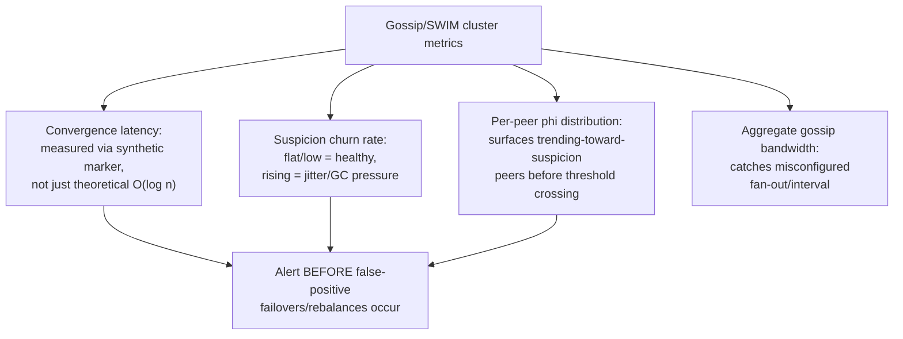

## 15. Failure Scenarios

- **Correlated false-positive storm from naive heartbeating.** Covered in
  Section 3/4.4's scenario — the failure mode SWIM's indirect probing and
  suspicion state exist specifically to prevent, versus a naive
  fixed-timeout all-to-all scheme that would suffer it directly.
- **Rumor die-out before full cluster convergence.** Section 4.3's failure
  mode — a discrete piece of information propagated via rumor-mongering
  alone can, with small but non-zero probability, fail to reach every node
  before every "hot" carrier loses interest, leaving a residual minority
  permanently uninformed unless a periodic anti-entropy pass later corrects
  it.
- **Sustained churn preventing true convergence.** Section 4.1's failure
  mode — a cluster experiencing membership changes faster than the gossip
  interval can propagate them never reaches a single, globally-agreed
  membership snapshot; this is an expected consequence of choosing an
  eventually-consistent mechanism under sustained churn, not a bug, but it
  must be accounted for by any application layer consuming the membership
  view.
- **Phi Accrual masking a chronically slow (not dead) node's eventual
  genuine failure.** Section 4.5's failure mode — a peer whose recent
  history has trained the detector to expect unusually high jitter will
  have its phi rise more slowly for the same absolute silence duration than
  a normally-fast peer would, delaying genuine-failure detection for that
  specific node relative to the rest of the cluster.
- **Network partition splitting the cluster into two gossiping islands.**
  Each island's nodes correctly continue gossiping and converging *within*
  their own island, but each island's view of the other island's nodes
  eventually ages out toward `SUSPECT`/`CONFIRMED_DEAD` — correct,
  eventually-consistent behavior for a partition-tolerant, availability-
  favoring mechanism (recapped, not re-taught, from [CAP
  Theorem](CH05_CAP_Theorem.md)'s AP framing), but one the application layer
  must be designed to tolerate rather than assume away.

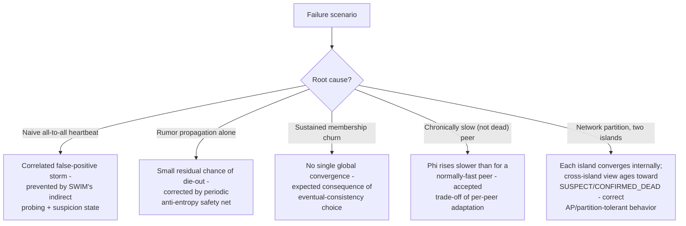

## 16. Testing

Gossip and failure-detection implementations are difficult to validate with
ordinary deterministic unit tests, because the properties that matter most —
convergence-round-count under a given fan-out and cluster size, the actual
false-positive/false-negative rate of a suspicion timeout or phi threshold
under realistic jitter, and the behavior of anti-entropy reconciliation
after a partition heals — are inherently statistical and timing-dependent.
The dominant testing techniques are: **discrete-event simulation** (exactly
the technique this chapter's Section 10 code examples use), which lets a
test harness run many simulated gossip rounds quickly, inject controlled
packet loss or latency on specific simulated links, and directly measure
convergence-round counts and false-positive rates across many randomized
trials rather than relying on real, slow, non-reproducible network timing;
**chaos/fault-injection testing against a real deployed cluster** (the same
Jepsen-style methodology recapped, not re-taught, from
[Consensus](CH07_Consensus.md#16-testing)), deliberately introducing network
partitions, packet loss, and process pauses and observing whether the
gossip layer's suspicion/confirm decisions match the actual injected fault
pattern rather than producing spurious false positives or delayed true
positives; and **parameter-sweep benchmarking**, systematically varying
fan-out, interval, and suspicion-timeout parameters against a fixed
simulated cluster size and churn rate to empirically validate the
performance/convergence-latency trade-off curve (Section 11) before
committing to production defaults, rather than trusting a library's
out-of-the-box constants for a deployment at a materially different scale
than the library's own defaults were tuned for.

## 17. Common Mistakes

- **Assuming gossip provides strong, instantaneous consistency.** Treating
  a gossip-disseminated membership view as if it were a linearizable,
  always-current source of truth, rather than the deliberately
  eventually-consistent, probabilistic view it actually is (Section 4.1) —
  this mistake surfaces as intermittent, hard-to-reproduce bugs whenever two
  nodes momentarily disagree during the normal convergence window.
- **Using a single fixed heartbeat timeout across a heterogeneous or
  wide-area deployment.** Reintroducing the exact false-positive/detection-
  latency compromise problem Phi Accrual (Section 4.5) exists to eliminate,
  by hand-tuning one global constant instead of adopting an adaptive,
  per-peer detector.
- **Relying on rumor-mongering alone with no anti-entropy safety net.**
  Section 4.3's failure mode — accepting rumor-mongering's small but
  non-zero die-out probability without a periodic full-state reconciliation
  pass to catch whatever it misses.
- **Letting per-exchange gossip payload size scale with total cluster
  state rather than exchanging a compact digest first.** Section 4.2's
  failure mode — turning gossip itself into a meaningful, unnecessary
  source of network load by transferring full state on every round instead
  of comparing digests and transferring only what has actually changed.
- **Copying a gossip library's default fan-out/interval/timeout constants
  into a deployment at a materially different scale than those defaults
  were tuned for**, rather than re-measuring and re-tuning them (Section 8,
  Section 16) against the actual target cluster size and churn rate.

## 18. Best Practices

- Treat gossip-based membership as shared cluster infrastructure consumed
  by multiple application-layer components, not a bespoke mechanism
  reinvented per feature (Section 7, Pattern 1).
- Default to push-pull for general-purpose membership/status gossip, and
  always exchange a compact digest before transferring full entry contents
  (Section 4.2).
- Layer a fast, cheap rumor-mongering-style path for discrete events under
  a slower, periodic anti-entropy safety net (Section 4.3), rather than
  choosing one exclusively.
- Prefer SWIM's indirect-probing/suspicion pipeline over naive fixed-
  timeout all-to-all heartbeating for any cluster expected to scale beyond
  a few dozen nodes (Section 4.4).
- Prefer an adaptive, per-peer statistical detector (Phi Accrual or an
  equivalent) over a single hand-tuned global timeout for any deployment
  with heterogeneous or wide-area network characteristics (Section 4.5).
- Empirically measure convergence latency and false-positive/negative rates
  against the actual target cluster size and churn rate before finalizing
  fan-out, interval, and threshold parameters, rather than trusting
  out-of-the-box library defaults (Section 16).

## 19. Anti-Patterns

- **Hand-rolling a bespoke gossip protocol from scratch for a new
  application** rather than adopting an existing, battle-tested library
  (`memberlist`) or a database/coordination system that already embeds one
  — analogous to [Consensus](CH07_Consensus.md#9-implementation)'s advice
  against hand-rolling Raft/Paxos, the subtle correctness properties of
  SWIM's indirect-probing and suspicion pipeline are easy to get wrong in
  ways that only manifest under real network jitter, not in a quick
  functional test.
- **Using gossip as a substitute for consensus** when a decision genuinely
  requires strong, linearizable agreement (electing a single active
  controller, committing a critical configuration change) — Section 3
  already establishes that gossip's eventual, probabilistic guarantee is
  categorically weaker than what [Consensus](CH07_Consensus.md) provides,
  and substituting one for the other where strong agreement is genuinely
  required produces silent correctness bugs (two nodes both believing they
  are the sole active controller) rather than an obvious failure.
- **Treating a single node's suspicion as cluster-wide truth without
  corroboration** — bypassing SWIM's indirect-probing and gossip-based
  dissemination of suspicion status by having one node's local observation
  unilaterally trigger a cluster-wide failover decision reintroduces the
  correlated-false-positive risk the whole protocol exists to avoid.
- **Ignoring convergence latency when reasoning about correctness** —
  designing application logic that assumes a membership change is visible
  everywhere the instant it happens locally, rather than accounting for the
  O(log n)-round propagation delay Section 4.1 establishes as inherent to
  the mechanism.

## 20. Trade-off Analysis

| Dimension | Gossip / SWIM / Phi Accrual | Centralized coordinator | Naive all-to-all heartbeat | Strong consensus (Raft/Paxos) |
|---|---|---|---|---|
| Consistency guarantee | Eventual, probabilistic | Strong (single source of truth) | Eventual, but prone to correlated errors | Strong, linearizable |
| Single point of failure | None | Yes (the coordinator) | None | None (tolerates minority failure) |
| Per-node message load vs. cluster size | Flat (fixed k) | Flat for followers, unbounded for coordinator | O(n) per node, O(n squared) aggregate | Flat per follower; leader bears more load |
| Convergence/decision latency | O(log n) rounds, non-zero | Fast if coordinator healthy | Fast until false positives occur | Fast (1-2 round-trips) once a stable leader exists |
| False-positive failure detection risk | Low (SWIM indirect probing + Phi Accrual adaptivity) | Depends entirely on coordinator's own detection logic | High (correlated storms) | Not applicable (different problem: agreement, not liveness) |
| Best-fit use case | Membership/failure-status dissemination at large scale | Small clusters where simplicity outweighs SPOF risk | Small clusters only | Small number of strongly-agreed, critical decisions |

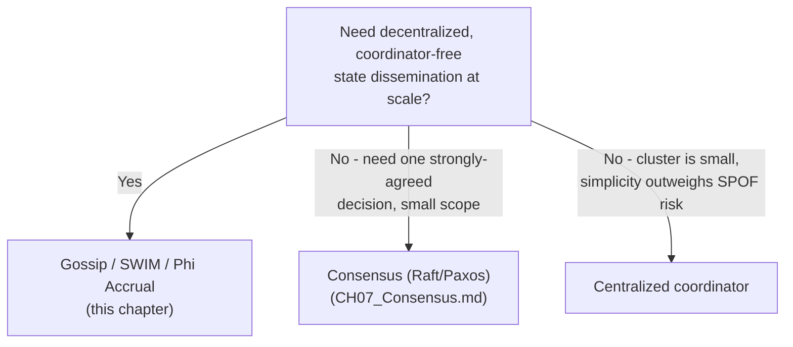

## 21. Comparison Table

| Mechanism | Problem solved | Guarantee strength | Scales to thousands of nodes? |
|---|---|---|---|
| Gossip (anti-entropy / rumor-mongering) | State/data dissemination | Eventual convergence | Yes (O(log n) rounds, O(n) messages) |
| SWIM | Membership + failure detection | Eventual, with bounded suspicion window | Yes (O(n) constant-per-node probing) |
| Phi Accrual | Adaptive suspicion-level computation | Probabilistic, continuously valued | Yes (per-peer local computation) |
| Naive all-to-all heartbeat | Failure detection | Eventual, but correlated-error-prone | No (O(n squared) messages) |
| Centralized membership service | Membership tracking | Strong (single source of truth) | Limited by coordinator capacity |
| Consensus (Raft/Paxos) | Single-value agreement | Strong, linearizable | Yes for message load; no for cluster-size-as-voting-members (recapped, [Consensus](CH07_Consensus.md#12-scalability)) |

## 22. Real-World Case Study

Apache Cassandra's gossip-based ring architecture, already introduced at a
recap level in [Cassandra](../06_Databases_and_Storage/CH18_Cassandra.md),
is the book's most concrete production instance of this chapter's
mechanisms operating together at scale. Every Cassandra node runs a
gossiper component that performs push-pull-style state exchange with 1-3
random peers roughly once per second, disseminating each node's known
ring-token ownership, schema version, and — critically — the Phi Accrual-
derived suspicion level for every other node it has recently probed. A
large, real-world Cassandra deployment spanning hundreds of nodes across
multiple data centers demonstrates exactly why this chapter's mechanisms
were necessary rather than incidental: a naive all-to-all heartbeat scheme
across that many nodes, several hundred milliseconds of inter-data-center
latency apart, would both saturate cross-data-center links with
O(n²)-scaling heartbeat traffic and produce constant false-positive
suspicion storms from ordinary WAN jitter — exactly the two failure modes
Section 3 identifies as gossip's founding motivation. Cassandra's own
operational documentation and community incident write-ups repeatedly
attribute a specific class of production incident — a garbage-collection
pause on one node briefly triggering `HintedHandoff`/coordinator-side
retries from peers that (correctly, per this chapter's design) had not yet
crossed their Phi Accrual threshold into full suspicion — directly to the
graduated, continuously-valued nature of the phi output this chapter's
Section 4.5 describes, rather than to a binary detector's abrupt, all-
or-nothing failover trigger; operators who mistakenly treat Cassandra's
`phi_convict_threshold` configuration as a simple on/off switch, rather than
as a genuinely continuous sensitivity dial, are a recurring source of
either premature-failover or too-slow-detection misconfiguration
incidents in production Cassandra fleets — precisely the common mistake
this chapter's Section 17 warns against generally.

## 23. Interview Questions

1. Why does a naive all-to-all heartbeat scheme fail to scale, and what two
   specific failure modes does SWIM's design directly address?
2. Derive, informally, why gossip dissemination converges in O(log n)
   rounds rather than O(n) rounds for a cluster of n nodes.
3. Explain the difference between push, pull, and push-pull gossip, and
   state which is generally preferred in production and why.
4. What problem does SWIM's indirect-probing step solve that a purely
   direct-probing scheme cannot?
5. Why is a `SUSPECT` intermediate state, rather than an immediate
   alive/dead binary decision, necessary in SWIM?
6. Explain how the Phi Accrual failure detector computes its suspicion
   level, and why this is more robust than a single fixed heartbeat
   timeout across a heterogeneous cluster.
7. Contrast anti-entropy and rumor-mongering dissemination styles, and
   explain why production systems typically use both rather than either
   alone.
8. Why is gossip not a substitute for consensus, even though both are
   distributed-agreement-adjacent mechanisms? Give a concrete example of a
   decision that requires consensus rather than gossip.
9. How would you tune a gossip protocol's fan-out (k) and interval for a
   cluster that is about to grow from 200 to 2,000 nodes?
10. What observability signals would tell you a gossip-based membership
    layer is experiencing unhealthy churn, before it causes a user-visible
    incident?

## 24. Hands-on Exercises

1. Run [`01_gossip_round_simulator.py`](../code/python/gossip-protocols-chapter/01_gossip_round_simulator.py)
   at cluster sizes of 10, 100, 1,000, and 10,000 simulated nodes, and plot
   convergence-round count against cluster size for push, pull, and
   push-pull; confirm the O(log n) growth curve Section 4.1 predicts.
2. Modify [`02_swim_membership_protocol.py`](../code/python/gossip-protocols-chapter/02_swim_membership_protocol.py)
   to remove the indirect-probing step entirely, re-run the "one congested
   path, target actually alive" scenario, and observe the resulting
   false-positive `SUSPECT` declaration that indirect probing was
   preventing.
3. Using [`03_phi_accrual_failure_detector.py`](../code/python/gossip-protocols-chapter/03_phi_accrual_failure_detector.py),
   compare the phi trajectory of a "stable, low-jitter" simulated peer
   against a "high-jitter, WAN-like" simulated peer under the same
   injected silence gap, and explain the resulting difference in
   detection latency at a fixed phi threshold.
4. Using [`04_anti_entropy_vs_rumor_mongering.py`](../code/python/gossip-protocols-chapter/04_anti_entropy_vs_rumor_mongering.py),
   deliberately tune the rumor die-out probability high enough to produce
   a run where a residual minority of nodes never receives the rumor, and
   verify that a subsequent anti-entropy pass corrects it.

## 25. Design Exercises

1. Design a gossip-based membership layer for a 5,000-node fleet spanning
   3 geographic regions with 150ms of inter-region latency. Specify your
   chosen fan-out, gossip interval, and whether you would adopt the
   hierarchical/hybrid gossip pattern from Section 7; justify each choice
   against the performance/convergence trade-off in Section 11.
2. A production incident report shows a cluster experiencing repeated,
   short-lived `SUSPECT` transitions that always self-resolve via
   refutation within 1-2 seconds, correlated with nightly garbage-
   collection-heavy batch jobs. Propose a concrete remediation using this
   chapter's mechanisms (which specific parameter(s) would you change, and
   why, versus simply disabling failure detection during the batch
   window).
3. You are asked whether a new distributed cache should use gossip-based
   membership or a centralized coordinator for tracking which of its 40
   nodes are currently alive. Write the trade-off argument you would give,
   referencing Section 20's trade-off table, and state your recommendation.

## 26. Architecture Review Questions

1. What fan-out (k), gossip interval, and dissemination-style mix
   (rumor-mongering vs. anti-entropy, or both) has this system chosen, and
   were those choices measured against the system's actual expected
   cluster size and churn rate, or copied from a library default?
2. Does this system use a fixed heartbeat timeout anywhere it could
   instead use an adaptive detector (Phi Accrual or equivalent), given
   observed network heterogeneity?
3. Is gossip being used anywhere in this system as a substitute for a
   decision that genuinely requires consensus-level strong agreement?
4. What observability exists for convergence latency, suspicion churn
   rate, and per-peer phi distribution, and is it alerted on proactively
   rather than only visible in a post-incident investigation?
5. Has the application layer consuming this system's membership view been
   explicitly designed to tolerate the eventual-consistency window Section
   4.1 establishes as inherent, rather than assuming instantaneous,
   globally-agreed membership?

## 27. Summary

Gossip protocols solve a specific, recurring distributed-systems problem —
disseminating membership, state, and failure-status information across a
large, coordinator-free cluster — by having every node exchange state with
only a small, fixed number of randomly chosen peers per round, which bounds
per-node cost to a constant regardless of cluster size while still, thanks
to the same multiplicative mathematics that makes real epidemics spread
fast, converging the entire cluster in only O(log n) rounds. Push, pull, and
push-pull describe *who sends to whom* in a single exchange; anti-entropy
and rumor-mongering describe *how long* a node keeps gossiping about a
given piece of information, and production systems typically layer both.
SWIM solves cluster membership and failure detection specifically, by
separating constant-load direct/indirect probing from infection-style
dissemination and by introducing a `SUSPECT` intermediate state that
tolerates transient unresponsiveness without either the O(n²) cost or the
correlated-false-positive risk of naive all-to-all heartbeating. Phi
Accrual replaces any single fixed heartbeat timeout with an adaptive,
per-peer, continuously-valued suspicion level derived from each peer's own
recent heartbeat-timing history, sidestepping the impossible compromise a
single global constant would otherwise force. None of these mechanisms
provide strong, linearizable consistency — that guarantee remains the
domain of [Consensus](CH07_Consensus.md) — and a well-designed distributed
system deliberately uses both: gossip for cheap, scalable, best-effort
dissemination at the cluster's full scale, and consensus for the much
smaller set of decisions that genuinely require strong agreement.
