# Chapter: Replication (as a General Distributed-Systems Pattern)

Part: [07 — System Design and Distributed Systems](PART_OVERVIEW.md) · Status: Drafted

## 1. Introduction

Replication is one of the most overloaded words in this book, so this
chapter opens by drawing a hard line around exactly what it does and does
not teach. [Replication](../06_Databases_and_Storage/CH07_Replication.md)
in Part 06 (Databases and Storage) is the book's canonical owner of
replication *mechanics as a database implements them*: leader/follower
(primary/replica) topology, Write-Ahead Log (WAL) shipping and streaming,
the synchronous/asynchronous/semi-synchronous acknowledgment spectrum,
Dynamo-style leaderless quorum replication with N/W/R arithmetic, and
failover/fencing/split-brain mechanics. If you need to understand *how a
PostgreSQL streaming replica stays current* or *what `synchronous_commit`
actually does to write latency*, that chapter is where the full teaching
lives, and this chapter will not repeat it — Section 3 gives the precise
2-3 sentence recap and links back to the specific subsections a reader
needs.

This chapter exists because replication, as an *architectural pattern*, is
far bigger than databases. Every stateful component in a distributed
system — a cache, a message queue's partition, a session store, a
distributed file system's block, a configuration store's key space — faces
the identical underlying question a database faces: *if this node's copy of
the data is destroyed or unreachable, does the system lose the data, lose
availability, or both?* A Solution Architect who only knows "replication"
as a checkbox on a database's configuration page will design distributed
caches with no replication story, will misconfigure a Kafka topic's
replication factor without understanding what it actually buys, and will be
surprised the first time a load-balanced web tier "randomly" logs users out
because session state lived on exactly one application-server replica. This
chapter builds the system-level mental model: *why* systems replicate at
all beyond databases, *how* multi-primary systems resolve conflicting
concurrent writes at the application layer using Conflict-free Replicated
Data Types (CRDTs) and vector clocks, *how* replication shows up inside
message queues and logs (using Apache Kafka's In-Sync Replica set model as
the running example), *how* it applies to caches and session stores, and
*how* an architect chooses a replication topology for a whole system given
the CAP theorem and PACELC constraints that
[CAP Theorem](CH05_CAP_Theorem.md) and [PACELC](CH06_PACELC.md) — this
part's two immediately preceding chapters — already teach in full formal
depth. Those two chapters are recapped here only at the level needed to
apply them to a replication-topology decision; their proofs and quadrant
taxonomies are not re-derived.

## 2. Historical Evolution

Replication-as-a-general-pattern did not arrive all at once — it accreted
as each new class of stateful infrastructure independently rediscovered
that "keep more than one copy" is unavoidable, and then diverged on *how*
to reconcile copies that disagree.

- **1978 — Lamport's logical clocks.** Leslie Lamport's *"Time, Clocks, and
  the Ordering of Events in a Distributed System"* introduced logical
  clocks and the happened-before relation, the conceptual ancestor of the
  vector clocks this chapter teaches in Section 4.4 — the first rigorous
  answer to "how do independent replicas agree on what happened in what
  order without a shared physical clock."
- **1988 — Fidge and Mattern's vector clocks.** Colin Fidge and Friedemann
  Mattern independently generalized Lamport's scalar logical clock into a
  vector (one counter per process/replica), which — unlike a scalar
  timestamp — can distinguish true causal ordering from genuine
  concurrency. This is the exact data structure Section 4.4 implements.
- **1990s — multi-master relational replication.** Enterprise relational
  databases (Oracle, Sybase) introduced multi-master replication for
  geo-distributed deployments, and immediately ran into write-write
  conflicts with no principled resolution beyond "last write wins" or
  manual conflict tables — the problem CRDTs would later solve
  structurally rather than by convention.
- **2006-2007 — Amazon's Dynamo paper reframes replication as an
  availability primitive.** Amazon's internal Dynamo system (and the
  academic paper describing it) applied quorum-based leaderless
  replication not to a database engine specifically but to a general
  key-value storage substrate, explicitly trading strong consistency for
  always-available writes — the design [Replication](../06_Databases_and_Storage/CH07_Replication.md#47-leaderless-quorum-based-replication--the-dynamo-style-model)
  covers as a database mechanism, but whose *philosophy* (replicate for
  availability, resolve conflicts after the fact) this chapter generalizes.
- **2011 — Shapiro, Preguica, Baquero, and Zawirski formalize CRDTs.**
  *"Conflict-free Replicated Data Types"* gave the industry a rigorous,
  general-purpose answer to multi-primary conflict resolution: data
  structures whose merge operation is provably commutative, associative,
  and idempotent, guaranteeing every replica converges to the same value
  with no coordination and no lost updates — independent of which database,
  cache, or document-editing tool applies them.
- **2011 — Apache Kafka open-sourced by LinkedIn.** Kafka generalized
  replication to a *log* rather than a mutable table: each partition is
  replicated across brokers with a leader and an explicit In-Sync Replica
  (ISR) set, making "replication factor" a first-class, per-topic capacity
  and durability dial rather than a whole-database setting — the model
  Section 4.5 teaches in depth.
- **2010s — the rise of collaborative and offline-first applications.**
  Products like Google Docs, Figma, and offline-capable mobile apps needed
  multiple devices to edit the same document concurrently and merge
  without a central coordinator; CRDTs (and Operational Transformation as a
  competing technique outside this chapter's scope) became the mechanism
  of choice, moving replication conflict-resolution from a database-admin
  concern into an application-development concern.
- **2010s-present — replication as a whole-system design lever.**
  Distributed caches (Redis Cluster, Memcached with client-side
  replication), session stores, distributed configuration stores
  (ZooKeeper, etcd, Consul — themselves consensus-replicated, per
  [Consensus](CH07_Consensus.md)), and distributed file systems (HDFS,
  Amazon S3) all now expose replication factor, topology, and consistency
  mode as explicit, system-design-level configuration — the unifying frame
  this chapter's Section 4.7 builds.

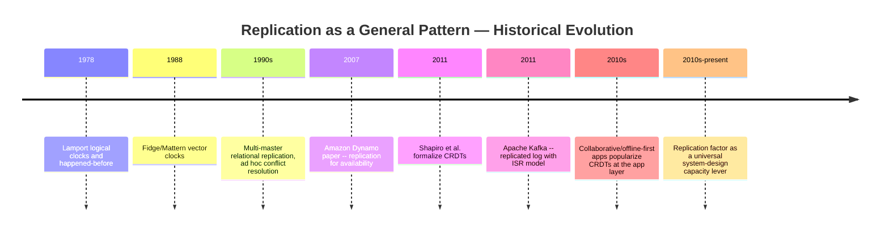

## 3. Why It Exists

Replication as a general pattern exists because every stateful component in
a distributed system is subject to the same four pressures, and a
single-copy design fails all four simultaneously the moment it meets real
production load and real hardware failure rates:

- **Durability against node loss.** Disks fail, virtual machines get
  reclaimed by a cloud provider, availability zones lose power. A single
  copy of data — whether it is a row in a database, a message in a queue
  partition, or a cached computation result — is one hardware failure away
  from permanent loss. Replication is the only mechanism that survives the
  loss of the machine holding the data, as opposed to backups, which
  survive loss but not without a recovery-time gap.
- **Read scalability.** A single node has a hard ceiling on how many reads
  per second it can serve, bounded by central processing unit (CPU),
  memory bandwidth, and network interface capacity. Replicating data to
  additional nodes and routing reads across all of them multiplies read
  capacity roughly linearly with replica count, independent of what kind of
  data is being replicated.
- **Geographic locality and latency reduction.** Physics imposes a hard
  floor on cross-region latency (light in fiber takes roughly 67
  milliseconds round-trip across the contiguous United States alone, before
  any processing). Replicating data closer to where it is read or written
  is often the *only* way to meet a latency Service Level Objective (SLO),
  regardless of how well-optimized the single-copy code path is —
  [Non-Functional Requirements](CH02_Non_Functional_Requirements.md#44-latency-percentiles-vs-throughput)
  already establishes latency percentiles as a first-class Non-Functional
  Requirement (NFR); replication is one of the primary levers for meeting
  them.
- **Fault tolerance for stateful services broadly.** "Fault tolerance"
  is often discussed only for stateless services (just run more instances
  behind a load balancer), but a stateless instance is only fault-tolerant
  *because it holds no state a client depends on surviving a crash*. The
  moment a service holds state a client cares about — a shopping cart, an
  in-flight WebSocket session, a partially consumed queue offset —
  fault tolerance for that service requires replicating the state itself,
  not just running more copies of the code.

These four pressures apply identically whether the stateful component in
question is a relational database, a cache, a queue partition, or a
session store — which is precisely why this chapter treats replication as
a system-design pattern rather than a single technology's feature.

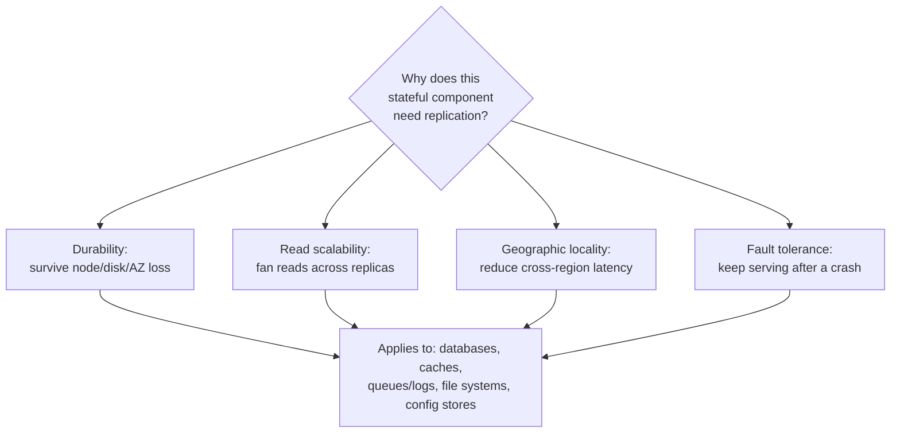

## 4. Core Concepts

### 4.1 Why Systems Replicate: General Architectural Motivations

**Definition.** Replication, at the system-design level, is the decision to
maintain more than one live, independently-failing copy of a unit of state
— a database row, a cache entry, a queue partition, a session, a
configuration key — across separate physical failure domains (separate
disks, machines, racks, or regions), such that the loss or unavailability
of any single copy does not by itself make the data unavailable or lost.

**Mechanism.** Every replication scheme, regardless of what kind of data it
replicates, is built from the same three moving parts: (1) a **write path**
that decides which replica(s) must acknowledge a write before the writer is
told it succeeded, (2) a **propagation mechanism** that moves the write
from the replica(s) that first accepted it to the others (synchronously,
asynchronously, or via a queue/log), and (3) a **read path** that decides
which replica(s) a reader is allowed to query and what consistency
guarantee that implies. Section 3's four motivations map directly onto
which of these three parts an architect optimizes first: durability-driven
designs prioritize the write path (more replicas must ack before success),
read-scalability designs prioritize the read path (route reads to any
replica), and locality-driven designs prioritize placement (put a replica
physically near the reader/writer).

**Decision implications.** An architect should be able to name, for any
stateful component in a system, *which* of the four motivations is driving
its replication requirement, because each motivation implies a different
replication factor and topology. A component needed only for durability
against a single-disk failure might need replication factor 2 within one
data center. A component needed for global read latency might need
replication factor 5+, one replica per served region, with reads pinned to
the nearest one. Conflating these — for example, adding a second replica
purely "for durability" but then also routing reads to it under load
without checking whether that replica's replication mode gives it current
data — is how latent staleness bugs are introduced.

**Common failure mode.** Treating replication as a single binary
switch ("replication: on") rather than a set of independently-tunable
knobs (factor, placement, synchronicity, read routing) per motivation. A
team that turns on cache replication "for durability" but does not also
decide *how stale a replicated read is allowed to be* will eventually ship
a bug where a price update is visible on one cache node and not another,
and no one initially understands why, because "replication" sounded like a
solved problem the moment it was enabled.

**Scenario.** A ride-hailing platform's driver-location cache needs to
survive an Availability Zone (AZ) outage without losing in-flight driver
positions (durability), serve tens of thousands of location reads per
second from the matching service (read scalability), and answer within
single-digit milliseconds for drivers in every served metro (locality). A
single Redis instance satisfies none of the three; a Redis Cluster with
replication factor 3, one replica per AZ, plus regional deployments for
locality, is the direct system-design consequence of naming all three
pressures explicitly rather than reaching for "add a replica" as an
undifferentiated fix.

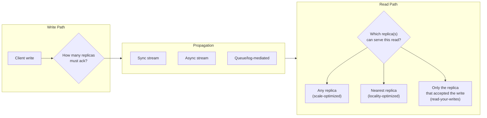

### 4.2 Replication Topologies Revisited: The System-Design View

**Definition.** [Replication](../06_Databases_and_Storage/CH07_Replication.md#41-the-replication-topology-and-the-leaderfollower-vocabulary)
already teaches the full mechanics of the leader/follower topology (a
single writable replica, N read-only followers receiving a stream of
changes) and, in
[Section 4.6](../06_Databases_and_Storage/CH07_Replication.md#46-multi-leader-replication-and-conflict-resolution),
introduces multi-leader (multi-primary) replication and names Last-Write-
Wins (LWW), application-level merge functions, and CRDTs as the three
broad conflict-resolution families — this chapter's job is to take that
last item, CRDTs, and teach it and its companion causality-tracking
technique (vector clocks) in full first-principles depth, because at the
whole-system-design level, *how* a multi-primary system resolves
conflicting writes without a central coordinator is exactly the kind of
decision an architect must be able to reason about across many different
kinds of replicated components, not just databases.

**Mechanism — why multi-primary needs a resolution strategy at all.**
Single-leader replication sidesteps the conflict problem entirely: there is
only ever one place a write can originate, so writes are trivially
totally ordered. Multi-primary replication deliberately gives up that
total order in exchange for the ability to accept writes at multiple
locations simultaneously (usually for write-latency-under-partition or
multi-region write locality) — which means two replicas can each accept a
write to the *same* logical record before either has heard from the other.
When they eventually exchange updates, something must decide the outcome,
and that something is either (a) a scalar rule like Last-Write-Wins that
silently discards one side's update, (b) a hand-written, data-shape-specific
merge function, or (c) a CRDT, which is a *data structure* engineered so
that "merge" is always well-defined and never loses an update it shouldn't.

**Decision implications.** Choose Last-Write-Wins only when losing the
"losing" write is genuinely acceptable business behavior (for example, a
"last viewed" timestamp, where an overwrite is semantically correct, not a
data-loss bug). Choose a hand-written merge function when the data has
domain-specific merge semantics that no generic library expresses (for
example, "the higher of two account-balance floors wins"). Choose a CRDT
(Section 4.3) when the data shape is a counter, set, map, list, or a
composition of those, and you want mathematically guaranteed convergence
with no coordination and no custom conflict code to get wrong.

**Common failure mode.** Assuming "we use multi-leader replication" and
"we use CRDTs" are the same decision. A multi-leader relational database
using Last-Write-Wins on a `last_updated_at` column is *not* using CRDTs —
it can silently lose an entire concurrent update. Conversely, a
single-region service can adopt CRDTs purely at the application layer (for
example, a collaborative document's operation log) with no multi-leader
database underneath at all. The topology decision (how many writable
locations) and the conflict-resolution technique (how disagreements are
reconciled) are independent axes.

**Scenario.** A retailer's inventory-count service accepts writes at
regional edge locations to keep checkout latency low during a partition
between regions. A naive Last-Write-Wins merge on the "quantity remaining"
field would let two regions each independently decrement stock for the
last unit of a hot item and then have one decrement silently vanish on
merge, overselling nothing to the customer but corrupting the count. A
CRDT-based counter (Section 4.3's PN-Counter) accumulates both
decrements correctly regardless of merge order, giving the business the
correct post-partition count with zero custom conflict code.

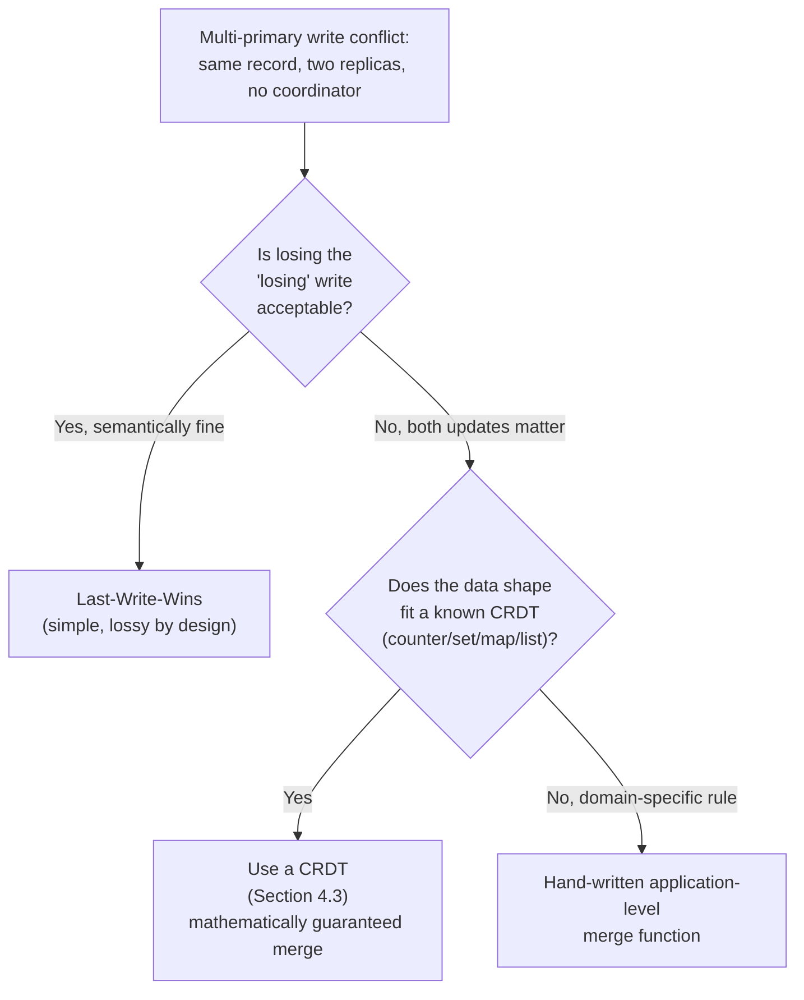

### 4.3 CRDTs: Conflict-free Replicated Data Types

**Definition.** A Conflict-free Replicated Data Type (CRDT) is a data
structure specifically designed so that replicas can be updated
independently, concurrently, and without coordination, and can always be
merged back together into a single, correct, agreed-upon value — with the
merge operation mathematically guaranteed to be commutative (order does
not matter), associative (grouping does not matter), and idempotent
(merging the same update twice causes no harm). Together these three
properties are called Strong Eventual Consistency: once two replicas have
observed the same set of updates (in any order, any number of times), they
are guaranteed to hold identical state — not "probably converge with
enough retries," but provably converge, by construction of the data
structure itself.

**Mechanism.** CRDTs come in two equivalent families. **State-based CRDTs
(CvRDTs)** periodically ship their entire current state to peers, and a
peer merges incoming state into its own using a type-specific merge
function; correctness requires that the state form a join-semilattice
(informally: there is always a well-defined "least upper bound" of any two
states, computed by the merge function) and that merge is idempotent.
**Operation-based CRDTs (CmRDTs)** instead ship individual operations (not
full state) to peers, and require that concurrent operations commute (the
result is the same regardless of the order two concurrent operations are
applied), plus a delivery guarantee that causally-related operations are
applied in causal order (which is exactly what Section 4.4's vector clocks
provide). The reference implementation in
[Section 10](#10-complete-code-examples) uses the state-based family
because it is simpler to reason about and does not require a
causally-ordered delivery channel.

The canonical CRDT catalog every architect should recognize:

| CRDT | Supports | Merge rule |
|---|---|---|
| G-Counter (Grow-only Counter) | increment only | per-replica-slot element-wise maximum, then sum |
| PN-Counter (Positive-Negative Counter) | increment and decrement | two G-Counters internally (increments, decrements), value = increments - decrements |
| G-Set (Grow-only Set) | add only | set union |
| 2P-Set (Two-Phase Set) | add then remove (remove is permanent, cannot re-add) | union of adds minus union of removes |
| OR-Set (Observed-Remove Set) | add, remove, re-add | per-element unique add-tags; a remove only tombstones tags it has actually observed, so a concurrent add survives (add-wins) |
| LWW-Register (Last-Write-Wins Register) | single mutable value | keep the value with the highest (timestamp, replica-id) tiebreak pair |
| OR-Map / RGA (Replicated Growable Array) | key-value maps / ordered lists | composition of the above per key or per list position |

**Decision implications.** CRDTs trade away one specific thing: the
ability to enforce cross-replica *invariants* that depend on more than one
element's combined value at write time (for example, "the total inventory
count across all warehouses must never go negative" cannot be enforced by
a PN-Counter alone, because each replica decides its own decrement locally
without seeing the others' current total). CRDTs are the right choice when
per-element convergence is the correctness requirement and coordination
would cost too much latency or availability (multi-region collaborative
apps, offline-first mobile clients, multi-region feature-flag/config
propagation); they are the wrong choice when a strict cross-replica
invariant must never be violated even transiently (use consensus — see
[Consensus](CH07_Consensus.md) — or a single-writer topology instead).

**Common failure mode.** Reaching for a plain LWW-Register when the true
requirement is "don't lose either concurrent update" — LWW-Registers are
themselves valid CRDTs (their merge is commutative/associative/idempotent),
but they resolve conflicts by *discarding* the losing write, which
satisfies convergence but not "no lost updates." Teams sometimes adopt
"CRDTs" as a checkbox term without checking whether the specific CRDT
chosen actually preserves both sides of a concurrent update, and are
surprised when an LWW-Register-based "CRDT" system still loses data under
concurrent writes — because it was never supposed to keep both.

**Scenario.** A collaborative to-do list app lets two users, offline on
airplanes, each independently check off different (and, rarely, the same)
items on a shared list. On reconnect, an OR-Set-backed "completed items"
representation merges both devices' changes: items checked off on only one
device end up checked off on both (grow-only union), and an item that one
user un-checked while the other independently re-checked resolves via the
OR-Set's add-wins tag mechanism rather than one user's edit silently
vanishing — see the runnable G-Counter and OR-Set implementation in
[Section 10](#10-complete-code-examples).

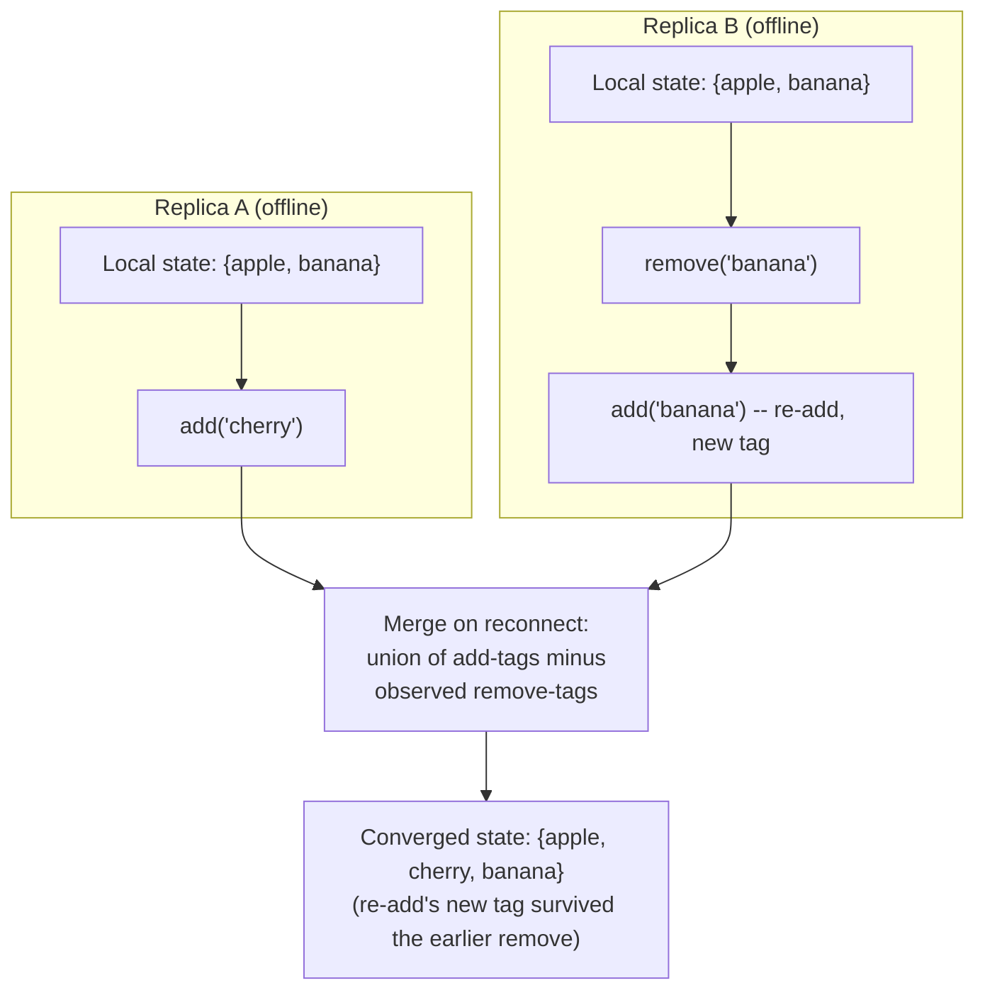

### 4.4 Vector Clocks: Tracking Causality Across Replicas

**Definition.** A vector clock is a data structure — one integer counter
per replica in the system — attached to each write, that lets any two
replicas compare two versions of a value and determine, without a shared
physical clock, whether one version *causally happened-before* the other,
*happened-after* it, or is *concurrent* with it (meaning neither replica
had seen the other's update at the time it made its own). This is strictly
more information than a wall-clock timestamp can provide, because clock
skew and network delay make two independent physical timestamps unreliable
evidence of true causal order — a write timestamped earlier is not
guaranteed to have causally preceded a write timestamped later if they
happened on different machines.

**Mechanism.** Each replica maintains its own vector (a map from
replica-id to counter). Two rules govern every vector clock: (1) on a
local write, a replica increments *only its own slot*; (2) on receiving a
replicated write from a peer, a replica takes the element-wise maximum of
its own vector and the incoming vector, then increments its own slot.
Comparing two vector clocks `V1` and `V2`: if every slot of `V1` is less
than or equal to the corresponding slot of `V2` (and at least one slot is
strictly less), `V1` happened-before `V2`; if the reverse holds, `V1`
happened-after `V2`; if neither vector dominates the other (some slots of
`V1` are higher, some slots of `V2` are higher), the two writes are
concurrent — a genuine conflict that no amount of waiting will resolve,
because the two writers never saw each other's update. This asymmetry
(dominance in one direction only) is exactly what a scalar Lamport
timestamp cannot express — a Lamport clock gives a *total* order, which
hides genuine concurrency by arbitrarily breaking every tie, whereas a
vector clock gives a *partial* order that correctly reports "these two
writes actually conflict."

**Decision implications.** Attach a vector clock to a value whenever a
system needs to distinguish "this is a stale copy of a value I've already
superseded" (happened-before, safe to discard the older one) from "this is
a genuinely conflicting concurrent update to the value I have" (needs
active conflict resolution — LWW, a merge function, or a CRDT). Riak and
the original Dynamo paper attach vector clocks (Dynamo used a bounded/
pruned variant to control unbounded metadata growth) to every stored
object precisely so the client, on a read, can be told explicitly "here
are two concurrent siblings, you decide" rather than the store silently
guessing. Vector clocks are metadata *about* a conflict; they do not
themselves resolve the conflict — pair them with the conflict-resolution
policy Section 4.2/4.3 covers.

**Common failure mode.** Vector clock size grows linearly with the number
of distinct replicas that have ever written a value, which becomes a real
storage and comparison-cost problem in systems with many short-lived
writers (for example, one vector-clock slot per client device in a
mobile-heavy system). Unbounded vector-clock growth was a documented
operational problem in early Dynamo-style deployments, addressed by
pruning old entries by timestamp — which reintroduces a small,
deliberately-bounded risk of mis-detecting a stale entry as concurrent.

**Scenario.** A shopping-cart service lets a customer add items from their
phone (offline, then reconnects) and their laptop (concurrently, on
Wi-Fi). Both devices' local carts descend from the same server-issued
vector clock snapshot; comparing the two updated vectors on reconnect
correctly reports them as concurrent (neither device saw the other's add)
rather than silently picking one device's cart and discarding the other's
items, which is the exact bug a scalar "last modified" timestamp
comparison would produce if the phone's clock were even a few seconds
behind the laptop's — see the runnable vector-clock comparison
implementation in [Section 10](#10-complete-code-examples).

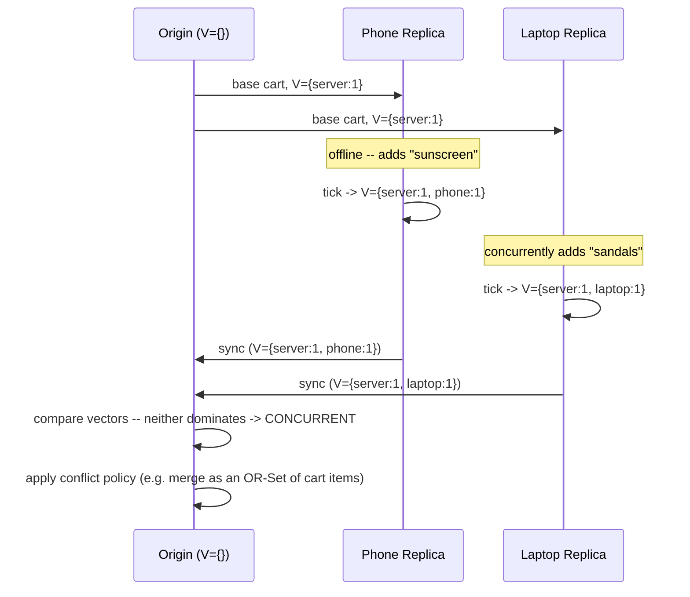

### 4.5 Replication in Message Queues and Logs: Kafka's ISR Model

**Definition.** A replicated log applies the same durability-through-copies
principle Section 3 establishes, but to an append-only, ordered sequence of
records rather than a mutable table — and Apache Kafka's partition
replication is the industry's most widely deployed example of this
pattern. Each Kafka topic-partition has one broker acting as **leader**
(the only broker that accepts produce/consume requests for that partition)
and N-1 **follower** brokers that continuously fetch and append the
leader's log; the **In-Sync Replica (ISR) set** is the leader-maintained
list of followers (plus itself) that are currently caught up closely
enough to be trusted for durability purposes.

**Mechanism.** A follower stays in the ISR only if it has fetched from the
leader within `replica.lag.time.max.ms`; a follower that falls behind
(disk I/O contention, garbage-collection pause, network partition) is
removed from the ISR by the leader, shrinking the durability guarantee
until it catches back up and rejoins. The **high watermark** is the
highest log offset that every *current* ISR member has acknowledged — a
consumer can only read up to the high watermark, never past it, so a
record is never visible to consumers until it is durable across the full
current ISR. **Replication factor** (how many broker copies of each
partition exist) and **`min.insync.replicas`** (the minimum ISR size a
produce request with `acks=all` will accept) are the two knobs that turn
"replication" from an abstract durability promise into an explicit,
per-topic capacity-and-durability trade-off: `acks=1` acknowledges after
only the leader appends (fast, but a leader crash before followers catch
up can lose the record); `acks=all` with `min.insync.replicas=1` still
only requires the leader (because the leader counts as one ISR member);
`acks=all` with `min.insync.replicas>=2` requires at least one follower to
have caught up before acknowledging, which is the configuration that
actually survives a leader failure without data loss.

**Decision implications.** Replication factor is a system-design capacity
lever, not a fixed default: replication factor 3 with `min.insync.replicas=2`
is Kafka's widely-used baseline because it tolerates one broker failure
while still requiring writes to be durable on more than just the leader,
but a topic carrying disposable, high-volume metrics might reasonably run
at replication factor 2 (or even 1, accepting data loss risk) to cut
storage and network cost, while a topic carrying financial transaction
events should run at replication factor 3+ with `acks=all` and
`min.insync.replicas>=2` without exception. This decision is made per
topic, not once for the whole cluster, precisely because different logs
carry different durability requirements.

**Common failure mode.** Configuring `acks=all` without also raising
`min.insync.replicas` above its default of 1 gives a false sense of
durability: the producer believes it is waiting for full replication, but
the leader alone still satisfies the requirement, so a leader crash before
any follower fetches the record loses it — identical in spirit to the
database-replication failure mode
[Replication](../06_Databases_and_Storage/CH07_Replication.md#43-synchronous-asynchronous-and-semi-synchronous-replication)
already documents for `synchronous_commit` misconfiguration, applied here
to a log instead of a table.

**Scenario.** An order-events topic runs at replication factor 3 across
three brokers, `min.insync.replicas=2`, `acks=all`. During a rolling
broker upgrade, one broker goes down for a few minutes; the ISR shrinks
from 3 to 2, and produce requests continue succeeding because 2 still
satisfies `min.insync.replicas`. If a second broker had gone down
simultaneously (a rare but real correlated-failure scenario), the ISR
would shrink to 1, produce requests would start failing with
`NotEnoughReplicasException` rather than silently accepting undurable
writes — the system chooses unavailability over silent data-loss risk,
exactly the CP-leaning trade-off
[CAP Theorem](CH05_CAP_Theorem.md#43-the-forced-choice-during-a-real-partition)
formalizes. The runnable ISR simulator in
[Section 10](#10-complete-code-examples) reproduces this exact shrink-and-
reject sequence.

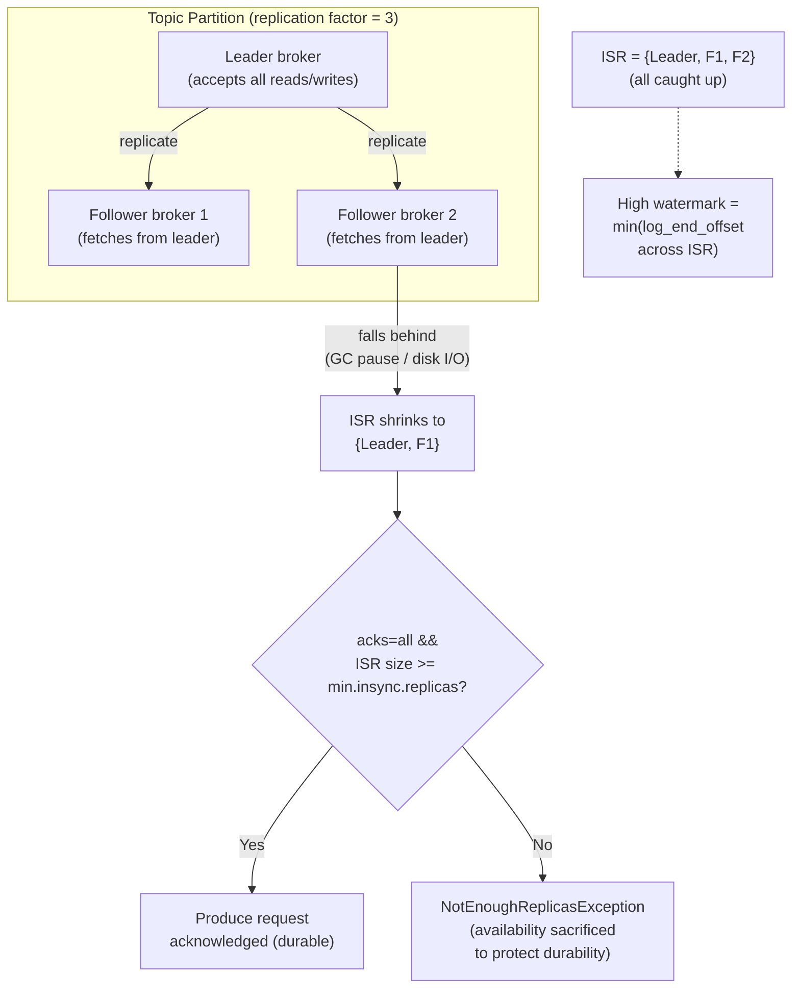

### 4.6 Replication for Other Stateful Services: Caches, Sessions, and Beyond

**Definition.** Beyond databases and logs, two especially common
stateful-service replication problems deserve their own first-principles
treatment because architects routinely under-invest in them: **distributed
cache replication** (keeping a cache's hot data available and consistent
enough across multiple cache nodes) and **session replication** (keeping a
user's authenticated session available regardless of which application-
server replica a subsequent request lands on).

**Mechanism — cache replication.** A distributed cache (for example, Redis
Cluster, Memcached with client-side replication logic, or a Content
Delivery Network's edge cache — recapped only, full CDN mechanics owned by
[CDN](../05_Networking_and_OS/CH09_CDN.md)) typically replicates
asynchronously: a write lands on a primary cache node (or the origin store
behind the cache) and is fanned out to replica cache nodes after a short
delay, because caches exist specifically to trade a small staleness window
for a large latency/throughput win — synchronous cache replication would
defeat the purpose by adding write latency to a component whose entire
value proposition is speed. The practical consequence is a **stale-read
window**: any replica cache node can serve slightly outdated data for the
duration of the propagation delay, which is why cache entries need a
Time-To-Live (TTL) and, for correctness-sensitive data, a cache-invalidation
message rather than relying on TTL expiry alone.

**Mechanism — session replication.** A load balancer distributing requests
round-robin (or otherwise non-stickily) across N application-server
replicas has no guarantee that two consecutive requests from the same
client land on the same replica. If session state (login status, shopping
cart, in-progress multi-step form) lives only in that one replica's
in-process memory, a request landing on a different replica sees no
session at all. Three architectural fixes exist, each a direct application
of this chapter's replication vocabulary: (1) **sticky sessions** at the
load balancer (recapped only —
[Load Balancer](../05_Networking_and_OS/CH10_Load_Balancer.md#45-session-affinitysticky-sessions)
already teaches sticky-session mechanics and their trade-offs in full;
this is not a replication solution at all, it is an *avoidance* of the
problem, and it reintroduces a single point of failure per session); (2)
**synchronous session replication** across all application-server
replicas (every replica holds every session, kept current via a
replication protocol — strong consistency, but memory cost scales with
replica count times session count); (3) **externalized session storage**
(sessions live in a separately-replicated store — a Redis cluster, a
database — and application servers become fully stateless, fetching
session data per request). Option 3 is the dominant modern pattern
precisely because it decouples the application tier's horizontal scaling
from the session-replication problem entirely: the application servers
need no replication story of their own, because they hold no state to
replicate.

**Decision implications.** For caches: choose synchronous replication only
when correctness genuinely cannot tolerate any staleness (rare for a
cache, since a store that cannot tolerate staleness is usually the primary
data store, not a cache); otherwise default to asynchronous replication
with a short TTL and, where write-through consistency matters, an explicit
invalidation message rather than assuming replicas converge fast enough on
their own. For sessions: prefer externalized session storage over sticky
sessions for any service intended to scale horizontally or tolerate a
single application-server replica's crash — sticky sessions turn every
crash of a "sticky" replica into a forced logout for every session pinned
to it.

**Common failure mode.** Relying on sticky sessions as if they were a
replication strategy — they are not; they are a routing strategy that
makes replication temporarily unnecessary as long as the sticky replica
stays alive, and they fail exactly when a replica is lost (the scenario
sticky sessions were supposed to make irrelevant reappears at the worst
possible moment, during an incident). For caches, the common failure mode
is assuming cache replication implies read-your-writes consistency for the
writer's own subsequent reads — a write fanned out asynchronously to
replica cache nodes does not guarantee the writer's very next read (if
routed to a different replica) sees its own write, the identical
read-your-writes problem
[Replication](../06_Databases_and_Storage/CH07_Replication.md#45-read-your-writes-consistency-and-mitigation-strategies)
already documents for databases.

**Scenario.** An e-commerce checkout flow stores the in-progress order
(items, shipping address, payment step reached) in application-server
memory with sticky sessions. During a deploy, the sticky replica handling
a customer's session is drained and terminated mid-checkout; the customer's
next request lands on a fresh replica with no memory of their in-progress
order, and the checkout silently restarts from step 1 — a support ticket
and a lost conversion. Migrating that in-progress-order state to an
externalized, replicated session store (Section 10's cache/session
replication demo illustrates the mechanics) makes the application-server
tier itself fully replaceable without losing any customer's in-progress
state.

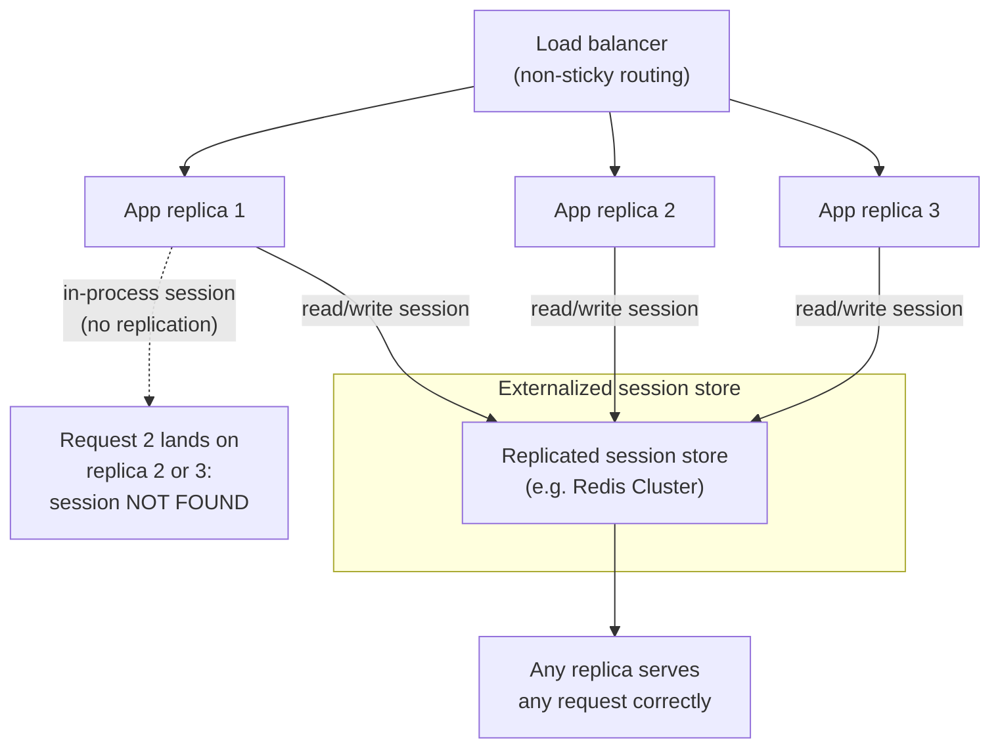

### 4.7 Choosing a Replication Strategy: A CAP/PACELC-Informed Decision Framework

**Definition.** Every replication-topology decision this chapter and
Part 06's Replication chapter describe is, underneath, an explicit or
implicit answer to the trade-offs
[CAP Theorem](CH05_CAP_Theorem.md) and [PACELC](CH06_PACELC.md) formalize:
during a network partition, does this component choose Consistency or
Availability (CAP's C-or-A choice); and even when the network is healthy,
does it choose lower Latency or stronger Consistency (PACELC's Else-branch
choice)? This section does not re-derive either theorem — both chapters
already give the full formal treatment, proof sketches, and four-quadrant
classification — it gives the architect a repeatable procedure for
translating a whole-system replication requirement into a concrete
topology choice using those two chapters' frameworks as inputs.

**Mechanism — the decision procedure.** For each stateful component in a
system (each database, cache, queue, session store), work through four
questions in order: (1) **What happens to this component's clients during
a network partition — must it stay available, or must it refuse rather
than risk inconsistency?** This directly selects a CAP quadrant (CP or AP)
per [CAP Theorem](CH05_CAP_Theorem.md#44-worked-examples-classifying-real-systems-as-cp-or-ap).
(2) **Even without a partition, can this component tolerate the latency
cost of synchronous replication, or must it favor low latency at the cost
of some staleness?** This selects a PACELC Else-branch position per
[PACELC](CH06_PACELC.md#43-the-four-quadrant-classification).
(3) **Does this component need a single writer (simpler, strongly ordered)
or must it accept writes at multiple locations (lower write latency
globally, but conflicts to resolve)?** — Section 4.2's topology choice.
(4) **If multi-writer, which conflict-resolution technique fits the data
shape** — LWW, hand-written merge, or a CRDT (Section 4.3), with vector
clocks (Section 4.4) as the causality-detection layer underneath any of
the three. The output of this four-question procedure is a concrete,
justifiable configuration: topology, replication factor, synchronicity
mode, and conflict-resolution technique — not a vague statement like "we
use eventual consistency."

**Decision implications.** Different components of the *same* system
routinely land in different quadrants, and that is correct, not
inconsistent: a payments ledger inside an e-commerce platform is
justifiably CP (refuse a write rather than risk double-charging or losing
a transaction), while the same platform's product-recommendation cache is
justifiably AP (serve a slightly stale recommendation rather than show an
error page). An architect who tries to pick one CAP/PACELC answer for an
entire system is solving the wrong-scoped problem; the correct unit of
analysis is each stateful component individually.

**Common failure mode.** Treating the CAP/PACELC classification as a
one-time, whiteboard-only exercise disconnected from the actual
replication configuration deployed. The classification is only useful if
it is traceable to a specific setting — "this component is CP" must map to
an actual `min.insync.replicas`/quorum/synchronous-replication
configuration, not just a label in an architecture document that the
running system's configuration silently contradicts (a documented "CP"
component running with asynchronous replication and no quorum check is
actually AP in practice, regardless of what the diagram says).

**Scenario.** A logistics platform's shipment-tracking system has three
stateful components: the authoritative shipment-status database (CP —
must never show conflicting delivery statuses, uses synchronous quorum
replication), a shipment-location cache feeding a customer-facing map
widget (AP — briefly stale truck position is acceptable, uses async
replication with a five-second TTL), and a driver mobile app's offline
route data (multi-writer, CRDT-based merge — a driver can go offline in a
warehouse with no signal and have their route updates merge correctly on
reconnect using the OR-Set pattern Section 4.3 teaches). All three
decisions trace back to the same four-question procedure applied per
component, using CAP/PACELC purely as the classification vocabulary and
this chapter's CRDT/vector-clock/queue-replication mechanics as the
concrete implementation toolkit.

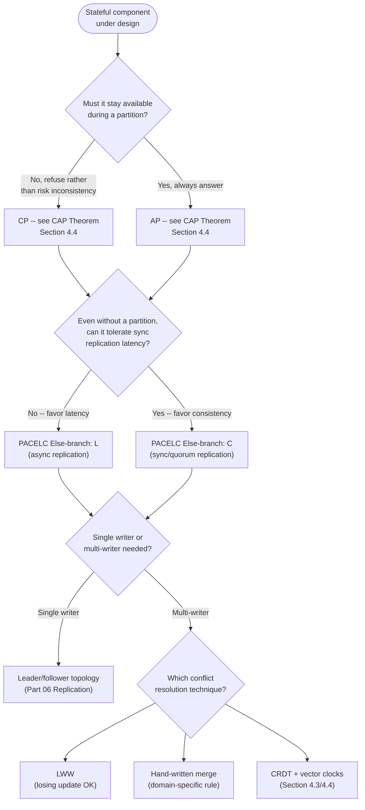

## 5. Internal Working

Zooming in on the mechanics underneath Section 4's decision framework, a
CRDT-based multi-primary system's internal write-and-merge cycle proceeds
in five steps, whether the CRDT lives inside a database, a cache, or an
application-level document store:

1. **Local apply.** A replica applies an operation to its own local copy
   of the CRDT immediately, without waiting for any other replica —
   this is what gives CRDT-based systems their signature low write
   latency and availability during partitions.
2. **Tag or vector-stamp the update.** The replica attaches whatever
   metadata its specific CRDT and delivery model require: a unique tag
   (OR-Set), a per-replica counter slot (G-Counter/PN-Counter), or a full
   vector clock if the surrounding system needs general causality
   tracking beyond what the CRDT's own merge rule provides.
3. **Asynchronous propagation.** The update (state-based: the whole
   current state; operation-based: just the operation) is shipped to
   peer replicas over whatever transport the system already uses —
   often the same gossip, pub/sub, or replicated-log transport used for
   ordinary asynchronous replication, since CRDTs are a property of the
   *data structure*, not a new network protocol.
4. **Merge on receipt.** The receiving replica applies its CRDT's
   type-specific merge function (or applies the incoming operation
   directly, for CmRDTs, after any needed causal-order buffering).
5. **Convergence.** After all replicas have exchanged all updates (in any
   order, with any amount of redundant re-delivery), every replica holds
   an identical, correct value — no reconciliation pass, no conflict
   ticket, no human intervention required.

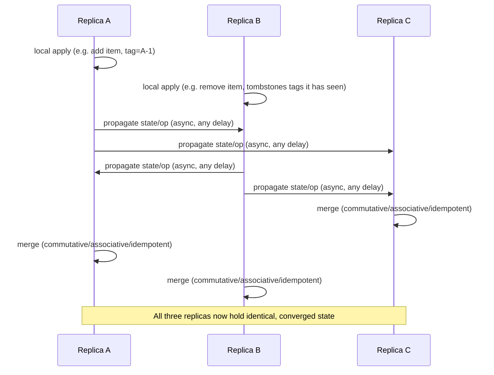

This same five-step cycle, substituting a vector clock for CRDT-specific
tags where the surrounding system needs general-purpose causality
detection rather than a single fixed data type, is exactly how a
Dynamo-style store decides whether an incoming replicated write
supersedes, is superseded by, or conflicts with the value it already
holds — the comparison logic Section 4.4 and its runnable implementation
make concrete.

## 6. Design Principles

- **Replicate the smallest unit that actually needs independent failure
  isolation.** Replicating an entire monolithic session blob when only one
  field changes wastes bandwidth and increases merge-conflict surface
  area; prefer CRDT composition (a map of independently-mergeable fields)
  over one large opaque blob.
- **Make the conflict-resolution policy an explicit, reviewable decision,
  not an accident of whichever library's default you picked.** Every
  multi-writer component should have a one-sentence, written answer to
  "what happens when two replicas write the same key concurrently," and
  that sentence should match Section 4.2's decision tree, not be
  discovered for the first time during an incident review.
- **Prefer externalizing state over replicating application-server
  memory.** Section 4.6's session-store lesson generalizes: whenever
  possible, move state replication responsibility into a purpose-built
  replicated store (cache, database, queue) rather than building ad hoc
  replication into a service whose primary job is something else.
- **Treat replication factor as a per-component capacity/durability
  budget, not a cluster-wide constant.** Section 4.5's Kafka example
  shows this directly — different topics in the same cluster legitimately
  run different replication factors.
- **Design for the partition, not just the happy path.** A replication
  strategy that has never been tested with a simulated network partition
  (killing a follower, isolating a region) has an unverified CAP/PACELC
  classification, not a verified one.

## 7. Architecture Patterns

- **CRDT-backed multi-region active-active.** Every region accepts writes
  locally; CRDTs (or CRDT-composed documents) handle eventual
  reconciliation without a cross-region coordinator on the write path —
  used by collaborative editors, multi-region feature-flag services, and
  some multi-region shopping-cart designs.
- **Replicated log as the system of record, with derived read stores.**
  A Kafka-style replicated log holds the append-only, replicated source of
  truth; downstream consumers build their own replicated (or single-node,
  rebuildable-from-the-log) read-optimized projections — the pattern
  underlying Event Sourcing (forward reference —
  [Event Sourcing](CH15_Event_Sourcing.md), not yet drafted at the time of
  this writing) and Change Data Capture pipelines feeding replicated
  caches.
- **Externalized, independently-replicated session/state store.**
  Section 4.6's pattern, generalized: any horizontally-scaled stateless
  tier depends on exactly one purpose-built, separately-replicated store
  for the state it would otherwise need to hold itself.
- **Tiered replication factor by data criticality.** A single system
  legitimately runs several different replication configurations
  simultaneously (Section 4.7's logistics-platform scenario), rather than
  one blanket policy for every component.

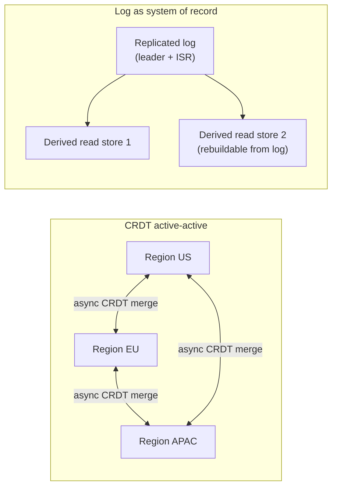

## 8. Production Architecture

A production deployment applying this chapter's patterns typically layers
them as follows: a replicated log (Section 4.5) ingests every state-change
event from every service; purpose-built replicated stores (a database using
Part 06's leader/follower or quorum mechanics, a cache using Section 4.6's
asynchronous replication, a session store using externalized replication)
each subscribe to the subset of that log relevant to them and maintain
their own replica set; and any component that must accept writes at
multiple simultaneous locations (multi-region session merge, offline-first
mobile sync, a globally-distributed feature-flag store) is built on CRDTs
with vector-clock-based causality tracking rather than a hand-rolled
conflict scheme. Observability (Section 14) instruments replication lag
and ISR/quorum health at every layer so that a shrinking durability
guarantee is visible before it becomes a data-loss incident, not after.

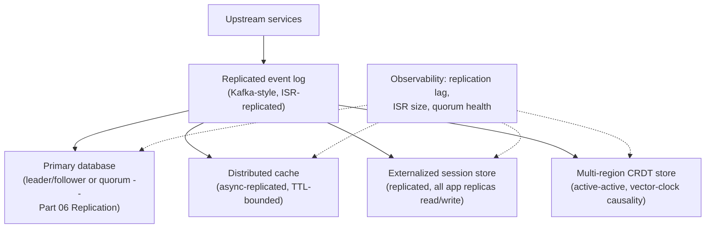

## 9. Implementation

Implementing this chapter's patterns in a real system means picking, per
stateful component, a concrete technology that already implements the
chosen technique rather than hand-rolling CRDT/vector-clock logic from
scratch in most cases: Redis Cluster or Amazon ElastiCache for
asynchronously-replicated caching, Kafka or a managed equivalent (Amazon
MSK, Confluent Cloud) for the replicated-log pattern with explicit
ISR/`min.insync.replicas` tuning, Automerge or Yjs libraries for
application-level CRDT-based collaborative documents, and Riak or
Cassandra (recapped —
[Cassandra](../06_Databases_and_Storage/CH18_Cassandra.md#41-vnode-based-consistent-hashing-and-ring-placement)
already owns Cassandra's own consistent-hashing and quorum mechanics) for
built-in vector-clock-style causality metadata at the storage-engine
level. Section 10's from-scratch implementations exist for *teaching*
purposes — to make the merge/comparison logic fully transparent — not as a
recommendation to build production CRDT or vector-clock code in-house when
a maintained library or managed service already implements it correctly.

## 10. Complete Code Examples

All four examples below are self-contained, dependency-free Python scripts
(standard library only) under
[`code/python/distributed-replication-chapter/`](../code/python/distributed-replication-chapter/),
each independently runnable and each verified to execute end-to-end with no
errors:

1. [`01_crdt_counter_and_set.py`](../code/python/distributed-replication-chapter/01_crdt_counter_and_set.py) —
   a state-based G-Counter (grow-only counter) and an Observed-Remove Set
   (OR-Set), demonstrating that both converge to an identical value
   regardless of merge order, and that the OR-Set's add-wins semantics
   correctly survive a concurrent add-and-remove of the same element
   (Section 4.3).
2. [`02_vector_clock.py`](../code/python/distributed-replication-chapter/02_vector_clock.py) —
   a from-scratch vector-clock implementation with `tick()`,
   `merge_after_receive()`, and a `compare()` static method that correctly
   classifies two clocks as happened-before, happened-after, equal, or
   concurrent, demonstrated against both a linear (non-conflicting) write
   history and a genuinely concurrent one (Section 4.4).
3. [`03_kafka_isr_simulator.py`](../code/python/distributed-replication-chapter/03_kafka_isr_simulator.py) —
   a simplified simulation of a Kafka partition's leader/follower/ISR
   model, showing the ISR shrinking as a follower's fetch lag grows past
   `replica.lag.time.max.ms`, and `acks=all` correctly refusing writes
   once the ISR can no longer satisfy `min.insync.replicas` (Section 4.5).
4. [`04_cache_session_replication_demo.py`](../code/python/distributed-replication-chapter/04_cache_session_replication_demo.py) —
   two simulations: asynchronous cache replication producing a bounded
   stale-read window on peer cache nodes, and a sticky-session-dependent
   application tier failing a request on a non-sticky replica versus
   succeeding once the session is externally replicated (Section 4.6).

## 11. Performance

Replication technique choice has direct, predictable performance
consequences: CRDT-based multi-primary writes are as fast as a purely
local write (no coordination round-trip), at the cost of eventual
background merge bandwidth that grows with update frequency and, for
tag-based CRDTs like OR-Set, with the number of tombstones retained.
Vector clocks add a small, fixed per-write metadata cost (proportional to
the number of distinct replicas that have ever written the value) to every
comparison and every stored object. Kafka's `acks=all` with a larger
`min.insync.replicas` trades produce-request latency (the leader must wait
for more followers) for durability; `acks=1` or `acks=0` remove that wait
entirely at the cost of the durability guarantee Section 4.5 details.
Asynchronous cache replication imposes effectively zero write-path latency
cost on the primary write, shifting all of the cost into the bounded
stale-read window peers experience — a trade an architect should size
explicitly (via the replication-delay budget) rather than leave as an
unmeasured side effect.

## 12. Scalability

CRDT-based and quorum-free multi-primary designs scale write throughput
roughly linearly with the number of writable replicas/regions added,
because no cross-replica coordination gates any individual write — this is
precisely why offline-first mobile apps and multi-region active-active
platforms favor them. Kafka's per-partition replication factor is
independent of partition count, so a topic scales write/read throughput by
adding partitions (each independently replicated) rather than by changing
any single partition's replication factor, which stays fixed for
durability, not throughput, purposes — do not confuse the two levers.
Externalized session/cache stores let the application tier scale
horizontally without limit, because scaling out application replicas adds
zero additional replication burden (the app tier holds no state to
replicate); the replicated store behind it must independently be sized for
the aggregate read/write load all application replicas generate.

## 13. Security

Replicated state — regardless of whether it lives in a database, cache,
queue, or CRDT store — multiplies the number of network paths and storage
locations that must be secured: every replica is an independent target for
data exfiltration or tampering, and every inter-replica propagation channel
(gossip, log replication, CRDT state exchange) must be encrypted in
transit, recapping TLS's general
[Transport Layer Security handshake](../05_Networking_and_OS/CH06_TLS.md#42-the-tls-13-handshake)
mechanics rather than re-teaching them here. Vector clocks and CRDT tags
themselves are ordinary metadata with no inherent confidentiality
requirement, but they do reveal *which* replicas (and, transitively, which
regions or devices) contributed to a piece of state, which can itself be
sensitive metadata (for example, revealing which specific device made a
particular edit) — worth an explicit review in privacy-sensitive
collaborative applications. Externalized session stores (Section 4.6)
concentrate every application replica's session data into one
purpose-built store, which correctly reduces the in-process attack surface
of any single application-server compromise, but correspondingly raises
the blast radius of a compromise of the session store itself, requiring
its own access controls and encryption-at-rest independent of the
application tier's.

## 14. Observability

The single most important replication-specific signal to monitor,
regardless of which pattern from this chapter is in play, is a **lag or
gap metric between the leader/primary/writer's state and each replica's
observed state**: Kafka exposes per-partition ISR membership and consumer
lag directly; a CRDT-based store should export the count and age of
unmerged, in-flight updates per replica; an externalized session store
should be monitored like any other dependency the application tier now
fully relies on (latency, error rate, saturation). A widening lag metric
on any of these is the earliest observable signal of the exact failure
modes Section 15 describes — a stalled follower, a partitioned region, an
overloaded replication channel — and should alert well before the lag
grows large enough to be user-visible.

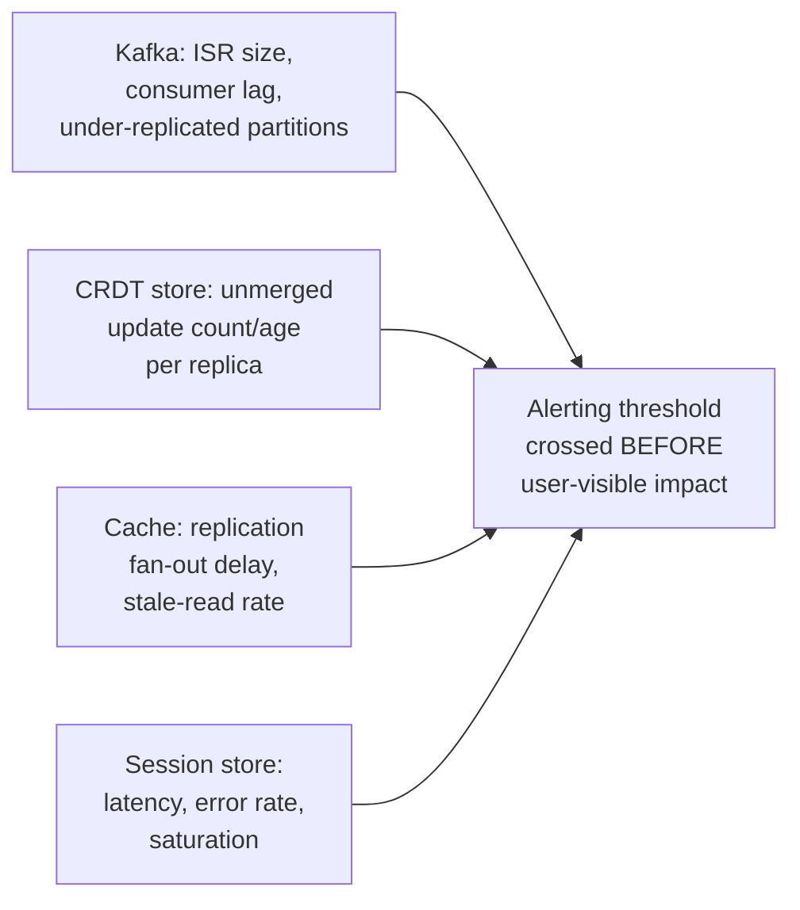

## 15. Failure Scenarios

- **Unbounded CRDT tombstone growth.** An OR-Set (or any tag-based CRDT)
  that never garbage-collects old removal tombstones grows storage and
  merge-comparison cost without bound over the system's lifetime; requires
  a causal-stability protocol (safely discarding a tombstone once every
  replica has observed it) to bound growth.
- **Kafka ISR shrinking below `min.insync.replicas` during correlated
  failures.** Section 4.5's scenario — a single slow broker is tolerable,
  but a correlated multi-broker failure (a bad rack, a botched deploy
  touching multiple brokers at once) can shrink the ISR enough to halt
  writes entirely, an availability cost the durability guarantee
  deliberately imposes.
- **Vector clock explosion from many short-lived writers.** A system with
  a very large or unbounded number of distinct writer identities (for
  example, one slot per ephemeral mobile session rather than per stable
  device) can grow vector clocks unmanageably large; requires pruning or a
  bounded writer-identity scheme.
- **Sticky-session replica loss during a deploy or incident.** Section
  4.6's scenario — every session pinned to a terminated replica is lost
  simultaneously, producing a correlated spike of user-visible failures
  exactly when the system is already under operational stress.
- **Silent asynchronous cache staleness masquerading as correctness.** A
  cache replication delay that is well within tolerance under normal load
  can grow unnoticed under load spikes (replication channel saturation),
  quietly widening the stale-read window past what the business actually
  intended, with no error to alert on unless lag itself is monitored
  (Section 14).

## 16. Testing

Verify replication behavior with tests that specifically induce the
conditions Section 15 describes rather than only testing the happy path:
(1) **CRDT convergence property tests** — apply the same set of operations
to multiple replica instances in every possible order and assert all
converge to the same value (a property-based test is ideal here, since it
can generate many orderings automatically); (2) **partition-simulation
tests** for any multi-writer system — artificially isolate two replicas,
apply conflicting operations to each, heal the partition, and assert the
merge resolves per the documented conflict policy; (3) **ISR/quorum-loss
tests** for replicated logs and quorum stores — kill enough replicas to
cross the `min.insync.replicas`/quorum threshold and assert writes are
correctly rejected, not silently accepted; (4) **session-externalization
regression tests** — deliberately route a multi-request user flow to
different application-server replicas in a test environment and assert the
flow completes correctly, catching a sticky-session dependency before it
reaches production.

## 17. Common Mistakes

- Assuming "eventually consistent" alone is a sufficient design
  specification, without naming *how* conflicting concurrent writes are
  actually resolved (Section 4.2's decision tree exists precisely because
  "eventually consistent" is silent on this).
- Choosing an LWW-based conflict resolution and calling it a CRDT without
  checking whether losing the "losing" write is actually acceptable for
  that specific data (Section 4.3's common failure mode).
- Confusing sticky sessions with session replication — they solve
  different problems and only one of them survives a replica crash
  (Section 4.6).
- Setting `acks=all` without also raising `min.insync.replicas`, believing
  full replication is guaranteed when it is not (Section 4.5).
- Letting vector clocks or CRDT tombstones grow unbounded with no pruning
  strategy, discovering the storage/comparison cost only once it is
  already a production problem (Section 15).
- Applying a single CAP/PACELC classification to an entire system instead
  of per stateful component, producing an architecture document that
  doesn't match the actual, intentionally-heterogeneous configuration
  running in production (Section 4.7).

## 18. Best Practices

- Name, in writing, the conflict-resolution technique for every
  multi-writer component before it ships, and verify it with the
  property-based convergence tests Section 16 describes.
- Externalize session and shared application state by default; treat
  sticky sessions as a last resort, not a first choice.
- Monitor replication lag/ISR health/unmerged-update age as a first-class
  Service Level Indicator (SLI) for every replicated component, not just
  for the primary database.
- Size replication factor and synchronicity mode per component based on
  Section 4.7's four-question procedure, and keep that reasoning
  documented alongside the configuration it produced.
- Bound the growth of any causality-tracking or tombstone metadata (vector
  clocks, OR-Set tags) with an explicit pruning or garbage-collection
  policy from day one, not as a later retrofit.

## 19. Anti-Patterns

- **The "replication as a checkbox" anti-pattern** — enabling replication
  on a component without deciding synchronicity mode, conflict-resolution
  technique, or read-routing policy, then discovering the gaps during an
  incident (Section 4.1's common failure mode).
- **The "silent LWW" anti-pattern** — a system that markets itself as
  using "conflict-free" replication while actually discarding concurrent
  updates via Last-Write-Wins, with no stakeholder having explicitly
  agreed that data loss is acceptable (Section 4.3).
- **The "sticky sessions forever" anti-pattern** — treating session
  affinity as a permanent architecture rather than a stopgap, and scaling
  the application tier for years without ever externalizing session state,
  until a large-scale incident forces the migration under pressure
  (Section 4.6).
- **The "one CAP label for the whole system" anti-pattern** — Section
  4.7's common failure mode, generalized into a named anti-pattern because
  it recurs so often in architecture reviews.

## 20. Trade-off Analysis

| Dimension | Single-writer (leader/follower) | Multi-writer, LWW | Multi-writer, CRDT |
|---|---|---|---|
| Write latency under partition | Blocked or degraded (only the leader's side can write) | Low everywhere | Low everywhere |
| Conflict handling | None needed (total order) | Silently discards losing write | Mathematically guaranteed convergence, no loss (for additive/mergeable shapes) |
| Implementation complexity | Lowest | Low | Higher (requires CRDT-shaped data or a library) |
| Fits arbitrary business invariants | Yes (single writer enforces them directly) | Partially (only where losing an update is acceptable) | No (cannot enforce cross-replica invariants like "never negative") |
| Best owned by | Part 06 Replication's leader/follower chapters | Simple, loss-tolerant fields (timestamps, "last seen") | Counters/sets/maps/lists where every concurrent update must be preserved |

## 21. Comparison Table

| Replicated component type | Typical synchronicity | Typical conflict-resolution need | Owning/reference chapter |
|---|---|---|---|
| Relational/NoSQL database | Sync/async/semi-sync/quorum | Usually single-writer; multi-leader databases use LWW/merge/CRDT | [Replication](../06_Databases_and_Storage/CH07_Replication.md) (Part 06) |
| Message queue/log partition | ISR-based, replication-factor-driven | None (single leader per partition; ordering is total within a partition) | This chapter, Section 4.5 |
| Distributed cache | Asynchronous, TTL-bounded | Rarely needs conflict resolution (cache entries are usually derived/re-computable) | This chapter, Section 4.6 |
| Session store | Synchronous replication or externalized | None if externalized (single source of truth); LWW if naively multi-writer | This chapter, Section 4.6 |
| Multi-region collaborative document/config store | Asynchronous, active-active | CRDT + vector clocks | This chapter, Sections 4.3/4.4 |

## 22. Real-World Case Study

**Riak's vector-clock-exposed conflict model (Basho Technologies, 2009-2016).**
Riak, a Dynamo-inspired distributed key-value store, made an unusually
explicit architectural choice: rather than silently resolving concurrent
writes with Last-Write-Wins internally, Riak attached a vector clock to
every stored object and, on a read that encountered genuinely concurrent
sibling values (Section 4.4's CONCURRENT classification), returned *all*
the siblings to the client and required the application to supply its own
resolution logic (often CRDT-based, once Riak added native CRDT data
types in version 2.0). This design decision generated real operational
friction — application developers who expected a key-value store to
"just work" like a single-node cache were surprised the first time a read
returned multiple sibling values instead of one — but it also prevented an
entire class of silent data loss that a Last-Write-Wins-only design would
have hidden. Basho's own documentation and postmortems from teams
adopting Riak repeatedly identified the same root cause for surprise
incidents: application code that assumed a single returned value and
picked `siblings[0]` without understanding vector-clock semantics, which
silently reintroduced the exact data-loss risk vector clocks were meant to
surface for explicit handling. Riak's later addition of native CRDT data
types (Section 4.3's catalog, implemented directly in the storage engine)
was a direct response: give application developers a way to get
provably-convergent behavior without hand-writing sibling-resolution logic
themselves. The lesson generalizes cleanly to this chapter's Section 4.7
framework: exposing a conflict honestly (vector clocks) is strictly safer
than hiding it (silent LWW), but exposing it usefully requires giving
developers a structured resolution mechanism (CRDTs) rather than raw
conflict metadata and an unstructured expectation that they will write
correct merge logic themselves under deadline pressure.

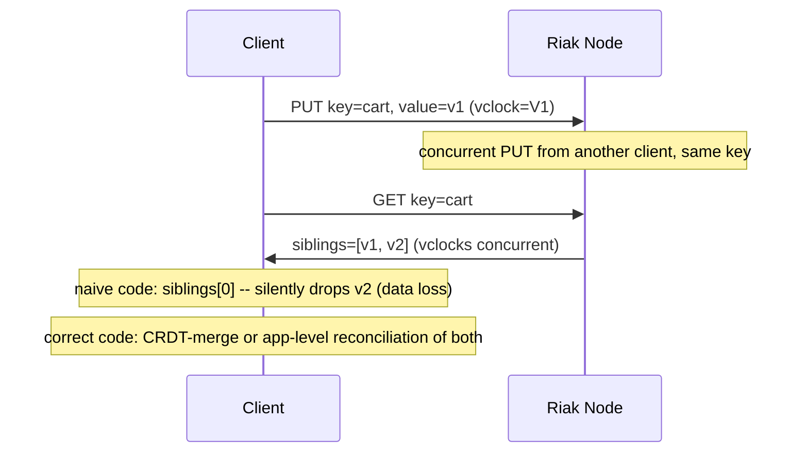

## 23. Interview Questions

1. What specific guarantee does a CRDT's merge function provide, and why
   is that guarantee (commutative, associative, idempotent) exactly what
   is needed for multi-primary replication without coordination?
2. Explain the difference between a Lamport scalar clock and a vector
   clock, and describe a concrete scenario where a scalar clock would
   incorrectly hide a real conflict that a vector clock correctly detects.
3. In Kafka, what is the difference between replication factor and
   `min.insync.replicas`, and why does `acks=all` alone not guarantee full
   replication?
4. Why is a cache's asynchronous replication delay a deliberate design
   trade-off rather than a defect, and what should an architect monitor to
   keep that trade-off within its intended bounds?
5. Why are sticky sessions not, by themselves, a session-replication
   strategy, and what specific failure mode reveals the gap?
6. Give an example of a stateful component where a CRDT would be the
   wrong choice, and explain what invariant it cannot enforce.
7. Walk through Section 4.7's four-question decision procedure for a
   component of your choosing, and justify each answer.
8. Why does Riak's decision to expose vector-clock-detected sibling
   conflicts to the application, rather than silently resolving them,
   count as safer even though it is less convenient for developers?

## 24. Hands-on Exercises

1. Run [`01_crdt_counter_and_set.py`](../code/python/distributed-replication-chapter/01_crdt_counter_and_set.py)
   and modify it to add a third concurrent replica; verify the G-Counter
   still converges to the correct total regardless of merge order.
2. Extend [`02_vector_clock.py`](../code/python/distributed-replication-chapter/02_vector_clock.py)
   with a fourth replica and construct a three-way concurrent-write
   scenario; verify `compare()` correctly reports concurrency between
   every pair that never observed each other.
3. Modify [`03_kafka_isr_simulator.py`](../code/python/distributed-replication-chapter/03_kafka_isr_simulator.py)
   to use `min.insync.replicas=3` on a replication-factor-3 partition, and
   observe how much more easily the ISR shrinks below the threshold.
4. Extend [`04_cache_session_replication_demo.py`](../code/python/distributed-replication-chapter/04_cache_session_replication_demo.py)
   to model a client reading immediately after its own write (read-your-
   writes) and show the stale-read window it experiences without a
   session-affinity or read-your-writes mitigation.

## 25. Design Exercises

1. Design the replication strategy for a multiplayer game's shared
   in-game economy (currency, item ownership) that must support players on
   spotty mobile connections making concurrent purchases offline. Apply
   Section 4.7's four-question procedure and justify whether a PN-Counter
   alone is sufficient or whether you need an additional invariant-
   enforcing mechanism.
2. Design a global configuration-flag service used by services in five
   regions, where any region can update a flag and updates must propagate
   to all regions without a cross-region synchronous round-trip. Specify
   the CRDT type(s) you would use per flag type (boolean, numeric
   threshold, string) and justify each.
3. A team proposes replicating application-server session state via
   sticky sessions "because it's simpler." Write the architecture-review
   pushback: identify the specific failure scenario this reintroduces and
   propose the externalized alternative with its own trade-offs named
   explicitly.

## 26. Architecture Review Questions

- For every multi-writer component in this design, is the
  conflict-resolution technique named explicitly, and has it been tested
  against a genuinely concurrent-write scenario (not just sequential
  writes with a delay)?
- Does any component's documented CAP/PACELC classification actually match
  its deployed replication configuration (synchronicity mode,
  `min.insync.replicas`/quorum setting), or has the documentation drifted
  from reality?
- Is any user-facing session or in-progress workflow state relying on
  sticky sessions rather than externalized replication? If so, what
  happens to an in-progress user flow when that specific replica is lost?
- Are vector clocks, CRDT tags, or tombstones in this design bounded by an
  explicit pruning policy, or could they grow unboundedly under realistic
  long-running production usage?
- Is replication lag (or unmerged-update age, or ISR/quorum health)
  actually monitored and alerted on for every replicated component in this
  design, not only the primary database?

## 27. Summary

Replication is a system-wide architectural pattern, not a database-specific
feature: every stateful component — cache, queue, session store,
configuration store, collaborative document — faces the same durability,
scalability, locality, and fault-tolerance pressures Section 3 names, and
needs an explicit answer to how it propagates writes and resolves
conflicts. Where [Replication](../06_Databases_and_Storage/CH07_Replication.md)
in Part 06 owns the mechanics of single-writer leader/follower topology and
quorum-based databases, this chapter owns the genuinely new ground: CRDTs
as a mathematically-guaranteed conflict-resolution technique for
multi-writer systems, vector clocks as the general-purpose causality-
tracking layer underneath them, Kafka's ISR model as the replicated-log
realization of the same durability-versus-availability trade-off, and
session/cache replication as the two most commonly under-designed
non-database applications of this pattern. Section 4.7's four-question
procedure ties all of it back to
[CAP Theorem](CH05_CAP_Theorem.md) and [PACELC](CH06_PACELC.md): every
replication-topology decision in this chapter is, underneath, a concrete,
component-by-component answer to the trade-offs those two chapters
formalize — the goal of this chapter is to make sure an architect can
apply that formal vocabulary to caches, queues, and application state just
as rigorously as to a database.

## Further Reading

- [Replication](../06_Databases_and_Storage/CH07_Replication.md) (Part 06) —
  leader/follower mechanics, synchronous/asynchronous/semi-synchronous
  replication, N/W/R quorum arithmetic, failover and fencing.
- [CAP Theorem](CH05_CAP_Theorem.md) — formal C/A/P definitions and the
  proof of the forced choice during a partition.
- [PACELC](CH06_PACELC.md) — the latency-versus-consistency trade-off that
  exists even absent a partition, and the four-quadrant classification.
- [Consensus](CH07_Consensus.md) — Paxos/Raft, and why strict cross-replica
  invariants that CRDTs cannot enforce require consensus instead.
- [Leader Election](CH08_Leader_Election.md) — the general election problem
  underlying any single-writer replication topology.
- [Partitioning](../06_Databases_and_Storage/CH05_Partitioning.md) and
  [Sharding](../06_Databases_and_Storage/CH06_Sharding.md) — the related
  but distinct concern of dividing a dataset across nodes, as opposed to
  keeping redundant copies of it.
- [Load Balancer](../05_Networking_and_OS/CH10_Load_Balancer.md) — sticky
  sessions/session affinity mechanics, recapped in Section 4.6.
- [CDN](../05_Networking_and_OS/CH09_CDN.md) — edge-cache replication as a
  specialized case of the cache-replication pattern in Section 4.6.
