# Chapter: Partitioning (Distributed Systems)

Part: [07 — System Design and Distributed Systems](PART_OVERVIEW.md) · Status: Drafted

## 1. Introduction

Partitioning, in the distributed-systems sense this chapter teaches, is the
practice of splitting **load, data, or state across many independent
cluster nodes** so that no single node has to hold all of it or absorb all
of the traffic aimed at it. That definition is deliberately broader than "a
database splits its rows across shards." The same underlying problem — take
one logical thing that is too big or too hot for one machine, and spread it
across many machines in a way that a client can still find the right piece
without a global lock — shows up in distributed caches (which node holds
this cache key?), message queues and event streams (which broker partition
does this message belong to, and which consumer processes it?), distributed
compute and stream-processing engines (which worker task owns this key's
state?), and yes, sharded databases too. This chapter's job is the *general*
mechanism and its cluster-scale operational concerns — consistent hashing as
the canonical way to place both nodes and keys on a shared address space,
virtual nodes as the load-balancing refinement that makes consistent hashing
practical, rebalancing as the operational discipline for adding/removing
nodes without a full data reshuffle, and hotspot mitigation as the answer to
"the ring placement was fair, so why is this one node still on fire?" — plus
how each of those ideas shows up, sometimes in a different concrete shape,
in message queues/topics and stream-processing frameworks specifically.

This chapter draws two explicit, load-bearing boundaries with same-named or
adjacent chapters, because getting this wrong would mean re-teaching content
another chapter already owns:

- **[Partitioning](../06_Databases_and_Storage/CH05_Partitioning.md)** (Part
  06, Chapter 05) teaches horizontal partitioning **inside a single database
  engine** — range/list/hash partitioning strategies and the partition-key
  selection framework for splitting one logical table into physical segments
  that one machine still owns end-to-end. That chapter is single-node by
  design; this chapter starts exactly where a single node's capacity runs
  out and the partitions must be scattered across a network of machines.
  This chapter recaps that framework in Section 4.1 rather than re-deriving
  it.
- **[Sharding](../06_Databases_and_Storage/CH06_Sharding.md)** (Part 06,
  Chapter 06) is the chapter that first took partitioning across a network
  boundary for databases specifically, and it already owns the full,
  first-principles derivation of consistent hashing (ring plus virtual
  nodes), cluster-scale rebalancing/live data migration, and hot-shard
  mitigation — all in the context of routing database queries to the right
  shard. This chapter does **not** re-derive those mechanisms from scratch;
  Section 4.1 recaps Sharding's treatment in 2-3 sentences with a link, and
  this chapter's own depth goes to two places Sharding's database framing
  does not cover: (1) generalizing consistent hashing/vnodes/rebalancing/
  hotspot-mitigation as patterns that apply identically to *any* stateful
  distributed system, not just database shards, with the operational
  distinctions (online vs. offline rebalancing framed generally, cluster-wide
  vs. single-partition mitigation) called out explicitly; and (2) teaching,
  in full first-principles depth for the first time in this book, how
  partitioning is applied inside **non-database distributed systems** —
  message-queue/event-stream topic partitions and consumer-group
  rebalancing, distributed cache partitioning, and stream-processing
  partition/key-based parallelism, none of which any existing chapter owns.

Finally, every partition in a real production system almost always has
**multiple replicas** — the partitioning layer decides *which* node(s) own a
given slice of data or load; the replication layer decides how many copies
of that slice exist and how they stay in sync. This chapter treats
replication as a recap-and-link concern (see Section 4.9) rather than
re-teaching it; the full mechanics live in the (not yet drafted, forward-
referenced here) sibling chapter
[Replication](CH10_Replication.md) in this same part, and in
[Replication](../06_Databases_and_Storage/CH07_Replication.md) (Part 06,
Chapter 07) for the database-specific treatment.

## 2. Historical Evolution

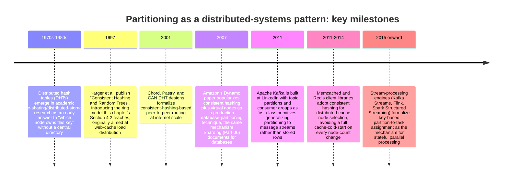

Two threads run through this history. The first is **the mechanism**:
consistent hashing was invented once (Karger, 1997), for web caching, and
then re-discovered as the right answer for an increasingly wide range of
"spread this across many nodes" problems — peer-to-peer DHTs, Dynamo-style
databases, distributed caches, and (in a related but distinct form) hash-
based partition assignment in message queues. The second is **the
generalization of the problem itself**: what started as "split a dataset
across database servers" broadened, over roughly two decades, into "split
*anything stateful* — a data store, a cache, a message stream, a computation
— across a cluster of nodes." Kafka's 2011 design is the clearest inflection
point: its topics-and-partitions model treats partitioning as the unit of
both storage *and* parallelism for a message stream, a framing a pure
database-sharding lens does not capture, because there is no query router
choosing a shard — there is a producer choosing (or being assigned) a
partition, and a consumer group whose membership changes trigger a
rebalance protocol unlike anything in a database's shard-map or
consistent-hashing routing layer.

## 3. Why It Exists

Partitioning exists because every single node in a cluster has a hard
ceiling — central processing unit (CPU) cycles, memory, disk input/output
(I/O), and network bandwidth are all finite — and once the aggregate demand
on a stateful system exceeds what one node can serve, the only way forward
is to add more nodes and give each one a *slice* of the total data or load
rather than a full copy. That statement is true whether "the stateful
system" is a relational database, a key-value cache, a message broker, or a
stream-processing job's internal state store; the physics of the problem is
identical even though the concrete unit being partitioned differs (rows vs.
cache entries vs. messages vs. keyed stream records).

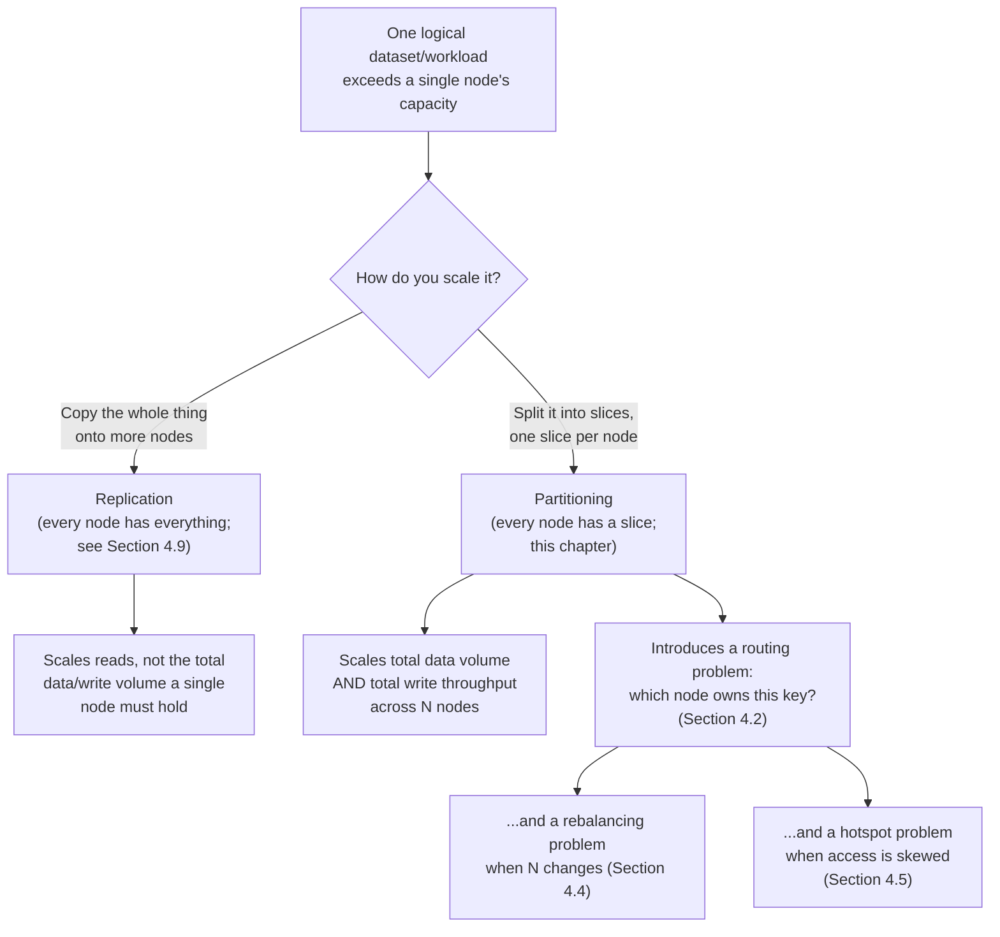

The reason this chapter exists **separately** from the database-specific
Partitioning and Sharding chapters is that the routing/rebalancing/hotspot
problems above recur, with materially different concrete mechanics, outside
databases entirely. A message queue's partition count is fixed at topic-
creation time and its consumer-group rebalance protocol has no database
analogue at all; a distributed cache's partitioning almost always lives in
the *client* library rather than a server-side router; a stream-processing
engine's partition-to-task assignment is really a scheduling problem, not a
storage-routing problem. Teaching the general mechanism once, then showing
its concrete shape in each of these domains, avoids both under-teaching
(treating Kafka partitions as "just sharding, nothing new") and over-
teaching (re-deriving consistent hashing three separate times across
different book chapters that each only need to cite it).

## 4. Core Concepts

### 4.0 Recap: what Partitioning (Part 06) and Sharding (Part 06) already teach

Before this chapter's own five subsections, here is the explicit recap the
Concept Ownership Rule requires, phrased so the ownership boundary is
unambiguous:

- **[Partitioning](../06_Databases_and_Storage/CH05_Partitioning.md)** (Part
  06 CH05) owns range/list/hash horizontal-partitioning strategies and the
  partition-key selection decision framework, entirely **inside a single
  database engine** — one machine still owns the whole table, just as
  several physically separate segments instead of one. It also owns
  vertical partitioning, partition pruning, rolling-window maintenance, and
  local-vs-global indexes. None of that is re-taught here.
- **[Sharding](../06_Databases_and_Storage/CH06_Sharding.md)** (Part 06 CH06)
  owns the first full derivation of taking those partitions **across a
  network boundary between database nodes**: shard-key selection built on
  Partitioning's framework, shard-map/directory routing, hash-mod routing,
  consistent hashing (ring plus virtual nodes) as applied to routing
  database queries to the right shard, rebalancing/live data migration for
  database shards, scatter-gather cross-shard queries, cross-shard
  transaction cost, and hot-shard mitigation. Sections 4.2, 4.4, and 4.5 of
  this chapter build on top of that existing derivation rather than
  repeating it — they generalize the same mechanism to non-database systems
  and to cluster-scale operational nuance (online vs. offline rebalancing,
  splitting vs. cluster-wide rebalancing for hotspots) that Sharding's
  database-specific framing does not itself dwell on. If you need the full
  database-routing derivation with its own worked numbers, read Sharding's
  Sections 4.5, 4.6, and 4.9 directly; this chapter assumes you have (or
  will) and does not repeat that derivation's worked examples.

### 4.1 Partitioning as a general distributed-systems pattern

**Definition.** Partitioning, at the level of generality this chapter
teaches, is the decision to divide a logical whole (a dataset, a message
stream, a cache's keyspace, a computation's per-key state) into disjoint
**partitions**, each owned by exactly one node (or one owning replica set)
at a time, so that the total data volume and the total request/message
throughput a cluster can absorb both scale with the number of nodes rather
than being capped by one node's ceiling.

**Mechanism.** Every partitioning scheme, regardless of domain, answers the
same three questions:

1. **Assignment** — given a key (a row's primary key, a cache key, a
   message's partition key, a stream record's grouping key), which
   partition does it belong to? This is almost always a deterministic
   function of the key (a hash, a range comparison, or an explicit
   directory lookup), never a coin flip, because the same key must resolve
   to the same partition on every subsequent lookup.
2. **Ownership** — which physical node (or replica set) currently owns that
   partition? This mapping *does* change over time (nodes join, leave, or
   fail), which is exactly the rebalancing problem in Section 4.4.
3. **Routing** — how does a client (an application, a producer, a cache
   client library, a stream-processing scheduler) discover the current
   owner for step 2, given the partition from step 1?

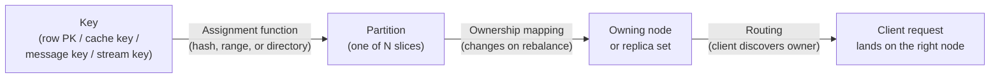

**Decision implications.** The concrete answer to "assignment" is the
single biggest architectural fork in this space: **range-based** assignment
(contiguous key ranges, as Partitioning's range strategy teaches for a
single table) keeps related keys together and supports efficient range
scans, at the cost of being vulnerable to sequential-key hotspots and
needing metadata to track range-to-owner mappings that must itself be kept
consistent. **Hash-based** assignment (of which consistent hashing, Section
4.2, is the cluster-scale-friendly variant) spreads keys near-uniformly and
needs no metadata beyond the hash function and node list, at the cost of
destroying key locality — you cannot cheaply scan "all keys between X and
Y" once they are scattered pseudo-randomly across the ring. Real systems
often pick per-domain: Kafka's default partitioner hashes a message key
(Section 4.6), a distributed cache's client library hashes the cache key
(Section 4.7), and a stream-processing engine hashes the grouping key
(Section 4.8) — hash-based assignment dominates outside databases precisely
because none of those domains routinely need ordered range scans across the
whole keyspace the way a database's `WHERE date BETWEEN` query does.

**Common failure mode.** Treating "partitioning" as synonymous with
"database sharding" and missing that a system's message queue, cache tier,
and stream-processing layer each have their *own* partitioning scheme,
often with different partition counts, different assignment functions, and
different rebalancing triggers than the database shards sitting next to
them in the same architecture. A system can be perfectly partitioned at the
database tier and still develop a queue-level or cache-level hotspot that no
database-focused runbook will catch, because the on-call engineer is
checking shard-map balance instead of consumer-group lag or cache-client
hash-ring skew.

**Scenario.** A social-media platform's architecture has a sharded
PostgreSQL cluster for user profiles (Sharding, Part 06), a Kafka cluster
with 64 partitions for the activity-feed event stream (Section 4.6 of this
chapter), a Redis Cluster tier for session/feed caching (Section 4.7), and a
Flink job that maintains per-user unread-count state (Section 4.8). All four
tiers are "partitioned," but each one's partition count, assignment
function, and operational rebalance trigger are independent decisions —
scaling the Kafka partition count does not touch the database shard map,
and vice versa.

### 4.2 Consistent hashing and the hash ring

**Recap of Sharding's existing derivation.** Sharding (Part 06 CH06,
[Section 4.5](../06_Databases_and_Storage/CH06_Sharding.md#45-routing-mechanism-consistent-hashing))
already derives consistent hashing in full — the ring, the clockwise-lookup
rule, and the ~1/N vs. ~(N-1)/N remap-cost proof against naive modulo
hashing — in the specific context of routing a database query to the
correct shard. Everything in that derivation is correct and this chapter
does not repeat its proof; what follows generalizes the *same* mechanism to
any keyspace, not only a database's primary keys, and is written so it
stands on its own for a reader who has not read Sharding's chapter.

**Definition.** Consistent hashing places both **nodes** and **keys** onto
the same circular numeric space (the "ring") using one shared hash
function. A key's owner is whichever node's position on the ring is the
first one encountered walking clockwise from the key's own hashed position.
The ring's circularity means the position "just past the maximum hash
value" wraps back to zero, so there is no "edge" node that behaves
differently from the rest.

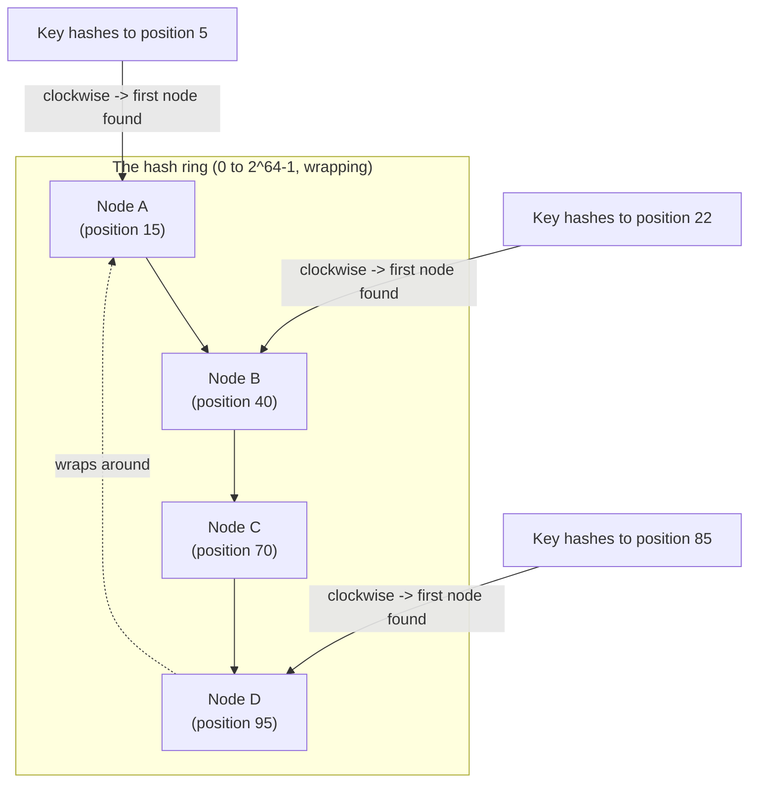

**Mechanism.** Adding a node inserts one new point on the ring; only the
keys between that new point and its counter-clockwise neighbor's *previous*
owner move — every other key's clockwise-nearest node is completely
unaffected, because nothing about the ring changed anywhere else. Removing
a node deletes its point; the keys it owned simply fall through to the next
node clockwise, and again nothing else on the ring moves. This is the
entire reason consistent hashing exists: a naive `hash(key) % N` scheme
recomputes *every* key's owner the moment `N` changes, because the modulus
itself changed, whereas the ring only ever perturbs the *local*
neighborhood of the node that joined or left.

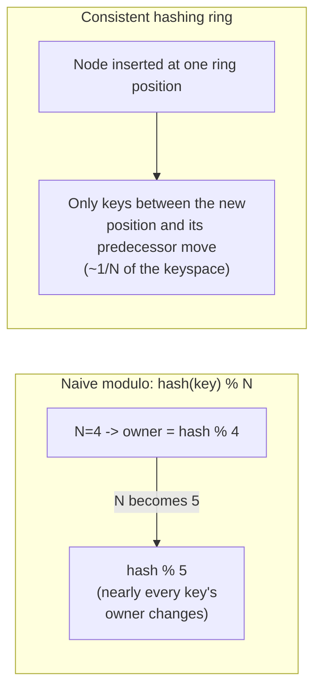

**Decision implications.** Consistent hashing is the default choice any
time nodes are expected to join or leave over the system's lifetime — which
is essentially always true at cluster scale — because the remap cost stays
proportional to the size of the *change* (one node in or out of N) rather
than to the size of the *whole cluster*. The trade-off it accepts in
exchange is losing the ability to assign arbitrary, hand-picked key ranges
to specific nodes (a shard-map router, Sharding Section 4.3, keeps that
flexibility at the cost of needing an explicit, consistently-cached
metadata layer). Outside databases, this trade-off almost always favors
consistent hashing, because Kafka producers, cache clients, and stream
processors rarely need "put this one specific key on this one specific
node" — they need even, low-churn distribution, which is exactly what the
ring provides.

**Common failure mode.** Assuming the ring alone guarantees even load
without also using virtual nodes (Section 4.3) — a bare ring with one point
per physical node produces wildly uneven arc lengths purely from hash-
function randomness, which the vnode refinement exists specifically to fix.

**Scenario.** A distributed cache client library maintains its own in-
process consistent-hashing ring over the configured cache node list
(Section 4.7). When one cache node is added to relieve memory pressure, the
client library's ring only reassigns the roughly 1/N slice of cache keys
that now map to the new node's ring position — every other key's owner is
untouched, so the cache-miss storm that a naive rehash would cause (every
key suddenly "moving" and missing on its new node) never happens.

### 4.3 Virtual nodes (vnodes) for load balancing

**Recap.** Sharding's
[Section 4.5](../06_Databases_and_Storage/CH06_Sharding.md#45-routing-mechanism-consistent-hashing)
already covers vnodes as part of its consistent-hashing derivation
(100-200 vnodes per shard, the load-imbalance failure mode of too few). This
subsection restates the mechanism briefly and focuses on the load-balancing
math and the cluster-scale operational implication, which is the part of
vnodes most relevant to a cluster-wide capacity-planning decision rather
than a single shard's routing correctness.

**Definition.** A virtual node (vnode) is one of many ring positions a
single physical node is responsible for, rather than one physical node
mapping to exactly one ring position. With `V` vnodes per physical node and
`N` physical nodes, the ring holds `N * V` total points, and each physical
node's *total* share of the ring is the sum of `V` separately-hashed,
scattered arcs instead of one single (and, by chance, potentially very long
or very short) contiguous arc.

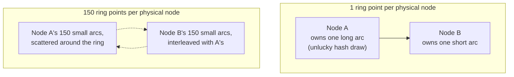

**Mechanism.** By the law of large numbers, summing many independently-
hashed small arcs per node converges to a far more even total share than
relying on one hash draw per node; empirically, 100-200 vnodes per physical
node is the range production systems converge on, because the marginal
load-balancing improvement past roughly 150-200 vnodes is small while the
per-vnode bookkeeping cost (ring memory, gossip/metadata propagation
overhead in gossip-based clusters) keeps growing linearly with `V`.

**Decision implications.** Vnode count is a genuine cluster-wide capacity-
planning parameter, not a fire-and-forget default, for two reasons this
generalization makes clearer than a single-shard view does: first, raising
`V` improves load-balance fairness but increases the *rebalance* fan-out —
when one physical node joins or leaves, its `V` vnodes are now scattered
across `V` different neighbors instead of one, so a rebalance touches more
distinct peer nodes even though the *total* data moved stays close to 1/N.
Second, in clusters using gossip-based membership (a mechanism this
chapter's sibling, the not-yet-drafted forward reference
[Gossip Protocols](CH09_Gossip_Protocols.md), will cover in depth), every
vnode is a separate piece of membership state that must propagate through
the cluster, so vnode count directly trades off against gossip convergence
time at very large node counts.

**Common failure mode.** Picking a vnode count once at cluster launch and
never revisiting it as the cluster grows by an order of magnitude — a count
tuned for 10 nodes (say, 200 vnodes each, 2,000 total ring points) may
produce excessive gossip/metadata overhead at 500 nodes (100,000 ring
points), a failure mode that only shows up as a slow, hard-to-diagnose
membership-convergence regression long after the original tuning decision
was made and forgotten.

**Scenario.** A message-queue-adjacent distributed cache tier starts at 6
nodes with 150 vnodes each (900 ring points) and, over two years of organic
growth, reaches 80 nodes still at 150 vnodes each (12,000 ring points) — the
load-balance quality stays excellent throughout because vnode count per
node never changed, but the operator must still periodically re-validate
that 150 remains an appropriate *per-node* count as node count itself
scales, since vnode count is a per-node knob, not a cluster-total one.

### 4.4 Cluster-scale rebalancing: adding/removing nodes with minimal data movement

**Recap.** Sharding's
[Section 4.6](../06_Databases_and_Storage/CH06_Sharding.md#46-rebalancing-and-live-data-migration)
already teaches the mechanics of a rebalance for database shards in detail:
the backfill-dual-write-verify-cutover-drain sequence, and why routing-
scheme choice (consistent hashing vs. shard-map) determines how much data a
rebalance must move. This subsection generalizes that same operational
sequence to *any* partitioned system, and draws out the **online vs.
offline** framing explicitly, since that distinction matters more once you
are comparing rebalancing across database shards, cache nodes, queue
partitions, and stream-processing workers, each with a different tolerance
for a write- or read-unavailability window.

**Definition.** Rebalancing is the operational process of changing which
node owns which partition(s) after cluster membership changes (a node
joins, leaves, or fails), carried out so that the *minimum necessary* data
or state actually moves — under consistent hashing, that minimum is close
to `1/N` of the total for one node added to or removed from an `N`-node
cluster, versus `(N-1)/N` under naive modulo hashing (Section 4.2).

**Mechanism — offline rebalancing.** The simplest approach: pause writes
(and often reads) to the affected partitions, copy the data to its new
owner, verify the copy, then resume traffic pointed at the new owner. This
is operationally simple and easy to reason about (no concurrent-write
correctness concerns during the copy), but it introduces a real
availability gap sized to however long the copy takes — acceptable for a
scheduled maintenance window, unacceptable for an internet-facing
production system with a nonzero-availability SLA (service level
agreement).

**Mechanism — online rebalancing.** The production-grade approach:
dual-write the affected key range to both the old and new owner while a
background process copies historical data and catches up to the write
stream, verify the new owner is caught up (usually via a checksum or row/
message-count comparison), atomically cut routing over to the new owner,
then drain and decommission the old owner's copy. This adds real
implementation complexity — the dual-write window must handle write
ordering and idempotency correctly, and the cutover must be atomic from the
client's point of view — but it eliminates the availability gap entirely,
which is why every rebalancing tool for a production-scale queue, cache, or
database (Kafka's partition reassignment tool, a cache cluster's live
resharding, a database's online shard-split) implements some variant of this
sequence rather than the offline one.

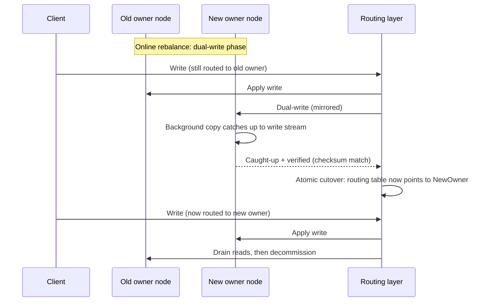

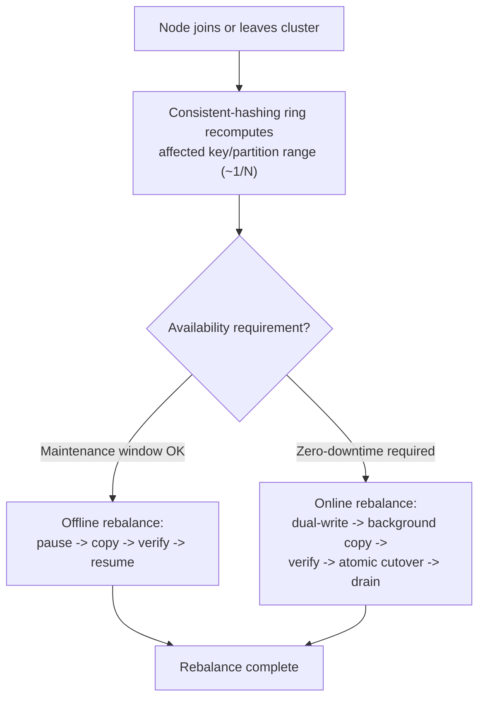

**Decision implications.** The online-vs-offline choice is really a
question of what "the partition" is: for a database shard or a large cache
node, the data volume per partition is large enough that even a `1/N` slice
can take minutes to hours to copy, making online rebalancing close to
mandatory for anything internet-facing. For a message-queue partition, the
"data" that must move on a consumer-side rebalance is not the queue's
stored messages at all (they stay on the broker) but the *ownership* of
who is allowed to consume from that partition — Kafka's consumer-group
rebalance (Section 4.6) is therefore closer to "offline" in spirit (the
partition briefly has no active consumer while the group re-converges) but
the absolute pause is typically milliseconds to a few seconds, not the
hours a large database-shard copy might take, so the same online/offline
framing applies but the concrete cost profile is completely different by
domain.

**Common failure mode.** Running a full cluster-wide rebalance to fix a
symptom that a single-partition hotspot fix (Section 4.5) would have solved
more cheaply and with less blast radius — exactly the mistake Sharding's
[Section 4.9](../06_Databases_and_Storage/CH06_Sharding.md#49-hot-shard--hotspot-mitigation)
flags for database shards, and equally true for cache and queue partitions:
rebalancing every partition when only one key (or one partition) is
actually hot moves a large amount of unrelated data for no benefit, and, if
the hot key's traffic pattern is intrinsic to the key rather than to which
node happens to hold it, the hotspot simply reappears on whichever node the
rebalance lands it on next.

**Scenario.** A distributed cache cluster scales from 8 to 12 nodes ahead
of an expected traffic spike. Because the cache client library uses
consistent hashing with vnodes, only roughly `4/12 ≈ 33%` of cache keys
remap to the four new nodes; the operator runs this as an online rebalance
(warming the four new nodes from the existing nodes' data while the
existing nodes keep serving unaffected reads), so cache hit rate dips only
slightly during the warm-up window instead of the near-total cache-miss
storm a full cold-start of all 12 nodes would cause.

### 4.5 Hotspot detection and mitigation at cluster scale

**Recap.** Sharding's
[Section 4.9](../06_Databases_and_Storage/CH06_Sharding.md#49-hot-shard--hotspot-mitigation)
already teaches hot-shard mitigation for databases in depth: skew root
causes, the diagnose-before-you-rebalance decision flow, and load-aware
placement and sub-splitting as the two core fixes. This subsection restates
the general principle briefly and focuses on how hotspot detection and
mitigation take a different concrete shape once the partitioned resource is
a cache node, a queue partition, or a stream-processing task rather than a
database shard.

**Definition.** A hotspot (or hot partition) is any partition whose
*access load* — not necessarily its data volume — is disproportionately
high relative to the cluster's mean, even when the partitioning scheme's
placement was itself perfectly fair. This distinction (placement fairness
vs. access-pattern skew) is the single most important idea in this
subsection: a consistent-hashing ring with 150 vnodes per node (Section
4.3) guarantees even *keyspace* distribution, but says nothing about
whether the *traffic* landing on any given key or partition is even, and
real-world access patterns (a viral post, a single misbehaving tenant, a
celebrity user, a single very "hot" message key) are essentially never
uniform.

**Mechanism.** Detecting a hotspot requires per-partition load metrics
(requests/sec, bytes/sec, or messages/sec per partition, not just per
node), because a node hosting several partitions can look healthy in
aggregate while one of its partitions absorbs nearly all of that load.
Once detected, two categories of fix apply, and choosing between them is
the crux of the decision:

1. **Load-aware placement** — when creating or rebalancing partitions,
   weight assignment by observed or predicted load rather than purely by
   key range or hash position, so a known-heavy partition (or, in a queue,
   a known-heavy partition key) is placed on a less-loaded node rather than
   wherever the hash function happens to put it.
2. **Splitting the hot partition further** — subdividing the hot
   partition's key range into two or more smaller partitions and
   redistributing them, narrowing the range that any single node must
   absorb. This is a *local* operation (touches one partition, not the
   whole cluster) and is the correct fix when the skew genuinely lives
   inside a bounded key range; it is the wrong fix, and can even relocate
   the hotspot rather than resolve it, if the split boundary does not
   actually isolate the hot key(s) — a naive midpoint bisection can leave
   the hot key(s) entirely inside one of the two halves, simply moving the
   fire to a different node instead of putting it out (demonstrated
   directly in this chapter's Section 10 code example,
   [03_hotspot_detection_and_split.py](../code/python/distributed-partitioning-chapter/03_hotspot_detection_and_split.py),
   where a first split still leaves a hot half until the boundary is chosen
   around the actual hot sub-range).

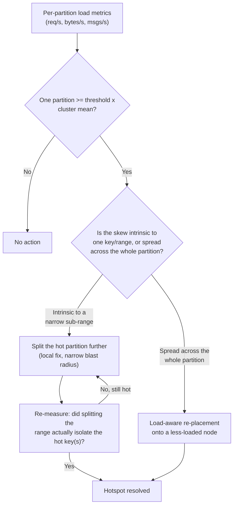

**Decision implications.** The general principle carried over from
Sharding's database framing holds unchanged in every domain this chapter
covers: **diagnose before you rebalance the whole cluster.** A cluster-wide
rebalance (Section 4.4) redistributes the *entire* keyspace and is
expensive in data movement and operational risk; a hotspot is, by
definition, usually confined to a small fraction of the keyspace, so the
narrowly-scoped fix (split or load-aware re-placement of just the affected
partition) is almost always cheaper and safer than a full rebalance, and a
full rebalance frequently does not even fix the problem if the skew is
intrinsic to a specific key rather than to which node currently holds it.

**Common failure mode.** Conflating "one node is overloaded" with "the
cluster is unbalanced" and triggering a full rebalance, when per-partition
metrics would have shown that node hosts several *evenly loaded* partitions
plus one severely hot one — the rebalance redistributes the even partitions
for no benefit and, unless it happens to also split the hot one, leaves the
actual problem exactly where it was.

**Scenario.** A Kafka topic partitioned by user ID develops a hot
partition because a single high-follower-count account generates a
disproportionate share of the topic's events. Per-partition consumer-lag
metrics (Section 4.6, Section 14) show one partition's lag growing while
the other 63 stay flat. The fix is not adding more Kafka brokers (a
cluster-wide operation) but either accepting a dedicated, differently-
partitioned "firehose" topic for known high-volume keys, or, if the
partitioner is custom, adjusting its salting so this specific key's traffic
splits across more than one partition — the queue-specific version of
"splitting the hot partition further."

### 4.6 Partitioning in message queues and event streams (Kafka)

**Definition.** In a partitioned message queue or event-streaming platform
such as Apache Kafka, a **topic** is divided into a fixed number of
**partitions** at creation time; each partition is an ordered, append-only
log, and Kafka guarantees ordering *within* a partition but not across
partitions of the same topic. **Consumer groups** are the mechanism for
horizontal read scaling: every partition in a topic is owned, at any given
moment, by exactly one consumer within a given consumer group, so a group
with `C` consumers and a topic with `P` partitions can have at most `P`
consumers doing useful work simultaneously (extra consumers beyond `P` sit
idle, exactly as this chapter's Section 10 code example demonstrates for a
12-partition topic with 5 consumers).

**Mechanism — partition assignment.** A producer decides which partition a
message goes to, typically by hashing an explicit message key (identical in
spirit to consistent hashing's key-to-ring mapping, though Kafka's default
partitioner uses a simpler `hash(key) % num_partitions` scheme rather than
a ring, precisely because Kafka partition *count* is a deliberate, manually-
changed value rather than something that grows/shrinks organically the way
a consistent-hashing ring's node count does — growing partition count
changes every keyed message's target partition, so it is treated as a
rare, planned operation, not an elastic scale-out). Messages without an
explicit key are spread round-robin (or, in recent Kafka versions, via a
sticky partitioner that batches efficiently) across partitions instead.

**Mechanism — consumer-group rebalancing.** When a consumer joins or
leaves a group (including a crash the group coordinator detects via missed
heartbeats), the group coordinator triggers a **rebalance**: a
join-group/sync-group protocol exchange that recomputes the partition-to-
consumer assignment for the entire group. The two classic assignment
strategies are the **range assignor** (partitions divided into contiguous
chunks per consumer — simple, but a partition count that does not divide
evenly leaves a remainder unevenly spread, exactly as this chapter's
Section 10 code example shows for 12 partitions across 5 consumers) and the
**round-robin assignor** (partitions dealt out one at a time across
consumers — more even, at the cost of any range locality). Older ("eager")
rebalance protocols revoke *every* partition from *every* consumer before
reassigning from scratch — a brief "stop the world" pause for the whole
group — while modern "cooperative sticky" assignors try to avoid revoking a
partition from a consumer that will keep it anyway, shrinking the pause to
only the partitions that actually change owners.

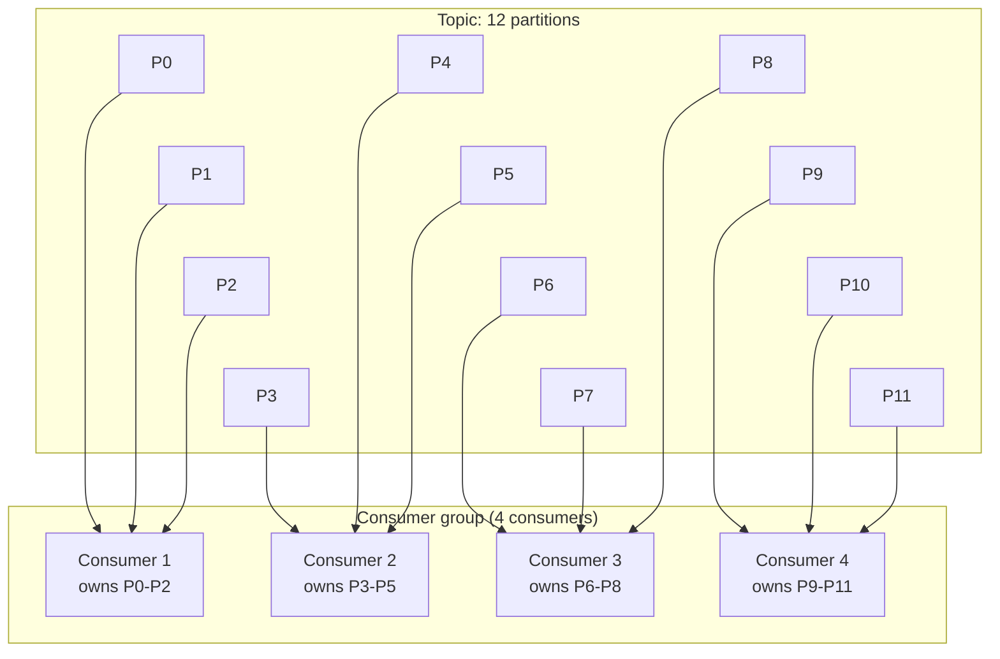

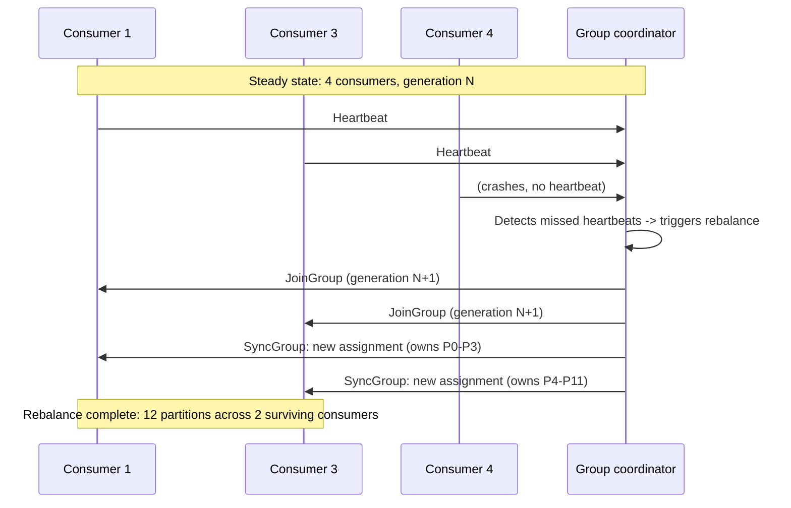

**Decision implications.** Partition count is chosen up front and is
expensive to change later precisely because it changes keyed-message
routing, so it should be sized for the cluster's *eventual* target consumer
parallelism (partition count is the hard ceiling on consumer-group
parallelism, per the `P` vs. `C` relationship above), not just today's. The
range-vs-round-robin assignor choice is a locality-vs-evenness trade-off
identical in shape to range-vs-hash partitioning in Section 4.1, and the
eager-vs-cooperative rebalance protocol choice trades simplicity for
reduced pause duration exactly the way offline-vs-online rebalancing does
in Section 4.4, even though a consumer-group rebalance moves partition
*ownership*, not the underlying stored data (which stays on the broker
throughout).

**Common failure mode.** Under-provisioning partition count relative to
expected consumer scale-out, then discovering that adding more consumers
past the partition count buys nothing — extra consumers simply sit idle
(shown directly in Section 10's uneven-split example) — and that fixing it
requires a manual, keyed-message-remapping partition-count increase rather
than an elastic scale-out the way adding a node to a consistent-hashing
ring would be.

**Scenario.** An order-processing pipeline's Kafka topic is created with 6
partitions, keyed by customer ID. A traffic surge motivates scaling the
consumer group from 4 to 10 consumers to keep up, but only 6 of the 10 ever
receive a partition — the other 4 sit idle. The team must increase the
topic's partition count to, say, 20 (accepting that this reshuffles which
partition every keyed message lands on going forward, an operation planned
during a lower-traffic maintenance window) before the extra consumers can
do any real work.

### 4.7 Partitioning in distributed caches

**Definition.** A distributed cache tier (a fleet of cache nodes such as
Memcached instances, or a client speaking to a Redis Cluster) partitions
its keyspace across nodes using the same consistent-hashing-with-vnodes
mechanism as Section 4.2/4.3, with one structurally important difference
from a database or queue: for a plain Memcached-style fleet, the
partitioning logic typically lives **entirely in the client library**, not
behind a server-side router — each application instance's cache client
independently computes, from its own local copy of the node list and hash
ring, which node owns a given cache key, then talks to that node directly.
Redis Cluster is a partial exception: it moves ownership tracking onto the
server side via a fixed 16,384-slot scheme (a related but distinct
mechanism, already the subject of
[Redis](../06_Databases_and_Storage/CH16_Redis.md) Section 4.4's dedicated
teaching — recapped, not re-taught, here), while plain Memcached-style
fleets rely purely on client-side consistent hashing as described below.

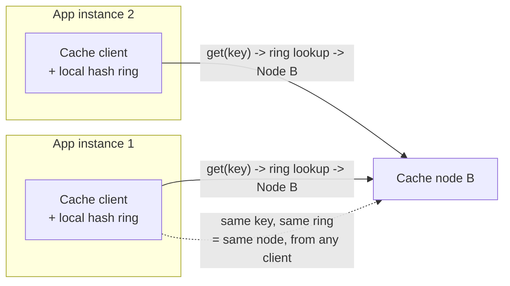

**Mechanism.** Because every application instance's cache client
independently runs the same hash function over the same configured node
list, they all agree on which node owns a given key without any central
coordinator — the "ring" is really just a shared, deterministic algorithm
plus a shared view of the current node list, kept consistent by
configuration management or a lightweight discovery mechanism (not a
distributed consensus protocol, since a brief window of slightly-stale node
lists across clients only costs a few cache misses, not a correctness
violation, unlike a database disagreeing about shard ownership).

**Decision implications.** Client-side consistent hashing means a node-list
change (a cache node added, removed, or replaced) must propagate to every
client, and until it does, different application instances may briefly
disagree about a key's owner — harmless for a cache (a miss just falls
through to the origin data store and repopulates), but this same client-
side approach would be unacceptable for a system of record, where two
clients disagreeing about a shard's owner risks a correctness violation
rather than a mere performance blip. This tolerance for brief inconsistency
is exactly why client-side hashing is the norm for caches but not for
databases.

**Common failure mode.** Cache-client node lists drifting out of sync
across a large fleet of application instances (some updated, some stale)
during a rolling cache-cluster change, producing a period of markedly
uneven hit rates as different clients momentarily send the same key to
different nodes — not a correctness bug, but a performance regression that
is easy to misdiagnose as a cache-node capacity problem rather than a
client-side ring-configuration propagation lag.

**Scenario.** A cache fleet scales from 8 to 10 nodes to relieve memory
pressure. Application instances pick up the new node list at different
times as their configuration-refresh cycles fire (some every 30 seconds,
some every 5 minutes, depending on deployment staggering) — for the several
minutes until every instance has converged, a small fraction of keys are
briefly served inconsistently by two different node's view of the ring;
cache hit rate dips slightly during this window but recovers automatically
once every client's ring converges, with no manual intervention required.

### 4.8 Partitioning in stream-processing systems

**Definition.** In a stream-processing engine (Kafka Streams, Apache Flink,
Spark Structured Streaming), partitioning determines how a keyed
computation's **state and parallelism** are distributed across worker
tasks: each parallel task instance owns a disjoint subset of the
input stream's partitions (Section 4.6) or of the grouping-key space, and
correspondingly owns the in-memory or on-disk **state store** for every
key that falls into its assigned range — a windowed aggregation (say,
per-user rolling counts) can only be computed correctly if every event for
a given key is always routed to the same task instance, so that the task
sees the full history for that key rather than a partial view scattered
across multiple instances.

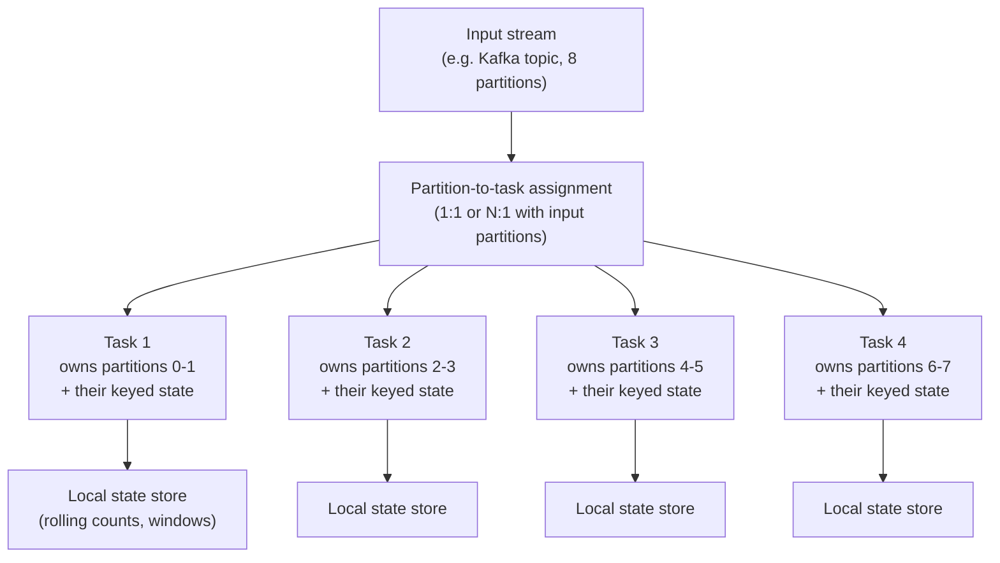

**Mechanism.** Most stream-processing engines inherit their input-side
partitioning directly from the source they read (a Kafka Streams job's
task parallelism is bounded by its input topic's partition count, exactly
as Section 4.6's `P`-vs-`C` ceiling describes for a consumer group); if the
job re-keys the data mid-pipeline (a `groupBy` on a different field than
the input partition key), the engine must **repartition** — physically
shuffle records across the cluster network so each task now receives every
record for its newly-assigned key range, an operation with real network and
latency cost, directly analogous to a database's cross-shard query
(Sharding's Section 4.7) needing to fan out and merge across nodes whose
data was not co-located on the query's actual predicate.

**Decision implications.** Choosing a grouping key that matches (or is
derived compatibly from) the input stream's existing partition key avoids
a repartition shuffle entirely, which is frequently the single biggest
performance lever available in a stream-processing job's design — the same
underlying idea as choosing a partition key that matches dominant query
predicates in Partitioning's (Part 06 CH05) single-node framework, just
applied to a distributed streaming job's grouping operations instead of a
table's `WHERE` clauses. When a repartition is unavoidable (the business
logic genuinely needs to group by a different field), it should be treated
as an explicit, costed design decision, not an incidental side effect of
writing a `groupBy` call.

**Common failure mode.** Chaining several `groupBy`/`keyBy` operations on
different fields without realizing each one that changes the grouping key
triggers a full network shuffle — a job with three sequential re-keying
operations pays for three full data reshuffles, often invisible in the code
itself and only visible in a network-I/O or back-pressure metric once the
job is under real production load.

**Scenario.** A fraud-detection stream-processing job first groups
transactions by account ID to compute a rolling spend total (matching the
input Kafka topic's existing partition key — no shuffle), then re-groups by
merchant category to compute a separate category-level anomaly score
(a genuine re-key, since merchant category has no relationship to account
ID) — the second aggregation necessarily pays a full repartition shuffle,
which the team explicitly budgets for in the job's expected latency rather
than discovering as an unplanned performance regression after deployment.

### 4.9 Partitioning and replication (recap)

Partitioning decides **which node(s) own a given slice** of data or state;
replication decides **how many copies of that slice exist and how they stay
consistent with each other** — the two are orthogonal and, in essentially
every production system, applied together: each partition is typically
backed by a small replica set (for example, one leader plus two followers)
rather than a single, unreplicated node, so that losing one node does not
lose an entire slice of the keyspace. This chapter does not re-teach
replication mechanics; the full leader/follower, quorum, and failover
treatment lives in
[Replication](../06_Databases_and_Storage/CH07_Replication.md) (Part 06
CH07) for the database-specific case, and will be covered generally for
distributed systems in this part's own forward-referenced sibling chapter,
[Replication](CH10_Replication.md), once drafted. Every diagram in this
chapter that shows "a node owns a partition" is implicitly shorthand for "a
replica set owns a partition," with that replica set's internal consistency
model governed entirely by the replication layer, not by anything taught
here.

## 5. Internal Working

Pulling Sections 4.1-4.8 together, here is the end-to-end path a single
write takes through a generically partitioned system, regardless of which
domain (database shard, cache, queue, stream job) it is:

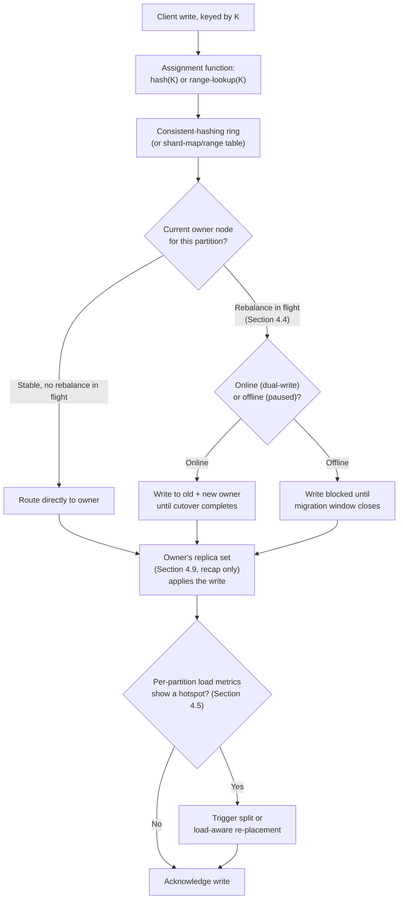

The routing layer's job, concretely, is maintaining the current
"partition -> owner" mapping and keeping every client (or every server-
side router) reading a *consistent enough* view of it — for client-side
schemes (Section 4.7), this means every client eventually converges on the
same node list; for server-side schemes (a database's shard map, a Kafka
broker's partition-leader metadata), this means the metadata store itself
(often backed by a consensus protocol — see the forward reference to
[Consensus](CH07_Consensus.md), already drafted in this part) must never let
two nodes simultaneously believe they own the same partition, since that
is exactly the split-brain risk Replication's fencing-token/STONITH
treatment (recapped, not re-taught, in Section 4.9) exists to prevent.

## 6. Design Principles

- **Default to hash-based (consistent-hashing) assignment unless you have a
  concrete, recurring need for ordered range scans.** Range-based
  assignment (Partitioning, Part 06) buys locality at the cost of
  sequential-key hotspot risk and rebalance complexity; most non-database
  domains in this chapter (queues, caches, stream jobs) never need range
  scans across the whole keyspace, so hash-based assignment should be the
  starting assumption, not an afterthought.
- **Choose vnode count as a deliberate capacity-planning parameter**
  (Section 4.3), revisited as cluster size changes by an order of
  magnitude, not a one-time default.
- **Diagnose before you rebalance.** A full cluster rebalance (Section 4.4)
  is expensive and often does not fix a hotspot that is intrinsic to one
  key or one narrow range (Section 4.5) — always check per-partition
  metrics before choosing which fix to apply.
- **Prefer online (dual-write/cutover) rebalancing for any system with a
  real availability requirement**, reserving offline rebalancing for
  systems with a genuine, accepted maintenance window.
- **Size partition count for eventual, not current, parallelism** in
  systems (like Kafka) where partition count is expensive to change later,
  since partition count is a hard ceiling on downstream consumer/task
  parallelism (Section 4.6, Section 4.8).
- **Match grouping/re-keying operations to existing partition keys wherever
  the business logic allows it**, to avoid unnecessary network-shuffle
  cost in stream-processing pipelines (Section 4.8).
- **Treat partitioning and replication as separate, composable decisions**
  (Section 4.9) — decide how data is sliced first, then decide separately
  how many copies of each slice exist and how they fail over.

## 7. Architecture Patterns

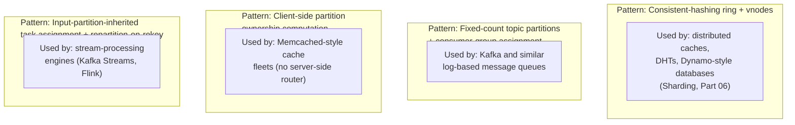

Each pattern above is a concrete instantiation of the general assignment/
ownership/routing model in Section 4.1, specialized to the operational
constraints of its domain: the ring pattern optimizes for elastic,
frequent membership change (nodes joining/leaving often); the fixed-count
topic-partition pattern optimizes for stable, rarely-changed partition
count with frequent *consumer* membership change instead; the client-side
pattern optimizes for a system (a cache) that tolerates brief inconsistency
in exchange for avoiding a server-side routing hop; and the stream-
processing pattern optimizes for inheriting an upstream partitioning
scheme wherever possible, paying the repartition cost only when the
business logic genuinely requires a different key.

## 8. Production Architecture

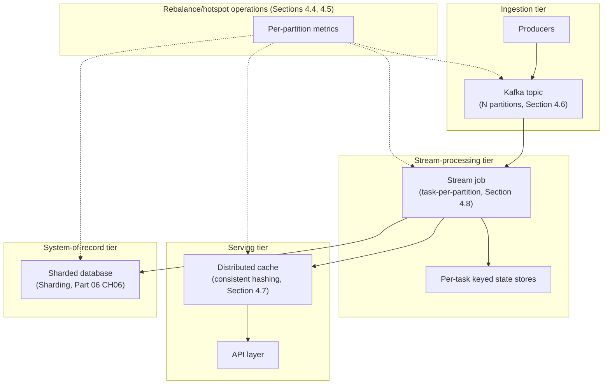

A realistic production system almost never partitions only one tier — the
diagram above shows four independently-partitioned layers (message queue,
stream-processing tasks, distributed cache, and sharded database) feeding
into and out of each other, each with its own partition count, assignment
function, and rebalance/hotspot monitoring, exactly as Section 4.1's
closing scenario describes. Operationally, this means a single "partition
count" or "rebalance status" dashboard is never sufficient — production
observability (Section 14) must track each tier's partitioning health
independently.

## 9. Implementation

Implementing cluster-scale partitioning for a new system generally follows
this sequence:

1. **Choose the assignment function** (Section 4.1) — hash-based (default)
   or range-based, based on whether ordered range scans are a genuine,
   recurring requirement.
2. **Choose the routing architecture** — server-side (a shard map, a
   broker's partition-leader metadata) or client-side (Section 4.7), based
   on whether the domain can tolerate brief cross-client inconsistency.
3. **Size initial partition/vnode count for eventual scale** (Sections 4.3,
   4.6), since both are expensive to change later in several domains this
   chapter covers.
4. **Build (or adopt) the rebalance tooling** (Section 4.4) before it is
   ever needed under production load — this includes both the online
   dual-write/cutover machinery and the observability (Section 14) to
   verify a rebalance completed correctly.
5. **Instrument per-partition metrics from day one** (Section 4.5, Section
   14), not only per-node metrics, so a hotspot is diagnosable the first
   time it occurs rather than the third time, after an unnecessary full
   rebalance was already attempted.

## 10. Complete Code Examples

Four runnable Python examples, all under
[code/python/distributed-partitioning-chapter/](../code/python/distributed-partitioning-chapter/):

- **[01_consistent_hashing_ring.py](../code/python/distributed-partitioning-chapter/01_consistent_hashing_ring.py)**
  — a from-scratch consistent-hashing ring with configurable virtual nodes
  per physical node (Sections 4.2, 4.3). Demonstrates the load-distribution
  improvement vnodes provide over a bare one-point-per-node ring, and
  measures actual remap cost (consistent hashing vs. naive modulo) when
  scaling a 5-node cluster to 6 nodes, directly reproducing the ~1/N vs.
  ~(N-1)/N proof this chapter's Section 4.2 states.
- **[02_rebalancing_simulation.py](../code/python/distributed-partitioning-chapter/02_rebalancing_simulation.py)**
  — extends the ring into a multi-step rebalance timeline (Section 4.4),
  modeling both offline (pause-copy-resume) and online (dual-write-cutover)
  rebalance strategies as a cluster scales from 4 to 7 nodes and back down
  to 6, reporting keys-moved and simulated timing for each step.
- **[03_hotspot_detection_and_split.py](../code/python/distributed-partitioning-chapter/03_hotspot_detection_and_split.py)**
  — simulates skewed (viral-content-style) key access against a uniformly-
  partitioned keyspace, detects the resulting hot partition via a load-
  ratio threshold (Section 4.5), and mitigates it by splitting the hot
  partition's key range — including surfacing the failure mode where a
  naive midpoint split still leaves a hot half, motivating a smarter
  split-boundary choice.
- **[04_kafka_partition_assignment_simulator.py](../code/python/distributed-partitioning-chapter/04_kafka_partition_assignment_simulator.py)**
  — simulates Kafka-style topic-partition assignment (range and round-
  robin assignors, Section 4.6) and consumer-group rebalancing as
  consumers join and leave, including the uneven-split failure mode when
  partition count does not divide evenly across the consumer group.

All four were executed directly (`python <file>.py`) during authoring and
verified to run to completion with the expected output shape described in
each file's module docstring.

## 11. Performance

The dominant performance lever in every domain this chapter covers is
**avoiding unnecessary data movement**: consistent hashing's ~1/N remap
cost (Section 4.2) versus naive modulo's ~(N-1)/N is not a marginal
optimization, it is the difference between a rebalance that finishes in
seconds and one that saturates cluster network bandwidth for hours. Vnode
count (Section 4.3) trades a small amount of per-node bookkeeping overhead
for materially more even load distribution, which in turn avoids the tail-
latency cost of a small number of overloaded nodes dragging down p99
(99th-percentile) latency for the whole cluster. In stream-processing
specifically (Section 4.8), avoiding an unnecessary repartition shuffle is
frequently the single largest available latency and throughput win in a
job's design.

## 12. Scalability

Cluster-scale partitioning is, definitionally, the mechanism that lets a
system scale past a single node's ceiling by adding nodes rather than
bigger ones (horizontal vs. vertical scaling) — but the scalability curve
is not unbounded in practice. Gossip-based membership propagation (Section
4.3, forward-referenced to [Gossip Protocols](CH09_Gossip_Protocols.md))
degrades as vnode count times node count grows very large; consumer-group
rebalance pause duration (Section 4.6) grows with group size under the
older eager protocol; and per-partition metadata overhead (routing tables,
partition leader elections) grows linearly with partition count regardless
of domain. Real systems therefore plan for partition/vnode/node count
targets an order of magnitude beyond current needs, not merely "enough for
today," precisely because several of these parameters are expensive to
change after the fact (Section 4.6's Kafka partition-count example is the
sharpest illustration).

## 13. Security

Partition-routing metadata (a shard map, a ring's node list, a topic's
partition-leader assignment) is a high-value target: an attacker who can
corrupt or spoof this metadata can redirect reads or writes to a node they
control, or trigger a denial-of-service by forcing spurious rebalances.
Routing/membership metadata should be authenticated and, where it is
propagated over the network (gossip, a metadata service, a broker's
controller), encrypted in transit — the general Transport Layer Security
(TLS) mechanics for this are owned by
[TLS](../05_Networking_and_OS/CH06_TLS.md) and recapped, not re-taught,
here. A cache tier's client-side ring computation (Section 4.7) also
implies every client must trust the same, tamper-proof node-list source;
an attacker able to inject a false node into that list could redirect a
slice of cache traffic to an attacker-controlled node.

## 14. Observability

Per-partition (not merely per-node) metrics are the non-negotiable
observability requirement this chapter's Section 4.5 depends on:
request/message rate, latency, and error rate broken out by partition ID,
plus rebalance-in-progress state (Section 4.4) and, for message queues
specifically, per-partition consumer lag (the gap between the latest
produced offset and a consumer's last-committed offset), which is the
single most useful early-warning signal for a developing queue-side
hotspot (Section 4.5's scenario). Ring/membership convergence lag (how
long it takes every client or node to agree on the current partition-to-
owner mapping, Section 4.3, Section 4.7) should also be tracked explicitly,
since a large convergence lag is the leading indicator for the kind of
transient inconsistency described in Section 4.7's cache scenario.

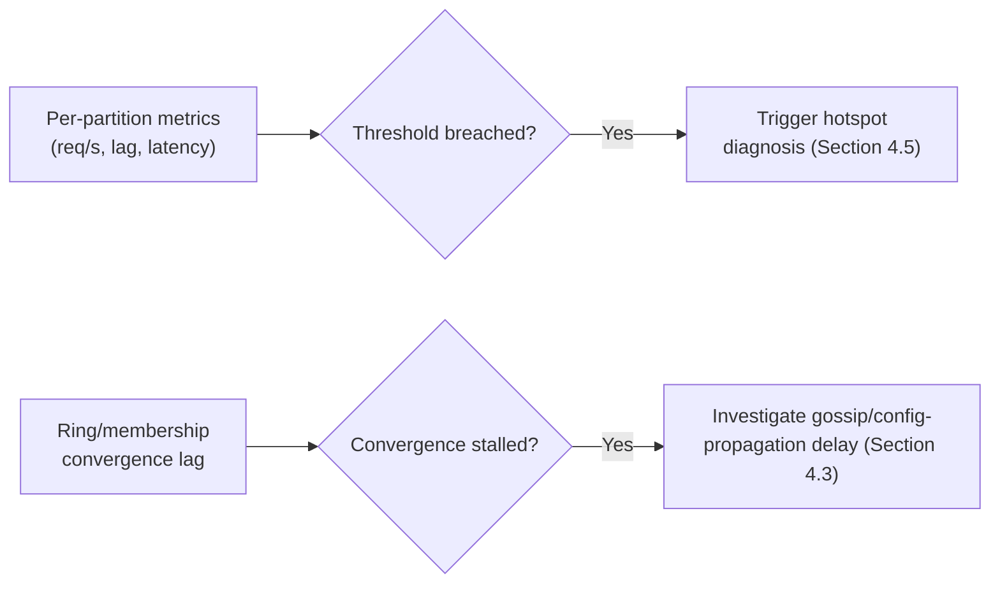

## 15. Failure Scenarios

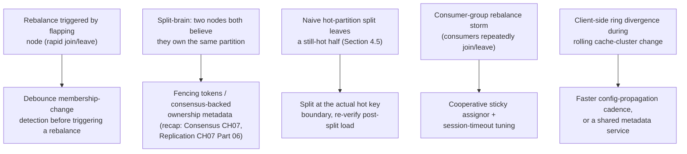

Each failure mode above maps directly to a mechanism this chapter teaches:
flapping-node rebalance storms are mitigated by not treating every
membership blip as a real topology change; split-brain ownership conflicts
are prevented by the same fencing/consensus mechanisms Replication and
Consensus already own; a naive-split-still-hot failure is exactly what this
chapter's Section 10 code example reproduces; consumer-group rebalance
storms are the queue-specific analogue of thrashing; and cache-ring
divergence is the client-side-routing failure mode unique to Section 4.7's
architecture.

## 16. Testing

- **Rebalance-under-load tests.** Execute a full node-add and node-remove
  cycle while a steady synthetic write/read load runs against the cluster,
  verifying no data loss and measuring the actual vs. theoretical (1/N)
  remap percentage — Section 10's `02_rebalancing_simulation.py` is a
  minimal version of this kind of test.
- **Hotspot-injection tests.** Synthetically skew traffic toward a single
  key or narrow key range (as `03_hotspot_detection_and_split.py` does) and
  verify the monitoring layer actually fires the expected alert and that
  the mitigation (split or re-placement) measurably reduces the skew
  afterward, rather than merely relocating it.
- **Consumer-group membership-churn tests.** Repeatedly add and remove
  consumers from a group under load and verify every partition is always
  owned by exactly one consumer at any instant, with no partition ever
  briefly owned by two consumers simultaneously (a correctness violation)
  or by zero consumers for longer than the expected rebalance pause.
- **Client-side ring-convergence tests.** For a client-side partitioning
  scheme (Section 4.7), verify that after a node-list change, every client
  instance converges to an identical ring within an expected time bound.

## 17. Common Mistakes

- Treating "partitioning" as synonymous with "database sharding" and never
  instrumenting per-partition metrics for the queue, cache, or stream-
  processing tiers of the same system (Section 4.1).
- Picking vnode count once and never revisiting it as node count grows by
  an order of magnitude (Section 4.3).
- Reaching for a full cluster-wide rebalance to fix what per-partition
  metrics would show is a single hot partition (Section 4.5).
- Splitting a hot partition at its numeric midpoint without verifying the
  actual hot key(s) end up isolated by that split (Section 4.5, Section
  10).
- Under-provisioning Kafka (or similar) partition count relative to
  eventual consumer parallelism, then discovering extra consumers sit idle
  (Section 4.6).
- Chaining multiple re-keying operations in a stream-processing job without
  realizing each one that changes the grouping key triggers a full network
  shuffle (Section 4.8).
- Assuming client-side cache-ring convergence is instantaneous across a
  large fleet of application instances (Section 4.7).

## 18. Best Practices

- Instrument per-partition (not just per-node) metrics for every
  partitioned tier in the architecture from day one (Section 14).
- Default to consistent hashing with 100-200 vnodes per node unless a
  concrete range-scan requirement argues otherwise (Sections 4.2, 4.3).
- Build and rehearse online (dual-write/cutover) rebalance tooling before
  a real rebalance is ever needed under production load (Section 4.4).
- Diagnose the root cause of a hotspot (intrinsic to a key, or spread
  across a whole partition) before choosing between splitting and
  re-placement (Section 4.5).
- Size message-queue partition count for eventual, not current, consumer
  parallelism (Section 4.6).
- Prefer grouping/re-keying operations in stream-processing jobs that
  match an existing partition key wherever the business logic allows it
  (Section 4.8).
- Treat partitioning and replication as separate, explicitly reasoned-about
  decisions rather than conflating "how many copies" with "which node
  owns this slice" (Section 4.9).

## 19. Anti-Patterns

- **Big-bang, whole-cluster rebalances** for a problem a single-partition
  split would have fixed with far less blast radius (Section 4.5).
- **One-vnode-per-node rings**, which reintroduce the very load-imbalance
  problem consistent hashing exists to solve (Section 4.3).
- **Ignoring per-partition consumer lag** in a message queue until it
  becomes a customer-visible processing delay, rather than alerting on it
  proactively (Section 4.6, Section 14).
- **Unbounded repartition chains** in stream-processing jobs, where every
  `groupBy` silently pays a full network shuffle with no design-time
  accounting for the cumulative cost (Section 4.8).
- **Treating client-side cache-ring convergence as instantaneous**, leading
  to unexplained, intermittent hit-rate dips during routine cache-cluster
  changes being misdiagnosed as capacity problems (Section 4.7).

## 20. Trade-off Analysis

| Decision | Benefit | Cost |
|---|---|---|
| Hash-based (consistent-hashing) assignment over range-based | Even load distribution, no metadata-consistency burden | Loses ordered range-scan locality |
| High vnode count (150-200) over low/none | Even load distribution across physical nodes | More per-node bookkeeping and gossip/metadata overhead |
| Online (dual-write/cutover) rebalancing over offline | No availability gap during rebalance | Higher implementation complexity (ordering, idempotency, atomic cutover) |
| Splitting a hot partition over a full cluster rebalance | Narrow blast radius, cheaper, often faster to resolve | Only fixes skew genuinely intrinsic to the partition's key range |
| Large Kafka-style partition count over small | High future consumer/task parallelism ceiling | More per-partition metadata/leader-election overhead; harder to shrink later |
| Client-side cache partitioning over a server-side router | No extra routing hop/service to operate | Tolerates only brief cross-client inconsistency, unsuitable for a system of record |

## 21. Comparison Table

| Domain | What gets partitioned | Typical assignment function | Rebalance trigger | Routing architecture |
|---|---|---|---|---|
| Sharded database (Part 06 CH06) | Rows across shards | Consistent hashing or shard-map | Node add/remove/failure | Server-side router |
| Distributed cache (Section 4.7) | Cache keyspace across nodes | Consistent hashing (client-side) or fixed hash-slots (Redis Cluster) | Node add/remove | Client-side (or Redis Cluster's server-assisted slot map) |
| Message queue / event stream (Section 4.6) | Topic keyspace across partitions; partitions across consumers | Hash(key) mod partition-count; range/round-robin consumer assignment | Consumer join/leave/crash | Broker-side partition-leader metadata + consumer-group coordinator |
| Stream-processing job (Section 4.8) | Grouping-key space across tasks | Inherited from input partitioning, or re-hashed on re-key | Job parallelism change; input partition-count change | Job-manager task assignment |

## 22. Real-World Case Study

**Kafka partition-count under-provisioning at a mid-size event-driven
platform.** A platform's core "user activity" Kafka topic was created early
in the company's life with 8 partitions, sized for the consumer-group scale
of that era. Over several years of organic growth, the consuming
application's team scaled its consumer-group instance count well past 8 in
response to rising traffic, discovering — only once on-call engineers
investigated why per-instance central processing unit (CPU) utilization
stayed flat despite adding instances — that every consumer beyond the 8th
was structurally idle, exactly the ceiling this chapter's Section 4.6
describes and Section 10's assignment-simulator code reproduces directly.
The fix required a planned, keyed-message-remapping partition-count
increase (to 64, sized generously for several more years of growth) during
a scheduled low-traffic window, plus a lasting process change: partition
count was added as an explicit capacity-planning checkpoint in the team's
architecture-review process (Section 26) rather than a one-time launch
decision, directly reflecting this chapter's "size for eventual, not
current, parallelism" design principle (Section 6).

## 23. Interview Questions

1. Explain why consistent hashing remaps only ~1/N of keys when a node is
   added to an N-node cluster, and why naive `hash(key) % N` remaps nearly
   all of them.
2. What problem do virtual nodes solve that a bare consistent-hashing ring
   (one point per physical node) does not, and what is the failure mode of
   too few vnodes?
3. Describe the difference between online and offline rebalancing, and
   give a concrete reason a production system with an availability SLA
   would require the online approach.
4. A cluster's consistent-hashing ring is perfectly load-balanced by key
   count, yet one node is still overloaded. What are the two possible root
   causes, and how would you distinguish between them using metrics?
5. Why is Kafka's topic partition count expensive to change after the
   fact, in a way a consistent-hashing ring's node count is not?
6. In a stream-processing job, what triggers a "repartition," and why does
   it have a real network cost?
7. Why does a distributed cache tier typically compute partition ownership
   client-side rather than through a server-side router, and what
   correctness property does this design choice implicitly rely on?
8. What is the relationship between partitioning and replication, and why
   are they treated as separate design decisions rather than one combined
   decision?

## 24. Hands-on Exercises

1. Run [01_consistent_hashing_ring.py](../code/python/distributed-partitioning-chapter/01_consistent_hashing_ring.py)
   with `vnodes_per_node` set to 1, then to 150, and compare the resulting
   load-distribution percentages. Explain the difference in terms of
   Section 4.3's mechanism.
2. Modify [02_rebalancing_simulation.py](../code/python/distributed-partitioning-chapter/02_rebalancing_simulation.py)
   to scale the cluster from 4 to 20 nodes one at a time, and plot
   (or print) the cumulative percentage of keys moved across the whole
   timeline versus the theoretical minimum.
3. In [03_hotspot_detection_and_split.py](../code/python/distributed-partitioning-chapter/03_hotspot_detection_and_split.py),
   change the split boundary logic so it targets the actual hot sub-range
   instead of the partition's numeric midpoint, and verify the post-split
   hotspot count drops to zero.
4. Using [04_kafka_partition_assignment_simulator.py](../code/python/distributed-partitioning-chapter/04_kafka_partition_assignment_simulator.py),
   simulate a topic with 7 partitions and a consumer group scaling from 1
   to 10 consumers; identify the exact consumer count beyond which
   additional consumers sit idle.

## 25. Design Exercises

1. Design the partitioning scheme for a multiplayer game's real-time
   leaderboard service, which must support both "get a single player's
   rank" (point lookup) and "get the top 100 players globally" (a query
   that, naively, must span every partition). Justify your assignment-
   function choice and describe how you would avoid a full cluster-wide
   scatter-gather for the top-100 query.
2. A message-queue-backed order-processing system currently partitions its
   Kafka topic by customer ID. The business now wants strict global
   ordering of all orders for a given *warehouse*, regardless of which
   customer placed them. Redesign the partitioning scheme, and explain the
   rebalancing/repartitioning cost of migrating from the old scheme to the
   new one.
3. Design a hotspot-detection and mitigation pipeline for a distributed
   cache tier serving a social-media platform's "trending post" feature,
   where a small number of cache keys can receive orders-of-magnitude more
   traffic than the median key with very little warning. Specify the
   metrics you would monitor, the threshold logic, and the concrete
   mitigation you would trigger automatically versus require a human to
   approve.

## 26. Architecture Review Questions

- Does every partitioned tier in this architecture (database, cache,
  queue, stream-processing) have its own per-partition observability, or
  only per-node?
- Is partition/vnode count sized for the system's expected scale one to
  two years out, or only for today's load?
- Is there a rehearsed, tested online-rebalance procedure for every
  partitioned tier, or does at least one tier only have an offline
  (downtime-incurring) rebalance path?
- If a hotspot occurs today, does the team have per-partition metrics
  sufficient to diagnose whether it is intrinsic to a key or spread across
  the whole partition, before reaching for a full rebalance?
- For any message-queue tier, is partition count sized for eventual
  consumer-group parallelism, and is there a documented process for
  planning a partition-count increase before it becomes an emergency?
- For any stream-processing tier, has the team audited the pipeline for
  unnecessary or unbudgeted repartition shuffles?

## 27. Summary

Partitioning, at the distributed-systems level, is the general pattern of
splitting data, load, or state across many independent cluster nodes so
that both total capacity and total throughput scale with node count. This
chapter recapped rather than re-taught two sibling chapters that already
own significant parts of this territory —
[Partitioning](../06_Databases_and_Storage/CH05_Partitioning.md) (single-
node database partitioning strategies) and
[Sharding](../06_Databases_and_Storage/CH06_Sharding.md) (the first full
derivation of consistent hashing, rebalancing, and hot-shard mitigation, in
a database-routing context) — and built its own depth in two directions:
generalizing consistent hashing, virtual nodes, cluster-scale rebalancing,
and hotspot mitigation as patterns that apply identically far beyond
databases, and teaching, for the first time in this book, how partitioning
takes shape inside message queues and event streams (Kafka topic partitions
and consumer-group rebalancing), distributed caches (client-side consistent
hashing), and stream-processing systems (partition-to-task assignment and
the repartition-shuffle cost of re-keying). Every partition in a real
system is backed by a replica set, not a single node — the replication
mechanics that govern that replica set are a deliberately separate,
recapped-only concern, owned by
[Replication](../06_Databases_and_Storage/CH07_Replication.md) (Part 06)
today and, once drafted, this part's own
[Replication](CH10_Replication.md) chapter.

## Further Reading

- [Partitioning](../06_Databases_and_Storage/CH05_Partitioning.md) — single-
  node range/list/hash horizontal partitioning and the partition-key
  selection framework this chapter builds on top of.
- [Sharding](../06_Databases_and_Storage/CH06_Sharding.md) — the full
  database-routing derivation of consistent hashing, rebalancing, and
  hot-shard mitigation this chapter generalizes.
- [Replication](../06_Databases_and_Storage/CH07_Replication.md) — the
  replica-set mechanics every partition in Section 4.9 implicitly assumes.
- [CAP Theorem](CH05_CAP_Theorem.md) and [PACELC](CH06_PACELC.md) — the
  consistency-vs-availability framing that governs how a partitioned
  system behaves during a network partition.
- [Consensus](CH07_Consensus.md) and [Leader Election](CH08_Leader_Election.md)
  — how a partition's replica set agrees on a single leader, referenced in
  Section 15's split-brain failure mode.
- [Redis](../06_Databases_and_Storage/CH16_Redis.md) — Redis Cluster's
  fixed 16,384-slot partitioning scheme, recapped in Section 4.7.
- [Gossip Protocols](CH09_Gossip_Protocols.md) (forward reference, not yet
  drafted) — the membership-propagation mechanism referenced in Sections
  4.3 and 12.
- [Replication](CH10_Replication.md) (forward reference, not yet drafted) —
  this part's own general treatment of the replica-set mechanics recapped
  in Section 4.9.
